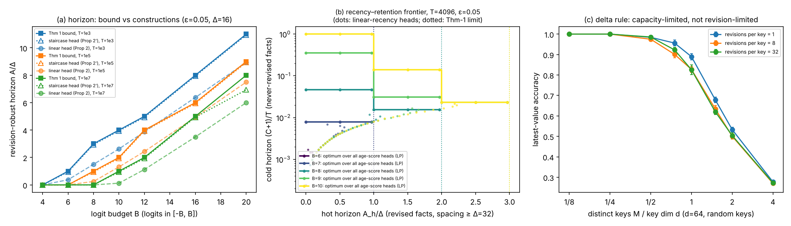
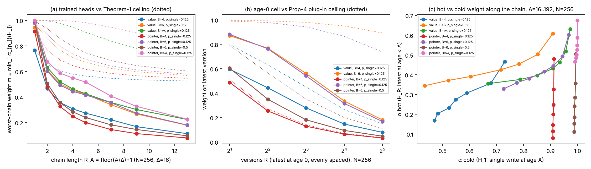
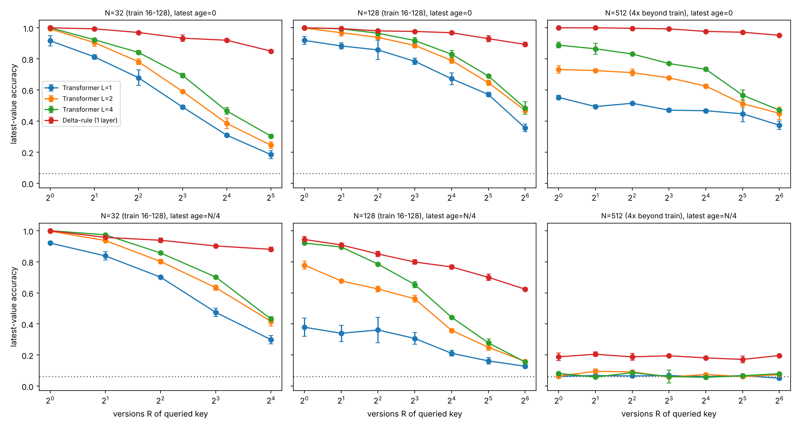

# Revision Costs Logit Range: A Recency–Retention Bound for Fixed-Query Softmax Readout of an Append-Only Context

**Target venue:** NeurIPS (main track; theory + controlled experiments)

**Revision r1.** Changes relative to the submitted version are listed point by point in `reviews/response_r1.md`.

---

## Abstract

Context windows of language models now hold hundreds of thousands of tokens, and a long context is often treated as a long-term memory. We study one specific, checkable reason why this equivalence can fail: memory must support *revision*. When a fact is updated, a read should return the newest version, and facts that were never updated should stay retrievable however old they are. An append-only context keeps every version, so the decision about which version is current has to be made at read time, by the attention scores. We analyse this decision for the simplest reader where it can be made precise: a single softmax head whose query depends only on the query token (A1). This is the setting of a one-layer model, or of the first attention layer of any model. Its logits lie in [−B, B] (A2). Its key-side features may be arbitrary causal functions of the prefix, with any positional scheme. Theorem 1 says the following. Suppose such a head puts weight at least 1−ε on the correct token, both for a never-revised fact at age A and for every revised fact whose versions are Δ apart and whose latest version is at age at most A−Δ. Then (⌊A/Δ⌋+1)·log((1−ε)/ε) ≤ 2B − log(T−1). Each version boundary therefore costs a fixed margin of logit range. At fixed B, the horizon over which a head can be both current and retentive does not grow with the window, and it shrinks as log T. When the value path is token-local, the same bound holds for retrieving the *value* (Corollary 2). The bound has three limits, which we state explicitly. It is a bound on selection margin: as ε → 1/2 the per-revision cost vanishes, so argmax decoding over well-separated values is limited only by attention dilution. It says nothing about a revised fact whose latest version is at age 0. And it does not survive dropping A1: we give a two-layer counting construction that escapes it. On the achievability side, a staircase-shaped age score meets the bound to within (R−1)·log(1+ε/(1−ε)) nats (Proposition 2′). An exact linear program gives the full trade-off between hot and cold horizons over all age-dependent score functions, and the hot horizon it reaches equals the Theorem-1 limit in every configuration we computed. For token-and-age heads, Proposition 4 adds an age-0 statement: retaining old facts forces a cost of log(R−1) on the latest version at age 0. A delta-rule memory avoids the revision cost entirely and is instead limited by state dimension (Proposition 3). In single-head models trained on CPU with known logit budgets, the bounds are never violated. Trained heads sit on the dilution ceiling for never-revised facts, and pointer-trained heads with a tight budget (B = 4) sit on the Proposition-4 age-0 ceiling. With looser budgets they choose shallow recency profiles far inside the Theorem-1 ceiling, while still decoding the correct value. Exploratory results for 1–4-layer Transformers are reported with confidence intervals. We do not attribute them to the theorem. Our answer to the title question is therefore narrow: for fixed-query softmax readout, window size is the wrong measure of revisable memory, and what bounds it is the logit margin per revision. Whether deep models escape this constraint in practice is left open.

## 中文摘要

语言模型的上下文窗口已达数十万 token，人们常把长上下文视为长期记忆。本文研究这一等价可能失效的一个具体、可检验的原因：记忆必须支持**修订**——事实更新后，读取应返回最新版本，而从未更新的事实无论多旧都应可检索。追加式上下文保留所有版本，“哪个版本是当前的”只能在读取时由注意力分数决定。我们在可以精确分析的最简单读出器上研究这一决策：单个 softmax 头，其查询只依赖查询 token（A1，即单层模型或任意模型的第一层注意力），logit 位于 [−B, B]（A2），键侧特征可以是前缀的任意因果函数、位置编码任意。定理 1 指出：若该头对“年龄为 A 的从未修订事实”以及“版本间隔为 Δ、最新版本年龄不超过 A−Δ 的所有修订事实”都把至少 1−ε 的权重放在正确 token 上，则 (⌊A/Δ⌋+1)·log((1−ε)/ε) ≤ 2B − log(T−1)：每个版本边界消耗固定的 logit 余量；在 B 固定时，既“最新”又“保持”的视野不随窗口增长，反而随 log T 缩小。若取值路径是 token 局部的，同一界对“取回值”也成立（推论 2）。我们明确说明其局限：这是**选择余量**的界——ε → 1/2 时每次修订的代价消失，对分离良好的值做 argmax 解码只受注意力稀释约束；它对最新版本年龄为 0 的情形不作断言；去掉 A1 后它不成立（我们给出逃逸它的两层计数构造）。在可达性方面，阶梯形年龄分数在 (R−1)·log(1+ε/(1−ε)) nats 内达到该界（命题 2′）；精确线性规划给出所有年龄打分函数下热/冷视野的完整前沿，在我们计算的所有配置中，其热视野恰好等于定理 1 的极限。对“token+年龄”型读出头，命题 4 给出年龄 0 处的界：保持旧事实迫使最新版本付出 log(R−1) 的代价。delta 规则记忆完全不付修订代价，而受状态维度限制（命题 3）。在 CPU 上训练、logit 预算已知的单头模型中，这些界从未被违反；训练得到的头在从未修订事实上贴合稀释上限，以选择目标训练且预算紧（B = 4）的头贴合命题 4 的年龄 0 上限；预算宽松时则选择平缓的新近性，远低于定理 1 上限，但仍能解码出正确值。1–4 层 Transformer 的结果作为探索性结果给出置信区间，不归因于定理。因此我们对标题问题的回答是限定性的：对固定查询的 softmax 读出，窗口大小不是衡量可修订记忆的正确量，起约束作用的是每次修订所需的 logit 余量；深层模型在实践中能否摆脱这一约束仍是开放问题。

---

## 1 Introduction

Context windows have grown from a few thousand tokens to hundreds of thousands. A natural reading of this trend is that the memory problem of language agents is being solved by brute force: if an assistant can keep a user's whole history in context, it would not need a separate memory system. Benchmarks question this reading. LongMemEval [Wu et al., 2025] reports that commercial chat assistants and long-context LLMs lose about 30% accuracy when information must be remembered across sustained interactions, and "knowledge updates" is one of its five core abilities. LoCoMo [Maharana et al., 2024] finds that LLMs struggle with temporal and causal structure over very long dialogues. Most directly, PI-LLM [Wang & Sun, 2025] streams semantically related key–value updates and queries only the final values. Retrieval accuracy declines log-linearly toward zero as updates accumulate, and the errors are retrievals of overwritten values.

These are empirical observations about specific models. They leave open which parts of the failure are structural properties of how softmax attention reads an append-only store. This paper isolates one such property in the simplest setting where it can be stated exactly. It also marks where that setting stops.

**The distinction.** A *store* keeps everything. A *memory* must also support **revision semantics**: after an update, reads return the new value, and never-updated facts stay retrievable. A context window is an append-only store, so "which version is current" must be decided at read time by attention scores. We ask what this decision costs a softmax readout, and how the cost interacts with retaining old facts.

**Contributions.** The theory is a short chain argument. It is related to known results on softmax dispersion [Veličković et al., 2025; Nakanishi, 2025] and on latest-write failures [Liu et al., 2023], and we regard it as an incremental but exact statement. What we add is (i) the precise form of the recency–retention interaction, (ii) matching achievability results and an exact frontier, and (iii) a direct test in trained heads whose logit budget is known.

1. **Recency–retention bound (Theorem 1, §4.1).** For a fixed-query softmax head with logits in [−B, B] and arbitrary causal key features, faithful selection of the current version over a chain of R = ⌊A/Δ⌋+1 versions, together with retention of a never-revised fact at age A, requires R·L_ε ≤ 2B − log(T−1), where L_ε = log((1−ε)/ε). Under a token-local value path the bound also covers value retrieval (Corollary 2). We state its limits explicitly: it is a margin bound (L_ε → 0 as ε → 1/2), it is silent at latest-age 0, and assumption A1 cannot be dropped (Remark 3, a two-layer counting construction).
2. **Achievability (§4.2).** A staircase age score is within (R−1)·log(1+ρ) nats of the bound (Proposition 2′), with ρ = ε/(1−ε). An exact linear program over all age-dependent score functions gives the complete hot/cold frontier. Its hot horizon equals the Theorem-1 limit in every configuration we computed, and holding a hot horizon of R−1 or more blocks drives the retained cold horizon from the whole window down to roughly the hot horizon (Fig. 1b). This replaces the one-parameter frontier of the submitted version, which was misleading.
3. **An age-0 statement for token-and-age heads (Proposition 4).** If old never-revised facts are retained, the weight on a latest version at age 0 with R−1 older versions is capped. The cap involves a log(R−1) term.
4. **Overwrite memory (Proposition 3).** A delta-rule memory with orthonormal keys has no revision cost, and its limit is capacity (Fig. 1c).
5. **A direct test in trained single heads (E3, §6.3).** The heads have known B and are trained on a distribution that covers the test structure. All bounds hold. Learned heads sit on the dilution ceiling for never-revised facts, and pointer-trained heads with tight B sit on the Proposition-4 ceiling. When B is loose they sit far below the Theorem-1 ceiling, yet decode values perfectly by plurality.
6. **Exploratory multi-layer results (E2, §6.4)**, reported with Wilson intervals and a training-distribution control. We do *not* attribute them to the theorem.

We do not claim that long-context models cannot be trained to act as memories. Deeper layers have history-dependent queries, and Remark 3 shows that they can escape the bound in principle.

## 2 Related Work

**Long-context evaluation.** Lost-in-the-middle effects show position-dependent use of context [Liu et al., 2024]. RULER finds that most models claiming windows of 32K tokens or more degrade well before their nominal length [Hsieh et al., 2024]. BABILong finds that popular LLMs effectively use only 10–20% of their context [Kuratov et al., 2024]. None of these isolates *revision*.

**Memory benchmarks and the update problem.** LongMemEval [Wu et al., 2025] and LoCoMo [Maharana et al., 2024] evaluate long-term conversational memory, including knowledge updates. PI-LLM [Wang & Sun, 2025] documents a log-linear decline in final-value retrieval as updates accumulate. Our results describe one mechanism (margin per version boundary in a fixed-query read) that is *compatible* with such declines. We do not claim it explains them: frontier models are deep, and Remark 3 shows that depth can circumvent the bound.

**Limits of softmax attention.** With bounded logits, softmax cannot stay sharp as the number of items grows. Veličković et al. [2025] call this dispersion, and Nakanishi [2025] calls it attention fading and proposes Scalable-Softmax, which multiplies logits by s·log n. Barbero et al. [2024] study the related problem of over-squashing. Liu et al. [2023] show that Transformers make sporadic "attention glitches" on flip-flop languages, where the latest write must be recalled. That is a single-register case of our task. Our Theorem 1 is the interaction of dispersion with recency: at R = 1 it reduces to the dispersion condition, and each additional version boundary consumes L_ε of the same budget.

**Position encodings.** ALiBi [Press et al., 2022] adds a linear recency penalty, and RoPE [Su et al., 2021/2024] encodes relative position by rotation. Both are covered by our score function, which may depend arbitrarily on age. Proposition 2′ shows that, for the revision task, a staircase age profile is near-optimal and a linear profile is not (Fig. 1a, b).

**Memory architectures.** The following models keep a fixed-size state that is overwritten rather than appended: fast weights [Ba et al., 2016], linear Transformers as fast-weight programmers with the delta rule [Schlag et al., 2021], DeltaNet [Yang et al., 2024], and Gated DeltaNet [Yang et al., 2025]. Infini-attention [Munkhdalai et al., 2024] and Titans [Behrouz et al., 2025] combine attention with a compressive or test-time-trained memory. Memorizing Transformers [Wu et al., 2022], RAG [Lewis et al., 2020] and MemGPT [Packer et al., 2023] manage memory outside the attention window. Modern Hopfield networks connect attention to associative memory [Ramsauer et al., 2021]. Zoology [Arora et al., 2024] and "Repeat After Me" [Jelassi et al., 2024] show that attention beats fixed-state models at in-context recall. Our results add one axis on which the ordering can flip, namely revision-consistent recall, and they show that the two families are limited by different resources. The complementary-learning-systems view [McClelland et al., 1995] makes the analogous point for biological memory.

## 3 Problem Setup

**Streams.** A history consists of T memory tokens x_1,…,x_T and then a query token x_{T+1} = query(κ). Each memory token is a write x_t = (k_t, v_t). The age of position t is a_t = T − t. Let t* be the position of the most recent write of κ. The answer is v_{t*}.

**Readout head.** A softmax head assigns each memory position a logit s_t and a weight α_t = e^{s_t}/Σ_u e^{s_u}. The logits take the form s_t = S(q, z_t, a_t), where z_t = f_t(x_1,…,x_t) is an arbitrary *causal* feature of the prefix and q = g(x_{T+1}). This allows any positional scheme, and it allows key features computed by arbitrarily deep causal networks (for example "this is the 3rd write of its key"). The assumptions are:

* **(A1) history-independent query.** This holds exactly for a single attention layer and for the first attention layer of any network, and it fails for later layers.
* **(A2) bounded logits,** |s_t| ≤ B. Only the spread 2B matters.
* **(A3) token-local value path** (used only for Corollary 2). The value vector at position t is a function of x_t alone. This holds in a single attention layer acting on token embeddings, when positional information enters only queries and keys, as with RoPE or relative biases.

**Faithful selection.** The head *ε-faithfully selects* on a history if α_{t*} ≥ 1−ε. We write L_ε = log((1−ε)/ε) and ρ = ε/(1−ε). We call a history *cold at age a* if κ is written exactly once, at age a. We call it *hot with spacing Δ and latest age a* if κ is written two or more times, with consecutive writes at least Δ apart and the latest write at age a. Let 𝓗(T, A, Δ) be the set of histories whose latest write of κ has age ≤ A and whose consecutive writes of κ are at least Δ apart. It contains both the cold and the hot histories up to age A.

## 4 Theory

### 4.1 The bound and what it does not say

**Theorem 1 (recency–retention bound).** Assume (A1) and (A2), and let A ≥ 0, Δ ≥ 1 and ε < 1/2. Suppose the head ε-faithfully selects on (a) every cold history at age A, and (b) every hot history with spacing ≥ Δ and latest age ≤ A − Δ. Then

  R·L_ε ≤ 2B − log(T − 1),  with R = ⌊A/Δ⌋ + 1.

In particular, the bound holds if the head is ε-faithful on all of 𝓗(T, A, Δ), which is the form stated in the submitted version.

*Proof.* Let p_j = T − A + (j−1)Δ for j = 1,…,R. These positions have ages A − (j−1)Δ ∈ [0, A]. Fix a filler: every position other than the p_j holds a fixed write of some key ≠ κ. Let H_j be the filler with κ written, with distinct values, at p_1,…,p_j. Then H_1 is cold at age A, and for j ≥ 2, H_j is hot with spacing Δ and latest age A − (j−1)Δ ≤ A − Δ.

*Causal consistency:* H_j and H_{j′} agree on positions 1,…,p_i whenever i ≤ min(j, j′). So z_{p_i}, the query (A1) and the ages agree, and σ_i := S(q, z_{p_i}, T − p_i) is the same in every H_j with j ≥ i.

*Chain:* In H_j (j ≥ 2), α_{p_j} ≥ 1−ε forces α_{p_{j−1}} ≤ ε, so σ_j − σ_{j−1} ≥ L_ε. Hence σ_1 ≤ σ_R − (R−1)L_ε ≤ B − (R−1)L_ε.

*Retention:* In H_1 every other logit is ≥ −B, so 1−ε ≤ e^{σ_1}/(e^{σ_1} + (T−1)e^{−B}), which gives σ_1 ≥ log(T−1) − B + L_ε.

Combining the two inequalities proves the claim. ∎

The proof gives a quantitative form that we test directly in §6.3. Let m = min_j α_{p_j}(H_j) be the worst weight along the chain, and let S be the logit spread over the chain histories. If m > 1/2, then R·log(m/(1−m)) ≤ S − log(T−1), so

  m ≤ m_ceil := 1 / (1 + exp(−(S − log(T−1))/R)).      (★)

If S ≤ log(T−1), then m ≤ 1/2.

**What the theorem does and does not say.**

* *It is a joint statement.* It does not say *which* history fails. A head can be perfect on all hot histories with latest age ≤ A − Δ and fail only on the cold fact. At A < Δ, only (a) remains, and the bound reduces to the dilution condition 2B ≥ log(T−1) + L_ε. **In particular, Theorem 1 predicts no revision cost for a latest version at age 0.** A steep recency profile retrieves such versions for any R, at the cost of retention. In the submitted version we presented an age-0 decline in trained Transformers as the theory's prediction. That was wrong, and we have withdrawn it (§6.4). Proposition 4 below gives the correct, much weaker, age-0 statement for a restricted class of heads.
* *It is a margin bound.* L_ε → 0 as ε → 1/2. Correct argmax decoding over orthogonal value codes only needs the correct value's mass to exceed each other value's mass, which is an ε-close-to-1/2 condition when values are distinct. That kind of decoding is therefore constrained only by dilution. The per-revision cost bites when downstream computation needs a clean read: for example when versions carry similar values (as in PI-LLM's semantically related updates), when values are averaged as quantities, or when logits are noisy. E3 confirms that trained heads can decode perfectly with small margins (§6.3).
* *Window size.* At fixed B the admissible R does not grow with T, and it shrinks by log(T)/L_ε. This "decreases with context length" statement holds **at fixed logit budget**. If B grows with T, Corollary 1 applies.

**Corollary 1 (log-scaled logits).** If B(T) = B₀ + (c/2)·log T, as in Scalable-Softmax, then R·L_ε ≤ 2B₀ + (c−1)·log T + log(T/(T−1)). The last term is the o(1) term. The number of revisions grows at most logarithmically in T.

**Corollary 2 (value retrieval).** Assume (A1)–(A3) and that at least R+1 distinct values exist. Define ε-faithful *value* retrieval as total weight ≥ 1−ε on positions whose value equals v_{t*}. Then the conclusion of Theorem 1 holds for value retrieval. *Proof.* In the chain of Theorem 1, choose the R versions with distinct values and filler values different from all of them. By (A3), the weight on value v_{t*} in H_j is then exactly α_{p_j}, so value-faithfulness on the chain equals token-faithfulness. ∎

This answers the reviewer's objection to the token-weight criterion (M2), but only under (A3). Without (A3), z_T may carry the current value of every key, since a delta-rule state is a causal feature. A head attending to position T then retrieves correctly while violating token-faithfulness. Theorem 1 is therefore a statement about *locating the current version in an append-only store by a fixed-query read*, not about arbitrary networks.

**Remark 3 (A1 cannot be dropped).** A two-layer construction escapes the bound. Layer 1, with uniform causal attention whose values are one-hot keys, plus an MLP, can compute two causal features: the index n_t of write t among the writes of its key, and, at the query position, the total count c of writes of κ. Layer 2 scores position t by B if (k_t = κ and n_t = c) and −B otherwise. This is a bilinear form in one-hot features of (key, index), with q built from (κ, c) and k_t from (k_t, n_t). Then faithfulness needs only 2B ≥ log(T−1) + L_ε, *for every R and every age*. The construction needs head dimension ≥ R_max and exact counting, which means resolving frequencies of order 1/T. So depth trades the logit budget for precision and dimension. We have not shown that trained models find such solutions. The point is that Theorem 1 says nothing about layers with history-dependent queries.

### 4.2 Achievability: the bound has the right form

**Proposition 2′ (staircase head).** Let the logit of a write of κ at age a be log U_k − B, where k = ⌊a/Δ⌋ < R and U_k = (T−1)(1+1/ρ)^{R−1−k}/ρ. Let the logit be −B for writes of κ at older ages and for every other position. If log(T−1) + L_ε + (R−1)·log(1+1/ρ) ≤ 2B, then this head ε-faithfully selects on every cold history and every hot history (spacing ≥ Δ) with age < RΔ.

*Proof.* Work in units u = e^{s+B} ∈ [1, e^{2B}]. On a history with N_old older versions, faithfulness reads ρ·u_{t*} ≥ (T−1) + Σ_{older}(u − 1). Older versions of a hot fact whose latest version is in block k lie in blocks > k, at most one per block, because they are ≥ Δ apart. So Σ_{older}(u−1) ≤ Σ_{m>k} U_m. Now ρU_k = (T−1) + Σ_{m>k} U_m holds by construction, since S_k := (T−1) + Σ_{m>k} U_m satisfies S_{k−1} = S_k(1 + 1/ρ). Cold histories need ρU_k ≥ T−1, which holds. Finally, U_0 ≤ e^{2B} is the stated condition. ∎

Theorem 1 requires R·L_ε ≤ 2B − log(T−1). The staircase reaches R·L_ε + (R−1)·log(1+ρ) ≤ 2B − log(T−1), a gap of (R−1)·log(1+ρ) nats with no further additive term. At ε = 0.05 that is 0.051 nats per revision against L_ε = 2.944. Numerically, the staircase attains the Theorem-1 horizon exactly in 14 of the 15 feasible (T, B) cells of E1a (Table 1, column "staircase").

**Proposition 2 (linear-recency head; kept for comparison).** Let the head have logit B − λa on writes of κ (clipped at −B) and −B elsewhere, with λ = c/Δ and c > log(1+1/ρ). It is ε-faithful for A ≤ (Δ/c)·[2B − log(T−1) − log(1/(ρ − g(c)))], where g(c) = e^{−c}/(1−e^{−c}). The multiplicative factor approaches L_ε/log(1+1/ρ) (0.98 at ε = 0.05) as c ↓ log(1+1/ρ). **However, the additive term log(1/(ρ − g(c))) diverges in that limit**, so the two cannot be optimized jointly. The submitted text hid this. The best linear head reaches only 50–83% of the bound (Table 1), and Proposition 2′ supersedes it.

**Exact frontier over all age-score heads (computational result).** Let the logit on a write of κ at age a be an arbitrary f(a) ∈ [−B, B], and let all other positions be at −B. In u-units, every faithfulness constraint is linear. The worst case over hot histories (a maximum over Δ-spaced placements of older versions) can be encoded exactly with dynamic-programming variables V_b ≥ max(V_{b+1}, u_b − 1 + V_{b+Δ}). Feasibility of "hot horizon A_h and cold horizon C" is therefore a linear program (`code/frontier_lp.py`). Every LP solution is re-verified by an exact worst-case evaluation.

**Proposition 3 (overwrite memory).** Consider the delta rule S ← S + (v − S k)kᵀ with β = 1 and orthonormal keys (M ≤ d). It returns v_{t*} exactly for every history. *Proof:* writing (κ, v) sets S k_κ = v, and writes of keys orthogonal to k_κ leave S k_κ unchanged. ∎ This is a textbook property [Schlag et al., 2021]. We include it only as the contrast case: with M > d keys, the limit becomes capacity (Fig. 1c).

**Proposition 4 (age-0 cost for token-and-age heads).** Suppose the logit of a write of κ depends only on the write token and its age, and that all logits lie in [−B, B]. Suppose further that cold histories at ages g, 2g, …, Mg are selected with weight odds o_c(jg) = α/(1−α). Then, in the hot history whose latest version is at age 0 and whose M older versions are at ages g, …, Mg, the odds on the latest version satisfy

  o_h ≤ e^{2B} / [ (T−1)·Σ_j o_c(jg) + (T−1−M) ].

In particular, uniform cold faithfulness 1−ε_c and hot faithfulness 1−ε_h together require 2B ≥ log(T−1) + log M + L_{ε_c} + L_{ε_h}.

*Proof.* In the cold history at age jg, every other logit is ≥ −B, so e^{f(jg)} ≥ o_c(jg)·(T−1)·e^{−B}. In the hot history, the older versions carry the same logits f(jg), because the score depends only on token and age. So e^{f(0)} = o_h·[Σ_j e^{f(jg)} + (rest)] ≥ o_h·[(T−1)e^{−B}·Σ_j o_c(jg) + (T−1−M)e^{−B}]. Use e^{f(0)} ≤ e^{B}. ∎

So a first-layer head that keeps old facts retrievable must pay log(R−1) at age 0. The cost is logarithmic in R, not linear like Theorem 1's cost in ⌊A/Δ⌋. It does not apply to heads whose key features carry history (a "first write of this key" feature escapes it), and so it does not apply to later layers. The submitted version had no such statement. We add it because it is the correct theoretical counterpart of the age-0 decline observed in trained heads (§6.3).

## 5 Experiments

All experiments ran on a shared 4-core CPU. Code is in `code/` and outputs are in `results/`. **Every number below is produced by the scripts named, from the files named.** The scripts write every field of their JSON outputs; the hand-added fields of the submitted JSON have been removed.

* **E1a, bound vs constructions** (`theory_sim.py`, under 10 s). ε = 0.05, Δ = 16, T ∈ {10³, 10⁵, 10⁷}, B ∈ {4,…,20}. The linear head (Prop. 2) is optimized over 400 slopes, using the closed-form worst-case weight and a binary search over A. For the staircase head (Prop. 2′), the R from the formula is verified by exact worst-case dynamic programming for T ≤ 10⁵.
* **E1b, exact frontier** (`frontier_lp.py`, about 35 s). T = 4096, Δ = 32, ε = 0.05, B ∈ {6,…,10}. For each hot horizon A_h, the maximal cold horizon C is found by LP (HiGHS) and binary search. Linear-recency and two-level step heads are evaluated under the same criteria.
* **E1c, delta-rule capacity** (`theory_sim.py`). d = 64, random unit keys, M ∈ {8,…,256}, R ∈ {1, 8, 32} revisions per key, 64 random unit value codes, 20 trials per point, ±1.96 s.e.
* **E3, trained single heads** (`e3_single_head.py`, `run_e3.sh`, `e3_prop4_check.py`, `e3_lp_reference.py`, `analyze_e3.py`). This is the theorem's exact setting: one head, query from the query token only (A1), a factorized token embedding (key embedding + value embedding, no mixing across positions), a content logit plus a learned bias for every age, logits clamped by B·tanh(·/B) with known B ∈ {4, 6} or unclamped (B = ∞, measured spread), and a token-local value path (A3) with a linear readout. The task has K = 32 keys and V = 32 values. Training streams have N ~ U{48,…,256}. The queried key gets R versions, where R−1 ~ U{1,…,7} with probability 1−p_single and R = 1 otherwise; the latest age is ~U[0, N−1] and the gaps are ~U{8,…,40}. Training therefore covers the test structure, and all test lengths (64, 128, 256) lie inside the training range. Two objectives are used: *value* (cross-entropy on the value) and *pointer* (value CE plus −log α_{t*}, which trains selection margin). Training: AdamW, learning rate 3·10⁻³, one-cycle schedule, batch 128, 4,000 steps. Evaluation follows the proof's chain: for N ∈ {64, 128, 256}, Δ = 16 and A ∈ {0, 16, …, 192}, we use 500 random instances of H_1,…,H_R with distinct values, record m, the per-instance spread S and the ceiling (★), and check (★) instance by instance. The Proposition-4 check evaluates saved clamped models at N ∈ {64, 128, 256} and R ∈ {2,…,32}, with older versions evenly spaced, using 400 streams per cold age and per hot cell.
* **E2, multi-layer Transformers and a delta-rule model** (`train_toy.py`, `analyze_toy.py`, `analyze_toy_r1.py`). These are the submitted models: 1/2/4-layer pre-LN RoPE Transformers with d = 64 and 4 heads, and a 1-layer, 4-head delta-rule model, all on a 16-key/16-value task with N ~ U{16,…,128}. Re-analysis pools the 300 evaluation streams of every seed and reports Wilson 95% intervals and a logistic trend test on log₂R. **New control:** 1-layer Transformers trained on an R-covering distribution (`--cover`: the queried key's count R ~ U{1,…,N/2}, positions uniform), evaluated identically.

## 6 Results

### 6.1 E1a: the bound is attained by a staircase head

*Figure 1.* (a) Theorem-1 bound on the revision-robust horizon (squares) vs the staircase head of Prop. 2′ (triangles) and the best linear-recency head of Prop. 2 (circles), at ε = 0.05 and Δ = 16. (b) Exact recency–retention frontier over all age-score heads (LP; T = 4096, Δ = 32, ε = 0.05). The x-axis is the hot horizon and the y-axis is the retained cold horizon. Dots are linear-recency heads and dotted verticals are the Theorem-1 limits. The curves for B = 6 and B = 7 coincide. (c) Delta-rule memory with random keys (d = 64): accuracy depends on M/d, not on the number of revisions (error bars ±1.96 s.e., 20 trials).

**Table 1.** Horizon A/Δ (`results/theory_sim.json`). Bound: Theorem 1 implies A/Δ < ⌊R_ub⌋. Staircase: R from Prop. 2′, which gives A/Δ = R − 1/Δ. Linear: best linear head.

| T | B | Thm-1 bound ⌊R_ub⌋ | staircase R | linear A/Δ |
|---|---|---|---|---|
| 10³ | 8 | 3 | 3 | 1.50 |
| 10³ | 12 | 5 | 5 | 3.88 |
| 10³ | 20 | 11 | 11 | 8.94 |
| 10⁵ | 12 | 4 | 4 | 2.44 |
| 10⁵ | 20 | 9 | 9 | 7.50 |
| 10⁷ | 12 | 2 | 2 | 1.13 |
| 10⁷ | 20 | 8 | 7 | 6.00 |

Over all 21 cells, the staircase matches ⌊R_ub⌋ in 14 of the 15 feasible cells (the exception is T = 10⁷, B = 20: 7 vs 8), and both are 0 in the 6 infeasible cells. Exact verification by worst-case dynamic programming succeeded for every feasible cell with T ≤ 10⁵. At fixed B the horizon shrinks with T: at B = 12 the bound falls from 5 at T = 10³ to 2 at T = 10⁷. The linear head reaches only 50–83% of the bound where the bound allows ≥ 3. The 50–83% figure is the one reported in the submitted version, and it reflected the weakness of the linear construction, not slack in the bound.

**Reproducibility.** The submitted `theory_sim.py` had two syntax errors, and its JSON carried hand-added fields. The fixed script reproduces every E1a number of the submitted version exactly, and it now runs in about 8 s because the worst-case weight is computed in closed form.

### 6.2 E1b: the exact recency–retention frontier

The frontier over all age-score heads (Fig. 1b, `results/frontier_lp.json`) looks as follows:

* **The hot horizon reaches the Theorem-1 limit exactly** for every B. The LP-feasible A_h is 31, 31, 63, 95, 95 for B = 6, 7, 8, 9, 10, and Theorem 1 allows A_h ≤ Δ⌊R_ub⌋ − 1 = 31, 31, 63, 95, 95. For token-and-age heads, the bound is therefore tight at Δ resolution.
* **Retention collapses as the hot horizon grows.** At B = 10, a hot horizon below one spacing (A_h ≤ 31) is compatible with retaining never-revised facts at *every* age (C = 4095). At A_h ∈ [32, 63], retention drops to C = 575. At A_h ∈ [64, 95], it drops to C = 95. At B = 9 the corresponding values are C = 1439, 127, 95, and at B = 8 they are C = 191, 63, then infeasible. The trade-off sharpens with each additional block of Δ that must be kept current.
* **Linear-recency heads lie far inside the frontier.** At B = 10 the best linear head has hot horizon 71 (vs 95), and no linear head with a non-empty hot horizon retains cold facts beyond age 87 (vs 4095 on the frontier). The submitted Fig. 1b described the frontier as "essentially a corner". That shape came from this restricted family and from the α ≥ 0.5 criterion, and it was wrong. The reviewer's two-level step head (logit 10 for age < 24, −1.6 otherwise) has hot horizon 23 and retains cold facts at every age under the α ≥ 1/2 criterion (C = 4095; `reviewer_step_head_eps_half`). That reproduces the reviewer's observation: at ε = 1/2 the trade-off in that configuration does not bind.

**E1c, delta-rule capacity (Fig. 1c).** With random keys and d = 64, latest-value accuracy is 1.00 at M = 8 for R = 1, 8 and 32 revisions per key. It is 0.89/0.83/0.83 at M = d and 0.28/0.27/0.27 at M = 4d. The limit is set by M/d, and the number of revisions matters little.

### 6.3 E3: trained single heads with a known logit budget

*Figure 3.* E3, N = 256. (a) Worst-chain weight m (mean over seeds; bars show the min–max over seeds) against chain length R_A, with the Theorem-1 ceiling (★) dotted. (b) Weight on a latest version at age 0 with R−1 evenly spaced older versions, with the Proposition-4 plug-in ceiling dotted (clamped models). (c) Hot weight α on H_R against cold weight α on H_1 along the chain.

The full tables are in `results/e3_tables.md`, with per-cell values in `results/e3_summary.json`. Configurations and seeds: value objective with B = 4 (1 seed), B = 6 (2 seeds) and B = ∞ (1 seed); pointer objective with p_single = 0.125 and B ∈ {4, 6, ∞} (3 seeds each); pointer objective with B = 6 and p_single = 0.5 (2 seeds). Brackets give the min–max over seeds. Seed-to-seed spread of m is ≤ 0.02 in every cell, but configurations with a single seed should be read as single runs.

**Table 2. Chain test at N = 256, Δ = 16.** m is the worst weight along the chain, "ceiling" is (★) evaluated with the measured spread S, and "LP (all ages)" is the best worst-case weight that *any* age-score head with the same B can reach while also selecting never-revised facts at *every* age (`results/e3_lp_reference.json`; "≤0.5" means even ε = 1/2 is infeasible). Accuracy is argmax value accuracy on the hot history H_R and on the cold history H_1.

| config | R_A (A) | m | Thm-1 ceiling (★) | LP (all ages) | acc hot | acc cold |
|---|---|---|---|---|---|---|
| value, B=4 | 2 (16) | 0.47 | 0.65 | ≤0.5 | 0.93 | 1.00 |
| value, B=4 | 4 (48) | 0.31 | 0.58 | ≤0.5 | 0.90 | 1.00 |
| value, B=6 | 2 (16) | 0.61 [0.60,0.61] | 0.86 | 0.87 | 1.00 | 1.00 |
| value, B=6 | 4 (48) | 0.45 [0.45,0.46] | 0.71 | 0.68 | 1.00 | 1.00 |
| value, B=6 | 7 (96) | 0.34 [0.34,0.34] | 0.62 | 0.53 | 1.00 | 1.00 |
| value, B=∞ | 4 (48) | 0.46 | 0.95 | – | 1.00 | 1.00 |
| pointer, B=4, p_single=0.125 | 2 (16) | 0.48 [0.48,0.48] | 0.77 | ≤0.5 | 0.52 | 1.00 |
| pointer, B=4, p_single=0.125 | 4 (48) | 0.25 [0.25,0.25] | 0.65 | ≤0.5 | 0.30 | 1.00 |
| pointer, B=6, p_single=0.125 | 2 (16) | 0.60 [0.60,0.61] | 0.89 | 0.87 | 1.00 | 1.00 |
| pointer, B=6, p_single=0.125 | 4 (48) | 0.44 [0.44,0.45] | 0.74 | 0.68 | 1.00 | 1.00 |
| pointer, B=6, p_single=0.125 | 7 (96) | 0.36 [0.35,0.36] | 0.64 | 0.53 | 1.00 | 1.00 |
| pointer, B=6, p_single=0.5 | 2 (16) | 0.50 [0.50,0.51] | 0.93 | 0.87 | 0.56 | 1.00 |
| pointer, B=6, p_single=0.5 | 4 (48) | 0.28 [0.28,0.28] | 0.80 | 0.68 | 0.47 | 1.00 |
| pointer, B=∞, p_single=0.125 | 4 (48) | 0.55 [0.54,0.56] | 0.99 | – | 1.00 | 1.00 |

We draw five findings.

1. **The bounds are never violated.** Inequality (★) holds in all 135,000 evaluated chain instances, across 16 trained heads, 3 lengths and 6–8 chain lengths each. The Proposition-4 plug-in ceiling holds in every (model, N, R) cell. Since these are theorems, this is a check of the code and of the setup, not evidence for the theory.
2. **For never-revised facts, trained heads sit on the dilution ceiling.** At R = 1 and A = 0, the measured weight equals the ceiling 1/(1+(N−1)e^{−S}) to within 0.01 for the clamped heads, and it falls with N as predicted. For example, value B = 4 gives 0.925/0.866/0.765 against ceilings of 0.930/0.872/0.772 at N = 64/128/256, and pointer B = 4 matches its ceilings to three decimals. This is the R = 1 corner of Theorem 1, and learned heads use their full budget there.
3. **For R ≥ 2, trained heads sit well inside the Theorem-1 ceiling.** Much of the gap comes from the retention requirement in training, not from the bound being loose. The ceiling (★) refers to the chain family only. Once cold facts must also be selected at every age, as the training distribution demands, the best achievable worst-case weight for age-score heads falls to 0.87/0.68/0.53 at B = 6 for R_A = 2/4/7, and to ≤ 0.5 at B = 4 (LP column). The B = 6 heads reach 0.60/0.44/0.36 against that reference. So they are not on the exact frontier, but they are at 65–70% of it.
4. **The objective's mixture moves heads along the recency–retention trade-off.** For pointer heads at B = 6, raising the share of never-revised training facts from p_single = 0.125 to 0.5 raises the cold weight at age 48 from 0.91 to 0.99 and lowers the hot weight from 0.44 to 0.28. Hot accuracy falls from 1.00 to 0.47 (Fig. 3c). At B = 4, all three pointer seeds converge to an essentially recency-free head: cold weight 0.91 at every age, and hot weight ≈ 1/R. Proposition 4 shows this is not an optimization failure. Given a cold weight of 0.91 at all ages, the age-0 weight on the latest of R versions cannot exceed 0.51/0.27/0.14/0.07/0.04 for R = 2/4/8/16/32, and the heads attain 0.49/0.25/0.13/0.07/0.03 (Fig. 3b).
5. **Correct decoding needs far less margin than selection.** Value-trained heads with B ≥ 6 decode the correct value in 100% of hot and cold chain histories, although the weight on the current version is only 0.34–0.61. This is the ε → 1/2 regime, where Theorem 1 imposes only dilution. It is also why the revision cost is invisible in argmax accuracy on this task. With B = 4, value heads lose some hot accuracy (0.93 → 0.81 from R_A = 2 to 13), and pointer heads at B = 4, or at B = 6 with p_single = 0.5, lose most of it.

**The age-0 cell.** The weight on a latest version at age 0 falls steeply with R in every head, for example from 0.88 to 0.17 (R = 2 → 32, pointer B = 6, N = 256, evenly spaced versions). For heads whose budget is tight relative to their cold retention (pointer B = 4; value B = 4, and pointer B = 6 with p_single = 0.5, within 0.06–0.21), this decline tracks the Proposition-4 ceiling (Fig. 3b). For pointer B = 6 with p_single = 0.125, the ceiling is far above the measured weight (0.74 vs 0.17 at R = 32), so the decline there is a property of the learned shallow recency profile, not a forced one. Argmax accuracy at age 0 with uniformly placed versions, the E2 protocol, falls in the same way: R = 32 gives 0.66 (value B = 6) and 0.12 (pointer B = 4).

### 6.4 E2: multi-layer models (exploratory; not attributed to the theorem)

*Figure 2.* Submitted E2 models: latest-value accuracy vs the number of versions R (top row: latest at age 0; bottom row: latest at age N/4). Error bars show the s.d. over seeds; Table 3 gives Wilson intervals on pooled streams.

These are the submitted models, re-analysed with each seed's 300 evaluation streams pooled (600–900 streams per cell). Values are accuracy with a Wilson 95% interval. The trend column is a logistic-regression slope of correctness on log₂R with its Wald p-value (`results/e2_r1_tables.md`, `results/e2_r1_stats.json`). The 1-layer R-covering control has 2 seeds; it was trained on the original 16-key task, with R ~ U{1,…,N/2} for the queried key.

**Table 3. Latest version at age 0, N = 128.**

| model | seeds | R=1 | R=4 | R=16 | R=64 | slope on log₂R (p) |
|---|---|---|---|---|---|---|
| Transformer L=1 | 3 | 0.92 [0.90,0.93] | 0.86 [0.83,0.88] | 0.67 [0.64,0.70] | 0.36 [0.32,0.39] | −0.51 (4e-189) |
| Transformer L=1, R-covering training | 2 | 0.94 [0.91,0.95] | 0.90 [0.88,0.92] | 0.85 [0.82,0.87] | 0.77 [0.73,0.80] | −0.25 (5e-25) |
| Transformer L=2 | 2 | 1.00 [0.99,1.00] | 0.94 [0.92,0.95] | 0.79 [0.76,0.82] | 0.47 [0.43,0.51] | −0.75 (5e-132) |
| Transformer L=4 | 2 | 1.00 [0.99,1.00] | 0.96 [0.95,0.98] | 0.83 [0.80,0.86] | 0.48 [0.44,0.52] | −0.89 (2e-126) |
| Delta-rule | 2 | 1.00 [0.99,1.00] | 0.98 [0.97,0.99] | 0.97 [0.95,0.98] | 0.89 [0.87,0.92] | −0.58 (3e-24) |

**Table 4. Never-revised fact (R = 1) by age, N = 128.**

| model | age 0 | age N/4 | age N/2 | age 0.95N |
|---|---|---|---|---|
| Transformer L=1 | 0.92 [0.90,0.93] | 0.38 [0.35,0.41] | 0.13 [0.11,0.15] | 0.14 [0.12,0.17] |
| Transformer L=1, R-covering training | 0.94 [0.91,0.95] | 0.13 [0.11,0.16] | 0.11 [0.09,0.14] | 0.25 [0.22,0.29] |
| Transformer L=4 | 1.00 [0.99,1.00] | 0.92 [0.90,0.94] | 0.27 [0.24,0.31] | 0.25 [0.21,0.28] |
| Delta-rule | 1.00 [0.99,1.00] | 0.94 [0.92,0.96] | 0.64 [0.60,0.68] | 0.23 [0.19,0.26] |

**What we withdraw.** Each of the following claims in the submitted version is withdrawn.

* (i) That the age-0 decline in R is "the signature" predicted by Theorem 1. Theorem 1 predicts nothing at age 0 (§4.1).
* (ii) The revision-spacing (Δ) effect inferred by comparing N = 32 with N = 128 at fixed R. That comparison is confounded by training/test shift: under training, P(R ≥ 16 | N = 32) ≈ 10⁻¹¹.
* "Monotone in R at every depth and length". This is false for L = 1 at N = 512 and for the delta model at N = 512.
* All N = 512 claims, including "never-revised fact at chance". At N = 512 even R = 1 at age 0 is only 0.55 for L = 1, so length extrapolation confounds these cells.
* That the delta model is "almost flat" in R. Its decline is much shallower, but it is statistically clear (Table 3).

**What the control shows.** For the 1-layer model, most of the age-0 decline at N = 128 was training-distribution shift. With R-covering training, accuracy at R = 64 rises from 0.36 to 0.77, and the slope halves (−0.51 → −0.25). However, the same control **loses retention**: a never-revised fact at age N/4 drops from 0.38 to 0.13 (Table 4). This trade is qualitatively the one that Theorem 1 and the LP frontier describe, and it mirrors the p_single shift of E3. A 4-head model with an MLP readout is outside our theory, so we do not quantify it. The 2- and 4-layer models also decline with R at age 0 and at age N/4. Their logit spreads (max over heads: 11.3/8.3/6.4 for L = 1/2/4) cannot be used quantitatively, because their final-layer queries are history-dependent. We therefore report these results only as observations that motivate the protocol in §7.

## 7 A Falsifiable Protocol for Open-Weight Models

We did not run this protocol (we have no model access). It tests the *first-layer* statements, the only ones our theory covers, and it probes whether deeper layers escape them.

**P1 (first-layer chain test).** On PI-LLM-style streams [Wang & Sun, 2025], build the chain H_1,…,H_R of Theorem 1 (fixed filler, distinct values, positions A−(j−1)Δ). For every first-layer head that attends to the queried key, record m, the spread S and the ceiling (★). Prediction: (★) holds for every head, since it is a theorem; the empirical question is how close retrieval heads come to it.

**P2 (where depth helps).** Using the same chains, compare final-answer correctness with first-layer selection margins. If answers stay correct for R·L_ε well beyond S − log T at all first-layer heads, later layers are resolving recency through history-dependent queries (as in Remark 3). Activation patching on the query position can then identify which layer carries the count or position information.

**P3 (margin-sensitive decoding).** Use semantically similar versions, or numeric values whose mixtures are wrong, so that a soft read with small margin gives a wrong answer. Theorem 1 predicts that first-layer-only readout degrades in R at A > 0 in this regime, but not in the distinct-value regime.

## 8 Discussion

**The answer to the title question, at the precision we can defend.** A context window guarantees *availability*. Memory also needs *currency* (reads reflect updates) and *retention* (old facts survive). For a fixed-query softmax read, Theorem 1 shows that currency and retention draw on one logit budget. Each version boundary costs L_ε, and window size enters only through log(T−1), against the reader. In this sense, a long context is not a revisable long-term memory *by virtue of its length*. We do **not** claim that deep long-context models cannot act as memories. Remark 3 shows that history-dependent queries can escape the bound, at the cost of precision and dimension. Whether trained deep models do so is an open empirical question, and §7 proposes how to test it.

**Design implications.**

* *Positional profiles.* For revision-consistent reads, staircase age profiles (piecewise-constant in age blocks, as in bucketed relative-position biases) dominate linear ones such as ALiBi (Prop. 2′ and Fig. 1b).
* *Explicit overwrite semantics.* Delta-rule or gated-delta layers [Yang et al., 2024; 2025], and key→latest-value stores in agent scaffolds [Packer et al., 2023], move the version decision from read time to write time. Their limit is capacity rather than margin (Prop. 3, Fig. 1c).
* *Evaluation.* NIAH-style tests measure only the R = 1 corner. Revision-aware evaluations should report accuracy jointly over R, latest age and T, and should include margin-sensitive variants (P3), because argmax accuracy with distinct values hides the margin cost (E3).

## 9 Limitations

* **Scope of the theory.** Theorem 1 and Proposition 4 cover one softmax head with a history-independent query (A1). Corollary 2 also needs a token-local value path (A3). Multi-head mixtures and multi-layer models with history-dependent queries are not covered, and Remark 3 shows they can escape the bound. The theorem is short and builds on known dispersion arguments. Its novelty is the exact recency–retention form and the matching achievability results.
* **Margin, not accuracy.** The per-revision cost vanishes as ε → 1/2. With distinct, well-separated values, argmax decoding is limited only by dilution, and the trained heads of E3 decode correctly with small margins. The bound is relevant where clean selection matters. We have argued that this includes similar versions, averaged quantities and noisy logits, but we have not shown it on natural data.
* **Proposition 4 is a plug-in comparison.** It uses the mean measured cold odds, while the inequality holds per score function. Value-dependent content logits make the comparison approximate.
* **E3 scale.** E3 uses tiny single-head models (d = 64), one task and N ≤ 256, with 1–3 seeds per configuration (`results/e3_summary.json` lists the seed counts). The grid was reduced because the CPU was shared with other jobs.
* **E2 confounds.** The multi-layer results are confounded by training/test distribution shift (partly controlled by the R-covering run), by RoPE length extrapolation at N = 512, and by multi-head mixing and MLP readouts. We report them as exploratory only.
* **No frontier-model experiments.** The protocol in §7 has not been executed.
* **Delta-rule assumptions.** Proposition 3 assumes orthonormal keys and β = 1. The trained delta model's per-head dimension (16) equals K = 16, which is the edge of that regime, and its readout also receives the query embedding through a skip connection.

## 10 Conclusion

For a fixed-query softmax read of an append-only context, keeping facts current and keeping old facts retrievable draw on the same logit budget. Each version boundary costs log((1−ε)/ε), and window size only adds dilution. A staircase head attains this bound up to log(1+ρ) per revision, and an exact LP shows how sharply retention collapses as the hot horizon grows. Trained single heads with known budgets obey the bounds. They sit on the dilution ceiling for never-revised facts and, with a tight budget and a selection objective, on the age-0 ceiling, and they otherwise trade margin for retention while still decoding correctly. These statements cover first-layer reads. Whether depth escapes them in trained models is the main open question, and it is directly testable.

## References

- Arora, S., Eyuboglu, S., et al. (2024). Zoology: Measuring and Improving Recall in Efficient Language Models. ICLR 2024. arXiv:2312.04927.
- Ba, J., Hinton, G. E., Mnih, V., Leibo, J. Z., Ionescu, C. (2016). Using Fast Weights to Attend to the Recent Past. NeurIPS 29. arXiv:1610.06258.
- Barbero, F., Banino, A., Kapturowski, S., Kumaran, D., Araújo, J. G. M., Vitvitskyi, A., Pascanu, R., Veličković, P. (2024). Transformers Need Glasses! Information Over-squashing in Language Tasks. NeurIPS 2024. arXiv:2406.04267.
- Behrouz, A., Zhong, P., Mirrokni, V. (2025). Titans: Learning to Memorize at Test Time. arXiv:2501.00663.
- Hsieh, C.-P., Sun, S., Kriman, S., Acharya, S., Rekesh, D., Jia, F., Zhang, Y., Ginsburg, B. (2024). RULER: What's the Real Context Size of Your Long-Context Language Models? COLM 2024. arXiv:2404.06654.
- Jelassi, S., Brandfonbrener, D., Kakade, S. M., Malach, E. (2024). Repeat After Me: Transformers are Better than State Space Models at Copying. ICML 2024. arXiv:2402.01032.
- Kuratov, Y., Bulatov, A., Anokhin, P., Rodkin, I., Sorokin, D., Sorokin, A., Burtsev, M. (2024). BABILong: Testing the Limits of LLMs with Long Context Reasoning-in-a-Haystack. NeurIPS 2024 Datasets and Benchmarks. arXiv:2406.10149.
- Lewis, P., Perez, E., Piktus, A., Petroni, F., Karpukhin, V., Goyal, N., Küttler, H., Lewis, M., Yih, W., Rocktäschel, T., Riedel, S., Kiela, D. (2020). Retrieval-Augmented Generation for Knowledge-Intensive NLP Tasks. NeurIPS 33.
- Liu, B., Ash, J. T., Goel, S., Krishnamurthy, A., Zhang, C. (2023). Exposing Attention Glitches with Flip-Flop Language Modeling. NeurIPS 2023. arXiv:2306.00946.
- Liu, N. F., Lin, K., Hewitt, J., Paranjape, A., Bevilacqua, M., Petroni, F., Liang, P. (2024). Lost in the Middle: How Language Models Use Long Contexts. Transactions of the ACL 12. doi:10.1162/tacl_a_00638.
- Maharana, A., et al. (2024). Evaluating Very Long-Term Conversational Memory of LLM Agents. ACL 2024. arXiv:2402.17753.
- McClelland, J. L., McNaughton, B. L., O'Reilly, R. C. (1995). Why There Are Complementary Learning Systems in the Hippocampus and Neocortex: Insights From the Successes and Failures of Connectionist Models of Learning and Memory. Psychological Review 102(3), 419–457.
- Munkhdalai, T., Faruqui, M., Gopal, S. (2024). Leave No Context Behind: Efficient Infinite Context Transformers with Infini-attention. arXiv:2404.07143.
- Nakanishi, K. M. (2025). Scalable-Softmax Is Superior for Attention. arXiv:2501.19399.
- Packer, C., Wooders, S., Lin, K., Fang, V., Patil, S. G., Stoica, I., Gonzalez, J. E. (2023). MemGPT: Towards LLMs as Operating Systems. arXiv:2310.08560.
- Press, O., Smith, N. A., Lewis, M. (2022). Train Short, Test Long: Attention with Linear Biases Enables Input Length Extrapolation. ICLR 2022.
- Ramsauer, H., Schäfl, B., Lehner, J., Seidl, P., Widrich, M., Gruber, L., Holzleitner, M., Adler, T., Kreil, D., Kopp, M. K., Klambauer, G., Brandstetter, J., Hochreiter, S. (2021). Hopfield Networks is All You Need. ICLR 2021.
- Schlag, I., Irie, K., Schmidhuber, J. (2021). Linear Transformers Are Secretly Fast Weight Programmers. ICML 2021, PMLR 139. arXiv:2102.11174.
- Su, J., Lu, Y., Pan, S., Murtadha, A., Wen, B., Liu, Y. (2021). RoFormer: Enhanced Transformer with Rotary Position Embedding. arXiv:2104.09864 (journal version: Neurocomputing, 2024).
- Veličković, P., Perivolaropoulos, C., Barbero, F., Pascanu, R. (2025). Softmax is not Enough (for Sharp Size Generalisation). ICML 2025, PMLR 267:61190–61211. arXiv:2410.01104.
- Wang, C., Sun, J. V. (2025). Unable to Forget: Proactive Interference Reveals Working Memory Limits in LLMs Beyond Context Length. arXiv:2506.08184.
- Wu, D., Wang, H., Yu, W., Zhang, Y., Chang, K.-W., Yu, D. (2025). LongMemEval: Benchmarking Chat Assistants on Long-Term Interactive Memory. ICLR 2025. arXiv:2410.10813.
- Wu, Y., Rabe, M. N., Hutchins, D., Szegedy, C. (2022). Memorizing Transformers. ICLR 2022. arXiv:2203.08913.
- Yang, S., Wang, B., Zhang, Y., Shen, Y., Kim, Y. (2024). Parallelizing Linear Transformers with the Delta Rule over Sequence Length. NeurIPS 2024. arXiv:2406.06484.
- Yang, S., Kautz, J., Hatamizadeh, A. (2025). Gated Delta Networks: Improving Mamba2 with Delta Rule. ICLR 2025. arXiv:2412.06464.
