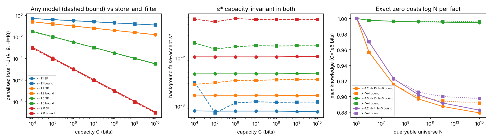
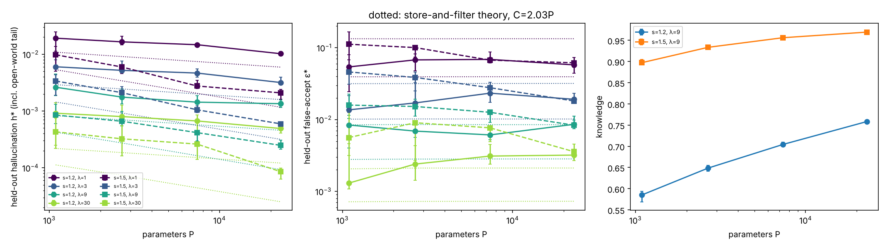

# The Bit Price of Abstention: Capacity Rates for Hallucination on Arbitrary Facts under Penalized Grading

**Target venue:** NeurIPS 2027 (Main Track; theory + controlled small-scale experiments)
**Revision:** round 1 (changes are listed point by point in `reviews/response_r1.md`)

---

## Abstract

Can hallucination be eliminated in principle? For arbitrary (incompressible) facts, the yes/no part of this question already has an answer. Exact membership testing over an unbounded universe needs unbounded memory, so a finite closed-book model that answers anything must falsely accept some unknown queries. Guo & Li (ICML 2026) show this for the membership-testing view of hallucination, and it goes back to Bloom-filter lower bounds. We take that answer as given and ask the quantitative question that penalized grading raises (Kalai et al., 2025). Under +1/0/−λ scoring, Zipf(s)-distributed queries and a capacity of C bits, how fast can hallucination fall with C and λ, and how much capacity does abstention consume? Our results are as follows. (1) **An information relaxation for arbitrary models (Theorem 3).** For any model, learner and architecture with at most B bits of entropy, the per-fact KL divergences between its answer/abstain/wrong outcome distribution and the outcome distribution on a fresh key sum to at most B. This gives a rigorous floor for any B-bit model with background false-accept rate ε: h ≥ (q/2)·U(B/(0.221q)), where q = ε(1−1/V) (Corollary 2). It also gives a convex upper bound on the penalized score of every C-bit model. (2) **Rates.** In the continuum limit the best penalized loss of any C-bit model is κ·C^−(s−1). Its optimal background false-accept rate ε* does not depend on C (Proposition 4; it matches the exact discrete bound to 4 significant digits). A simple store-and-filter construction comes within a factor 1.003–1.53 of this loss. Any C-bit model with the knowledge of that construction must hallucinate at least 1/7.5 to 1/2.6 as much as it does, with the same C^−(s−1) slope. Hence bigger models become more knowledgeable at fixed selectivity, not more selective. In the store-and-filter solution, 17–77% of capacity goes to the abstention filter. (3) **Experiments (CPU, small MLPs).** In a 2^20-fact Zipf world with an untrained tail, 144 networks were trained over 6 seeds, with held-out operating-point selection and measured open-world hallucination. The held-out hallucination falls with parameter count with slopes of −0.20 to −0.21 at s = 1.2 (predicted −0.20) and −0.41 to −0.58 at s = 1.5 (predicted −0.50). The difference between the two exponents is −0.20 to −0.38 (predicted −0.30), and its 95% CIs exclude 0. At s = 1.2, ε* shows no detectable trend with size, as predicted. At s = 1.5 it falls with size (slopes −0.16 to −0.31), which partly contradicts the prediction. We read this as small networks being inefficient filters. **Practical caveat:** "irreducible" is a statement about exact zero. In the same model, hallucination can be driven from 0.15 to 1.6×10^−13 for about 2.6 points of knowledge (s = 1.1, H = 10, C = 10^9 bits). Our answer to the title question is that hallucination on arbitrary facts cannot be removed by a finite closed-book model. It can be made negligible at a quantified capacity price, and it can be removed only by moving the membership test outside the model (retrieval or verification).

## 中文摘要

幻觉能否从根本上消除？对任意（不可压缩）事实而言，"能否"这一部分已有答案：在无界键空间上做精确成员判定需要无界存储，因此任何能回答问题的有限闭卷模型都必然误接受部分未知问题（Guo & Li, ICML 2026 在幻觉的成员判定视角下证明了这一点，其根源是 Bloom 过滤器下界）。本文以此为前提，研究惩罚评分（Kalai et al., 2025）提出的定量问题：在 +1/0/−λ 评分、Zipf(s) 查询分布与 C 比特容量下，幻觉随 C 与 λ 下降得多快？弃答消耗多少容量？（1）**任意模型的信息松弛（定理3）**：对任何熵不超过 B 比特的模型（任意学习算法与架构），各事实上"回答正确/弃答/答错"结果分布相对于新鲜键上结果分布的 KL 散度之和不超过 B。由此得到对任何背景误接受率为 ε 的 B 比特模型都成立的严格下界 h ≥ (q/2)·U(B/(0.221q))，q = ε(1−1/V)（推论2），以及对所有 C 比特模型惩罚得分的凸上界。（2）**速率**：在连续极限下，任意 C 比特模型的最优惩罚损失为 κ·C^−(s−1)，且其最优背景误接受率 ε* 与 C 无关（命题4，与离散精确界在4位有效数字上一致）；简单的"存储+过滤"构造达到该损失的 1.003–1.53 倍；任何知识量与之相同的 C 比特模型，其幻觉率至少为该构造的 1/7.5 到 1/2.6，且斜率同为 C^−(s−1)。因此，更大的模型是在固定选择性下知道得更多，而不是变得更有选择性；在"存储+过滤"解中，17–77% 的容量用于弃答过滤器。（3）**实验（CPU，小型 MLP）**：在含 2^20 个事实并带有未训练尾部的 Zipf 世界中训练 144 个网络（6 个种子），采用留出法选择工作点，并测量开放世界幻觉。留出幻觉率随参数量的斜率在 s = 1.2 时为 −0.20 至 −0.21（预测 −0.20），在 s = 1.5 时为 −0.41 至 −0.58（预测 −0.50）；两者之差为 −0.20 至 −0.38（预测 −0.30，95% 置信区间不含 0）。s = 1.2 时 ε* 未随规模出现可检测的变化（符合预测）；s = 1.5 时 ε* 随规模下降（斜率 −0.16 至 −0.31），与预测部分矛盾，我们将其解释为小网络是低效的过滤器。**实际意义上的说明**："不可消除"指的是不能精确为零：在同一模型中，只需约 2.6 个百分点的知识量，就能把幻觉率从 0.15 降到 1.6×10^−13（s = 1.1，H = 10，C = 10^9 比特）。我们的回答是：任意事实上的幻觉不能被有限闭卷模型消除，但能以可量化的容量代价降到可忽略的水平；只有把成员判定移到模型之外（检索或验证）才能真正消除。

---

## 1 Introduction

"Can hallucination be fundamentally eliminated?" Answers fall into three groups. Computability arguments (Xu et al., 2024; Banerjee et al., 2024) show that some computable ground truth defeats every computable model. That is true, but it says little about factual recall. Statistical arguments (Kalai & Vempala, 2024; Kalai et al., 2025) tie hallucination to the Good-Turing mass of rarely seen facts and to binary grading that rewards guessing. Their suggested fix is to penalize wrong answers so that abstaining becomes optimal under uncertainty. Suzuki et al. (2025) argue that hallucination, though inevitable in general, can be made statistically negligible. Finally, **capacity** arguments treat factual memory as approximate membership testing. Guo & Li (2026) prove a rate-distortion theorem for membership testing. In that theorem, optimal memory efficiency is set by a KL divergence between score distributions on facts and non-facts, and at limited capacity it is optimal to give high confidence to some non-facts rather than abstain. Eliminating false positives on random facts is therefore very costly. Wang, Xu & Guo (2026) split closed-book factual error under a B-bit budget into a compression-distortion term and a missing-coverage term.

Our starting point is therefore not "is hallucination irreducible?" For arbitrary facts in an open world the answer is a classical consequence of approximate-membership lower bounds (Carter et al., 1978), and it is established for hallucination by Guo & Li (2026). Our Corollary 1 restates it, and we do not claim it as new. We ask the quantitative question left open by the penalized-grading remedy:

> *Under +1 / 0 / −λ grading, with Zipf(s)-distributed queries over an infinite set of arbitrary facts, what is the best hallucination–knowledge trade-off of any C-bit closed-book model? How does it scale with C and λ, and what share of capacity does abstention consume?*

**Contributions.** We list them in order of novelty.

1. **An information relaxation that applies to arbitrary models (Theorem 3, Corollary 2).** For any model with entropy at most B bits, the per-fact KL divergences between its outcome distribution (reject / accept-wrong / accept-correct) and the outcome distribution on a fresh key sum to at most B. The model may be trained on all facts, with infinite data, and may use any architecture. This fixes the step from store-and-filter policies to arbitrary models, which was heuristic in our first version. It gives an explicit any-model floor h ≥ (q/2)·U(B/(0.221q)) at background false-accept rate ε, and a convex program whose value upper-bounds the penalized score of every C-bit model. Guo & Li (2026) also use a KL characterization. Ours adds Zipf query weights, value correctness (wrong versus correct answers, not just membership), penalized scoring, and a fresh-key open world.
2. **Rates under penalized grading for arbitrary models (Proposition 4) and the store-and-filter optimum (Theorem 2, Proposition 3).** The best penalized loss of any C-bit model scales as κ·C^−(s−1) with a capacity-invariant ε*. A store-and-filter construction matches it within a factor 1.003–1.53, so the exponent is tight. At the knowledge level of that construction, every C-bit model hallucinates at least 1/7.5 to 1/2.6 as much, with the same slope. Abstention takes 17–77% of capacity in the store-and-filter solution, and hallucination can be lowered exponentially in filter bits at little cost in knowledge.
3. **A direct test of the rate predictions in a universe much larger than capacity (Experiment C, new).** We train 144 MLPs over 6 seeds on a 2^20-fact Zipf world with an untrained tail. Operating points are selected on held-out data, CIs come from a seed bootstrap, and open-world hallucination is measured. We test the C^−(s−1) exponent, its dependence on s (a dose-response test), and capacity invariance of ε*. The first two are confirmed. Capacity invariance holds at s = 1.2 and not at s = 1.5.
4. **Certified capacity measurement of trained networks (Theorem 1, Experiment A).** A counting bound with partial recall turns the measured (recall, false-accept) pairs of a trained network into a certified lower bound on the information it holds. With union bounds over the data-chosen operating point included, the result is up to 2.18 bits per parameter.

**Scope.** The setting is factual recall of arbitrary facts, with independent uniform keys and values. It does not cover reasoning errors, faithfulness to a context, or facts derivable from rules. The networks are small MLPs on random keys. We draw no empirical conclusions about LLMs, and give falsifiable predictions for them as a protocol (Section 7).

## 2 Related Work

**Membership testing and hallucination (closest work).** Guo & Li (2026) model the memorization of random facts as membership testing and characterize optimal memory efficiency by the minimum KL divergence between score distributions on facts and non-facts. They recover Bloom-filter space lower bounds and show that a hash-based two-sided filter is optimal up to o(n) bits. They also show that in a closed world the space-optimal strategy at limited capacity gives high confidence to some non-facts instead of abstaining, so eliminating false positives on random facts is very costly. That result already contains the qualitative message of our Corollary 1 and Theorem 2(b). We differ in four ways: (i) penalized +1/0/−λ grading rather than log-loss or space alone; (ii) Zipf-weighted queries over an infinite fact set, which yields *rates* in C and λ; (iii) a fresh-key open world in which accepted unknown facts are answered with a wrong value with probability 1 − 1/V; (iv) experiments with trained networks that test the rates. Our per-fact KL relaxation (Theorem 3) is a close relative of their KL characterization, adapted to these four changes. Wang, Xu & Guo (2026) give a rate-distortion limit for a B-bit closed-book learner that separates distortion on observed facts from missing coverage. They do not treat abstention under penalized grading.

**Statistical lower bounds.** Kalai & Vempala (2024) show that calibrated LMs must hallucinate at roughly the Good-Turing missing mass. Kalai et al. (2025) argue that binary grading rewards guessing and recommend explicit confidence targets. Suzuki et al. (2025) argue that hallucination can be made statistically negligible. These works treat data as the bottleneck. We fix data (infinite-data limit) and make capacity the bottleneck, which lets us price the penalized-grading remedy. Our Theorem 2(a) recovers the observation that binary grading makes "never abstain" optimal.

**Impossibility via computability and generation in the limit.** Xu et al. (2024) and Banerjee et al. (2024) give worst-case diagonalization and undecidability arguments. Kleinberg & Mullainathan (2024) and Kalavasis et al. (2025) study generation in the limit, including a consistency–breadth trade-off. Their constraint is sample access. Ours is stored bits.

**Knowledge capacity.** Allen-Zhu & Li (2025) find about 2 bits of knowledge per parameter. Morris et al. (2026) estimate about 3.6 bits per parameter for GPT-style models. Kandpal et al. (2023) show that long-tail QA accuracy tracks pretraining frequency.

**Approximate membership and retrieval.** These go back to Bloom (1970) and Carter et al. (1978), and structures within lower-order terms of the bounds exist (Pagh, Pagh & Rao, 2005; Dietzfelbinger & Pagh, 2008). Theorem 1 is a joint retrieval-plus-membership counting bound with partial recall.

**Abstention.** Chow (1970) derived the optimal error–reject rule. Further work covers selective classification (Geifman & El-Yaniv, 2017), LM self-knowledge (Kadavath et al., 2022), and abstention-aware grading in SimpleQA (Wei et al., 2024).

## 3 Setting

**Facts.** A universe of n keys (n → ∞ in the theory; n = 2^32 in the experiments). Fact i = 1, 2, … has key X_i, uniform and independent, and value Y_i, uniform on [V], where V = 2^H. Facts are mutually independent ("arbitrary" in the sense of Kalai & Vempala, 2024).

**Queries and grading.** A query asks for fact i with probability p_i = i^−s/ζ(s), s > 1. The model returns a value or ⊥. The score is +1 for correct, 0 for ⊥, and −λ for wrong. **Hallucination** h is the query mass answered wrongly. **Knowledge** is the query mass answered correctly. Guessing without information has expected score −β, where β := λ(1−1/V) − 1/V. Write U(k) = Σ_{i>k} p_i.

**Models.** A model M maps keys to [V] ∪ {⊥}. It may be any (possibly randomized) function of the whole world D = ((X_i, Y_i))_i. We measure its size by its entropy H(M) ≤ B, which is implied by a B-bit description. The **background false-accept rate** is ε := Pr[M(X') ≠ ⊥], where X' is a fresh uniform key independent of M. Under the Zipf model with infinitely many facts, the infinite-data regime of Section 4 lets the model see every fact. The open-world part of the problem is the infinite tail that no finite model can encode.

## 4 Theory

### 4.1 Certified bits: a counting bound with partial recall

**Theorem 1 (retrieval-plus-membership lower bound).** Fix n, k, V, g ≤ k and a ≥ g. Draw S uniformly among k-subsets of [n] and y_S uniformly from [V]^k. Then Pr[∃M with description ≤ B bits that answers ≥ g keys of S correctly and has |A(M)| ≤ a] ≤ 2^(B+1)·C(a,g)·C(k,g)/(C(n,g)·V^g). Hence, except on a 2^−t fraction of datasets,

**B ≥ g·log2 V + log2 C(n,g) − log2 C(a,g) − log2 C(k,g) − 1 − t.**   (1)

*Proof.* A dataset is covered by M if M answers some g-subset G ⊆ S ∩ A(M) correctly. There are at most C(a,g) choices of G, with values fixed by M. The remaining keys can be chosen in C(n−g,k−g) ways and their values in V^(k−g) ways. Using C(n,k)C(k,g) = C(n,g)C(n−g,k−g), the covered fraction is at most C(a,g)C(k,g)/(C(n,g)V^g). A union bound over fewer than 2^(B+1) descriptions finishes the proof. ∎

**Remark (data-chosen operating points).** In the experiments, (g, a) is read off a trained network at one of about 43 thresholds. To keep the certificate formally valid, we take a union bound over all (g, a) ∈ [0,k]×[0,n]. This costs log2((k+1)(n+1)) ≤ 44 bits. We set t = 7, so the certificate holds simultaneously for all (g, a) with probability ≥ 1 − 2^−7. We also replace the estimate of ε by a one-sided Clopper–Pearson bound at level 0.05/43 (Bonferroni over thresholds). The total penalty is about 52 bits, negligible next to the thousands of certified bits.

For g = k and εn ≫ k, (1) reads B ≳ k(H + log2 1/ε): H bits per fact of knowledge and log2(1/ε) bits per fact of "knowing what is not known". Retrieval plus filter structures achieve this to first order (Pagh et al., 2005; Dietzfelbinger & Pagh, 2008).

**Corollary 1 (zero false accepts needs unbounded memory; classical).** Under Theorem 1, with probability ≥ 1 − 2^−t, ε ≥ (g/(e²k))·2^(H−(B+1+t)/g) − k/n. So for n → ∞, any model that answers g ≥ 1 facts has ε > 0. *This is the finite-memory Bloom-filter fact. It is the qualitative conclusion of Guo & Li (2026), and we do not claim it as a contribution.* The floor is also practically empty: at B/g = 1000 and H = 10 it is about 2^−990. The informative statements are the rates below.

### 4.2 An information relaxation for arbitrary models

**Theorem 3 (per-fact KL budget).** Let M be any model with H(M) ≤ B. It may be a function of the whole world D and of independent randomness. For fact i, let P_i = (P_i^rej, P_i^wrong, P_i^corr) be the distribution of M's outcome on query x_i, averaged over D and M. Let Q(ε) = (1−ε, ε(1−1/V), ε/V). Then

**Σ_i KL(P_i ‖ Q(ε)) ≤ I(M; D) ≤ B**   (bits).   (5)

*Proof.* The outcome O_i is a function of (M, X_i, Y_i). Under the product distribution P_M ⊗ P_{X_i,Y_i}, the key X_i is uniform and independent of M, so it is accepted with probability exactly ε. Given acceptance, Y_i is independent of M's answer, so the answer is correct with probability 1/V. Thus O_i ~ Q(ε). By the data-processing inequality, KL(P_{O_i} ‖ Q(ε)) ≤ KL(P_{M,X_i,Y_i} ‖ P_M ⊗ P_{X_i,Y_i}) = I(M; X_i, Y_i). The (X_i, Y_i) are mutually independent, so Σ_i I(M; X_i, Y_i) ≤ I(M; D). (This is superadditivity of mutual information over independent components; the countable case follows by monotone limits.) Finally, I(M; D) ≤ H(M) ≤ B. ∎

Theorem 3 makes precise the reviewer's suggested "I(M; tail) ≤ B" argument. A B-bit model can move the outcome distribution of only a limited total amount, measured in KL, away from what it would be on an unrelated key. That holds however its bits depend on the facts.

**Corollary 2 (any-model hallucination floor).** Let q = ε(1−1/V) and δ = q(1−ln 2)/(2 ln 2) ≈ 0.221q bits. Every model with H(M) ≤ B and background false-accept rate ε satisfies

**h ≥ (q/2)·U(⌊B/δ⌋),**   and for Zipf(s),   **h ≥ (q/2)·(B/δ + 1)^(1−s) / ((s−1)ζ(s)) = Θ(ε^s·B^−(s−1)).**   (6)

*Proof.* Data processing to the binary event "accept and wrong" gives d(P_i^wrong ‖ q) ≤ KL_i, where d is binary KL. The function d(w ‖ q) decreases on [0, q], and d(q/2 ‖ q) ≥ (q/2)(1 − ln 2) nats = δ bits. (Use ln(1+x) ≥ x/(1+x).) So P_i^wrong ≤ q/2 requires KL_i ≥ δ. By (5) at most ⌊B/δ⌋ facts can satisfy this. In the worst case they are the most frequently queried facts, and every other fact contributes at least (q/2)p_i. Finally, U(k) ≥ (k+1)^(1−s)/((s−1)ζ(s)). ∎

(6) is rigorous for every architecture and learner. It replaces the heuristic step in our first version, which extended inequality (2) to "tail facts whose keys are independent of the model". A model can make (6) small only by making ε small, and selectivity costs knowledge. The joint trade-off is the convex program below.

**The penalized-score relaxation.** By (5), the penalized score Σ_i p_i(P_i^corr − λP_i^wrong) of any model with H(M) ≤ C is at most

J_relax(C) = max_{ε, (P_i)} Σ_i p_i (P_i^corr − λP_i^wrong)   s.t.   Σ_i KL(P_i ‖ Q(ε)) ≤ C.   (7)

For fixed ε, (7) is a concave maximization. Its solution is an exponential tilt, P_{i,o} ∝ Q_o·exp(a_{i,o}/ν) with a_i = (0, −λp_i, p_i), and ν is set by the budget. Weak duality turns (7) into an any-model hallucination floor at a given knowledge level K. Every C-bit model with knowledge ≥ K has h ≥ max_{λ'>0} (K − J_relax(C; λ'))/λ'.

**Proposition 4 (closed-form rate for arbitrary models; continuum limit).** Let Z'(x) = (1−ε)e^−x + ε(1−1/V)e^−(1+λ)x + ε/V and G(ε) = −∫_0^∞ ln Z'(u^−s) du. Replace the sum over facts by an integral. The minimum penalized loss L*(C) = 1 − J_relax(C) of any C-bit model is then

**L*(C) = κ·C^−(s−1),   κ = ((1−1/s)·G(ε*))^s / ((s−1)ζ(s)) · (ln 2)^−(s−1),   ε* = argmin_ε G(ε),**   (8)

with C in bits. In particular **ε* does not depend on C.**

*Derivation.* The dual of (7) at fixed ε is J = min_ν [νC + Σ_i ν ln Z_i], with Z_i = Σ_o Q_o e^{a_{i,o}/ν} = e^{p_i/ν} Z'(p_i/ν). Hence L = max_ν ν[−Σ_i ln Z'(p_i/ν) − C] (in nats). With p_i/ν = (i/i_0)^−s and i_0 = (ζν)^−1/s, the sum becomes i_0·G(ε). Maximizing νG(ζν)^−1/s − νC over ν gives L = ((1−1/s)G)^s C^{1−s}/(ζ(s−1)). Minimizing over ε minimizes G. ∎

`code/theory_closed_form.py` checks (8) against the exact discrete value of (7) computed by `code/theory_relax.py`. Over s ∈ {1.1, 1.2, 1.5, 2}, H ∈ {4, 10} and λ ∈ {1, 9, 100}, the two agree to 4–5 significant digits in both L* and ε* at C = 10^8 and 10^10 (`results/closed_form.txt`). The discrete solver bins facts beyond rank 1000 into 60 log-bins per decade. A 4× finer binning changes the loss by at most 0.14% (`results/relax_resolution.txt`).

### 4.3 The achievable side: store-and-filter policies

The class 𝒫_C of **store-and-filter** policies stores the values of the top-k facts plus a uniform membership filter with ε = 2^−f, subject to k(H+f) ≤ C. It achieves (1) to first order. Its score is

J(k, f) = M(k) − β·U(k)·2^−f,   h = (1−1/V)·U(k)·2^−f.   (3)

**Theorem 2 (store-and-filter under penalized grading).** Assume s > 1 and C ≥ H. (a) If β ≤ 0, which includes binary grading, the optimum never abstains and h* = (1−1/V)U(⌊C/H⌋). (b) If β > 0, the optimum is either refuse-all or has h* > 0. (c) h* → 0 as C → ∞. *Proofs as in the first version.* Part (a) recovers the observation of Kalai et al. (2025) that binary grading makes "never abstain" optimal. Part (b) holds within 𝒫_C by construction (f < ∞), and we no longer present it as a result. The any-model statement is Corollary 2.

**Proposition 3 (store-and-filter optimum; continuum first-order condition).** The optimal ε* solves ε = (s−1)/(β[ln2·(H + log2 1/ε) − (s−1)]). This does not depend on C, so h* ∝ C^−(s−1), and the λ-dependence is approximately h* ∝ λ^−1. The derivation is unchanged. It is a first-order continuum result, checked numerically: the median absolute log-error against the exact discrete optimum is 0.010 (`results/theory_tables.txt`).

### 4.4 Numerical results: the bound, the construction, and the gap between them

All numbers in this section are produced by `code/theory.py` and `code/theory_relax.py` (sources `results/theory_tables.txt` and `results/relax_tables.txt`).

**Table 1. Penalized loss 1−J: store-and-filter (achievable) versus the any-model bound (7), λ = 9.** [relax_tables.txt, R1]

| s | H | C (bits) | SF ε* | bound ε* | SF loss | bound loss | ratio |
|---|---|---|---|---|---|---|---|
| 1.1 | 10 | 10^5 | 7.95e-4 | 7.28e-4 | 0.4066 | 0.4052 | 1.004 |
| 1.1 | 10 | 10^10 | 7.72e-4 | 1.22e-3 | 0.1286 | 0.1281 | 1.004 |
| 1.2 | 10 | 10^5 | 1.69e-3 | 3.09e-3 | 0.1639 | 0.1618 | 1.013 |
| 1.2 | 10 | 10^10 | 1.69e-3 | 3.57e-3 | 0.0164 | 0.0162 | 1.012 |
| 1.5 | 10 | 10^4 | 4.71e-3 | 2.06e-2 | 0.0336 | 0.0307 | 1.093 |
| 2.0 | 4 | 10^4 | 2.12e-2 | 1.19e-1 | 0.0007 | 0.0005 | 1.352 |

(For s ≥ 1.5 the loss falls below 10^−4 at large C and is printed as 0.0000 in the source table, so we show C = 10^4 rows there. The ratio is stable in C: 1.060 and 1.309 at C = 10^10.) Over all 168 grid points (s ∈ {1.1, 1.2, 1.5, 2}, H ∈ {4, 10}, λ ∈ {1, 9, 100}, C = 10^4…10^10), the store-and-filter loss is 1.003–1.53 times the any-model bound. The gap is at most 3.5% for s ≤ 1.2 and largest for light tails with high λ.

**Rates for arbitrary models.** Over C = 10^6…10^10, the log-log slope of the bound's loss against C equals −(s−1) to three decimals at all 24 (s, H, λ) settings (R2). The bound's ε* varies by at most a factor 1.10 over those four decades, so it is capacity-invariant, as Proposition 4 states. For C ≥ 10^6 the bound's ε* is larger than the store-and-filter ε*, by a factor of 1.1–23. A model with non-uniform, per-fact acceptance can afford a looser background filter, because it shapes acceptance on frequently queried unknowns individually. This answers the question of whether non-uniform filters change the rate: they change the constant, not the exponent.

**Any-model hallucination floor at matched knowledge (Table 2).** [relax_tables.txt, R3] Fix the knowledge K_0 of the optimal store-and-filter policy at λ = 9. Weak duality then lower-bounds the hallucination of *every* C-bit model with knowledge ≥ K_0.

| s | H | C | K_0 | h (SF) | h floor (any model) | ratio |
|---|---|---|---|---|---|---|
| 1.2 | 10 | 10^5 | 0.8385 | 2.73e-4 | 9.75e-5 | 2.81 |
| 1.2 | 10 | 10^9 | 0.9744 | 4.25e-5 | 1.65e-5 | 2.57 |
| 1.5 | 10 | 10^5 | 0.9898 | 4.81e-5 | 6.45e-6 | 7.45 |
| 1.5 | 10 | 10^9 | 0.9999 | 4.88e-7 | 7.02e-8 | 6.95 |

The floor decays with slopes −0.194 (s = 1.2) and −0.492 to −0.494 (s = 1.5), against a prediction of −(s−1). So for arbitrary C-bit models at a fixed knowledge level, hallucination is Θ(C^−(s−1)), with store-and-filter within a factor 2.6–7.5 of optimal.

**Exact zero in a finite queryable universe (R4).** If only N facts can ever be asked about, then h = 0 is achievable. Applying (7) with P^wrong ≡ 0 shows that the knowledge it costs grows like log N per stored fact. At C = 10^6 bits, s = 1.2 and H = 10, the best knowledge with h = 0 falls from 0.957 (N = 10^6) to 0.879 (N = 10^15). Allowing h ≈ 10^−7 recovers 0.892. This is the quantitative form of "exact zero costs memory that grows without bound in the size of the world".

**Store-and-filter specifics (theory_tables.txt).** ε* is constant across six decades of C (Table T1 of the first version). The slopes of h* against C match −(s−1) within 0.004, and the slopes against λ are −1.03 to −1.09. The filter's share of capacity, f*/(H+f*), is 0.17–0.77 at C = 10^9 (T6), for example 0.51 for s = 1.1, H = 10, λ = 9. Under binary grading (λ = 0) at s = 1.1, H = 10, h* = 0.376 at C = 10^5 and 0.094 at 10^11. At λ = 9 it is 3×10^−4 and 1×10^−4.

**The practical price (T5).** At C = 10^9, s = 1.1, H = 10, raising filter bits f moves knowledge and hallucination as follows: 0.850 / 0.150 (f = 0), 0.840 / 1.6e-4 (f = 10), 0.833 / 1.6e-7 (f = 20), 0.824 / 1.6e-13 (f = 40). Hallucination falls exponentially in f, while knowledge falls by about 2.6 points. **In this model, "cannot be exactly zero" and "can be made negligible cheaply" are both true.** Our results are compatible with the "statistically negligible" view of Suzuki et al. (2025). What they add is the price.

*Figure 1. Left: penalized loss against C for store-and-filter (solid) and the any-model bound (dashed), λ = 9, H = 10. Middle: ε* against C for both, flat. Right: maximum knowledge at exactly zero hallucination against the size N of the queryable universe (C = 10^6 bits).*

## 5 Experiments: Method

All networks are 2-hidden-layer ReLU MLPs trained with Adam (lr 3×10^−3, cosine schedule) on CPU with fixed seeds. Keys are random ±1 vectors in 32 dimensions (n = 2^32), and values are uniform on [V], V = 16 (H = 4). Each step adds fresh random keys labelled ⊥ with loss weight w, which provides the abstain signal. At evaluation we sweep a threshold τ on the non-abstain probability.

**Experiment A (certified capacity; first version).** k ∈ {1024, 2048, 4096} stored facts, widths 32 and 64 (P = 2,673 and 7,377), w ∈ {0.03, …, 3}, 2 seeds: 60 runs (block A1). Block A2, a value-entropy sweep with a bit-output head, has 30 runs and was confounded (Section 6.1). Certified bits use (1) with the union-bound and Bonferroni–Clopper–Pearson corrections of Section 4.1.

**Experiment B (closed-world penalized grading; first version, secondary).** 16,384 facts, all present in training, Zipf(1.2), widths 32/64/128, w ∈ {0.03, …, 10}, 2 seeds: 36 runs. Its limits are an oracle choice of (w, τ), closed-world hallucination only, and a universe too small for capacity invariance. We keep it as a secondary result and now report per-seed slopes.

**Experiment C (new; primary test of the rates).** This is the world of Section 3 with explicit keys and values for the first N_U = 2^20 facts. Training queries are sampled from p restricted to i ≤ N_U: 3,000 steps × 2,048 queries, so rarely queried facts are seen rarely or never. Facts beyond N_U, with mass U_out, are never trained on. Their keys are independent of the model, so their hallucination is exactly (1−1/V)·ε·U_out, with ε measured on fresh keys. We measure **open-world hallucination** h_open, the wrong-answer mass on in-universe facts never seen in training plus this tail term. Total hallucination h also includes wrong answers on seen facts. Settings: s ∈ {1.2, 1.5}, widths {16, 32, 64, 128} (P = 1,089; 2,673; 7,377; 22,929), w ∈ {0.3, 1, 3}, **6 seeds**: 144 runs, which took 1,151 s on 4 CPU processes. Network capacity (≤ about 5×10^4 bits) is far below N_U·H ≈ 4×10^6 bits, so capacity limits what is stored. For s = 1.2, U_out = 0.0559, and the in-universe mass never seen in training is 0.0255 (median), with about 270k of 1.05M facts seen. For s = 1.5 the figures are 0.0007 and 0.0044.

**Held-out operating points and uncertainty (Experiment C).** We use 2-fold cross-fitting over seeds. (w, τ) is chosen to maximize the mean penalized score on 3 seeds, using fresh-key sample A (200k keys) for ε. It is then evaluated on the other 3 seeds using an independent fresh-key sample B, and the folds are swapped. 95% CIs come from 200 bootstrap resamples of seeds, with the whole cross-fit re-run in each resample. Slopes against P are fitted over the four widths. The theory comparison uses store-and-filter at C = 2.03·P. Note that **the slope and ε* predictions do not depend on this constant**: a power law's log-log slope does not depend on a constant factor in C, and ε* is capacity-invariant.

## 6 Results

### 6.1 Experiment A: certified capacity, and what the zero-false-accept observation does and does not show

All numbers are from `results/analysis_rev.txt` unless marked (first version: `results/analysis_tables.txt`).

**Certified capacity with formal corrections.** With the union bound over (g, a), t = 7, and Bonferroni–Clopper–Pearson upper bounds on ε, the maximum certified information over the 60 A1 runs is **1.85 bits/parameter (width 32) and 2.18 (width 64)**, with medians of 1.17 and 1.38. The uncorrected values in the first version were 1.87/2.19 (maxima). These are consistent with about 2 bits/parameter (Allen-Zhu & Li, 2025).

**Table 3. Experiment A1 at τ = 0.5 (mean over 2 seeds).** The last column is the *mean over seeds of each run's maximum (over thresholds) certified bits/parameter*, without the formal corrections. [analysis_tables.txt]

| width | k | w | recall g/k | ε | wrong (stored) | mean-over-seeds of per-run max certified bits/param |
|---|---|---|---|---|---|---|
| 32 | 1024 | 0.03 | 1.000 | 0.738 | 0 | 1.85 |
| 32 | 1024 | 3 | 0.376 | 0.082 | 50 | 1.19 |
| 32 | 2048 | 0.03 | 0.720 | 1.000 | 573 | 1.56 |
| 32 | 2048 | 3 | 0.075 | 0.037 | 80 | 0.74 |
| 64 | 2048 | 0.3 | 1.000 | 0.275 | 0 | 1.75 |
| 64 | 2048 | 3 | 0.557 | 0.083 | 29 | 1.28 |
| 64 | 4096 | 0.03 | 0.992 | 0.991 | 31 | 2.17 |
| 64 | 4096 | 3 | 0.156 | 0.053 | 147 | 0.89 |

**The zero-false-accept observation reflects poor confidence ranking, not an information floor (reinterpreted).** In the first version we cited the near-absence of zero-false-accept operating points as evidence for Corollary 1. That was wrong. The diagnosis follows. At the strictest threshold, which accepts only stored keys scoring at least as high as the most confident stored key, the networks still accept a median 7.4×10^−4 of fresh keys (range 0 to 7.6×10^−2 over 60 runs). Typically about a hundred random keys out of 200k score above the network's best memorized fact. Theorem 1 needs only 1–9 bits to permit such (g, ε) pairs (92 bits in one case), far below the networks' thousands of certified bits. Corollary 1 would therefore allow zero false accepts at g in the hundreds. In 7 of 60 runs the strictest threshold is saturated at conf = 1.0 in float32, so the ranking cannot be resolved there. The threshold grid is also coarse: 41 quantiles of stored-key confidence, so steps of about k/40 stored keys. The observation is evidence that **SGD-trained MLPs with a softmax abstain head are poor filters at the extreme**, not evidence of the information bound. We no longer cite it in support of the theory.

**Trained networks pay more than log2(1/ε) bits per fact when they filter strongly.** This is unchanged from the first version. For width 32, certified bits/parameter fall from 1.71–1.87 (f < 2) to 0.14 (f ∈ [6,9)). Width 64 holds 1.18–2.19 up to f < 9.

**A2 is inconclusive** (unchanged). The bit-output head confounds the value-entropy sweep.

### 6.2 Experiment C: the capacity rate in a world much larger than capacity

**Table 4. Experiment C, held-out operating points, mean [95% seed-bootstrap CI].** h_open is the open-world part of h. Selected rows; the full table is in analysis_rev.txt. [analysis_rev.txt]

| s | width (P) | λ | knowledge | h (total) | h_open | ε* |
|---|---|---|---|---|---|---|
| 1.2 | 16 (1,089) | 9 | 0.585 [0.569, 0.594] | 2.62e-3 [1.9e-3, 4.5e-3] | 6.4e-4 | 0.0084 [0.0040, 0.0104] |
| 1.2 | 32 (2,673) | 9 | 0.649 [0.641, 0.655] | 1.76e-3 [1.3e-3, 2.4e-3] | 5.3e-4 | 0.0069 [0.0056, 0.0084] |
| 1.2 | 64 (7,377) | 9 | 0.704 [0.702, 0.710] | 1.43e-3 [1.1e-3, 1.9e-3] | 4.7e-4 | 0.0061 [0.0052, 0.0076] |
| 1.2 | 128 (22,929) | 9 | 0.758 [0.756, 0.761] | 1.35e-3 [1.2e-3, 1.6e-3] | 6.5e-4 | 0.0086 [0.0075, 0.0099] |
| 1.5 | 16 (1,089) | 9 | 0.897 [0.895, 0.905] | 8.48e-4 [6.0e-4, 1.3e-3] | 7.6e-5 | 0.0159 [0.0115, 0.0227] |
| 1.5 | 32 (2,673) | 9 | 0.934 [0.932, 0.937] | 6.60e-4 [5.4e-4, 9.8e-4] | 7.4e-5 | 0.0152 [0.0112, 0.0192] |
| 1.5 | 64 (7,377) | 9 | 0.956 [0.955, 0.957] | 4.17e-4 [3.0e-4, 4.4e-4] | 6.1e-5 | 0.0126 [0.0091, 0.0136] |
| 1.5 | 128 (22,929) | 9 | 0.969 [0.969, 0.970] | 2.48e-4 [2.1e-4, 3.1e-4] | 4.1e-5 | 0.0083 [0.0078, 0.0111] |

**Table 5. Experiment C, log-log slopes against parameter count P (4 widths), mean [95% CI].** [analysis_rev.txt]

| s | λ | slope of h (pred. −(s−1)) | slope of ε* (pred. 0) | store-and-filter theory: slope of h, ε* |
|---|---|---|---|---|
| 1.2 | 1 | −0.199 [−0.291, −0.050] | +0.016 [−0.112, +0.242] | −0.199, 0.0393 (flat) |
| 1.2 | 3 | −0.202 [−0.298, −0.113] | +0.126 [−0.007, +0.174] | −0.199, 0.0102 |
| 1.2 | 9 | −0.213 [−0.361, −0.092] | +0.000 [−0.073, +0.251] | −0.195, 0.0028 |
| 1.2 | 30 | −0.202 [−0.344, +0.152] | +0.284 [−0.081, +0.358] | −0.195, 0.0007 |
| 1.5 | 1 | −0.528 [−0.660, −0.353] | −0.215 [−0.385, −0.069] | −0.499, 0.1332 |
| 1.5 | 3 | −0.581 [−0.642, −0.407] | −0.310 [−0.363, −0.200] | −0.497, 0.0316 |
| 1.5 | 9 | −0.410 [−0.563, −0.308] | −0.212 [−0.347, −0.122] | −0.499, 0.0085 |
| 1.5 | 30 | −0.507 [−0.716, −0.303] | −0.163 [−0.442, +0.094] | −0.492, 0.0021 |

**Dose-response.** The theory predicts that the h-exponent shifts by −0.30 when s goes from 1.2 to 1.5. The measured difference is −0.33 [−0.55, −0.13] (λ = 1), −0.38 [−0.47, −0.18] (λ = 3), −0.20 [−0.40, −0.002] (λ = 9) and −0.30 [−0.71, −0.07] (λ = 30). All four CIs exclude 0 and contain −0.30.

**What these results confirm and what they do not.**

* *Confirmed: the C^−(s−1) exponent and its dependence on s.* All eight point estimates of the h-slope lie within 0.09 of −(s−1), and every CI contains it. The dose-response test is the discriminating one. Any account in which hallucination falls with size at a rate unrelated to the query tail (for example a generic h ∝ P^−γ from better optimization) predicts the same exponent for both s. That is rejected at all four λ.
* *Confirmed at s = 1.2: capacity invariance of ε*.* No ε*-slope CI excludes 0 at s = 1.2. The estimates (0.000 to +0.28) also argue against the alternative "bigger models become more selective", which predicts a negative slope. Since h ≈ U(k)·ε and h-slope = −(s−1) + ε-slope, a model with ε* ∝ P^−γ would show h-slopes of −(0.2+γ). The lower CI ends of the s = 1.2 h-slopes (−0.29 to −0.36) bound γ ≤ 0.16, and the lower CI ends of the ε*-slopes (−0.11 to −0.01) bound γ ≤ 0.11. So a strong selectivity-with-scale effect is excluded at s = 1.2.
* *Not confirmed at s = 1.5: ε* falls with size* (slopes −0.16 to −0.31; CIs exclude 0 at λ = 1, 3, 9). At λ ≥ 3 the small networks' ε* is above the theory value (e.g. 0.0159 against 0.0085 at λ = 9), and the largest network reaches it (0.0083). This fits Section 6.1: narrow networks filter inefficiently, and the gap closes as width grows. We cannot rule out other explanations within this experiment. At λ = 1 the networks' ε* (0.11 → 0.06) is below the store-and-filter value (0.133) at every size. So the prediction holds at most in an asymptotic regime the small s = 1.5 networks have not reached, and the h-slope agreement at s = 1.5 partly reflects the counteracting effects of the falling ε* and the finite universe.
* *Open-world hallucination is positive and measured.* h_open is 11–49% of h at s = 1.2 and 6–20% at s = 1.5 (Table 4). Its slope against P follows the ε*-slope (analysis_rev.txt), because at s = 1.2 it is dominated by the term ε·U_out.
* *λ-slopes are shallower than the store-and-filter theory.* Held-out h* falls with λ ∈ [1, 30] at slopes of −0.70 to −0.95, against a theory value of −1.12 to −1.15. Several CIs exclude the theory value, for example [−0.95, −0.83] at s = 1.2, width 128. One possible cause is the coarse grid of only three abstain weights w, which limits selectivity at high λ. We did not test it.

**The any-model floor at the measured operating points.** Corollary 2 with B = 32P and the measured held-out ε* lower-bounds the hallucination of *any* model of that size and selectivity. At s = 1.2 the networks are 13–70× above this floor, and at s = 1.5 they are 300–2,100× above it (`results/corollary2.txt`). The floor is loose, because B = 32P overstates the information a network holds by about 16× and (6) uses worst-case constants. But it is rigorous and nonzero.

**Is the λ-slope a discriminating test?** On its own, only partly. Under Chow's rule (answer if P(correct) ≥ λ/(1+λ)), a model whose calibrated confidence density near 1 behaves like (1−q)^(a−1) has h* ∝ λ^−(1+a). The integral ∫_0^{1/(1+λ)} u·u^{a−1} du ∝ (1+λ)^−(1+a). A smooth, for example uniform (a = 1), confidence distribution therefore predicts a slope of −2. The capacity theory predicts about −1, because filter bits cost capacity linearly in log(1/ε). The measured slopes (−0.70 to −0.95 in Experiment C; −1.01 to −1.25 in Experiment B) reject a = 1, but they do not single out our model among models with a ≈ 0. We therefore no longer present the λ-slope as a main test.

*Figure 2. Experiment C (6 seeds, held-out operating points, 95% bootstrap CIs). Left: hallucination, including the open-world tail, against P; dotted lines are store-and-filter theory at C = 2.03P. Middle: ε* against P. Right: knowledge at λ = 9.*

### 6.3 Experiment B (closed world; secondary)

The numbers are unchanged from the first version (`analysis_tables.txt`). From λ = 0 to λ = 100, score-optimal hallucination falls by two to three orders of magnitude (e.g. width 32: 0.136 → 6×10^−5), and knowledge falls by 15/12/8 points (widths 32/64/128). The λ-slopes over [1, 100] are −1.25, −1.01 and −1.10. **Per-seed** values are −1.36/−1.17, −1.09/−0.96 and −1.11/−1.10 (analysis_rev.txt), against finite-universe theory values of −1.16 to −1.19. At matched C = 2.03P the networks have 4–12 points less knowledge than store-and-filter. With 2 seeds and oracle (w, τ) selection, these numbers are descriptive only. Experiment C supersedes them for every rate claim.

## 7 Discussion

**Answer to the question.** For arbitrary facts in an open world, a finite closed-book model that answers anything cannot reach exactly zero hallucination. That part is classical and is established for hallucination by Guo & Li (2026). Our contribution is the price. For arbitrary C-bit models under penalized grading, the best achievable loss and the minimum hallucination at fixed knowledge both decay as C^−(s−1), with a capacity-invariant background false-accept rate (Theorem 3, Proposition 4, Table 2). Hallucination can be lowered exponentially in filter bits for little knowledge. So the engineering question is not whether hallucination can be eliminated but which ε to operate at, which is an economic choice set by λ.

**Consequences.**

1. *Scale alone yields slow reductions under the optimal policy.* Bigger models become more knowledgeable at fixed selectivity. With s near 1, a 10× increase in capacity reduces hallucination by only 10^(s−1). Experiment C confirms the exponent and its s-dependence at small scale. Capacity invariance of ε* is confirmed at s = 1.2 but not at s = 1.5 for networks this small.
2. *Penalized evaluation measures a different capability.* In the store-and-filter solution, abstention takes 17–77% of capacity for short answers. In Experiments B and C, knowledge falls as λ rises at fixed size. Accuracy should not be expected to stay the same when a model is trained or selected for penalized scoring.
3. *Self-knowledge about arbitrary facts has an information price.* This is compatible with evidence that LMs "mostly know what they know" (Kadavath et al., 2022). The price is about log2(1/ε) bits per known fact, or, for arbitrary models, the KL budget (5).

**Where hallucination can be eliminated.** When facts are derivable from stored rules, or when membership is decided outside the model (retrieval against a corpus, verification against a tool). In this model, a retriever that reliably returns "not found" gives ε = 0 at no in-model cost, and the problem moves to corpus coverage and retriever recall.

**Pre-registered predictions for language models (not tested here).** (P1) With a synthetic-fact corpus much larger than capacity, an abstain option and penalized selection, the held-out hallucination on queried-but-unencoded entities should fall with model size with exponent close to −(s−1), where s is the corpus's query-frequency exponent. Changing s should shift the exponent accordingly (the dose-response test of Experiment C). (P2) The score-optimal ε* on fictitious entities should become size-invariant once models are efficient filters. Our s = 1.5 result suggests that small models may not reach this regime. (P3) Moving membership to retrieval should free about f/(H+f) of knowledge capacity.

## 8 Limitations

* **Novelty is narrower than in our first version.** The impossibility of exactly zero hallucination (Corollary 1, Theorem 2b) is classical and is shown for hallucination by Guo & Li (2026). Our contributions are the penalized-grading rates (Theorem 3, Corollary 2, Proposition 4, Propositions 3 and 2a–c), certified measurement, and the Experiment C tests.
* **Continuum approximations.** Proposition 4 (any model) and Proposition 3 (store-and-filter) are continuum results without error bounds. They agree with the exact discrete computations to 4 digits and 0.010 median log-error respectively. The discrete solver of (7) uses fact binning, and a 4× refinement changes the loss by ≤ 0.14%. Theorem 3, Corollary 2 and Theorem 1 are exact.
* **The relaxation is an upper bound on score, and its tightness is shown only numerically.** It is within a factor 1.003–1.53 in loss of an achievable construction. The achievability of store-and-filter relies on known data structures with lower-order overhead (Pagh et al., 2005; Dietzfelbinger & Pagh, 2008), which we do not re-prove.
* **Arbitrary facts only.** Real knowledge has structure that makes storage and membership cheaper. We say nothing about reasoning or faithfulness errors.
* **Mixed evidence on capacity invariance.** At s = 1.5, ε* falls with network size (Table 5). We attribute this to inefficient filtering by small networks (Section 6.1), but Experiment C cannot separate this from other causes. The networks' λ-slopes are shallower than theory, with an untested possible cause.
* **Small scale.** Networks have 1k–23k parameters and are MLPs on random binary keys, trained for a fixed number of steps. The capacity constant C = 2.03P is a certified lower bound, which is why our Experiment C comparisons use only constant-free quantities (slopes, ε*). Four widths span only a 21× range of P, so the slope CIs are wide.
* **Experiment B** uses 2 seeds and oracle selection and is closed-world. It is retained only as descriptive. **Experiment A2** is confounded.
* **Corollary 2 is loose** in practice (13–2,100× below the measured hallucination), because B = 32P overstates the information a network holds and the constants are worst-case.

## 9 Conclusion

Exactly zero hallucination on arbitrary facts is out of reach for any finite closed-book model. That much was known. This paper prices the alternative. Under penalized grading, the per-fact KL budget of a B-bit model (Theorem 3) implies an any-model hallucination floor of order ε^s·B^−(s−1). It also implies an optimal penalized loss of κ·C^−(s−1) with a capacity-invariant false-accept rate, which a store-and-filter construction achieves to within a small constant. In the store-and-filter solution, up to three quarters of capacity goes to knowing what one does not know. Yet hallucination can be pushed to 10^−13 for a few points of knowledge. Small trained networks in a large Zipf world follow the predicted capacity exponent and its dependence on the tail, and they follow capacity invariance at s = 1.2 but not at s = 1.5. Hallucination on arbitrary facts is not removable inside a finite model. It can be made negligible at a quantified price, and it can be removed only by moving the membership test outside the model.

## Reproducibility

Code: `code/`. Theory: `theory.py` (store-and-filter, T1–T6), `theory_relax.py` (Theorem 3 relaxation, R1–R4), `theory_closed_form.py` (Proposition 4), `relax_resolution_check.py` (binning check), `corollary2.py`. Experiments: `exp_a_frontier.py`, `exp_b_penalty.py`, `exp_c_large_universe.py`. Analysis: `analyze.py` (first version) and `analyze_rev.py` (corrected certificates, diagnosis of the zero-false-accept observation, per-seed Experiment B slopes, Experiment C cross-fit and bootstrap). Outputs: `results/`. Every number in Sections 4.4 and 6 comes from `results/theory_tables.txt`, `relax_tables.txt`, `closed_form.txt`, `relax_resolution.txt`, `analysis_tables.txt`, `analysis_rev.txt` or `corollary2.txt`, all produced by code run in this environment on CPU. Experiment C took 1,151 s on 4 processes. Numbers attributed to other papers (2 and 3.6 bits/parameter) are cited.

## References

Allen-Zhu, Z., & Li, Y. (2025). Physics of Language Models: Part 3.3, Knowledge Capacity Scaling Laws. *ICLR 2025*. arXiv:2404.05405.

Banerjee, S., Agarwal, A., & Singla, S. (2024). LLMs Will Always Hallucinate, and We Need to Live With This. arXiv:2409.05746.

Bloom, B. H. (1970). Space/Time Trade-offs in Hash Coding with Allowable Errors. *Communications of the ACM*, 13(7), 422–426.

Carter, L., Floyd, R., Gill, J., Markowsky, G., & Wegman, M. (1978). Exact and Approximate Membership Testers. *STOC 1978*, 59–65.

Chow, C. K. (1970). On Optimum Recognition Error and Reject Tradeoff. *IEEE Transactions on Information Theory*, 16(1), 41–46.

Dietzfelbinger, M., & Pagh, R. (2008). Succinct Data Structures for Retrieval and Approximate Membership. *ICALP 2008*, LNCS 5125, 385–396. arXiv:0803.3693.

Geifman, Y., & El-Yaniv, R. (2017). Selective Classification for Deep Neural Networks. *NeurIPS 2017*. arXiv:1705.08500.

Guo, A., & Li, J. (2026). Hallucination is a Consequence of Space-Optimality: A Rate-Distortion Theorem for Membership Testing. *Proceedings of the 43rd International Conference on Machine Learning (ICML 2026)*, PMLR 306, 38012–38051. arXiv:2602.00906.

Kadavath, S., et al. (2022). Language Models (Mostly) Know What They Know. arXiv:2207.05221.

Kalai, A. T., Nachum, O., Vempala, S. S., & Zhang, E. (2025). Why Language Models Hallucinate. arXiv:2509.04664.

Kalai, A. T., & Vempala, S. S. (2024). Calibrated Language Models Must Hallucinate. *STOC 2024*. arXiv:2311.14648.

Kalavasis, A., Mehrotra, A., & Velegkas, G. (2025). On the Limits of Language Generation: Trade-Offs Between Hallucination and Mode Collapse. *STOC 2025*. arXiv:2411.09642.

Kandpal, N., Deng, H., Roberts, A., Wallace, E., & Raffel, C. (2023). Large Language Models Struggle to Learn Long-Tail Knowledge. *ICML 2023*, PMLR 202. arXiv:2211.08411.

Kleinberg, J., & Mullainathan, S. (2024). Language Generation in the Limit. *NeurIPS 2024*. arXiv:2404.06757.

Morris, J. X., Sitawarin, C., Guo, C., Kokhlikyan, N., Suh, G. E., Rush, A. M., Chaudhuri, K., & Mahloujifar, S. (2026). How much can language models memorize? *Proceedings of the 43rd International Conference on Machine Learning (ICML 2026)*, PMLR 306, 90392–90411. (Preprint title: "How Much Do Language Models Memorize?", arXiv:2505.24832.)

Pagh, A., Pagh, R., & Rao, S. S. (2005). An Optimal Bloom Filter Replacement. *SODA 2005*, 823–829.

Suzuki, A., He, Y., Tian, F., & Wang, Z. (2025). Hallucinations are Inevitable but Can Be Made Statistically Negligible. arXiv:2502.12187.

Wang, X., Xu, S., & Guo, R. (2026). The Cost of Compression: A Rate-Distortion Limit on Factual Hallucination. arXiv:2609.12111.

Wei, J., Karina, N., Chung, H. W., Jiao, Y. J., Papay, S., Glaese, A., Schulman, J., & Fedus, W. (2024). Measuring Short-Form Factuality in Large Language Models. arXiv:2411.04368.

Xu, Z., Jain, S., & Kankanhalli, M. (2024). Hallucination is Inevitable: An Innate Limitation of Large Language Models. arXiv:2401.11817.
