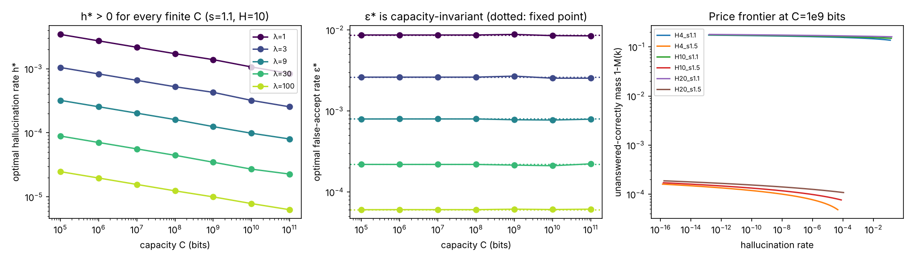
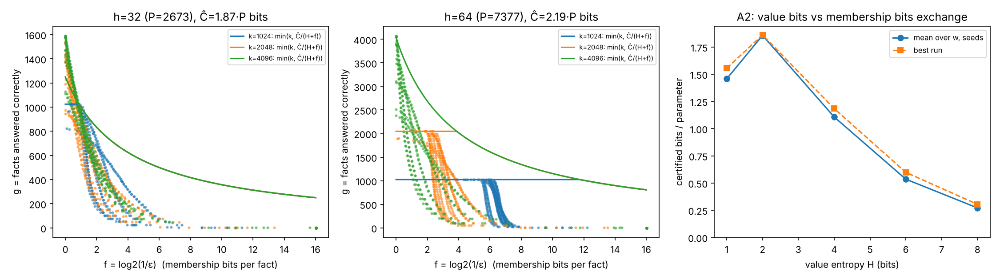
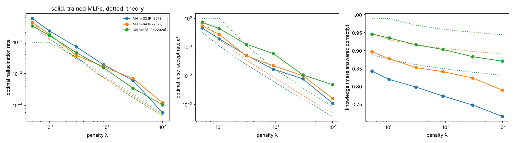

# Knowing What You Don't Know Costs Bits: A Capacity Theory of Irreducible Hallucination under Penalized Grading

**Target venue:** NeurIPS 2027 (Main Track; theory + controlled small-scale experiments)

---

## Abstract

Can hallucination be eliminated in principle? Recent theory says that pretraining pushes models to guess on rare facts, and that binary grading rewards guessing (Kalai & Vempala, 2024; Kalai et al., 2025). The proposed remedy is to penalize wrong answers so that a model abstains when uncertain. We ask what that remedy costs. The question is not whether a model *should* abstain. It is whether a finite model *can* recognize the questions it cannot answer, and at what price. We treat abstention as an approximate-membership problem. To answer a fact correctly the model must store its value (H bits). To abstain on a fact it does not know, the model must also tell that fact apart from the facts it does know. That costs about log2(1/ε) further bits per stored fact, where ε is the rate at which unknown queries are falsely accepted. We prove three results. (1) A counting lower bound (Theorem 1) holds for any model, neural or not. A model that answers g of k random facts correctly while falsely accepting a fraction ε of unseen keys must contain at least g·H + log2 C(n,g) − log2 C(a,g) − log2 C(k,g) − O(1) bits, which is about g(H + log2 1/ε). A corollary turns this into a hallucination floor on facts the model never saw. (2) Theorem 2 covers penalized grading (+1 correct, 0 abstain, −λ wrong) with a Zipf-tailed query distribution and a capacity of C bits. For every finite C, the optimal policy either refuses everything or has a strictly positive hallucination rate h*. (3) Proposition 3 says the optimal false-accept rate ε* tends to a fixed point that does not depend on capacity. As a result h* falls only polynomially, as C^−(s−1), where s is the Zipf exponent. Under the optimal policy, 17–77% of all capacity goes to "knowing what you don't know" rather than to knowledge. Numerically the predicted slopes match to within 0.005. We also train 126 small MLPs on random facts with an explicit abstain class. They contain up to 2.19 certified bits per parameter. On a 43-point threshold grid, only one of 60 networks reached zero observed false accepts while answering any stored fact correctly, and then for a single fact. Under penalized selection their hallucination rate falls with the penalty with log-log slopes of −1.01 to −1.25 (theory: −1.16 to −1.19). Trained networks fall short of the information-theoretic frontier when they must filter strongly. Our answer to the title question is a qualified *no*. Hallucination on an open-world long tail can be pushed down exponentially in the bits spent on abstention, but at finite capacity it cannot be removed at a nonzero level of knowledge. Removing it requires an external membership oracle such as retrieval or verification.

## 中文摘要

幻觉能否从根本上消除？近期理论指出，预训练会促使模型对罕见事实进行猜测，而二元评分会奖励猜测（Kalai & Vempala, 2024; Kalai et al., 2025），因此建议对错误答案进行惩罚，使模型在不确定时选择弃答。本文追问这一补救措施的代价：问题不在于模型是否*应当*弃答，而在于一个有限容量的模型能否*识别*自己无法回答的问题，以及需要付出多少容量。我们把弃答形式化为近似成员判定问题：正确回答一个事实需要存储其取值（H 比特）；而要对未知事实弃答，模型还必须把它与已知事实区分开，这对每个已存储事实额外需要约 log2(1/ε) 比特，其中 ε 为未知问题被误接受的比率。我们证明：（1）一个适用于任意模型的计数下界（定理1）——若模型在 k 个随机事实中正确回答 g 个，同时以比率 ε 误接受未见过的键，则其至少包含约 g(H+log2 1/ε) 比特；其推论给出了对未见事实的幻觉下界。（2）在惩罚评分（答对 +1，弃答 0，答错 −λ）、Zipf 长尾查询分布和容量为 C 比特的条件下（定理2），对任意有限 C，最优策略要么全部弃答，要么具有严格为正的幻觉率 h*。（3）命题3：最优误接受率 ε* 趋于一个与容量无关的不动点，因此 h* 仅按 C^−(s−1) 多项式衰减；在最优策略下，17–77% 的容量被用于"知道自己不知道"而非知识本身。数值结果与预测斜率的偏差在 0.005 以内。我们还在带显式弃答类别的随机事实上训练了 126 个小型 MLP：它们包含最高 2.19 个可认证比特/参数；在 60 个网络中，仅有一个在零观测误接受下正确回答了已存储事实，且仅一个；在惩罚选择下，其幻觉率随惩罚系数下降的对数斜率为 −1.01 至 −1.25（理论值 −1.16 至 −1.19）；而在需要强过滤时，训练得到的网络明显落后于信息论前沿。我们对标题问题的回答是有条件的"否"：在开放世界长尾上，幻觉可以随弃答所用比特数指数级降低，但在有限容量下，只要保持非零知识量就无法消除——要消除它，需要外部成员判定预言机（检索或验证）。

---

## 1 Introduction

"Can hallucination be fundamentally eliminated?" The literature gives two kinds of answer. Impossibility arguments based on computability (Xu et al., 2024; Banerjee et al., 2024) show that some computable ground-truth function will defeat any computable model. That is true, but it says little about the factual-recall hallucinations that matter in practice. Statistical arguments (Kalai & Vempala, 2024; Kalai et al., 2025) go further. A calibrated pretrained model must hallucinate at a rate tied to the Good-Turing fraction of facts seen once. Binary-graded evaluations then reward guessing over saying "I don't know". The suggested fix is socio-technical. Grade with an explicit penalty for wrong answers, and announce a confidence target, so that abstaining becomes the optimal response under uncertainty. Suzuki et al. (2025) likewise argue that hallucinations, while inevitable in general, can be made statistically negligible with enough data.

These analyses leave one resource out: **capacity**. Abstention is not free. To say "I don't know" exactly on the questions it cannot answer, a model must carry a description of the boundary of its own knowledge. Data structures have studied this problem for fifty years under the name approximate membership (Bloom, 1970; Carter et al., 1978). Any structure that answers "is x in S?" for a set S of k items, with false-positive rate ε on items outside S, needs about k·log2(1/ε) bits. The "knowing what you don't know" problem in language models is an approximate-membership problem built into a knowledge store. Its cost has to come out of the same finite parameter budget that stores knowledge. Empirically that budget is about 2 bits per parameter (Allen-Zhu & Li, 2025) or about 3.6 bits per parameter (Morris et al., 2025).

This paper turns that observation into theorems and tests them. We study the cleanest setting in which the trade-off appears: memorizing random facts (key to value), where the queries follow a long-tailed distribution, under penalized grading. Within this setting the title question has a precise form. *Can a model with finite capacity C reach zero hallucination while still answering some questions? If not, how fast can hallucination fall as C and the penalty λ grow, and what fraction of capacity does abstention consume?*

**Contributions.**

1. **A model-agnostic lower bound on the bits needed to abstain (Theorem 1, Corollary 1).** A counting argument shows the following. Any model, of any architecture, that answers g of k uniformly random facts correctly while accepting at most a keys of an n-key universe must have description length at least g·H + log2 C(n,g) − log2 C(a,g) − log2 C(k,g) − 1 − t bits, except on a 2^−t fraction of datasets. When g = k this is about k(H + log2 1/ε), and known retrieval and filter structures match it to first order (Dietzfelbinger & Pagh, 2008). Corollary 1 converts the bound into a floor on false acceptance, and so on hallucination, for any query on facts whose keys the model's bits do not depend on.
2. **Irreducibility under penalized grading (Theorem 2).** Take a capacity of C bits, Zipf(s) query probabilities with infinite support, and scoring of +1 / 0 / −λ. Within the class of top-k storage plus uniform filter policies, which by Theorem 1 is tight up to lower-order terms, every finite C forces a dichotomy. Either refusing everything is optimal, or the optimal hallucination rate h* is strictly positive. Penalized grading moves the operating point. It cannot remove the floor.
3. **Capacity-invariant abstention and polynomial decay (Proposition 3).** Asymptotically, the optimal false-accept rate ε* solves the fixed-point equation ε = (s−1)/(β[ln2·(H + log2 1/ε) − (s−1)]), which does not depend on C. Hence h* ∝ C^−(s−1), and h* falls roughly as λ^−1. The capacity share spent on abstention, f*/(H+f*), is 17–77% across the settings we examine. Numerical optimization confirms the predicted exponents to within 0.005 (Table 2).
4. **Controlled experiments with certified measurement (Experiments A and B).** We train 126 MLPs on random-fact memorization with an abstain class. Theorem 1 then gives a *certified* lower bound on the information each trained network contains. Networks reach up to 2.19 certified bits per parameter, in line with the ~2 bits/parameter of Allen-Zhu & Li (2025). No network answered even one stored fact correctly at a threshold with zero observed false accepts among 200,000 fresh keys. Under penalized selection, hallucination falls with λ at the slope the theory predicts. Networks are, however, far from the bound when they must filter strongly (Section 6.1).

We state the scope plainly. This is a theory of *factual-recall* hallucination for arbitrary facts in an open world: facts with no compressible structure, which the model can only memorize or look up. It does not cover reasoning errors, faithfulness to a given context, or facts that can be derived from rules. For that class our answer is no: hallucination cannot be fundamentally eliminated by any finite, closed-book model that answers anything. The bit-price at which it can be suppressed is, however, quantifiable and surprisingly modest (Section 4.4). It can be eliminated only by moving the membership test outside the model's capacity, which is what retrieval does.

## 2 Related Work

**Impossibility via computability.** Xu et al. (2024) define hallucination as disagreement with a computable ground-truth function and use diagonalization to show that every computable LLM hallucinates on some inputs. Banerjee et al. (2024) make related arguments using undecidability. These results are worst-case and do not quantify rates. Our setting is average-case and quantitative, and the obstacle it identifies is information, not computability.

**Statistical lower bounds.** Kalai & Vempala (2024) show that a calibrated language model must hallucinate on arbitrary facts at a rate close to the Good-Turing missing-mass estimate (the fraction of facts appearing exactly once in training). Kalai et al. (2025) reduce generative errors to binary classification ("Is-It-Valid") and argue that binary grading rewards guessing. They recommend explicit confidence targets with penalties for wrong answers. Suzuki et al. (2025) argue that hallucinations can be made statistically negligible given enough data. These works treat the data as the bottleneck. We hold data fixed (infinite-data limit in Experiment B) and make *capacity* the bottleneck. This lets us price the remedy that Kalai et al. (2025) propose. Our Theorem 2 with λ = 0 recovers their observation that binary grading makes "never abstain" optimal.

**Language generation in the limit.** Kleinberg & Mullainathan (2024) show that generation (as opposed to identification) is possible in the limit for countable collections. Kalavasis et al. (2025) show a trade-off between consistency (no hallucination) and breadth (no mode collapse) for a broad class of generators. In both, the information constraint is the learner's sample access. In ours it is the bits stored.

**Knowledge capacity.** Allen-Zhu & Li (2025) find that language models store about 2 bits of knowledge per parameter when trained on controlled synthetic biographies. Morris et al. (2025) estimate about 3.6 bits per parameter for GPT-style models. Kandpal et al. (2023) show that QA accuracy tracks the number of pretraining documents relevant to a question, and that long-tail knowledge would need orders-of-magnitude scaling. These works measure the knowledge stored. We measure the *knowledge-plus-boundary* information needed for abstention and show that both draw on the same budget.

**Approximate membership and retrieval.** Bloom (1970) introduced space-efficient membership testing with false positives. Carter et al. (1978) established the ~n·log2(1/ε) lower bound. Pagh, Pagh & Rao (2005) and Dietzfelbinger & Pagh (2008) gave structures within lower-order terms of the lower bounds for both approximate membership and retrieval, i.e. storing values for keys in a set with arbitrary output elsewhere. Our Theorem 1 is a joint retrieval-plus-membership lower bound adapted to partial recall (g < k), so that it can certify trained networks.

**Abstention and selective prediction.** Chow (1970) derived the optimal error–reject trade-off for a classifier with known posteriors. Geifman & El-Yaniv (2017) developed selective classification for deep networks. Kadavath et al. (2022) show that LMs can partly predict whether they know an answer (P(IK)). SimpleQA (Wei et al., 2024) grades "not attempted" separately from "incorrect". Chow's rule assumes the posterior is available. We show that for arbitrary facts the information needed to *compute* that posterior costs bits that compete with knowledge.

## 3 Setting

**Facts.** A universe of n possible keys (we let n → ∞; in experiments n = 2^32). A world consists of facts i = 1, 2, … . Each fact has a key x_i drawn uniformly and independently from the universe and a value y_i drawn uniformly from [V], where V = 2^H. Facts are "arbitrary" in the sense of Kalai & Vempala (2024): they have no structure that would let one fact be predicted from others.

**Queries and grading.** A query asks for fact i with probability p_i, where p_i = i^−s/ζ(s) and s > 1 (Zipf). The model returns either a value or ⊥ ("I don't know"). The score is +1 for a correct value, 0 for ⊥, and −λ for a wrong value, with λ ≥ 0. We define the **hallucination rate** h as the query mass answered wrongly and **knowledge** as the query mass answered correctly. For a fact whose value the model has no information about, any answer is correct with probability 1/V, so answering it has expected score −β, where β := λ(1 − 1/V) − 1/V. Guessing is unprofitable exactly when β > 0.

**Models.** A model is any function M: keys → [V] ∪ {⊥} that can be described in B bits. For a neural network, B is the length of the shortest description of a parameter setting that implements M on the relevant keys. The trivial bound is 32P for P float32 parameters. Write A(M) = {x : M(x) ≠ ⊥} for the accepted set. For a set S of k stored keys, the **false-accept rate** is ε = |A \ S|/(n − k). Equivalently, it is the probability that a fresh uniform key is answered rather than refused.

## 4 Theory

### 4.1 What abstention costs: a counting lower bound

**Theorem 1 (retrieval-plus-membership lower bound).** Fix n, k, V, g ≤ k, and a ≥ g. Draw a dataset D = (S, y_S) uniformly: S is a uniformly random k-subset of [n], and y_S is uniform in [V]^k. Let 𝓜_B be the set of models describable in at most B bits. Then

Pr_D[∃M ∈ 𝓜_B: M answers ≥ g keys of S correctly and |A(M)| ≤ a] ≤ 2^(B+1) · C(a,g)·C(k,g) / (C(n,g)·V^g).

Consequently, except on a 2^−t fraction of datasets, any model learned from D that achieves (g, a) satisfies

**B ≥ g·log2 V + log2 C(n,g) − log2 C(a,g) − log2 C(k,g) − 1 − t.**   (1)

*Proof.* Fix any model M with |A(M)| ≤ a. A dataset is "covered" by M if M answers at least g keys of S correctly. Every covered dataset contains a g-subset G ⊆ S ∩ A(M) whose values agree with M. Count covered datasets by first choosing G, then the rest. G is chosen from A(M): at most C(a,g) ways. The values on G are fixed by M. The remaining k − g keys of S are chosen from the other n − g keys: C(n−g, k−g) ways. Their values: V^(k−g) ways. (This overcounts, which only weakens the bound.) The total number of datasets is C(n,k)·V^k. So the fraction covered by M is at most C(a,g)·C(n−g,k−g) / (C(n,k)·V^g). By the identity C(n,k)·C(k,g) = C(n,g)·C(n−g,k−g), this equals C(a,g)·C(k,g)/(C(n,g)·V^g). At most 2^(B+1) − 1 models have descriptions of at most B bits. A union bound gives the first claim. Setting the right-hand side to 2^−t gives (1). ∎

**Interpretation.** Assume εn ≫ k, so that a ≈ k + εn ≈ εn, and assume g = k. Then log2 C(n,k) − log2 C(εn,k) ≈ k·log2(1/ε), and (1) becomes B ≳ k(H + log2 1/ε). Each stored fact costs H bits of *knowledge* plus f := log2(1/ε) bits of *knowing what is not known*. The bound is tight to first order. A retrieval structure for the values (≈ kH bits) plus an approximate-membership filter (≈ k·log2(1/ε) bits) achieves (1 + o(1)) times this (Pagh et al., 2005; Dietzfelbinger & Pagh, 2008). The term −log2 C(k,g) lets the bound handle partial recall, which is what we observe in trained networks.

**Corollary 1 (no free abstention; hallucination floor on unseen facts).** Use C(n,g) ≥ (n/g)^g, C(a,g) ≤ (ea/g)^g, C(k,g) ≤ (ek/g)^g and a ≤ k + εn. Under the hypotheses of Theorem 1, with probability at least 1 − 2^−t,

ε ≥ (g/(e²k)) · 2^(H − (B+1+t)/g) − k/n.

Now consider any query on a fact whose key is uniform and independent of the model's B bits. Examples are facts never seen in training, or tail facts the model did not encode. Such a query is accepted with probability ε. If accepted, it is answered wrongly with probability 1 − 1/V, because the value is independent of the model. So if U_ind is the query mass on such facts, the hallucination rate satisfies

h ≥ (1 − 1/V) · ε · U_ind.   (2)

*Proof.* Substitute the bounds into (1) and solve for ε. For (2), independence of the key from the model makes acceptance a Bernoulli(ε) event, and independence of the value makes correctness a Bernoulli(1/V) event. ∎

Corollary 1 is the formal core of our answer. A finite model that answers anything correctly (g ≥ 1) has a strictly positive false-accept rate on fresh keys. In an open world (U_ind > 0) that is a strictly positive hallucination rate. No training procedure, architecture, or grading scheme changes this. It changes only if the model gets more bits, or if acceptance is decided by something outside the model.

### 4.2 Optimal abstention at finite capacity

We now ask what the *best* model with capacity C does under penalized grading. Following Theorem 1 and its matching upper bound, we analyze the class 𝒫_C of **store-and-filter policies**. Store the values of the top-k facts and a membership filter over them with uniform false-accept rate ε = 2^−f. Answer accepted queries with the stored value, or with a guess if the fact is not stored. Abstain otherwise. The budget is k(H + f) ≤ C. Let U(k) = Σ_{i>k} p_i be the unstored (tail) mass, and M(k) = 1 − U(k). The expected score is

J(k, f) = M(k) − β·U(k)·2^−f,   with   h = (1 − 1/V)·U(k)·2^−f.   (3)

Higher-probability facts are stored first because that maximizes M(k) for a given k.

**Theorem 2 (irreducibility under penalized grading).** Assume s > 1 (so U(k) > 0 for every finite k) and finite C ≥ H. 
(a) If β ≤ 0, which includes binary grading λ = 0, the optimal policy in 𝒫_C never abstains (f = 0) and h* = (1 − 1/V)·U(⌊C/H⌋) > 0. 
(b) If β > 0, every policy in 𝒫_C with positive knowledge has h > 0. Hence the optimum is either the trivial refuse-all policy (J = 0, h = 0, knowledge 0) or has h* > 0. The second case holds as soon as some feasible (k, f) has J > 0. A sufficient condition is p_1 > β·U(1)·2^(H−C). 
(c) For any fixed λ, h* → 0 as C → ∞, but h* > 0 at every finite C at which the optimum is non-trivial.

*Proof.* (a) With β ≤ 0, the term −βU·2^−f is non-negative and largest at f = 0. Then J = M(k) − βU(k) is increasing in k because β > −1, so k = ⌊C/H⌋. (b) Positive knowledge requires k ≥ 1. The budget k(H+f) ≤ C forces f ≤ C − H < ∞, so 2^−f > 0. With U(k) > 0, (3) gives h > 0. The sufficient condition is J(1, C − H) > 0. (c) If β ≤ 0, h* = (1 − 1/V)·U(⌊C/H⌋) → 0 directly. If β > 0, take k = ⌊√C⌋ and f = √C − H, which is feasible. Then U(k) → 0 and 2^−f → 0, so J* → 1. At the optimum, J* = M(k*) − β·U(k*)·ε* with M ≤ 1, so β·U(k*)·ε* ≤ 1 − J* and h* = (1 − 1/V)·U(k*)·ε* ≤ (1 − 1/V)(1 − J*)/β → 0. Positivity at finite C is (b). ∎

The step from Theorem 2 to arbitrary models uses Corollary 1. Tail facts the model does not encode have keys independent of the model, so (2) bounds the hallucination of *any* B-bit model, not only store-and-filter policies. What the restriction to 𝒫_C buys is the exact optimum and the rates in Proposition 3. Outside 𝒫_C, a model could spend bits on an explicit "negative list" of high-probability unstored facts. That changes constants. It cannot cover an infinite tail with finitely many bits (Section 7).

### 4.3 The optimal operating point is capacity-invariant

**Proposition 3 (asymptotic optimum).** Take the continuum approximation U(k) ≈ k^(1−s)/((s−1)ζ(s)) and m(k) := −U'(k) ≈ k^−s/ζ(s), so that k·m(k) ≈ (s−1)·U(k). Let β > 0 and C → ∞ with the budget tight (f = C/k − H). The interior first-order condition of (3) is

(s−1)(1 + βε) = β·ε·ln2·(H + log2 1/ε),

that is,

**ε* = (s−1) / (β·[ln2·(H + log2 1/ε*) − (s−1)])**,   (4)

which does not depend on C. It follows that k* = C/(H + f*) grows linearly in C, and

h* = (1 − 1/V)·U(k*)·ε* ∝ C^−(s−1),   and   h* ≈ λ^−1 up to logarithmic factors.

*Derivation.* Write J(k) = 1 − U(k) − βU(k)·2^(H − C/k). Then dJ/dk = m(k)(1 + βε) − βU(k)·ε·ln2·C/k². Set this to zero, multiply by k, and use C/k = H + f and k·m = (s−1)U. ∎

(This is a first-order, continuum-approximation result. We check it against exact discrete optimization below rather than claim a rigorous error bound.)

Proposition 3 says something counter-intuitive. **A bigger model does not become more selective. It becomes more knowledgeable at a fixed selectivity.** Every extra bit of capacity is split in a fixed ratio between values and filter. The hallucination rate therefore falls only as fast as the tail mass beyond k*, i.e. polynomially. With heavy tails (s close to 1, as for real-world entity frequencies) this is very slow. At s = 1.1, a 10× increase in capacity reduces h* by only 10^0.1 ≈ 1.26×.

### 4.4 Numerical verification and the price of abstention

`code/theory.py` solves (3) exactly. It maximizes over integer k with U(k) computed from the Hurwitz zeta function, on a grid of s ∈ {1.05, 1.1, 1.2, 1.5, 2.0}, H ∈ {4, 10, 20}, λ ∈ {0, …, 1000}, and C ∈ {10^5, …, 10^11} bits. All numbers below come from `results/theory_tables.txt`.

**Table 1. Optimal false-accept rate ε* versus capacity (s = 1.1, H = 10).** [source: theory.py, Table T1]

| λ | C=10^5 | 10^7 | 10^9 | 10^11 | fixed point (4) |
|---|---|---|---|---|---|
| 1 | 0.0087 | 0.0087 | 0.0088 | 0.0084 | 0.0087 |
| 3 | 0.0026 | 0.0026 | 0.0027 | 0.0025 | 0.0026 |
| 9 | 0.0008 | 0.0008 | 0.0008 | 0.0008 | 0.0008 |
| 30 | 0.0002 | 0.0002 | 0.0002 | 0.0002 | 0.0002 |

ε* stays constant across six orders of magnitude of capacity. Over all grid points with λ ≥ 1 and C ≥ 10^8, the median absolute log-error of the fixed point (4) against the exact optimum is 0.010 and the maximum is 0.061.

**Table 2. Log-log slope of h* against C (λ = 9, C = 10^7…10^11) versus the predicted −(s−1).** [source: Table T3]

| s | H=4 | H=10 | H=20 | predicted |
|---|---|---|---|---|
| 1.05 | −0.051 | −0.052 | −0.053 | −0.050 |
| 1.1 | −0.102 | −0.102 | −0.101 | −0.100 |
| 1.2 | −0.201 | −0.198 | −0.203 | −0.200 |
| 1.5 | −0.499 | −0.496 | −0.499 | −0.500 |
| 2.0 | −0.999 | −1.001 | −0.999 | −1.000 |

The slope of h* against λ (λ = 3…1000, C = 10^9) lies between −1.03 and −1.09 for s ∈ {1.1, 1.5} and H ∈ {4, 10, 20} (Table T4).

**Binary grading.** At λ = 0 (s = 1.1, H = 10), h* = 0.376 at C = 10^5 bits and still 0.094 at C = 10^11 bits (Table T2). This is the "never abstain" regime that Kalai et al. (2025) attribute to binary evaluation. At λ = 9 and the same capacities, h* falls to 3×10^−4 and 1×10^−4.

**Capacity share of abstention.** At the optimum, the fraction of capacity spent on the filter, f*/(H+f*), ranges from 0.17 to 0.77 across s ∈ {1.1, 1.5, 2}, H ∈ {4, 10, 20}, λ ∈ {1, …, 100} at C = 10^9 (Table T6). For example, it is 0.51 for s = 1.1, H = 10, λ = 9. The share is larger when values are cheap (small H) and penalties are high. For short factual answers, *knowing what you don't know is as expensive as knowing*.

**The price is nonetheless modest.** Hold C = 10^9 bits, s = 1.1, H = 10 fixed and raise the filter strength f (Table T5). Knowledge falls from 0.850 (f = 0, h = 0.150) to 0.840 (f = 10, h = 1.6×10^−4), 0.833 (f = 20, h = 1.6×10^−7), and 0.824 (f = 40, h = 1.6×10^−13). Hallucination falls *exponentially* in f, while knowledge falls only as (H+f)^(s−1), because halving k removes little mass from a heavy tail. So hallucination cannot be driven to zero, but it can be driven to any target ε > 0 for a few points of knowledge. This is the quantitative content of "inevitable but negligible" claims such as Suzuki et al. (2025), with the cost made explicit.

*Figure 1. Left: h* against capacity (s = 1.1, H = 10) for five penalties; h* is positive for every finite C. Middle: ε* against capacity, with the fixed point (4) dotted. Right: the knowledge–hallucination frontier at C = 10^9 bits.*

## 5 Experiments: Method

The experiments test whether trained neural networks behave like the capacity-limited agents of Section 4. All networks are 2-hidden-layer ReLU MLPs (width h ∈ {32, 64, 128}) trained with Adam (lr 3×10^−3, cosine schedule) on CPU with fixed seeds. Keys are random ±1 vectors of dimension D = 32, so n = 2^32. Values are uniform on [V]. Each training step includes a batch of fresh random keys labeled ⊥ with loss weight w. This is the "I don't know" signal, and w controls how strongly the network is pushed to abstain. At evaluation we sweep a threshold τ on the network's non-abstain probability. For each τ we measure the number of stored facts answered correctly (g), the stored facts answered wrongly, and the false-accept rate ε on 200,000 fresh keys.

**Experiment A (certified frontier).** k ∈ {1024, 2048, 4096} facts, V = 16 (H = 4), h ∈ {32, 64} (P = 2,673 and 7,377 parameters), w ∈ {0.03, 0.1, 0.3, 1, 3}, 2 seeds, 3,000 steps: 60 runs (block A1). Block A2 varies V ∈ {2, 4, 16, 64, 256} at k = 2048, h = 32, using a "bits" output head (one answer logit plus log2 V value-bit logits), with w ∈ {0.1, 0.3, 1} and 2 seeds: 30 runs. For each run and threshold we compute the Theorem 1 certified bits (Eq. 1, t = 0, with a = k + ε(n−k), which is an upper bound on |A|). As a robustness check we recompute with a one-sided 95% Clopper–Pearson upper bound on ε. When no false accept is observed, the point estimate is floored at 3/200,000. Certified bits divided by P is a lower bound on the information per parameter that the trained network holds about its dataset.

**Experiment B (penalized grading).** A universe of N_U = 16,384 facts with Zipf(s = 1.2) query probabilities and V = 16. Training batches of 2,048 queries are sampled from p, which corresponds to the infinite-data limit: every fact is eventually seen, so Good-Turing missing mass plays no role and capacity is the only bottleneck. Settings: h ∈ {32, 64, 128} (P = 2,673; 7,377; 22,929), w ∈ {0.03, 0.1, 0.3, 1, 3, 10}, 2 seeds, 4,000 steps: 36 runs. Knowledge and hallucination are computed *exactly* as query-weighted sums over all 16,384 facts. For each size, seed, and λ ∈ {0, 0.5, 1, 3, 9, 30, 100}, we select the (w, τ) pair that maximizes the penalized score. This mimics an evaluator-optimal deployment. We compare against the exact finite-universe optimum of (3) with C = α·P, where α = 2.03 bits/parameter is the median over widths of the best certified capacity from Experiment A1. This choice is not fitted to Experiment B.

Total compute: Experiment A took about 8 minutes and Experiment B about 6 minutes, on 4 CPU processes.

## 6 Results

All numbers below are from `results/analysis_tables.txt` (produced by `code/analyze.py`) unless stated otherwise.

### 6.1 Experiment A: networks pay bits to abstain, and pay more than the minimum

**Certified capacity.** Across the 60 A1 runs, the maximum certified information is 1.87 bits/parameter for h = 32 and 2.19 bits/parameter for h = 64. The median over runs is 1.37 bits/parameter. With the Clopper–Pearson upper bound on ε the maxima are unchanged to two decimals (1.87 and 2.19), and the medians are 1.19 and 1.39. These values are consistent with the ~2 bits/parameter that Allen-Zhu & Li (2025) report for transformers on synthetic biographies. They are also below the ~3.6 bits/parameter of Morris et al. (2025), which measures a different quantity (memorization of token sequences).

**The abstain signal trades directly against recall.** Table 3 shows the default threshold (τ = 0.5) for representative cells (means over 2 seeds). Raising w lowers ε and lowers recall. The effect is strongest when the model is over capacity (k·H approaches the certified budget).

**Table 3. Experiment A1 at τ = 0.5.** [source: analysis_tables.txt]

| h | k | w | recall g/k | ε | wrong (stored) | max certified bits/param |
|---|---|---|---|---|---|---|
| 32 | 1024 | 0.03 | 1.000 | 0.738 | 0 | 1.85 |
| 32 | 1024 | 3 | 0.376 | 0.082 | 50 | 1.19 |
| 32 | 2048 | 0.03 | 0.720 | 1.000 | 573 | 1.56 |
| 32 | 2048 | 3 | 0.075 | 0.037 | 80 | 0.74 |
| 64 | 2048 | 0.3 | 1.000 | 0.275 | 0 | 1.75 |
| 64 | 2048 | 3 | 0.557 | 0.083 | 29 | 1.28 |
| 64 | 4096 | 0.03 | 0.992 | 0.991 | 31 | 2.17 |
| 64 | 4096 | 3 | 0.156 | 0.053 | 147 | 0.89 |

**No zero-hallucination operating point.** On the evaluated threshold grid (41 quantiles of stored-key confidences plus τ = 0.5), only one of the 60 A1 runs (h = 32, k = 4096) has a threshold at which a stored fact is answered correctly *and* none of the 200,000 fresh keys is accepted, and there it answers exactly one fact (g = 1). Every other zero-false-accept point has g = 0. This is consistent with Corollary 1, but it is a weak test. The grid is coarse, and 200,000 samples resolve ε only down to about 1.5×10^−5. Corollary 1 predicts that zero-FP points with g ≥ 1 exist at sufficiently strict thresholds, but with very small g.

**Trained networks are inefficient filters.** Figure 2 (left, middle) plots measured (f, g) points against the capacity curve g = min(k, Ĉ/(H+f)), where Ĉ = α_h·P. The networks fall *below* the curve as f grows. Binning the certified bits/parameter by f (points with g ≥ 50, maximum over runs) gives the following. For h = 32 it is 1.71–1.87 for f < 2, 1.29 for f ∈ [2,3), 0.91 for f ∈ [3,4), 0.58 for f ∈ [4,6), and 0.14 for f ∈ [6,9). For h = 64 it stays between 1.18 and 2.19 across all bins up to f < 9. The narrower network loses most of its usable capacity when asked to filter strongly. In other words, SGD-trained MLPs pay *more* than log2(1/ε) bits per fact for abstention, and the excess depends on width. The information-theoretic price is a floor, not a forecast.

**A2 is inconclusive.** We hoped the value-entropy sweep would show a constant certified capacity as bits moved between values and filter. Instead, certified bits/parameter of the bit-output head fell with H, from 1.86 (H = 2) to 0.27 (H = 8, mean over w and seeds). The network did not memorize high-entropy values well in 3,000 steps, and at H ≥ 2 the best points had ε ≈ 1 (no filtering). The bit-head architecture is a confound, so we draw no conclusion from A2 about the exchange rate.

*Figure 2. Experiment A. Left/middle: correct answers g against membership bits per fact f = log2(1/ε) for every run and threshold (dots), with the capacity curve min(k, Ĉ/(H+f)) (lines). Right: A2 value-entropy sweep (confounded; see text).*

### 6.2 Experiment B: penalized grading lowers hallucination but leaves a floor

**Table 4. Experiment B: score-optimal operating points (mean over 2 seeds) and the finite-universe theory with C = 2.03·P.** [source: analysis_tables.txt]

| h (P) | λ | NN knowledge | NN halluc. | NN ε* | theory knowledge | theory halluc. | theory ε* |
|---|---|---|---|---|---|---|---|
| 32 (2,673) | 0 | 0.864 | 0.1362 | 1.000 | 0.905 | 0.0893 | 1.000 |
| 32 | 1 | 0.819 | 0.0224 | 0.195 | 0.875 | 0.0128 | 0.109 |
| 32 | 9 | 0.772 | 0.0019 | 0.017 | 0.849 | 0.0009 | 0.006 |
| 32 | 100 | 0.715 | 0.00006 | 0.0011 | 0.830 | 0.00006 | 0.0004 |
| 64 (7,377) | 0 | 0.912 | 0.0880 | 1.000 | 0.949 | 0.0475 | 1.000 |
| 64 | 1 | 0.877 | 0.0176 | 0.277 | 0.930 | 0.0121 | 0.184 |
| 64 | 9 | 0.840 | 0.0017 | 0.022 | 0.906 | 0.0008 | 0.009 |
| 64 | 100 | 0.789 | 0.00012 | 0.0016 | 0.890 | 0.00005 | 0.0005 |
| 128 (22,929) | 0 | 0.951 | 0.0485 | 1.000 | 0.990 | 0.0098 | 1.000 |
| 128 | 1 | 0.935 | 0.0162 | 0.442 | 0.990 | 0.0098 | 1.000 |
| 128 | 9 | 0.902 | 0.0016 | 0.059 | 0.959 | 0.0007 | 0.019 |
| 128 | 100 | 0.870 | 0.00010 | 0.0049 | 0.944 | 0.00004 | 0.0009 |

The main findings are as follows.

* **Penalties work, at a price in knowledge.** At every size, moving from λ = 0 to λ = 100 lowers hallucination by about two to three orders of magnitude (h = 32: 0.136 → 6×10^−5; h = 128: 0.049 → 1.0×10^−4). Over the same range knowledge drops by 15, 12, and 8 points for h = 32, 64, 128.
* **Hallucination never reaches zero.** Every one of the 21 (size, λ) cells has a positive measured hallucination rate at its score-optimal operating point. It falls with λ with log-log slopes over λ ∈ [1, 100] of −1.25, −1.01, −1.10 (h = 32, 64, 128). The finite-universe theory slopes are −1.16, −1.18, −1.19. Both are close to the λ^−1 of Proposition 3.
* **Networks are about one bit-budget behind theory.** At matched C, the networks have about 4–12 points less knowledge than the store-and-filter optimum, and ε* 1.1–5.7× higher at λ ≥ 3. The h = 128 network at λ = 0 hallucinates 0.049 where the theory predicts 0.010. This is consistent with Section 6.1: trained networks do not reach the frontier, especially when they must filter.
* **Capacity invariance cannot be tested here.** In this 16,384-fact universe the largest model can store nearly every fact, so the *finite-universe* theory itself predicts ε* rising with size (e.g. at λ = 9: 0.006, 0.009, 0.019). The networks show the same direction (0.017, 0.022, 0.059). Proposition 3 is an infinite-tail statement, and a clean test needs a much larger universe relative to capacity (Section 8).

*Figure 3. Experiment B. Solid: trained MLPs (score-optimal w and τ). Dotted: finite-universe theory with C = 2.03·P. Left: hallucination against λ. Middle: ε* against λ. Right: knowledge against λ.*

## 7 Discussion

**Answer to the question.** For factual recall of arbitrary facts in an open world, a closed-book model of finite capacity cannot both answer questions and never hallucinate. This follows from a counting argument (Corollary 1), not from any feature of transformers, next-token prediction, or training. It is the same reason a Bloom filter with finite memory has false positives. The constraint is weaker than "hallucination is inevitable" suggests. Hallucination can be pushed down *exponentially* in the bits spent on abstention, and in heavy-tailed worlds those bits cost little knowledge (Section 4.4). The engineering question is therefore not whether hallucination can be eliminated but at what ε to operate, and that is an economic choice set by λ.

**Three consequences that differ from prior accounts.**

1. *Scale alone gives slow, polynomial reductions.* Under the optimal policy, scaling capacity does not make models more selective (ε* is capacity-invariant). It only pushes the knowledge frontier further into the tail, so h* ∝ C^−(s−1). For entity-frequency tails with s near 1, this is consistent with the slow improvement of closed-book long-tail QA that Kandpal et al. (2023) documented. It also suggests why factuality benchmarks such as SimpleQA (Wei et al., 2024) remain hard for frontier models. We have not tested this link quantitatively.
2. *Changing evaluation is necessary but costs capacity.* Kalai et al. (2025) are right that binary grading forces h* = U(k) (our Theorem 2a). Introducing penalties moves models to the abstaining regime, where for short answers 17–77% of capacity goes to the filter. A penalized evaluation therefore measures a different capability (knowledge plus its boundary) than an accuracy benchmark, and should not be expected to leave accuracy unchanged at fixed size. In our Experiment B, knowledge fell by 8–15 points as λ went from 0 to 100.
3. *Self-knowledge has an information price.* Results showing that LMs "mostly know what they know" (Kadavath et al., 2022) are compatible with our theory. The bound does not say self-knowledge is impossible. It says self-knowledge about *arbitrary* facts must be paid for at about log2(1/ε) bits per known fact, so any fixed-size model has a calibrated-abstention frontier it cannot exceed.

**Where hallucination *can* be eliminated.** The bound applies to facts whose keys and values are independent of what the model stores. It does not apply when (a) facts are derivable from stored rules (systematic knowledge, as also noted by Kalai & Vempala, 2024), or (b) membership is decided outside the model's capacity, by retrieval against a corpus or verification against a tool. A retrieval-augmented system whose corpus contains the fact and whose retriever returns "not found" reliably can, in this model, reach ε = 0 at zero in-model cost. The hallucination problem then moves to retriever recall and corpus coverage. Our framework predicts that the in-model filter capacity a retrieval system frees up is f*/(H+f*) of the knowledge budget.

**Falsifiable predictions for large models.** We did not test these. We state them as a pre-registered protocol. (P1) For a model family trained on a fixed synthetic-fact corpus (e.g. Allen-Zhu & Li's bioS data) with an abstain token and penalized fine-tuning, the score-optimal ε* on held-out fictitious entities should stay roughly constant across model sizes once the corpus is much larger than capacity. Hallucination on unseen-but-queried entities should then fall as the Zipf tail mass beyond the stored set. (P2) At fixed size, adding the abstention objective should lower measured knowledge-capacity (bits/parameter on stored facts) by a fraction close to f/(H+f) for small H. (P3) Moving membership to retrieval should restore that capacity. Each prediction is checkable at sub-billion scale with the open-source synthetic-biography pipeline.

## 8 Limitations

* **Arbitrary facts only.** All results assume facts with independent uniform keys and values. Real knowledge has structure (relations, compositionality, overlap among entities) that can make both storage and membership cheaper. Our bounds are worst-case over such structure. They describe the "Good-Turing" class of facts that Kalai & Vempala (2024) identify as most hallucination-prone, not reasoning or faithfulness errors.
* **Policy class in Theorem 2 and Proposition 3.** Optimality is shown within store-and-filter policies with a *uniform* false-accept rate. A model could instead spend bits on a negative list of high-probability unstored facts, which would lower hallucination on the head of the tail. Corollary 1 still guarantees h > 0 for any B-bit model whenever unencoded tail mass exists. But the exact rates (ε* capacity-invariance, C^−(s−1) decay) are proven only for the restricted class, and Proposition 3 is a first-order continuum derivation checked numerically, not a theorem with error bounds.
* **Description length of neural networks.** Theorem 1 bounds the number of distinguishable models. "Certified bits per parameter" is therefore information the parameters must contain, not a measure of how the network stores it. We do not claim the networks implement anything like a Bloom filter internally.
* **Statistical resolution.** ε is estimated from 200,000 fresh keys. Rates below about 10^−5 cannot be resolved, so the "no zero-FP operating point" observation is weak. Certified bits use t = 0 (the 1 + t correction is negligible against thousands of bits). Using a 95% upper confidence bound on ε does not change the maxima.
* **Small scale and toy architecture.** The networks have 2.7k–23k parameters, are MLPs and not transformers, use random binary keys and not natural language, and were trained for a fixed 3,000–4,000 steps without tuning per configuration. The gap between networks and theory (Sections 6.1–6.2) may be partly undertraining. Allen-Zhu & Li (2025) show that undertraining roughly halves capacity.
* **Oracle selection in Experiment B.** The score-optimal (w, τ) is selected on the same evaluation it is scored on. That is appropriate for describing the best achievable operating point of the trained models, but it is optimistic as a deployment estimate.
* **Inconclusive sub-experiment.** A2, the value-entropy sweep, was confounded by the bit-output head and does not test the value-versus-filter exchange rate. Capacity invariance (Proposition 3) is not tested empirically, because the finite universe of Experiment B is too small relative to model capacity.
* **Two seeds** per configuration. We report means, and differences smaller than the seed-to-seed spread visible in `exp_a.log` and `exp_b.log` (e.g. about 0.1–0.3 certified bits/parameter) should not be interpreted.

## 9 Conclusion

We asked whether hallucination can be fundamentally eliminated, and answered within a precise model. For arbitrary facts in an open world, saying "I don't know" exactly when one doesn't know costs about log2(1/ε) bits per known fact, on top of the bits for the knowledge itself. A model of finite capacity therefore has a strictly positive hallucination rate whenever it answers anything, under any grading scheme. Penalized grading moves the optimum to a capacity-invariant false-accept rate. Hallucination then falls as C^−(s−1) with scale and roughly as λ^−1 with the penalty, and up to three quarters of capacity goes to self-knowledge. Small trained networks follow the predicted penalty scaling, but they pay more than the information-theoretic price. Hallucination is irreducible inside a finite closed-book model. It is suppressible at a quantifiable price, and it is eliminable only by moving the membership test outside the model.

## Reproducibility

Code: `code/` (`theory.py`, `exp_a_frontier.py`, `exp_b_penalty.py`, `analyze.py`, `common.py`). Outputs: `results/`. Run instructions: `README.md`. All runs are CPU-only with fixed seeds, about 15 minutes in total on 4 processes. Source labels: every number in Sections 4.4 and 6 comes from `results/theory_tables.txt` or `results/analysis_tables.txt`, produced by code run in this environment. Numbers attributed to other papers (2 bits/parameter, 3.6 bits/parameter) are cited.

## References

Allen-Zhu, Z., & Li, Y. (2025). Physics of Language Models: Part 3.3, Knowledge Capacity Scaling Laws. *International Conference on Learning Representations (ICLR 2025)*. arXiv:2404.05405.

Banerjee, S., Agarwal, A., & Singla, S. (2024). LLMs Will Always Hallucinate, and We Need to Live With This. arXiv:2409.05746.

Bloom, B. H. (1970). Space/Time Trade-offs in Hash Coding with Allowable Errors. *Communications of the ACM*, 13(7), 422–426. doi:10.1145/362686.362692.

Carter, L., Floyd, R., Gill, J., Markowsky, G., & Wegman, M. (1978). Exact and Approximate Membership Testers. *Proceedings of the 10th Annual ACM Symposium on Theory of Computing (STOC)*, 59–65.

Chow, C. K. (1970). On Optimum Recognition Error and Reject Tradeoff. *IEEE Transactions on Information Theory*, 16(1), 41–46. doi:10.1109/TIT.1970.1054406.

Dietzfelbinger, M., & Pagh, R. (2008). Succinct Data Structures for Retrieval and Approximate Membership. *ICALP 2008*, LNCS 5125, 385–396. doi:10.1007/978-3-540-70575-8_32. arXiv:0803.3693.

Geifman, Y., & El-Yaniv, R. (2017). Selective Classification for Deep Neural Networks. *Advances in Neural Information Processing Systems 30 (NeurIPS 2017)*, 4878–4887. arXiv:1705.08500.

Kadavath, S., et al. (2022). Language Models (Mostly) Know What They Know. arXiv:2207.05221.

Kalai, A. T., Nachum, O., Vempala, S. S., & Zhang, E. (2025). Why Language Models Hallucinate. arXiv:2509.04664.

Kalai, A. T., & Vempala, S. S. (2024). Calibrated Language Models Must Hallucinate. *Proceedings of the 56th Annual ACM Symposium on Theory of Computing (STOC 2024)*. arXiv:2311.14648.

Kalavasis, A., Mehrotra, A., & Velegkas, G. (2025). On the Limits of Language Generation: Trade-Offs Between Hallucination and Mode Collapse. *Proceedings of the 57th Annual ACM Symposium on Theory of Computing (STOC 2025)*. arXiv:2411.09642.

Kandpal, N., Deng, H., Roberts, A., Wallace, E., & Raffel, C. (2023). Large Language Models Struggle to Learn Long-Tail Knowledge. *Proceedings of the 40th International Conference on Machine Learning (ICML 2023)*, PMLR 202, 15696–15707. arXiv:2211.08411.

Kleinberg, J., & Mullainathan, S. (2024). Language Generation in the Limit. *Advances in Neural Information Processing Systems 37 (NeurIPS 2024)*. arXiv:2404.06757.

Morris, J. X., et al. (2025). How Much Do Language Models Memorize? arXiv:2505.24832.

Pagh, A., Pagh, R., & Rao, S. S. (2005). An Optimal Bloom Filter Replacement. *Proceedings of the 16th Annual ACM-SIAM Symposium on Discrete Algorithms (SODA 2005)*, 823–829.

Suzuki, A., He, Y., Tian, F., & Wang, Z. (2025). Hallucinations are Inevitable but Can Be Made Statistically Negligible. arXiv:2502.12187.

Wei, J., Karina, N., Chung, H. W., Jiao, Y. J., Papay, S., Glaese, A., Schulman, J., & Fedus, W. (2024). Measuring Short-Form Factuality in Large Language Models. arXiv:2411.04368.

Xu, Z., Jain, S., & Kankanhalli, M. (2024). Hallucination is Inevitable: An Innate Limitation of Large Language Models. arXiv:2401.11817.
