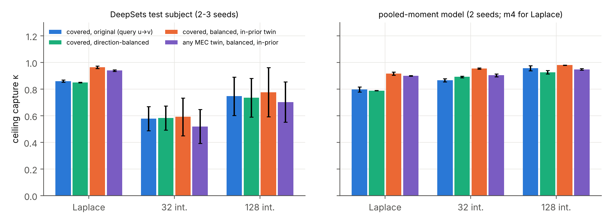

# Observational Twins: Calibrated Tests of Whether Learned Causal Reasoners Use Causal Evidence, with Exact Bayes Baselines under the Benchmark Prior

**Target venue:** NeurIPS 2027 (Datasets & Benchmarks / Evaluation track)

**Revision note (round 1).** This version responds to the round-1 review (`reviews/response_r1.md`). The main changes are: (i) we no longer present the Gaussian twin accuracy of 50% as a finding, since it is a theorem; it is now reported as a unit test of the generator; (ii) we replace the "MEC-uniform oracle" with exact Bayes-optimal observational baselines under the training prior, and we retract the claim that the label-order models exceed "what any reasoner could achieve from observational data" overall; (iii) we add twin probes that are direction-balanced, restricted to in-prior twins, and that include non-adjacent queries, plus prior-agnostic classical reference reasoners; (iv) we cite Montagna et al. and the R²-sortability work and reposition the contribution; (v) we narrow the scope: no LLM or pretrained amortized model was evaluated (see Section 9 for why), and we call the LLM protocol "pre-specified", not "pre-registered".

---

## Abstract

Claims that a learned model "reasons causally" usually rest on benchmark accuracy. We study when accuracy can support such claims, using *observational twins*: pairs of structural causal models (SCMs) that induce the same observational distribution but give opposite answers to a causal query. Three known facts make twins an evaluation instrument. Any reasoner whose input is a function of observational samples plus side information shared within the pair scores exactly 1/2 on the pair (a restatement of non-identifiability). With additional evidence, accuracy is bounded by (1 + TV)/2 and the likelihood-ratio (LR) test attains the bound (Le Cam). For linear-Gaussian SCMs, refitting on any Markov-equivalent DAG produces an exact twin (a corollary of Chickering, 1995). We use these to build two calibrated statistics: *ceiling capture* κ = (2·acc − 1)/(2·acc_LR − 1) on twin pairs, and exact *Bayes-optimal observational baselines* under the benchmark's own prior. Applied to small amortized causal-query networks (DeepSets, four-variable linear SCMs, CPU), the baselines change the picture. An oracle that knows the true Markov equivalence class (MEC) and the prior reaches 86.3%. A label-free Bayes reasoner that sees the population correlation matrix reaches 90.2–91.4%. One that sees the unstandardized covariance reaches 98.8%, because the simulation prior (weights bounded away from zero, bounded noise scales) nearly identifies causal direction inside the MEC. A model trained where labels follow the causal order reaches 92.5% i.i.d. accuracy. That is only 1–2 points above the label-free bound overall, but about 9 points above it on MEC-unidentified queries (92.1% vs ≤ 83.4%). The weaker-cue model (p = 0.9) does not exceed the overall bound. Removing the label cue at test time cuts the label-order models' accuracy by §CUE§. Under informative evidence (Laplace noise, interventional samples), networks capture κ = §KLAP§ (Laplace) and §KINT§ (interventions) of the LR ceiling. This surplus persists on twins whose second member also lies inside the training prior and whose answer direction is balanced (§KINP§), so it is not explained by detecting out-of-prior parameterizations. Prior-agnostic classical reasoners given the common parents reach κ = 0.94–1.00. We evaluate no large language model; we give a pre-specified protocol for doing so.

## 中文摘要

关于学习模型能否"进行因果推理"的论断通常依赖基准准确率。本文借助"观测孪生体"——一对产生相同观测分布、但对同一因果查询给出相反答案的结构因果模型——研究准确率何时能够支撑此类论断。三个已知事实使孪生体成为评测工具：任何仅以观测样本及孪生对共享的辅助信息为输入的推理器在孪生对上的准确率恰为 1/2（不可识别性的重述）；存在额外证据时准确率上界为 (1+TV)/2，似然比检验可达该上界（Le Cam）；对线性高斯 SCM，在任一马尔可夫等价 DAG 上重拟合即可得到精确孪生体（Chickering 1995 的推论）。据此我们构造两个经过校准的统计量：孪生对上的"上限捕获率" κ，以及在基准自身先验下精确计算的贝叶斯最优观测基线。在 CPU 上训练的小型摊销式因果查询网络上，这些基线改变了结论：知晓真实马尔可夫等价类与先验的预言机准确率为 86.3%；看到总体相关矩阵、不使用标签的贝叶斯推理器为 90.2–91.4%；看到未标准化协方差者达 98.8%，因为仿真先验（权重远离零、噪声尺度有界）几乎在等价类内部识别了因果方向。标签遵循因果顺序训练的模型 i.i.d. 准确率为 92.5%，整体仅比无标签贝叶斯上界高 1–2 个百分点，但在等价类不可识别的查询上高约 9 个百分点（92.1% 对 ≤83.4%）；较弱线索（p=0.9）的模型整体并未超过该上界。在信息充分的证据下（拉普拉斯噪声、干预样本），网络捕获了似然比上限的相当比例，且在第二个孪生体同样位于训练先验内、答案方向平衡的孪生对上依然存在，因此不能用"检测先验外参数"来解释。本文未评测任何大语言模型，仅给出预先设定的评测协议。

---

## 1 Introduction

The question "can models perform genuine causal reasoning, rather than correlational inference?" has produced two largely separate literatures. One evaluates large language models (LLMs) on causal questions posed in text: CLadder (Jin et al., 2023), Corr2Cause (Jin et al., 2024), interventional-reasoning probes (Kasetty et al., 2024) and broad evaluations (Kıcıman et al., 2023). The other trains networks to map datasets to causal structures, such as AVICI (Lorch et al., 2022) and CSIvA (Ke et al., 2023). Both share a worry: high accuracy may come from cues that correlate with the answer in the benchmark but have nothing to do with causal inference. Examples include "causal parrot" repetition of causal facts (Zečević et al., 2023), lexical anchors in variable names (Yu & Zhou, 2026), and simulator artefacts such as varsortability and R²-sortability (Reisach et al., 2021, 2023). Montagna et al. (2024) show, for CSIvA, that constraints on the training distribution act as an implicit prior on test data, and that amortized models fail on causal-model classes unseen in training.

This paper makes one point precise and quantitative. **To interpret a causal-query accuracy, it must be compared with what an optimal reasoner could reach on the same input under the same prior, and the comparison must separate three sources of accuracy:** queries identified by the evidence's structure, queries identified only by the prior over parameters, and queries answered from side cues. Two instruments do this.

*Twin pairs* hold every rung-1 cue fixed and flip only the rung-2 answer. Every function of observational data scores exactly 1/2 on them, so any surplus must come from evidence that separates the twins, and the LR test fixes the ceiling. These facts are known: non-identifiability and the causal hierarchy theorem (Bareinboim et al., 2022), Le Cam's two-point bound, and Chickering's (1995) covered-edge characterization. We restate them only in the form needed for evaluation and claim no theoretical novelty for them. On Gaussian twins the score is 1/2 *by theorem* for every reasoner, trained or untrained. That number is a check on the generator, not evidence about any model. Twins become informative only when the evidence can separate them (non-Gaussian noise, interventions), and we report what fraction κ of the LR ceiling a model captures.

*Exact Bayes baselines under the benchmark prior* calibrate i.i.d. accuracy. They show that the commonly used reference (the majority answer over the MEC) is far from the observational limit. Under a standard simulation prior, the unstandardized covariance plus the parameter prior nearly identifies the full DAG (98.8%), and the correlation matrix still carries substantial prior-driven direction information (90–91% vs 86% from the MEC alone).

**Contributions.**

1. **An evaluation framework with a provable floor and a computable ceiling** (Section 3). It is assembled from known results (stated as Propositions 1–3 with attribution), extended in one small way: refit on *any* member of the MEC, not only a single covered reversal, which lets us test non-adjacent and deeper unidentified queries. It is verified numerically (covariance error ≤ 1.4 × 10⁻¹³ over 78,481 refits).
2. **Exact Bayes-optimal observational baselines for a standard linear-SCM benchmark prior** (Section 5.2). Closed-form densities over DAGs within an MEC come from the regression parameterization and its Jacobian, with diagonal scales integrated out for standardized data. The reference levels are 86.3% (MEC only), 90.2–91.4% (correlation matrix, label-free) and 98.8% (covariance). We check that the posteriors are calibrated. This quantifies "identification by the prior" in amortized causal benchmarks, complementing Reisach et al. (2021, 2023) and Montagna et al. (2024).
3. **A corrected shortcut accounting** (Section 5.2). The label-order model at p = 1 exceeds the label-free bound by 1–2 points overall and by about 9 points on MEC-unidentified queries; the p = 0.9 model does not exceed the overall bound. A cue-removal probe confirms that label-order reliance drives these models.
4. **A surplus analysis with controls** (Section 5.3). Networks trained with Laplace noise or interventional samples earn surplus. We test whether this surplus survives (a) balancing the answer direction, so that "yes" is not tied to the in-prior twin; (b) restricting to twins whose refit member lies inside the training prior; and (c) non-adjacent queries. We compare against prior-agnostic classical reasoners. The surplus survives all three controls.
5. **A pre-specified LLM protocol** (Section 7). It is not run here and not registered with any registry.

Scope. We do not answer the question for LLMs. Our empirical results concern a small amortized network class on four-variable linear SCMs. What transfers to other model classes is the method: the twin construction, the Bayes-calibrated baselines and the accounting.

## 2 Related Work

**Causal reasoning benchmarks for LLMs.** CLadder (Jin et al., 2023) generates questions on all three rungs from an oracle inference engine. Corr2Cause (Jin et al., 2024) asks whether a causal relation follows from stated (in)dependencies. Its labels are derived from MEC reasoning (a hypothesis is valid only if it holds in every member of the MEC), which is closely related to our restriction to identified versus unidentified queries. Kasetty et al. (2024) separate interventional reasoning from memorized facts. Zečević et al. (2023) formalize "causal parrots". Yu and Zhou (2026) show that placeholder variable names remove much of the reported accuracy. Twin pairs complement cue-removal perturbations by holding *all* rung-1 cues fixed. They are not a replacement for Corr2Cause-style MEC labelling, which they resemble in spirit.

**Amortized causal discovery and its identifiability.** AVICI (Lorch et al., 2022) and CSIvA (Ke et al., 2023) learn dataset-to-graph maps on simulated SCMs. Reisach et al. (2021) showed that marginal-variance order ("varsortability") leaks the causal order in common simulators. Reisach et al. (2023) showed that a scale-invariant analogue, R²-sortability, survives standardization. Montagna et al. (2024) analyse CSIvA through identifiability theory. They find that the training distribution acts as an implicit prior on test data, that models fail on noise types unseen in training, and that training on mixtures of identifiable models helps. Our cross-regime result (Gaussian-trained models capture none of the Laplace surplus) is an instance of their finding, and we do not claim it as new. Our Bayes baselines make their "implicit prior" point quantitative for one standard prior: the prior alone raises the attainable accuracy on MEC-unidentified queries from 75% to 83% (standardized data) and to 98% (raw covariance).

**Identifiability.** Markov equivalence (Verma & Pearl, 1990), essential graphs (Andersson et al., 1997) and covered-edge transformations (Chickering, 1995) characterize what observational Gaussian data determine. Interventions refine equivalence classes (Eberhardt et al., 2005; Hauser & Bühlmann, 2012), and non-Gaussian noise identifies linear models (Shimizu et al., 2006). Our classical reference reasoners use the pairwise LiNGAM likelihood ratio (Hyvärinen & Smith, 2013) with the maximum-entropy approximation of Hyvärinen (1998).

**Contrast sets, shortcut learning and causal world models.** Contrast sets (Gardner et al., 2020) and counterfactually-augmented data (Kaushik et al., 2020) evaluate on minimally edited inputs whose label flips; twins are the causal-inference analogue in which the edit is invisible in the input distribution. On shortcut learning see Geirhos et al. (2020). Richens and Everitt (2024) show that agents with low regret under many distribution shifts must have learned approximate causal models.

## 3 Framework (known results, restated for evaluation)

### 3.1 Setup

A *causal-query task* draws an SCM M from a prior Π, evidence E ~ P_M^E, side information S (names, wording, variable order), and a binary query q with answer y = q(M). A *reasoner* is a possibly randomized map f(E, S, q) ∈ {0,1}.

**Definition 1 (observational twins).** M, M′ are *observational twins for q* if P_M(V) = P_{M′}(V) and q(M) ≠ q(M′).

**Definition 2 (twin accuracy, surplus, ceiling capture).** For pairs (M_k, M′_k, q_k) with shared S_k, acc_tw is the pair-averaged accuracy. The surplus is Δ = 2·acc_tw − 1, and ceiling capture is κ = Δ/Δ_LR, where Δ_LR is the surplus of the likelihood-ratio rule that knows both SCMs.

### 3.2 Floor and ceiling

**Proposition 1 (floor; restatement of non-identifiability).** If E is observational, every reasoner has pair-averaged accuracy exactly 1/2 on every twin pair.
*Proof.* E and E′ have the same law and S, q are shared, so f(E,S,q) and f(E′,S,q) have the same law a; accuracy is (a + 1 − a)/2. ∎

This is the observational-equivalence half of the causal hierarchy theorem (Bareinboim et al., 2022) written as a symmetry. We state it because it fixes how the test must be built (side information identical within a pair), not because it is new. **Consequence for reporting:** on Gaussian observational twins, every reasoner's accuracy is 1/2 up to sampling noise, including an untrained network and the Bayes-optimal reasoner. Such numbers verify the generator and say nothing about the model.

**Proposition 2 (ceiling; Le Cam's two-point bound).** With evidence laws P, Q for the twins, pair-averaged accuracy ≤ (1 + TV(P,Q))/2, with equality for the LR rule (Tsybakov, 2009, Ch. 2). ∎

**Remark (what Δ > 0 does and does not certify).** Δ > 0 shows that the answer depends on evidence features that separate the twins. If one twin lies outside the training prior, those features may include "this parameterization looks unlike training data" rather than a causal-direction cue. Section 5.3 controls for this with in-prior twins and direction-balanced queries.

### 3.3 Constructing twins for linear-Gaussian SCMs

A linear SCM is X_j = Σ_i W_ij X_i + s_j ε_j. An edge u → v is *covered* if pa(v) = pa(u) ∪ {u}.

**Proposition 3 (MEC refit; corollary of Chickering, 1995).** Let M have Gaussian noise and DAG G, and let G′ be any DAG Markov equivalent to G. Define M′ by population regression of each X_j on pa_{G′}(j) under Σ_M. Then P_{M′} = P_M. For any query whose ancestral answer differs between G and G′, (M, M′) are observational twins.
*Proof sketch.* Σ_M satisfies the Markov property of G′ (same conditional independences), and regression on G′-parents reproduces any covariance that is Markov with respect to G′. Zero-mean Gaussians are determined by their covariance. ∎

The original single-covered-reversal construction is the special case where G′ differs from G by one covered edge. By Chickering's (1995) theorem that covered reversals connect every MEC, every MEC-unidentified ancestral query has a twin. We re-verify this on all 543 four-node DAGs (Section 5.1) only as a check of our implementation: it confirms a known theorem.

With Laplace noise the same pair no longer has equal laws (Shimizu et al., 2006). Mixing in samples under do(X_t) separates the twins when t is one of the queried variables. In both cases the pair becomes a probe with a high ceiling.

**Out-of-prior twins.** Under our prior (|w| ∈ [0.5, 2], s ∈ [0.5, 1.5]), refit twins usually leave the prior's support. This happens for 88.5% of covered-reversal twins and 94.2% of refits on other MEC members (`results/rev_checks.json`, 20,000 sampled SCMs; the reviewer independently found 88.3%). This does not affect Proposition 1. It does matter for informative-evidence probes, and for the Bayes baselines, where it signals that the prior carries direction information (Section 5.2).

## 4 Experimental Design

All experiments are CPU-scale. Every number in Sections 5–6 is read from files in `results/` produced by code in `code/` (Reproducibility section).

### 4.1 Task distribution

There are n = 4 variables. A DAG includes each edge of a random total order with probability 0.5. Nonzero weights are ±U(0.5, 2) and noise scales U(0.5, 1.5). Each dataset has N = 256 samples, and every variable is standardized per dataset. This removes marginal-variance cues but not the scale-invariant ones (R²-sortability; Reisach et al., 2023), and Section 5.2 measures how much the latter is worth. The query is "is X_i an ancestor of X_j?", balanced between positives and negatives. Labels are a random permutation, except that with probability p_order they follow the causal order (a controlled stand-in for any side cue correlated with causal direction).

### 4.2 Regimes, model, training

Regimes: obs_p0/p05/p09/p1 (Gaussian, p_order 0/0.5/0.9/1); laplace_p0 (unit-variance Laplace noise); int32_p0 and int128_p0 (the last 32 or 128 of 256 samples drawn under do(X_t ~ N(0,1)) for a uniformly random target t, with indicators); graph_p0 (an adjacency "description" of the true DAG). The model is a DeepSets network. Per-sample features are the four standardized values, the 10 pairwise products and the 4 intervention indicators, with the queried pair placed first. The encoder φ is an MLP (width 128, 3 layers) followed by mean pooling. The head ρ is an MLP that also receives the label-order bit 1[i < j] and, in the graph regime, the description. Training: binary cross-entropy, Adam (lr 10⁻³, cosine decay), 4,000 steps of 64 fresh items. The network is small and untuned. We report it as a *test subject* for the instruments, not as a strong causal-discovery model.

Seeds: obs_p0 (2), obs_p05 (2), obs_p09 (3), obs_p1 (3), laplace_p0 (2), int32_p0 (3), int128_p0 (3), graph_p0 (1). The seeds added in this revision are obs_p05 s1, obs_p09 s1–2, obs_p1 s2, int32 s2 and int128 s1–2. Retraining with the revised code reproduces all round-0 fields bit-for-bit (training and evaluation RNG streams are unchanged; new probes use separate streams).

### 4.3 Evaluation

*i.i.d. test.* 4,000 fresh items per run, split by whether the query is identified by the true MEC.

*Bayes-optimal observational baselines (new).* For each i.i.d. item we compute the posterior-optimal answer of reasoners that know the query and either (a) the population MEC, (b) the population correlation matrix R, or (c) the population covariance Σ. Each is computed label-free (prior with uniformly random labels, the optimal permutation-equivariant rule) or label-aware (the regime's p_order mixture, labels fully observed). The posterior over DAGs G in the MEC is

P(G | Σ, q) ∝ Π(G) · P(q | G) · π(θ_G(Σ)) / Π_j [2 s_j det Σ_{pa(j),pa(j)}].

Here Π(G) ∝ (number of linear extensions of G) under random labels. P(q | G) is the balanced query-sampling probability. θ_G(Σ) gives the regression coefficients and noise scales of Σ on G, and π is the parameter prior. The denominator is the Jacobian of θ ↦ (Σ_ii, Σ_ij for adjacent i, j), a chart shared by all members of an MEC. For R, the diagonal scales D are integrated out: Σ = DRD, the integrand reduces to Π_{k→j}(d_j/d_k) times prior indicators over a box, and we integrate with scrambled Sobol points (4,096; 2¹⁸ in the rare cases where the coarse grid misses the support). Standardized samples depend on the model only through R, and raw samples only through Σ. By data processing, (b)-label-free therefore upper-bounds the accuracy of **every** permutation-equivariant reasoner that sees standardized Gaussian samples. This holds on any subset of items defined through R, such as "MEC-unidentified". The posteriors are calibrated on held-out items: binned predicted P(yes) matches the empirical frequency to within 0.02 in each bin with n > 50 (Section 5.2).

*Twin probes.* We use 1,500 pairs per probe, each with a paired bootstrap over pairs (2,000 resamples) for accuracy and κ. The probes are:
- `twins_matched` (round 0): covered reversal, query (u, v), so the in-prior member M is always the "yes" item;
- `rev_cov_all` (new): the same, but the queried direction (u, v) or (v, u) is drawn at random, so "yes" is no longer tied to the in-prior member;
- `rev_cov_inprior` (new): as `rev_cov_all`, but pairs whose refit twin leaves the prior's support are rejected, so both members are plausible training draws;
- `rev_mec_all` and `rev_mec_inprior` (new): any MEC-unidentified query, adjacent or not, with a direction-balanced answer, using a uniformly drawn MEC member with the opposite answer refit by Proposition 3 (about 20% of pairs are non-adjacent);
- `rev_matched_redraw` (new): an independent redraw of `twins_matched`, used for κ confidence intervals.

*Prior-agnostic classical reasoners (new).* These run on `rev_cov_*`-style twins. They know the common parents of the queried pair (oracle skeleton information) but nothing about the parameter prior. For Laplace data the reasoner is the pairwise LiNGAM likelihood ratio (Hyvärinen & Smith, 2013) on residuals after regressing out the common parents. For interventional data it is a Fisher-z partial-correlation test (α = 0.05) on the interventional rows: do(u) makes u and v dependent given the common parents iff u → v.

*Cue-removal probe (new).* Saved label-order models are evaluated on i.i.d. items with random labels and with labels in reverse causal order.

## 5 Results

### 5.1 Unit tests of the generator (not findings)

These checks confirm known theory and our implementation (`results/theory_checks.json`, `results/rev_checks.json`):
- the exhaustive enumeration finds 543 DAGs and 185 MECs on four nodes;
- covered-reversal BFS spans every MEC;
- all 4,008 MEC-unidentified (DAG, ordered pair) combinations have a twin; the minimum reversal depth is 1 for 2,280, 2 for 1,248, 3 for 432 and 4 for 48;
- refit on every MEC member reproduces Σ to within 1.4 × 10⁻¹³ (78,481 refits);
- 28.8% of MEC-unidentified ordered pairs under the prior are non-adjacent.

As Proposition 1 requires, every Gaussian-observational model scores 49.2–50.2% on Gaussian twins (Table 1, last column), as does the LR rule. We report these numbers only as a check that the encoding shares all side information within a pair. They carry no information about what the models learned.

### 5.2 Calibrated baselines change the i.i.d. picture

**Table 1.** i.i.d. accuracy of the Gaussian observational models against exact Bayes baselines (%). Network: mean ± s.d. over seeds. Bayes values are computed on the seed-0 evaluation items; values on the seed-1 and seed-2 items differ by ≤ 1.3 points (`results/bayes_oracles.json`, `per_seed_items`).

| Regime | Network i.i.d. | Network, unidentified queries | Bayes: MEC only | Bayes: R, label-free | Bayes: R, label-free, unidentified | Bayes: R, with labels | Bayes: Σ, label-free | Gaussian twin acc (unit test) |
|---|---|---|---|---|---|---|---|---|
| obs_p0 | §T1_P0§ | §T1U_P0§ | 86.3 | 90.6 | 83.2 | 90.6 | 98.9 | 50.2 |
| obs_p05 | §T1_P05§ | §T1U_P05§ | 85.9 | 90.1 | 82.4 | 93.5 | 98.6 | 49.2 |
| obs_p09 | §T1_P09§ | §T1U_P09§ | 86.5 | 90.2 | 82.2 | 98.3 | 98.8 | 49.9 |
| obs_p1 | §T1_P1§ | §T1U_P1§ | 86.4 | 90.6 | 82.8 | 100.0 | 98.7 | 50.0 |

*Figure 1. i.i.d. accuracy of the label-order models (blue) against the label-free Bayes bound for standardized data (green diamonds), the MEC-only Bayes rule (purple) and the MEC + label-order reference (grey). Twin accuracy (orange) is 1/2 by Proposition 1 and is shown only as a unit test.*

Four observations.

1. **The MEC is not the observational limit.** The reviewer computed the Bayes rule that knows only the MEC and the prior at 86.4%; we obtain 86.3% (round 0 used a uniform-within-MEC majority, 80.6%). A reasoner that sees the correlation matrix and knows the parameter prior reaches 90.2–91.4%. One that sees the raw covariance reaches 98.8%, of which 97.7–98.4% is on MEC-unidentified queries. **The simulation prior nearly identifies causal direction within the MEC.** Bounded-away-from-zero weights and bounded noise scales make most Markov-equivalent reparameterizations implausible. Standardization removes much of this signal but not all of it (83% vs 75% on unidentified queries). This is a quantitative instance of the "implicit prior" effect of Montagna et al. (2024) and of the sortability artefacts of Reisach et al. (2021, 2023). For benchmark design, accuracy above the MEC rate on "unidentified" queries is not evidence of a shortcut; it can be legitimate Bayesian use of the benchmark prior.

2. **The round-0 shortcut claim is retracted overall and survives only on unidentified queries.** Overall, the p = 0.9 model (§P09ALL§) does **not** exceed the label-free bound (90.2–91.4%). The p = 1 model exceeds it by 1–2 points in each seed on the same items (paired: s0 92.3 vs 90.6; s1 92.7 vs 91.4; §P1S2§). On MEC-unidentified queries, where the bound is 82.2–84.4%, both models exceed it clearly: p = 1 reaches 91.8–92.4% (+8 to +9 points) and p = 0.9 reaches §P09UNID§. By the data-processing argument, no label-free reasoner on standardized data can reach these accuracies on these items, so the excess must come from the label cue. The models fall short of the Bayes rule on *identified* queries (93% vs 100%), which is why the overall excess is small.

3. **The label-order models rely on the cue.** §CUEPAR§

4. **The p = 0 model is a weak observational reasoner.** At 74.6% it is 16 points below the label-free bound and below even the MEC-only rule. The instruments make this visible; round 0 understated it.

Calibration check of the Bayes computation (1,500 held-out items, p_order = 0). In each predicted-probability bin, predicted P(yes) and the empirical frequency agree:
- MEC rule: 0.21/0.21, 0.35/0.34, 0.57/0.55, 0.79/0.80, 0.97/0.97;
- R rule: 0.19/0.17, 0.41/0.40, 0.61/0.61, 0.82/0.84 (bins with n ≥ 88).

### 5.3 Informative evidence: surplus survives in-prior and direction-balanced controls

**Table 2.** Ceiling capture κ under informative evidence. Per-probe values are the mean ± s.d. over seeds; full per-seed values with bootstrap CIs are in `results/summary_table.md`. Twin acc / LR ceiling are pooled means (%).

§TABLE2§

*Figure 4. Ceiling capture κ for the original probe and the three controls (direction-balanced, in-prior twin, any-MEC in-prior twin including non-adjacent queries).*

§SEC53TEXT§

**Prior-agnostic reference reasoners** (`results/rev_baselines.json`, 1,500 pairs each, direction-balanced):

| Evidence | All twins: acc / ceiling / κ [95% CI] | In-prior twins: acc / ceiling / κ [95% CI] |
|---|---|---|
| Laplace, pairwise LiNGAM | 99.3 / 99.9 / 0.989 [0.984, 0.995] | 99.9 / 100.0 / 0.998 [0.995, 1.000] |
| 32 interventional, CI test | 71.6 / 73.9 / 0.904 [0.878, 0.929] | 73.2 / 74.5 / 0.948 [0.930, 0.966] |
| 128 interventional, CI test | 73.9 / 75.2 / 0.948 [0.932, 0.964] | 73.0 / 74.5 / 0.941 [0.924, 0.958] |

These reasoners know nothing about the parameter prior, yet nearly reach the LR ceiling. The information that separates the twins is therefore available as a causal-direction signal (non-Gaussianity, or dependence induced by do(u)), not only as prior-support information. They are given the common parents, which the networks must infer, so they are reference points rather than fair competitors.

The interventional ceiling is about 0.75 because only interventions on u or v separate a covered-edge twin pair, and the target is uniform over four variables.

### 5.4 Cross-regime and text probes

Gaussian-trained models score 48.7–50.0% on Laplace twins whose LR ceiling is 99.8–100% (κ between −0.027 and +0.002). The Laplace-trained model scores 49.5% on Gaussian twins (ceiling 50%). The first result is an instance of the non-transfer across noise types reported by Montagna et al. (2024) for CSIvA, and we include it for completeness. The graph-description model scores 100% on twins given the true description (the description differs between twins, so it is evidence, not shared side information). It scores 75.0% with 25% of edges reversed, and 0.0% when each dataset is paired with the other twin's description. On Gaussian twins, following the description is optimal; the conflict probe becomes diagnostic only when the data also carry causal information (protocol P4).

## 6 Accounting for i.i.d. Accuracy

The Bayes baselines give a three-way decomposition of what an i.i.d. causal-query accuracy can contain under a benchmark prior:

| Source | Attainable i.i.d. accuracy (label-free, standardized Gaussian data) | Removed by twin pairs? |
|---|---|---|
| Structural identification (MEC) | 86.3% overall (100% on identified, 75% on unidentified queries) | n/a (twins contain only unidentified queries) |
| + identification by the parameter prior | 90.2–91.4% (82–84% on unidentified) | Yes: prior information is a function of the observational law, so it scores 1/2 on twins |
| + side cues (label order) | up to 100% | Yes: shared within the pair |

Twin pairs remove both the prior-driven and the cue-driven components, *including legitimate Bayesian use of the benchmark prior*. This is a feature when the goal is to test use of evidence that does not depend on the benchmark's parameter prior, since a real-world prior will differ. It is a limitation when the prior is genuinely known. A Bayes-optimal reasoner and an untrained network score the same on Gaussian twins. Twins measure *evidence use*, not *inference quality*, and must be paired with calibrated baselines such as those in Table 1 to say anything about the latter.

## 7 A Pre-specified (not pre-registered) Protocol for Large Language Models

We could not run LLMs or pretrained amortized discovery models here. The environment has no GPU and no API access, and downloads from the model hub hosting open-weight LLMs and the AVICI checkpoints were blocked by the sandbox's network policy. We therefore specify, but have not registered with any registry, the following protocol.

**Instances.** Use `code/scm.py` (Proposition 3 refit; balanced direction; optionally in-prior twins) with n ∈ {3, 4, 5}. Render each twin in three formats:
- (F1) a table of N ∈ {20, 100} rows with abstract names;
- (F2) a verbal summary of observational statistics, which is identical within a pair by construction;
- (F3) F1 plus K interventional rows on u or v.

Randomize names, row order and variable position *identically within a pair*.

**Statistics.**
- Twin accuracy and Δ, with paired bootstrap CIs.
- The within-pair agreement rate.
- κ for F3.
- For i.i.d. versions of the same questions, the Bayes baselines of Section 4.3 recomputed for the instance prior, *not* the MEC-majority rate.

**Predictions.**
- (P1) Δ ≈ 0 on F1/F2 for every model; a nonzero Δ indicates a rendering bug.
- (P2) i.i.d. accuracy above the label-free Bayes bound on unidentified queries indicates cue use.
- (P3) κ ≥ 0.1 on F3 at an LR ceiling ≥ 0.95 is the minimum evidence for use of interventional data.
- (P4) A conflicting narrative added to F3 measures text-over-data dominance as a drop in κ.

**Note on world knowledge.** Round 0 claimed that an LLM that memorized "smoking causes cancer" would score at chance on smoking/cancer twins. That holds only if the reversed twin is shown under the same names. This conflicts with world knowledge and is not part of the protocol (which uses abstract names), so we withdraw the example.

## 8 Discussion

**What the evidence supports.** On our task family, the data support three conclusions. (1) i.i.d. accuracy is uninterpretable without a Bayes baseline under the benchmark prior. The common MEC-majority reference understated the attainable accuracy by 10 points (standardized data) to 18 points (raw data). (2) Label-order cue use is detectable as accuracy above the label-free bound on MEC-unidentified queries, and the cue-removal probe confirms it. (3) Networks given non-Gaussian or interventional evidence use it: their surplus survives controls for prior-support detection and answer direction, and extends to non-adjacent queries. They capture less of the ceiling than prior-agnostic classical reasoners given the common parents.

**What "genuine causal reasoning" can mean operationally.** The twin surplus is a behavioural criterion. A reasoner uses causal evidence to the extent that its answers differ between inputs that are rung-1-identical but rung-2-different. It says nothing about mechanism. It also gives zero credit to correct Bayesian use of a known parameter prior, which is not "correlational" in any pejorative sense. Whether that should count as causal reasoning depends on whether the prior is trusted, so we report it separately (Section 6) rather than folding it into either category.

**Relation to the research question.** For the question "can models do genuine causal reasoning rather than correlational inference?", our answer is narrow. Small amortized networks can learn to use causal evidence when their training rewards it (κ ≈ §KSUM§ of the information-theoretic ceiling here). The same networks also learn label shortcuts when available, and they do not transfer across evidence types. Whether LLMs do either remains open; Section 7 says how to test it.

## 9 Limitations

- **No LLM or pretrained amortized model was evaluated.** Model-hub downloads were blocked in our environment. This is the main gap with respect to the research question; the LLM protocol is unexecuted and unregistered.
- **Small, untuned test subject.** DeepSets with 4,000 training steps, four variables, linear SCMs, no hidden confounders. The p = 0 model is far from Bayes-optimal (74.6% vs ≤ 91%), so the networks' κ values are lower bounds on what amortized models can achieve, not estimates of it. We ran no architecture or feature ablations; for example, the per-sample features include second-order products but no explicit higher moments.
- **Bayes baselines are population-level.** They upper-bound finite-sample reasoners (by data processing) but are not attainable at N = 256. We did not compute the finite-sample Bayes rule, so the gap between networks and the bound mixes learning inefficiency with finite-sample loss.
- **Prior-specific numbers.** The 98.8% (Σ) and 90–91% (R) levels depend on our prior, in particular the support |w| ≥ 0.5. Different priors give different baselines; the method, not the numbers, is what transfers.
- **Seeds.** 2–3 seeds for most regimes and 1 for graph_p0. κ CIs are within-run bootstrap CIs and do not include training variability, which is reported separately as the s.d. across seeds.
- **Classical references use oracle common parents.** Their κ is an optimistic reference.
- **Coverage.** About 20% of pairs in the MEC probes are non-adjacent. We test ancestral queries only, with no rung-3 queries, in linear models only.
- **Side information must truly be shared.** Any rendering difference within a pair breaks Proposition 1; each new rendering (especially text) must be checked.

## 10 Conclusion

Observational twins give a floor (1/2) and a ceiling (LR) for any causal-query reasoner. Exact Bayes baselines under the benchmark prior say how much i.i.d. accuracy is attainable without side cues. Together they separate three things: accuracy explained by structural identifiability, accuracy explained by the benchmark's parameter prior (large in a standard linear-SCM prior: 86% → 91% → 99%), and accuracy from side cues. On small amortized networks this corrects an earlier overclaim: the label-order shortcut exceeds the observational bound mainly on unidentified queries, not overall. It also shows that learned surplus under informative evidence is a real causal-direction signal, not detection of out-of-prior parameterizations. We release the generator, the Bayes-baseline code and the protocol.

## Reproducibility

`bash code/run_all.sh` runs the round-0 runs and `bash code/rev_runs.sh` the revision runs. Each training run takes about 10 minutes on one core when the machine is idle. Revision-only scripts:
- `code/bayes_oracle.py` → `results/bayes_oracles.json` (about 1 minute);
- `code/rev_checks.py` → `results/rev_checks.json`;
- `code/rev_baselines.py` → `results/rev_baselines.json` (10 s);
- `code/eval_saved.py` → `results/cue_removal.json`;
- `code/summarize.py` → `results/summary_table.md` and Figures 1–4.

Model weights and per-pair predictions of the revision runs are in `results/models/`. Round-0 JSONs are preserved in `results/backup_r0/`; every round-0 field of the retrained runs is bit-identical to them.

**Provenance of numbers.** All numbers are produced by the code above in this environment, except the reviewer's independent 86.4% and 88.3% figures, which we quote only for comparison. No number is taken from external sources.

## References

Andersson, S. A., Madigan, D., & Perlman, M. D. (1997). A characterization of Markov equivalence classes for acyclic digraphs. *Annals of Statistics*, 25(2), 505–541.

Bareinboim, E., Correa, J. D., Ibeling, D., & Icard, T. (2022). On Pearl's hierarchy and the foundations of causal inference. In *Probabilistic and Causal Inference: The Works of Judea Pearl* (Chapter 27). ACM. doi:10.1145/3501714.3501743.

Chickering, D. M. (1995). A transformational characterization of equivalent Bayesian network structures. In *Proceedings of the 11th Conference on Uncertainty in Artificial Intelligence (UAI)*, 87–98.

Eberhardt, F., Glymour, C., & Scheines, R. (2005). On the number of experiments sufficient and in the worst case necessary to identify all causal relations among N variables. In *Proceedings of UAI 2005*. arXiv:1207.1389.

Gardner, M., Artzi, Y., et al. (2020). Evaluating models' local decision boundaries via contrast sets. In *Findings of EMNLP 2020*, 1307–1323.

Geirhos, R., Jacobsen, J.-H., Michaelis, C., Zemel, R., Brendel, W., Bethge, M., & Wichmann, F. A. (2020). Shortcut learning in deep neural networks. *Nature Machine Intelligence*, 2(11), 665–673.

Hauser, A., & Bühlmann, P. (2012). Characterization and greedy learning of interventional Markov equivalence classes of directed acyclic graphs. *Journal of Machine Learning Research*, 13, 2409–2464.

Hyvärinen, A. (1998). New approximations of differential entropy for independent component analysis and projection pursuit. In *Advances in Neural Information Processing Systems 10* (NIPS 1997), 273–279.

Hyvärinen, A., & Smith, S. M. (2013). Pairwise likelihood ratios for estimation of non-Gaussian structural equation models. *Journal of Machine Learning Research*, 14, 111–152.

Jin, Z., Chen, Y., Leeb, F., Gresele, L., Kamal, O., Lyu, Z., Blin, K., Gonzalez Adauto, F., Kleiman-Weiner, M., Sachan, M., & Schölkopf, B. (2023). CLadder: Assessing causal reasoning in language models. In *NeurIPS 36*, 31038–31065.

Jin, Z., Liu, J., Lyu, Z., et al. (2024). Can large language models infer causation from correlation? In *ICLR 2024*.

Kasetty, T., Mahajan, D., Dziugaite, G. K., Drouin, A., & Sridhar, D. (2024). Evaluating interventional reasoning capabilities of large language models. arXiv:2404.05545.

Kaushik, D., Hovy, E., & Lipton, Z. C. (2020). Learning the difference that makes a difference with counterfactually-augmented data. In *ICLR 2020*.

Ke, N. R., Chiappa, S., Wang, J., Goyal, A., Bornschein, J., Rey, M., Weber, T., Botvinick, M., Mozer, M., & Rezende, D. J. (2023). Learning to induce causal structure. In *ICLR 2023*.

Kıcıman, E., Ness, R., Sharma, A., & Tan, C. (2023). Causal reasoning and large language models: Opening a new frontier for causality. arXiv:2305.00050.

Lorch, L., Sussex, S., Rothfuss, J., Krause, A., & Schölkopf, B. (2022). Amortized inference for causal structure learning. In *NeurIPS 35*.

Montagna, F., Cairney-Leeming, M., Sridhar, D., & Locatello, F. (2024). Demystifying amortized causal discovery with transformers. arXiv:2405.16924 (published in *Transactions on Machine Learning Research*, 2025).

Pearl, J. (2009). *Causality: Models, Reasoning, and Inference* (2nd ed.). Cambridge University Press.

Reisach, A. G., Seiler, C., & Weichwald, S. (2021). Beware of the simulated DAG! Causal discovery benchmarks may be easy to game. In *NeurIPS 34*.

Reisach, A. G., Tami, M., Seiler, C., Chambaz, A., & Weichwald, S. (2023). A scale-invariant sorting criterion to find a causal order in additive noise models. In *NeurIPS 36*. arXiv:2303.18211.

Richens, J., & Everitt, T. (2024). Robust agents learn causal world models. In *ICLR 2024*.

Shimizu, S., Hoyer, P. O., Hyvärinen, A., & Kerminen, A. (2006). A linear non-Gaussian acyclic model for causal discovery. *Journal of Machine Learning Research*, 7, 2003–2030.

Tsybakov, A. B. (2009). *Introduction to Nonparametric Estimation*. Springer.

Verma, T., & Pearl, J. (1990). Equivalence and synthesis of causal models. In *Proceedings of UAI 1990*. (arXiv:1304.1108.)

Yu, Z., & Zhou, S. (2026). Caliper: Probing lexical anchors versus causal structure in LLMs. arXiv:2606.04915.

Zečević, M., Willig, M., Dhami, D. S., & Kersting, K. (2023). Causal parrots: Large language models may talk causality but are not causal. *Transactions on Machine Learning Research*.
