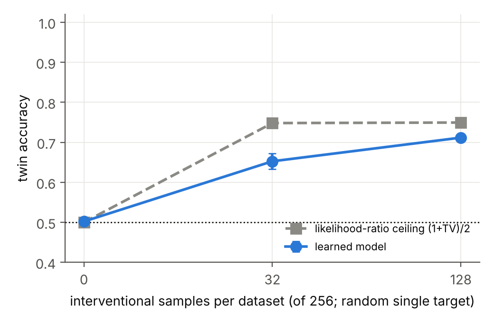
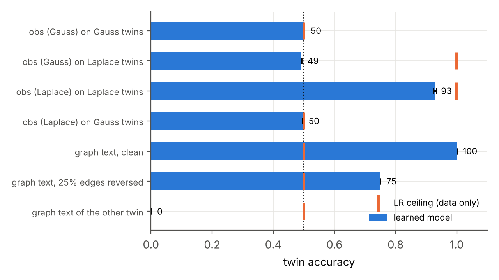

# Observational Twins: An Information-Theoretic Test for Separating Causal Inference from Correlational Shortcuts in Learned Reasoners

**Target venue:** NeurIPS 2027 (Datasets & Benchmarks / Evaluation track)

---

## Abstract

Whether a learned model "really" reasons causally or merely exploits correlations is usually argued from benchmark accuracy. We show that accuracy on i.i.d. causal-query benchmarks cannot settle this question, and we propose a test that can. The test is built from *observational twins*: pairs of structural causal models (SCMs) that induce exactly the same observational distribution but give opposite answers to a causal query. We prove that on a twin pair, any reasoner whose input is a function of observational samples plus side information shared by both twins (variable names, prompt wording, label order) has pair-averaged accuracy exactly 1/2, and that with any additional evidence (interventional samples, non-Gaussian noise) the achievable accuracy is bounded by (1 + TV)/2, where TV is the total-variation distance between the two evidence distributions; the likelihood-ratio test attains the bound. We call 2·acc − 1 the *causal surplus*: it is zero for pure correlational reasoning and its ceiling is fixed by the evidence, so a model's surplus relative to the ceiling measures how much of the available causal information it actually uses. For linear-Gaussian SCMs we give a constructive twin generator (covered-edge reversal with population refit) and verify exhaustively on all 543 DAGs over four variables that it reaches every Markov-equivalence-unidentified ancestral query. We then train small amortized causal-query networks (DeepSets over samples) on CPU under eight information regimes. A model trained where variable labels partly follow the causal order reaches up to 92% i.i.d. accuracy, above the 81% ceiling of an oracle that knows the true Markov equivalence class, yet its twin accuracy is 50.0% (paired-bootstrap 95% CI 49.6–50.3): high benchmark accuracy here is entirely shortcut. Models given interventional samples or non-Gaussian noise do obtain a non-zero surplus, and the twin test reports what fraction of the information-theoretic ceiling they capture. We release the generator, the bound, and a pre-registered protocol for applying the test to large language models.

## 中文摘要

模型究竟是在进行真正的因果推理，还是仅仅利用相关性？这一问题通常依据基准测试的准确率来争论。本文证明，独立同分布（i.i.d.）因果查询基准上的准确率无法回答这一问题，并提出一种能够回答它的检验方法——"观测孪生体"（observational twins）：一对结构因果模型，它们产生完全相同的观测分布，但对同一因果查询给出相反的答案。我们证明：对于任何输入仅为观测样本与两个孪生体共享的辅助信息（变量名、提示措辞、标签顺序）之函数的推理器，其在孪生对上的平均准确率严格等于 1/2；若存在额外证据（干预样本、非高斯噪声），可达准确率的上界为 (1+TV)/2，其中 TV 为两种证据分布之间的总变差距离，且似然比检验可达到该上界。我们将 2·acc−1 定义为"因果盈余"：纯相关性推理的盈余为零，其上限由证据决定，因此模型盈余相对上限的比例度量了它实际利用了多少可用的因果信息。针对线性高斯 SCM，我们给出构造性孪生体生成器（覆盖边反转加总体重拟合），并在四变量全部 543 个 DAG 上穷举验证它能覆盖所有在马尔可夫等价类下不可识别的祖先查询。随后，我们在 CPU 上于八种信息条件下训练小型摊销式因果查询网络。在变量标签部分遵循因果顺序的数据上训练的模型，其 i.i.d. 准确率最高达 92%，超过了知晓真实马尔可夫等价类的预言机上限（81%），但其孪生准确率仅为 50.0%（配对自助法 95% 置信区间 49.6–50.3）：此处的高基准准确率完全来自捷径。获得干预样本或非高斯噪声的模型确实获得了非零盈余，孪生检验报告了它们捕获信息论上限的比例。我们公开了生成器、界和一份将该检验应用于大语言模型的预注册协议。

---

## 1 Introduction

The question "can models perform genuine causal reasoning, rather than correlational inference?" has generated two largely disconnected literatures. One evaluates large language models (LLMs) on causal questions posed in text: CLadder (Jin et al., 2023), Corr2Cause (Jin et al., 2024), interventional-reasoning probes (Kasetty et al., 2024), and broad evaluations of causal-argument generation (Kıcıman et al., 2023). The other trains networks to map datasets to causal structures, e.g. AVICI (Lorch et al., 2022) and CSIvA (Ke et al., 2023). A recurring worry runs through both: high accuracy may come from cues that correlate with the right answer in the benchmark but have nothing to do with causal inference. Zečević et al. (2023) argue that LLMs are "causal parrots" that repeat correlations among causal facts seen in training text; Yu and Zhou (2026) show that replacing semantic variable names with placeholders opens a gap on CLadder-style benchmarks; and in classical causal discovery, Reisach et al. (2021) showed that simulated benchmarks can be "gamed" by sorting variables by marginal variance.

These critiques share one structure. A model is shown to depend on a particular shortcut, and a perturbation is designed to remove that shortcut. But each perturbation targets a cue someone thought of. What is missing is a test that is *complete* against shortcuts: one that any non-causal strategy fails, whatever cue it exploits, together with a quantitative statement of what a perfect causal reasoner could achieve on the same input.

Pearl's ladder of causation (Pearl, 2009) separates association, intervention and counterfactuals, and the causal hierarchy theorem (Bareinboim et al., 2022) states that interventional (rung-2) queries are in general not determined by observational (rung-1) information. We turn this impossibility result into an evaluation instrument. An *observational twin pair* consists of two SCMs that induce the same observational distribution but disagree on a causal query. On such a pair, a reasoner that uses only observational information, however sophisticated and however many correlational shortcuts it has learned, must give the same answer distribution to both twins and therefore scores exactly 1/2 averaged over the pair. Any surplus above 1/2 must come from evidence that distinguishes the twins, and that surplus is capped by the total-variation distance between the two evidence distributions. The test therefore has a floor that does not depend on which shortcuts are present and a ceiling we can compute.

**Contributions.**

1. **A formal criterion.** We define observational twins and the *causal surplus* 2·acc − 1 on twin pairs. We prove (Proposition 1) that the surplus is exactly zero for every reasoner whose input is a function of observational samples and of side information shared within the pair, and (Proposition 2) that in general it is bounded by the total-variation distance between the twins' evidence distributions, with equality attained by the likelihood-ratio test. This yields a normalized score, *ceiling capture*, that compares models evaluated under different evidence regimes.
2. **A complete constructive generator for linear-Gaussian SCMs.** Reversing a covered edge and refitting by population regression preserves the Gaussian joint law exactly and flips the ancestral relation of the reversed pair (Proposition 3). Building on Chickering's (1995) transformational characterization, we show that repeated covered reversals reach a twin for every ancestral query not identified by the Markov equivalence class, and we verify this exhaustively for all 543 DAGs (185 equivalence classes, 4,008 unidentified DAG–query pairs) on four nodes.
3. **A controlled demonstration that i.i.d. accuracy and causal surplus come apart.** We train amortized causal-query networks on CPU under eight information regimes. A label-order shortcut lifts i.i.d. accuracy from 75% to 92%, past the 81% ceiling of an oracle that knows the true equivalence class, while twin accuracy stays at 50.0%. Interventional data and non-Gaussian noise produce genuine, measurable surplus, and the test reports what fraction of the ceiling each model captures. Cross-regime probes show that a model trained on Gaussian data captures none of the large surplus that non-Gaussian data makes available (LR ceiling 99.9%).
4. **A pre-registered protocol for LLMs.** We specify how to render twin pairs as natural-language and tabular prompts, which statistics to report, and which outcomes would count as evidence for and against causal reasoning (Section 7). We did not run it here (no LLM access in our environment) and present it as a protocol, not a result.

Our position is deliberately modest. We do not claim to settle whether any particular large model reasons causally. We claim that the question has a crisp operational form, that i.i.d. benchmark accuracy is the wrong statistic for it, and that the twin surplus is a statistic with a provable floor and a computable ceiling.

## 2 Related Work

**Causal reasoning benchmarks for LLMs.** CLadder (Jin et al., 2023) generates questions on all three rungs of Pearl's hierarchy from an oracle causal-inference engine and renders them in natural language. Corr2Cause (Jin et al., 2024) asks models to infer causal relations from stated correlations and reports near-chance performance, with fine-tuned models failing to generalize under paraphrase. Kasetty et al. (2024) build interventional-reasoning tests designed to separate reasoning from memorized facts. Kıcıman et al. (2023) find strong performance on causal-argument tasks but note that LLMs ignore the actual data. Zečević et al. (2023) formalize the "causal parrot" hypothesis via meta-SCMs. Yu and Zhou (2026) show that placeholder variable names remove much of the reported accuracy. Our test is complementary: rather than removing one cue, it builds instances in which *every* rung-1 cue is held fixed and only rung-2 truth changes.

**Amortized causal discovery.** AVICI (Lorch et al., 2022) and CSIvA (Ke et al., 2023) train networks on simulated SCMs to predict graphs from observational and interventional data. They are evaluated by structural metrics on i.i.d. draws from a simulator. Reisach et al. (2021) showed that such simulators can leak the causal order through marginal variances ("varsortability"); our label-order shortcut is a controlled analogue. The twin test is an evaluation that is immune to any leak of this kind, because the leak is shared within each pair.

**Identifiability.** Two DAGs are observationally equivalent iff they share skeleton and v-structures (Verma & Pearl, 1990); equivalence classes are represented by essential graphs (Andersson et al., 1997), and members of a class are connected by covered-edge reversals (Chickering, 1995). Interventions refine equivalence classes (Hauser & Bühlmann, 2012; Eberhardt et al., 2005); non-Gaussian noise makes linear models fully identifiable (Shimizu et al., 2006). These results tell us *which* queries the evidence determines; our bound turns them into a finite-sample ceiling for evaluation.

**Contrast sets and counterfactual data.** Contrast sets (Gardner et al., 2020) and counterfactually-augmented data (Kaushik et al., 2020) evaluate models on minimally edited inputs whose gold label flips. Observational twins are the causal-inference analogue with a stronger property: the "edit" is invisible in the input distribution itself, so the floor of 1/2 is a theorem rather than an empirical expectation.

**Shortcut learning and causal world models.** Geirhos et al. (2020) describe shortcut learning as decision rules that succeed on benchmarks but fail under harder test conditions. Richens and Everitt (2024) prove that agents satisfying regret bounds under many distribution shifts must have learned approximate causal models. Our result is in the same spirit but in the reverse direction and at the level of evaluation: we give the distribution shift (from an i.i.d. test to a twin test) under which correlational strategies provably fail.

## 3 Theory

### 3.1 Setup

A *causal-query task* draws an SCM M from a prior Π, an evidence object E ~ P_M^E (e.g. N i.i.d. observational samples, possibly mixed with interventional samples), side information S (variable names, textual descriptions, prompt wording, the ordering of variables), and a binary query q (e.g. "is X_i an ancestor of X_j?", equivalently "does do(X_i) change the distribution of X_j?" under faithfulness) with answer y = q(M) ∈ {0,1}. A *reasoner* is a (possibly randomized) map f(E, S, q) ∈ {0,1}. All learned networks and all prompted LLMs are reasoners in this sense.

**Definition 1 (observational twins).** SCMs M, M′ over the same variables are *observational twins for q* if P_M(V) = P_{M′}(V) and q(M) ≠ q(M′).

**Definition 2 (twin test, causal surplus).** Given twin pairs (M_k, M′_k, q_k) with shared side information S_k, the *twin accuracy* of f is acc_tw = (1/2K) Σ_k [Pr(f(E_k,S_k,q_k)=q_k(M_k)) + Pr(f(E′_k,S_k,q_k)=q_k(M′_k))], with E_k ~ P^E_{M_k}, E′_k ~ P^E_{M′_k}. The *causal surplus* is Δ = 2·acc_tw − 1 ∈ [−1, 1].

### 3.2 The floor and the ceiling

**Proposition 1 (zero surplus for observational reasoners).** If the evidence consists only of observational samples, then for every reasoner f, every twin pair has pair-averaged accuracy exactly 1/2, so Δ = 0.

*Proof.* Since P_M(V) = P_{M′}(V), E and E′ have the same law, and S, q are shared, so f(E,S,q) and f(E′,S,q) have the same law. Writing a = Pr(f = 1), and assuming w.l.o.g. q(M) = 1, q(M′) = 0, the pair-averaged accuracy is (a + (1 − a))/2 = 1/2. ∎

The statement is elementary, which is the point: it holds for *every* f, including ones that exploit label order, variable names, marginal variances, or memorized facts, so long as these cues are shared by the twins. It turns a cue-by-cue debate into a single invariance requirement on the test construction.

**Proposition 2 (ceiling).** Let P = P^E_M and Q = P^E_{M′} be the evidence laws of a twin pair. For every reasoner f, pair-averaged accuracy ≤ (1 + TV(P,Q))/2, with equality for the likelihood-ratio rule f(E) = 1[p(E) > q(E)]. Hence Δ ≤ TV(P,Q).

*Proof.* Let A be the (randomized) acceptance region. Pair accuracy is (P(A) + 1 − Q(A))/2 ≤ (1 + sup_A |P(A) − Q(A)|)/2 = (1 + TV)/2; the supremum is attained by A = {p > q}. This is Le Cam's two-point bound (cf. Tsybakov, 2009, Ch. 2). ∎

For i.i.d. samples TV(P^N, Q^N) → 1 whenever P ≠ Q, so the ceiling depends on N and on how strongly the evidence separates the twins; we estimate it per pair by evaluating the exact likelihood ratio under the two known SCMs. We report *ceiling capture* κ = Δ / Δ_LR, where Δ_LR is the surplus of the likelihood-ratio oracle on the same pairs: κ = 0 means no causal information is used, κ = 1 means all of it is.

**Remark (what the test does and does not certify).** Δ > 0 certifies that f's answer depends on features of the evidence that distinguish the twins, i.e. on rung-2-relevant information. It does not certify that f has an explicit causal model; an f that uses interventional samples correctly, by any mechanism, earns surplus. Conversely, Δ ≈ 0 when Δ_LR ≈ 0 is uninformative: the test discriminates only where the ceiling is high.

### 3.3 Constructing twins for linear-Gaussian SCMs

A linear SCM is X_j = Σ_i W_ij X_i + s_j ε_j with independent standardized noise ε. An edge u → v is *covered* if pa(v) = pa(u) ∪ {u} (Chickering, 1995).

**Proposition 3 (covered-edge twins).** Let M be a linear SCM with Gaussian noise and DAG G containing covered edge u → v. Let G′ be G with u → v reversed and let M′ have, for every node j, coefficients and noise scale given by the population regression of X_j on pa_{G′}(j) under Σ_M = Cov_M(X). Then (i) P_{M′} = P_M, and (ii) u is an ancestor of v in G but not in G′.

*Proof sketch.* (i) G′ is Markov equivalent to G (Chickering, 1995, Lemma 1), so Σ_M satisfies the Markov property of G′; population regression on G′-parents yields an SCM whose implied covariance equals Σ_M, and zero-mean Gaussians are determined by their covariance. (ii) In G′, v → u, so u is not an ancestor of v by acyclicity. In G, u → v directly. ∎

Two observations make this useful for evaluation. First, the same query (u, v) receives answer 1 on M and 0 on M′, and nothing about variable identity changes: side information is shared by construction. Second, the construction is *complete* for the observationally unidentified fragment. Every pair of Markov-equivalent DAGs is connected by a sequence of covered-edge reversals (Chickering, 1995, Theorem 2), so for any ancestral query whose answer varies within the equivalence class of G there is a chain of reversals, each preserving the Gaussian law, ending at a DAG with the opposite answer. We verified this exhaustively for n = 4 (Section 5.1).

When the noise is non-Gaussian (we use Laplace), the same pair M, M′ (with M′ refit as above but sampled with Laplace noise) no longer has equal joint laws, since linear non-Gaussian models are identifiable (Shimizu et al., 2006). The pair then becomes a *probe* with a high ceiling: the evidence permits causal discrimination, and the question is whether a model uses it. Similarly, mixing in samples drawn under do(X_t ~ N(0,1)) separates the twins when t ∈ {u, v} and leaves them equal otherwise.

## 4 Experimental Design

All experiments are CPU-scale and fully reproducible from `code/run_all.sh`; every number reported in Sections 5–6 is read from JSON files in `results/` produced by that script (seeds 0 and 1 where stated).

### 4.1 Task distribution

SCMs have n = 4 variables. A DAG is drawn by including each edge of a random total order with probability 0.5; nonzero weights are ±U(0.5, 2); noise scales are U(0.5, 1.5). Each dataset has N = 256 samples. Every variable is standardized per dataset before encoding, which removes marginal-variance ("varsortability") cues (Reisach et al., 2021). The query is "is X_i an ancestor of X_j?", balanced between positive and negative answers. Variables are relabelled by a uniformly random permutation, except that with probability p_order the labels follow the causal order. This *label-order shortcut* is a controlled stand-in for any side cue that correlates with causal direction in a training distribution: variable naming conventions in text, the order in which a story mentions events, or simulator artefacts.

### 4.2 Information regimes

We train one model per regime:

| Regime | Evidence | Side information |
|---|---|---|
| obs_p0 / p05 / p09 / p1 | 256 observational samples, Gaussian noise | label order follows causal order w.p. 0 / 0.5 / 0.9 / 1 |
| laplace_p0 | 256 observational samples, Laplace noise (unit variance) | random labels |
| int32_p0, int128_p0 | 256 samples, the last 32 or 128 drawn under do(X_t ~ N(0,1)) for a uniformly random target t; intervention indicators given | random labels |
| graph_p0 | 256 observational samples | a "textual" adjacency matrix of the true DAG |

The graph regime models a reasoner that is told the causal story in words (as in CLadder-style prompts) in addition to seeing data.

### 4.3 Model

Each (dataset, query) item is encoded by reordering variables so that the queried pair comes first, then forming per-sample features (4 standardized values, 10 pairwise products, 4 intervention indicators). A DeepSets network (three-layer MLP φ of width 128, mean pooling over samples, three-layer MLP ρ) outputs the logit of "yes". ρ also receives the label-order bit 1[i < j] (the only way variable identity enters) and, in the graph regime, the flattened 4×4 description. Training uses binary cross-entropy, Adam (lr 10⁻³, cosine decay), 4,000 steps of 64 freshly sampled items. The architecture is permutation-invariant over samples and therefore can compute any symmetric statistic of the empirical distribution, including higher moments needed to exploit non-Gaussianity.

### 4.4 Evaluation

*i.i.d. test.* 4,000 fresh items from the training distribution. We also split accuracy by whether the query is identified by the Markov equivalence class (MEC) of the true DAG, and report two oracles: an *MEC-uniform* oracle that knows the population MEC and answers with the majority answer over its member DAGs, and an *MEC + label-order* oracle that additionally orients the skeleton by label order when that orientation lies in the MEC. These are reference points for what observational data plus label cues can support.

*Twin test.* 1,500 twin pairs per probe. For each pair we draw an SCM with random labels, choose a covered edge u → v uniformly, build M′ by Proposition 3, sample a fresh dataset from each, and query (u, v) on both (answers 1 and 0). We report twin accuracy, a paired bootstrap 95% CI over pairs (2,000 resamples), the fraction of pairs on which the model answers *both* twins correctly, and the likelihood-ratio ceiling computed from the exact log-likelihoods of the sampled data under M and M′ (ties scored 1/2).

*Cross-regime probes.* Gaussian-trained models are tested on Laplace twins (high ceiling), the Laplace-trained model on Gaussian twins (zero ceiling), and the graph model on twins whose description has 25% of edges reversed and on a *conflict* probe where each twin's dataset is paired with the *other* twin's description.

### 4.5 Exhaustive checks of the theory

`code/verify_theory.py` enumerates all DAGs on four labelled nodes, groups them into MECs by skeleton and v-structures, runs breadth-first search over covered-edge reversals inside each MEC (checking that it reaches every member), and for every DAG and every ordered pair (i, j) whose ancestral answer varies within the MEC records the minimum number of reversals needed to reach a twin. It also draws 20,000 SCMs from the training prior, constructs a twin whenever a covered edge exists, and checks the maximum absolute difference between implied covariance matrices.

## 5 Results

Unless stated otherwise, numbers are means over the available seeds (two seeds for obs_p0, obs_p1, laplace_p0, int32_p0; one seed for obs_p05, obs_p09, graph_p0, int128_p0), with ± the between-seed standard deviation. Source files: `results/summary_table.md`, `results/theory_checks.json`, and the per-run JSONs.

### 5.1 The twin generator is exact and complete on four nodes

The exhaustive enumeration (`results/theory_checks.json`) finds 543 DAGs on four labelled nodes in 185 Markov equivalence classes. Breadth-first search over covered-edge reversals reaches every member of every class. There are 4,008 (DAG, ordered pair) combinations whose ancestral answer is not identified by the class, and **every one of them (0 exceptions) has an observational twin** reachable by covered reversals. The minimum number of reversals is 1 for 2,280 combinations (56.9%), 2 for 1,248, 3 for 432 and 4 for 48. Under the training prior, 84.6% of sampled SCMs contain at least one covered edge, and over 20,000 sampled SCMs the largest absolute difference between the implied covariances of an SCM and its constructed twin is 7.1 × 10⁻¹⁴, i.e. floating-point error. The likelihood-ratio oracle confirms this on sampled data: on Gaussian observational twins its accuracy is 50.0% in every run (all likelihood ratios tie to within 10⁻⁷ relative error).

### 5.2 A shortcut raises i.i.d. accuracy past the observational limit; twin accuracy does not move

Figure 1 and Table 1 show the four Gaussian observational regimes.

**Table 1.** i.i.d. accuracy, oracle references, and twin performance (%, Gaussian observational data).

| Regime (p_order) | i.i.d. acc | MEC-uniform oracle | MEC + label-order oracle | Twin acc | Twin LR ceiling | Pairs with both twins correct |
|---|---|---|---|---|---|---|
| obs_p0 (0) | 74.6 ± 0.5 | 80.6 | 79.0 | 50.2 ± 0.0 | 50.0 | 2.0 |
| obs_p05 (0.5) | 77.1 | 79.7 | 89.2 | 49.2 | 50.0 | 3.9 |
| obs_p09 (0.9) | 89.5 | 80.6 | 97.8 | 49.9 | 50.0 | 1.5 |
| obs_p1 (1) | 92.5 ± 0.2 | 81.2 | 100.0 | 50.0 ± 0.1 | 50.0 | 1.1 |

*Figure 1. i.i.d. accuracy (blue) rises with the strength of the label-order cue and passes the observational limit (MEC-uniform oracle, green); twin accuracy (orange) stays at the provable bound of 1/2. Error bars: between-seed s.d. where two seeds exist.*

Three facts stand out.

1. *I.i.d. accuracy exceeds what observational data can support.* The MEC-uniform oracle, which knows the exact population equivalence class and nothing else, reaches 80–81%. With p_order ≥ 0.9 the trained models exceed it (89.5% and 92.5%). The excess can only come from the label-order cue, as the MEC + label-order oracle (97.8–100%) confirms is possible.
2. *Twin accuracy is at chance in every regime.* For obs_p1, twin accuracy is 50.0% with paired-bootstrap 95% CI [49.6, 50.3] (seed 0). Across all four regimes and six runs, the causal surplus lies between −0.015 and +0.005.
3. *The model gives the same answer to both twins.* Mean P(yes) on M and on M′ agree to within 0.003 in every regime, the mean absolute within-pair difference in P(yes) is 0.02–0.06, and only 1–4% of pairs have both twins answered correctly. The twin test identifies not just that the model is at chance, but why: its output does not depend on the features that distinguish the twins, as Proposition 1 requires.

Note that the obs_p0 model (74.6%) does not reach the MEC-uniform oracle (80.6%), so it is also not an optimal *observational* reasoner. The twin test is silent on this, by design: it measures causal surplus, not observational efficiency.

### 5.3 Informative evidence produces measurable surplus

When the evidence can distinguish the twins, the models do earn surplus (Table 2, Figure 2).

**Table 2.** Twin performance under informative evidence. κ = Δ / Δ_LR is ceiling capture (per-seed values in `results/summary_table.md`).

| Regime | i.i.d. acc | Twin acc | LR ceiling | Surplus Δ | κ |
|---|---|---|---|---|---|
| laplace_p0 (Laplace noise) | 91.9 ± 0.2 | 92.9 ± 0.4 | 99.8 | 0.857 | 0.86 (0.868, 0.852) |
| int32_p0 (32 interventional samples) | 82.5 ± 0.5 | 65.3 ± 2.0 | 74.8 | 0.305 | 0.62 (0.705, 0.527) |
| int128_p0 (128 interventional samples) | 85.8 | 71.2 | 74.9 | 0.423 | 0.85 |

*Figure 2. Twin accuracy of models trained with interventional samples versus the likelihood-ratio ceiling.*

The interventional ceiling is close to 75%, not 100%, for a reason the theory predicts: the intervention target is uniform over four variables, and only interventions on u or v separate a covered-edge twin pair (interventions on other variables leave the conditional law of (X_u, X_v) given their common parents unchanged in both twins). With probability 1/2 the evidence is uninformative and the best achievable accuracy is 1/2; with probability 1/2 it is nearly decisive, so the ceiling is ≈ 0.5·1 + 0.5·0.5 = 0.75. Raising the number of interventional samples from 32 to 128 increases twin accuracy from 65.3% to 71.2% and κ from 0.62 to 0.85 while the ceiling barely moves, i.e. the extra samples help the learned model, not the oracle. The between-seed spread at 32 samples (κ = 0.705 vs 0.527) is large, so we read this as a trend, not a precise estimate.

The Laplace-trained model attains 92.9% twin accuracy against a 99.8% ceiling (κ = 0.86). This is the regime in which linear causal direction is identifiable from observational data alone (Shimizu et al., 2006), and the twin test shows the network has learned to exploit it.

### 5.4 Surplus does not transfer across evidence types; text overrides data

*Figure 3. Twin accuracy across evidence types and probes (blue) against the data-only likelihood-ratio ceiling (orange ticks). For the graph-text rows the description is itself evidence, so the data-only ceiling does not bound them (Section 5.4).*

Cross-regime probes (Figure 3) show that surplus is specific to the evidence type seen in training.

- Gaussian-trained models evaluated on *Laplace* twins (ceiling 99.8–100%) score 48.7–50.0% (κ between −0.027 and +0.002 across the four regimes). The information is in the data; the models do not use it.
- The Laplace-trained model on *Gaussian* twins scores 49.5% against a ceiling of 50.0%, as Proposition 1 requires.
- The graph-description model scores 100% on twins when given the true graph. This is not a violation of Proposition 1: the description *differs* between the twins, so it is evidence, not shared side information, and the relevant ceiling is 100%, not the data-only 50%. With 25% of edges reversed in the description, twin accuracy is 75.0%, which matches the probability (0.75) that the queried edge itself is described correctly. When each dataset is paired with the *other* twin's description, accuracy is 0.0%: the model follows the description in 100% of cases.

On Gaussian twins, following the description is optimal, since the data are uninformative. The conflict probe becomes a test of *data-grounded* causal reasoning only when the data carry causal information as well (protocol item P4, Section 7).

## 6 Why i.i.d. Accuracy Overstates Causal Ability: A Decomposition

The results admit a simple accounting that applies to any benchmark. Let Acc_iid be accuracy on queries drawn from the benchmark prior, and partition queries into those identified from the available evidence (fraction π_id) and those not identified. For identified queries, causal surplus is possible and accuracy can approach 1 without shortcuts. For unidentified queries, any accuracy above the posterior-majority rate under the prior restricted to the evidence-equivalence class (what our MEC-uniform oracle computes, up to the prior's non-uniformity within classes) must come from side information correlated with the answer.

In our setting, about 44–46% of benchmark queries are identified by the MEC (`results/summary_table.md`; 53.8% of all ordered pairs under the prior, `theory_checks.json`, before balancing positives and negatives). On the unidentified remainder, accuracy rises from 66.0% (p_order = 0) to 92.1% (p_order = 1) while accuracy on identified queries rises much less (85.5% to 93.0%). Of the 17.9-point i.i.d. gain, roughly 14.4 points come from the unidentified queries (26.1-point rise, weighted by their ≈55% share) and only ≈3.4 from identified ones; the former can only be shortcut. The twin test is the limiting case of this decomposition: it consists *only* of unidentified queries, constructed in pairs so that the prior-majority rate is exactly 1/2 and every side cue is held fixed.

Two consequences follow for causal-reasoning benchmarks in text. First, a benchmark can only measure causal surplus on the fraction of its items whose answers are not determined by information the model could have absorbed correlationally (names, phrasing, world knowledge). Second, this fraction can be made exactly 1 by construction, by building items in twin pairs, without having to anticipate which shortcuts a model uses.

## 7 A Pre-registered Protocol for Large Language Models

We could not run LLMs in our environment (no GPU, no API access). We therefore state a protocol in advance, so that its results can be read as confirmatory, not exploratory.

**Instances.** Generate twin pairs with the generator in `code/scm.py` on n ∈ {3, 4, 5} variables. For each pair, render each twin in three formats: (F1) a table of N ∈ {20, 100} rows of sampled values with abstract variable names (A, B, C, D); (F2) a verbal summary of the observational statistics (correlations and partial correlations), which is identical for both twins by construction; (F3) F1 plus K rows drawn under an announced intervention on u or v (ceiling > 1/2). Ask "If we intervened to set A, would the distribution of B change?" with the queried pair mapped to the reversed edge. Randomize variable names, row order and the position of the queried variables in the prompt, independently per pair but *identically within a pair*.

**Primary statistics.** Twin accuracy and causal surplus Δ with paired bootstrap CIs; the within-pair agreement rate (fraction of pairs given the same answer); the LR ceiling for F3; ceiling capture κ.

**Predictions and decision rule.** (P1) On F1 and F2, Δ must lie within its CI of 0 for any model; a significantly nonzero Δ on F2 would indicate a bug in rendering (the two prompts are not identical), and on F1 a leak through sampling, not causal ability. (P2) Reported accuracy on i.i.d. versions of the same questions (random graphs, not twins) will exceed 1/2 for models that exploit name or order cues; the gap between i.i.d. accuracy and the MEC-uniform oracle is an upper bound on shortcut use. (P3) The informative test is F3: a model reasoning causally from data should have κ substantially above 0 and increasing in K. We will regard κ < 0.1 at K large enough that the LR ceiling exceeds 0.95 as evidence that the model does not use interventional evidence. (P4) Adding a fluent but *conflicting* causal narrative (the other twin's graph in words) to F3 measures how far text overrides data; we predict a strong pull toward the narrative, which we measure as the drop in κ.

**What would falsify our framing.** If models achieved κ near 1 on F3 while also matching the MEC-uniform oracle on i.i.d. observational queries (no shortcut excess), we would conclude that, on this task family, they perform the causal inference the data supports. If i.i.d. accuracy exceeded the observational oracle while F1 surplus is zero, as in our small-model experiments, the i.i.d. score would be shown to be shortcut-driven.

## 8 Discussion

**Accuracy is the wrong statistic.** The central empirical message is the dissociation in Figure 1: as the label-order cue strengthens, i.i.d. accuracy rises past what any reasoner could achieve from observational data without side information (the MEC-uniform oracle), while twin accuracy stays at chance. Reported against i.i.d. benchmarks, the p = 1 model would look like the best of our observational-data reasoners; under the twin test it has zero causal surplus. Nothing in the i.i.d. score distinguishes "learned to read off the label order" from "learned causal inference", and Proposition 1 explains why the twin score does.

**What "genuine" can mean operationally.** The question of whether a model "really" reasons causally is often posed as a question about internal mechanism. The twin surplus offers a behavioural criterion: a reasoner is using causal information exactly to the extent that its answers differ between inputs that are rung-1-identical but rung-2-different. This is falsifiable, computable per instance, and comes with a calibrated ceiling. It deliberately says nothing about *how* the information is used. An LLM that has memorized that "smoking causes cancer" will score at chance on twin pairs about smoking and cancer, because in one twin the arrow is reversed and memory cannot tell which twin it was shown. That is the intended behaviour of the test.

**Causal ability is regime-specific.** Our cross-regime probes show that surplus does not transfer automatically. The Gaussian-trained model sees Laplace twins whose evidence separates them almost perfectly (LR ceiling 99.9%), yet captures none of that information, because nothing in its training rewarded it. A claim that a model "can reason causally" should therefore be indexed by evidence type: from observational Gaussian data (impossible beyond the MEC), from non-Gaussian data, from interventions, from text.

**Text versus data.** The graph-description regime illustrates the "causal parrot" concern in miniature. When given an accurate description, the model answers twin queries perfectly, but the conflict probe shows that its answers follow the description, not the data. On observational Gaussian twins this is the optimal policy, since the data carry no causal information; the conflict probe becomes diagnostic only when combined with evidence that does carry it (protocol P4).

## 9 Limitations

- **Scale and model class.** Our models are small DeepSets networks on four-variable linear SCMs, trained for 4,000 steps on CPU. The experiments isolate the mechanism (shortcut versus surplus) but say nothing directly about LLMs, which we did not evaluate. Section 7 is a protocol, not evidence.
- **Query and SCM family.** We study only ancestral queries in linear SCMs without hidden confounders. Twin constructions for nonlinear SCMs, for confounded models (where observational twins are far more common), and for counterfactual (rung-3) queries require other generators; Proposition 1 and Proposition 2 still apply, but Proposition 3 does not.
- **Single covered reversals.** Our twin test samples one covered reversal per pair, i.e. the subset of unidentified queries at reversal distance 1 (56.9% of unidentified DAG–query pairs on four nodes; Section 5.1). Deeper twins are guaranteed to exist but are not sampled in the training-run evaluations.
- **Few seeds.** Most regimes have one or two training seeds. Within-run CIs are tight, but between-seed variance of i.i.d. accuracy and ceiling capture is estimated from at most two runs.
- **Untuned models.** We did not tune architecture or training length per regime. Ceiling capture below 1 for the interventional and Laplace models may partly reflect undertraining or the limited feature encoding, not a fundamental limit of amortized inference.
- **The floor holds only if side information is truly shared.** In natural-language renderings, any rendering choice that differs between twins (e.g. listing parents first) breaks Proposition 1. Test construction must enforce identical side information; we provide this for our synthetic encoding but it must be re-checked for each new rendering.

## 10 Conclusion

We have argued that "does the model reason causally or only correlationally?" has a precise behavioural form: does the model's answer change between observational twins? Every reasoner restricted to correlational information scores exactly 1/2 on twin pairs regardless of what shortcuts it uses, and the achievable surplus beyond 1/2 is fixed by a total-variation ceiling. In a controlled experiment, a strong correlational shortcut raised i.i.d. accuracy above the observational-identifiability limit while leaving twin accuracy at chance, and genuine evidence (interventions, non-Gaussian noise) produced measurable surplus whose share of the ceiling the test reports directly. We hope the twin test, its generator, and the pre-registered LLM protocol will be used to replace accuracy-based claims about causal reasoning with surplus-based ones.

## Reproducibility

`bash code/run_all.sh` regenerates every result (Python 3, numpy, torch CPU; each training run takes about 10 minutes on one CPU core; with four in parallel the full set of twelve runs takes about 30–35 minutes on 4 cores). `code/verify_theory.py` produces `results/theory_checks.json`; `code/twins.py` produces `results/<regime>_s<seed>.json`; `code/summarize.py` produces `results/summary_table.md` and the three figures.

## References

Andersson, S. A., Madigan, D., & Perlman, M. D. (1997). A characterization of Markov equivalence classes for acyclic digraphs. *Annals of Statistics*, 25(2), 505–541.

Bareinboim, E., Correa, J. D., Ibeling, D., & Icard, T. (2022). On Pearl's hierarchy and the foundations of causal inference. In H. Geffner, R. Dechter, & J. Y. Halpern (Eds.), *Probabilistic and Causal Inference: The Works of Judea Pearl* (Chapter 27). ACM. doi:10.1145/3501714.3501743.

Chickering, D. M. (1995). A transformational characterization of equivalent Bayesian network structures. In *Proceedings of the 11th Conference on Uncertainty in Artificial Intelligence (UAI)*, 87–98.

Eberhardt, F., Glymour, C., & Scheines, R. (2005). On the number of experiments sufficient and in the worst case necessary to identify all causal relations among N variables. In *Proceedings of the 21st Conference on Uncertainty in Artificial Intelligence (UAI)*. arXiv:1207.1389.

Gardner, M., Artzi, Y., et al. (2020). Evaluating models' local decision boundaries via contrast sets. In *Findings of the Association for Computational Linguistics: EMNLP 2020*, 1307–1323.

Geirhos, R., Jacobsen, J.-H., Michaelis, C., Zemel, R., Brendel, W., Bethge, M., & Wichmann, F. A. (2020). Shortcut learning in deep neural networks. *Nature Machine Intelligence*, 2(11), 665–673.

Hauser, A., & Bühlmann, P. (2012). Characterization and greedy learning of interventional Markov equivalence classes of directed acyclic graphs. *Journal of Machine Learning Research*, 13, 2409–2464.

Jin, Z., Chen, Y., Leeb, F., Gresele, L., Kamal, O., Lyu, Z., Blin, K., Gonzalez Adauto, F., Kleiman-Weiner, M., Sachan, M., & Schölkopf, B. (2023). CLadder: Assessing causal reasoning in language models. In *Advances in Neural Information Processing Systems 36 (NeurIPS 2023)*, 31038–31065.

Jin, Z., Liu, J., Lyu, Z., et al. (2024). Can large language models infer causation from correlation? In *International Conference on Learning Representations (ICLR 2024)*.

Kasetty, T., Mahajan, D., Dziugaite, G. K., Drouin, A., & Sridhar, D. (2024). Evaluating interventional reasoning capabilities of large language models. arXiv:2404.05545 (NeurIPS 2024 Workshop on Causality and Large Models).

Kaushik, D., Hovy, E., & Lipton, Z. C. (2020). Learning the difference that makes a difference with counterfactually-augmented data. In *International Conference on Learning Representations (ICLR 2020)*.

Ke, N. R., Chiappa, S., Wang, J., Goyal, A., Bornschein, J., Rey, M., Weber, T., Botvinick, M., Mozer, M., & Rezende, D. J. (2023). Learning to induce causal structure. In *International Conference on Learning Representations (ICLR 2023)*.

Kıcıman, E., Ness, R., Sharma, A., & Tan, C. (2023). Causal reasoning and large language models: Opening a new frontier for causality. *Transactions on Machine Learning Research*. arXiv:2305.00050.

Lorch, L., Sussex, S., Rothfuss, J., Krause, A., & Schölkopf, B. (2022). Amortized inference for causal structure learning. In *Advances in Neural Information Processing Systems 35 (NeurIPS 2022)*.

Pearl, J. (2009). *Causality: Models, Reasoning, and Inference* (2nd ed.). Cambridge University Press.

Reisach, A. G., Seiler, C., & Weichwald, S. (2021). Beware of the simulated DAG! Causal discovery benchmarks may be easy to game. In *Advances in Neural Information Processing Systems 34 (NeurIPS 2021)*.

Richens, J., & Everitt, T. (2024). Robust agents learn causal world models. In *International Conference on Learning Representations (ICLR 2024)*.

Shimizu, S., Hoyer, P. O., Hyvärinen, A., & Kerminen, A. (2006). A linear non-Gaussian acyclic model for causal discovery. *Journal of Machine Learning Research*, 7, 2003–2030.

Tsybakov, A. B. (2009). *Introduction to Nonparametric Estimation*. Springer Series in Statistics. Springer.

Verma, T., & Pearl, J. (1990). Equivalence and synthesis of causal models. In *Proceedings of the 6th Conference on Uncertainty in Artificial Intelligence (UAI)*. (Reprinted as arXiv:1304.1108, "On the equivalence of causal models".)

Yu, Z., & Zhou, S. (2026). Caliper: Probing lexical anchors versus causal structure in LLMs. arXiv:2606.04915.

Zečević, M., Willig, M., Dhami, D. S., & Kersting, K. (2023). Causal parrots: Large language models may talk causality but are not causal. *Transactions on Machine Learning Research*.
