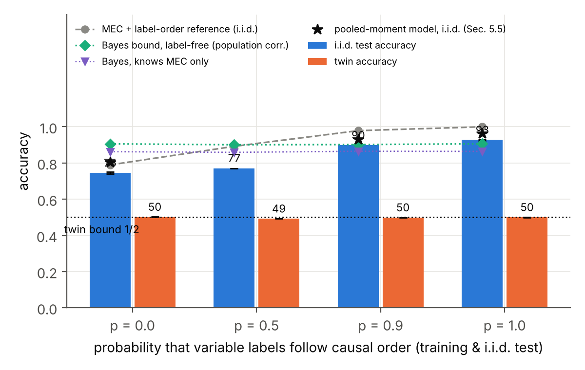

# Observational Twins and Bayes Baselines: Calibrated Tests of Whether Learned Causal Reasoners Use Causal Evidence

**Target venue:** NeurIPS 2027 (Datasets & Benchmarks / Evaluation track)

**Revision note (round 1).** This version responds to the round-1 review (`reviews/response_r1.md`; the round-0 text is in `reviews/paper_r0.md`). Main changes:
1. The Gaussian twin accuracy of 50% is a theorem, so we no longer present it as a finding. It is reported only as a unit test of the generator.
2. The "MEC-uniform oracle" is replaced by exact Bayes-optimal observational baselines under the training prior. We retract the claim that the label-order models exceed "what any reasoner could achieve from observational data", and we redo the shortcut accounting against the new bound.
3. Three new twin probes test the surplus: answer direction balanced, refit twin restricted to the training prior, and any MEC member including non-adjacent queries. They come with a feature ablation and prior-agnostic classical reference reasoners.
4. A second, stronger amortized test subject (a pooled-moment network) is added, along with more seeds and κ confidence intervals.
5. We cite Montagna et al. (2024) and the R²-sortability work, and state that Propositions 1–3 are restatements of known results.
6. The scope is narrower. No LLM or pretrained amortized model was evaluated, because the model hubs were unreachable (Section 7). The LLM protocol is called "pre-specified", not "pre-registered".

---

## Abstract

Claims that a learned model "reasons causally" usually rest on benchmark accuracy. We ask when such accuracy can support the claim, and we make two instruments precise.

*Observational twins* are pairs of structural causal models (SCMs) that induce the same observational distribution but give opposite answers to a causal query. Three known facts make them an evaluation tool:
- Every reasoner that sees only observational data, plus side information shared within the pair, scores exactly 1/2 on the pair. This restates non-identifiability.
- With additional evidence, accuracy is at most (1+TV)/2, and the likelihood-ratio (LR) test attains it (Le Cam).
- For linear-Gaussian SCMs, refitting on any Markov-equivalent DAG gives an exact twin (a corollary of Chickering, 1995).

Twin pairs therefore measure *evidence use*, reported as the fraction κ of the LR ceiling a model captures. They do not measure inference quality.

*Exact Bayes-optimal observational baselines under the benchmark's own prior* calibrate i.i.d. accuracy. For a standard four-variable linear-SCM prior, these baselines show the usual reference is badly mis-set. A reasoner that knows the true Markov equivalence class (MEC) and the prior reaches 86–88%. A label-free reasoner that sees the population correlation matrix reaches 90.1–91.4%, and one that sees the raw covariance reaches 98.5–99.2%. The parameter prior thus nearly identifies causal direction inside the MEC.

We apply both instruments to two small amortized test subjects trained on CPU: a DeepSets network and a stronger pooled-moment network.
- **Label-order shortcut.** Models trained with a label-order cue (labels follow the causal order with probability p) exceed the label-free bound on MEC-unidentified queries in every run: by 4–11 points for the DeepSets models and 6–12 points for the pooled-moment models. Overall, the DeepSets p = 0.9 model does not exceed the bound. Its p = 1 model exceeds it by 1.3–3.1 points, and the pooled-moment models by 2.1–5.5 points. With random labels, these models drop to 60–65% accuracy (50–52% on unidentified queries).
- **Informative evidence.** Under Laplace noise or interventional samples, the networks capture κ = 0.78–0.98 of the LR ceiling on covered-edge twins. The exception is DeepSets on interventional data, where κ varies with seed between 0.49 and 0.85.
- **Controls.** The surplus is not lower on twins whose refit member also lies in the training prior; it is usually higher. So it is not explained by detecting out-of-prior parameterizations. It vanishes when the network sees only second-order statistics.

We evaluate no large language model; Section 7 gives a pre-specified protocol for doing so.

## 中文摘要

关于学习模型能否"进行因果推理"的论断通常依赖基准准确率。本文研究这种准确率何时能够支撑此类论断，并给出两种精确的评测工具。

第一种是"观测孪生体"：一对结构因果模型，产生相同的观测分布，但对同一因果查询给出相反答案。三个已知事实使其成为评测工具：
- 仅使用观测数据及孪生对共享辅助信息的任何推理器，在孪生对上的准确率恰为 1/2（不可识别性的重述）；
- 有额外证据时，准确率上界为 (1+TV)/2，似然比检验可达该上界（Le Cam）；
- 对线性高斯 SCM，在任一马尔可夫等价 DAG 上重拟合即得到精确孪生体（Chickering 1995 的推论）。

因此，孪生体衡量的是"证据使用"，以模型捕获的似然比上限比例 κ 表示，而不是推理质量。

第二种是在基准自身先验下精确计算的贝叶斯最优观测基线，用于校准 i.i.d. 准确率。在一个常见的四变量线性 SCM 先验下，这些基线表明常用的参照被严重低估：
- 知晓真实马尔可夫等价类与先验的推理器为 86–88%；
- 看到总体相关矩阵、不使用标签的推理器为 90.1–91.4%；
- 看到原始协方差的推理器为 98.5–99.2%。

也就是说，参数先验几乎在等价类内部识别了因果方向。

我们在两个小型摊销式模型（DeepSets 与更强的"池化矩"网络，均在 CPU 上训练）上应用这两种工具，得到以下结果：
- **标签顺序捷径。** 依赖标签顺序线索训练的模型，在等价类不可识别的查询上，每次运行都超过无标签贝叶斯上界：DeepSets 高 3–11 个百分点，池化矩模型高 6–12 个百分点。整体准确率上，DeepSets 的 p=0.9 模型未超过上界，p=1 模型高 1.3–3.1 个百分点，池化矩模型高 2.1–5.5 个百分点。随机标签下，这些模型降至 60–65%。
- **信息充分的证据。** 在拉普拉斯噪声或干预样本下，网络在覆盖边孪生体上捕获了似然比上限的 0.78–0.98。例外是干预数据上的 DeepSets，其 κ 随种子在 0.49–0.85 之间波动。
- **对照实验。** 当孪生体的第二个成员同样位于训练先验内时，该剩余并未下降（通常更高），因此不能用"检测先验外参数"来解释；只给网络二阶统计量时，该剩余消失。

本文未评测任何大语言模型，仅给出预先设定的评测协议（第 7 节）。

---

## 1 Introduction

The question "can models perform genuine causal reasoning, rather than correlational inference?" has produced two largely separate literatures.
- **LLM evaluation.** One evaluates large language models (LLMs) on causal questions posed in text: CLadder (Jin et al., 2023), Corr2Cause (Jin et al., 2024), interventional-reasoning probes (Kasetty et al., 2024) and broad evaluations (Kıcıman et al., 2023).
- **Amortized discovery.** The other trains networks to map datasets to causal structures, such as AVICI (Lorch et al., 2022) and CSIvA (Ke et al., 2023).

Both share a worry: high accuracy may come from cues that correlate with the answer in the benchmark but have nothing to do with causal inference. Examples include "causal parrot" repetition of causal facts (Zečević et al., 2023), lexical anchors in variable names (Yu & Zhou, 2026), and simulator artefacts such as varsortability and R²-sortability (Reisach et al., 2021, 2023). Montagna et al. (2024) show for CSIvA that constraints on the training distribution act as an implicit prior on test data, and that amortized models fail on causal-model classes unseen in training.

This paper makes one methodological point precise and quantitative. **A causal-query accuracy can be interpreted only against what an optimal reasoner could reach on the same input under the same prior.** The comparison must separate three sources of accuracy:
- queries identified by the structure of the evidence;
- queries identified only by the prior over parameters;
- queries answered from side cues.

Two instruments do this.

*Twin pairs* hold every rung-1 cue fixed and flip only the rung-2 answer. Every function of observational data scores exactly 1/2 on them, so any surplus must come from evidence that separates the twins, and the LR test fixes the ceiling. These facts are known: non-identifiability and the causal hierarchy theorem (Bareinboim et al., 2022), Le Cam's two-point bound, and Chickering's (1995) covered-edge characterization. We restate them in the form needed for evaluation and claim no theoretical novelty. On Gaussian twins the score is 1/2 *by theorem* for every reasoner, trained or untrained, so that number checks the generator and says nothing about any model. Twins become informative only when the evidence can separate them (non-Gaussian noise, interventions). We then report the fraction κ of the LR ceiling that a model captures.

*Exact Bayes baselines under the benchmark prior* calibrate i.i.d. accuracy. They show that the commonly used reference, the majority answer over the MEC, is far from the observational limit. Under a standard simulation prior, the unstandardized covariance plus the parameter prior nearly identifies the full DAG (about 99%). The correlation matrix still carries substantial prior-driven direction information (90–91%, against 86–88% from the MEC alone).

**Contributions.** They are methodological and empirical at small scale.

1. **An evaluation framework with a provable floor and a computable ceiling** (Section 3). It is assembled from known results, stated as Propositions 1–3 with attribution. We extend it in one small way: we refit on *any* member of the MEC, not only across a single covered reversal. This lets us test non-adjacent and deeper unidentified queries. The construction is verified numerically, with covariance error ≤ 1.4 × 10⁻¹³ over 78,481 refits.
2. **Exact Bayes-optimal observational baselines for a standard linear-SCM benchmark prior** (Sections 4.3, 5.2). Closed-form densities over DAGs within an MEC come from the regression parameterization and its Jacobian; for standardized data the diagonal scales are integrated out. The posteriors are checked for calibration. The baselines quantify "identification by the prior" in amortized causal benchmarks, complementing Reisach et al. (2021, 2023) and Montagna et al. (2024).
3. **A corrected shortcut accounting** (Section 5.2). Label-order cue use is detectable as accuracy above the label-free bound on MEC-unidentified queries. It appears in all nine label-order runs (DeepSets and pooled-moment, p ∈ {0.9, 1}). It is detectable on *overall* accuracy in seven of the nine; the two DeepSets p = 0.9 runs are the exceptions. A cue-removal probe confirms it.
4. **A surplus analysis with controls** (Sections 5.3–5.4). We test whether surplus under informative evidence survives (a) balancing the answer direction, (b) restricting to twins whose refit member lies inside the training prior, and (c) non-adjacent queries. It survives all three. It requires higher-order statistics in the Laplace case, and it approaches prior-agnostic classical reasoners for the stronger test subject.
5. **A pre-specified LLM protocol** (Section 7). It is not run here and not registered with any registry.

**Scope.** We do not answer the research question for LLMs. Our empirical results concern two small amortized network classes on four-variable linear SCMs. What transfers is the method: the twin construction, the Bayes-calibrated baselines and the three-way accounting.

## 2 Related Work

**Causal reasoning benchmarks for LLMs.**
- CLadder (Jin et al., 2023) generates questions on all three rungs from an oracle inference engine.
- Corr2Cause (Jin et al., 2024) asks whether a causal relation follows from stated (in)dependencies. Its labels come from MEC reasoning: a hypothesis is valid only if it holds in every member of the MEC. This is closely related to our split into identified and unidentified queries.
- Kasetty et al. (2024) separate interventional reasoning from memorized facts.
- Zečević et al. (2023) formalize "causal parrots".
- Yu and Zhou (2026) show that placeholder variable names remove much of the reported accuracy.

Twin pairs complement such cue-removal perturbations by holding *all* rung-1 cues fixed. They do not replace Corr2Cause-style MEC labelling, which they resemble in spirit. The Bayes baselines add something MEC labelling lacks: once a parameter prior exists, "unidentified by the MEC" does not mean "50/50".

**Amortized causal discovery and its identifiability.** AVICI (Lorch et al., 2022) and CSIvA (Ke et al., 2023) learn dataset-to-graph maps on simulated SCMs. Reisach et al. (2021) showed that marginal-variance order ("varsortability") leaks the causal order in common simulators. Reisach et al. (2023) showed that a scale-invariant analogue, R²-sortability, survives standardization. Montagna et al. (2024) analyse CSIvA through identifiability theory and find that:
- the training distribution acts as an implicit prior on test data;
- models fail on noise types unseen in training;
- training on mixtures of identifiable models helps.

Our cross-regime result (Gaussian-trained models capture none of the Laplace surplus) is an instance of their finding, and we do not claim it as new. Our Bayes baselines make their "implicit prior" point quantitative for one standard prior. On MEC-unidentified queries, the prior alone raises the attainable accuracy from about 75% to 82–84% on standardized data and to 97–98% on raw covariance.

**Identifiability.** Markov equivalence (Verma & Pearl, 1990), essential graphs (Andersson et al., 1997) and covered-edge transformations (Chickering, 1995) characterize what observational Gaussian data determine. Interventions refine equivalence classes (Eberhardt et al., 2005; Hauser & Bühlmann, 2012), and non-Gaussian noise identifies linear models (Shimizu et al., 2006). Our classical reference reasoners use the pairwise LiNGAM likelihood ratio (Hyvärinen & Smith, 2013) with the maximum-entropy entropy approximation of Hyvärinen (1998).

**Contrast sets, shortcut learning and causal world models.** Contrast sets (Gardner et al., 2020) and counterfactually-augmented data (Kaushik et al., 2020) evaluate on minimally edited inputs whose label flips. Twins are the causal-inference analogue, in which the edit is invisible in the input distribution. On shortcut learning see Geirhos et al. (2020). Richens and Everitt (2024) show that agents with low regret under many distribution shifts must have learned approximate causal models.

## 3 Framework (known results, restated for evaluation)

### 3.1 Setup

A *causal-query task* draws:
- an SCM M from a prior Π;
- evidence E ~ P_M^E;
- side information S (names, wording, variable order);
- a binary query q with answer y = q(M).

A *reasoner* is a possibly randomized map f(E, S, q) ∈ {0,1}.

**Definition 1 (observational twins).** M and M′ are *observational twins for q* if P_M(V) = P_{M′}(V) and q(M) ≠ q(M′).

**Definition 2 (twin accuracy, surplus, ceiling capture).** Consider pairs (M_k, M′_k, q_k) with shared side information S_k.
- acc_tw is the pair-averaged accuracy.
- The surplus is Δ = 2·acc_tw − 1.
- Ceiling capture is κ = Δ/Δ_LR, where Δ_LR is the surplus of the likelihood-ratio rule that knows both SCMs.

### 3.2 Floor and ceiling

**Proposition 1 (floor; restatement of non-identifiability).** If E is observational, every reasoner has pair-averaged accuracy exactly 1/2 on every twin pair.

*Proof.* E and E′ have the same law, and S and q are shared, so f(E,S,q) and f(E′,S,q) have the same law a. The accuracy is (a + 1 − a)/2. ∎

This is the observational-equivalence half of the causal hierarchy theorem (Bareinboim et al., 2022), written as a symmetry. We state it because it fixes how the test must be built (side information identical within a pair), not because it is new.

**Consequence for reporting.** On Gaussian observational twins, every reasoner's accuracy is 1/2 up to sampling noise. This includes an untrained network and the Bayes-optimal reasoner. Such numbers verify the generator and say nothing about the model.

**Proposition 2 (ceiling; Le Cam's two-point bound).** Let P and Q be the evidence laws of the two twins. Pair-averaged accuracy is at most (1 + TV(P,Q))/2, with equality for the LR rule (Tsybakov, 2009, Ch. 2). ∎

**Remark (what Δ > 0 does and does not certify).** Δ > 0 shows that the answer depends on evidence features that separate the twins. If one twin lies outside the training prior, those features may include "this parameterization looks unlike the training data" rather than a causal-direction cue. Sections 5.3–5.4 control for this.

### 3.3 Constructing twins for linear-Gaussian SCMs

A linear SCM is X_j = Σ_i W_ij X_i + s_j ε_j. An edge u → v is *covered* if pa(v) = pa(u) ∪ {u}.

**Proposition 3 (MEC refit; corollary of Chickering, 1995).** Let M have Gaussian noise and DAG G, and let G′ be any DAG Markov equivalent to G. Define M′ by population regression of each X_j on pa_{G′}(j) under Σ_M. Then P_{M′} = P_M. For any query whose ancestral answer differs between G and G′, (M, M′) are observational twins.

*Proof sketch.* Σ_M satisfies the Markov property of G′, since G and G′ imply the same conditional independences. Regression on G′-parents reproduces any covariance that is Markov with respect to G′. Zero-mean Gaussians are determined by their covariance. ∎

The round-0 single-covered-reversal construction is the special case where G′ differs from G by one covered edge. Chickering (1995) proved that covered reversals connect every MEC, so every MEC-unidentified ancestral query has a twin. We re-verify this on all 543 four-node DAGs (Section 5.1) only to check our implementation.

With Laplace noise the same pair no longer has equal laws (Shimizu et al., 2006). With samples under do(X_t) mixed in, the twins are separated when t is one of the queried variables. In both cases the pair becomes a probe with a high ceiling.

**Out-of-prior twins.** Under our prior (|w| ∈ [0.5, 2], s ∈ [0.5, 1.5]), refit twins usually leave the prior's support. This holds for 88.5% of covered-reversal twins and 94.2% of refits on other MEC members (`results/rev_checks.json`, 20,000 sampled SCMs; the reviewer independently found 88.3%). It does not affect Proposition 1. It does matter for informative-evidence probes (controlled in Section 5.3), and for the Bayes baselines, where it shows that the prior carries direction information (Section 5.2).

## 4 Experimental Design

All experiments are CPU-scale. Every number in Sections 5–6 is read from files in `results/` produced by code in `code/` (see Reproducibility).

### 4.1 Task distribution

- **Graphs and parameters.** There are n = 4 variables. A DAG includes each edge of a random total order with probability 0.5. Nonzero weights are ±U(0.5, 2) and noise scales are U(0.5, 1.5).
- **Data.** Each dataset has N = 256 samples, and every variable is standardized per dataset. This removes marginal-variance cues but not scale-invariant ones (R²-sortability; Reisach et al., 2023); Section 5.2 measures how much the latter are worth.
- **Query.** "Is X_i an ancestor of X_j?", balanced between positives and negatives.
- **Labels.** Variable labels are a random permutation, except that with probability p_order they follow the causal order. This is a controlled stand-in for any side cue correlated with causal direction.

### 4.2 Regimes and test subject 1 (DeepSets)

**Regimes.**
- obs_p0, obs_p05, obs_p09, obs_p1: Gaussian noise, with p_order = 0, 0.5, 0.9, 1.
- laplace_p0: unit-variance Laplace noise.
- int32_p0 and int128_p0: the last 32 or 128 of the 256 samples are drawn under do(X_t ~ N(0,1)) for a uniformly random target t, with indicators.
- graph_p0: an adjacency "description" of the true DAG is supplied.

**Model.** The DeepSets per-sample features are the four standardized values, the 10 pairwise products and the 4 intervention indicators, with the queried pair placed first. The encoder φ is an MLP (width 128, 3 layers) followed by mean pooling. The head ρ is an MLP that also receives the label-order bit 1[i < j] and, in the graph regime, the description.

**Training.** Binary cross-entropy, Adam (lr 10⁻³, cosine decay), 4,000 steps of 64 fresh items.

**Seeds.** obs_p0 (2), obs_p05 (1), obs_p09 (2), obs_p1 (3), laplace_p0 (2), int32_p0 (3), int128_p0 (3), graph_p0 (1). Retraining with the revised code reproduces every round-0 field bit-for-bit (checked for laplace s0/s1, int32 s0/s1 and int128 s0), because new probes use separate RNG streams.

This network is small and untuned. It is a *test subject* for the instruments, not a strong causal-discovery model.

### 4.3 Test subject 2: a pooled-moment network (new)

The DeepSets subject is far from optimal (Section 5.2), so we add a stronger and cheaper subject. It has the same input encoding, but the per-sample features are replaced by fixed pooled statistics, and a wider MLP (3 × 256) is trained for 30 epochs on 200,000 fresh items. Two feature sets:
- **m2:** second-order moments over all rows, over observational rows and over interventional rows, plus the intervention-target position. For standardized Gaussian data with a known target, these are sufficient statistics.
- **m4:** m2 plus per-variable third and fourth moments and pairwise E[x_a³x_b] and E[x_a²x_b²]. These are the cumulants that carry LiNGAM direction information.

We train obs_p0, obs_p09, obs_p1, int32_p0 and int128_p0 with m2, and laplace_p0 with both m2 and m4. Each is trained with 2 seeds. Evaluation uses *exactly* the i.i.d. items and twin pairs of the DeepSets run with the same seed, through the same RNG streams. Network comparisons and Bayes comparisons are therefore paired by item.

### 4.4 Evaluation

**i.i.d. test.** 4,000 fresh items per run, split by whether the query is identified by the true MEC.

**Bayes-optimal observational baselines (new).** For each i.i.d. item we compute the posterior-optimal answer of a reasoner that knows the query and one of:
- (a) the population MEC;
- (b) the population correlation matrix R;
- (c) the population covariance Σ.

Each reasoner is computed in two versions:
- *label-free*: the prior has uniformly random labels, which gives the optimal permutation-equivariant rule;
- *label-aware*: the prior is the regime's p_order mixture, with labels fully observed.

The posterior over DAGs G in the MEC is

P(G | Σ, q) ∝ Π(G) · P(q | G) · π(θ_G(Σ)) / Π_j [2 s_j det Σ_{pa(j),pa(j)}].

The terms are:
- Π(G) ∝ the number of linear extensions of G, under random labels;
- P(q | G) is the balanced query-sampling probability;
- θ_G(Σ) gives the regression coefficients and noise scales of Σ on G, and π is the parameter prior;
- the denominator is the Jacobian of θ ↦ (Σ_ii, and Σ_ij for adjacent i, j), a chart shared by all members of an MEC.

For R, the diagonal scales D are integrated out. Write Σ = DRD. The integrand reduces to Π_{k→j}(d_j/d_k) times prior indicators over a box, which we integrate with scrambled Sobol points (4,096 points; 2¹⁸ in the rare cases where the coarse grid misses the support).

Why (b) is an upper bound:
- Standardized samples depend on the model only through R, because per-column rescaling cancels.
- By data processing, the label-free version of (b) therefore upper-bounds the accuracy of **every** permutation-equivariant reasoner that sees standardized Gaussian samples. The same holds for every reasoner when labels are random (p_order = 0).
- The bound holds on any subset of items defined through R, such as "MEC-unidentified".
- It is a population-level bound, so it is not attainable at N = 256 (Section 9).

**Twin probes.** Each probe has 1,500 pairs, with a paired bootstrap over pairs (2,000 resamples) for accuracy and κ.
- `twins_matched` (round 0): covered reversal with query (u, v), so the in-prior member M is always the "yes" item.
- `rev_cov_all`: the same, but the queried direction, (u, v) or (v, u), is drawn at random, so "yes" is no longer tied to the in-prior member.
- `rev_cov_inprior`: as `rev_cov_all`, but pairs whose refit twin leaves the prior's support are rejected, so both members are plausible training draws.
- `rev_mec_all` and `rev_mec_inprior`: any MEC-unidentified query, adjacent or not, with a direction-balanced answer. A uniformly drawn MEC member with the opposite answer is refit by Proposition 3. About 16–20% of pairs are non-adjacent.
- `rev_matched_redraw`: an independent redraw of `twins_matched`, used for κ confidence intervals.

**Prior-agnostic classical reasoners.** These run on `rev_cov_*`-style twins. They know the common parents of the queried pair (oracle skeleton information) but nothing about the parameter prior.
- For Laplace data: the pairwise LiNGAM likelihood ratio (Hyvärinen & Smith, 2013) on residuals after regressing out the common parents.
- For interventional data: a Fisher-z partial-correlation test (α = 0.05) on the interventional rows. Under do(u), u and v are dependent given the common parents iff u → v.

**Cue-removal probe.** Label-order models are evaluated on i.i.d. items with random labels, and (DeepSets only) with labels in reverse causal order.

## 5 Results

### 5.1 Unit tests of the generator (not findings)

These checks confirm known theory and our implementation (`results/theory_checks.json`, `results/rev_checks.json`):
- the exhaustive enumeration finds 543 DAGs and 185 MECs on four nodes;
- covered-reversal BFS spans every MEC;
- all 4,008 MEC-unidentified (DAG, ordered pair) combinations have a twin, with minimum reversal depth 1 for 2,280, 2 for 1,248, 3 for 432 and 4 for 48;
- refit on every MEC member reproduces Σ to within 1.4 × 10⁻¹³ (78,481 refits);
- 28.8% of MEC-unidentified ordered pairs under the prior are non-adjacent.

As Proposition 1 requires, every Gaussian-observational model scores 49.2–50.2% on Gaussian twins (DeepSets, 9 runs) or 49.7–50.0% (pooled-moment, 6 runs). We report these numbers only as a check that the encoding shares all side information within a pair. They carry no information about what the models learned.

### 5.2 Calibrated baselines change the i.i.d. picture

**Table 1.** i.i.d. accuracy (%) of the Gaussian observational models against exact Bayes baselines. Networks are reported as mean ± s.d. over seeds. Bayes values are on the seed-0 items. On the seed-1 and seed-2 items they differ by at most 1.3 points; per-seed values are in `results/bayes_oracles.json` (`per_seed_items`), and the per-seed comparisons in the text are paired by item.

| Regime | DeepSets | DeepSets, unid. | Pooled-moment | Pooled, unid. | Bayes: MEC only | Bayes: R, label-free | Bayes: R, label-free, unid. | Bayes: R, with labels | Bayes: Σ, label-free | Gaussian twin acc (unit test) |
|---|---|---|---|---|---|---|---|---|---|---|
| obs_p0 | 74.6 ± 0.5 | 66.0 ± 0.8 | 80.4 ± 0.5 | 70.4 ± 0.5 | 86.3 | 90.6 | 83.2 | 90.6 | 98.9 | 50.2 |
| obs_p05 | 77.1 | 70.3 | – | – | 85.9 | 90.1 | 82.4 | 93.5 | 98.6 | 49.2 |
| obs_p09 | 89.8 ± 0.3 | 87.9 ± 0.3 | 93.1 ± 0.3 | 90.2 ± 0.5 | 86.5 | 90.2 | 82.2 | 98.3 | 98.8 | 49.9 |
| obs_p1 | 92.8 ± 0.4 | 92.5 ± 0.6 | 96.4 ± 0.5 | 94.9 ± 0.4 | 86.4 | 90.6 | 82.8 | 100.0 | 98.7 | 50.0 |

*Figure 1. i.i.d. accuracy of the DeepSets label-order models (blue bars) and the pooled-moment models (stars). Reference lines: the label-free Bayes bound for standardized data (green diamonds), the MEC-only Bayes rule (purple) and the MEC + label-order reference (grey). Twin accuracy (orange) is 1/2 by Proposition 1 and is shown only as a unit test.*

Five observations.

1. **The MEC is not the observational limit.**
   - The reviewer computed the Bayes rule that knows only the MEC and the prior at 86.4%. We obtain 86.3% on the same items, and 85.9–87.6% across item sets. Round 0 used a uniform-within-MEC majority, which gives 80.6%.
   - A reasoner that sees the correlation matrix and knows the parameter prior reaches 90.1–91.4%.
   - One that sees the raw covariance reaches 98.5–99.2%, with 97.4–98.0% on MEC-unidentified queries.

   **The simulation prior nearly identifies causal direction within the MEC.** Weights bounded away from zero and bounded noise scales make most Markov-equivalent reparameterizations implausible (Section 3.3: 88–94% of them leave the support). Standardization removes much of this signal but not all of it: on unidentified queries the bound is 82–84%, against about 75% from the MEC alone. This is a quantitative instance of the "implicit prior" effect of Montagna et al. (2024) and of the sortability artefacts of Reisach et al. (2021, 2023). **For benchmark design:** accuracy above the MEC rate on "unidentified" queries is not evidence of a shortcut. It can be legitimate Bayesian use of the benchmark prior.

2. **Shortcut accounting against the correct bound.** All comparisons below are per seed and on identical items. One binomial standard error is ≤ 0.5 points for each quantity.
   - *DeepSets, overall accuracy.* The p = 0.9 model does **not** exceed the label-free bound (s0: 89.5 vs 90.2; s1: 90.1 vs 91.3). The p = 1 model exceeds it by 1.3–3.1 points (s0: 92.3 vs 90.6; s1: 92.7 vs 91.4; s2: 93.2 vs 90.1). The smallest of these margins is only about two unpaired standard errors.
   - *DeepSets, MEC-unidentified queries.* Both models exceed the bound clearly. p = 0.9 reaches 87.6/88.2 vs 82.2/84.4 (+4 to +5); p = 1 reaches 91.8/92.4/93.3 vs 82.8/84.1/82.3 (+8 to +11).
   - *Pooled-moment, overall.* p = 0.9 exceeds the bound by 2.1–2.5 points (92.8/93.4 vs 90.2/91.3), and p = 1 by 5.4–5.5 points (96.0/96.9 vs 90.6/91.4).
   - *Pooled-moment, unidentified.* Excess of +6 to +12 points.

   By data processing (Section 4.4), no label-free reasoner on standardized data can reach these accuracies on these items, so the excess must come from the label cue. The round-0 claim ("past what any reasoner could achieve from observational data") was therefore wrong for DeepSets at p = 0.9 overall. It holds on unidentified queries and, for the stronger subject, also overall. Overall excess is a weak test: a model can use the cue heavily and still trail the bound on identified queries, as DeepSets does (about 93% vs 100%). The unidentified-query comparison is the diagnostic one.

3. **The label-order models rely on the cue** (`results/cue_removal.json`; `results/strong/*.json`).
   - *DeepSets* (obs_p09 s1, obs_p1 s2). With random labels, accuracy falls to 59.9% and 59.7%. That is 49.9% and 49.7% on unidentified queries (chance) and about 72% on identified ones. With labels in reverse causal order it falls to 26.8% and 26.0%, systematically wrong.
   - *Pooled-moment* (random labels). Accuracy falls to 64.9 ± 0.1% (p = 0.9) and 61.8 ± 0.0% (p = 1), with 51–52% on unidentified queries.
   - In every case accuracy falls below the p = 0 model trained without the cue (74.6% and 80.4%). Models trained with the cue did not learn the data-driven inference that the p = 0 models learn.

4. **Both p = 0 test subjects are weak observational reasoners.** DeepSets reaches 74.6% and the pooled-moment model 80.4%. Both are below the MEC-only Bayes rule (86.3%) and 10–16 points below the population correlation bound (90.6%). Part of this gap is finite-sample loss: the bound uses population R, whereas the networks see N = 256 samples. We did not compute the finite-sample Bayes rule, so we can say only that the attainable accuracy at N = 256 lies between 80.4% (achieved) and 90.6% (bound).

5. **Calibration of the Bayes computation** (1,500 held-out items, p_order = 0). In each predicted-probability bin, predicted P(yes) and the empirical frequency agree:
   - MEC rule: 0.21/0.21, 0.35/0.34, 0.57/0.55, 0.79/0.80, 0.97/0.97;
   - R rule (bins with n ≥ 88): 0.19/0.17, 0.41/0.40, 0.61/0.61, 0.82/0.84.

### 5.3 Informative evidence: surplus survives in-prior and direction-balanced controls

**Table 2.** Ceiling capture κ under informative evidence (mean ± s.d. over seeds). The pooled LR ceilings are about 99.9% for Laplace twins, 74–75% for covered-edge interventional twins and 75–81% for MEC interventional twins. Per-seed values with paired-bootstrap 95% CIs are in `results/summary_table.md`.

| Model (seeds) | matched (round 0) | cov, balanced | cov, balanced, in-prior | MEC, balanced | MEC, balanced, in-prior |
|---|---|---|---|---|---|
| DeepSets, Laplace (2) | 0.860 ± 0.008 | 0.850 ± 0.002 | 0.964 ± 0.010 | 0.812 ± 0.012 | 0.940 ± 0.006 |
| DeepSets, 32 int. (3) | 0.578 ± 0.091 | 0.583 ± 0.089 | 0.592 ± 0.141 | 0.459 ± 0.054 | 0.520 ± 0.127 |
| DeepSets, 128 int. (3) | 0.747 ± 0.144 | 0.735 ± 0.145 | 0.776 ± 0.185 | 0.530 ± 0.098 | 0.702 ± 0.151 |
| Pooled m4, Laplace (2) | 0.797 ± 0.018 | 0.788 ± 0.001 | 0.916 ± 0.011 | 0.753 ± 0.001 | 0.899 ± 0.002 |
| Pooled m2, Laplace (2) | −0.003 ± 0.009 | −0.008 ± 0.000 | −0.005 ± 0.001 | 0.008 ± 0.000 | −0.001 ± 0.005 |
| Pooled m2, 32 int. (2) | 0.867 ± 0.011 | 0.892 ± 0.006 | 0.954 ± 0.005 | 0.725 ± 0.011 | 0.904 ± 0.010 |
| Pooled m2, 128 int. (2) | 0.956 ± 0.019 | 0.927 ± 0.012 | 0.980 ± 0.001 | 0.753 ± 0.013 | 0.948 ± 0.006 |

*Figure 4. Ceiling capture κ for the original probe and the three controls, for both test subjects.*

**Prior-support detection does not explain the surplus.** If a network separated twins by recognising that one member "looks out of prior", restricting to in-prior twins would remove that signal and lower κ. The data show the opposite.
- Across the 8 DeepSets runs, κ on in-prior covered twins is higher than on all covered twins in 6. The other 2 are int32 s1 (0.496 vs 0.558) and int128 s2 (0.515 vs 0.530), and in both the CIs overlap.
- Across the 6 pooled-moment runs with informative evidence (excluding the m2-Laplace negative control), κ is higher on in-prior twins in all 6.
- For MEC twins, κ is higher on in-prior twins in 13 of the 14 runs; in the remaining run (DeepSets int32 s2) the two values differ by 0.001.

The likely reason is that out-of-prior members are *harder*: their parameters (for example near-deterministic edges) were never seen in training. This covariate shift costs accuracy and gives no shortcut.

**Answer direction does not explain it.** In the direction-balanced probes, accuracy when the in-prior member is the "yes" item is close to accuracy when it is the "no" item. For DeepSets Laplace this is 92.0/92.6% (s0) and 93.2/91.9% (s1).

**Second-order statistics give no surplus (feature ablation).** The pooled m2 network trained on Laplace data captures κ = −0.01 to +0.01 on every probe. Its i.i.d. accuracy is 81.3%, close to the Gaussian p = 0 model. With m4 features, the same architecture captures κ = 0.79 (all covered twins) and 0.92 (in-prior twins), and its i.i.d. accuracy rises to 91.0%.

Part of this is by construction. The twins share Σ exactly, so population second moments carry no separating information. Sample second moments differ only through their fourth-moment-dependent sampling noise, which the m2 network does not exploit. The ablation is still a useful negative control: the Laplace surplus is carried by the higher cumulants that LiNGAM identifiability rests on (Shimizu et al., 2006). Combined with the in-prior control, this supports the claim that the Laplace-trained networks use non-Gaussianity of the kind that identifies direction. It does not show that they implement a LiNGAM-like algorithm.

**Non-adjacent and deeper twins.** On non-adjacent queries in the MEC probes, surplus is positive in every run but smaller. Values are twin accuracy against the LR ceiling (%).

| Model | All twins | In-prior twins |
|---|---|---|
| DeepSets, Laplace | 82.5 / 86.5 vs 100 | 90.5 / 86.4 vs 100 |
| Pooled m4, Laplace | 84.7 / 87.0 vs 100 | 89.7 / 90.7 vs 100 |
| Pooled m2, 128 int. | 72.1 / 73.2 vs 82.7 / 84.6 | 75.3 / 73.0 vs 78.2 / 75.7 |
| DeepSets, interventional | 56.5–65.3 vs 74.8–84.6 | (included in range) |

**Seed variability (DeepSets, interventional).** DeepSets κ on interventional twins varies strongly with seed. On direction-balanced covered twins it is 0.70, 0.56 and 0.49 for int32, and 0.83, 0.85 and 0.53 for int128, even though i.i.d. accuracy varies much less (81.0–85.8%). The round-0 "32 → 128 trend" (0.62 → 0.85) rested on one int128 run and is **not supported**. With three seeds the means are 0.58 and 0.75 with overlapping spreads. The pooled-moment subject is stable across seeds: κ on the matched probe is 0.87 ± 0.01 (32 interventional samples) and 0.96 ± 0.02 (128). The difference of 0.09 is several times the seed spread, but the per-run CIs overlap marginally (int32 s1: [0.841, 0.917]; int128 s0: [0.906, 0.967]). For that subject the trend is supported, though only modestly.

**Prior-agnostic reference reasoners** (`results/rev_baselines.json`; 1,500 direction-balanced pairs each):

| Evidence | All twins: acc / ceiling / κ [95% CI] | In-prior twins: acc / ceiling / κ [95% CI] |
|---|---|---|
| Laplace, pairwise LiNGAM | 99.3 / 99.9 / 0.989 [0.984, 0.995] | 99.9 / 100.0 / 0.998 [0.995, 1.000] |
| 32 interventional, CI test | 71.6 / 73.9 / 0.904 [0.878, 0.929] | 73.2 / 74.5 / 0.948 [0.930, 0.966] |
| 128 interventional, CI test | 73.9 / 75.2 / 0.948 [0.932, 0.964] | 73.0 / 74.5 / 0.941 [0.924, 0.958] |

These reasoners know nothing about the parameter prior, yet they nearly reach the LR ceiling. The separating information is therefore available as a causal-direction signal (non-Gaussianity, or dependence induced by do(u)), not only as prior-support information. They are given the common parents, which the networks must infer, so they are reference points rather than fair competitors. On interventional twins the pooled-moment network (κ 0.89–0.98 on covered twins) matches them without oracle parents. On Laplace twins both networks remain below the pairwise LiNGAM reasoner (0.79–0.96 vs 0.99–1.00).

The interventional ceiling on covered-edge twins is about 0.75, because only interventions on u or v separate such a pair and the target is uniform over four variables. On MEC twins whose members differ in more edges, interventions on other variables can also separate them, so the ceiling is higher (75–82%).

### 5.4 Cross-regime and text probes

**Cross-regime.** Gaussian-trained DeepSets models score 48.7–50.1% on Laplace twins whose LR ceiling is 99.8–100%. Gaussian-trained pooled-moment models score 49.7–50.1% (κ between −0.006 and +0.002). The Laplace-trained DeepSets models score 49.5–49.6% on Gaussian twins, whose ceiling is 50%. The first result is an instance of the non-transfer across noise types that Montagna et al. (2024) report for CSIvA; we include it for completeness.

**Graph description.** The graph-description model scores:
- 100% on twins given the true description (the description differs between twins, so it is evidence, not shared side information);
- 75.0% with 25% of edges reversed;
- 0.0% when each dataset is paired with the other twin's description.

On Gaussian twins, following the description is optimal. The conflict probe becomes diagnostic only when the data also carry causal information (protocol P4).

## 6 Accounting for i.i.d. Accuracy

The Bayes baselines give a three-way decomposition of what an i.i.d. causal-query accuracy can contain under a benchmark prior.

| Source | Attainable i.i.d. accuracy (label-free, standardized Gaussian data, population level) | Removed by twin pairs? |
|---|---|---|
| Structural identification (MEC) | 86–88% overall (100% on identified, about 75% on unidentified queries) | n/a (twins contain only unidentified queries) |
| + identification by the parameter prior | 90.1–91.4% (82–84% on unidentified) | Yes: prior information is a function of the observational law, so it scores 1/2 on twins |
| + side cues (label order) | up to 100% | Yes: shared within the pair |

Twin pairs remove both the prior-driven and the cue-driven components, *including legitimate Bayesian use of the benchmark prior*.
- This is a feature when the goal is to test use of evidence that does not depend on the benchmark's parameter prior, since a real-world prior will differ.
- It is a limitation when the prior is genuinely known.

A Bayes-optimal reasoner and an untrained network score the same on Gaussian twins. Twins measure *evidence use*, not *inference quality*, and must be paired with calibrated baselines such as Table 1 to say anything about the latter. The two test subjects show this. They differ by 6 points in i.i.d. accuracy at p = 0, and both score exactly 1/2 on Gaussian twins.

## 7 A Pre-specified (not pre-registered) Protocol for Large Language Models

We could not run LLMs or pretrained amortized discovery models here. The environment has no GPU and no API access. Model-hub downloads were also blocked (`results/network_check.txt`):
- the Hugging Face hub and two mirrors, a second model hub and the Ollama registry returned no connection;
- GitHub release assets returned 403;
- the AVICI package (`avici` 1.0.7) fetches its pretrained checkpoints through `huggingface_hub`.

We therefore specify, but have not registered with any registry, the following protocol.

**Instances.** Use `code/scm.py` (Proposition 3 refit, balanced direction, optionally in-prior twins) with n ∈ {3, 4, 5}. Render each twin in three formats:
- (F1) a table of N ∈ {20, 100} rows with abstract names;
- (F2) a verbal summary of observational statistics, identical within a pair by construction;
- (F3) F1 plus K interventional rows on u or v.

Randomize names, row order and variable position *identically within a pair*.

**Statistics.**
- Twin accuracy and Δ, with paired bootstrap CIs.
- The within-pair agreement rate.
- κ for F3.
- For i.i.d. versions of the same questions: the Bayes baselines of Section 4.4 recomputed for the instance prior, *not* the MEC-majority rate. Report accuracy on MEC-unidentified queries against the label-free bound, and a cue-removal (random-name, shuffled-order) variant.

**Predictions.**
- (P1) Δ ≈ 0 on F1/F2 for every model; a nonzero Δ indicates a rendering bug.
- (P2) i.i.d. accuracy above the label-free Bayes bound on unidentified queries indicates cue use.
- (P3) κ ≥ 0.1 on F3 at an LR ceiling ≥ 0.95 is the minimum evidence for use of interventional data. This needs interventions on u or v, or a design whose ceiling is close to 1.
- (P4) A conflicting narrative added to F3 measures text-over-data dominance as a drop in κ.

**Note on world knowledge.** Round 0 claimed that an LLM that had memorized "smoking causes cancer" would score at chance on smoking/cancer twins. That holds only if the reversed twin is shown under the same names. This conflicts with world knowledge and is not part of the protocol, which uses abstract names, so we withdraw the example.

## 8 Discussion

**What the evidence supports.** On our task family the data support four conclusions.
1. i.i.d. accuracy cannot be interpreted without a Bayes baseline under the benchmark prior. The common MEC-majority reference understated attainable accuracy by about 10 points on standardized data and 18 points on raw data.
2. Label-order cue use shows up reliably as accuracy above the label-free bound on MEC-unidentified queries, in all 9 label-order runs. Overall accuracy is a weaker test (7 of 9), and the cue-removal probe confirms reliance on the cue.
3. Networks given non-Gaussian or interventional evidence use it. Their surplus survives controls for prior-support detection and answer direction, extends to non-adjacent queries, and in the Laplace case needs higher-order statistics.
4. How much of the ceiling a network captures depends strongly on the architecture and, for DeepSets, on the seed: on covered-edge twins, κ ranges from 0.49 to 0.98 across our runs. Evaluations should report κ with seeds and CIs, not a single number.

**What "genuine causal reasoning" can mean operationally.** The twin surplus is a behavioural criterion: a reasoner uses causal evidence to the extent that its answers differ between inputs that are rung-1-identical but rung-2-different. It says nothing about mechanism. It also gives zero credit to correct Bayesian use of a known parameter prior, which is not "correlational" in any pejorative sense. Whether that use counts as causal reasoning depends on whether the prior is trusted, so we report it separately (Section 6) rather than folding it into either category.

**Relation to the research question.** For the question "can models do genuine causal reasoning rather than correlational inference?", our answer is narrow and conditional.
- Small amortized networks can learn to use causal evidence when training rewards it: on covered-edge twins, κ = 0.78–0.98 for the pooled-moment subject and 0.49–0.97 for DeepSets.
- The same architectures also learn label shortcuts when available, and then fail to learn the data-driven inference.
- They do not transfer across evidence types.

Whether LLMs do any of this remains open; Section 7 says how to test it.

## 9 Limitations

- **No LLM or pretrained amortized model was evaluated.** Model hubs were unreachable from our environment (Section 7). This is the main gap with respect to the research question. The LLM protocol is unexecuted and unregistered.
- **Small test subjects.** Both networks are small, with four variables, linear SCMs and no hidden confounders. Our only ablations are the two-subject comparison and the m2/m4 feature ablation; we have no architecture sweep. The p = 0 subjects are 10–16 points below the population Bayes bound, so their κ values are lower bounds on what amortized models can achieve, not estimates of it.
- **Bayes baselines are population-level.** By data processing they upper-bound finite-sample reasoners, which makes the shortcut excess conservative. They are not attainable at N = 256. We did not compute the finite-sample Bayes rule, so the gap between networks and the bound mixes learning inefficiency with finite-sample loss.
- **Prior-specific numbers.** The 98.5–99.2% (Σ) and 90–91% (R) levels depend on our prior, in particular the support |w| ≥ 0.5. Different priors give different baselines. What transfers is the method, not the numbers.
- **Seeds.** DeepSets has 2–3 seeds for most regimes, and 1 for obs_p05 and graph_p0. The pooled-moment subject has 2 seeds. κ CIs are within-run bootstrap CIs and do not include training variability, which we report separately as the s.d. across seeds. DeepSets interventional κ is seed-unstable (Section 5.3).
- **Classical references use oracle common parents.** Their κ is an optimistic reference.
- **Coverage.** About 16–20% of pairs in the MEC probes are non-adjacent. We test ancestral queries only, with no rung-3 queries, in linear models only, and with a single uniformly random intervention target.
- **Side information must truly be shared.** Any rendering difference within a pair breaks Proposition 1, so each new rendering (especially text) must be checked.

## 10 Conclusion

Observational twins give a floor (1/2) and a ceiling (LR) for any causal-query reasoner. Exact Bayes baselines under the benchmark prior say how much i.i.d. accuracy is attainable without side cues. Together they separate three things:
- accuracy explained by structural identifiability;
- accuracy explained by the benchmark's parameter prior, which is large for a standard linear-SCM prior: 86% → 91% → 99%;
- accuracy from side cues.

Applied to two small amortized test subjects, the instruments do three things. They correct an earlier overclaim: the label-order shortcut is reliably detectable on unidentified queries, not always overall. They show that learned surplus under informative evidence is not detection of out-of-prior parameterizations. They show that how much of the ceiling is captured depends on architecture and seed. We release the generator, the Bayes-baseline code and the protocol.

## Reproducibility

Training runs:
- `bash code/run_all.sh` reproduces the round-0 runs.
- `bash code/rev_runs.sh` (first wave) and `bash code/rev_runs2.sh` produce the revision DeepSets runs. A DeepSets run takes about 10 minutes on one idle core.
- `bash code/strong_runs.sh` trains the pooled-moment models, about 2–3 minutes each (`results/strong/`).

Revision analysis scripts:
- `code/bayes_oracle.py` → `results/bayes_oracles.json` (about 1 minute);
- `code/rev_checks.py` → `results/rev_checks.json`;
- `code/rev_baselines.py` → `results/rev_baselines.json` (10 s);
- `code/eval_saved.py` → `results/cue_removal.json`;
- `code/summarize.py` → `results/summary_table.md` and Figures 1–4.

Model weights and per-pair predictions of the revision DeepSets runs are in `results/models/`. Round-0 JSONs are preserved in `results/backup_r0/`, and every round-0 field of the retrained runs is bit-identical to them.

**Provenance of numbers.** All numbers come from the code above, run in this environment. The only exceptions are the reviewer's independent 86.4% and 88.3% figures, which we quote only for comparison. No number is taken from external sources.

## References

Andersson, S. A., Madigan, D., & Perlman, M. D. (1997). A characterization of Markov equivalence classes for acyclic digraphs. *Annals of Statistics*, 25(2), 505–541.

Bareinboim, E., Correa, J. D., Ibeling, D., & Icard, T. (2022). On Pearl's hierarchy and the foundations of causal inference. In *Probabilistic and Causal Inference: The Works of Judea Pearl* (Chapter 27). ACM. doi:10.1145/3501714.3501743.

Chickering, D. M. (1995). A transformational characterization of equivalent Bayesian network structures. In *Proceedings of the 11th Conference on Uncertainty in Artificial Intelligence (UAI)*, 87–98.

Eberhardt, F., Glymour, C., & Scheines, R. (2005). On the number of experiments sufficient and in the worst case necessary to identify all causal relations among N variables. In *Proceedings of UAI 2005*, 178–184. arXiv:1207.1389.

Gardner, M., Artzi, Y., et al. (2020). Evaluating models' local decision boundaries via contrast sets. In *Findings of EMNLP 2020*, 1307–1323.

Geirhos, R., Jacobsen, J.-H., Michaelis, C., Zemel, R., Brendel, W., Bethge, M., & Wichmann, F. A. (2020). Shortcut learning in deep neural networks. *Nature Machine Intelligence*, 2(11), 665–673.

Hauser, A., & Bühlmann, P. (2012). Characterization and greedy learning of interventional Markov equivalence classes of directed acyclic graphs. *Journal of Machine Learning Research*, 13, 2409–2464.

Hyvärinen, A. (1998). New approximations of differential entropy for independent component analysis and projection pursuit. In *Advances in Neural Information Processing Systems 10* (NIPS 1997), 273–279.

Hyvärinen, A., & Smith, S. M. (2013). Pairwise likelihood ratios for estimation of non-Gaussian structural equation models. *Journal of Machine Learning Research*, 14, 111–152.

Jin, Z., Chen, Y., Leeb, F., Gresele, L., Kamal, O., Lyu, Z., Blin, K., Gonzalez Adauto, F., Kleiman-Weiner, M., Sachan, M., & Schölkopf, B. (2023). CLadder: Assessing causal reasoning in language models. In *NeurIPS 36*.

Jin, Z., Liu, J., Lyu, Z., et al. (2024). Can large language models infer causation from correlation? In *ICLR 2024*.

Kasetty, T., Mahajan, D., Dziugaite, G. K., Drouin, A., & Sridhar, D. (2024). Evaluating interventional reasoning capabilities of large language models. arXiv:2404.05545.

Kaushik, D., Hovy, E., & Lipton, Z. C. (2020). Learning the difference that makes a difference with counterfactually-augmented data. In *ICLR 2020*.

Ke, N. R., Chiappa, S., Wang, J., Goyal, A., Bornschein, J., Rey, M., Weber, T., Botvinick, M., Mozer, M., & Rezende, D. J. (2023). Learning to induce causal structure. In *ICLR 2023*.

Kıcıman, E., Ness, R., Sharma, A., & Tan, C. (2023). Causal reasoning and large language models: Opening a new frontier for causality. arXiv:2305.00050.

Lorch, L., Sussex, S., Rothfuss, J., Krause, A., & Schölkopf, B. (2022). Amortized inference for causal structure learning. In *NeurIPS 35*.

Montagna, F., Cairney-Leeming, M., Sridhar, D., & Locatello, F. (2024). Demystifying amortized causal discovery with transformers. arXiv:2405.16924 (published in *Transactions on Machine Learning Research*, 2025).

Pearl, J. (2009). *Causality: Models, Reasoning, and Inference* (2nd ed.). Cambridge University Press.

Reisach, A. G., Seiler, C., & Weichwald, S. (2021). Beware of the simulated DAG! Causal discovery benchmarks may be easy to game. In *NeurIPS 34*.

Reisach, A. G., Tami, M., Seiler, C., Chambaz, A., & Weichwald, S. (2023). A scale-invariant sorting criterion to find a causal order in additive noise models. In *NeurIPS 36*. arXiv:2303.18211.

Richens, J., & Everitt, T. (2024). Robust agents learn causal world models. In *ICLR 2024*.

Shimizu, S., Hoyer, P. O., Hyvärinen, A., & Kerminen, A. (2006). A linear non-Gaussian acyclic model for causal discovery. *Journal of Machine Learning Research*, 7, 2003–2030.

Tsybakov, A. B. (2009). *Introduction to Nonparametric Estimation*. Springer.

Verma, T., & Pearl, J. (1990). Equivalence and synthesis of causal models. In *Proceedings of UAI 1990*. (arXiv:1304.1108.)

Yu, Z., & Zhou, S. (2026). Caliper: Probing lexical anchors versus causal structure in LLMs. arXiv:2606.04915.

Zečević, M., Willig, M., Dhami, D. S., & Kersting, K. (2023). Causal parrots: Large language models may talk causality but are not causal. *Transactions on Machine Learning Research*.
