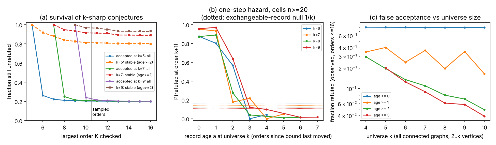
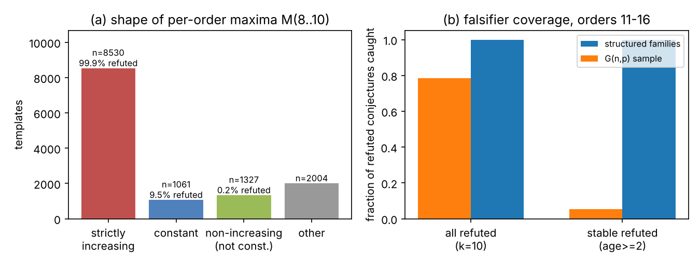

# How Much Does Exhaustive Small-Case Verification Certify? A Survival Analysis of Machine-Accepted Graph Conjectures

**Target venue:** NeurIPS 2027, Datasets and Benchmarks Track (evaluation methodology for AI-for-mathematics systems)

**Code and data:** `code/` (run `bash code/run_all.sh`), outputs in `results/`. Every number in this paper was computed by that code in this environment unless it is attributed to a cited source.

---

## Abstract

Pipelines that aim to make AI an independent producer of new theorems share one gate: a candidate statement is checked on a finite set of objects, and only the survivors go on to a prover, a human, or a paper. The Graffiti and TxGraffiti conjecturers, AutoGraphiX, and recent LLM-driven systems such as AlphaEvolve and AutoGraphForge all include some version of this gate. How much does passing it certify? We answer this exactly for one standard setting. We enumerate 12,922 inequality templates over 14 exact graph invariants (linear, sum and product forms). For each universe size k = 4,…,10, we accept the sharpest bound in each template that holds on every connected graph with 2 to k vertices, which is exactly what an exhaustive-verification conjecturer returns. We then follow every accepted statement forward. The checks are exhaustive over all 11,989,763 connected graphs with at most 10 vertices, and beyond that we use a 12,969,324-graph deterministic slice of the 11-vertex graphs and 15,860 random and structured graphs with 11 to 16 vertices. We report five findings. (1) Raw precision does not improve with the universe: 80.4% of statements accepted on all 9 connected graphs with ≤4 vertices are refuted, and so are 79.4% of those accepted on all 11.99 million graphs with ≤10 vertices. (2) Most of the failure mass is predictable *drift*. A template whose per-order maximum grows is refuted with certainty, and we prove a simple sufficient condition for this. A parameter-free drift statistic computed only from orders ≤ k predicts refutation by order 10 with AUC 0.988 to 0.995. (3) For *stable* conjectures, whose sharp bound has not moved for at least two orders, the false-acceptance rate falls with the universe, from 29.5% at k = 4 to 4.9% at k = 10 (observed lower bound). The one-step refutation hazard collapses with record age, to 1.6 to 1.7% for records 6 to 7 orders old, far below the 1/k rate of an exchangeable-record null. (4) The residual failures are *sporadic*. All 134 stable statements that hold on every graph with ≤10 vertices but fail by order 16 were caught by structured families (lollipops, circulants, paths, trees, cycles), and only 7 of them by 13,500 G(n,p) random graphs. One example: χ ≤ ω + 1 holds on all 273,192 connected graphs with ≤9 vertices and fails at order 10 on a single graph, C₅ ∨ C₅. (5) A Dalmatian-like significance filter barely changes precision (75.4% vs 79.9% refuted at k = 9). We turn these measurements into a reporting standard ("certified order, record age, drift class, falsifier provenance") and a pre-registered protocol for evaluating LLM conjecturers. The contribution is a measurement. It does not settle whether AI can prove important new theorems. It quantifies how weak the most common acceptance gate in such pipelines is, and which cheap diagnostics repair most of that weakness.

## 中文摘要

让人工智能独立产出新定理的流水线几乎都有同一道关口：先在有限个对象上检验候选命题，只有通过检验的命题才会交给证明器、人类数学家或写进论文。Graffiti/TxGraffiti、AutoGraphiX，以及 AlphaEvolve、AutoGraphForge 等由大模型驱动的新系统，都包含这道"有限验证"关口。通过它究竟能证明什么？我们在一个标准场景中给出精确回答。我们在 14 个可精确计算的图不变量上枚举了 12,922 个不等式模板（线性、和式、积式）。对每个宇宙规模 k = 4,…,10，在每个模板中取对所有 2 至 k 个顶点的连通图都成立的最紧界作为"被接受的猜想"，这正是穷举验证式猜想生成器的输出。随后我们逐一追踪这些命题：对全部 11,989,763 个不超过 10 个顶点的连通图做穷举检验，并在一个包含 12,969,324 个 11 顶点图的确定性子集，以及 15,860 个 11 至 16 顶点的随机图和结构化图上继续检验。主要发现有五点。（1）原始精度不随宇宙增大而提高：在全部 9 个不超过 4 个顶点的连通图上被接受的命题中，80.4% 最终被推翻；在全部 1,199 万个不超过 10 个顶点的连通图上被接受的命题中，被推翻的仍有 79.4%。（2）大部分失败来自可预测的"漂移"：每阶最大值递增的模板必然被推翻，我们证明了这一现象的一个充分条件；一个只用 ≤ k 阶数据、无需调参的漂移统计量，预测其在 10 阶以内被推翻的 AUC 为 0.988 至 0.995。（3）对于"稳定"猜想（其最紧界至少两阶未变），误接受率随宇宙增大而下降，从 k = 4 时的 29.5% 降到 k = 10 时的 4.9%（观测下界）；单步被推翻风险随记录年龄迅速下降，年龄 6 至 7 阶的记录仅为 1.6% 至 1.7%，远低于可交换记录零模型给出的 1/k。（4）剩余的失败是"偶发"的：在全部不超过 10 个顶点的图上成立、却在 16 阶以内被推翻的 134 个稳定命题，全部能被结构化图族（棒棒糖图、循环图、路、树、圈）抓到，而 13,500 个 G(n,p) 随机图只抓到其中 7 个。例如，χ ≤ ω + 1 在全部 273,192 个不超过 9 个顶点的连通图上成立，到 10 阶才在唯一一个图 C₅ ∨ C₅ 上失效。（5）类 Dalmatian 显著性筛选几乎不改变精度（k = 9 时被推翻比例为 75.4%，对照组为 79.9%）。基于这些测量，我们提出一套报告规范（验证阶数、记录年龄、漂移类别、反例来源）和一套评估大模型猜想生成器的预注册方案。本文的贡献是测量：它不能回答 AI 能否证明重要的新定理，但量化了这类流水线中最常见的接受关口有多弱，并指出哪些廉价诊断可以弥补大部分缺陷。

---

## 1 Introduction

Can AI independently prove important new theorems? Recent systems show that parts of this question now have answers that can be checked. AlphaProof finds formal Lean proofs of olympiad problems with reinforcement learning (Hubert et al., 2025). FunSearch and AlphaEvolve find constructions that improve best-known bounds in extremal combinatorics (Romera-Paredes et al., 2024; Georgiev et al., 2025). The Aletheia agent reports autonomous resolutions of some open Erdős problems (Feng et al., 2026). Each of these claims, however, ultimately rests on a *gate*: a check that decides which machine-produced statements count as results. When the gate is a proof assistant, as in AlphaProof, acceptance is sound. When the gate is an evaluator on a finite set of instances, as in conjecture generation, acceptance certifies only what holds on those instances. For autonomous *discovery* of new statements, as opposed to proving given ones, the finite gate is the common case. Graffiti accepted a conjecture if no graph in its database refuted it (Fajtlowicz, 1988). TxGraffiti and the Dalmatian heuristic do the same with an added significance test (Larson & Van Cleemput, 2016; Davila, 2024). AutoGraphForge tests its candidates against roughly 348,000 graphs before formalisation (Pastorek, 2026).

The weakness of finite checking is folklore. Brewster, Dinneen and Faber (1995) tested over 200 Graffiti conjectures against all graphs with at most 10 vertices and found several counterexamples, some on a single graph. What is missing is a *quantitative* account. Suppose a pipeline accepts statements that hold on every object up to size k. What fraction of them are false? How does that fraction depend on k? Which statements fail, and can a pipeline tell in advance? Without these numbers, the yield of an autonomous conjecturer ("6,522 surviving conjectures", "16 verified results per 40 proposals") cannot be turned into an estimate of how many true theorems it has found.

We answer these questions exactly in the setting where the gate is strongest and cheapest: inequalities between graph invariants, checked exhaustively over all connected graphs up to a given order. We separate the acceptance gate from the generator. Rather than study the outputs of one generator (LLM-based or otherwise), we enumerate a large template space and accept *every* sharp bound the gate would pass. This gives the gate's error profile over the whole hypothesis class that Graffiti-style systems search. Any particular generator's accepted set is a subset of it, and Section 7 shows how to reweight our estimates to that subset.

**Contributions.**

1. **An exact survival dataset.** We provide 12,922 inequality templates over 14 exactly computed invariants. Their per-order maxima are computed over *all* 11,989,763 connected graphs with 2 to 10 vertices, over a 12.97-million-graph slice of order 11, and over a 15,860-graph random and structured sample of orders 11 to 16. The C invariant engine is cross-validated against brute force on 1,055 graphs with zero mismatches. Every accepted statement at every universe k = 4,…,10 can be followed forward through larger orders.
2. **Negative headline result.** Raw precision of "sharp and true on all graphs of order ≤ k" is about 20% and essentially independent of k. Verification on 11.99 million graphs leaves 79.4% of accepted statements false, against 80.4% after verification on 9 graphs.
3. **Theory: drift and records.** We formalise acceptance as an envelope problem and prove three things: an exact refutation criterion (Proposition 1), a sufficient condition under which a sharp bound is refuted with certainty (an extension operator that raises the template value; Proposition 2), and the exchangeable-record null hazard 1/k (Proposition 3). Empirically, 8,530 templates have strictly increasing per-order maxima on orders 8 to 10, and 99.9% of them are refuted.
4. **Cheap diagnostics that work, and where they stop working.** A parameter-free drift score predicts refutation by order 10 with AUC 0.988 to 0.995. For stable conjectures, the false-acceptance rate falls from 29.5% (k = 4) to 4.9% (k = 10), and the one-step hazard falls to about 1.6% for old records. A logistic hazard model trained on k ∈ {5, 6} transfers to k ∈ {7, 8, 9} (AUC 0.971 to 0.989 on stable conjectures).
5. **Sporadic failures need structured falsifiers.** All 134 stable statements that are true on every graph with ≤10 vertices but refuted by order 16 were refuted by structured families, and only 7 by G(n,p) graphs. A Dalmatian-like significance filter does not fix precision.
6. **A reporting standard and a pre-registered protocol** for evaluating LLM-based conjecturers with these measurements. The protocol includes falsifiable predictions (Section 7).

We do not claim to have found new theorems. The analysis recovers known ones as sharp survivors (e.g. γ ≤ n/2, χ ≤ Δ + 1, residue ≤ α, α ≤ annihilation number). Its purpose is to calibrate the gate, not to mine it.

## 2 Related Work

**Automated conjecturing in graph theory.** Graffiti (Fajtlowicz, 1988) generated inequalities between invariants and kept those not refuted by a database of graphs. Some of these led to substantial theorems, for example the residue lower bound on the independence number, proved by Favaron, Mahéo and Saclé (1991). Brewster, Dinneen and Faber (1995) ran over 200 Graffiti conjectures against all graphs with at most 10 vertices and found counterexamples to several of them. Several failed on a single graph, and six failed on K₂ alone. Our work generalises their audit from a fixed list of conjectures to an entire template space and from a single universe to a nested sequence of universes, which makes survival curves and hazards measurable. The Dalmatian heuristic (Larson & Van Cleemput, 2016) adds a *significance* test: keep a conjecture only if it says something stronger than the already-accepted ones on some object. TxGraffiti (Davila, 2024) uses this truth test with linear-programming fits, and the Optimist (Davila, 2024b) adds memory and MIP-based generation. Davila et al. (2025) document ten years of TxGraffiti conjectures. AutoGraphiX (surveyed in Aouchiche, Caporossi & Hansen, 2013) finds extremal graphs by variable neighbourhood search and reads conjectures off them. AutoGraphForge (Pastorek, 2026) chains a Graffiti3 generator, a novelty filter, refutation against roughly 348,000 graphs, active counterexample search, and Lean 4 formalisation. Jooken (2025) surveys computer-assisted graph theory broadly.

**Learned search for counterexamples and constructions.** Wagner (2021) used the cross-entropy method to refute graph-theory conjectures. Vito and Stefanus (2023) used adaptive Monte Carlo search for the same purpose. PatternBoost (Charton et al., 2024) alternates local search with a transformer. FunSearch (Romera-Paredes et al., 2024) and AlphaEvolve (Georgiev et al., 2025) evolve programs under an automatic evaluator. In these works the falsifier is the *object* of study. In ours it is the *instrument*, and Section 5.4 shows that the choice of falsifier distribution decides which false conjectures are caught.

**AI theorem proving and autonomous mathematics.** AlphaGeometry (Trinh et al., 2024) and AlphaProof (Hubert et al., 2025) prove given statements with sound verification. Davies et al. (2021) used supervised learning to guide human conjecture formation. The Ramanujan Machine (Raayoni et al., 2021) generated numerically verified conjectures about constants, some of which were later proved. Gemini-based agents have been applied to the open Erdős problems in Bloom's database (Feng et al., 2026; Google DeepMind, 2026). The latter study stresses that some "correct" solutions answered vacuous or misread statements. Our work concerns the step *before* proof in autonomous-discovery pipelines: deciding which statements deserve proof effort at all.

**Gap.** We found no prior measurement of the false-acceptance rate of finite-universe verification as a function of universe size, of the hazard of refutation as a function of how long a bound has been stable, or of which falsifier distributions catch the residual failures. These quantities are needed to interpret any yield figure reported by an autonomous conjecturer.

## 3 Setting and Theory

### 3.1 Objects, invariants, templates

Let 𝒢ⱼ be the set of connected simple graphs on j vertices up to isomorphism, and let 𝒰ₖ = 𝒢₂ ∪ … ∪ 𝒢ₖ. Each graph G is mapped to an integer invariant vector I(G) with 14 entries: order n, size m, minimum and maximum degree δ and Δ, independence number α, clique number ω, chromatic number χ, domination number γ, matching number ν, diameter, radius, Havel–Hakimi residue R, annihilation number a, and number of triangles t. A *template* is an integer-valued expression

e(G) = s · (q·X − p·W),  with W ∈ {Y, Y+Z, Y·Z},

where X, Y, Z are invariants, a = p/q is a ratio from a fixed grid, and s ∈ {+1, −1}. The inequality e(G) ≤ c is equivalent to X ≤ (p/q)·W + c/q when s = +1, and to X ≥ (p/q)·W − c/q when s = −1. We use three families, which give 12,922 templates in total:

- linear: all ordered pairs (X, Y), with a ∈ {1/3, 1/2, 2/3, 1, 3/2, 2, 3}. This grid is closed under inversion, so s = +1 suffices. There are 1,274 templates.
- sums: X versus Y + Z with X ∉ {Y, Z}, a ∈ {1/2, 1, 2}, both signs. There are 6,552 templates.
- products: X versus Y·Z (Y = Z allowed) with X ∉ {Y, Z}, a ∈ {1/2, 1}, both signs. There are 5,096 templates.

This is the hypothesis class of Graffiti/TxGraffiti-style linear and simple non-linear invariant bounds, restricted to a grid of small rational coefficients.

### 3.2 The acceptance gate

For a template e, define the per-order maximum M_e(j) = max over G ∈ 𝒢ⱼ of e(G), and the envelope E_k(e) = max over 2 ≤ j ≤ k of M_e(j). The **k-accepted conjecture** is

C_k(e):  e(G) ≤ E_k(e) for all connected G.

C_k(e) is exactly the statement that a conjecturer with an exhaustive verifier on 𝒰ₖ accepts when it fits the tightest constant: it is true on 𝒰ₖ and sharp, since equality is attained on 𝒰ₖ. Its *first counterexample order* is f_k(e) = min{j > k : M_e(j) > E_k(e)}, with f_k(e) = ∞ if no such j exists.

**Proposition 1 (envelope criterion).** C_k(e) holds on every connected graph of order ≤ K if and only if max over k < j ≤ K of M_e(j) ≤ E_k(e). Consequently: (i) for fixed e, the event "C_k(e) is refuted by order K" is non-increasing in k; (ii) the relaxed bound e ≤ E_k(e) + r with r ≥ 0 has first-counterexample order at least f_k(e).

*Proof.* C_k(e) fails at order j exactly when some G ∈ 𝒢ⱼ has e(G) > E_k(e), that is, when M_e(j) > E_k(e). (i) Since E_k is non-decreasing in k, any order j > k' > k at which C_{k'} fails satisfies M_e(j) > E_{k'} ≥ E_k, so C_k also fails there. (ii) A larger constant can only remove violations. ∎

Call r_k(e) = k − min{j ≤ k : M_e(j) = E_k(e)} the **record age**: the number of orders since the bound last moved. Age 0 means the sharp constant was set by graphs of the top order k.

**Proposition 2 (extension operators force refutation).** Suppose that for every j ≥ j₀ there is a map φⱼ : 𝒢ⱼ → 𝒢ⱼ₊₁ and a constant δ > 0 with e(φⱼ(G)) ≥ e(G) + δ for all G ∈ 𝒢ⱼ. Then M_e(j+1) ≥ M_e(j) + δ for j ≥ j₀, and for every k ≥ j₀ the conjecture C_k(e) is false, with first counterexample order f_k(e) ≤ k + ⌊(E_k(e) − M_e(k))/δ⌋ + 1. In particular, if C_k(e) has age 0 (that is, M_e(k) = E_k(e)), it is refuted at order k + 1.

*Proof.* Take G* ∈ 𝒢ⱼ attaining M_e(j). Then M_e(j+1) ≥ e(φⱼ(G*)) ≥ M_e(j) + δ. By induction, M_e(k+t) ≥ M_e(k) + tδ, and this exceeds E_k(e) as soon as t > (E_k(e) − M_e(k))/δ. ∎

The operators are elementary. Adding a dominating vertex to G ∈ 𝒢ⱼ raises m − n by j − 1 ≥ 1 and leaves α unchanged (for j ≥ 1), so it also raises n − α by 1. Hence every k-accepted bound of the form "m ≤ n + c" or "α ≥ n − c" is false. Integer-valued templates have δ ≥ 1 whenever the increase is strict. Proposition 2 explains the dominant failure mode measured in Section 5.2. Sharp bounds on templates that grow under some order-raising operation are not conjectures at all: they are artefacts of the finite universe, and they are refuted at the next order.

**Proposition 3 (exchangeable-record null).** Suppose the sequence (M_e(2), …, M_e(K)) is exchangeable, with no ties almost surely. Then P(C_k(e) survives to order K) = (k − 1)/(K − 1), and the one-step hazard is P(f_k(e) = k + 1) = 1/k.

*Proof.* C_k survives to K if and only if the maximum of positions 2..K falls among the first k − 1 of these K − 1 positions. Under exchangeability without ties, each position is equally likely to hold the maximum. For K = k + 1, the refutation probability is 1/k. ∎

Proposition 3 is the "no structure" baseline. If per-order maxima carried no order-dependent structure, enlarging the universe from k to K would certify survival only with probability (k − 1)/(K − 1), and no statement verified on finitely many orders would be more than a coin flip about its truth at all orders. Section 5.3 shows that real templates are far from this null in both directions: drifting templates are refuted much *more* often than 1/k, and old stable records much *less* often.

### 3.3 Diagnostics computable inside the universe

All of the following use only M_e(2..k):

- **drift score** d₁ − g, where d₁ = M_e(k) − M_e(k−1) is the last increment and g = E_k − M_e(k) is the gap at the top order. A positive value means that linear extrapolation breaks the bound at k + 1.
- **drift3**, the least-squares slope of M_e over orders k−2..k, minus g.
- **record age** r_k.
- **gap-closing rule**: if the slope over the last three orders is positive, predict refutation when the extrapolated crossing order k + ⌊g/slope⌋ + 1 is at most 16.
- **tiny-graph tightness**: the bound is attained only on graphs with ≤3 vertices (K₂, P₃, K₃). This is the "Graffiti fails on K₂" phenomenon reported by Brewster et al. (1995), turned into a diagnostic.
- **Dalmatian-like significance**: within each target invariant and direction, a conjecture is *significant* if on some graph of 𝒰ₖ its implied bound on X is strictly tighter than that of every other accepted conjecture with the same target. This is a simplified, order-free version of the Dalmatian test of Larson and Van Cleemput (2016).

## 4 Experimental Setup

**Graphs.** All connected graphs on 2 to 11 vertices were generated with nauty's `geng` (McKay & Piperno, 2014), version 2.8.8, built from the sources bundled with pynauty 2.8.8.1. Orders 2 to 10 are exhaustive: 1, 2, 6, 21, 112, 853, 11,117, 261,080 and 11,716,571 graphs, which matches OEIS A001349, for a total of 11,989,763. For order 11 we used `geng`'s deterministic residue classes 0 to 3 modulo 256, giving 12,969,324 graphs. This slice is not a uniform sample: its maximum observed minimum degree is 7 and its maximum clique number is 9, for example. We treat it only as an additional falsifier. For orders 11 to 16 we generated 15,860 connected graphs: G(n,p) graphs with p ∼ U(0.08, 0.92) (3,000 per order for n ≤ 13, 1,500 per order for n ≥ 14), plus structured families. The families are paths, cycles, stars, complete graphs, wheels, all K_{a,n−a}, complete split graphs, lollipops, friendship graphs, barbells, ladders, prisms, cocktail-party graphs, all two-jump circulants, random 3- and 4-regular graphs, balanced complete multipartite graphs, 300 random labelled trees per order, and coronas of paths. Data provenance for all these counts: `results/summary.json`.

**Invariants.** A C program (`code/invariants.c`) computes all 14 invariants exactly with bitset branch-and-bound. It was checked against independent brute-force code (exhaustive colourings and subsets, networkx matching and diameter) on all 995 connected graphs with ≤7 vertices and 60 random graphs with 8 to 9 vertices, with 0 mismatches (`results/validation_invariants.txt`). Computing invariants for the 11.7 million 10-vertex graphs took 23 s wall-clock on 4 cores. All analyses work on deduplicated invariant vectors: at order 10 there are only 81,797 distinct vectors.

**Ground truth and its limits.** For k ≤ 9, refutation by order 10 is known *exactly*. Refutation at orders 11 to 16 is *observed* on samples, so it is a lower bound on falsity. Correspondingly, "survival" is an upper bound on truth, because a statement can fail at order 17 or beyond. Where we write "refuted" without qualification, we mean refuted by any graph we checked (≤16 vertices).

**Sanity check.** Among the k = 10 survivors are sharp versions of known theorems, each with the theorem's exact constant: γ ≤ n/2 (Ore, 1962), χ ≤ Δ + 1, ω ≤ χ, diam ≤ 2·rad, γ ≤ α, R ≤ α (Favaron et al., 1991), and α ≤ a (Pepper, 2004). α + ν ≤ n holds on all data (`results/summary.json`, `known_theorem_checks`).

## 5 Results

### 5.1 Raw precision is flat in the universe size

**Table 1.** Fraction of k-accepted (sharp, true on 𝒰ₖ) conjectures refuted by order 10 (exhaustive) and by any checked graph (≤16 vertices). Source: `results/summary.json`.

| universe k | graphs in 𝒰ₖ | refuted by order 10 | refuted (any, ≤16) | attained at top order: refuted | not attained at top order: refuted |
|---|---|---|---|---|---|
| 4 | 9 | 80.1% | 80.4% | 92.2% (n = 10,872) | 17.4% (n = 2,050) |
| 5 | 30 | 79.6% | 80.2% | 92.2% | 13.3% |
| 6 | 142 | 79.2% | 80.0% | 92.3% | 6.3% |
| 7 | 995 | 79.1% | 79.9% | 92.2% | 7.9% |
| 8 | 12,112 | 78.8% | 79.8% | 92.2% | 2.9% |
| 9 | 273,192 | 75.8% | 79.8% | 92.2% | 4.6% |
| 10 | 11,989,763 | — | 79.4% | 91.7% (n = 11,159) | 1.5% (n = 1,763) |

The headline is in the "refuted (any)" column. Multiplying the verification universe by more than a million, from 9 graphs to 11.99 million, moves the false-acceptance rate of sharp template bounds from 80.4% to 79.4%. Figure 1(a) shows why. Each survival curve drops by about 70 percentage points at the first unseen order and then flattens at about 20%. The surviving 20% is roughly the *same* set of templates whatever k is: templates whose maxima stop growing early. Relaxing every accepted bound by one unit of X barely helps (77.6% refuted at k = 10, against 79.4%), because drifting templates outrun any constant slack (Proposition 2).

The split by whether the bound is attained at the top order k is the first hint of structure. Bounds whose sharp constant was set by the largest graphs checked are false 92% of the time. Bounds set at smaller orders, which then held at the top order with slack, are false 1.5% to 17% of the time, and this rate falls with k.

**Figure 1.** (a) Survival of k-accepted conjectures as the largest checked order K grows. Solid lines: all templates. Dashed lines: stable templates (record age ≥ 2). Orders to the right of the grey line are sampled. (b) One-step refutation hazard against record age, for cells with ≥20 templates. Dotted lines show the exchangeable-record null 1/k (Proposition 3). (c) Observed false-acceptance rate against universe size, by minimum record age.

### 5.2 Most failures are drift, and drift is predictable

Classifying templates by the shape of M_e on orders 8, 9, 10 (Figure 2a; `results/summary2.json`) gives the following refutation rates beyond order 10:

- 8,530 templates are *strictly increasing*, and 99.9% of them are refuted;
- 1,061 are *constant*, and 9.5% of them are refuted;
- 1,327 are *non-increasing but not constant*, and 0.15% of them are refuted;
- 2,004 have other shapes.

Strictly increasing maxima are the empirical signature of Proposition 2. Accordingly, the in-universe diagnostics separate refuted from surviving conjectures almost perfectly (`results/summary.json`, `prediction`):

**Table 2.** AUC for predicting "refuted by order 10" (exact labels) from statistics of orders ≤ k. All predictors are parameter-free.

| k | positives / templates | drift score | drift3 | −record age | attained at top | −gap |
|---|---|---|---|---|---|---|
| 6 | 10,237 / 12,922 | 0.974 | 0.988 | 0.972 | 0.823 | 0.824 |
| 7 | 10,220 / 12,922 | 0.962 | 0.992 | 0.984 | 0.823 | 0.825 |
| 8 | 10,184 / 12,922 | 0.978 | 0.995 | 0.989 | 0.819 | 0.820 |

The binary rule "drift score > 0" has 9,573 true positives, 157 false positives, 664 false negatives and 2,528 true negatives at k = 6. These numbers mean that a conjecturer can discard most of its false output *without any additional verification*, simply by looking at the trajectory of the per-order extremes it has already computed. Systems that report only "true on the database" do not use this information.

### 5.3 Stable conjectures: hazard collapses with record age

Restricting to stable conjectures (record age ≥ 2) changes the picture entirely (Figure 1c; `results/summary2.json`):

**Table 3.** Observed false-acceptance rate of k-accepted conjectures with record age ≥ 2. The number in parentheses is the exhaustive rate of refutation by order 10.

| k | n (age ≥ 2) | refuted (any, ≤16) | refuted by order 10 |
|---|---|---|---|
| 4 | 3,299 | 29.5% | 28.6% |
| 5 | 3,144 | 19.8% | 18.8% |
| 6 | 2,938 | 13.6% | 12.5% |
| 7 | 2,880 | 11.0% | 8.5% |
| 8 | 2,810 | 8.0% | 4.4% |
| 9 | 2,792 | 7.0% | 3.2% |
| 10 | 2,738 | 4.9% | — |

For age ≥ 4 at k = 10 the rate is 3.7% (n = 2,685). Among stable conjectures, then, a larger universe *does* buy precision, with observed false acceptance falling by a factor of roughly 1.1 to 1.5 per additional order. Note that the observed column is a lower bound that becomes looser as k grows, because fewer of the later orders are exhaustive.

The one-step hazard, P(refuted at order k + 1 | accepted at k with age a), shows the mechanism (Figure 1b). At age 0 it is 0.87 to 0.96 for every k, far *above* the exchangeable null 1/k ∈ [0.11, 0.17]. For old records it is far *below* that null. At k = 8 the hazard is 0.016 at age 6 (n = 2,436); at k = 9 it is 0.015 at age 6 (n = 200) and 0.017 at age 7 (n = 2,398); at k = 6 it is 0.044 at age 4 (n = 2,683). There is a visible parity effect: odd k has a higher age-0 hazard (0.95 to 0.96) than even k (0.87 to 0.88). This is consistent with invariants such as ν and γ whose extremal values move in steps of ⌈n/2⌉ or ⌈n/3⌉.

**Cross-validated hazard model.** We fitted a 5-feature logistic model (log(1 + age), last-three-order slope, gap, attained-at-top, intercept) on the one-step labels at k ∈ {5, 6} and tested it on k ∈ {7, 8, 9}. On stable conjectures (age ≥ 1), the next-order AUC is 0.971, 0.971 and 0.989. Calibration is good at k = 8 (mean predicted 0.141 vs observed 0.137) but low at the odd orders (0.247 vs 0.310 at k = 7, 0.246 vs 0.319 at k = 9), which again points to parity. The fitted weights are in `results/summary2.json`.

### 5.4 The residue is sporadic, and random graphs do not find it

At k = 10, 134 stable conjectures (age ≥ 2) hold on all 11.99 million connected graphs with ≤10 vertices but are refuted by order 16 (`results/late_counterexamples_stable.json`). Their first refuting orders are 11 (22), 12 (45), 13 (56), 14 (6), 15 (4) and 16 (1). Thirty of them have record age 8, meaning the bound was set on K₂ and then held unchanged for eight orders. Figure 2(b) and `results/summary2.json` show that **all 134** were refuted by some structured family, while only **7** were refuted by any of the 13,500 G(n,p) graphs of orders 11 to 16 (the 2,360 structured graphs are about 390 per order). In addition, 127 were refuted *only* by structured families. Over all 10,262 refuted k = 10 conjectures, which are dominated by drift, the G(n,p) sample catches 78%. On stable conjectures it catches 5%. The families that most often witness these failures are lollipops (63 conjectures), circulants (63), paths (59), random trees (43) and cycles (41).

Representative statements that hold on *every* connected graph with at most 10 vertices but are false:

- t ≤ 3m − 3 (tight only on K₂; fails on K₁₁, where 165 > 162);
- n ≥ ½·ω·rad + 1 and n ≥ ½·χ·rad + 1 (fail on 11-vertex lollipops);
- res ≤ 3Δ − 2 and res ≤ Δ² (fail on paths and cycles of order 12 to 13);
- γ ≤ 2·diam − 1 (fails on circulants of order 13);
- ann ≤ Δ + α − 1 (first counterexample at order 16, a random tree and a path corona).

A sharper instance comes from the exhaustive range itself. **χ ≤ ω + 1 holds on all 273,192 connected graphs with ≤9 vertices**, and fails at order 10 on exactly one of the 11,716,571 graphs: the join C₅ ∨ C₅, which has ω = 4 and χ = 6 (per-order maxima of χ − ω and the invariants of C₅ ∨ C₅ are recorded in `results/check_chi_omega.txt`; the unique order-10 graph with χ − ω = 2 has exactly the invariant vector of C₅ ∨ C₅). It is a textbook-style sporadic extremal object. No trend in the per-order maxima anticipates it, because the per-order maximum of χ − ω is constant at 1 on orders 5 to 9.

**Where the diagnostics stop working.** Among stable k = 10 conjectures, the gap-closing rule flags 30, of which 17 are refuted; it misses 117 of the 134 refuted (`results/summary3.json`). The ranking AUC of slope/(gap + q) on this stratum is only 0.78 to 0.83 across k = 6..10. Two mechanisms escape trend rules. The first is *staircase drift*: γ(Pₙ) = ⌈n/3⌉ grows only every third order, so "γ ≤ Δ²" looks stable on orders 8 to 10 and breaks at 13. The second is *sporadic extremal graphs*, such as C₅ ∨ C₅, lollipops and circulants, which appear at a single order or in sparse infinite families.

**Tiny-graph tightness is a safety signal, not a warning.** A counter-intuitive result: among stable k = 10 conjectures, those tight *only* on graphs with ≤3 vertices are almost never refuted (0.25% of 1,591). Those tight at some order ≥ 4 are refuted 11.3% of the time. The "degenerate" bound has slack that grows with n, whereas a bound attained by mid-sized graphs is a sign of an extremal family that may continue. The most "interesting-looking" conjectures, those that are sharp on non-trivial graphs, are therefore the most fragile. If we filter to stable conjectures with non-positive recent slope and tightness at some order ≥ 4, 10.1% are refuted (114 of 1,127 at k = 10).

**Figure 2.** (a) Shape of per-order maxima on orders 8 to 10, with the refutation rate beyond order 10 for each shape. (b) Fraction of refuted k = 10 conjectures caught by structured families versus G(n,p) graphs, for all refuted conjectures and for stable ones.

### 5.5 Significance filtering does not repair precision

At each k ≤ 9 we computed the Dalmatian-like significant subset (`results/summary.json`, `dalmatian_like`). At k = 9, 211 conjectures are significant, and 75.4% of them are refuted, against 79.9% of non-significant ones. At k = 6 the figures are 68 conjectures and 76.5% vs 80.0%; at k = 4 they are 5 conjectures and 60% vs 80.4%. Selecting for conjectures that are *strictly the best bound somewhere in the universe* selects bounds whose extremal graphs sit at the edge of the universe, and those are exactly the fragile ones. Significance is a useful *novelty* filter for presentation. It is not a *truth* filter.

## 6 Discussion

**What this says about AI independently proving new theorems.** A pipeline that discovers and proves new theorems needs three steps: proposing statements, filtering them, and proving them. Proof assistants have made the third step sound (Hubert et al., 2025), and LLM-driven search has made the first step productive (Romera-Paredes et al., 2024; Georgiev et al., 2025). Our measurements concern the middle step. In the best case for finite checking, with exact invariants and an exhaustive universe of 12 million objects, the default acceptance rule "true and sharp on the database" passes a set that is four-fifths false, and a larger database does not change this. Precision comes instead from *how* a statement was true on the database. Did its bound stop moving several orders ago? Do its per-order extremes decrease? Was it attained only on tiny graphs or on a growing family? Did structured falsifiers fail to break it? A pipeline that records these quantities can push the observed false-acceptance rate of its stable survivors below 5% at k = 10. A pipeline that does not record them cannot distinguish its true outputs from its artefacts. This matters because reported yields drive the narrative. A system reporting "N verified conjectures" without the age and drift profile of the N has made a claim that our data would discount by a factor anywhere from about 1.05 to about 5, depending on that profile.

**Why the gate fails.** Proposition 2 and Table 2 show that the dominant failure is not subtle. Most sharp bounds on a finite universe are fitted to its boundary, and a statement fitted to the boundary of a growing universe is a statement about the boundary. The second failure mode is the classic one, rare extremal objects, and here the falsifier distribution matters more than its size. Thirteen thousand five hundred random graphs caught 7 of 134 stable failures, while a few hundred structured graphs per order caught all 134. Systems that pair a conjecturer with a learned counterexample searcher (Wagner, 2021; Vito & Stefanus, 2023; Charton et al., 2024) are, in effect, buying the structured falsifier. Our data say that this is where the marginal value of falsification lies.

**Recommended reporting standard.** For every machine-accepted conjecture, a paper or system should report:

1. the *certified order*: the largest order verified exhaustively, plus the sampled orders and how they were sampled;
2. the *record age* and the *drift class* of the per-order extremes;
3. the *tightness profile*: the orders at which equality is attained;
4. the *falsifier provenance*: which random and structured families, and which search methods, failed to refute it.

All four quantities are cheap byproducts of the verification already done.

## 7 A Pre-registered Protocol for LLM Conjecturers

We did not run any LLM. The following protocol makes our template-level measurements directly comparable with the output of an LLM-based conjecturer, and it states predictions that could falsify our account.

*Procedure.* (a) Give the model the invariant vocabulary and the data of 𝒰ₖ for k ∈ {7, 8, 9}, and collect its proposed inequalities. (b) Map each proposal to its template, and to its constant relative to E_k(e). (c) Apply the exhaustive gate on 𝒰ₖ. (d) Follow each accepted statement forward with exact labels at order 10, the order-11 slice, and both falsifier families at orders 11 to 16 (all of these are released in `data/` and `results/`). (e) Report the false-acceptance rate overall and stratified by record age, drift class and tightness profile.

*Predictions.*

- **P1** (stratified invariance). After stratifying by record age and drift class, the false-acceptance rate of LLM-accepted conjectures equals the template-level rate in Table 3 within sampling error. In other words, the LLM's "taste" acts through *which strata* it proposes from, not by producing conjectures that are more often true within a stratum.
- **P2** (taste shifts the mix). LLM proposals will over-represent age-0 sharp bounds relative to uniform template sampling, because sharpness at visible extremes is salient. The model's unstratified false-acceptance rate is therefore no lower than the template baseline of about 79%.
- **P3** (falsifier asymmetry). For LLM-accepted stable conjectures refuted at orders 11 to 16, structured families will catch at least 90% and G(n,p) graphs at most 20%.
- **P4** (memory). If the generator is given its own refutation history (reflective memory), its accepted set will shift toward higher record age, and its false-acceptance rate will fall by the amount Table 3 predicts from that shift alone.

A violation of P1, for instance LLM-accepted age-2 conjectures failing at half the template rate, would show that LLMs carry information about truth beyond what the in-universe statistics capture. That would be a positive and important finding for the prospects of autonomous discovery.

## 8 Limitations

- **One domain, one template class.** The results concern 14 graph invariants and linear, sum and product templates with small rational coefficients. Other hypothesis classes (implications with hypotheses such as "if G is regular", spectral invariants, objects outside graph theory) may have different drift and sporadic profiles. Number-theoretic conjectures, for example, can have first counterexamples astronomically far out, and our flat-precision result may be much worse there.
- **"True" means "unrefuted up to 16 vertices".** Orders 11 to 16 are sampled, and order 11 is a non-uniform `geng` slice. All refutation rates beyond order 10 are lower bounds, and some of our 2,660 k = 10 survivors are certainly false at larger orders. The stable-conjecture rates for k ≥ 8 (Table 3) are the most affected.
- **The template space is not a generator.** Real conjecturers do not propose all templates uniformly. Our rates are those of the gate applied to the whole class. Section 7 explains how to transfer them to a particular generator, but we have not done this for any LLM.
- **Templates are not deduplicated by logical equivalence or implication.** Strata contain correlated statements (e.g., χ ≤ c·t + 3 for several c fail together), so the effective sample size is smaller than the template counts suggest, and rates should be read as descriptive, not as estimates with i.i.d. error bars.
- **The diagnostics are partly tuned to this setting.** The drift rules are parameter-free, but the age threshold of 2 and the horizon of 16 are choices we made. The logistic model was cross-validated across k but not across domains.
- **Our significance filter is a simplification** of the Dalmatian heuristic, which adds conjectures sequentially and uses a richer acceptance order. The negative result in Section 5.5 should be confirmed with the original implementation.
- **No novelty assessment.** We did not check which survivors are already known, beyond the eight sanity checks. Nothing here is offered as a new theorem.

## 9 Conclusion

Verification on a finite universe is the most common gate between machine-generated mathematical statements and the claim that a machine has discovered something. We measured exactly how much it certifies in a setting where it is unusually strong. On its own, "true and sharp on all connected graphs with at most k vertices" passes statements that are about 80% false, and this does not change between k = 4 and k = 10, a million-fold increase in verification effort. The failure is mostly drift, which can be proved and predicted from data the verifier already has. Once drift is removed, record age is a strong predictor: stable bounds accepted at k = 10 are refuted at an observed rate of 4.9%. What remains are sporadic extremal objects, which structured falsifiers find and random sampling does not. For the larger question of whether AI can independently prove important new theorems, the lesson is modest and practical. The proving step can be made sound, but the *choice of what to prove* is currently made by a gate whose precision depends on bookkeeping that most systems do not report. Adding that bookkeeping costs almost nothing.

## References

All references were verified to exist via web search on 2026-11-22.

- Aouchiche, M., Caporossi, G., & Hansen, P. (2013). Open problems on graph eigenvalues studied with AutoGraphiX. *EURO Journal on Computational Optimization*.
- Bloom, T. F. Erdős Problems (website and database). https://www.erdosproblems.com.
- Brewster, T. L., Dinneen, M. J., & Faber, V. (1995). A computational attack on the conjectures of Graffiti: New counterexamples and proofs. *Discrete Mathematics*, 147(1–3), 35–55.
- Davila, R., Brimkov, B., Pepper, R., et al. (2025). In Reverie Together: Ten years of mathematical discovery with a machine collaborator. arXiv:2507.17780.
- Charton, F., Ellenberg, J. S., Wagner, A. Z., & Williamson, G. (2024). PatternBoost: Constructions in mathematics with a little help from AI. arXiv:2411.00566.
- Davies, A., Veličković, P., et al. (2021). Advancing mathematics by guiding human intuition with AI. *Nature*, 600, 70–74. doi:10.1038/s41586-021-04086-x.
- Davila, R. (2024). Automated conjecturing in mathematics with TxGraffiti. arXiv:2409.19379.
- Davila, R. (2024b). The *Optimist*: Towards fully automated graph theory research. arXiv:2411.09158.
- Fajtlowicz, S. (1988). On conjectures of Graffiti. *Discrete Mathematics* (1988).
- Favaron, O., Mahéo, M., & Saclé, J.-F. (1991). On the residue of a graph. *Journal of Graph Theory*, 15(1), 39–64. doi:10.1002/jgt.3190150107.
- Feng, T., Trinh, T. H., Bingham, G., Hwang, D., Chervonyi, Y., Jung, J., Lee, J., Pagano, C., Kim, S.-h., Pasqualotto, F., Gukov, S., et al. (2026). Towards autonomous mathematics research. arXiv:2602.10177.
- Georgiev, B., Gómez-Serrano, J., Tao, T., & Wagner, A. Z. (2025). Mathematical exploration and discovery at scale. arXiv:2511.02864.
- Google DeepMind (corresponding authors T. Feng and T. Luong) (2026). Semi-autonomous mathematics discovery with Gemini: A case study on the Erdős problems. arXiv:2601.22401.
- Hubert, T., Mehta, R., Sartran, L., et al. (2025). Olympiad-level formal mathematical reasoning with reinforcement learning. *Nature*. doi:10.1038/s41586-025-09833-y.
- Jooken, J. (2025). Computer-assisted graph theory: A survey. arXiv:2508.20825.
- Larson, C. E., & Van Cleemput, N. (2016). Automated conjecturing I: Fajtlowicz's Dalmatian heuristic revisited. *Artificial Intelligence*, 231, 17–38.
- McKay, B. D., & Piperno, A. (2014). Practical graph isomorphism, II. *Journal of Symbolic Computation*, 60, 94–112. doi:10.1016/j.jsc.2013.09.003.
- OEIS Foundation. Sequence A001349: Number of connected graphs with n nodes. https://oeis.org/A001349.
- Ore, O. (1962). *Theory of Graphs*. American Mathematical Society Colloquium Publications.
- Pastorek, J. (2026). AutoGraphForge: Towards automated graph theory discovery. arXiv:2609.03478.
- Pepper, R. D. (2004). *Binding Independence*. Ph.D. dissertation, University of Houston.
- Raayoni, G., Gottlieb, S., Manor, Y., Pisha, G., Harris, Y., Mendlovic, U., Haviv, D., Hadad, Y., & Kaminer, I. (2021). Generating conjectures on fundamental constants with the Ramanujan Machine. *Nature*, 590, 67–73. doi:10.1038/s41586-021-03229-4.
- Romera-Paredes, B., Barekatain, M., Novikov, A., et al. (2024). Mathematical discoveries from program search with large language models. *Nature*, 625, 468–475. doi:10.1038/s41586-023-06924-6.
- Trinh, T. H., Wu, Y., Le, Q. V., He, H., & Luong, T. (2024). Solving olympiad geometry without human demonstrations. *Nature*, 625, 476–482. doi:10.1038/s41586-023-06747-5.
- Vito, V., & Stefanus, L. Y. (2023). Adaptive Monte Carlo search for conjecture refutation in graph theory. arXiv:2306.07956.
- Wagner, A. Z. (2021). Constructions in combinatorics via neural networks. arXiv:2104.14516.
