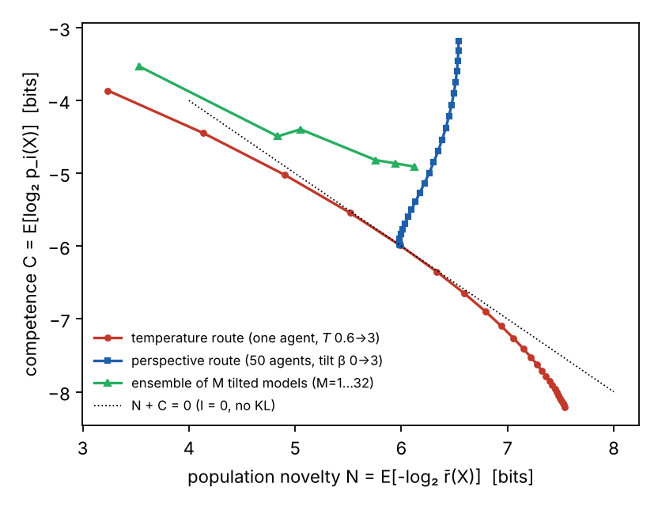
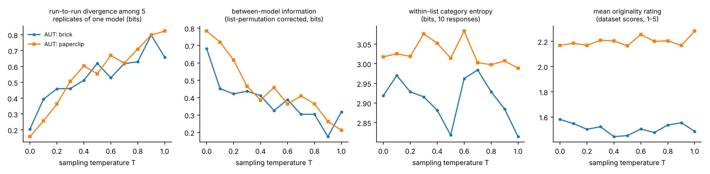
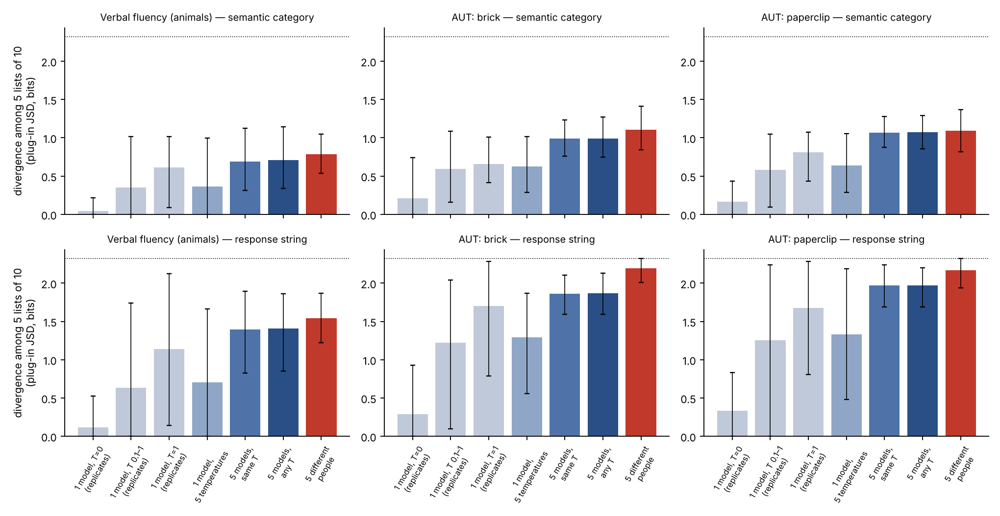
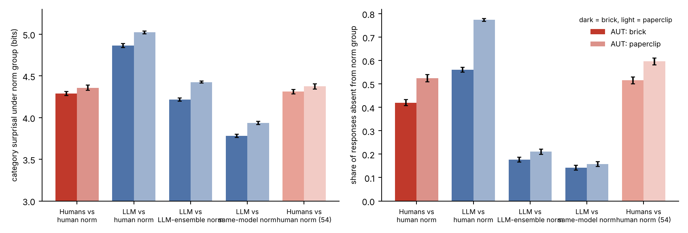

# Same Scores, Different Crowds: Authorship Information and the Structure of Human and Machine Creative Novelty

**Target venue:** NeurIPS 2027, Datasets & Benchmarks Track (evaluation methodology)

---

## Abstract

Language models now match or beat the average person on standard divergent-thinking tests, and several studies report that their outputs are more homogeneous than human outputs at the population level. These findings leave open whether model "innovation" is the same kind of thing as human innovation. We make this question precise with one information-theoretic quantity, *authorship information* I(X;A): the mutual information between an idea and the agent that produced it. Population novelty splits exactly into within-agent generative entropy plus I(X;A). We prove three results.

1. **Novelty–competence identity.** For any population, novelty plus competence equals I(X;A) minus the mean divergence between what agents sample and what they are competent at. A single generator can therefore raise population novelty only by paying in competence, for example through temperature. Heterogeneous agents can raise it for free.
2. **Score uninformativeness.** Per-response score parity between humans and models is uninformative about this structure.
3. **Non-identifiability.** When each agent contributes one list, a population of stable, distinct perspectives cannot be distinguished from a single generator that resamples a latent "persona" on every run. Identification requires replicate lists per agent and list-level (not response-level) permutation nulls.

In simulation, the response-level null that is commonly implicit in homogeneity analyses has the wrong sign under repetition avoidance and false-positive rates near 1 under persistence. The replicate design is close to nominal.

We then re-analyse a public dataset (Nath et al., 2024): 220 people and 8 LLMs × 11 temperatures × 5 replicates on two Alternate Uses items and a verbal-fluency control. LLM lists receive slightly higher originality scores than human lists. Against a human norm group they also look more novel (category surprisal 4.86 vs 4.29 bits for brick). When the norm group is other LLM runs, however, the share of their responses absent from 100 peers falls from 0.56 to 0.18. Inside the LLM population, model identity carries 0.37–0.49 bits of authorship information (10–12% of population entropy). Temperature leaves within-list entropy and originality scores unchanged. It increases run-to-run divergence (Spearman ρ = 0.96–0.98), and in doing so erodes model identity (ρ = −0.93 to −0.94). The divergence among five lists from five different people exceeds that among lists from five different LLMs at the response-string level on all three tasks (p < 10⁻³). At the semantic-category level it does so on two of three tasks. On this measure, model novelty is mostly per-run sampling variation layered on a small number of model "perspectives", whereas human novelty is spread across many authors. With single-list human data, we show that how much of the human spread reflects stable perspectives is not yet identifiable. We give a pre-registered replicate protocol that would settle it.

## 中文摘要

语言模型在发散思维测验上已达到或超过普通人的水平，但多项研究发现，其输出在群体层面比人类更同质。由此引出的问题是：模型的"创新"与人类的创新是否同质？本文用一个信息论量刻画这一问题，即**作者信息** I(X;A)：想法与其产生者之间的互信息。群体新颖性可精确分解为"个体内生成熵 + 作者信息"。我们证明了三点。

1. **新颖性–胜任力恒等式**：新颖性 + 胜任力 = I(X;A) − 个体采样分布与其胜任分布之间的平均 KL 散度。因此单一生成器（如通过调高温度）只能以牺牲胜任力为代价提高群体新颖性，而异质个体则无需付出这一代价。
2. **逐条评分不可区分性**：人类与模型在逐条回答评分上的持平，并不能说明二者的生成结构相同。
3. **不可识别性**：当每个个体只贡献一份列表时，"稳定而各异的个人视角"与"每次运行重新抽取潜在人格的单一生成器"在观测上无法区分。识别这一结构需要每个个体提供重复列表，并使用列表层面（而非回答层面）的置换零分布。

模拟显示，同质化分析中常隐含使用的回答层面零分布，在"避免重复"时符号错误，在"持续深挖"时假阳性率接近 1；重复列表设计的第一类错误则接近名义水平。

我们重新分析了 Nath 等人（2024）的公开数据：220 名被试，以及 8 个大语言模型 × 11 个温度 × 5 次重复，任务为两项替代用途任务和一项言语流畅性对照任务。模型列表的原创性评分略高于人类列表。以人类为常模时，模型回答的新颖性也更高（砖块任务类别惊异度 4.86 比 4.29 比特）。但以其他模型运行为常模时，其回答中未出现于 100 个同伴的比例从 0.56 降至 0.18。在模型群体内部，模型身份贡献 0.37–0.49 比特作者信息（占群体熵的 10–12%）。温度对列表内熵和原创性评分没有影响，它提高的是运行间差异（Spearman ρ = 0.96–0.98），同时削弱了模型身份（ρ = −0.93 至 −0.94）。在回答字符串层面，五名不同的人的列表间差异在全部三个任务上都大于五个不同模型的列表间差异（p < 10⁻³）；在语义类别层面，这一差异在三个任务中的两个上成立。按此度量，模型的新颖性主要是少数模型"视角"之上的每次运行的抽样波动，而人类的新颖性分散在众多作者之中。人类差异中有多少来自稳定的个人视角，在单列表数据下尚不可识别。我们给出了可解决该问题的预注册重复测量方案。

---

## 1 Introduction

Is a language model's "innovation" the same kind of thing as a human's? The empirical literature gives two answers that seem to conflict.

- **Per-response scores say yes, or better.** On the Alternate Uses Task (AUT) and related tests, GPT-class models score at or above the average human on originality ratings and semantic distance (Stevenson et al., 2022; Koivisto & Grassini, 2023; Hubert et al., 2024; Bellemare-Pepin et al., 2026). LLM-generated research ideas were judged more novel than expert ideas (Si et al., 2025).
- **Population-level analyses say no.** LLM responses are more similar to one another than human responses are, across many model families (Wenger & Kenett, 2026). People who use LLMs produce stories and brainstorms that are individually better but collectively narrower (Doshi & Hauser, 2024; Anderson et al., 2024; Meincke et al., 2025; Padmakumar & He, 2024). Models generate less diverse sets of valid answers than humans do (Zhang et al., 2025).

Both answers can be true at once, because they measure different things. A per-response score is a property of the *marginal* distribution of outputs. Homogeneity is a property of how outputs are *distributed across producers*. This paper's starting point is that the question "is the novelty of the same kind?" concerns the second property. We give that property a precise definition, derive its consequences, show how it can and cannot be measured, and measure it on public data.

**The quantity.** Consider a population of agents (people, models, model runs). Each agent *i* produces ideas X from its own distribution r_i, and the population produces ideas from the mixture r̄. Population novelty, the expected surprisal of an idea relative to the population, is H(X). It decomposes exactly as

> H(X) = Σᵢ wᵢ H(X | A=i) + I(X;A),

where the first term is within-agent *generative entropy* and the second is the mutual information between idea and author, which we call **authorship information**. It equals the generalised Jensen–Shannon divergence among the agents' distributions (Lin, 1991). In plain terms, I(X;A) measures how much knowing *who* produced an idea tells you about *what* the idea is.

Two populations can have the same H(X), and the same distribution of per-response scores, while one gets its novelty from authorship information and the other from generative entropy. We argue that this is the sense in which machine and human innovation can be "non-homologous". We also show that the difference has consequences for quality.

**Contributions.**

1. **A novelty–competence identity (Prop. 2).** Let each agent have a competence distribution p_i (what it can execute well) and a sampling distribution r_i. Then population novelty N and mean competence C satisfy N + C = I(X;A) − Σ wᵢ KL(rᵢ‖pᵢ). Consequences:
   - A single generator, or any exchangeable population, has I = 0. It can push novelty above its own entropy only by sampling away from its competence, for example with temperature (Prop. 3), and this trades novelty one-for-one against competence.
   - Heterogeneous agents can raise population novelty at no competence cost.
   - An ensemble of M generators has I ≤ log₂ M.
2. **Two negative results about measurement.**
   - Per-response score parity is uninformative about this structure (Prop. 1).
   - With one list per agent, a population of stable, distinct perspectives is observationally equivalent to one generator that resamples a latent persona every run (Prop. 4). Authorship information is identified only from replicate lists, and only with *list-level* permutation nulls.

   In simulation (Sim 3), the response-level permutation null that is implicit in many diversity comparisons is invalid in both directions. Under repetition avoidance its estimates are negative and it never rejects, even with true heterogeneity. Under persistence it rejects 100% of the time with no heterogeneity. The replicate design holds its size.
3. **A re-analysis of public human and LLM data** (Nath et al., 2024): 220 people; 8 LLMs × 11 temperatures × 5 replicates; AUT brick, AUT paperclip, verbal fluency. Because the LLM arm has replicates, we can decompose LLM population novelty into model, temperature and run components with valid nulls. We find:
   - Model identity carries 10–12% of LLM population entropy.
   - Temperature acts almost entirely as a run-to-run resampler. It raises replicate divergence and *erodes* model identity, and leaves within-list entropy and originality scores unchanged.
   - A matched "divergence ladder" shows that five different LLMs approach, but at the phrasing level do not reach, the divergence among five random people.
   - A *norm-reference paradox*: LLM lists look more original than human lists when scored against human norms, and much less original when scored against other LLM runs.
4. **A pre-registered replicate protocol** with falsifiable predictions (Section 7) that would identify the human stable-perspective component that current single-list data cannot reach.

We do not claim that human creativity is "deeper" or that models "cannot innovate". Our claims concern the *structure* of novelty in populations. We say explicitly which parts of that structure the existing data can and cannot identify.

## 2 Related Work

**LLMs on divergent-thinking tests.** These studies compare per-response or per-participant scores:
- Stevenson et al. (2022) tested GPT-3 on the AUT and found humans still ahead.
- Koivisto & Grassini (2023) found chatbots above the average human, but the best humans above the best chatbots.
- Hubert et al. (2024) reported GPT-4 above humans on three divergent-thinking tasks.
- Bellemare-Pepin et al. (2026) compared LLMs with a very large human sample on the Divergent Association Task.
- Si et al. (2025) found LLM research ideas judged more novel but slightly less feasible than expert ideas, and noted the models' lack of idea diversity.

Our Prop. 1 explains why none of these per-response comparisons can settle whether the generating structure is the same.

**Homogeneity and homogenisation.**
- Wenger & Kenett (2026; preprint 2025) showed that responses from many LLMs are more similar to each other than responses from different humans are.
- Doshi & Hauser (2024), Anderson et al. (2024), Padmakumar & He (2024) and Meincke et al. (2025) showed that LLM assistance narrows the collective diversity of human outputs.
- Kirk et al. (2024) found that RLHF reduces output diversity relative to supervised fine-tuning.
- Zhang et al. (2025) built NoveltyBench around the count of functionally distinct answers among k samples.

These works measure population similarity or distinctness, mostly with embedding similarity. We contribute a decomposition, with a quality-side identity, that locates *where* diversity lives (within runs, between runs, between models, between people). We also contribute an identification analysis showing which comparisons need replicate data.

**Process accounts.** Nath, Dayan & Stevenson (2024), whose data we re-use, characterised humans' and LLMs' *search paths* through semantic categories (persistent vs flexible) and found that LLMs as a population match human profiles. Our analysis is complementary. It concerns between-author structure, not within-sequence switching, and we show that within-sequence dependence is a central confound for between-author inference.

**Temperature.** Peeperkorn et al. (2024) found temperature only weakly related to novelty and moderately related to incoherence. Holtzman et al. (2020) documented the quality problems of sampling from the unreliable tail. Prop. 3 formalises why temperature-bought novelty must cost competence, and our data show what temperature actually changes in a creative-ideation population.

**Diversity and collective problem solving; recursion.** Hong & Page (2004) argued that diversity among problem solvers can matter more than individual ability. That claim is contested in later work, and we do not rely on it. Our identity gives a narrower, exact statement of why between-agent diversity is "free" novelty. Shumailov et al. (2024) showed that recursive training on model outputs loses distribution tails. In our terms, this is a mechanism by which the authorship information of a model-saturated idea ecology could fall over time.

**Definitions of creativity.** We follow the standard two-component definition: originality plus effectiveness (Runco & Jaeger, 2012). In our formal model, novelty stands for originality and competence for effectiveness. Boden's (2004) distinction between combinational, exploratory and transformational creativity, and Campbell's (1960) blind-variation-and-selective-retention account, motivate treating ideation as sampling from a space. Our framework covers only the first two kinds, within a fixed idea space.

**Estimation.** Plug-in entropy and mutual-information estimators are biased in the undersampled regime (Paninski, 2003). We use permutation nulls, which make the bias explicit, and show that the choice of permutation unit is decisive.

## 3 Theory

### 3.1 Setup

A finite idea space 𝒳 (in the data: semantic categories or response strings). A population of agents i = 1..n with weights wᵢ. Agent *i* samples ideas from rᵢ. The population distribution is r̄ = Σ wᵢ rᵢ. The *population novelty* of an idea x is its surprisal −log₂ r̄(x). Expected population novelty is N := E[−log₂ r̄(X)] = H(r̄).

This choice is deliberate. Frequency-based originality scoring on the AUT, where an idea is original if few others in the sample produced it, is an empirical version of population surprisal.

Let A be the agent index. Then

> N = H(X) = Σᵢ wᵢ H(rᵢ) + I(X;A) =: G + I. (1)

This follows from the chain rule; I(X;A) = JSD_w(r₁,…,r_n) (Lin, 1991).

**Proposition 1 (score uninformativeness).** Let f be any per-response statistic (a rating, a semantic distance to the prompt, a surprisal under any fixed reference). The distribution of f(X) under the population {(wᵢ, rᵢ)} equals its distribution under the single exchangeable generator r̄. A heterogeneous population with I > 0 and its exchangeable twin with I = 0 therefore have identical score distributions.

*Proof.* The marginal law of a randomly drawn response is r̄ in both cases. ∎

Prop. 1 is elementary, but it disposes of a common inference: "the model's responses score like a human's, so its creativity is of the same kind." Score parity is a statement about r̄. The structural question is about how r̄ is distributed over authors.

### 3.2 The novelty–competence identity

Give each agent a *competence* distribution pᵢ. Read log pᵢ(x) as how well agent i can elaborate, justify and execute idea x. For an LLM, pᵢ is the untempered model distribution. For a person, it is the distribution they would sample when working within their own expertise. Define mean competence C := Σ wᵢ E_{rᵢ}[log₂ pᵢ(X)].

**Proposition 2 (identity).**

> N + C = I(X;A) − Σᵢ wᵢ KL(rᵢ ‖ pᵢ). (2)

*Proof.* E_{rᵢ}[log pᵢ] = −H(rᵢ) − KL(rᵢ‖pᵢ). Average over i and use (1): −Σ wᵢ H(rᵢ) = I − N. ∎

**Consequences.**

- *(a) Exchangeable generators have a non-positive budget.* If all agents share the same rᵢ (one model, or many runs of one model with no persistent state), then I = 0 and N + C = −KL ≤ 0. Novelty above the generator's own competent entropy is paid for one-for-one in competence.
- *(b) Only authorship information makes the budget positive.* A population in which each agent samples from its own competence (rᵢ = pᵢ) has N + C = I ≥ 0. Its novelty exceeds its members' typical-idea entropy by exactly the between-agent divergence, at no competence cost.
- *(c) Ensembles are capped.* For M equally weighted generators, I ≤ H(A) = log₂ M. A population of n distinct people can reach log₂ n.

**Proposition 3 (temperature).** Let a single agent with competence p sample from q_T ∝ p^{1/T}, with p non-uniform. Then N(T) = H(q_T) is strictly increasing in T and C(T) = E_{q_T}[log₂ p] is strictly decreasing in T.

*Proof.* Let β = 1/T and ℓ = log p. Then d/dβ E_{q}[ℓ] = Var_q(ℓ) > 0. Also H(q_β) = −β E_q[ℓ] + log Z(β), so dH/dβ = −β Var_q(ℓ) < 0 for β > 0. ∎

Simulation 2 (Fig. 1) checks (2) numerically: maximum residual 2×10⁻¹⁵ over 50 configurations. It contrasts three routes to novelty:
- **Temperature:** one agent. N + C is 0 at T = 1 and negative for T ≠ 1.
- **Perspective:** 50 agents, each a random exponential tilt of a shared Zipf competence distribution. Novelty rises while competence *rises*.
- **Ensemble:** M tilted models. I is bounded by log₂ M.

*Figure 1 (Sim 2, `code/simulate.py`). Novelty vs competence along three routes over K = 200 ideas. Temperature trades novelty one-for-one against competence. Heterogeneous perspectives buy novelty without that trade.*

**Scope of Prop. 2.** The identity is exact, but it says nothing on its own about real agents until competence is operationalised. Treating log-probability under one's own competence distribution as value is a modelling assumption. It fits the observation that temperature mainly increases incoherence (Peeperkorn et al., 2024), but it is not established for human ideation. Also, N is population-relative. Novelty relative to an *external* norm (e.g., human norms for a model) is a different quantity, and Section 5.5 shows that the two can disagree sharply.

### 3.3 What can be identified from data

Creativity datasets give each agent a *list* of k responses, and lists have strong internal dependence: people and models avoid repeating themselves, and they persist within a semantic cluster (Nath et al., 2024). Let L_i = (X_{i1},…,X_{ik}) be agent i's list.

**Proposition 4 (non-identifiability with one list per agent).** Let a population draw agents i ~ w, and let each agent produce one list from a list-law Pᵢ. Its joint law of observed lists equals that of a *single* generator that, on every run, draws a latent persona z ~ w and then a list from P_z.

*Proof.* In both cases the observed lists are i.i.d. from the mixture Σ wᵢ Pᵢ. ∎

So with one list per agent, no statistic separates "many stable perspectives" from "one model that resamples a persona each run". The plug-in divergence among lists, H(pooled) − mean H(list), confounds three things:

- (i) stable between-agent divergence (authorship information in the trait sense);
- (ii) run-level latent variation;
- (iii) finite-list and within-list dependence effects.

With r ≥ 2 independent lists per agent, (i) is identified. Lists from the same agent share i, while a persona-resampling generator's runs are independent. Permuting *agent labels across whole lists* gives an exact null for "no stable agent effect", valid under any within-list dependence, because each list is kept intact. By contrast, permuting *responses* across agents assumes responses are i.i.d. within agents, and that assumption is false for lists.

**Simulation 3 (Table 1)** checks validity:
- K = 26 categories, n = 120 agents, k = 10.
- Lists generated sequentially; a category already in the list has its weight multiplied by ψ (ψ < 1 avoidance, ψ > 1 persistence).
- Agents either exchangeable, or heterogeneous with Dirichlet-tilted distributions (true I ≈ 0.20 bits).
- 20 replications per cell, 100 permutations.

*Table 1 (Sim 3, `results/sim3_list_dependence.json`). Rejection rates at α = 0.05 and mean permutation-corrected estimate I\*.*

| truth | ψ | naive (response-perm., 1 list) I\* | naive reject | replicate (list-perm., 2 lists) I\* | replicate reject |
|---|---|---|---|---|---|
| no heterogeneity | 0.2 | −0.288 | 0.00 | 0.000 | 0.05 |
| no heterogeneity | 1.0 | −0.002 | 0.00 | 0.000 | 0.00 |
| no heterogeneity | 2.0 | +0.381 | **1.00** | 0.004 | 0.10 |
| no heterogeneity | 4.0 | +0.919 | **1.00** | 0.000 | 0.00 |
| I = 0.20 bits | 0.2 | −0.254 | **0.00** | 0.064 | 1.00 |
| I = 0.20 bits | 1.0 | +0.070 | 1.00 | 0.050 | 1.00 |
| I = 0.20 bits | 4.0 | +1.079 | 1.00 | 0.034 | 0.30 |

The naive estimator is driven by within-list dependence, and its errors go in both directions. The replicate design holds its size; the 0.10 in one cell is 2 of 20 replications. It is powerful under avoidance, and weaker under strong persistence, where each list covers fewer categories. With i.i.d. sampling within agents (Sim 1, `results/sim1_summary.json`), the response-permutation estimate is unbiased under the null: type-I rate 0.03 at n = 220, k = 10. Under heterogeneity it is conservative: it underestimates a true I of 0.49 bits by 0.32 bits. Permutation-corrected magnitudes should therefore be read as lower bounds even when the null is valid.

## 4 Data and Methods

**Data.** We use the public data of Nath, Dayan & Stevenson (2024) (github.com/surabhisnath/Creative_Process, commit bd88536; files `csvs/data_humans.csv` and `csvs/data_LLMs.csv`; SHA-256 hashes in the README). Nath et al. collected or generated all data; we did not collect any.

- **Humans:** 220 adults (219 for fluency) responded in Dutch, and the dataset provides English translations.
- **LLMs:** 8 models (GPT-4-turbo, Claude-3-Opus, Gemini-1.0-Pro, PaLM text-bison, Llama-3-70B-chat, Mistral-7B-Instruct-v0.2, Nous-Hermes-2-Mistral-7B-DPO, SOLAR-10.7B-Instruct) × 11 temperatures (0.0–1.0) × 5 replicates = 440 lists per task.
- **Tasks:** AUT brick, AUT paperclip, and an animal verbal-fluency task, which we use as a non-creative control.
- **Idea representations:**
  - *Semantic category:* clusters released with the data. There are 15, 26 and 28 categories for fluency, brick and paperclip, and every category occurs in both populations.
  - *Response string:* the cleaned response, lower-cased and whitespace-normalised. This is a fine-grained but phrasing-sensitive representation.
- **Originality scores:** the dataset supplies a per-response originality score (1–5) as a lookup by response string. We use these scores as given and did not verify how they were produced.

**Units and matching.** An agent's list is its first k = 10 responses (robustness: k = 8 and 12). Agents with fewer responses are excluded, leaving:

| | fluency | brick | paperclip |
|---|---|---|---|
| humans | 211 | 179 | 185 |
| LLM lists | 439 | 403 | 440 |

All entropies are in bits.

**Analyses** (`code/empirical.py`; seeds fixed; about 2.5 CPU-minutes):

- **(A) Naive estimator.** Plug-in I(X; list) with response-level permutation, shown for humans and for a size-matched LLM ensemble. As a known-truth check, we apply it to LLM T = 0 replicates, which are nearly identical lists of the same model.
- **(B) LLM hierarchy with list-level nulls.** By the chain rule, I(X; list) = I(X; model) + I(X; T | model) + I(X; replicate | model, T). For the first two terms, model labels (or temperature labels within a model) are permuted across *whole lists*, 500 permutations. This is the exact null of exchangeable list generators. The replicate term has no list-level null, since lists are the units, and is reported as a plug-in "floor".
- **(C) Temperature sweep.** For each T, we compute:
  - mean within-list category entropy and the number of distinct categories per list;
  - mean originality score;
  - the replicate floor: plug-in divergence among one model's replicate lists, averaged over models;
  - between-model information at fixed T, with list-level null.

  Trends across T use Spearman correlations.
- **(D) Divergence ladder (main comparison).** The plug-in JSD among g = 5 lists (robustness: g = 3) is computed for matched structures:
  - 5 random people;
  - 5 replicates of one model at one T;
  - one model at 5 temperatures;
  - 5 models at one T;
  - 5 models at any T.

  Every structure has the same g and k, so plug-in bias is comparable. 1,500 random draws per structure. For a formal test we partition humans into disjoint groups of 5, and LLM lists into disjoint groups of 5 different models (each list used once), then compare with a Mann–Whitney U test.
- **(E) Peer-normed originality.** Each list is scored against a norm group:
  - mean category surprisal under the norm group's smoothed (add-½) category distribution;
  - share of the list's response strings that no norm-group member produced.

  Norm groups: 100 random humans (excluding self), 100 random other LLM lists, or up to 54 lists of the same model. For humans we also use 54 human peers, to match the same-model condition.
- **(F) Breadth vs depth.** Distinct ideas from M responses taken one per agent vs ten per agent. This is descriptive only; by Prop. 4 it is confounded with within-list dependence.

## 5 Results

### 5.1 Per-response scores: parity or better for LLMs

At the list level (first 10 responses), LLM lists have higher mean originality scores than human lists:

| task | human | LLM | Welch t | p |
|---|---|---|---|---|
| brick | 1.462 | 1.509 | 2.13 | 0.034 |
| paperclip | 2.071 | 2.201 | 6.78 | 5.9×10⁻¹¹ |

(`results/log.json`.) This reproduces the familiar "LLMs score at least as well" pattern. By Prop. 1, it says nothing about population structure.

### 5.2 The naive estimator fails on real data, as predicted

With response-level permutation (`results/A_naive_iid_permutation.csv`), the permutation-corrected authorship information I\* for LLM T = 0 replicates is −0.30, −0.43 and −0.48 bits (fluency, brick, paperclip; p = 1.0 in each case). The true value is ≈ 0: the replicates are nearly identical lists, with plug-in between-replicate information of only 0.04–0.21 bits.

Applied to the full populations, the naive estimator gives:

| population | fluency | brick | paperclip |
|---|---|---|---|
| humans | +0.035 | +0.078 | −0.025 |
| size-matched LLM ensemble | +0.042 | −0.114 | −0.152 |

At the string level, the estimate is negative for every population and task. These values come from within-list repetition avoidance (Table 1, ψ < 1), not from author structure. Any analysis that implicitly treats an agent's responses as i.i.d. draws would mis-measure homogeneity on these data.

### 5.3 Where LLM population novelty lives

With list-level nulls (`results/B_llm_hierarchy_listperm.csv`, Table 2), LLM population entropy decomposes as follows.

*Table 2. Decomposition of LLM population entropy at the semantic-category level (bits). I\* = plug-in minus list-permutation null mean; all list-level tests p = 0.002, the minimum with 500 permutations.*

| | fluency | brick | paperclip |
|---|---|---|---|
| population entropy H(X) | 3.15 | 4.19 | 4.40 |
| within-list entropy G | 2.26 | 2.91 | 3.03 |
| model I\* | **0.37** (11.6%) | **0.43** (10.2%) | **0.49** (11.2%) |
| temperature \| model I\* | 0.05 | 0.06 | 0.08 |
| replicate floor (plug-in) | 0.32 | 0.54 | 0.55 |

At the string level, model I\* is 0.93, 1.12 and 1.23 bits.

So between-model differences are real and are the main *stable* source of authorship information in the LLM population. Temperature settings within a model add very little stable structure. Most of the remaining list-to-list divergence is replicate-level, that is, per-run sampling variation, which by Prop. 4 is the "persona-resampling" component.

### 5.4 Temperature resamples runs; it does not broaden them

Across the 11 temperatures (`results/C_temperature_sweep.csv`, Fig. 2; Spearman ρ, n = 11):

| quantity, as T rises | brick | paperclip |
|---|---|---|
| replicate floor | 0.21 → 0.66 bits; ρ = 0.96, p = 1.9×10⁻⁶ | 0.16 → 0.82 bits; ρ = 0.98, p = 8.4×10⁻⁸ |
| between-model information | 0.68 → 0.32 bits; ρ = −0.93, p = 4.0×10⁻⁵ | 0.78 → 0.21 bits; ρ = −0.94, p = 2.2×10⁻⁵ |
| within-list entropy | ρ = −0.25, p = 0.45 | ρ = −0.62, p = 0.043 |
| mean originality score | ρ = −0.23, p = 0.50 | ρ = 0.33, p = 0.32 |

Within-list entropy does *not* increase, and the originality score shows no monotone trend. In this population, temperature makes runs of the same model differ more from each other and makes different models resemble each other more. It does not make a single run range more widely or score as more original. This fits Peeperkorn et al. (2024), and it fits Prop. 3: a single generator's extra novelty comes from moving its sampling distribution, run by run, away from its mode, not from acquiring a different perspective.

*Figure 2. Temperature effects in the LLM arm (8 models; first 10 responses per list).*

### 5.5 The divergence ladder: how many models make a crowd?

The plug-in divergence among five lists, with identical g and k for every structure, is shown in Fig. 3 and Table 3 (`results/D_list_divergence_ladder.csv`). The ceiling is log₂ 5 = 2.32 bits.

*Table 3. Divergence among 5 lists of 10 (bits, mean over 1,500 draws).*

| structure | fluency cat. | brick cat. | paperclip cat. | fluency str. | brick str. | paperclip str. |
|---|---|---|---|---|---|---|
| 1 model, T = 0, replicates | 0.04 | 0.21 | 0.17 | 0.12 | 0.29 | 0.33 |
| 1 model, T = 1, replicates | 0.61 | 0.66 | 0.81 | 1.14 | 1.70 | 1.68 |
| 1 model, 5 temperatures | 0.36 | 0.62 | 0.64 | 0.70 | 1.29 | 1.33 |
| 5 models, same T | 0.69 | 0.99 | 1.07 | 1.39 | 1.86 | 1.97 |
| 5 models, any T | 0.71 | 0.99 | 1.07 | 1.41 | 1.87 | 1.97 |
| **5 different people** | **0.78** | **1.11** | **1.09** | **1.55** | **2.19** | **2.17** |

Disjoint-group tests, humans vs five different models (`results/D2_ladder_disjoint_tests.csv`; k = 10):

| | fluency | brick | paperclip |
|---|---|---|---|
| category | 0.790 vs 0.707, p = 0.0033 | 1.101 vs 0.991, p = 7×10⁻⁵ | 1.081 vs 1.073, p = 0.79 |
| string | p = 1.4×10⁻⁴ | p = 4.9×10⁻¹⁶ | p = 1.5×10⁻¹² |

The pattern holds for k = 8 and 12. The only non-significant comparisons are paperclip categories (p = 0.062 and 0.149). It also holds with groups of 3. For brick categories, for example: humans 0.87, five-model groups 0.78, single-model replicates at T = 1 0.53.

Two readings follow.

- First, five lists from five different frontier and open models reach 89–98% of the categorical divergence of five random people. At the phrasing level they reach 85–91%: humans are near the ceiling (2.17–2.19 of 2.32 bits), so almost every human response string is unique within a group of five.
- Second, the ladder isolates what produces divergence in each population. A single model at its default-like temperature reaches about 59–78% of the human value at the category level, and this divergence is per-run variation. Additional divergence requires a different model.

*Figure 3. Divergence among 5 lists of 10 responses. Bars are means; whiskers span the 2.5–97.5% range over draws. The dotted line is the ceiling log₂ 5.*

### 5.6 The norm-reference paradox

Peer-normed originality (`results/E_peer_normed_originality_summary.csv`, Fig. 4; brick / paperclip; means ± SEM ≤ 0.03):

| list type, norm group | category surprisal (bits) | share of responses absent from norm group |
|---|---|---|
| human list, human norm (100) | 4.29 / 4.36 | 0.42 / 0.52 |
| LLM list, human norm (100) | **4.86 / 5.02** | **0.56 / 0.77** |
| LLM list, LLM-ensemble norm (100) | 4.21 / 4.43 | 0.18 / 0.21 |
| LLM list, same-model norm (≤54) | 3.78 / 3.94 | 0.14 / 0.16 |
| human list, human norm (54) | 4.31 / 4.37 | 0.52 / 0.60 |

Measured against human norms, LLM lists look *more* original than human lists, both in category rarity and in share of responses absent from the norm group. Measured against a norm group of their own kind, they look much less original. Under a same-model norm, about 14–16% of a run's responses are unique, compared with 52–60% for a human against an equally sized human norm.

The category-level shift is the more trustworthy one. Exact-string uniqueness across populations is inflated by differences in phrasing between translated human responses and LLM responses (see Limitations). Within each population, the comparison of strings is like-for-like.

This is Prop. 1 in action. Frequency-normed originality is a population-relative quantity. An LLM's ideas are rare *among humans* because they come from a different, concentrated distribution, not because the generator distributes novelty across many authors. If a single model became the norm group, as when many users brainstorm with the same assistant (Doshi & Hauser, 2024; Meincke et al., 2025), the same ideas would stop being original.

*Figure 4. Peer-normed originality of human and LLM lists under different norm groups.*

### 5.7 What we cannot conclude about humans

The breadth-vs-depth exchange ratio (`results/F_breadth_depth_coverage.csv`) compares distinct ideas from 100 responses taken one each from 100 agents against ten each from 10 agents. It is 0.99–1.00 for humans and 0.99–1.01 for the LLM ensemble.

Naively, this suggests no person-level structure in either population. Prop. 4 and Table 1 show why that reading is unwarranted. Repetition avoidance favours depth, between-agent heterogeneity favours breadth, and with one list per person the two cannot be separated. More generally, we can say that human lists diverge from one another more than replicate lists of any single LLM do, and somewhat more than lists of five different LLMs. We *cannot* say how much of the human divergence is stable personal perspective (authorship information in the trait sense) and how much is run-level variation within a person. The second would make a person, like a model, a "persona resampler". Separating them requires the design in Section 7.

## 6 Discussion

**Is model novelty homologous with human novelty?** On the per-response scale, these data cannot tell the two apart, and Prop. 1 shows that no per-response comparison could. On the population-structure scale, the evidence and the theory point to a specific, non-trivial difference:

- **Within one model,** novelty consists of within-run entropy, which is roughly matched to human lists (on the AUT items, G = 2.91–3.03 bits for LLM lists vs 2.76–2.85 for human lists at k = 10; `results/B_llm_hierarchy_listperm.csv`, `results/human_within_list_entropy.json`), plus run-to-run variation that grows with temperature.
- **Across models,** a modest amount of stable authorship information appears, about 0.4–0.5 bits, which temperature erodes.
- **Human lists** diverge more than lists from five different LLMs at the phrasing level, and on two of three tasks at the category level.

Prop. 2 explains why the difference matters beyond diversity statistics. If the human divergence is largely stable perspective (rᵢ ≈ pᵢ for diverse pᵢ), human populations get their novelty for free in competence terms. Model populations that try to match human population novelty by raising temperature must pay in competence; ensembling or persona-conditioning pays less. This is a testable claim, not a demonstrated one, because it hinges on the unidentified human component and on the competence operationalisation.

**Implications for evaluation.**

1. Report creativity comparisons with norm groups of both kinds. An LLM's originality "against human norms" is not a property of the model alone (Section 5.6).
2. Never treat an agent's list as i.i.d. draws when estimating between-agent structure (Section 5.2, Table 1).
3. Collect replicates. For LLMs this is free: replicate runs at fixed settings are the null. For humans it requires test–retest on the same items.

**Implications for practice and policy.**
- The identity (2) and the ensemble bound I ≤ log₂ M give a formal version of the advice to combine several models when brainstorming (Meincke et al., 2025), and they also show its ceiling: with M models, stable authorship information cannot exceed log₂ M bits.
- The norm-reference paradox predicts that originality measured against a human baseline will decline as model-generated ideas become a larger share of the reference population. This parallels, at the level of idea ecologies, the tail loss documented for recursive training (Shumailov et al., 2024).

## 7 Pre-registered Protocol and Falsifiable Predictions

**Design.**
- **Humans:** N ≈ 200 participants complete the AUT for 4 objects twice, 1–2 weeks apart (two replicate lists per object), plus 2 control objects once.
- **LLMs:** for each of ≥ 8 models, 5 replicate lists per (object, T ∈ {0.3, 0.7, 1.0}, persona condition). Persona conditions: no persona; one of 40 sampled persona descriptions held fixed across replicates ("stable persona"); a persona resampled per replicate.
- **Ideas:** categorised with a single shared codebook, plus string and embedding representations.
- **Quality:** blind human ratings of usefulness/feasibility, our competence proxy.

**Primary estimand.** The stable authorship information I_stable = I(X; agent) estimated across replicate lists, with list-level permutation of agent labels (Section 3.3), and the stable share π = I_stable / H(X).

**Predictions.**
- **P1.** Human π_stable > 0 (one-sided α = 0.01), and larger than for LLM replicate runs at any temperature without personas, for which π_stable ≈ 0 by construction.
- **P2.** For LLMs, raising T increases the replicate floor and *decreases* between-model I_stable, replicating Section 5.4. Mean usefulness ratings decline with T at fixed population novelty (Prop. 3).
- **P3.** "Stable persona" conditioning yields I_stable > 0 bounded by log₂(#personas), with a smaller usefulness cost per bit of novelty than temperature (Prop. 2(b)). "Resampled persona" yields population novelty without I_stable (Prop. 4).
- **P4.** The human advantage on the ladder shrinks when string-level phrasing is normalised by the shared codebook, but does not vanish at the category level for most items.
- **P5.** Under peer norms of equal size, LLM uniqueness stays below human uniqueness for every model.

The theory is falsified in its empirical bite if human π_stable ≈ 0, that is, if people too are best described as persona resamplers. It is also falsified if temperature-bought novelty carries no usefulness cost while persona-bought novelty does.

## 8 Limitations

- **One dataset, three tasks, one human sample.** The humans are Dutch-speaking adults whose responses were translated into English. The LLM data come from 8 models of the 2023–2024 generation. Newer models, base (non-RLHF) models and other prompting strategies may behave differently (Kirk et al., 2024).
- **Representation dependence.**
  - Semantic categories were created by the dataset authors from embedding clusters. Our category-level results inherit their granularity (15–28 categories).
  - String-level results are sensitive to phrasing. Translation of human responses and differences in LLM phrasing can inflate or deflate cross-population string overlap. We therefore rest cross-population claims mainly on category-level results, and use string-level results mainly within a population. Even so, human–LLM string-level divergence comparisons (Table 3) may be partly a phrasing effect.
- **Originality scores** were taken as supplied, and we did not verify how they were produced.
- **Plug-in estimators.** Ladder comparisons are bias-matched by design (same g and k), not bias-free. Permutation-corrected magnitudes are conservative (Sim 1). We report divergences, not calibrated estimates of true information.
- **The central human quantity is not identified.** By Prop. 4, the human stable-perspective component cannot be estimated from these data. We provide a protocol instead of a number.
- **The competence operationalisation** in Prop. 2 (log-probability under one's own competence distribution) is a modelling assumption. We did not measure competence or usefulness, so the quality side of the identity is untested here.
- **Temperature analysis.** n = 11 temperature points with 31–40 lists each. Some models produced fewer than 10 responses for some runs (Nous-Hermes on brick especially), so conditions are unbalanced.
- **No new LLM experiments.** All LLM outputs were generated by Nath et al. (2024). We ran no models.

## 9 Conclusion

"Is model creativity the same as human creativity?" has no answer at the level of individual responses (Prop. 1). It does have a precise form at the level of populations: how much of a population's novelty is authorship information. Theory says this matters. Only between-agent divergence buys novelty without a competence cost (Prop. 2), and temperature cannot substitute for it (Prop. 3). Measurement needs care. With one list per agent, stable perspectives are not identifiable (Prop. 4), and response-level permutation nulls are invalid (Table 1).

On public data, LLM novelty is structured as per-run variation layered on a few model-level perspectives. Temperature amplifies the first and erodes the second. Five models approach, but do not fully reach, the divergence of five random people, and LLM ideas that look original against human norms stop looking original against their own kind. Whether humans owe their divergence to stable perspectives is the open empirical question. The replicate protocol in Section 7 can answer it.

## Reproducibility

All code is in `code/`; see `README.md`. Total runtime is about 3 CPU-minutes. Every number in Sections 3.3 and 5 is produced by `code/simulate.py` or `code/empirical.py` and saved under `results/`. Numbers about prior studies come from the cited sources.

## References

- Anderson, B. R., Shah, J. H., & Kreminski, M. (2024). Homogenization effects of large language models on human creative ideation. In *Proceedings of the 16th Conference on Creativity & Cognition (C&C '24)*, ACM. https://doi.org/10.1145/3635636.3656204
- Bellemare-Pepin, A., et al. (2026). Divergent creativity in humans and large language models. *Scientific Reports*, 16. https://doi.org/10.1038/s41598-025-25157-3 (preprint arXiv:2405.13012)
- Boden, M. A. (2004). *The Creative Mind: Myths and Mechanisms* (2nd ed.). Routledge.
- Campbell, D. T. (1960). Blind variation and selective retention in creative thought as in other knowledge processes. *Psychological Review*, 67, 380–400.
- Doshi, A. R., & Hauser, O. P. (2024). Generative AI enhances individual creativity but reduces the collective diversity of novel content. *Science Advances*, 10(28), eadn5290. https://doi.org/10.1126/sciadv.adn5290
- Holtzman, A., Buys, J., Du, L., Forbes, M., & Choi, Y. (2020). The curious case of neural text degeneration. In *International Conference on Learning Representations (ICLR)*. arXiv:1904.09751
- Hong, L., & Page, S. E. (2004). Groups of diverse problem solvers can outperform groups of high-ability problem solvers. *Proceedings of the National Academy of Sciences*, 101(46), 16385–16389.
- Hubert, K. F., Awa, K. N., & Zabelina, D. L. (2024). The current state of artificial intelligence generative language models is more creative than humans on divergent thinking tasks. *Scientific Reports*, 14, 3440. https://doi.org/10.1038/s41598-024-53303-w
- Kirk, R., Mediratta, I., Nalmpantis, C., Luketina, J., Hambro, E., Grefenstette, E., & Raileanu, R. (2024). Understanding the effects of RLHF on LLM generalisation and diversity. In *International Conference on Learning Representations (ICLR)*. arXiv:2310.06452
- Koivisto, M., & Grassini, S. (2023). Best humans still outperform artificial intelligence in a creative divergent thinking task. *Scientific Reports*, 13, 13601. https://doi.org/10.1038/s41598-023-40858-3
- Lin, J. (1991). Divergence measures based on the Shannon entropy. *IEEE Transactions on Information Theory*, 37(1), 145–151. https://doi.org/10.1109/18.61115
- Meincke, L., Nave, G., & Terwiesch, C. (2025). ChatGPT decreases idea diversity in brainstorming. *Nature Human Behaviour*.
- Nath, S. S., Dayan, P., & Stevenson, C. (2024). Characterising the creative process in humans and large language models. In *Proceedings of the 15th International Conference on Computational Creativity (ICCC'24)*, 325–330. arXiv:2405.00899. Data: https://github.com/surabhisnath/Creative_Process
- Padmakumar, V., & He, H. (2024). Does writing with language models reduce content diversity? In *International Conference on Learning Representations (ICLR)*. arXiv:2309.05196
- Paninski, L. (2003). Estimation of entropy and mutual information. *Neural Computation*, 15, 1191–1253. https://doi.org/10.1162/089976603321780272
- Peeperkorn, M., Kouwenhoven, T., Brown, D., & Jordanous, A. (2024). Is temperature the creativity parameter of large language models? In *Proceedings of the 15th International Conference on Computational Creativity (ICCC'24)*. arXiv:2405.00492
- Runco, M. A., & Jaeger, G. J. (2012). The standard definition of creativity. *Creativity Research Journal*, 24(1), 92–96. https://doi.org/10.1080/10400419.2012.650092
- Shumailov, I., Shumaylov, Z., Zhao, Y., Papernot, N., Anderson, R., & Gal, Y. (2024). AI models collapse when trained on recursively generated data. *Nature*, 631, 755–759. https://doi.org/10.1038/s41586-024-07566-y
- Si, C., Yang, D., & Hashimoto, T. (2025). Can LLMs generate novel research ideas? A large-scale human study with 100+ NLP researchers. In *International Conference on Learning Representations (ICLR)*. arXiv:2409.04109
- Stevenson, C., Smal, I., Baas, M., Grasman, R., & van der Maas, H. (2022). Putting GPT-3's creativity to the (alternative uses) test. In *Proceedings of the 13th International Conference on Computational Creativity (ICCC'22)*, 164–168. arXiv:2206.08932
- Wenger, E., & Kenett, Y. N. (2026). Large language models are homogeneously creative. *PNAS Nexus*, 5(3), pgag042. https://doi.org/10.1093/pnasnexus/pgag042 (preprint: "We're different, we're the same: Creative homogeneity across LLMs", arXiv:2501.19361, 2025)
- Zhang, Y., et al. (2025). NoveltyBench: Evaluating language models for humanlike diversity. In *Conference on Language Modeling (COLM)*. arXiv:2504.05228
