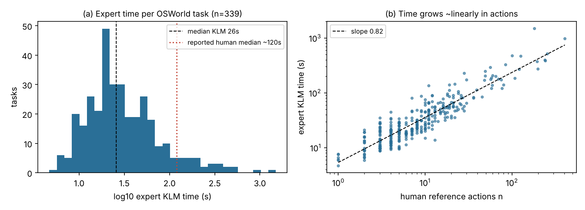
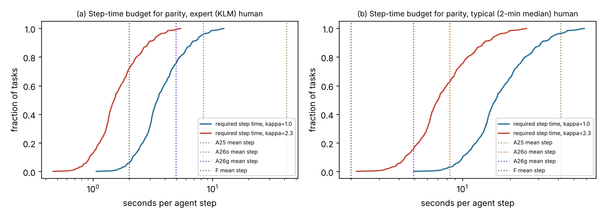
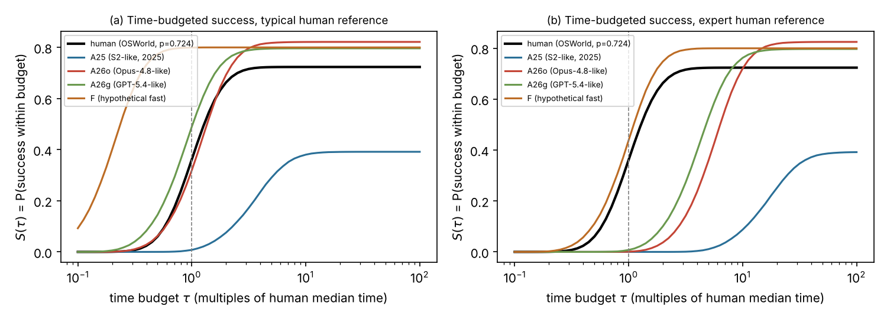
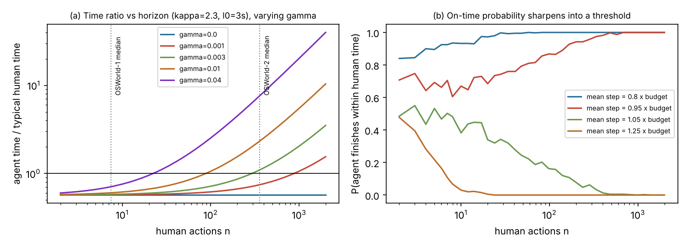
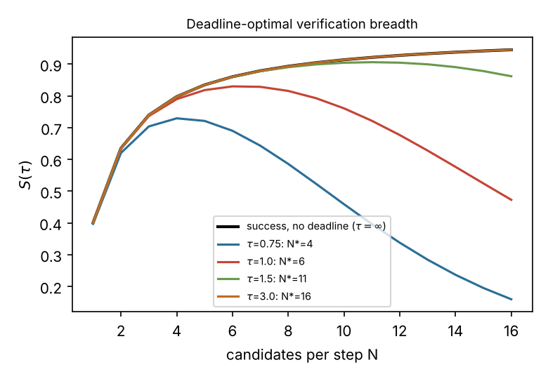
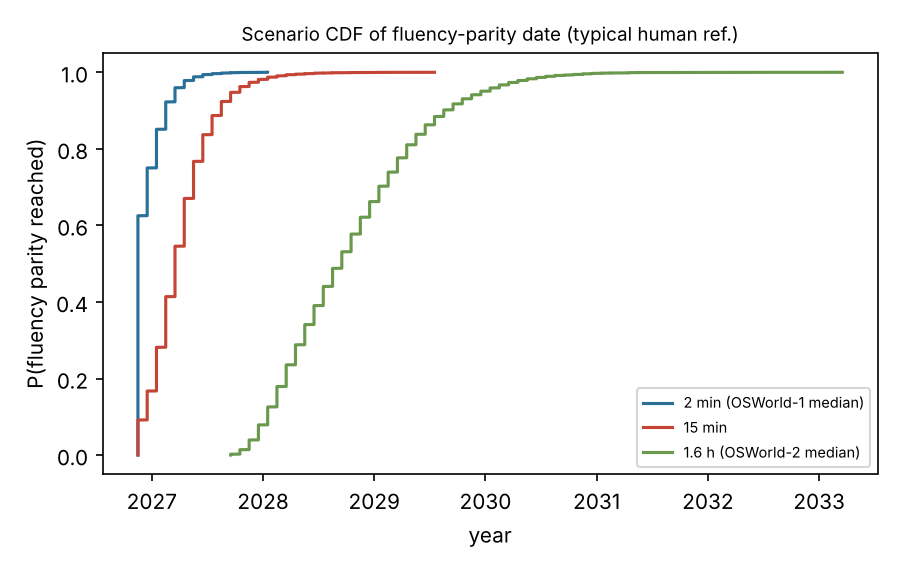

# Success Is Not Fluency: A Time-Budgeted Model of When Computer-Use Agents Match Human Speed and Reliability

**Target venue:** NeurIPS 2027, Datasets & Benchmarks Track (evaluation methodology + quantitative model)

---

## Abstract

By late 2026, computer-use agents (CUAs) report success rates on OSWorld-Verified above the 72.36% human baseline. Yet the same agents take several times longer than people, and on long workflows (OSWorld 2.0, median human time about 1.6 h) the best reported system completes 20.6% of tasks. "When will computer use be as fluent as a human's?" is therefore no longer a question about success rates alone. We make it measurable and give it a conditional answer. (1) We define *fluency parity* as matching humans on **time-budgeted success** S(τ), the probability of finishing correctly within τ times the human time on the same task. We argue for S(1) as the headline metric. (2) We build a per-task human time reference for all 339 feasible OSWorld tasks. To do so we apply the Keystroke-Level Model (KLM) to the public OSWorld-Human reference trajectories. The median expert time is 25.6 s, about 4.7× below the roughly 2-minute median reported for people, and expert time grows almost linearly in the number of actions (log-log slope 0.82). (3) We prove four simple properties of a step-level agent timing model. When per-step latency grows with context, parity holds only up to a finite horizon n* ∝ 1/γ. Action execution sets a hard floor, κ·a ≤ h. The on-time probability becomes a sharp threshold in per-action speed as tasks lengthen. And the verification breadth that maximizes success under a deadline is no larger than the unconstrained optimum and rises with the budget. (4) We calibrate archetype agents to published latency and step-count measurements. Against a typical-human reference, 2026-like agents are already near parity on short OSWorld tasks: S(1) is 0.32–0.49 against 0.36 for humans. Against an expert (KLM) reference they need 4.0–5.6× the human time to match human S(1), with S(1) < 0.01. Ranking agents by raw success and ranking them by S(1) give different orders. (5) A scenario analysis with explicit, wide priors puts expert-level fluency parity on tasks of 2 minutes to 1.6 hours at a median of 2028.9–2029.6 (10–90% range 2028.2–2031.5). Its main drivers are per-step latency and step inflation. Long-horizon parity against typical humans depends mostly on how fast the per-step failure hazard falls. These dates hold only under our assumptions, which are not forecasts of capability. We give a pre-registered protocol that would falsify the model's predictions.

## 中文摘要

到 2026 年底，计算机操作智能体（CUA）在 OSWorld-Verified 上报告的成功率已超过 72.36% 的人类基线；但它们完成同一任务所用的时间仍是人类的数倍，在长流程任务（OSWorld 2.0，人类中位用时约 1.6 小时）上，报告的最佳系统也只能完成 20.6%。因此，“计算机操作何时能像人一样流畅？”已不再只是成功率问题。本文把它变成一个可测量的问题，并给出有条件的回答。（1）我们把“流畅性对等”定义为在**限时成功率** S(τ) 上与人类持平：S(τ) 是在同一任务人类用时的 τ 倍时间内正确完成任务的概率；我们主张以 S(1) 作为核心指标。（2）我们把击键层次模型（KLM）应用于公开的 OSWorld-Human 人类参考轨迹，为全部 339 个可行 OSWorld 任务构建了逐任务的人类用时基准：专家中位用时 25.6 秒，约为报告的人类中位用时（约 2 分钟）的 1/4.7，且用时随动作数近似线性增长（对数斜率 0.82）。（3）对一个步级智能体计时模型，我们证明了四条简单性质：单步延迟随上下文增长时，对等只在有限任务长度 n* ∝ 1/γ 以内成立；动作执行本身构成硬下限 κ·a ≤ h；任务越长，按时完成的概率越接近一个关于单动作速度的陡峭阈值；在截止时间约束下，使成功率最大的验证宽度不超过无约束时的最优值，并随时间预算增大而增大。（4）用已发表的延迟与步数测量校准若干原型智能体：以普通人类为参照，2026 年水平的智能体在 OSWorld 短任务上已接近对等（S(1) 为 0.32–0.49，人类为 0.36）；以专家（KLM）为参照，它们需要人类用时的 4.0–5.6 倍才能达到人类的 S(1)（S(1) < 0.01）。按原始成功率与按 S(1) 对智能体排序，得到的顺序不同。（5）在明确且宽泛的先验假设下，情景分析给出：对 2 分钟到 1.6 小时的任务，达到专家级流畅性对等的中位年份为 2028.9–2029.6（10%–90% 区间 2028.2–2031.5），主要取决于单步延迟和步数膨胀；以普通人类为参照的长任务对等，则主要取决于单步失败风险下降的速度。这些年份只在我们的假设下成立，并不是对能力的预测。我们还给出了一个预注册的检验方案，可用来证伪模型的预测。

---

## 1 Introduction

Computer-use agents operate graphical interfaces through screenshots, clicks and keystrokes. Their headline metric has been task success on benchmarks such as OSWorld [Xie et al., 2024]. That metric has now saturated near or above the human baseline. OSWorld reported 72.36% human success when it was released. Agent S3 with behaviour best-of-N reported 72.6% [Gonzalez-Pumariega et al., 2025]. The OSWorld 2.0 authors note that Claude Opus 4.8 reaches 83.5% on OSWorld-Verified [Yuan et al., 2026]. Taken alone, these numbers suggest computer use is "solved." Users do not experience it that way. OSWorld-Human [Abhyankar et al., 2025/2026] measured agents taking tens of minutes on tasks a person finishes in about two. It found that large-model planning, reflection and judging calls make up most of end-to-end latency, and that later steps can take three times as long as early ones. CADWorld [Dong et al., 2026] reports frontier agents in 2026 using 2.3–3.0× as many steps and 3.0–3.8× as much wall-clock time as a human expert, even on tasks they complete.

"Fluent like a human" combines at least two properties: getting it right, and getting it done in human-comparable time. A model that conflates them cannot answer when parity will arrive. This paper separates and then recombines them. We make one claim: **the right unit of progress for fluency is time-budgeted success S(τ), measured against a per-task human time reference.** We then ask what agent parameters S(1)-parity requires, and when current trends could meet them.

**Contributions.**

1. **Metric.** We define time-budgeted success S(τ) and *fluency parity*, S_agent(1) ≥ S_human(1). We show that it can order agents differently from raw success and from the step-based Weighted Efficiency Score (§3.1, §5.3).
2. **Human time reference for OSWorld.** We apply the Keystroke-Level Model [Card, Moran & Newell, 1980] to all 369 OSWorld-Human reference trajectories, using grouped actions to place mental operators. This gives a per-task expert time for the 339 feasible tasks, a sensitivity analysis, and a calibration against the reported ~2-minute human median (§4.1, §5.1). As far as we know, this is the first per-task human time reference for OSWorld that is derived from action-level trajectories.
3. **Theory.** For a step-level agent timing model with step inflation κ, per-step model latency ℓ₀, context-growth coefficient γ, action time a, recoverable errors and a failure hazard, we prove four properties (§3.3): (i) parity holds only up to a finite horizon n* ∝ 1/γ; (ii) execution sets a floor, κ·a ≤ h; (iii) on-time completion becomes a threshold in per-action speed as tasks lengthen; (iv) deadline-optimal verification breadth is no larger than the unconstrained optimum and does not decrease with the budget.
4. **Calibrated measurement of the gap.** We calibrate archetype agents to published measurements. We then quantify how much per-step latency each task can afford and where each archetype stands, against both an expert and a typical human reference (§5.2–5.4).
5. **Conditional timeline and falsifiable predictions.** A Monte Carlo scenario analysis with explicit priors gives distributions over the parity date for three task-length classes and ranks the parameters that drive them. We also give a pre-registered protocol with predictions that would falsify the model (§5.6, §6.2).

We do not run any large model. Every number either comes from code we ran (outputs in `results/`) or is quoted from a cited source, and we label which. Parameters we had to assume are marked as assumptions and varied.

## 2 Related Work

**Computer-use benchmarks.** OSWorld [Xie et al., 2024] introduced 369 execution-checked desktop tasks with a 72.36% human success rate. Its maintainers later released OSWorld-Verified, which fixed more than 300 task issues [XLANG Lab, 2025]. Related environments include WebArena [Zhou et al., 2024], Windows Agent Arena [Bonatti et al., 2024], which reports 74.5% unassisted human performance, and AndroidWorld [Rawles et al., 2024]. OSWorld 2.0 [Yuan et al., 2026] targets long workflows: 108 tasks with a median skilled-human time of about 1.6 h, and an average of 318 tool calls for a frontier agent against about 30 on OSWorld 1.0. Its best system completes 20.6% of tasks. CADWorld [Dong et al., 2026] reports human-expert and agent step counts and wall-clock times on FreeCAD tasks. These benchmarks report success. Only OSWorld-Human and CADWorld report time or steps against a human reference.

**Agent efficiency.** OSWorld-Human [Abhyankar et al., 2025; MLSys 2026 version] is the closest work. It profiles Agent S2 [Agashe et al., 2025] and GTA1 [Yang et al., 2025], annotates minimal single-action and grouped-action human trajectories for every OSWorld task, and proposes the Weighted Efficiency Score (WES⁺ = success × human steps / agent steps). WES counts steps, not seconds, and does not separate per-step latency from step inflation. Our work builds on its trajectories but measures time, gives a human *time* reference, and adds theory. Agent S3 reports a 62.4% cut in average completion time over Agent S2 [Gonzalez-Pumariega et al., 2025]. Systems work on agent latency includes speculative actions [Ye et al., 2025], which report up to 20% latency reduction. Native end-to-end models such as UI-TARS [Qin et al., 2025] remove model-to-model hops.

**Time horizons and hazards.** METR measures the human task length at which agents succeed 50% of the time and finds it doubling about every seven months on software tasks [Kwa et al., 2025]. Ord [2025] shows that a constant per-unit failure hazard explains those curves. We borrow the hazard model for success. The difference is that we measure *agent wall-clock time against human time on the same task*, a quantity time-horizon work does not track. Yuan et al. [2026] report that time-horizon trends transfer only partly to general computer use.

**Human performance models.** The Keystroke-Level Model [Card, Moran & Newell, 1980] predicts expert, error-free execution time from primitive operators: pointing P = 1.1 s, button B = 0.1 s, homing H = 0.4 s, mental preparation M = 1.35 s, keystroke K = 0.08–1.2 s. We use it to turn OSWorld-Human action lists into per-task human times. We take reading rate from Brysbaert's [2019] meta-analysis (238 words/min for silent non-fiction reading).

**Gap.** No existing work (i) gives a per-task human *time* reference for a major CUA benchmark, (ii) defines parity as a joint time-and-success criterion, or (iii) gives an analytic account of how parity depends on horizon, context growth, step inflation and verification. Without these, the question "when will computer use be fluent?" has no measurable answer.

## 3 Model and Theory

### 3.1 Definitions

A task i has a human reference trajectory of n_i primitive actions. Its human completion time T_H,i is random, with median t_i. Humans succeed with probability p_H. An agent's time T_A,i and success indicator Z_A,i are random.

**Definition 1 (time-budgeted success).** S_A(τ) = mean over tasks of P(Z_A,i = 1 and T_A,i ≤ τ·t_i). S_H(τ) is defined the same way for humans.

**Definition 2 (fluency parity).** An agent reaches fluency parity on a task distribution if S_A(1) ≥ S_H(1). It reaches it *at slack τ* if S_A(τ) ≥ S_H(1). We call the smallest such τ the *parity slack* τ_par.

S(∞) is ordinary success, so S(τ) generalises it. S(1) is 0 for an agent that is always correct but always slower than the human median. It is 0.36 for a typical OSWorld human, given p_H = 0.7236 and the fact that a human beats their own task median half the time. We model human times as lognormal around t_i with σ_H = 0.5. **This spread is an assumption**: no OSWorld per-task human time distribution is public. Under the model, S_H(τ) = p_H·Φ(ln τ / σ_H).

### 3.2 Agent timing model

The agent takes K = ⌈κ n⌉ nominal steps, where κ ≥ 1 is **step inflation** over the human reference. Each executed step makes a recoverable error with probability ε, and each error costs a Geometric(mean ρ) number of extra steps. Step j costs

  ℓ_j = ℓ₀ (1 + γ (j−1)) + a,

where ℓ₀ is base model latency, γ is the **context-growth coefficient** (later steps carry longer prompts: OSWorld-Human observes later steps up to 3× slower), and a is action execution plus UI settling. Over K steps,

  T_A(K) = K(ℓ₀ + a) + ℓ₀ γ K(K−1)/2.                (1)

Task success follows a constant per-step hazard λ [Ord, 2025]: P(Z_A = 1) = p₀ e^{−λK_exec}. A lognormal multiplicative noise term (σ = 0.3, assumption) captures run-to-run variation in time.

### 3.3 Results

Write the human time as T_H(n) = h n + c₀, with h the human seconds per action. We use c₀ = 0 in the analysis below. This is conservative, because a fixed human overhead such as reading only helps the agent.

**Proposition 1 (finite parity horizon).** Let D(n) = T_A(κn) − T_H(n) = A n² + B n − c₀, with A = ℓ₀γκ²/2 and B = κ(ℓ₀ + a) − ℓ₀γκ/2 − h.
(a) If γ = 0, then T_A/T_H = κ(ℓ₀ + a)/h for every n (when c₀ = 0). Parity holds at all horizons or at none.
(b) If γ > 0 and ℓ₀ > 0, the set of horizons with time parity is the interval [0, n*], where n* = (−B + √(B² + 4Ac₀))/(2A) < ∞. Also T_A/T_H → ∞ linearly in n. For c₀ = 0 and B < 0, n* = −B/A ≈ 2(h − κ(ℓ₀ + a))/(ℓ₀ γ κ²), so n* ∝ 1/γ.

*Proof.* (a) Substitute γ = 0 into (1). (b) D is a convex quadratic with D(0) = −c₀ ≤ 0, so {D ≤ 0} ∩ [0, ∞) is the interval from 0 to the positive root. The ratio T_A/T_H ~ (A n² + …)/(h n) grows linearly. ∎

*Interpretation.* Parity on short benchmarks does not carry over to long workflows unless context cost stays bounded (γ → 0). That requires summarisation, prefix caching, or memory designs whose per-step cost does not grow with history.

**Proposition 2 (execution floor).** Time parity at γ = 0 requires κ(ℓ₀ + a) ≤ h, so it requires κ ≤ h/a regardless of model speed. Equivalently, the per-step budget for model latency is ℓ₀ ≤ h/κ − a.

*Proof.* Immediate from Proposition 1(a), since ℓ₀ ≥ 0. ∎

*Interpretation.* Faster inference cannot by itself close an expert-level gap if agents take many more steps than an expert. Cutting step inflation, for example by grouping actions per observation as OSWorld-Human proposes, works on a different term from model speed.

**Proposition 3 (on-time threshold).** Let each nominal step's total time, including its recovery steps, be i.i.d. with mean m and finite variance, so per human action the agent spends mean μ = κ m. With budget τ h n:
(a) if μ < τh, P(T_A ≤ τhn) → 1 as n → ∞;
(b) if μ > τh, P(T_A ≤ τhn) → 0, and exponentially fast, P ≤ exp(−n·I) with I > 0, when step times have a finite moment-generating function;
(c) at μ = τh the probability tends to 1/2.
So S_A(τ; n) → p_succ(n)·1[μ < τh], and the transition has width O(n^{−1/2}) in μ.

*Proof.* T_A is a sum of ⌈κn⌉ i.i.d. terms. (a) and (b) follow from the weak law of large numbers, and the rate in (b) from Cramér's theorem applied to the upper deviation. (c) follows from the central limit theorem. ∎

*Interpretation.* On long tasks, whether an agent is on time is close to a yes/no property of its per-action speed, which short tasks can measure. Whether it succeeds is then decided by the hazard λ. These are two separable axes of fluency.

**Proposition 4 (deadline-aware verification).** Suppose an agent picks a verification breadth N, such as best-of-N candidates per step with a judge. Success p(N) is nondecreasing in N. Time μ(N) is increasing in N. The on-time probability F_τ(N) = Φ((ln(τ t) − ln μ(N))/σ). Let N*_∞ be the smallest maximiser of p and N*_τ the smallest maximiser of S_τ(N) = p(N) F_τ(N). Then (a) N*_τ ≤ N*_∞, and (b) N*_τ is nondecreasing in τ.

*Proof.* (a) For N > N*_∞, p(N) ≤ p(N*_∞) and F_τ(N) ≤ F_τ(N*_∞), so S_τ(N) ≤ S_τ(N*_∞). Hence a maximiser exists at or below N*_∞. (b) Write log S_τ(N) = log p(N) + log Φ(z(N, τ)) with z = (ln τ t − ln μ(N))/σ. Then ∂_N log Φ(z) = −(φ/Φ)(z)·μ′(N)/(σ μ(N)). The inverse Mills ratio φ/Φ decreases in z, and z increases in τ, so ∂_N log S_τ increases in τ. This gives increasing differences in (N, τ). By Topkis' monotonicity theorem, the smallest maximiser is nondecreasing in τ. ∎

*Interpretation.* The test-time scaling that pushes raw success past the human baseline, such as parallel rollouts with a judge (GTA1, behaviour best-of-N), trades directly against S(1). An agent that is aware of its deadline should verify less when the budget is tight.

## 4 Data and Calibration

### 4.1 Human time reference from OSWorld-Human trajectories

**Data (sourced).** OSWorld-Human (repository WukLab/osworld-human, commit deff1a7c) provides, for each of the 369 OSWorld tasks, a *single-action* trajectory (every primitive action) and a *grouped-action* trajectory. A group is a run of actions that can be executed from one observation. Two graduate annotators built and cross-validated the trajectories and replayed them in the OSWorld VM [Abhyankar et al., 2025]. Thirty tasks are infeasible tasks whose reference action is `FAIL`. We exclude them from all timing analyses, leaving 339 tasks.

**KLM mapping (ours).** We parse each action type and assign KLM operator sequences: CLICK = P + 2B; DOUBLE_CLICK = P + 4B; DRAG_TO = B + P + B; MOVE_TO = P; TYPING = (characters)·K; HOTKEY = (keys)·K; PRESS = K. A homing operator H is added whenever the hand changes device. We place one mental operator M per grouped-action group, since a group is by definition one decision per observation. We add instruction reading at 238 wpm. KLM has no canonical values for SCROLL and WAIT; we assume 1 s and 2 s and vary them. The baseline uses K = 0.28 s ("average non-secretary typist"). Code: `code/klm.py`.

**Typical-human rescaling.** KLM predicts expert, error-free time. The OSWorld 2.0 paper reports a median human time of "roughly two minutes" on OSWorld 1.0 [Yuan et al., 2026]. We define a *typical-human* reference t_i^typ = s·t_i^KLM, where s = 120 s / median(t^KLM). This keeps the per-task shape from KLM and the empirical level from the reported median. We report both references throughout. The expert reference is the more demanding notion of "fluent like a person."

### 4.2 Agent archetypes (calibration from sourced measurements)

We do not run agents. We calibrate four archetypes. The quantities in brackets are taken from the cited sources; everything else is derived or assumed as stated.

| Archetype | κ | mean s/step | ℓ₀ (s) | γ | a (s) | success model | Calibration source |
|---|---|---|---|---|---|---|---|
| **A25** (Agent-S2-like, 2025) | 2.0 | ≈48.5 on a 50-step task | 24.0 | 0.04 | 1.0 | p₀ = 0.90, λ fit to mean success 0.414 | [>40 min for a 50-step task; later steps ~3× slower; 1.4–2.7× extra steps; 41.4% success] OSWorld-Human |
| **A26o** (Opus-4.8-like, 2026) | 2.3 | [8.1] | 6.11 | 0.01* | 1.0 | p₀ = 0.966, λ = 0.00486 | [270.6 s / 33.5 steps vs human 14.6 steps] CADWorld; [83.5% OSWorld-Verified, 20.6% OSWorld 2.0 at ~300 steps] OSWorld 2.0 |
| **A26g** (GPT-5.4-like, 2026) | 3.0 | [4.8] | 3.12 | 0.01* | 1.0 | same as A26o* | [213.5 s / 44.5 steps] CADWorld |
| **F** (hypothetical fast) | 1.5 | 2.0 | 1.0 | 0 | 1.0 | p₀ = 0.80, λ = 0 | none: a counterfactual design point |

\*Assumption. The hazard λ for 2026 agents comes from two published points for the same model family: 83.5% at about 30 steps and 20.6% at about 318 tool calls, so λ = ln(0.835/0.206)/288. ℓ₀ is solved from the mean step time using (1), averaged over the reference step count. Every archetype has ε = 0.05 recoverable errors with mean recovery ρ = 2 steps (assumption). The CADWorld rows are averaged over 10 tasks that have human recordings. CADWorld is a different benchmark from OSWorld, so transferring its per-step times to OSWorld is an assumption (§7).

## 5 Results

All numbers in this section come from `code/run_all.py` (6 s CPU), stored in `results/results.json`, except where a source is cited.

### 5.1 Human time on OSWorld (E1)

The 339 feasible tasks have a median of 7 reference actions (mean 17.6) and 4 decision groups. Their **median expert KLM time is 25.6 s** (mean 56.6 s; 10th–90th percentile 10.4–99.8 s). Motor operators make up 64% of total KLM time, mental operators 23%, and reading the rest. The median expert time per action is **3.45 s**. Expert time grows almost linearly in actions (log-log slope 0.82; Fig. 1b). By application, median times range from 12.2 s (GIMP) to 68.7 s (multi-app workflows, median 18 actions). Full table: `results/e1_klm_by_app.csv`.

*Sensitivity.* Across K ∈ {0.20, 0.50} s, one M per action instead of per group, SCROLL = 2 s, WAIT = 5 s and reading at 300 wpm, the median ranges from 23.2 s to 30.6 s. The implied ratio between typical and expert time therefore ranges from **3.9 to 5.2** (baseline 4.68). This puts the typical-human time per action at 16.1 s.

*External check (sourced).* CADWorld's human expert demonstrations take 71.7 s for 14.6 steps on average, or 4.9 s per step [Dong et al., 2026]. That is within 1.4× of our KLM per-action estimate, in a different and harder application. A gap of roughly 4.7× between KLM expert time and the reported OSWorld human median is plausible: OSWorld's human baseline was measured on people who first have to find the right menu or setting, while KLM assumes an expert who already knows the method.

*Figure 1. (a) Distribution of expert KLM time over 339 OSWorld tasks; the dashed line is the KLM median and the dotted line is the reported ~120 s human median. (b) Expert time against the number of reference actions.*

### 5.2 How much latency can an agent afford? (E2)

For γ = 0, Proposition 2 gives the per-step time budget for parity on task i as t_i/(κ n_i). On the median task:

| Human reference | κ = 1.0 | κ = 1.5 | κ = 2.3 | κ = 3.0 |
|---|---|---|---|---|
| Expert (KLM) | 3.45 s | 2.30 s | 1.50 s | 1.15 s |
| Typical (2-min) | 16.1 s | 10.8 s | 7.0 s | 5.4 s |

*(Budget for model latency plus action execution, (ℓ₀ + a), per step. 10th–90th percentiles are in `results.json`.)*

The deterministic time ratio T_A/t on the median task, and the fraction of tasks where the agent is no slower than the reference:

| Archetype | ratio vs expert | tasks at expert parity | ratio vs typical | tasks at typical parity |
|---|---|---|---|---|
| A25 | 18.7× | 0% | 4.0× | 0.3% |
| A26o | 5.3× | 0% | 1.13× | 39% |
| A26g | 3.9× | 0% | 0.84× | 67% |
| F | 0.90× | 63% | 0.19× | 100% |

Two findings. First, **against typical humans, 2026-like agents are already at time parity on short OSWorld tasks.** This matches the qualitative observation that agents "feel" comparable to a non-expert who has to search menus. Second, **against experts, no 2026-like archetype reaches parity on any task.** By Proposition 2 this cannot be fixed by inference speed alone. With a = 1 s and κ = 2.3, parity on the median task requires ℓ₀ ≤ 0.5 s. With κ = 3.0 it requires ℓ₀ ≤ 0.15 s.

*Figure 2. CDF over tasks of the per-step time budget for parity (κ = 1, 2.3), with each archetype's mean step time (dotted). An archetype is at parity on the tasks to the right of its line on the curve for its own κ.*

### 5.3 Time-budgeted success and ranking reversals (E3)

We simulate each archetype on all 339 tasks (200 repetitions per task, seed 0) and compute S(τ):

| | raw success S(∞) | S(1) typical | τ_par typical | S(1) expert | τ_par expert | WES⁺-like |
|---|---|---|---|---|---|---|
| Human (OSWorld) | 0.724 [sourced] | 0.362 | 1 | 0.362 | 1 | — |
| A25 | 0.392 | 0.008 | 7.9 | 0.000 | 39.8 | 0.196 |
| A26o | **0.822** | 0.319 | 1.12 | 0.001 | 5.6 | 0.344 |
| A26g | 0.797 | 0.490 | 0.89 | 0.008 | 4.0 | 0.266 |
| F | 0.800 | **0.800** | 0.20 | **0.439** | 0.89 | **0.518** |

(WES⁺-like = success × min(n/K, 1), a step-based efficiency score in the style of OSWorld-Human.)

The orders differ. By raw success the order is A26o > F > A26g > A25. By S(1) it is F > A26g > A26o > A25. By the step-based score it is F > A26o > A26g > A25. A26o and A26g trade places between the step-based and time-based scores, because the step-based score does not see per-step latency. The archetype with the highest raw success needs 12% more time than the typical human median to match the human S(1), and 5.6× the expert time.

*Figure 3. Time-budgeted success S(τ) for the archetypes against the human curve, for (a) the typical and (b) the expert reference.*

### 5.4 Horizon dependence and the on-time threshold (E4)

Figure 4a takes an agent with κ = 2.3, ℓ₀ = 3 s and a = 1 s and plots T_A/T_H against the horizon n for several γ. With γ = 0 the ratio stays flat at 0.57 against the typical reference. With any γ > 0 it eventually crosses 1, as Proposition 1 says. The parity horizons n* (in human actions, typical reference) are:

| ℓ₀ \ γ | 0.001 | 0.003 | 0.01 | 0.04 |
|---|---|---|---|---|
| 1 s | 4359 | 1453 | 436 | 109 |
| 3 s | 874 | 291 | 88 | 22 |
| 5 s | 176 | 59 | 18 | 4.8 |

At about 16 s per typical human action, n* = 88 corresponds to roughly 24 minutes of human work. The median OSWorld 2.0 task is about 360 typical-human actions. So a 2026-like agent with even mild context growth (γ = 0.01) that is at parity on OSWorld 1.0 is predicted to fall behind on OSWorld 2.0, unless ℓ₀ ≲ 1 s or γ ≲ 0.001. Against the expert reference, n* = 0 throughout the grid because the floor in Proposition 2 binds: κ(ℓ₀ + a) ≥ 2.3·1.5 = 3.45 s, which is already at h_exp.

Figure 4b checks Proposition 3 by simulation (ε = 0.15, ρ = 2, 400 tasks per horizon). When the mean step time is 0.8× the budget, the on-time probability rises from 0.84 at n = 2 to 1.0 by n ≈ 60. At 0.95× it rises from 0.71 to 1.0 by n ≈ 700. At 1.05× it falls from about 0.49 to 0 by n ≈ 1000. At 1.25× it falls from 0.48 to 0 by n ≈ 24. The threshold sharpens as n grows, as predicted.

*Figure 4. (a) Agent-to-typical-human time ratio against horizon for several context-growth coefficients; dotted lines mark the OSWorld-1 and OSWorld-2 medians in typical-human actions. (b) On-time probability against horizon for mean step times just below and above the budget.*

### 5.5 Deadline-optimal verification (E5)

This is a stylised instance of Proposition 4: per-step unrecoverable error 0.03/N, per-step latency 3(1 + 0.15(N−1)) + 1 s, n = 20, κ = 1.5, typical human reference, and N ≤ 16 (all values are assumptions). The success-maximising breadth is the cap, N = 16. The S(τ)-maximising breadth is N* = 4, 6, 11 and 16 for τ = 0.75, 1, 1.5 and 3, giving S_max = 0.73, 0.83, 0.91 and 0.95. The optimum rises with the budget and is never above the unconstrained optimum, as the proposition requires (Fig. 5).

### 5.6 When? A conditional scenario analysis (E6)

**Setup (all rates are assumptions).** We start in November 2026 and draw 20,000 parameter sets: ℓ₀ ~ U[3.5, 7] s (a range derived from CADWorld), κ ~ U[2, 3], γ ~ logU[0.001, 0.02]. Annual improvement factors are drawn as follows. Per-step latency speed-up is logU[1.25, 4]/yr. The excess steps (κ − 1) shrink by logU[1, 2]/yr, and γ shrinks by logU[1, 3]/yr. The per-step failure hazard halves every logU[0.5, 2] years. (For comparison, METR's time horizon, the inverse of a constant hazard, doubled about every 0.58 years on software tasks [Kwa et al., 2025]. Agent S3 reported a 62.4% cut in completion time over Agent S2 within about six months [Gonzalez-Pumariega et al., 2025].) We hold a = 1 s fixed. p₀ rises towards 0.99 at the same pace as the hazard falls. Parity in a month means S_A(1) ≥ p_H/2 for the task class's median task.

**Results** (year at which parity is first met; median [10th, 90th percentile]):

| Task class (typical-human time) | Typical-human reference | Expert reference |
|---|---|---|
| 2 min (OSWorld-1 median) | already met in 62.5% of draws; 2026.9 [2026.9, 2027.1] | 2028.9 [2028.2, 2030.6] |
| 15 min | 2027.2 [2027.0, 2027.6] | 2029.0 [2028.3, 2030.8] |
| 1.6 h (OSWorld-2 median) | 2028.7 [2028.0, 2029.6] | 2029.6 [2028.8, 2031.5] |

**What drives the date** (Spearman correlation of each parameter with the parity date):
- Expert reference, all classes: the latency speed-up rate (ρ = −0.84, −0.83, −0.71) and the step-inflation shrink rate (ρ ≈ −0.40 to −0.46).
- Typical reference, 1.6 h class: the hazard halving time (ρ = +0.85). Time-only parity comes earlier (median 2027.6), so on long tasks against typical humans, reliability is the binding constraint, not speed.

**Deterministic bounds.** Under a pessimistic scenario (ℓ₀ = 7 s, κ = 3, γ = 0.02, 1.25× speed-up per year, no step-inflation or γ improvement, hazard halving every 2 years), expert parity comes in 2042.3 (2-min class) and 2052.5 (1.6-h class); typical-human parity on 1.6-h tasks comes in 2039.6. A central scenario gives 2029.0–2029.6 (expert) and an optimistic one gives 2027.6–2027.9. Varying human success on these tasks over {0.5, 0.72, 0.9} moves the dates by less than 0.7 years in the central and optimistic scenarios and by up to 3.4 years in the pessimistic one (`results.json`, `e6_bounds`).

*Figure 6. Scenario CDF of the fluency-parity date against the typical-human reference, by task class.*

## 6 Discussion

### 6.1 What the analysis says about the question

"When will computer use be as fluent as a human's?" splits into three questions, and the answer differs for each.

1. **Typical people, short tasks: approximately now.** Against the reported ~2-minute OSWorld human median, 2026-like agents are close to S(1) parity: 0.32–0.49 against 0.36. This holds only if one accepts a human baseline that includes search and hesitation.
2. **Expert people (KLM), any length: not yet, and not by inference speed alone.** The floor κ(ℓ₀ + a) ≤ h_exp ≈ 3.45 s makes step inflation as important as model latency. Under our priors the median date is about 2029. The pessimistic corner moves it past 2040.
3. **Typical people, long workflows: limited by reliability.** Proposition 3 makes on-time completion a near-binary function of per-action speed. The remaining gap is the hazard λ, the same quantity behind METR-style time horizons.

The practical lever is clear. For expert-level fluency, **reducing steps** (grouped actions, scripts, keyboard shortcuts, API calls where they exist) and **bounding context cost** (γ → 0) together matter as much as faster models. Test-time verification should depend on the deadline (Proposition 4).

### 6.2 Falsifiable predictions and a pre-registered protocol

The model makes predictions that can be checked against logged agent runs:

- **P1 (horizon slope).** For agents without context compaction, the ratio log(T_A/t^KLM) increases with log n_i across OSWorld tasks. The slope is positive and larger for agents with longer prompts. With γ = 0 the slope should be close to 0.
- **P2 (ranking reversal).** On OSWorld-Verified with wall-clock logging, the Spearman correlation between agent rankings by S(∞) and by S(1) is below 0.8 across leaderboard agents.
- **P3 (threshold).** On OSWorld 2.0 tasks binned by human time, the on-time fraction of each agent is monotone in horizon. It rises when the agent's short-task per-action time μ̂ is below h and falls when μ̂ is above h.
- **P4 (deadline-aware verification).** Making best-of-N breadth depend on the remaining budget raises S(1) relative to a fixed N tuned for S(∞), at equal compute.
- **P5 (floor).** No agent with κ > 2.3 relative to OSWorld-Human single-action trajectories achieves median T_A ≤ t^KLM.

**Protocol.** (1) Run each agent on OSWorld-Verified with per-step timestamps for model calls, action execution and screenshots. (2) Compute κ_i against OSWorld-Human, fit ℓ₀, γ and a per agent by least squares on (1), and estimate λ from success against executed steps. (3) Time human participants on a stratified sample of 60 tasks at two expertise levels to replace our KLM/typical references and σ_H. (4) Test P1–P5 with the thresholds above, and publish the per-step logs. Any one of P1, P3 or P5 failing would falsify the corresponding proposition's practical relevance. A failure of P1 in particular would mean γ is effectively zero in deployed agents.

### 6.3 Relation to step-based efficiency scores

WES⁺ penalises extra steps but treats a 1-second step and a 40-second step the same. S(τ) needs wall-clock logging but is directly interpretable ("would this agent finish before the person would?") and puts reliability and speed on one axis. The two are complementary. κ (from step counts) and ℓ₀, γ, a (from timing) are exactly the inputs that S(τ) combines.

## 7 Limitations

- **The human reference is modelled, not measured.** KLM gives expert, error-free motor and mental time. It ignores search, reading screens and verification. Our typical-human reference rescales KLM to a single reported median ("roughly two minutes") and assumes the same per-task shape. The human spread σ_H = 0.5 is an assumption. Per-task human timings would replace both.
- **Some KLM operators are improvised.** SCROLL, WAIT, drag and `REPEAT_UNTIL_DONE` have no canonical KLM values. Their effect on the median is small (≤ 0.05 s for SCROLL and WAIT) but may matter for individual tasks.
- **Agent calibration crosses benchmarks.** The 2026 per-step times come from CADWorld (FreeCAD, 10 tasks with human recordings). We transfer them to OSWorld. CADWorld's averages may include unsuccessful runs. The hazard λ combines two points from one model family measured on different benchmarks. γ for 2026 agents is not published; we assume 0.01 and vary it.
- **Failed runs are not run to the step cap.** Real agents often use their full step budget on failed tasks. This inflates their measured time (OSWorld-Human's "20+ minutes"). It does not change S(τ) but it makes our time ratios lower bounds.
- **Independence assumptions.** Step times are i.i.d. apart from the linear context term. Real agents have bursts (loops, retries), heavy tails and correlated failures. Proposition 3(b) needs light tails.
- **The scenario dates are conditional.** The improvement-rate priors are our choices, informed but not estimated. They contain no regime changes, such as agents moving from GUIs to APIs, which would change κ and h. Every draw reaches parity within 15 years because every prior speed-up factor is at least 1.25. The analysis cannot assign any probability to stagnation.
- **Task success is not task fluency.** We treat fluency as time plus success. Other parts of human fluency, such as interruptibility, asking for clarification, and safety, are out of scope. OSWorld 2.0 reports that agents "guess rather than ask the user."
- **No agent was run.** All agent numbers are model outputs from calibrated archetypes. They are not measurements of named products.

## 8 Conclusion

Success-rate parity on OSWorld-style tasks has arrived. Fluency parity, meaning finishing correctly within the time a person would take, has not, at least against expert users. We gave fluency a definition, S(1) ≥ S_H(1), and a per-task human time reference for OSWorld built from human trajectories with the Keystroke-Level Model. We also gave a step-level theory that explains why parity depends on horizon, why step inflation sets a floor that speed cannot remove, why on-time completion becomes a threshold, and why deadline-aware agents should verify less. With calibrated archetypes and explicit priors, we estimate that expert-level fluency on tasks from 2 minutes to 1.6 hours arrives around 2029 in the central case (10–90%: 2028–2031). That estimate depends on assumptions we have stated and on predictions that can be tested with per-step timing logs that benchmarks do not yet publish. Our main recommendation is that CUA leaderboards report wall-clock time per task, alongside success, against a human time reference.

## References

- Abhyankar, R., Qi, Q., & Zhang, Y. (2025). OSWorld-Human: Benchmarking the Efficiency of Computer-Use Agents. arXiv:2506.16042. (Workshop on Computer-Use Agents at ICML 2025; extended version in Proceedings of MLSys 2026.) Data: github.com/WukLab/osworld-human.
- Agashe, S., Wong, K., Tu, V., Yang, J., Li, A., & Wang, X. E. (2025). Agent S2: A Compositional Generalist-Specialist Framework for Computer Use Agents. arXiv:2504.00906.
- Bonatti, R., et al. (2024). Windows Agent Arena: Evaluating Multi-Modal OS Agents at Scale. arXiv:2409.08264.
- Brysbaert, M. (2019). How many words do we read per minute? A review and meta-analysis of reading rate. *Journal of Memory and Language*, 109, 104047.
- Card, S. K., Moran, T. P., & Newell, A. (1980). The keystroke-level model for user performance time with interactive systems. *Communications of the ACM*, 23(7), 396–410. doi:10.1145/358886.358895.
- Dong, Z., Liu, Y., Ma, Z., Zhan, Q., Kong, D., Li, G., & Li, K. (2026). CADWorld: Computer-Use Benchmark for Long-Horizon Computer-Aided Design. arXiv:2609.16251.
- Gonzalez-Pumariega, G., Tu, V., Lee, C.-L., Yang, J., Li, A., & Wang, X. E. (2025). The Unreasonable Effectiveness of Scaling Agents for Computer Use (v2: Scaling Agents for Computer Use). arXiv:2510.02250. ICLR 2026.
- Kwa, T., West, B., et al. (2025). Measuring AI Ability to Complete Long Tasks. arXiv:2503.14499 (METR).
- Ord, T. (2025). Is there a half-life for the success rates of AI agents? arXiv:2505.05115.
- Qin, Y., et al. (2025). UI-TARS: Pioneering Automated GUI Interaction with Native Agents. arXiv:2501.12326.
- Rawles, C., et al. (2024). AndroidWorld: A Dynamic Benchmarking Environment for Autonomous Agents. arXiv:2405.14573.
- Topkis, D. M. (1978). Minimizing a submodular function on a lattice. *Operations Research*, 26(2), 305–321.
- Xie, T., Zhang, D., Chen, J., Li, X., Zhao, S., Cao, R., Toh, J. H., Cheng, Z., Shin, D., Lei, F., Liu, Y., Xu, Y., Zhou, S., Savarese, S., Xiong, C., Zhong, V., & Yu, T. (2024). OSWorld: Benchmarking Multimodal Agents for Open-Ended Tasks in Real Computer Environments. *NeurIPS 2024* (Datasets and Benchmarks). arXiv:2404.07972.
- XLANG Lab (2025, July 28). Introducing OSWorld-Verified. xlang.ai/blog/osworld-verified.
- Yang, Y., et al. (2025). GTA1: GUI Test-time Scaling Agent. arXiv:2507.05791.
- Ye, N., Ahuja, A., Liargkovas, G., Lu, Y., Kaffes, K., & Peng, T. (2025). Speculative Actions: A Lossless Framework for Faster Agentic Systems. arXiv:2510.04371. ICLR 2026.
- Yuan, M., Zhou, Z., Xiong, X., et al. (2026). OSWorld 2.0: Benchmarking Computer Use Agents on Long-Horizon Real-World Tasks. arXiv:2606.29537.
- Zhou, S., Xu, F. F., Zhu, H., Zhou, X., Lo, R., Sridhar, A., Cheng, X., Ou, T., Bisk, Y., Fried, D., Alon, U., & Neubig, G. (2024). WebArena: A Realistic Web Environment for Building Autonomous Agents. *ICLR 2024*. arXiv:2307.13854.
