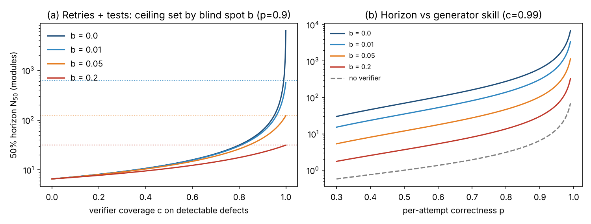
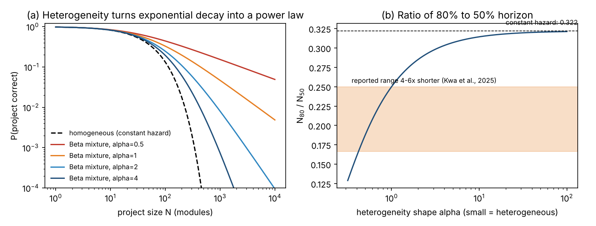
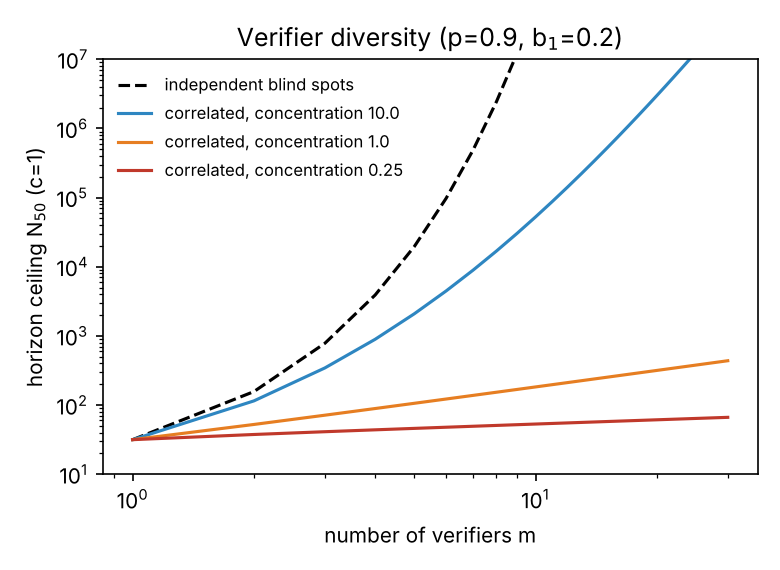
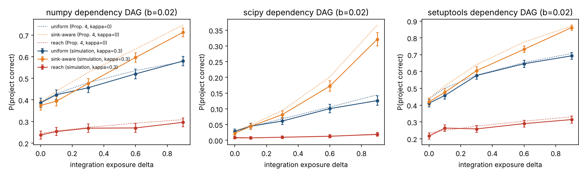

# The Verification Ceiling: A Latent-Defect Model of When AI Agents Can Complete Whole Software Projects

**Target venue:** NeurIPS 2027 (main track; theory and simulation).

*Code, results and figures are in `code/` and `results/` in this directory. `bash code/run_all.sh` reproduces every number computed here (about 3 CPU-minutes). Numbers marked **[run]** come from that code; numbers marked **[sourced]** come from the cited publication.*

---

## Abstract

Coding agents now resolve a large share of single-issue benchmark tasks, yet they rarely deliver a fully correct repository from a specification. We ask what separates the two regimes and argue that the answer is the quality of the acceptance check more than the skill of the generator. We model an agent that builds a project of N modules, retrying each module until a verifier accepts it. A module that is accepted but wrong is a *latent defect*. Four results follow. (i) **Retry invariance.** The probability q that an accepted module is defective does not depend on the retry budget: the odds are q/(1−q) = ((1−p)/p)·s, where p is per-attempt correctness and s the probability that a defective attempt escapes the verifier. Retries buy completion, never correctness. (ii) **A verification ceiling.** If a fraction b of defects lies in a blind spot the verifier shares with the generator (for example, tests written by the same model from the same misreading of the specification), then s ≥ b at any testing effort, and the 50% project horizon satisfies N₅₀ ≤ ln 2·(p/((1−p)b) + 1). With p = 0.9 and b = 0.2 the horizon at full coverage is 31.5 modules; raising coverage from 0.99 to 1 adds only 1.2 modules. (iii) **Heterogeneity.** If q varies across projects with a Beta law, success decays as a power law N^(−α) instead of exponentially, and the ratio of the 80% to the 50% horizon falls from 0.322 to 0.25 at α = 1, inside the 4–6× gap reported for frontier agents. (iv) **Structure.** On a dependency graph where downstream use exposes upstream defects, a project behaves like a chain of N_eff = (1−a)·Σ(1−δ)^(d_u) modules, dominated by leaf modules. In 12 real Python import graphs, leaves make up 44% of modules against 26% in size-matched random graphs. Monte Carlo simulation matches each closed form. The intuitive policy of testing the most depended-upon modules hardest lowers project success from 0.56 to 0.39 on average. Calibrating to published false-acceptance rates of 7.8%–50% for test-passing agent patches gives a horizon of 1–9 issue-sized units under benchmark-grade tests. Reaching 100 units needs a 12–144× lower escape rate. All experiments are simulations or closed-form computations; we give a protocol for testing five predictions on real agents.

## 中文摘要

编程智能体已能解决大多数单个 issue 级别的基准任务，却很少能根据一份需求文档交付完全正确的代码仓库。本文研究这两种情形的差别，并论证关键在于验收检查的质量，而不只是生成器的能力。我们对如下过程建模：智能体构建一个含 N 个模块的项目，每个模块反复重试，直到验证器接受为止。被接受但实际有错的模块称为"潜伏缺陷"。本文得到四个结果。(i) 重试不变性：被接受模块有缺陷的概率 q 与重试次数上限无关，其几率为 q/(1−q) = ((1−p)/p)·s，其中 p 是单次尝试的正确率，s 是有缺陷的尝试逃过验证器的概率。重试只能提高完成率，不能提高正确率。(ii) 验证上限：若有比例 b 的缺陷落在验证器与生成器共有的盲区内（例如同一模型基于对需求的同一误读写出的测试），则无论投入多少测试都有 s ≥ b，项目的 50% 视界满足 N₅₀ ≤ ln 2·(p/((1−p)b) + 1)。当 p = 0.9、b = 0.2 时，覆盖率为 1 时的视界也只有 31.5 个模块；把覆盖率从 0.99 提到 1 只多出 1.2 个模块。(iii) 异质性：若 q 在不同项目间服从 Beta 分布，成功率按幂律 N^(−α) 而非指数衰减，80% 视界与 50% 视界之比从 0.322 降到 0.25（α = 1），落在前沿智能体实测的 4–6 倍差距之内。(iv) 结构：在下游使用会暴露上游缺陷的依赖图上，项目等价于一条长度为 N_eff = (1−a)·Σ(1−δ)^(d_u) 的链，主要由叶子模块决定。在 12 个真实 Python 包的导入图中，叶子模块占 44%，而规模相同的随机图中只占 26%。蒙特卡洛模拟与各闭式结果一致。"被依赖最多的模块测得最严"这一直觉策略使项目成功率平均从 0.56 降到 0.39。用已发表的"通过测试的智能体补丁"误接受率（7.8%–50%）校准后，在基准级测试下的视界只有 1–9 个 issue 规模的单元；要达到 100 个单元，逃逸率需降低 12–144 倍。本文所有实验均为仿真或闭式计算；我们给出了在真实智能体上检验五条预测的实验方案。

---

## 1 Introduction

Can an AI system complete an entire software engineering project without a human? The evidence in late 2026 points in two directions. Single-task results are strong. The 50% time horizon of frontier agents on software tasks has doubled about every seven months since 2019 [Kwa et al., 2025]. Sixteen parallel agents produced a 100,000-line C compiler that builds the Linux kernel [Carlini, 2026]. A benchmark of 22 specification-driven systems of 1,000–10,000 lines each saw 19 solved by the best model [Zhang et al., 2026].

Whole-project results are weak. On NL2Repo-Bench, where an agent must turn one requirements document into an installable library, the strongest agents stay below a 40% average test pass rate and "rarely" produce a fully correct repository [Ding et al., 2025]. Half of the agent patches that pass SWE-bench Verified's tests would not be merged by the projects' own maintainers [METR, 2026]. Differential testing finds that 29.6% of test-passing patches behave differently from the reference fix [Wang et al., 2026].

What separates the cases? The compiler author states it directly: "it's important that the task verifier is nearly perfect, otherwise Claude will solve the wrong problem," and progress on the kernel became possible once GCC was used as "an online known-good compiler oracle" [Carlini, 2026]. The successes share an acceptance check that is strong and independent of the agent. The failures share an acceptance check that is weak, or that the agent wrote itself.

This paper turns that observation into a quantitative model. We do not ask whether an agent can write code for N modules. We ask whether the N modules it *accepts* are all correct. The object of study is the **latent defect**: a module that passed the agent's own acceptance check and is wrong. The question "can AI complete a whole project autonomously?" then becomes "how many accepted units can be composed before a latent defect is expected?", and the answer depends on three numbers that can be measured.

**Contributions.**

1. **A latent-defect model (LDM)** of generate–verify–retry development with three parameters: per-attempt correctness p, verifier coverage c on detectable defects, and blind-spot mass b shared by generator and verifier (§3).
2. **Lemma 1 (retry invariance)** and **Theorem 1 (horizon law).** The latent-defect odds equal error odds times escape probability and do not depend on the retry budget. The 50% horizon is N₅₀ = ln 2·p/((1−p)s) to within ln 2 modules (§4.1).
3. **Theorem 2 (verification ceiling).** With blind-spot mass b, no amount of testing lifts the horizon above ln 2·(p/((1−p)b) + 1) (§4.2). **Proposition 5** extends this to m verifiers with correlated miss probabilities: the ceiling grows polynomially in m, not geometrically (§4.5).
4. **Proposition 3 (heterogeneity).** Beta-distributed defect rates turn exponential decay into a power law and give closed-form ratios between reliability horizons (§4.3).
5. **Proposition 4 (dependency structure).** A closed form for project success on a dependency DAG with integration exposure, an effective project length N_eff, and the optimal split of a fixed verification budget (§4.4).
6. **Experiments [run].** Monte Carlo checks of every closed form; a simulation on 12 dependency graphs extracted from real Python packages that compares verification-allocation policies and adds defect contamination, which the theory omits (§5–6).
7. **A calibration [sourced inputs, run computation]** to published false-acceptance rates, with sensitivity analysis (§7), and **five falsifiable predictions with a test protocol** (§8).

We state the scope plainly. The model is simple and the experiments are simulations. No LLM was run. The paper's claim is a conditional one: given measured values of p, s and b, the model says how large a project an agent can finish correctly, and which of the three is worth improving.

## 2 Related Work

**Benchmarks of project-scale software engineering.** SWE-bench [Jimenez et al., 2024] made issue resolution in real repositories the standard unit of evaluation. SWE-Bench Pro raised the difficulty to tasks that take engineers hours to days [Deng et al., 2026]. Whole-repository generation is evaluated by DevBench [Li et al., 2024], Commit0 [Zhao et al., 2025], NL2Repo-Bench [Ding et al., 2025] and SWE-AGI [Zhang et al., 2026]. Multi-agent frameworks such as MetaGPT [Hong et al., 2024] and ChatDev [Qian et al., 2024] organise role-playing agents into a software company; MetaGPT's stated motive is to let agents check intermediate results and reduce cascading errors. All of these score an agent against a hidden, human-written test suite. That design measures capability well. It also supplies exactly the independent oracle that an autonomous agent in deployment lacks, which is the variable our model isolates.

**Weak tests and false acceptance.** Stronger tests reveal wrong solutions that weak tests accept. EvalPlus extended HumanEval's tests 80-fold and reduced pass@k by up to 19.3–28.9% [Liu et al., 2023]. UTBoost found 345 erroneous patches labelled as passing in SWE-bench [Yu et al., 2025]. Wang et al. [2026] report that 7.8% of plausible patches fail the full developer test suite and 29.6% diverge behaviourally from the reference. METR [2026] had four maintainers review 296 AI-generated pull requests; maintainer merge decisions ran about 24 percentage points below the automated grader. These studies measure the escape rate s for benchmark-grade tests. We use their figures in §7.

**Self-generated verification.** Agents can write their own tests. CodeT ranks candidate programs by agreement with model-written tests [Chen et al., 2023]. Olausson et al. [2024] find that self-repair gains are modest and bottlenecked by the model's feedback on its own code. Tests generated from incorrect code detect bugs 47% worse on real-world code [Huang et al., 2024], because the tests inherit the code's assumptions. This is the blind spot b of our model.

**Time horizons and the constant-hazard model.** Kwa et al. [2025] define the 50% time horizon and report that 80% horizons are 4–6× shorter. Ord [2025] shows that a constant failure rate per unit of human task time explains the data with one parameter and implies T₈₀ ≈ T₅₀/3. Our Theorem 1 is the same survival law, derived for accepted modules, with the hazard decomposed into generator and verifier terms. Proposition 3 gives one explanation of why the measured gap exceeds 3×.

**Coincident failures and software reliability.** Eckhardt and Lee [1985] proved that independently developed program versions fail dependently when inputs vary in difficulty. Knight and Leveson [1986] confirmed this experimentally, and Littlewood and Miller [1989] generalised the model to diverse methodologies. Ron et al. [2026] repeated the Knight–Leveson experiment with 48 agent-written versions and again found substantial common-mode failure. Kim et al. [2025] show that LLM errors are correlated across more than 350 models. We apply the Eckhardt–Lee construction to *verifiers* in place of program versions (Proposition 5).

**Software structure.** MacCormack et al. [2006] introduced design-structure analysis of dependencies in large code bases. We use dependency graphs for a different purpose: to locate where latent defects survive.

**Human factors.** A randomised trial found that experienced open-source developers were slower with early-2025 AI tools [Becker et al., 2025]. Reviewing and correcting agent output is costly, which is consistent with the verification step being the binding constraint.

**The gap.** Benchmarks report *whether* agents finish projects. Reliability studies report *how often* tests accept wrong code. No model we know of links the two to predict project-scale success from per-unit generation and verification rates, or separates the effect of retries, test effort, oracle independence and project structure. That is what this paper supplies.

## 3 The Latent-Defect Model

**Project.** A project consists of N modules. A module is the unit at which the agent decides "done": a function, a file, a feature, or an issue-sized change. The project is *correct* when no accepted module is defective. §7 relaxes this to a tolerance of m defects.

**Generation.** Each attempt at a module is correct with probability p, independently across attempts and modules.

**Verification.** A defective attempt falls in the verifier's **blind spot** with probability b, in which case the verifier cannot detect it. Otherwise the verifier detects it with probability c, the **coverage**. The **escape probability** of a defective attempt is

  s = b + (1−b)(1−c).

Correct attempts always pass (no false alarms; see Limitations). Coverage c is what testing effort buys. The blind spot b is what effort cannot buy: defects that stem from a misreading of the specification which the test author shares, or behaviour that the test environment cannot exercise. An oracle built independently of the generator (a reference implementation, a human-written conformance suite, a formal specification) has small b. Tests written by the same model in the same context have large b.

**Retry.** The agent repeats attempts until the verifier accepts or a budget of K attempts is used.

**Latent defect.** An accepted module that is defective. Let q denote P(defective | accepted).

The model omits much (§10). It keeps the one feature that drives the results: acceptance is decided by an imperfect check whose errors may be correlated with the generator's.

## 4 Theory

### 4.1 Retry invariance and the horizon law

**Lemma 1 (retry invariance).** For any K ≥ 1,

  q = (1−p)s / (p + (1−p)s),  equivalently  q/(1−q) = ((1−p)/p)·s.

The probability of acceptance within K attempts is 1 − (1−A)^K with A = p + (1−p)s.

*Proof.* Each attempt has three outcomes: correct and accepted (probability p), defective and accepted ((1−p)s), defective and rejected ((1−p)(1−s)). Acceptance at attempt t requires t−1 rejections first, so P(accepted at t, defective) = [(1−p)(1−s)]^(t−1)(1−p)s and P(accepted at t, correct) = [(1−p)(1−s)]^(t−1)p. Their ratio is (1−p)s/p for every t. Summing over t ≤ K leaves the ratio unchanged. ∎

The lemma separates two things that are easy to conflate. A larger retry budget raises the probability that a module is *finished*. It does nothing to the probability that a finished module is *right*. Extra compute spent on retries cannot substitute for a better verifier.

*Remark (learning from feedback).* If attempt t has correctness p_t because the agent uses error messages, then q is a weighted average of the per-attempt values (1−p_t)s/(p_t + (1−p_t)s). It lies between the best and worst of them. Feedback helps only through p_t.

**Theorem 1 (horizon law).** If every module is accepted, P(project correct) = (1−q)^N. The x-horizon N_x = ln x / ln(1−q) satisfies, for x = 1/2,

  ln 2 · p/((1−p)s) ≤ N₅₀ ≤ ln 2 · p/((1−p)s) + ln 2.

*Proof.* Modules are independent, which gives the product. For the bounds use q ≤ −ln(1−q) ≤ q/(1−q) and (1−q)/q = p/((1−p)s). ∎

The horizon is proportional to the generator's success odds p/(1−p) and inversely proportional to the escape probability s. Halving either the error odds or the escape rate doubles the size of project that can be completed. In this sense the generator and the verifier are exact substitutes. The next result shows where the substitution stops.

### 4.2 The verification ceiling

**Theorem 2 (verification ceiling).** For every coverage c ∈ [0,1], s ≥ b. Hence

  N₅₀ ≤ ln 2 · ( p/((1−p)b) + 1 ),

and the smallest escape probability, s = b, is attained at c = 1 (the horizon there lies within ln 2 of the bound). Relative to no verification (s = 1), verification of any intensity multiplies the latent-defect odds by at least b.

*Proof.* s = b + (1−b)(1−c) ≥ b, with equality at c = 1; apply Theorem 1. ∎

Define the **crossover coverage** c* by (1−b)(1−c*) = b. Below c*, most escapes are defects that more testing would catch. Above c*, most escapes are blind-spot defects, and further testing has sharply diminishing returns. For b = 0.05, c* = 0.947; for b = 0.2, c* = 0.75.

Table 1 gives N₅₀ for p = 0.9 **[run]**. Without a verifier the horizon is 6.6 modules. With an independent oracle (b = 0) it grows without bound as c → 1. With b = 0.2 it reaches only 31.5 at full coverage (the bound of Theorem 2 is 31.9), and raising coverage from 0.99 to 1 adds 1.2 modules. With b = 0.01 the ceiling is 624, the same horizon that an independent oracle reaches at c = 0.99.

**Table 1.** 50% horizon N₅₀ in modules, p = 0.9 (`results/exp1_validate.json`).

| blind spot b | c = 0.5 | c = 0.9 | c = 0.99 | c → 1 (ceiling) |
|---|---|---|---|---|
| 0 | 12.8 | 62.7 | 624.2 | unbounded |
| 0.01 | 12.7 | 57.6 | 313.8 | 624.2 |
| 0.05 | 12.2 | 43.4 | 105.2 | 125.1 |
| 0.2 | 10.7 | 22.6 | 30.3 | 31.5 |

*Figure 1. (a) Horizon against coverage for four blind-spot masses; dotted lines are the ceilings of Theorem 2. (b) Horizon against generator skill at c = 0.99. A better generator always helps; a better verifier helps until the blind spot binds.*

Once the ceiling binds, two levers remain: reduce generator error odds, or reduce b by making the oracle independent. The first is model progress. The second is an engineering and specification choice that is available now, and the compiler case study is an instance of it.

### 4.3 Heterogeneous difficulty

Projects differ. A vague specification or an unfamiliar domain raises the defect rate of every module in the project at once. Let q be drawn once per project from Beta(α, β), with mean q̄ = α/(α+β).

**Proposition 3 (heterogeneity).** (a) P(project correct) = B(α, β+N)/B(α, β), where B is the Beta function. (b) This is at least (1−q̄)^N. (c) As N → ∞ it behaves as Γ(α+β)/Γ(β) · N^(−α). (d) In the small-q limit (β large, α fixed), S(N) = (1+N/β)^(−α), and

  N_x / N₅₀ = (x^(−1/α) − 1) / (2^(1/α) − 1),

which does not depend on β.

*Proof.* (a) E[(1−q)^N] is a Beta integral. (b) Jensen's inequality, since (1−q)^N is convex in q. (c) Stirling's approximation for the ratio Γ(β+N)/Γ(α+β+N). (d) The Beta law converges to a Gamma law with shape α and rate β, whose Laplace transform at N is (1+N/β)^(−α); invert for N_x. ∎

Two consequences follow. First, success probability at large N is far higher than the homogeneous model predicts, because easy projects dominate the tail. At ten times the median horizon the homogeneous model gives a success probability of 0.001, while the mixture gives 0.091 at α = 1 and 0.180 at α = 0.5 **[run]**. An occasional large project completed autonomously is therefore weak evidence about the typical one.

Second, high-reliability horizons shrink faster. Under a constant hazard, N₈₀/N₅₀ = 0.322, which is Ord's "one third" [Ord, 2025]. Under the mixture the ratio is 0.25 at α = 1, 0.1875 at α = 0.5 and 0.285 at α = 2 **[run]**. The 4–6× gap between 50% and 80% time horizons reported by Kwa et al. [2025] **[sourced]** corresponds to α between 1.00 and 0.42 **[run]**. We do not claim this is the only explanation: Kwa et al. fit a logistic curve in log task length, and the gap is a property of that fit. The claim is narrower. A constant hazard cannot produce a gap above 3.1×; heterogeneity in difficulty of the size α ≈ 0.4–1 can.

*Figure 2. (a) Project success against size for a homogeneous defect rate and for Beta mixtures with the same mean q̄ = 0.02. (b) Ratio of the 80% to the 50% horizon against the heterogeneity shape α.*

### 4.4 Dependency structure and integration exposure

Real projects are not chains. Module v depends on module u when v imports or calls u. Using u is an additional test of u: a defect in u may surface when v is built and tested. Let the dependency graph be a DAG built in topological order, and let d_u be the number of modules that depend directly on u. When a dependent of u is built and u is latently defective, the defect is exposed with probability δ and u is rebuilt. After all modules are built, an end-to-end acceptance stage exposes each remaining latent defect with probability a, and the module is rebuilt. Rebuilt modules pass through the same module-level verifier, so each is latently defective with probability q_u.

**Proposition 4 (residual defects on a DAG).** Under the process above,

  r_u := P(u is latently defective at the end) = q_u · [1 − δ(1−q_u)]^(d_u) · [1 − a(1−q_u)],

the events are independent across modules, and P(project correct) = Π_u (1 − r_u).

*Proof.* Track whether u is latently defective. Initially this has probability q_u. At each dependent's build, a defective u stays defective if it is not exposed (1−δ) or if it is exposed and the rebuild is again defective (δq_u). The probability is multiplied by 1 − δ(1−q_u) at each of the d_u dependents, and by 1 − a(1−q_u) at acceptance. The trajectory of u uses only u's own build and exposure draws, which gives independence. ∎

**Corollary 4 (effective length).** For small, uniform q, P(project correct) ≈ exp(−q · N_eff) with

  N_eff = (1−a) · Σ_u (1−δ)^(d_u) ≥ (1−a) · #{u : d_u = 0}.

A project with integration testing behaves like a chain of N_eff modules. Modules with many dependents contribute almost nothing: their defects are found by use. **Sinks**, modules on which nothing else depends, contribute fully. The number of sinks is a floor on effective project length that no amount of integration exposure removes.

**Optimal allocation.** Suppose a fixed verification budget is split across modules, with effort e_u giving coverage c_u = 1 − exp(−ηe_u). To first order the expected number of residual defects is Σ_u w_u · ((1−p)/p) · (b + (1−b)e^(−ηe_u)) with weights w_u = (1−δ)^(d_u)(1−a). Minimising under Σe_u = B gives the water-filling rule e_u = max(0, ln(η(1−b)w_u/λ)/η). Dedicated verification should go where nothing downstream will test the module. This is the opposite of the common heuristic "test the core hardest". The heuristic is right about *cost*: a late-found defect in a core module forces rework in everything built on it. It is wrong about *final correctness*. §6 measures both effects.

### 4.5 Many verifiers

An agent can run several checks: its own tests, a second model's review, a type checker, a fuzzer. Does the blind spot shrink geometrically with the number of verifiers m?

**Proposition 5 (verifier diversity).** Let each defect have a miss intensity θ drawn from Beta(a₀, b₀), and let each of m verifiers miss it independently with probability θ given θ. Then the probability that all m miss it is

  b_m = E[θ^m] = B(a₀+m, b₀)/B(a₀, b₀) ≥ (E θ)^m,

and b_m ~ [Γ(a₀+b₀)/Γ(a₀)] · m^(−b₀) as m → ∞.

*Proof.* Conditional independence gives θ^m; take the Beta moment; Jensen's inequality gives the bound; Stirling gives the rate. ∎

This is the Eckhardt–Lee [1985] model applied to verifiers. The single-verifier miss rate is b₁ = a₀/(a₀+b₀). The concentration a₀+b₀ controls correlation. As it tends to infinity the verifiers become independent and b_m = b₁^m. As it tends to zero, each defect is either always missed or never missed and b_m = b₁ for every m: the blind spot of §3 is this limit. Table 2 shows the resulting horizon ceilings **[run]**. With independent verifiers, three checks lift the ceiling from 31.5 to 780 modules. At concentration 1 three checks give 71, and thirty give 437.

**Table 2.** Horizon ceiling N₅₀ (c = 1, p = 0.9, b₁ = 0.2) against number of verifiers m (`results/exp3_hetero_diversity.json`).

| verifier correlation | m = 1 | m = 2 | m = 3 | m = 5 | m = 10 |
|---|---|---|---|---|---|
| independent | 31.5 | 156.3 | 780.1 | 19,495 | 6.1×10⁷ |
| concentration 10 | 31.5 | 114.7 | 343.5 | 2,082 | 52,390 |
| concentration 1 | 31.5 | 52.3 | 71.2 | 105.8 | 182.5 |
| concentration 0.25 | 31.5 | 37.5 | 41.1 | 45.9 | 53.1 |

*Figure 3. Horizon ceiling against the number of verifiers. Correlated verifiers give polynomial growth.*

## 5 Experimental Setup

All experiments are simulations or closed-form computations run on CPU **[run]**. Seeds are fixed.

**Experiment 1: closed forms on chains** (`exp1_validate.py`). We simulate 400,000 modules for each of five (p, c, b, K) settings and compare the empirical latent-defect rate with Lemma 1. We simulate 50,000 chain projects for each of three settings and compare with Theorem 1.

**Experiment 2: real dependency graphs** (`graphs.py`, `dagsim.py`, `exp2_dags.py`). We extract the intra-package import graph of 12 installed Python packages: numpy, scipy, matplotlib, networkx, sympy, pandas, setuptools, pip, and the standard-library packages asyncio, email, multiprocessing and importlib. Nodes are source files; test directories, vendored code and `__init__.py` files are excluded; only import-time imports are used. Import cycles are condensed into single nodes so that the result is a DAG. Graph sizes range from 20 to 571 nodes (Table 3). For each graph we draw five random DAGs with the same numbers of nodes and edges as a null model.

The simulator builds modules in topological order with the process of §4.4 and adds two mechanisms that Proposition 4 omits. *Contamination*: if any dependency of a module is latently defective when the module is built, per-attempt correctness drops from p to p(1−κ). *Rework cost*: exposing a defect in u costs ρ per already-built descendant of u. Base parameters are p = 0.9, b = 0.02, δ = 0.3, κ = 0.3, ρ = 0.5, a = 0.5, K = 10. The verification budget equals what uniform coverage c = 0.9 would cost, with η = 1. We compare four allocation policies by water-filling with different weights: **uniform**; **reach** (weight 1 + number of transitive dependents, the "test the core hardest" heuristic); **sink-aware** (the weights of §4.4); and **combined** (a weighted sum of the two). Each configuration is simulated 4,000 times (2,000 in sweeps). We also run κ = 0 to test Proposition 4 exactly, and sweep δ ∈ {0, 0.1, 0.3, 0.6, 0.9} and b ∈ {0, 0.02, 0.1} on three graphs.

These parameters are illustrative, not measured. The experiment tests the theory against a richer process and compares policies under identical conditions. It does not estimate absolute success rates of any real agent.

**Experiment 3: heterogeneity and diversity** (`exp3_hetero_diversity.py`). Closed forms of Propositions 3 and 5, with Monte Carlo checks on 200,000 and 400,000 draws.

**Experiment 4: calibration** (`exp4_calibration.py`). Described in §7.

## 6 Results

### 6.1 Closed forms hold

The empirical latent-defect rate matches Lemma 1 in all five settings, with a largest absolute error of 0.0005 (for example 0.1717 simulated against 0.1722 predicted at p = 0.5, c = 0.99, b = 0.2, K = 10). Retry budgets from 2 to 10 make no difference beyond sampling error. Chain-project success matches Theorem 1: 0.7207 against 0.7178, 0.8211 against 0.8206, and 0.3562 against 0.3584. The mixture formula of Proposition 3 matches in four settings (for example 0.3284 simulated against 0.3289 predicted, where the homogeneous model gives 0.1326). The moment formula of Proposition 5 matches for m = 1, 2, 3, 5 (0.1995, 0.1198, 0.0881, 0.0585 against 0.2, 0.12, 0.088, 0.0591).

### 6.2 Real dependency graphs are sink-heavy

Table 3 gives the structure of the 12 graphs. On average 44% of modules are sinks, against 26% in the size-matched random DAGs; the real fraction is higher in all 12 packages. The effective-length ratio N_eff/N at the base parameters averages 0.354 for real graphs and 0.292 for the null, again higher in all 12. Real software has a few heavily used core modules and a broad periphery of leaves, such as command-line entry points, plotting back ends and format-specific readers. Each leaf is tested by nothing but its own tests.

**Table 3.** Structure of import DAGs (`results/exp2_structure.json`). "Null" is the mean over five random DAGs with the same N and E. N_eff/N is computed at uniform c = 0.9 with the base parameters.

| Package | N | E | sinks | sinks (null) | N_eff/N | N_eff/N (null) |
|---|---|---|---|---|---|---|
| numpy | 144 | 215 | 0.56 | 0.30 | 0.393 | 0.334 |
| scipy | 535 | 995 | 0.52 | 0.26 | 0.387 | 0.307 |
| matplotlib | 130 | 537 | 0.29 | 0.12 | 0.291 | 0.188 |
| networkx | 263 | 96 | 0.84 | 0.71 | 0.470 | 0.455 |
| sympy | 571 | 1716 | 0.44 | 0.16 | 0.355 | 0.236 |
| pandas | 129 | 255 | 0.45 | 0.25 | 0.386 | 0.297 |
| setuptools | 125 | 269 | 0.39 | 0.22 | 0.338 | 0.285 |
| pip | 94 | 264 | 0.35 | 0.17 | 0.321 | 0.244 |
| asyncio | 31 | 104 | 0.23 | 0.18 | 0.255 | 0.222 |
| email | 27 | 54 | 0.30 | 0.19 | 0.315 | 0.289 |
| multiprocessing | 20 | 50 | 0.45 | 0.18 | 0.338 | 0.258 |
| importlib | 22 | 20 | 0.50 | 0.43 | 0.398 | 0.389 |

### 6.3 Proposition 4 is exact without contamination and optimistic with it

With κ = 0 the simulation agrees with Proposition 4. Across 24 configurations (12 graphs, uniform and sink-aware allocation) the standardised differences have mean −0.16 and standard deviation 1.00, with a largest absolute value of 2.1; the largest absolute error in success probability is 0.007 under uniform allocation and 0.017 under sink-aware allocation.

With contamination (κ = 0.3) the formula is optimistic, as expected, since defective dependencies now cause further defects. The mean signed error is −0.010 under uniform allocation and −0.026 under sink-aware allocation, with largest absolute errors of 0.027 and 0.059. The formula remains a usable approximation and an upper bound in tendency.

**Table 4.** P(project correct) by policy (`results/exp2_summary.json`). "Chain" is (1−q)^N with module-level verification only. Standard errors are at most 0.008.

| Package | chain | uniform | Prop. 4 | reach | sink-aware | null DAG, uniform | uniform, κ=0 | sink-aware, κ=0 |
|---|---|---|---|---|---|---|---|---|
| numpy | 0.153 | 0.468 | 0.480 | 0.284 | 0.478 | 0.529 | 0.482 | 0.514 |
| scipy | 0.001 | 0.064 | 0.068 | 0.009 | 0.074 | 0.101 | 0.069 | 0.095 |
| matplotlib | 0.184 | 0.586 | 0.612 | 0.134 | 0.645 | 0.709 | 0.617 | 0.702 |
| networkx | 0.033 | 0.195 | 0.201 | 0.155 | 0.196 | 0.196 | 0.203 | 0.219 |
| sympy | 0.001 | 0.056 | 0.072 | 0.000 | 0.083 | 0.149 | 0.080 | 0.120 |
| pandas | 0.186 | 0.515 | 0.524 | 0.298 | 0.536 | 0.593 | 0.524 | 0.538 |
| setuptools | 0.196 | 0.557 | 0.578 | 0.263 | 0.597 | 0.601 | 0.576 | 0.632 |
| pip | 0.294 | 0.665 | 0.676 | 0.280 | 0.686 | 0.711 | 0.674 | 0.724 |
| asyncio | 0.668 | 0.889 | 0.902 | 0.752 | 0.916 | 0.913 | 0.900 | 0.925 |
| email | 0.703 | 0.899 | 0.896 | 0.753 | 0.906 | 0.900 | 0.897 | 0.902 |
| multiprocessing | 0.771 | 0.908 | 0.916 | 0.855 | 0.925 | 0.929 | 0.915 | 0.943 |
| importlib | 0.751 | 0.896 | 0.893 | 0.864 | 0.900 | 0.892 | 0.889 | 0.898 |
| **mean** | | **0.558** | | **0.387** | **0.579** | **0.602** | **0.569** | **0.601** |

### 6.4 Structure and policy effects

*Integration exposure and acceptance testing help a great deal.* For numpy's graph, module-level verification alone gives a success probability of 0.153; adding exposure through use (δ = 0.3) and an acceptance stage (a = 0.5) gives 0.468.

*Sink-heavy structure hurts.* Under uniform allocation the real graph has lower success than its random null in 11 of 12 packages (mean 0.558 against 0.602).

*Testing the core hardest lowers correctness.* The reach policy has lower success than uniform in all 12 graphs (mean 0.387 against 0.558). It starves the leaves of verification. It does achieve the lowest cost: 1.111 attempts-plus-rework per module against 1.134 for uniform.

*Sink-aware allocation helps correctness modestly and costs more.* It beats uniform in 12 of 12 graphs, but the mean gain is small (0.579 against 0.558) and several per-graph differences are within sampling error. Its cost is 1.183 per module, the highest, because core defects are now found late and trigger rework. Contamination erodes its benefit: at κ = 0 the gain is 0.601 against 0.569. The benefit grows with integration exposure. For scipy's graph at b = 0.02, sink-aware allocation gives 0.082 against 0.061 for uniform at δ = 0.3, and 0.321 against 0.126 at δ = 0.9 (Figure 4).

*The blind spot caps what structure can do.* For setuptools' graph at δ = 0.9 under uniform allocation, success is 0.732 at b = 0, 0.693 at b = 0.02 and 0.550 at b = 0.1.

The policy lesson is a trade-off, not a dominance result. Verification effort on core modules reduces rework; verification effort on leaves reduces shipped defects. Which matters depends on whether the objective is the cost of getting to "done" or the correctness of what is done. An agent optimising its own apparent progress will favour the former.

*Figure 4. Project success against integration exposure δ on three real dependency graphs (b = 0.02). Points: simulation with contamination, ±2 standard errors. Dotted: Proposition 4.*

## 7 Calibration to Published False-Acceptance Rates

The model's key quantity q is the share of accepted units that are wrong. Three published figures bound it for issue-sized units accepted by benchmark-grade, human-written tests **[sourced]**:

- **q = 0.078.** Share of plausible (test-passing) patches that fail the full developer test suite [Wang et al., 2026].
- **q = 0.296.** Share of plausible patches that differential testing separates from the reference patch [Wang et al., 2026]. This is an upper proxy: manual inspection found 28.6% of the divergent patches certainly incorrect.
- **q ≈ 0.5.** Share of test-passing pull requests that maintainers would not merge [METR, 2026]. This is a broader notion of defect that includes code quality.

Everything below is computed from these inputs **[run]** (`results/exp4_calibration.json`).

**Table 5.** Implications of published false-acceptance rates under the LDM. "Units" are issue-sized accepted changes. Escape s is inferred assuming a 70% per-attempt acceptance rate (an assumption; see text).

| | q = 0.078 | q = 0.296 | q = 0.50 |
|---|---|---|---|
| N₅₀ (units) | 8.5 | 2.0 | 1.0 |
| N₈₀ (units) | 2.7 | 0.6 | 0.3 |
| P(correct) at N = 10 | 0.444 | 0.030 | 0.001 |
| P(correct) at N = 30 | 0.087 | 3×10⁻⁵ | <10⁻⁶ |
| largest N with P(≤1 defect) ≥ 0.5 | 21 | 5 | 3 |
| largest N with P(≤10 defects) ≥ 0.5 | 136 | 35 | 21 |
| inferred p, s at 70% acceptance | 0.645, 0.154 | 0.493, 0.409 | 0.350, 0.538 |
| escape reduction for N₅₀ = 100 | 12× | 60× | 144× |
| escape reduction for N₅₀ = 1,000 | 122× | 606× | 1,442× |

Three readings follow.

*Benchmark-grade verification supports small projects only.* Even under the most favourable figure, a composition of 10 accepted units is fully correct with probability 0.44, and one of 30 units with probability 0.09. By Lemma 1 a larger retry budget does not change this.

*The required improvement is large but well defined.* A horizon of 100 units needs latent-defect odds of 0.007, which is a 12-fold reduction from q = 0.078 and a 144-fold reduction from q = 0.5. By Theorem 1 the reduction can come from the verifier, the generator or both. The inversion formulas are p = A(1−q) and s = Aq/(1−p) for an acceptance rate A. At A = 0.7 and q = 0.078 the implied escape rate is 0.154: benchmark tests miss about one wrong patch in seven. Holding s = 0.15 fixed, the generator-only route to N₅₀ = 100 needs a per-attempt error rate of 4.4%, and N₅₀ = 1,000 needs 0.46%.

*Defect tolerance scales the horizon linearly.* Real projects ship with defects. If m latent defects are acceptable, the horizon is roughly (m + 0.7)/q. Tolerating 10 defects extends the favourable case to 136 units. The strict criterion is the right one for a claim of *autonomous completion*, where no human will find and fix what remains. The tolerant criterion is the right one for a project that will have maintainers.

**Consistency with project-scale case studies.** The compiler project [Carlini, 2026] had what the model says is needed: human-written conformance suites, a reference implementation used as an oracle, and continuous integration, all independent of the generating agents. Its reported limitations (no working assembler or linker, inefficient output, new features breaking existing ones) lie where the oracle was absent or weak. SWE-AGI's tasks are parsers, decoders and solvers built from standards and RFCs with hidden tests [Zhang et al., 2026], again a setting with small b. NL2Repo-Bench provides only a requirements document during development [Ding et al., 2025]; the agent must supply its own verification, and fully correct repositories are rare. The model orders these three cases correctly. This is an after-the-fact reading of three cases and is not a test.

## 8 Predictions and a Test Protocol

The model yields predictions that can fail.

**P1 (retry invariance).** For a fixed verifier, the share of accepted solutions that fail a stronger hidden test suite does not fall as the retry budget K grows. Completion rate rises with K; the false-acceptance share stays flat or rises if later attempts overfit to the visible tests.

**P2 (ceiling under self-verification).** When an agent writes its own tests, the hidden-test failure rate of accepted modules flattens at a positive floor as the number of self-written tests grows. With tests written independently of the implementation (by a human, or by a different model that sees only the specification), the rate keeps falling. The floor estimates b.

**P3 (power-law tail).** Across projects of varying size with a fixed agent and verifier, success probability against size is better fitted by (1+N/β)^(−α) than by an exponential, and N₈₀/N₅₀ is below 0.32.

**P4 (leaves hold the defects).** In agent-built repositories, modules with no in-project dependents have a higher residual defect rate than modules with d dependents, by a factor near (1−δ)^(−d) for an exposure rate δ estimated from the agent's own repair log.

**P5 (diversity is polynomial).** Adding verifiers of the same model family reduces the escape rate more slowly than geometrically. Cross-family verifiers reduce it faster than same-family ones, but still more slowly than independence predicts.

**Protocol.** Take a repository-generation benchmark with hidden upstream tests, such as Commit0 or NL2Repo-Bench. Split each task's hidden suite into a *visible* part V and a *held-out* part H. Run the agent under a 2×2×3 design: verifier source (agent-written tests, or V), verifier author (same model, or a different family, for the agent-written arm), and retry budget K ∈ {1, 4, 16} per module. Record, for each module the agent marks done, whether it passes H. Estimate A, q, and hence p and s per arm by the inversion of §7; estimate b as the floor of q's escape component as the size of the agent's test suite is varied. P1 is tested by the K contrast, P2 by the verifier-source contrast, P5 by the author contrast, P4 by regressing module-level H-failure on in-project dependents, and P3 by pooling projects of different sizes. With 100 repositories, about 30 modules each and a baseline q near 0.1, a two-sided test at the 5% level detects a difference of 0.03 in q between arms with power above 0.9, by a standard two-proportion calculation (`results/exp4_calibration.json`) that ignores within-repository clustering; clustering will raise the required sample. We did not run this protocol: it needs LLM inference that was not available.

## 9 Discussion

**An answer to the title question.** Whether AI can complete a whole software project autonomously depends on the product N·q, where q is fixed by generator error odds and verifier escape probability. For projects with an independent, near-complete oracle (compilers, codecs, protocol implementations, ports and migrations with a reference system), q can in principle be driven low enough that hundreds or thousands of units compose correctly, and the published project-scale successes are of this kind. For projects whose specification lives in a natural-language document and whose tests the agent must write itself, the blind spot bounds the horizon at tens of units under plausible parameters, whatever the retry budget. Both statements are consistent with the published evidence, and the model explains why they do not conflict.

**What to invest in.** Theorem 1 says generator and verifier improvements are interchangeable in their effect on latent-defect odds. Theorem 2 says the verifier's contribution saturates at 1/b. The practical order is therefore: first raise coverage to the crossover c*; then reduce b through independence (tests from the specification before the code exists, a different model family, property-based and differential testing against references, human-written acceptance criteria); and expect the rest to come from generator progress. Proposition 5 warns that stacking several reviewers from the same family buys little.

**What "autonomous" should mean in evaluations.** A benchmark that grades with hidden human-written tests measures p well. If the same tests are visible to the agent during development it also supplies an oracle with small b, which overstates autonomous capability. If they are hidden, the benchmark measures the agent's own verification, which is the deployment condition. Reporting A and q separately, as in the protocol above, would make results comparable across the two designs.

**An incentive problem.** The reach policy in §6.4 finishes cheapest and ships the most defects. An agent rewarded for task completion at low cost is pushed toward that policy. Lemma 1 has the same flavour: retrying until tests pass looks like diligence and adds no correctness. Evaluation by completion rate alone cannot see either effect.

## 10 Limitations

- **No experiments on real agents.** Every result is a proof, a closed-form computation or a simulation. The parameter values in §5–6 (p = 0.9, b = 0.02, δ = 0.3, κ = 0.3 and so on) are illustrative and were not measured. The predictions of §8 are untested.
- **The calibration is rough.** The three false-acceptance figures come from SWE-bench Verified, which covers bug fixes in mature Python repositories with existing tests, from agents of 2024–2025. They need not transfer to new-project development or to current models. The 0.5 figure mixes functional defects with code-quality objections, and the 0.296 figure counts behavioural divergence, not confirmed incorrectness. The 70% acceptance rate used to infer p and s is an assumption; Table 5's horizons do not depend on it but the inferred p and s do. Treating an issue-sized patch as a "module" of a new project is an analogy.
- **Independence across modules.** The base model assumes independent attempts. Real defects cluster: one misunderstanding of the specification can corrupt many modules. Proposition 3 captures project-level correlation only through a shared q, and the simulator's contamination term is one simple mechanism among many.
- **Strict success criterion.** "No latent defect" is harsher than how software is judged in practice, and it ignores severity. §7 gives the tolerant variant, but the model has no notion of a defect that does not matter.
- **Verifier model.** We assume no false alarms, a blind spot that is a fixed fraction of defects, and coverage that is the same for all detectable defects. Flaky or wrong tests, which make agents "fix" correct code, are outside the model. The Beta form in Propositions 3 and 5 is chosen for tractability.
- **Static architecture.** The dependency DAG is given. In a real project the agent chooses the decomposition, and architectural errors, missing requirements and non-functional properties (performance, security, maintainability) are not module-level defects in our sense.
- **Graph extraction.** Import graphs of mature, human-written Python packages stand in for the structure of agent-built projects, which may differ. Condensing import cycles merges 139 files of sympy and 113 of pandas into single nodes. The extracted graphs depend on installed package versions (recorded in `results/exp2_chainref.json`); we observed the setuptools graph change with the installed version. The null model matches only node and edge counts.
- **Policy comparison.** The sink-aware gain at the base parameters is small, and for individual graphs it is within sampling error. The claim we rely on is the direction of the trade-off and the clear loss under the reach policy, both of which hold in all 12 graphs.
- **Heterogeneity reading.** Matching the reported 4–6× horizon gap with α ≈ 0.4–1 shows compatibility, not identification. Other mechanisms, including the logistic functional form used to estimate the horizons, can produce the same gap.
- **Literature verification.** We could not open METR's own pages from this environment; figures attributed to the METR note (296 pull requests, four maintainers, about 24 points, roughly half) were confirmed only through search-result excerpts of that note.

## 11 Conclusion

We modelled autonomous software development as generate–verify–retry and studied the defects that the agent's own acceptance check lets through. Retries do not change the chance that an accepted module is wrong. The project horizon is proportional to generator success odds divided by verifier escape probability. A blind spot shared by generator and verifier puts a ceiling on what testing effort can deliver, and correlated verifiers raise that ceiling only polynomially. On real dependency structures, leaf modules carry most of the residual risk, and the intuitive policy of testing the core hardest trades correctness for lower cost. Published false-acceptance rates imply that benchmark-grade tests support fully correct compositions of fewer than ten issue-sized units. The model gives a conditional answer to whether AI can complete a whole software project on its own: yes where an independent oracle exists, and not yet where the agent must also be its own judge. The predictions are stated so that experiments on real agents can refute them.

## References

Becker, J., Rush, N., Barnes, E., & Rein, D. (2025). Measuring the impact of early-2025 AI on experienced open-source developer productivity. arXiv:2507.09089.

Carlini, N. (2026). Building a C compiler with a team of parallel Claudes. Anthropic Engineering Blog, 5 February 2026. https://www.anthropic.com/engineering/building-c-compiler

Chen, B., Zhang, F., Nguyen, A., Zan, D., Lin, Z., Lou, J.-G., & Chen, W. (2023). CodeT: Code generation with generated tests. *ICLR 2023*. arXiv:2207.10397.

Deng, X., Da, J., et al. (2026). SWE-Bench Pro: Can AI agents solve long-horizon software engineering tasks? *ICML 2026*, PMLR 306:23917–23934. arXiv:2509.16941.

Ding, J., Long, S., Pu, C., Zhou, H., Gao, H., Gao, X., et al. (2025). NL2Repo-Bench: Towards long-horizon repository generation evaluation of coding agents. arXiv:2512.12730.

Eckhardt, D. E., & Lee, L. D. (1985). A theoretical basis for the analysis of multiversion software subject to coincident errors. *IEEE Transactions on Software Engineering*, SE-11(12), 1511–1517.

Hong, S., Zhuge, M., et al. (2024). MetaGPT: Meta programming for a multi-agent collaborative framework. *ICLR 2024*. arXiv:2308.00352.

Huang, D., Zhang, J. M., Harman, M., Du, M., & Cui, H. (2024). Measuring the influence of incorrect code on test generation. arXiv:2409.09464.

Jimenez, C. E., Yang, J., Wettig, A., Yao, S., Pei, K., Press, O., & Narasimhan, K. (2024). SWE-bench: Can language models resolve real-world GitHub issues? *ICLR 2024*. arXiv:2310.06770.

Kim, E. M., Garg, A., Peng, K., & Garg, N. (2025). Correlated errors in large language models. *ICML 2025*, PMLR 267:30038–30066. arXiv:2506.07962.

Knight, J. C., & Leveson, N. G. (1986). An experimental evaluation of the assumption of independence in multiversion programming. *IEEE Transactions on Software Engineering*, SE-12(1), 96–109.

Kwa, T., West, B., Becker, J., Deng, A., Garcia, K., Hasin, M., et al. (2025). Measuring AI ability to complete long software tasks. arXiv:2503.14499.

Li, B., Wu, W., Tang, Z., Shi, L., Yang, J., Li, J., et al. (2024). DevBench: A comprehensive benchmark for software development. arXiv:2403.08604.

Littlewood, B., & Miller, D. R. (1989). Conceptual modeling of coincident failures in multiversion software. *IEEE Transactions on Software Engineering*, 15(12), 1596–1614.

Liu, J., Xia, C. S., Wang, Y., & Zhang, L. (2023). Is your code generated by ChatGPT really correct? Rigorous evaluation of large language models for code generation. *NeurIPS 2023*. arXiv:2305.01210.

MacCormack, A., Rusnak, J., & Baldwin, C. Y. (2006). Exploring the structure of complex software designs: An empirical study of open source and proprietary code. *Management Science*, 52(7), 1015–1030.

METR (2026). Many SWE-bench-passing PRs would not be merged into main. METR note, 10 March 2026. https://metr.org/notes/2026-03-10-many-swe-bench-passing-prs-would-not-be-merged-into-main/

Olausson, T. X., Inala, J. P., Wang, C., Gao, J., & Solar-Lezama, A. (2024). Is self-repair a silver bullet for code generation? *ICLR 2024*. arXiv:2306.09896.

Ord, T. (2025). Is there a half-life for the success rates of AI agents? arXiv:2505.05115.

Qian, C., Liu, W., Liu, H., Chen, N., Dang, Y., Li, J., et al. (2024). ChatDev: Communicative agents for software development. *ACL 2024*, 15174–15186.

Ron, J., Baudry, B., & Monperrus, M. (2026). N-version programming with coding agents. arXiv:2606.20158.

Wang, Y., Pradel, M., & Liu, Z. (2026). Are "solved issues" in SWE-bench really solved correctly? An empirical study. *ICSE 2026*. arXiv:2503.15223.

Yu, B., Zhu, Y., He, P., & Kang, D. (2025). UTBoost: Rigorous evaluation of coding agents on SWE-Bench. *ACL 2025*, 3762–3774. arXiv:2506.09289.

Zhang, Z., Zhang, H., Fei, H., Bao, Z., Chen, Y., Lei, Z., et al. (2026). SWE-AGI: Benchmarking specification-driven software construction with MoonBit in the era of autonomous agents. arXiv:2602.09447.

Zhao, W., Jiang, N., Lee, C., Chiu, J. T., Cardie, C., Gallé, M., & Rush, A. M. (2025). Commit0: Library generation from scratch. *ICLR 2025*. arXiv:2412.01769.
