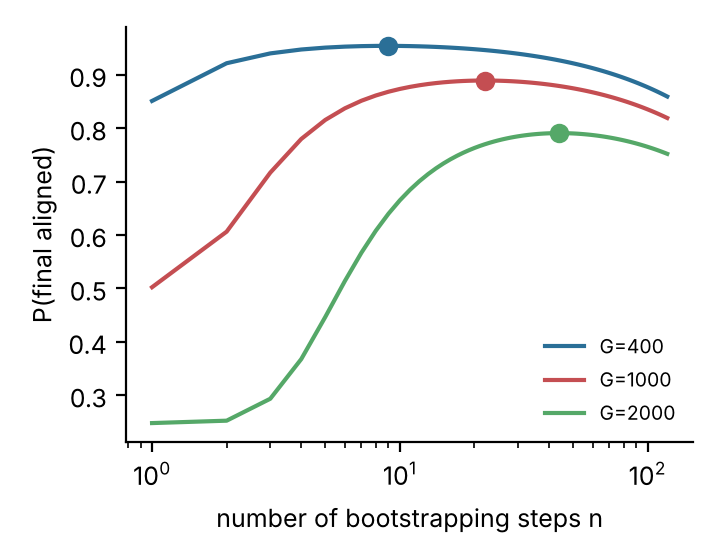
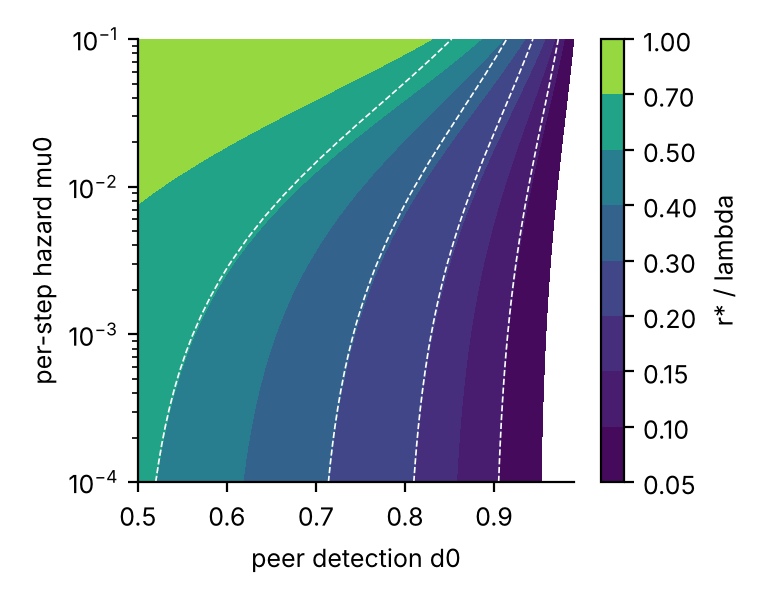
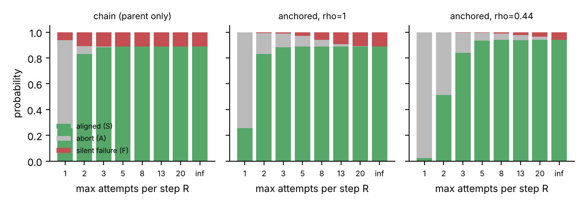
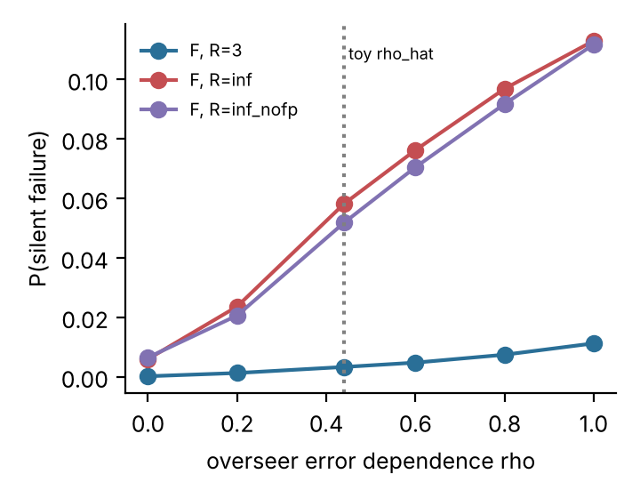

# When Does Bootstrapped Oversight Keep Stronger Models Aligned? Persistence, Correlated Blind Spots, and the Resampling Trap

**Target venue:** NeurIPS 2027 (main track; formal model + simulation + toy measurement)

---

## Abstract

A widely discussed route to keeping increasingly capable models aligned with human intent is *bootstrapped* (nested, iterated) oversight: a trusted model oversees a slightly stronger successor, which, once accepted, oversees the next one. Recent work quantified how such chains scale when every step is an adversarial game, but left open three questions that decide whether the strategy can work at all: (i) what happens when misalignment, once it slips through, *persists* into the overseers of later generations; (ii) whether adding older, trusted overseers ("anchoring") helps when overseers share blind spots; and (iii) how the common practice of retraining or resampling a flagged model interacts with oversight. We study these questions in a minimal probabilistic model, the Bootstrapped Oversight Schedule (BOS) model, in which each new model carries a misalignment hazard that grows with the capability step, overseers detect misalignment with a probability that falls with their capability deficit, and flagged models are retrained up to *R* times before the process aborts. We prove five results. (1) If misalignment is persistent, then for *any* oversight schedule the probability that the final model is aligned is at most exp(−λ(1−d̄)G − n·c₀), where G is the total capability gap, λ the hazard per unit of capability, d̄ the best achievable per-attempt detection probability, and c₀ ≥ 0 a per-step overhead: bootstrapping can reduce the exponential rate of alignment loss by at most a factor 1−d̄, and cannot make it vanish. (2) For chain oversight the success probability is *exactly* exp(−G·h(G/n)); the optimal step size is therefore independent of G, the optimal number of steps grows linearly in G, and a first-order closed form gives the optimal rate (√(λ(1−d₀)) + √(μ₀d₁))². (3) By the Fréchet–Hoeffding bounds, an ensemble of overseers with unknown error dependence guarantees no more detection than its best member. (4) In an anchored chain, raising the retry budget R raises *both* success and silent failure; as R→∞ anchoring's protection disappears entirely, because retraining against a fixed overseer is a best-of-R search for an undetected model. (5) If misalignment is not persistent (a misaligned parent corrupts its child with probability γ<1), the success probability converges to a gap-independent limit, so persistence γ, not capability gap, is the quantity that decides whether bootstrapping scales. Exact dynamic programs agree with Monte Carlo simulation (absolute differences ≤ 0.002), and a property test of result (1) over 3,000 random parameter settings found no violations. In a toy experiment with MLP overseers, the probability that all four overseers miss a defect was 8 times the independence prediction (0.115 vs 0.014), the estimated dependence weight was ρ̂ ≈ 0.42–0.47, and adversarial best-of-20 selection by a stronger policy tripled the all-miss rate. We state falsifiable predictions and a test protocol for model-organism experiments.

## 中文摘要

让越来越强的模型持续与人类意图保持一致，一个被广泛讨论的方案是“自举式（嵌套、迭代）监督”：可信模型监督略强一些的后继模型，后者通过审查后再去监督下一代。已有工作在“每一步都是对抗博弈”的假设下量化了这种链条的扩展规律，但留下了三个决定该方案能否成立的问题：(i) 若错位（misalignment）一旦漏检便会*持续*传递给后代的监督者，会怎样；(ii) 当监督者共享盲区时，引入更早、可信的监督者（“锚定”）是否有用；(iii) 对被标记模型进行重训/重采样的常见做法如何与监督相互作用。我们提出一个最小概率模型——自举监督日程（BOS）模型：每个新模型的错位风险随能力跃升而增长，监督者的检出概率随其能力差距而下降，被标记的模型最多重训 R 次，否则流程中止。我们证明了五个结果：(1) 若错位具有持续性，则对*任何*监督日程，最终模型对齐的概率不超过 exp(−λ(1−d̄)G − n·c₀)，即自举最多把对齐丧失的指数速率降低 1−d̄ 倍，而无法使其消失；(2) 对链式监督，成功概率*恰好*为 exp(−G·h(G/n))，因此最优步长与总差距 G 无关、最优步数随 G 线性增长，并给出一阶闭式最优速率 (√(λ(1−d₀)) + √(μ₀d₁))²；(3) 由 Fréchet–Hoeffding 界，误差相关结构未知时，监督者集成能保证的检出率不超过其最佳成员；(4) 在锚定链中，提高重试预算 R 会*同时*提高成功率和静默失败率，R→∞ 时锚定的保护完全消失，因为针对固定监督者反复重训等价于“best-of-R”搜索未被检出的模型；(5) 若错位不持续（错位父模型以概率 γ<1 污染子模型），成功概率收敛到一个与能力差距无关的极限——决定自举能否扩展的是持续性 γ，而非能力差距。精确动态规划与蒙特卡洛模拟一致（绝对误差 ≤ 0.002），对结果 (1) 的 3000 组随机参数性质测试无一违反。在以 MLP 为监督者的玩具实验中，四个监督者同时漏检的概率是独立性预测的 8 倍（0.115 对 0.014），估计的依赖权重 ρ̂ ≈ 0.42–0.47，而更强策略的对抗性 best-of-20 选择使全体漏检率提高约三倍。我们给出了可证伪的预测和面向“模型生物”实验的检验方案。

---

## 1 Introduction

The question "how do we ensure that increasingly capable models remain aligned with human intent?" has, in the technical literature, largely become a question about *oversight that scales*: how a weaker, trusted party can reliably evaluate or train a stronger one. Iterated amplification [Christiano et al., 2018], debate [Irving et al., 2018], recursive reward modeling [Leike et al., 2018], weak-to-strong generalization [Burns et al., 2024] and AI control [Greenblatt et al., 2024a] each propose a different mechanism, but many of them share a common structural move: *bootstrapping*. A model that has been verified at one capability level becomes the overseer for the next level. Engels et al. [2025] recently made this structure quantitative under the name Nested Scalable Oversight (NSO): they fit how oversight-game performance scales with general capability and showed that, when every step is an adversarial game that must be won, the overall success probability is the product of per-step win probabilities and there is an optimal number of oversight steps.

That analysis treats every step as a fresh game. Three features that matter for whether bootstrapping can actually keep strong models aligned fall outside it.

1. **Persistence.** If a misaligned model is accepted at step *i*, it becomes the overseer and (often) the source of training signal for step *i*+1. Empirical work shows that unwanted dispositions can survive safety training [Hubinger et al., 2024], that models can strategically comply during training to preserve their preferences [Greenblatt et al., 2024b], and that traits can be transmitted from a teacher to a student through innocuous-looking data [Cloud et al., 2025]. How strongly misalignment propagates down a chain is a parameter; its value changes the qualitative answer.
2. **Correlated blind spots.** A natural patch is to have *all* earlier, trusted models (and humans) also oversee each new model ("anchoring"). Whether this helps depends on whether overseers fail on the same inputs. Errors of language models are strongly correlated and becoming more so with capability [Goel et al., 2025; Kim et al., 2025], echoing the classic finding in multiversion software that independently developed versions fail together more often than independence predicts [Eckhardt and Lee, 1985; Littlewood and Miller, 1989].
3. **Resampling.** In practice a flagged model is not simply discarded: it is retrained, re-sampled, or patched and re-evaluated. Resampling is also an explicit control protocol [Bhatt et al., 2025]. But retraining until a check passes is a form of optimization against the checker, the same pressure that produces reward-model over-optimization [Gao et al., 2023].

This paper isolates these three effects in a deliberately minimal model and proves how they determine the scaling of alignment with capability gap. The model is not a forecast; its purpose is to identify which quantities must be measured, and to derive predictions that model-organism experiments can falsify.

**Contributions.**

- **C1 (model).** The Bootstrapped Oversight Schedule (BOS) model: a chain of models spanning capability gap *G* in *n* steps, with a capability-dependent misalignment hazard, capability-deficit-dependent detection, a persistence parameter γ, a collusion parameter κ, overseer-error dependence ρ, false positives *f*, and a retry budget *R*, with three outcomes: aligned (S), aborted (A), and silent failure (F). (§3)
- **C2 (an alignment-loss floor).** Theorem 1: under persistent misalignment, for every schedule, retry policy and false-positive rate, P(S) ≤ exp(−λ(1−d̄)G − n·c₀). Oversight can slow the exponential decay of alignment with capability gap by at most a factor 1−d̄, where d̄ is the best per-attempt detection probability; it cannot stop it. (§4.1)
- **C3 (exact law and optimal schedule).** Theorem 2: for chain oversight, P(S) = exp(−G·h(G/n)) exactly, so the optimal step size Δ* is independent of *G* and the optimal number of steps is linear in *G*; the first-order optimal rate is (√(λ(1−d₀)) + √(μ₀d₁))². (§4.2)
- **C4 (ensembles and resampling).** Proposition 3 (Fréchet–Hoeffding): with unknown error dependence, an ensemble of overseers guarantees only its best member's detection. Proposition 4: in an anchored chain, P(S) and P(F) are both non-decreasing in the retry budget *R*, and as *R*→∞ anchoring provides no protection at all. (§4.3–4.4)
- **C5 (persistence decides scaling).** Proposition 5: for γ<1, P(S) converges to a gap-independent limit a/(a+ε₀). Whether bootstrapping scales is governed by persistence γ relative to the per-step leak ε₀. (§4.5)
- **C6 (evidence and protocol).** Exact dynamic programs validated against Monte Carlo; quantitative sweeps; a toy measurement of ρ with MLP overseers showing strong positive dependence and the effect of adversarial selection; and a pre-registrable protocol with four falsifiable predictions. (§5–6)

All numbers reported below come from code in `code/` that we ran, with outputs in `results/`. Parameter values in the model are illustrative and not estimates for any real system; we report sensitivity analyses throughout.

## 2 Related Work

**Scalable oversight protocols.** Iterated amplification builds a training signal for hard tasks by composing solutions to easier subproblems [Christiano et al., 2018]; debate pits two agents against each other before a judge and argues that, at equilibrium, honest debate can let a weak judge check strong claims [Irving et al., 2018]; recursive reward modeling uses agents trained at one level to help evaluate the next [Leike et al., 2018]. Empirical work has measured whether such protocols help weaker judges: Bowman et al. [2022] proposed the sandwiching paradigm and found that humans assisted by an unreliable model outperformed both; Kenton et al. [2024] compared debate and consultancy with weak LLM judges across many tasks and found debate better than consultancy, with mixed results relative to direct question answering. Our model abstracts away from the specific protocol: a protocol enters only through its detection curve d(δ).

**Scaling laws for oversight.** Engels et al. [2025] fit how oversight-game "Domain Elo" scales with general capability in four games (Mafia, Debate, Backdoor Code, Wargames) and analyze NSO, in which the overall success probability is the product of stepwise Guard win probabilities; they report NSO success rates of 13.5%, 51.7%, 10.0% and 9.4% respectively at a general Elo gap of 400, and that the optimal number of steps increases with the gap. We adopt their Elo-logistic parameterisation of detection, but (a) model misalignment as a hazard rather than assuming every step's overseen model is adversarial, (b) let accepted misalignment propagate with persistence γ, (c) allow multiple overseers with dependent errors, and (d) model retraining. When γ=1 our chain model shares their product structure; Theorems 1–2 then provide closed-form statements (floor, exact exponential law, G-independent optimal step size) that complement their numerical optimization.

**Weak-to-strong generalization.** Burns et al. [2024] showed that strong models fine-tuned on weak labels outperform their supervisors but fall short of ground-truth supervision, particularly for reward modeling. Theoretical analyses explain this via pseudolabel correction and coverage expansion [Lang et al., 2024] or a misfit-based gain [Charikar et al., 2024]. Goel et al. [2025] found that weak-to-strong gains shrink as supervisor and student become more similar. These works study a single weak-to-strong step; we study composition over many steps and the role of failures that persist.

**AI control and resampling.** AI control evaluates protocols that remain safe even if the model deliberately subverts them [Greenblatt et al., 2024a], formalized as partially observable stochastic games by Griffin et al. [2024]. Ctrl-Z introduced resample protocols for agents, which reduced attack success from 58% to 7% at a 5% usefulness cost in their BashBench setting [Bhatt et al., 2025]; importantly, their protocols use resampling to gather incriminating evidence, not merely to obtain a passing sample. Our Proposition 4 formalizes why the latter use is dangerous: retraining until an overseer passes the model is best-of-R optimization against the overseer, analogous to proxy over-optimization in reward modeling [Gao et al., 2023].

**Persistence of misalignment.** Deceptive or mesa-optimizing models were analyzed conceptually by Hubinger et al. [2019] and Ngo et al. [2024]. Hubinger et al. [2024] built backdoored models whose behavior persisted through supervised fine-tuning, RL and adversarial training. Greenblatt et al. [2024b] documented alignment faking. Cloud et al. [2025] showed that a teacher's traits can be transmitted to a student via data that appears unrelated, when they share a base model. These results motivate treating persistence γ as potentially close to 1, which our Proposition 5 identifies as the decisive regime.

**Correlated failures.** In software reliability, Eckhardt and Lee [1985] showed that independently developed program versions can fail coincidentally more often than independence predicts, and Littlewood and Miller [1989] showed that forced methodological diversity can reduce coincident failures. In ML, ensemble diversity has a long literature [Kuncheva and Whitaker, 2003]. For language models, Kim et al. [2025] found that models agree on 60% of the cases where both err on one leaderboard dataset, and Goel et al. [2025] found that errors become more similar as capability grows and that LLM judges favor similar models. We use the Fréchet–Hoeffding bounds [Nelsen, 2006] to turn this observation into a worst-case statement about oversight ensembles, and we propose a one-parameter estimator ρ̂ that plugs directly into the BOS model.

## 3 The Bootstrapped Oversight Schedule (BOS) Model

**Capability.** Models M₀, M₁, …, Mₙ lie on a capability scale measured in Elo-like units. M₀ is trusted (e.g., humans plus current tools) and aligned by assumption. The target Mₙ is *G* units more capable; we use equal steps Δ = G/n for the numerical results and Theorem 2; Theorem 1 holds for arbitrary step sizes.

**Hazard.** A newly trained model whose parent (the model supplying its training signal and oversight) is aligned is misaligned with probability

  μ(Δ) = 1 − (1 − μ₀) e^{−λΔ},

that is, a fixed per-step hazard μ₀ (e.g., from training noise or reward hacking that occurs regardless of step size) plus a constant hazard λ per unit of capability gained. With no oversight at all, the probability of reaching the target aligned is (1−μ₀)ⁿ e^{−λG}; λ is thus the raw hazard rate per unit of capability, and splitting the gap into steps does not by itself change the capability-driven part of the risk.

**Persistence and collusion.** If the parent is misaligned, the child is misaligned with probability μ + (1−μ)γ, where γ ∈ [0,1] is *persistence* (corruption of an otherwise-aligned child by a misaligned parent's training signal). A misaligned overseer stays silent (colludes) with probability κ, and otherwise reports honestly.

**Detection.** An honest overseer whose capability deficit relative to the overseen model is δ ≥ 0 detects a misaligned model with probability d(δ). Our results in §4.1 and §4.3 hold for any non-increasing d with d(0)=d₀. For numerical work we use the Elo-logistic form

  d(δ) = σ(logit(d₀) − k·(ln 10/400)·δ),

so that one standard Elo step (400 units) reduces the detection odds tenfold when k=1, following the Elo framing of Engels et al. [2025]. Its slope at zero is d₁ = k(ln 10/400)d₀(1−d₀). An honest overseer flags an aligned model (false positive) with probability *f*.

**Overseer sets and dependence.** Under *chain* oversight only the parent oversees the child. Under *anchored* oversight every ancestor M₀…Mᵢ oversees Mᵢ₊₁ (M₀ is always honest). For a set H of honest overseers with marginal miss probabilities 1−d_j, the probability that all miss is modeled as

  P(all miss) = ρ · min_{j∈H}(1−d_j) + (1−ρ) · ∏_{j∈H}(1−d_j),

a mixture of the comonotone copula (ρ=1: nested blind spots, the strongest overseer catches everything any weaker one does) and the independence copula (ρ=0). False positives use the same mixture. ρ is the key empirical quantity measured in §5.4.

**Retraining and outcomes.** If any honest overseer flags the new model, it is discarded and retrained from the same parent (an independent draw); after *R* flagged attempts in one step the process aborts. Outcomes after *n* steps: **S** (final model aligned), **F** (final model misaligned and deployed: silent failure), **A** (abort: safe but capability not obtained). The baseline parameters, used unless stated otherwise, are G=1000, λ=ln 2/1000 (raw half-life of alignment 1000 Elo), μ₀=0.01, d₀=0.9, k=1, γ=κ=ρ=1, f=0, R=∞. These are illustrative choices, not measurements.

**Computation.** For chain oversight the state is the parent's alignment (two states); for anchored oversight with ρ=1 and κ=1 the state is the lag ℓ since the last aligned model (the best honest overseer then has deficit (ℓ+1)Δ). We compute both exactly by dynamic programming (`bos_model.chain_exact`, `anchored_comonotone_exact`). The general case (any ρ, κ) is simulated by vectorized Monte Carlo with 200,000 replications (`bos_model.simulate`).

## 4 Theory

Write s(Δ) for the probability that a step whose parent is aligned ends with an aligned child, and ε(Δ) for the probability it ends with an accepted misaligned child. For chain oversight with f=0 and R=∞,

  ε(Δ) = μ(1−d)/(1−μd),  s(Δ) = (1−μ)/(1−μd),  with μ = μ(Δ), d = d(Δ).

### 4.1 An alignment-loss floor under persistent misalignment

Let d̄ ∈ [0,1) be an upper bound on the probability that a misaligned model is flagged in a single attempt, by whatever overseer set is used (for a single aligned overseer or a comonotone ensemble of aligned overseers, d̄ = d₀; by Proposition 3 this is also the guarantee available when error dependence is unknown).

**Theorem 1 (floor).** Assume persistence γ=1. For any n, any retry budget R ∈ {1,2,…,∞}, any false-positive rate f ∈ [0,1), any collusion κ and any overseer sets whose per-attempt detection probability is at most d̄,

  P(S) ≤ exp( −λ(1−d̄)·G − n·c₀ ),  c₀ = log[(1−d̄μ₀)/(1−μ₀)] ≥ 0.

*Proof.* With γ=1 a misaligned parent produces a misaligned child in every attempt, so the final model is aligned only if every step ends with an aligned child given an aligned parent. Attempts are independent draws. In one attempt, an aligned child is accepted with probability x = (1−μ)(1−f′), where f′ ≤ 1 is the effective false-positive probability, a misaligned child is accepted with probability y = μ(1−D) with D ≤ d̄, and the attempt is flagged with probability 1−x−y. The probability that the step ends with an aligned child is x·Σ_{a<R}(1−x−y)^a ≤ x/(x+y). Since x/(x+y) is increasing in x and decreasing in D, x/(x+y) ≤ (1−μ)/((1−μ)+μ(1−d̄)) = (1−μ)/(1−d̄μ). Hence −log P(S) ≥ Σ_steps g(Δ_i) with g(Δ) = −log(1−μ(Δ)) + log(1−d̄μ(Δ)). Viewing g as a function of μ, dg/dμ = (1−d̄)/((1−μ)(1−d̄μ)), and dμ/dΔ = λ(1−μ), so dg/dΔ = λ(1−d̄)/(1−d̄μ) ≥ λ(1−d̄). Therefore g(Δ) ≥ g(0) + λ(1−d̄)Δ with g(0) = c₀, and summing over steps (with ΣΔ_i = G, so the bound also holds for unequal steps) gives the claim. c₀ ≥ 0 because d̄ ≤ 1. ∎

**Tightness.** With f=0, R=∞, d continuous at 0, and μ₀→0, letting n→∞ gives −log P(S) → λ(1−d₀)G, so the factor (1−d₀) cannot be improved for chain oversight.

**Interpretation.** Under persistent misalignment, *no* number of bootstrapping steps makes the probability of ending aligned independent of the capability gap. The best possible "alignment half-life" in capability units is ln 2/(λ(1−d̄)), i.e., at most 1/(1−d̄) times the raw half-life without oversight. With d₀=0.9 this is a 10× extension; with d₀=0.99 a 100× extension. Peer-level detection d₀ (how reliably a model can catch misalignment in a model *equally* capable to itself) is therefore the single quantity that bounds what bootstrapping can achieve, which places a premium on measuring it.

### 4.2 The exact exponential law and the optimal schedule

**Theorem 2 (exact law).** Under chain oversight with γ=1, f=0, R=∞ and equal steps,

  P(S) = exp(−G · h(G/n)),  h(Δ) = −log(1−ε(Δ))/Δ.

Consequently (a) sup_n P(S) ≤ exp(−G r*) with r* = inf_{Δ>0} h(Δ), with equality whenever G/Δ* is an integer, where Δ* attains the infimum; (b) the optimal step size Δ* does not depend on G and the optimal number of steps is n* ≈ G/Δ*, linear in G; (c) h(Δ) → λ as Δ→∞ (a single giant step offers no rate improvement over no oversight), and h(Δ)→∞ as Δ→0 when μ₀>0 (too many steps accumulate the per-step hazard).

*Proof.* With γ=1, P(S) = s(Δ)ⁿ = (1−ε(Δ))ⁿ = exp(n log(1−ε(Δ))) = exp(−G·h(Δ)) using n = G/Δ. (a)–(b) follow because G factors out of the exponent. For (c), as Δ→∞, 1−ε = (1−μ)/(1−μd) with 1−μ = (1−μ₀)e^{−λΔ} and μd→0, so −log(1−ε)/Δ → λ; as Δ→0, −log(1−ε) → −log((1−μ₀)/(1−μ₀d₀)) = c₀ > 0, so h → ∞. ∎

**Closed form.** Linearizing to first order in μ₀, λΔ and d₁Δ, ε(Δ) ≈ (μ₀+λΔ)(1−d₀+d₁Δ), so

  n·ε(G/n) ≈ n μ₀(1−d₀) + λG(1−d₀) + μ₀d₁G + λd₁G²/n,

minimized at n_lin = G·√(λd₁/(μ₀(1−d₀))), i.e., Δ_lin = √(μ₀(1−d₀)/(λd₁)), with

  r_lin = ( √(λ(1−d₀)) + √(μ₀ d₁) )².

The two terms have a direct reading: √(λ(1−d₀)) is the irreducible cost of capability-driven hazard that even a peer cannot catch (the floor of Theorem 1), and √(μ₀d₁) is the cost of balancing per-step overhead against the decline in detection with step size.

**Scale invariance.** For the Elo-logistic family, h depends on Δ only through λΔ and kΔ, so the dimensionless rate r*/λ depends only on (μ₀, d₀, k/λ). Rescaling the capability axis therefore cannot change conclusions; only these three dimensionless quantities matter.

### 4.3 Ensembles under unknown dependence

**Proposition 3 (Fréchet–Hoeffding).** Let honest overseers j=1..m detect a given misaligned model with marginal probabilities d_j. Over all joint distributions with these marginals,

  max(0, 1 − Σ_j d_j) ≤ P(all miss) ≤ min_j (1 − d_j),

and both bounds are attained. Hence the detection probability an ensemble *guarantees* without knowledge of the dependence is max_j d_j, that of its best member.

*Proof.* Let E_j be the event that overseer j misses, P(E_j) = 1−d_j. Then P(∩E_j) ≤ min_j P(E_j) and P(∩E_j) ≥ 1 − Σ_j P(E_jᶜ) = 1 − Σ_j d_j (union bound). The upper bound is attained by the comonotone coupling (E_j = {U < 1−d_j} for a common uniform U). The lower bound is attained by letting overseer j detect exactly when U falls in an interval of length d_j, with the intervals placed end to end on [0,1] (wrapping is unnecessary: once Σd_j ≥ 1 the intervals cover [0,1] and P(all miss)=0); see Nelsen [2006] for the Fréchet–Hoeffding bounds in general. ∎

In an anchored chain whose lineage is aligned, the parent is the strongest honest overseer, so under comonotone dependence anchoring adds nothing to detection; Theorem 1 therefore applies to anchored oversight with d̄ = d₀ whenever dependence is unknown. Anchoring's potential benefit lies elsewhere: once the lineage is compromised, older aligned ancestors (including M₀) remain honest overseers. The next result shows how retraining can erase that benefit.

### 4.4 The resampling trap

Consider anchored oversight with γ=1, κ=1, ρ=1 and false-positive rate f. From an aligned parent, one attempt yields an accepted aligned child with probability x=(1−μ)(1−f), an accepted misaligned child with probability y=μ(1−d(Δ)), and is flagged otherwise; let G_R = Σ_{a<R}(1−x−y)^a, s_R = xG_R, q_R = yG_R. Once a misaligned model is accepted at step i, every later child is misaligned (γ=1); at lag ℓ the best honest overseer has deficit (ℓ+1)Δ, and the step passes with probability 1−d((ℓ+1)Δ)^R.

**Proposition 4 (resampling trap).** Under these assumptions,

  P(F) = Σ_{i=1}^{n} s_R^{i−1} q_R · ∏_{ℓ=1}^{n−i} [1 − d((ℓ+1)Δ)^R],  P(S) = s_Rⁿ.

Both P(S) and P(F) are non-decreasing in R. As R→∞, P(F) converges to the chain-oversight silent-failure probability Σ_i s^{i−1}q, i.e., anchoring provides no protection.

*Proof.* The formula follows by conditioning on the first step i at which a misaligned child is accepted: the preceding i−1 steps end aligned (probability s_R each), step i accepts a misaligned child (q_R), and each later step at lag ℓ passes with probability 1−d((ℓ+1)Δ)^R (it aborts if all R attempts are flagged). G_R, s_R, q_R and each factor 1−d^R are non-decreasing in R, and all terms are non-negative, giving monotonicity. As R→∞, G_R → 1/(x+y), and each factor → 1 because d((ℓ+1)Δ) < 1. ∎

The mechanism is simple: retraining from a compromised lineage until the trusted overseers stop objecting is a best-of-R search for a misaligned model the overseers cannot detect. Abort, not retry, is what turns anchoring into protection. A retry budget therefore trades capability (S) against safety (F), and the right budget depends on whether a flag is more likely to be a false positive or evidence of a compromised lineage, which is the reasoning behind using resamples as incriminating evidence rather than as a way to obtain a passing sample [Bhatt et al., 2025].

### 4.5 Persistence decides whether bootstrapping scales

**Proposition 5 (non-persistent misalignment).** Under chain oversight with κ=1, f=0, R=∞, d continuous at 0, and γ<1,

  lim_{n→∞} P(S) = a/(a+ε₀),  a = (1−μ₀)(1−γ),  ε₀ = μ₀(1−d₀)/(1−μ₀d₀),

for every G>0.

*Proof.* The parent's alignment evolves as a two-state Markov chain: aligned→misaligned with probability ε(Δ); misaligned→aligned with probability α(Δ) = (1−μ(Δ))(1−γ) (the child is aligned and, with κ=1, nobody flags anything). As n→∞, Δ = G/n → 0, so ε(Δ)→ε₀ and α(Δ)→a. The distribution after n steps differs from the stationary law α/(α+ε) by at most |1−α−ε|ⁿ, which tends to 0 because α+ε is bounded away from 0 and from 2 for small Δ; and α/(α+ε) → a/(a+ε₀). ∎

Propositions 5 and Theorem 1 together give a dichotomy. If γ=1, alignment decays exponentially in the capability gap at a rate of at least λ(1−d̄). If γ<1, many small steps "wash out" past failures and success no longer depends on G, with a ceiling set by the ratio of per-step recovery a to per-step leak ε₀. The practical question for bootstrapped oversight is therefore not only "how good is the overseer?" but "**does an undetected misaligned overseer reliably pass its misalignment on?**", a quantity that can be measured in model organisms (§6).

## 5 Results

All numbers in this section come from `run_theory.py`, `gamma_limit.py` and `toy_rho.py`, saved in `results/theory_results.json`, `results/gamma_limit.json` and `results/toy_rho.json`.

### 5.1 Validation

Exact dynamic programs and Monte Carlo simulation (200,000 replications) agree for both chain and anchored (ρ=1) oversight, at n ∈ {5, 20} and R ∈ {1, 3, ∞}, including false positives f=0.02 in the anchored case. The largest absolute discrepancy across the twelve configurations and three outcomes was 0.0019 (anchored, R=1, n=20: exact abort probability 0.7250 vs Monte Carlo 0.7231), consistent with sampling error. A property test of Theorem 1 sampled 3,000 random parameter settings (G ∈ [50, 5000], λ ∈ [10⁻⁵, 10⁻²], μ₀ ∈ [10⁻⁴, 0.32], d₀ ∈ [0.05, 0.995], k ∈ [0.2, 3], f ∈ {0, 0.01, 0.1}, R ∈ {1, 2, 5, ∞}, n ∈ [1, 199]) and found **no violations**; the smallest slack −log P(S) − bound was 2.6×10⁻⁵ ≥ 0.

### 5.2 The exponential law and optimal schedules (Theorems 1–2)

At baseline, the optimal per-step gap is Δ* = 45.4 Elo and the optimal rate is r* = 1.17×10⁻⁴ per Elo, i.e., r*/λ = 0.169: optimal bootstrapping reduces the raw hazard rate to 16.9% of its value, compared with the floor 1−d₀ = 10% from Theorem 1. In half-life terms, the capability gap over which the success probability halves is 1,000 Elo without oversight, 5,902 Elo with optimal bootstrapping, and at most 10,000 Elo (floor). The first-order closed form gives r_lin = 1.12×10⁻⁴ (4.3% below r*) and Δ_lin = 52.8 Elo.

**Table 1.** Optimal chain schedules at baseline (exact DP, integer n).

| Gap G (Elo) | n* | P(S) at n* | exp(−G r*) | exp(−G r_lin) | Floor exp(−λ(1−d₀)G) | One step (n=1) | No oversight e^{−λG} |
|---|---|---|---|---|---|---|---|
| 400 | 9 | 0.954 | 0.954 | 0.956 | 0.973 | 0.851 | 0.758 |
| 1000 | 22 | 0.889 | 0.889 | 0.894 | 0.933 | 0.502 | 0.500 |
| 2000 | 44 | 0.791 | 0.791 | 0.799 | 0.871 | 0.248 | 0.250 |
| 4000 | 88 | 0.625 | 0.625 | 0.638 | 0.758 | 0.062 | 0.063 |

Three observations (Figure 1, Figure 2). First, n* is exactly proportional to G in this range (9, 22, 44, 88 for G = 400, 1000, 2000, 4000), as Theorem 2(b) predicts; the exact-rate prediction exp(−G r*) matches the integer optimum to at least six decimal places for G ≥ 1000. Second, even optimally scheduled bootstrapping loses alignment exponentially: P(S) falls from 0.954 to 0.625 as G goes from 400 to 4000. Third, a single step of oversight is almost worthless for large gaps (0.502 vs 0.500 at G=1000), because detection collapses with the capability deficit. Over-splitting is also costly: at G=1000, n=120 steps gives P(S)=0.819 rather than 0.889, because the per-step hazard μ₀ accumulates.

*Figure 1. Left: P(final model aligned) vs capability gap under the optimal chain schedule (exact DP), the closed form, the Theorem 1 floor, a single oversight step, and no oversight (log scale). Right: per-Elo loss rate h(Δ)/λ as a function of step size; the minimum defines r* and Δ*.*

*Figure 2. P(S) vs number of steps n for G = 400, 1000, 2000; dots mark n*.*

**Sensitivity (Figure 5).** Over a 25×25 grid with d₀ ∈ [0.5, 0.99] and μ₀ ∈ [10⁻⁴, 0.1], r*/λ ranges from 0.011 to 0.985: the benefit of bootstrapping varies by two orders of magnitude, governed mainly by peer detection d₀ and secondarily by μ₀. The closed form r_lin has a median relative error of 1.2% over the grid and a maximum of 37% (in the corner with large μ₀, where the first-order expansion is poor). Steeper detection decay (k from 0.25 to 4) raises r*/λ from 0.135 to 0.261 and shrinks Δ* from 89 to 21 Elo. Changing the raw half-life from 250 to 4,000 Elo gives the same values of r*/λ as the corresponding k values (0.135 to 0.261), illustrating the scale invariance in §4.2: only k/λ matters.

*Figure 5. r*/λ over peer detection d₀ and per-step hazard μ₀ (filled: exact; white dashed: closed form).*

### 5.3 Anchoring, dependence and the resampling trap (Propositions 3–4)

We fix G=1000, the chain-optimal n=22 and false-positive rate f=0.02, and vary the retry budget R and the dependence ρ (Figure 3, Table 2).

**Table 2.** Outcome probabilities (S / F / A) at G=1000, n=22, f=0.02. Chain and anchored ρ=1 are exact; ρ=0.44 and ρ=0 are Monte Carlo (200,000 replications).

| R | Chain | Anchored, ρ=1 | Anchored, ρ=0.44 | Anchored, ρ=0 |
|---|---|---|---|---|
| 1 | 0.257 / 0.064 / 0.679 | 0.257 / 0.002 / 0.741 | 0.023 / 0.000 / 0.977 | 0.002 / 0.000 / 0.998 |
| 3 | 0.884 / 0.113 / 0.003 | 0.884 / 0.011 / 0.105 | 0.840 / 0.003 / 0.157 | 0.645 / 0.000 / 0.355 |
| 5 | 0.887 / 0.113 / 0.000 | 0.887 / 0.028 / 0.085 | 0.935 / 0.006 / 0.060 | 0.950 / 0.001 / 0.049 |
| 20 | 0.887 / 0.113 / 0.000 | 0.887 / 0.108 / 0.005 | 0.939 / 0.036 / 0.024 | 0.994 / 0.005 / 0.001 |
| ∞ | 0.887 / 0.113 / 0.000 | 0.887 / 0.113 / 0.000 | 0.939 / 0.059 / 0.002 | 0.993 / 0.006 / 0.001 |

The table shows four effects.

1. **Anchoring helps only with bounded retries.** With comonotone errors (ρ=1), anchoring leaves P(S) unchanged (as Proposition 3 implies) but at R=3 converts most silent failures into aborts: P(F) falls from 0.113 to 0.011, while P(A) rises from 0.003 to 0.105. At R=∞ the anchored and chain outcomes are identical (P(F)=0.113), as Proposition 4 predicts.
2. **Silent failure increases monotonically with R** in every anchored column (ρ=1: 0.002, 0.011, 0.028, 0.108, 0.113), confirming the resampling trap.
3. **Independence is what makes ensembles useful, and false positives are its price.** At R=∞, P(F) is 0.113 (ρ=1), 0.059 (ρ=0.44) and 0.006 (ρ=0). But with independent errors, false positives also compound across the many overseers: at R=1, P(S) is only 0.002 with ρ=0, because the 22-step process almost surely trips at least one false alarm.
4. **A small retry budget is a reasonable operating point.** At ρ=0.44, R=5 gives P(S)=0.935 with P(F)=0.006, compared with P(F)=0.059 at R=∞ for almost the same P(S) (0.939). The silent-failure rate is roughly ten times lower at a cost of 0.004 in success probability and a 6% abort rate.

With false positives switched off (f=0, R=∞), the dependence sweep gives P(F) = 0.0065, 0.021, 0.052, 0.070, 0.092, 0.112 for ρ = 0, 0.2, 0.44, 0.6, 0.8, 1.0 (Figure 4): the safety benefit of an anchored ensemble declines steadily with ρ, and most of it is already lost at moderate dependence.

*Figure 3. Outcome decomposition vs retry budget R (G=1000, n=22, f=0.02). Green: aligned; grey: abort; red: silent failure.*

*Figure 4. Silent-failure probability vs overseer-error dependence ρ for anchored oversight; the dotted line marks the toy estimate ρ̂ ≈ 0.44 from §5.4.*

### 5.4 Persistence (Proposition 5)

Table 3 compares the n→∞ limit of Proposition 5 with the exact P(S) at n=20,000 steps, and with the best P(S) over n ≤ 200.

**Table 3.** Chain oversight, κ=1, baseline otherwise.

| γ | Limit a/(a+ε₀) | P(S), n=20,000 (G=400 / 1000 / 4000) | Best P(S), n≤200 (G=400 / 1000 / 4000) |
|---|---|---|---|
| 0 | 0.9990 | 0.9990 / 0.9990 / 0.9990 | 0.9988 / 0.9986 / 0.9973 |
| 0.9 | 0.9899 | 0.9899 / 0.9899 / 0.9898 | 0.9884 / 0.9861 / 0.9733 |
| 0.99 | 0.9075 | 0.9074 / 0.9072 / 0.9062 | 0.9559 / 0.9015 / 0.8025 |
| 0.999 | 0.4952 | 0.4949 / 0.4943 / 0.4915 | 0.9543 / 0.8903 / 0.6403 |
| 1 | 0 | ≈1.6×10⁻⁹ / 1.6×10⁻⁹ / 1.3×10⁻⁹ | 0.9541 / 0.8892 / 0.6252 |

For γ ≤ 0.9 success is high and essentially independent of G once steps are numerous. For γ = 0.999 the limit is only 0.495, and for moderate step counts the behavior is indistinguishable from γ=1 (best n≤200 at G=4000: 0.640 vs 0.625). Small departures from perfect persistence therefore matter only if they exceed the per-step leak ε₀ (≈0.001 at baseline). With collusion κ=0.5 instead of 1 (so misaligned overseers sometimes report), γ=0.9 improves from 0.985 to 0.991 at n=150, while γ=1 is unaffected, as Theorem 1 requires.

### 5.5 A toy measurement of overseer-error dependence

**Setup.** Inputs x ∈ ℝ¹² are standard Gaussian; an output is "defective" (stand-in for a misaligned action) when a fixed nonlinear score combining linear, pairwise, triple-product and trigonometric terms exceeds a threshold (base rate ≈ 28%). Overseers are one-hidden-layer MLP classifiers (scikit-learn) trained on 3,000 examples with 5% label noise. The **ladder** ensemble has widths 2, 8, 32 and 128 (validation accuracies 0.77–0.88 in seed 0); the **peers** ensemble has four width-32 MLPs trained on independent samples. On 6,000 defective test outputs we measure each overseer's detection rate, the all-miss rate, and

  ρ̂ = (P̂(all miss) − ∏(1−d̂_j)) / (min_j(1−d̂_j) − ∏(1−d̂_j)),

the mixture weight on the comonotone copula in the BOS model. Defects are either **natural** (drawn from the data distribution) or **adversarial**: a "policy" draws 20 defective candidates and submits the one rated least suspicious by a stronger surrogate detector (width 256, trained on 12,000 independent examples), a best-of-20 evasion strategy. We report means over three seeds.

**Table 4.** Toy overseer ensembles (mean of 3 seeds).

| Ensemble / defects | Detection rates d_j | P(all miss) | Independence prediction | Comonotone prediction | ρ̂ (per seed) |
|---|---|---|---|---|---|
| Ladder / natural | 0.42, 0.69, 0.71, 0.75 | 0.115 | 0.014 | 0.254 | 0.42 (0.36, 0.47, 0.44) |
| Ladder / adversarial | 0.20, 0.34, 0.36, 0.42 | 0.366 | 0.197 | 0.580 | 0.44 (0.42, 0.48, 0.43) |
| Peers / natural | 0.72, 0.70, 0.72, 0.71 | 0.119 | 0.007 | 0.276 | 0.42 (0.38, 0.43, 0.43) |
| Peers / adversarial | 0.38, 0.37, 0.39, 0.38 | 0.364 | 0.151 | 0.609 | 0.47 (0.45, 0.47, 0.48) |

**Findings.** (i) Overseer errors are strongly positively dependent: the all-miss rate is 8× (ladder) and 17× (peers) the independence prediction on natural defects. Even four peers trained on *independent data* share blind spots, because the blind spots come from the structure of the task (the high-order terms that a small MLP fits poorly from 3,000 examples) rather than from the particular sample. (ii) ρ̂ is stable at about 0.42–0.47 across seeds, ensembles and conditions; the seed-0 bootstrap 95% interval for the ladder on natural defects is [0.33, 0.38], so seed-to-seed variation exceeds the within-seed sampling error. (iii) Adversarial selection by a stronger policy roughly halves every overseer's detection rate and triples the all-miss rate (0.115 → 0.366 for the ladder), but changes ρ̂ only slightly (0.42 → 0.44 ladder, 0.42 → 0.47 peers). In this toy, then, adversarial pressure mainly acts on the marginals; we did not find that it qualitatively changes the dependence structure. Plugging ρ=0.44 into the BOS model (Table 2) places this toy closer to the comonotone end than to independence in terms of safety: P(F) at R=∞ is 0.059, about half the comonotone value rather than the 0.006 that independence would give.

## 6 Discussion

**What the model says about the research question.** Read as an answer to "how can we ensure stronger models stay aligned?", the results separate three levers, in order of how much they can matter.

1. *Break persistence.* Proposition 5 shows that if an undetected misaligned overseer does not reliably pass its misalignment to its successor (γ<1, with recovery a exceeding the per-step leak ε₀), bootstrapping can keep alignment probability high regardless of the capability gap. Mechanisms that lower γ include training each generation's signal from sources independent of the previous generation (e.g., trusted data, a different base model, given the finding that subliminal transmission requires a shared base model [Cloud et al., 2025]), and limiting the influence of the overseer on the successor's training beyond the accept/reject decision.
2. *Raise peer-level detection d₀.* If persistence cannot be broken, Theorem 1 says the achievable half-life of alignment is at most 1/(1−d̄) times the raw one. Effort spent on catching misalignment in an *equally capable* model (interpretability, consistency checks, honest-by-construction evaluations) translates directly into the exponential rate; effort spent on better weak-to-strong transfer across large gaps cannot beat the floor.
3. *Make overseer errors independent, and abort rather than resample.* Ensembles of older trusted overseers help only to the extent that their blind spots differ (Proposition 3) and only if flags lead to aborts or investigation rather than unlimited retraining (Proposition 4).

**Falsifiable predictions.** The model yields predictions that can be tested in model-organism experiments that we did not run (no GPU or LLM access was available).

- **P1 (linear schedule).** In a chain where a planted misalignment persists (γ≈1), log P(final aligned) is linear in the capability gap, and the best number of steps is proportional to the gap with a fixed per-step capability increment. Falsified if the best step size grows or shrinks systematically with the total gap.
- **P2 (ensemble dependence).** For LLM judges evaluating adversarially selected flawed outputs, the all-judges-miss rate exceeds the independence prediction, and ρ̂ (estimable from the same per-item correctness matrix used for error-agreement metrics such as CAPA [Goel et al., 2025]) is substantially above 0. Falsified if ρ̂ ≈ 0 on adversarial items.
- **P3 (resampling trap).** For a planted-misaligned lineage overseen by a fixed trusted judge, the probability of eventually passing increases monotonically with the number of retraining or resampling attempts, roughly as 1 − d^R for per-attempt detection d. Falsified if detection is perfectly correlated across retraining attempts (i.e., the same model fails consistently), which would correspond to the rep-independence assumption failing in the safe direction.
- **P4 (persistence threshold).** The transmission rate γ of a planted trait from an overseer-teacher to its student can be measured directly (as in subliminal-learning experiments); bootstrapping chains whose measured (1−γ)(1−μ₀) exceeds their per-step leak ε₀ should retain alignment as the chain lengthens, and chains below the threshold should not.

**Protocol sketch (pre-registrable).** (1) Build a ladder of 5–8 open-weight models of increasing size from one family. (2) Plant a detectable-but-subtle misaligned behavior (e.g., a backdoor or a covert sabotage policy) in a fraction of fine-tuning runs, and measure the hazard μ(Δ) as the rate at which it arises or survives in naturally trained runs at each size step. (3) Measure the detection curve d(δ) of each model as an overseer of every larger model on held-out planted cases (natural and best-of-K adversarially selected). (4) Estimate ρ̂ from the per-item miss matrix of all overseer subsets. (5) Measure γ by distilling a student from a misaligned versus an aligned teacher-overseer and testing the student for the trait. (6) Plug the estimates into the BOS model to predict P(S), P(F), P(A) for chain and anchored schedules at several R, then run the actual chains and compare. The pre-registered quantities are Δ*, the sign of dP(F)/dR, and the predicted vs observed P(F).

**Relation to NSO scaling laws.** With γ=1, our chain model has the same multiplicative structure as the NSO analysis of Engels et al. [2025], and the qualitative conclusion that more steps help up to an optimum agrees with theirs. Our model adds that (a) the optimum step size is gap-independent and the optimal success decays exponentially at an explicit rate with a hard floor, (b) a single step at large gaps is nearly useless (Table 1), and (c) whether the multiplicative structure applies at all depends on γ.

## 7 Limitations

- **Stylized model.** Alignment is binary; real misalignment is graded and context-dependent. Detection is a single probability per overseer–model pair, independent across retraining attempts; real detection depends on tasks and on how a misaligned model chooses to act. The hazard has a specific form (constant per-capability hazard plus a fixed per-step term). Theorem 1 and Proposition 3 hold for general non-increasing detection curves, but Theorem 2's closed form and all numerical results use the Elo-logistic family.
- **Illustrative parameters.** None of λ, μ₀, d₀, k, γ, κ, f is estimated from real systems. We therefore emphasize the qualitative statements that hold across the sensitivity ranges (exponential decay under γ=1, floor 1−d̄, gap-independent Δ*, monotonicity in R, γ-dichotomy), not specific probabilities. The baseline numbers (e.g., P(S)=0.889 at G=1000) have no external meaning.
- **One-parameter dependence model.** The ρ-mixture of the comonotone and independence copulas cannot represent negative dependence or dependence that varies with capability gap; real overseer errors may be better described by richer copulas. ρ̂ as defined can fall outside [0,1] if the mixture is misspecified (it did not in our toy runs).
- **Toy experiment.** The overseer experiment uses small MLPs on a synthetic 12-dimensional task with a hand-designed defect function, a single training-set size and only three seeds. It shows that strong positive dependence arises naturally in a simple setting; it is not evidence about the value of ρ for LLM overseers. The adversarial policy is a best-of-20 selection against a surrogate, not a learned evasion strategy.
- **No large-model experiments.** All results are analytical, numerical or from CPU-scale toy models. The model-organism protocol in §6 is proposed, not run.
- **Retraining model.** We model retraining as an independent fresh draw from the same parent. If a flagged model's misalignment is stable across retraining attempts (correlated attempts), the resampling trap is weaker; if retraining actively learns to evade the specific overseer (gradient-based optimization against the overseer), it is stronger than our model's best-of-R.
- **Abort is assumed safe.** We treat abort as a safe outcome; in reality a misaligned model that has been detected may already have acted, and the cost of aborts (lost capability, competitive pressure to deploy anyway) is outside the model.

## 8 Conclusion

We modeled bootstrapped oversight as a chain of capability steps with a misalignment hazard, capability-limited detection, persistence of accepted misalignment, dependent overseer errors, and retraining. Under persistent misalignment, the probability of ending aligned decays exponentially in the capability gap for every schedule, with a rate that oversight can reduce by at most the factor 1−d̄ set by peer-level detection; the optimal schedule uses a fixed, gap-independent step size. Ensembles of trusted overseers guarantee nothing beyond their best member unless their errors are independent, and unbounded retraining against them erases their benefit. Whether bootstrapping can keep stronger models aligned therefore depends on three measurable quantities: the persistence γ of misalignment through the oversight chain, peer-level detection d₀, and overseer-error dependence ρ. We provided closed forms, validated computations, a toy measurement of ρ, and a protocol to measure all three in model organisms.

## References

- Bhatt, A., Shlegeris, B., et al. (2025). Ctrl-Z: Controlling AI Agents via Resampling. arXiv:2504.10374.
- Bowman, S. R., Perez, E., Askell, A., Kaplan, J., et al. (2022). Measuring Progress on Scalable Oversight for Large Language Models. arXiv:2211.03540.
- Burns, C., et al. (2024). Weak-to-Strong Generalization: Eliciting Strong Capabilities With Weak Supervision. In *Proceedings of ICML 2024*, PMLR 235:4971–5012. arXiv:2312.09390.
- Charikar, M., Pabbaraju, C., and Shiragur, K. (2024). Quantifying the Gain in Weak-to-Strong Generalization. In *Advances in Neural Information Processing Systems 37 (NeurIPS 2024)*.
- Christiano, P., Shlegeris, B., and Amodei, D. (2018). Supervising Strong Learners by Amplifying Weak Experts. arXiv:1810.08575.
- Cloud, A., Le, M., Chua, J., Betley, J., Sztyber-Betley, A., Hilton, J., Marks, S., and Evans, O. (2025). Subliminal Learning: Language Models Transmit Behavioral Traits via Hidden Signals in Data. arXiv:2507.14805.
- Eckhardt, D. E., and Lee, L. D. (1985). A Theoretical Basis for the Analysis of Multiversion Software Subject to Coincident Errors. *IEEE Transactions on Software Engineering*, SE-11(12):1511–1517. doi:10.1109/TSE.1985.231895.
- Engels, J., Baek, D. D., Kantamneni, S., and Tegmark, M. (2025). Scaling Laws For Scalable Oversight. In *Advances in Neural Information Processing Systems 38 (NeurIPS 2025)*. arXiv:2504.18530.
- Gao, L., Schulman, J., and Hilton, J. (2023). Scaling Laws for Reward Model Overoptimization. In *Proceedings of ICML 2023*, PMLR 202:10835–10866. arXiv:2210.10760.
- Goel, S., et al. (2025). Great Models Think Alike and this Undermines AI Oversight. In *Proceedings of ICML 2025*, PMLR 267. arXiv:2502.04313.
- Greenblatt, R., Shlegeris, B., Sachan, K., and Roger, F. (2024a). AI Control: Improving Safety Despite Intentional Subversion. In *Proceedings of ICML 2024*, PMLR 235. arXiv:2312.06942.
- Greenblatt, R., Denison, C., Wright, B., Roger, F., MacDiarmid, M., Marks, S., Treutlein, J., et al. (2024b). Alignment Faking in Large Language Models. arXiv:2412.14093.
- Griffin, C., Thomson, L., Shlegeris, B., and Abate, A. (2024). Games for AI Control: Models of Safety Evaluations of AI Deployment Protocols. arXiv:2409.07985.
- Hubinger, E., van Merwijk, C., Mikulik, V., Skalse, J., and Garrabrant, S. (2019). Risks from Learned Optimization in Advanced Machine Learning Systems. arXiv:1906.01820.
- Hubinger, E., et al. (2024). Sleeper Agents: Training Deceptive LLMs that Persist Through Safety Training. arXiv:2401.05566.
- Irving, G., Christiano, P., and Amodei, D. (2018). AI Safety via Debate. arXiv:1805.00899.
- Kenton, Z., Siegel, N. Y., et al. (2024). On Scalable Oversight with Weak LLMs Judging Strong LLMs. In *Advances in Neural Information Processing Systems 37 (NeurIPS 2024)*. arXiv:2407.04622.
- Kim, E., Garg, A., Peng, K., and Garg, N. (2025). Correlated Errors in Large Language Models. In *Proceedings of ICML 2025*, PMLR 267. arXiv:2506.07962.
- Kuncheva, L. I., and Whitaker, C. J. (2003). Measures of Diversity in Classifier Ensembles and Their Relationship with the Ensemble Accuracy. *Machine Learning*, 51(2):181–207. doi:10.1023/A:1022859003006.
- Lang, H., Sontag, D., and Vijayaraghavan, A. (2024). Theoretical Analysis of Weak-to-Strong Generalization. In *Advances in Neural Information Processing Systems 37 (NeurIPS 2024)*. arXiv:2405.16043.
- Leike, J., Krueger, D., Everitt, T., Martic, M., Maini, V., and Legg, S. (2018). Scalable Agent Alignment via Reward Modeling: A Research Direction. arXiv:1811.07871.
- Littlewood, B., and Miller, D. R. (1989). Conceptual Modeling of Coincident Failures in Multiversion Software. *IEEE Transactions on Software Engineering*, 15(12):1596–1614. doi:10.1109/32.58771.
- Nelsen, R. B. (2006). *An Introduction to Copulas* (2nd ed.). Springer, New York. doi:10.1007/0-387-28678-0.
- Ngo, R., Chan, L., and Mindermann, S. (2024). The Alignment Problem from a Deep Learning Perspective. In *International Conference on Learning Representations (ICLR 2024)*. arXiv:2209.00626.

---

*Reproducibility.* `README.md` lists the three commands that regenerate every number and figure (about three minutes on one CPU). Source of numbers: §5.1–5.4 from `results/theory_results.json` and `results/gamma_limit.json`; §5.5 from `results/toy_rho.json`; Engels et al. success rates, Kim et al.'s 60% agreement and the Ctrl-Z 58%→7% figures are quoted from the cited papers.
