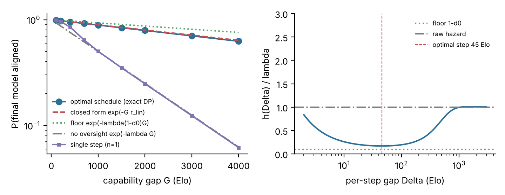
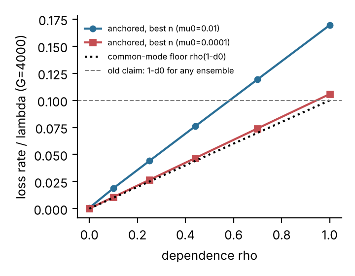
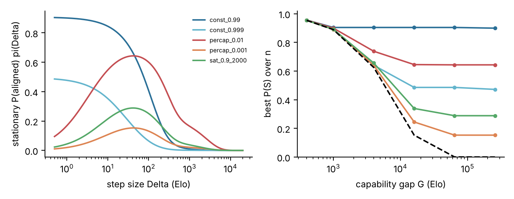

# When Does Bootstrapped Oversight Keep Stronger Models Aligned? Common-Mode Blind Spots, Recovering Lineages, and the Resampling Trap

**Target venue:** NeurIPS 2027 (formal model + exact computation + CPU-scale toy measurement). Revised after round-1 review; see `reviews/response_r1.md`.

---

## Abstract

One proposed way to keep increasingly capable models aligned with human intent is *bootstrapped* (nested, iterated) oversight. A trusted model oversees a slightly stronger successor, and that successor, once accepted, oversees the next one. Recent work quantified how such chains scale when every step is an adversarial game. It did not address three things: misalignment that slips through and *persists* into later overseers; *anchoring*, in which older trusted overseers also judge each new model and may share blind spots; and *retraining or resampling* a flagged model.

We study these in a minimal probabilistic model, the Bootstrapped Oversight Schedule (BOS) model. Each new model carries a misalignment hazard that grows with the capability step. Overseers detect misalignment with a probability that falls with their capability deficit. Flagged models are retrained up to *R* times before the process aborts. We prove the following.

1. **Floor.** If misalignment persists, then for any schedule, retry policy and false-positive rate, P(aligned) ≤ exp(−λβG − n·c₀(β)). Here G is the capability gap, λ the hazard per unit of capability, and β the *common-mode miss probability*: the per-attempt probability that *every* honest overseer misses a misaligned model. β is a property of the ensemble and its error dependence, not of the best overseer. For chain or comonotone oversight, β ≥ 1−d₀, where d₀ is peer-level detection. When the overseers' errors follow a mixture with weight ρ on nested blind spots, β ≥ ρ(1−d₀), and this rate is asymptotically attained. When dependence is unknown, no non-trivial floor exists.
2. **Exact law (chain).** For chain oversight, P(aligned) = exp(−G·h(G/n)) exactly. The optimal step size is therefore independent of G.
3. **Resampling trap.** In anchored chains, both success and silent failure rise with R, and as R→∞ anchoring stops protecting at all.
4. **Absorbing vs recovering lineages.** If persistence γ(Δ) can depend on the step size, the best achievable P(aligned) converges, as G→∞, to sup_Δ π(Δ), the best stationary probability of a two-state chain. This limit is positive if and only if misalignment is not absorbing. If recovery vanishes for small steps, the limit is reached only at a finite, interior step size, and it can be far below what a step-independent γ suggests: 0.64 instead of 0.90 at matched persistence.

The any-ρ computations are exact. A new dynamic program matches brute-force enumeration to within 2×10⁻¹⁶ and agrees with Monte Carlo to within 0.003. Across 1,500 random anchored configurations, the floor holds in every case, while the earlier "d₀ bounds any ensemble" claim fails in 304. We also run a model-level toy in which meta-classifier overseers judge *trained, possibly backdoored* networks. It gives a dependence weight ρ̂ between 0.15 and 0.32 across 12 seed-conditions; best-of-5 selection against a stronger auditor lowers detection without raising ρ̂. Across 81 parameter settings, a small retry budget cuts silent failure by a median of 9.5×, but its cost in success is strongly parameter dependent. We state falsifiable predictions and a model-organism protocol.

## 中文摘要

让越来越强的模型持续与人类意图保持一致，一个被广泛讨论的方案是“自举式（嵌套、迭代）监督”：可信模型监督略强一些的后继模型，后者通过审查后再去监督下一代。已有工作在“每一步都是对抗博弈”的假设下量化了这种链条的扩展规律，但没有处理三个问题：漏检的错位会*持续*传递给后代监督者；引入更早的可信监督者（“锚定”）时监督者可能共享盲区；以及对被标记模型的重训/重采样。我们提出一个最小概率模型——自举监督日程（BOS）模型，并证明：(1) 若错位具有持续性，则对任何日程、重试策略和误报率，最终对齐的概率不超过 exp(−λβG − n·c₀(β))，其中 β 是*共模漏检概率*，即所有诚实监督者在单次尝试中同时漏检的概率。它是整个监督集成及其误差依赖结构的性质，而不是最佳成员的性质。链式或共单调监督时 β ≥ 1−d₀；在权重为 ρ 的混合依赖下 β ≥ ρ(1−d₀)，且该速率渐近可达；依赖结构未知时不存在非平凡下界。(2) 链式监督满足精确的指数律，最优步长与总差距无关。(3) 在锚定链中，重试预算 R 同时提高成功率与静默失败率，R→∞ 时锚定完全失效。(4) 若持续性 γ(Δ) 依赖步长，则 G→∞ 时最佳成功率收敛到 sup_Δ π(Δ)（两状态链平稳概率的上确界），当且仅当错位不是吸收态时该极限为正。若小步长下的恢复趋于零，最优步长是有限的内部点，而且极限可能远低于“常数 γ”所暗示的值：在相同的持续性下为 0.64 而非 0.90。任意 ρ 的结果现在都由精确动态规划给出：新动态规划与暴力枚举的误差在 2×10⁻¹⁶ 以内，与蒙特卡洛的差异在 0.003 以内。在 1500 个随机锚定配置中，修正后的下界从未被违反，而旧的“d₀ 对任意集成成立”的说法在其中 304 个配置中被违反。在新的“模型级”玩具实验中，元分类器监督者判断*训练好的、可能带后门的*网络，12 个种子-条件下的依赖权重 ρ̂ 在 0.15–0.32 之间；以更强审计者为目标的 best-of-5 选择降低了检出率，但没有提高 ρ̂。在 81 组参数下，小重试预算使静默失败率的中位数降低 9.5 倍，但其对成功率的代价强烈依赖参数。我们给出了可证伪的预测和模型生物实验方案。

---

## 1 Introduction

"How do we ensure that increasingly capable models remain aligned with human intent?" In the technical literature this has largely become a question about *oversight that scales*: how can a weaker, trusted party reliably evaluate or train a stronger one? Several mechanisms have been proposed: iterated amplification [Christiano et al., 2018], debate [Irving et al., 2018], recursive reward modeling [Leike et al., 2018], weak-to-strong generalization [Burns et al., 2024] and AI control [Greenblatt et al., 2024a]. Many of them share one structural move, *bootstrapping*: a model verified at one capability level becomes the overseer for the next level. Engels et al. [2025] made this quantitative as Nested Scalable Oversight (NSO). They showed that when every step is an adversarial game that must be won, the overall success probability is the product of per-step win probabilities, and there is an optimal number of steps. Xiao and Phuong [2026] recently proposed *bootstrapped monitoring* for AI control, in which a weak trusted model inspects the transparent reasoning of a stronger untrusted monitor.

The NSO analysis treats each step as a fresh game. Three features that matter for alignment fall outside it.

1. **Persistence.** A misaligned model accepted at step *i* becomes the overseer, and often the source of training signal, for step *i*+1. Unwanted dispositions can survive safety training [Hubinger et al., 2024]. Models can comply strategically during training to preserve their preferences [Greenblatt et al., 2024b]. Traits can also pass from teacher to student through innocuous-looking data [Cloud et al., 2025].
2. **Common-mode blind spots.** A natural patch is *anchoring*: every earlier trusted model, and humans, also judge each new model. Anchoring helps only if the overseers do not fail on the same cases. LLM errors are strongly correlated, and more so as capability grows [Goel et al., 2025; Kim et al., 2025]. This echoes coincident failures in multiversion software [Eckhardt and Lee, 1985; Littlewood and Miller, 1989] and the observation that alignment techniques share failure modes [Dung and Mai, 2025].
3. **Resampling.** In practice a flagged model is retrained, resampled or patched, then re-evaluated. Resampling is also an explicit control protocol [Bhatt et al., 2025]. But retraining until a check passes is optimization against the checker [Gao et al., 2023].

We isolate these three effects in a minimal model. The model is not a forecast. Its purpose is to identify which quantities must be measured and to derive predictions that model-organism experiments can falsify. **Scope of the formal contribution.** Each per-step argument below is elementary: a ratio bound, a product, a two-state Markov chain. The contribution lies in identifying the controlling quantities and the scaling behaviour. These quantities are the common-mode miss probability β, the persistence profile γ(Δ), and the retry budget relative to the flag likelihood ratio. The paper also supplies exact computations for all of them.

**Contributions.**

- **C1 (model).** The BOS model has a capability-dependent hazard, deficit-dependent detection, persistence γ (possibly step dependent), collusion κ, error dependence ρ, false positives *f* and retry budget *R*. It has three outcomes: aligned (S), aborted (A) and silent failure (F). (§3)
- **C2 (common-mode floor).** Theorem 1 states that, under persistence, P(S) ≤ exp(−λβG − n c₀(β)) for every schedule, where β is the ensemble's common-mode miss probability. Corollaries give β ≥ 1−d₀ for chain or comonotone oversight and β ≥ ρ(1−d₀) for the ρ-mixture. Proposition 2 shows that the ρ(1−d₀) rate is attained asymptotically by anchored oversight. With unknown dependence there is no non-trivial floor. (§4.1)
- **C3 (exact law).** Theorem 3 states that chain oversight satisfies P(S) = exp(−G h(G/n)), so the optimal step Δ* does not depend on G. (§4.2)
- **C4 (resampling).** Proposition 5 is the resampling trap. We also compute optimal retry budgets for the utility S − c·F and the likelihood ratio a flag carries about a compromised lineage. (§4.4, §5.3)
- **C5 (absorbing vs recovering).** Theorem 6: for any persistence profile γ(Δ), lim_{G→∞} sup_n P(S) = sup_Δ π(Δ). This limit is positive if and only if misalignment is not absorbing. We give the relaxation length that a gap must exceed before the gap-independent regime applies. Under capability-scaled recovery the optimal step is again finite. (§4.5)
- **C6 (evidence).** We provide exact dynamic programs for anchored oversight at any ρ, validated against brute-force enumeration; extended sensitivity analyses; and a model-level toy measurement of ρ in which overseers judge trained backdoored networks. A pre-registrable protocol accompanies them. (§5–6)

All numbers come from code in `code/` that we ran, with outputs in `results/`. The model parameters are illustrative.

## 2 Related Work

**Scalable oversight protocols.** Iterated amplification [Christiano et al., 2018], debate [Irving et al., 2018] and recursive reward modeling [Leike et al., 2018] build training or evaluation signals for tasks beyond the overseer. Bowman et al. [2022] proposed sandwiching. Kenton et al. [2024] compared debate and consultancy with weak LLM judges and found debate better than consultancy, with mixed results relative to direct question answering. In our model a protocol enters only through its detection curve d(δ).

**Scaling laws for oversight and bootstrapped monitoring.** Engels et al. [2025] fit how oversight-game Elo scales with general capability in four games and analysed NSO. They report NSO success rates of 13.5%, 51.7%, 10.0% and 9.4% at a general Elo gap of 400, with the optimal number of steps growing with the gap. We adopt their Elo-logistic detection, and with γ=1 our chain model shares their product structure. We add a misalignment hazard rather than an always-adversarial target, persistence, dependent multi-overseer ensembles and retraining. Xiao and Phuong [2026] study a related three-party bootstrap. In their setup a weak trusted model checks the chain of thought of a stronger untrusted monitor, and they report substantially improved catch rates on BashArena even when the untrusted monitor colludes. In our terms this raises detection while living with collusion (κ), and our floor says its long-run value depends on whether the trusted check's misses are common mode with the untrusted monitor's.

**Weak-to-strong generalization.** Strong models fine-tuned on weak labels outperform their supervisors [Burns et al., 2024]. Theory explains this through pseudolabel correction and coverage expansion [Lang et al., 2024] or a misfit-based gain [Charikar et al., 2024]. The gains shrink as supervisor and student become more similar [Goel et al., 2025]. These works study a single step; we study composition across many steps.

**AI control and resampling.** AI control evaluates protocols that remain safe against deliberate subversion [Greenblatt et al., 2024a]; Griffin et al. [2024] formalise it as partially observable stochastic games. Ctrl-Z introduced resample protocols, which reduced attack success from 58% to 7% at a 5% usefulness cost on BashBench [Bhatt et al., 2025]. Those protocols use resamples partly to *incriminate*, not only to obtain a passing sample. Our Proposition 5 formalises why the second use alone is dangerous, and §5.3 quantifies the incrimination value of a flag.

**Persistence of misalignment.** Conceptual analyses of deceptive or mesa-optimising models include Hubinger et al. [2019] and Ngo et al. [2024]. Backdoors persist through safety training [Hubinger et al., 2024], models fake alignment [Greenblatt et al., 2024b], and traits transmit subliminally when teacher and student share a base model [Cloud et al., 2025]. These results motivate γ close to 1. Our Theorem 6 makes precise which property of γ matters: whether misalignment is absorbing, and how recovery scales with step size.

**Correlated failures.** Coincident failures in multiversion software exceed what independence predicts [Eckhardt and Lee, 1985], and forced design diversity can reduce them [Littlewood and Miller, 1989]. Ensemble diversity has a long ML literature [Kuncheva and Whitaker, 2003]. For LLMs, Kim et al. [2025] report that models agree on 60% of the cases where both err on one leaderboard dataset. Goel et al. [2025] find that errors become more similar with capability. Dung and Mai [2025] analyse seven alignment techniques against seven failure modes and argue that defence-in-depth helps only to the extent that failure modes are not shared; they find substantial overlap. Our common-mode floor is a quantitative version of their argument for one specific architecture, bootstrapped oversight. It says that the long-run loss rate is set by the probability that *all* layers miss together, not by the best layer. We use the Fréchet–Hoeffding bounds [Nelsen, 2006] for the unknown-dependence case.

## 3 The Bootstrapped Oversight Schedule (BOS) Model

**Capability.** Models M₀, …, Mₙ lie on an Elo-like capability scale. M₀ (humans plus current tools) is trusted and aligned. Mₙ is *G* units more capable. Numerical results use equal steps Δ = G/n. Theorem 1 allows arbitrary step sizes.

**Hazard.** A new model whose parent (the model supplying its training signal and oversight) is aligned is misaligned with probability μ(Δ) = 1 − (1 − μ₀)e^{−λΔ}. This combines a per-step hazard μ₀ with a hazard λ per unit of capability gained. With no oversight, P(S) = (1−μ₀)ⁿ e^{−λG}.

**Persistence and collusion.** If the parent is misaligned, the child is misaligned with probability μ + (1−μ)γ. Persistence γ ∈ [0,1] may depend on the step size, γ = γ(Δ) (§4.5). A misaligned overseer stays silent (colludes) with probability κ, fixed for the step, and otherwise reports honestly.

**Detection.** An honest overseer with capability deficit δ ≥ 0 detects a misaligned model with probability d(δ). The results in §4.1 and §4.3 hold for any non-increasing d with d(0)=d₀<1. Numerically we use d(δ) = σ(logit(d₀) − k(ln 10/400)δ), with slope at zero d₁ = k(ln 10/400)d₀(1−d₀). An honest overseer flags an aligned model with probability *f*.

**Overseer sets and dependence.** Under *chain* oversight only the parent judges the child. Under *anchored* oversight every ancestor M₀…Mᵢ judges Mᵢ₊₁. For a set H of honest overseers with marginal miss probabilities 1−d_j, the probability that all miss is

  P(all miss) = ρ · min_{j∈H}(1−d_j) + (1−ρ) · ∏_{j∈H}(1−d_j).

This is a mixture of the comonotone copula (ρ=1: nested blind spots) and the independence copula (ρ=0). False positives use the same mixture. ρ refers to dependence *across draws of misaligned models*: each training attempt produces one model, and the question is whether the overseers miss it together. §5.5 estimates this quantity at that level.

**Retraining and outcomes.** A model flagged by any honest overseer is discarded and retrained from the same parent as an independent draw. After *R* flagged attempts in one step the process aborts. The outcomes are **S** (final model aligned), **F** (final model misaligned and deployed: silent failure) and **A** (abort). Baseline parameters: G=1000, λ=ln 2/1000, μ₀=0.01, d₀=0.9, k=1, γ=κ=ρ=1, f=0, R=∞. These values are illustrative.

**Computation.** Chain oversight (any κ, γ, f, R) is solved exactly by a two-state dynamic program (DP). Anchored oversight with γ=κ=1 and *any* ρ is solved exactly by a DP over the index of the last aligned model (`bos_model.anchored_exact`). With γ=1 the aligned models form a prefix M₀…M_j, so the honest set at every step is known. Brute-force enumeration over all alignment histories and honesty patterns (`brute_force`, n ≤ 7) covers the remaining cases (κ<1 or γ<1 with anchoring) and validates everything else. Vectorised Monte Carlo (`simulate`) supplies an independent check. True R=∞ is used everywhere: the simulator loops until every replication has accepted a model, and it raises an error rather than silently counting aborts.

## 4 Theory

For a step with an aligned parent under chain oversight with f=0 and R=∞, the probability of ending with an accepted misaligned child is ε(Δ) = μ(1−d)/(1−μd), and of ending with an aligned child s(Δ) = 1−ε(Δ), where μ=μ(Δ) and d=d(Δ).

### 4.1 A common-mode floor under persistent misalignment

**Definition (common-mode miss probability).** Consider step i on the event that M₀…Mᵢ are all aligned. Let βᵢ be the probability that a misaligned candidate is flagged by *none* of the honest overseers in one attempt. Let β = minᵢ βᵢ. β depends on the overseer set, the deficits and the dependence structure of the overseers' errors. It is *not* determined by the best overseer alone.

**Theorem 1 (floor).** Assume γ=1. For any n, any step sizes summing to G, any R ∈ {1,…,∞}, any f ∈ [0,1) and any κ,

  P(S) ≤ exp( −λβG − n·c₀(β) ),  c₀(β) = log[(1−(1−β)μ₀)/(1−μ₀)] ≥ 0.

*Proof.* With γ=1, a misaligned parent produces a misaligned child in every attempt. The final model is therefore aligned only if every step ends aligned *on an aligned lineage*. On that event all overseers are aligned, so κ plays no role. In one attempt at step i, an aligned child is accepted with probability x ≤ 1−μ and a misaligned child with probability y = μβᵢ ≥ μβ. The step ends aligned with probability x·Σ_{a<R}(1−x−y)^a ≤ x/(x+y) ≤ (1−μ)/(1−(1−β)μ). Hence −log P(S) ≥ Σᵢ g(Δᵢ), where g(Δ) = −log(1−μ) + log(1−(1−β)μ). Using dμ/dΔ = λ(1−μ), we get dg/dΔ = λβ/(1−(1−β)μ) ≥ λβ. Therefore g(Δ) ≥ c₀(β) + λβΔ, and summing over steps gives the claim. ∎

The per-step argument is elementary. As the reviewer notes, once β is defined as the ensemble's joint miss probability, the bound says that losses compound if every step leaks at least μβ. The content is in what β is for the oversight architectures of interest.

**Corollary 1a (chain, or comonotone ensembles).** Here βᵢ = 1−d(Δᵢ) ≥ 1−d₀, which recovers the round-0 floor exp(−λ(1−d₀)G − n c₀).

**Corollary 1b (ρ-mixture ensembles).** The comonotone component contributes ρ·min_j(1−d_j) = ρ(1−d(Δᵢ)) ≥ ρ(1−d₀), because the parent is the strongest honest overseer. Hence β ≥ ρ(1−d₀) and P(S) ≤ exp(−λρ(1−d₀)G − n c₀(ρ(1−d₀))), uniformly over n, anchoring depth and R.

**Corollary 1c (unknown dependence: no floor).** By Proposition 4 below, the only dependence-free lower bound on βᵢ is max(0, 1−Σ_j d_j). It is 0 whenever the honest overseers' detection probabilities sum to at least 1, for example two overseers with d ≥ ½ each. With unknown dependence, Theorem 1 therefore gives no non-trivial floor for anchored oversight.

*Correction to round 0.* The earlier version claimed that the floor with β = 1−d₀ holds for anchored oversight whenever dependence is unknown. That claim had the direction of the Fréchet–Hoeffding bound reversed, and it is false. The paper's own Table 2 contradicts it: anchored oversight at ρ=0 gives P(S)=0.993, above exp(−0.0693−22·0.00091) ≈ 0.913. In 1,500 random anchored configurations (§5.1), the old claim is violated in 304. The corrected floor is violated in none.

**Proposition 2 (the ρ-floor is asymptotically attained).** Take anchored oversight with the ρ-mixture, γ=κ=1, f=0, R=∞ and μ₀=0. As n→∞, −log P(S)/G → λρ(1−d₀).

*Proof sketch.* Each step contributes −log(x/(x+y)) = log(1+μβᵢ/(1−μ)) = λΔβᵢ(1+O(Δ)). The comonotone part of βᵢ is ρ(1−d(Δ)) → ρ(1−d₀). The independent part (1−ρ)∏_{l=1}^{i+1}(1−d(lΔ)) contributes λΔ(1−ρ)Σᵢ∏ₗ(1−d(lΔ)). Fix any L>0. Every factor with lΔ ≤ L is at most 1−d(L) < 1, and step i has at least min(i+1, ⌊L/Δ⌋) of them. The sum is therefore at most Δ·Σᵢ(1−d(L))^{min(i+1,⌊L/Δ⌋)} ≤ Δ/d(L) + G(1−d(L))^{⌊L/Δ⌋} → 0. ∎

*Interpretation.* Under persistent misalignment, the best achievable "alignment half-life" in capability units is ln 2/(λβ). For chain oversight this is ln 2/(λ(1−d₀)), set by peer-level detection. For anchored ensembles it is ln 2/(λρ(1−d₀)): the quantity that matters is the *fraction of peer-level misses that every overseer shares*. Better individual detection matters through d₀. Diversity matters through ρ. With independent errors (ρ=0) the floor disappears in this model, which is why ρ needs to be measured rather than assumed (§5.5).

### 4.2 The exact exponential law and the optimal schedule (chain)

**Theorem 3 (exact law).** Under chain oversight with γ=1, f=0, R=∞ and equal steps, P(S) = exp(−G·h(G/n)) with h(Δ) = −log(1−ε(Δ))/Δ. Consequently:

(a) For every n, P(S) ≤ exp(−G r*), where r* = inf_{Δ>0} h(Δ). The bound is achieved by an integer n exactly when G/Δ* is an integer, where Δ* is the minimiser.

(b) Δ* does not depend on G, so the optimal number of steps is n* ≈ G/Δ*.

(c) h(Δ) → λ as Δ→∞, and h(Δ) → ∞ as Δ→0 when μ₀>0.

*Proof.* P(S) = (1−ε(Δ))ⁿ = exp(−G h(Δ)) with n = G/Δ, and G factors out of the exponent. For (c), as Δ→∞, 1−ε = (1−μ)/(1−μd) with μd→0. As Δ→0, −log(1−ε) → c₀ > 0. ∎

This is the NSO product structure with G factored out of the exponent. The new statement is (b): the optimal step size does not depend on the gap.

**Closed form.** Expand each factor of ε ≈ μ(1−d) to first order in its own small quantity: μ ≈ μ₀+λΔ and 1−d ≈ 1−d₀+d₁Δ. Drop the O(μ²) denominator correction, but keep the product of the two linear factors exactly. This retains the second-order cross term λd₁Δ², which is the term that penalises large steps, and drops μ₀λΔ, μ₀² and higher-order terms. Then

  n·ε(G/n) ≈ nμ₀(1−d₀) + λG(1−d₀) + μ₀d₁G + λd₁G²/n,

which is minimised at Δ_lin = √(μ₀(1−d₀)/(λd₁)) with r_lin = (√(λ(1−d₀)) + √(μ₀d₁))². For the Elo-logistic family, r*/λ depends only on (μ₀, d₀, k/λ).

### 4.3 Ensembles under unknown dependence

**Proposition 4 (Fréchet–Hoeffding).** Let honest overseers detect a given misaligned model with marginal probabilities d_j. Over all joint distributions with these marginals, max(0, 1−Σ_j d_j) ≤ P(all miss) ≤ min_j(1−d_j), and both bounds are attained [Nelsen, 2006]. Hence the ensemble's detection lies in [max_j d_j, min(1, Σ_j d_j)].

The *lower* end is what an ensemble guarantees. The *upper* end is what Theorem 1 needs, and it is vacuous (Corollary 1c). In round 0 we used the wrong end. The correct reading: without knowledge of dependence, anchoring can do no worse than the parent alone, and its benefit is bounded only by the common-mode miss probability, which must be measured.

### 4.4 The resampling trap

Consider anchored oversight with γ=κ=ρ=1 and false-positive rate f. From an aligned parent, one attempt yields an accepted aligned child with probability x=(1−μ)(1−f), an accepted misaligned child with probability y=μ(1−d(Δ)), and is flagged otherwise. Let G_R = Σ_{a<R}(1−x−y)^a, s_R = xG_R and q_R = yG_R. At lag ℓ after the last aligned model, the best honest overseer has deficit (ℓ+1)Δ.

**Proposition 5 (resampling trap).** P(F) = Σ_{i=1}^{n} s_R^{i−1} q_R ∏_{ℓ=1}^{n−i}[1 − d((ℓ+1)Δ)^R] and P(S) = s_Rⁿ. Both are non-decreasing in R. As R→∞, P(F) → Σᵢ s^{i−1}q, where s = x/(x+y) and q = y/(x+y) are computed with the *same* f. This is the chain-oversight silent-failure probability at that f, so anchoring provides no protection.

*Proof.* Condition on the first step i that accepts a misaligned child. G_R, s_R, q_R and 1−d^R are non-decreasing in R, and as R→∞ each factor 1−d^R → 1 because d<1. ∎

Retraining a compromised lineage until the trusted overseers stop objecting is a best-of-R search for a misaligned model they cannot detect. Abort, not retry, is what turns anchoring into protection. §5.3 derives the budget that maximises S − c·F, and how strongly a flag indicates a compromised lineage.

### 4.5 Absorbing vs recovering lineages

Round 0 stated a limit a/(a+ε₀) that charges recovery a = (1−μ₀)(1−γ) *per step*, independent of Δ. Under that parameterisation, infinitely many tiny steps give unboundedly many recovery chances. It is at least as plausible that a parent nearly identical to its child corrupts it almost surely, so that 1−γ(Δ)→0 as Δ→0. We therefore let γ depend on Δ.

Under chain oversight with κ=1, f=0 and R=∞, the parent's alignment is a two-state Markov chain. It moves from aligned to misaligned with probability ε(Δ) and back with probability α(Δ) = (1−μ(Δ))(1−γ(Δ)). Let π(Δ) = α/(α+ε) and π* = sup_{Δ>0} π(Δ). Then P_n(S) = π(Δ) + (1−π(Δ))(1−α−ε)ⁿ with Δ = G/n.

**Theorem 6 (absorbing vs recovering).** Assume μ₀>0, d₀<1, λ>0, γ(·) measurable with values in [0,1], and π continuous. Then

  lim_{G→∞} sup_n P_n(S) = π*.

In particular, the limit is positive if and only if γ(Δ)<1 for some Δ (misalignment is not absorbing). If γ ≡ 1, P(S) decays exponentially (Theorem 3).

*Proof.* Since μ ≥ μ₀ and d ≤ d₀, ε(Δ) ≥ μ₀(1−d₀) =: c > 0 for all Δ. Also α+ε ≤ 1, so 0 ≤ 1−α−ε ≤ 1−c.

*Lower bound.* Fix Δ₀ and take n = ⌈G/Δ₀⌉. Then Δ_n → Δ₀ and n → ∞ as G → ∞, and P_n(S) ≥ π(Δ_n) − (1−c)ⁿ → π(Δ₀).

*Upper bound.* Fix N. For n ≥ N, P_n(S) ≤ π* + (1−c)^N. For n < N, Δ ≥ G/N → ∞. The final model is aligned with probability at most max(s(Δ), α(Δ)) ≤ (1−μ(Δ))/(1−d₀) → 0. Hence limsup ≤ π* + (1−c)^N for every N. ∎

**Corollaries.**

(i) *Constant γ<1.* α is decreasing in Δ and ε is increasing, so π is decreasing in Δ and π* = π(0+) = a/(a+ε₀). This is the round-0 Proposition 5, which is therefore the special case in which more, smaller steps always help.

(ii) *Capability-scaled recovery.* If 1−γ(Δ) → 0 as Δ → 0, then π(0+) = 0. Many tiny steps then lose alignment, the optimal step size is interior, and the round-0 claim that "persistence, not gap, decides" fails as a statement about step-count limits.

(iii) *Relaxation length.* For Δ fixed at the optimum, the chain reaches its asymptote only after about 1/(α+ε) steps, which is a gap of L = Δ/(α+ε). For G ≪ L, the chain behaves as if γ=1.

The robust qualitative statement is therefore the **absorbing vs ergodic dichotomy**. A gap-independent asymptote exists exactly when misalignment is not absorbing. Its *level* sup_Δ π(Δ), and the gap L needed to reach it, depend on how recovery scales with step size. §5.4 quantifies this.

## 5 Results

Sources: §5.1–5.4 come from `run_theory.py` (`results/theory_results.json`), `run_revision.py` (`results/revision_results.json`) and `gamma_limit.py` (`results/gamma_limit.json`). §5.5 comes from `toy_models.py` (`results/toy_models.json`) and `toy_rho.py` (`results/toy_rho.json`).

### 5.1 Validation

- **Chain and comonotone anchored DPs vs Monte Carlo.** The DPs and Monte Carlo (200,000 replications) agree at n ∈ {5, 20} and R ∈ {1, 3, ∞}. The largest of 36 absolute discrepancies is 0.0019 (anchored, R=1, n=20: abort 0.7250 vs 0.7231).
- **New: brute-force enumeration.** In 40 random configurations with n ∈ [2,6], every one of ρ, κ, γ, f and R was randomised (κ<1 and γ<1 included), for both chain and anchored oversight. The Monte Carlo simulator matched enumeration with a maximum absolute error of 0.0026 and a maximum |z| of 3.4 over 120 outcome probabilities. The chain DP matched enumeration to 7×10⁻¹⁶.
- **New: any-ρ anchored DP.** In 60 further random configurations with γ=κ=1, the any-ρ anchored DP matched enumeration to 2.2×10⁻¹⁶. All ρ<1 entries in Table 2 and the ρ sweep are now computed with this exact DP. They also agree with Monte Carlo at true R=∞ to within 0.0007.
- **Floor property tests.** The round-0 test (3,000 random chain configurations) found 0 violations, minimum slack 2.6×10⁻⁵. Two new tests cover ensembles:
  - (a) 1,500 random anchored configurations with any ρ, f ∈ {0, 0.01, 0.05}, R ∈ {1, 2, 5, ∞} and n ≤ 59, solved by exact DP. The common-mode floor (Theorem 1 with the realised β) had 0 violations, and so did the ρ-form (Corollary 1b). The bound is attained, to numerical precision, in configurations where detection vanishes. The round-0 "d₀ for any ensemble" claim was violated in **304 of 1,500**, for example ρ=0.29, G=730, d₀=0.73: P(S)=0.443 vs claimed bound 0.141.
  - (b) 300 brute-force configurations with κ<1, chain and anchored: 0 violations.

### 5.2 The exponential law and optimal schedules (chain)

At baseline, Δ* = 45.4 Elo and r* = 1.17×10⁻⁴ per Elo, so r*/λ = 0.169. The chain floor gives 1−d₀ = 0.10. The capability gap over which P(S) halves is 1,000 Elo without oversight, 5,902 Elo with optimal chain bootstrapping, and at most 10,000 Elo (chain floor). The closed form gives r_lin = 1.12×10⁻⁴ (4.3% below r*) and Δ_lin = 52.8 Elo.

**Table 1.** Optimal chain schedules at baseline (exact DP, integer n).

| Gap G (Elo) | n* | P(S) at n* | exp(−G r*) | exp(−G r_lin) | Chain floor exp(−λ(1−d₀)G) | One step (n=1) | No oversight e^{−λG} |
|---|---|---|---|---|---|---|---|
| 400 | 9 | 0.954 | 0.954 | 0.956 | 0.973 | 0.851 | 0.758 |
| 1000 | 22 | 0.889 | 0.889 | 0.894 | 0.933 | 0.502 | 0.500 |
| 2000 | 44 | 0.791 | 0.791 | 0.799 | 0.871 | 0.248 | 0.250 |
| 4000 | 88 | 0.625 | 0.625 | 0.638 | 0.758 | 0.062 | 0.063 |

- n* is proportional to G, as Theorem 3(b) predicts.
- Even an optimal chain loses alignment exponentially.
- At this baseline, a single step at G=1000 is nearly worthless (0.502 vs 0.500). Over-splitting also costs: n=120 gives 0.819.

**Sensitivity (Figure 5).** Over d₀ ∈ [0.5, 0.99] × μ₀ ∈ [10⁻⁴, 0.1], r*/λ ranges from 0.011 to 0.985. The closed form has a median relative error of 1.2% and a maximum of 37% (at large μ₀). Varying k from 0.25 to 4 moves r*/λ from 0.135 to 0.261. Rescaling λ gives identical values, as scale invariance requires.

*Figure 1. Left: P(final model aligned) vs gap under the optimal chain schedule, the closed form, the chain floor, one step and no oversight. Right: h(Δ)/λ vs step size.*

*Figure 2. P(S) vs number of steps n for G = 400, 1000, 2000; dots mark n*.*

*Figure 5. r*/λ over d₀ and μ₀ (filled: exact; dashed: closed form).*

**Anchored rates approach the ρ-floor (Figure 7).** At G=4000 we optimise n for anchored oversight (γ=κ=1, f=0, R=∞). With μ₀=10⁻⁴, the realised loss rate −log P(S)/(λG) is 0.0107, 0.0266, 0.0466, 0.0741 and 0.1058 for ρ = 0.1, 0.25, 0.44, 0.7 and 1. The ρ-floor ρ(1−d₀) gives 0.010, 0.025, 0.044, 0.070 and 0.100, consistent with Proposition 2. With μ₀=0.01 the rates are higher (0.019, 0.044, 0.076, 0.119, 0.169) because the per-step overhead keeps n finite. At ρ=0 the optimal anchored chain loses almost nothing: rate/λ is 0.0007 at μ₀=0.01 and 0.00008 at μ₀=10⁻⁴.

*Figure 7. Optimised anchored loss rate (G=4000) vs ρ, with the common-mode floor ρ(1−d₀) and the incorrect round-0 claim 1−d₀.*

### 5.3 Anchoring, dependence and the resampling trap

We fix G=1000, the chain-optimal n=22 and f=0.02 (Table 2, Figure 3). Every entry is exact. The R=∞ column is now truly unlimited. The round-0 Monte Carlo had capped retries at 50 attempts.

**Table 2.** Outcome probabilities S / F / A at G=1000, n=22, f=0.02 (exact DP).

| R | Chain | Anchored, ρ=1 | Anchored, ρ=0.44 | Anchored, ρ=0 |
|---|---|---|---|---|
| 1 | 0.257 / 0.064 / 0.679 | 0.257 / 0.002 / 0.741 | 0.022 / 0.000 / 0.978 | 0.002 / 0.000 / 0.998 |
| 3 | 0.884 / 0.113 / 0.003 | 0.884 / 0.011 / 0.105 | 0.839 / 0.003 / 0.157 | 0.645 / 0.000 / 0.355 |
| 5 | 0.887 / 0.113 / 0.000 | 0.887 / 0.028 / 0.085 | 0.935 / 0.005 / 0.060 | 0.950 / 0.001 / 0.049 |
| 20 | 0.887 / 0.113 / 0.000 | 0.887 / 0.108 / 0.005 | 0.939 / 0.037 / 0.024 | 0.993 / 0.005 / 0.001 |
| ∞ | 0.887 / 0.113 / 0.000 | 0.887 / 0.113 / 0.000 | 0.939 / 0.061 / 0.000 | 0.993 / 0.007 / 0.000 |

1. **Anchoring helps only with bounded retries.** At ρ=1 and R=3, anchoring converts most silent failures into aborts: P(F) falls from 0.113 to 0.011. At R=∞ it equals the chain (Proposition 5).
2. **Silent failure rises with R in every anchored column.**
3. **Independence is what makes ensembles safe, and false positives are its price.** At R=∞, P(F) is 0.113, 0.061 and 0.007 for ρ = 1, 0.44 and 0. At R=1 and ρ=0, P(S) is only 0.002, because some overseer almost surely raises a false alarm.
4. **Consistency with the corrected floor.** At ρ=0.44, P(S)=0.939 lies below the common-mode floor exp(−λβG−n c₀(β)) = 0.950 (β=0.056) and below the ρ-form 0.961. At ρ=0 both floors are ≈1 (vacuous). At ρ=1, 0.887 ≤ 0.891.

With f=0 and R=∞, the dependence sweep gives P(F) = 0.0064, 0.028, 0.054, 0.070, 0.091 and 0.111 for ρ = 0, 0.2, 0.44, 0.6, 0.8 and 1 (Figure 4). The exact value at ρ=0.2 (0.028) corrects the round-0 Monte Carlo value of 0.021.

**Optimal retry budgets (new).** We choose R ∈ {1,…,30,∞} to maximise U = S − c·F, where c is the cost of a silent failure relative to the value of success.

- *Chain.* R=∞ is optimal for c ≤ 10 (any R ≥ 13 is equivalent) and R=1 for c ≥ 30. Retries do not interact with safety here, because a compromised parent never flags.
- *Anchored, ρ=0.44.* R_opt is 6, 5, 5, 4 and 3 for c = 1, 3, 10, 30 and 100. At c=10 the optimum gives S=0.935, F=0.005 and A=0.060, against U(R=∞) = 0.331.
- *Anchored, ρ=1.* R_opt is 3 for c ≤ 10 and 2 for c ≥ 30.
- *Anchored, ρ=0.* R_opt falls from 10 (c=1) to 5 (c=100).

**What a flag means.** At step 11, a single attempt is flagged with probability 0.055 on an aligned lineage and 0.842 on a lineage whose parent is compromised, a likelihood ratio of 15.4 per flag at ρ=1. The ratio is 5.7 at ρ=0.44 and 4.0 at ρ=0. A few consecutive flags are thus strong evidence of compromise. This supports treating resamples as incriminating evidence [Bhatt et al., 2025] rather than as a route to a passing sample.

**Sensitivity of the Table 2 conclusions (new).** We use 81 settings: d₀ ∈ {0.7, 0.9, 0.97}, k ∈ {0.5, 1, 2}, μ₀ ∈ {0.002, 0.01, 0.05} and f ∈ {0.005, 0.02, 0.05}, each at its chain-optimal n and solved exactly.

- **Structural conclusions hold in all 81:**
  - P(F) is non-decreasing in R for ρ ∈ {0, 0.44, 1};
  - anchored ρ=1 equals chain at R=∞;
  - P(F) at R=∞ increases with ρ.
- **Share of the ensemble's safety benefit lost at ρ=0.44.** This is (F_{0.44}−F_0)/(F_1−F_0). Its median is 0.51 (range 0.45–0.78), so "about half the benefit is lost at moderate dependence" is robust.
- **The retry operating point is not robust.** R=5 at ρ=0.44 reduces P(F) relative to R=∞ by a median of 9.5× (interquartile range 2.1–23.6×, full range 1.0–396×). Its cost in success has median 0.0035, upper quartile 0.044 and maximum 0.85, with abort probability up to 0.87 at large f and many steps.

We therefore no longer recommend R=5. The only robust recommendation is to choose R from S − cF together with the flag likelihood ratio. With R=1 and ρ=0, success is at most 0.33 and has median 0.005, so independent ensembles are unusable without some retry tolerance whenever f > 0.

*Figure 3. Outcomes vs retry budget R (G=1000, n=22, f=0.02). Green: aligned; grey: abort; red: silent failure.*

*Figure 4. Silent-failure probability vs ρ for anchored oversight (exact DP). The dotted line marks the input-level toy ρ̂ ≈ 0.44 from round 0. The model-level estimate in §5.5 is 0.15–0.32.*

### 5.4 Absorbing vs recovering lineages (Theorem 6)

**Constant γ (round-0 setting).** The n→∞ limit a/(a+ε₀) is 0.999, 0.990, 0.908 and 0.495 for γ = 0, 0.9, 0.99 and 0.999, matching the exact P(S) at n=20,000. For γ=0.999 and moderate n, the chain is indistinguishable from γ=1: the best P(S) over n ≤ 200 at G=4000 is 0.640, against 0.625. Consistent with Corollary (i), the best n for constant γ<1 lies at the search cap (n=3,000), not at an interior optimum: P(S) increases monotonically in n. With collusion κ=0.5, γ=0.9 at n=150 rises from 0.985 to 0.995. Under γ=1, κ has no effect, as Theorem 1 requires.

**Step-dependent γ(Δ) (new, Figure 6).** We compare five persistence profiles. Each is calibrated to the same persistence at the baseline optimal step Δ_ref = 45.4 Elo where applicable. The best P(S) over n is computed in closed form, which matches the DP to 5×10⁻¹⁵.

**Table 3.** Asymptote π* = sup_Δ π(Δ), its location, the relaxation length L at that step, and the best P(S) over n at several gaps (γ=1 reference: 0.954, 0.889, 0.625, 0.153, 0.0005).

| Persistence profile | π* | Δ at π* | π(Δ=0.5) | L (Elo) | Best P(S): G=400 / 1000 / 4000 / 16000 / 64000 |
|---|---|---|---|---|---|
| constant 1−γ = 0.01 | 0.904 | →0 (grid min 0.5) | 0.904 | 46 | 0.956 / 0.904 / 0.904 / 0.904 / 0.904 |
| constant 1−γ = 0.001 | 0.486 | →0 | 0.486 | 246 | 0.954 / 0.890 / 0.640 / 0.486 / 0.486 |
| per-capability, 1−γ = 1−e^{−bΔ}, 0.01 at Δ_ref | 0.643 | 42.1 | 0.095 | 3,040 | 0.956 / 0.900 / 0.738 / 0.645 / 0.643 |
| per-capability, 0.001 at Δ_ref | 0.153 | 42.5 | 0.010 | 7,226 | 0.954 / 0.890 / 0.639 / 0.245 / 0.153 |
| saturating, 1−γ = 0.1(1−e^{−Δ/2000}) | 0.289 | 41.5 | 0.023 | 6,063 | 0.954 / 0.892 / 0.656 / 0.339 / 0.289 |

Three findings follow.

1. *The dichotomy is robust.* In every recovering profile the best P(S) becomes independent of G for large G, while the γ=1 chain decays to 0.0005 at G=64,000. The constant-γ rows at G=256,000 (Figure 6) dip slightly (0.899, 0.472) because n is capped at 200,000 there.
2. *The level is not robust.* At the same persistence at Δ_ref, capability-scaled recovery gives an asymptote of 0.643 instead of 0.904 (1−γ=0.01), and 0.153 instead of 0.486 (1−γ=0.001). The round-0 limit a/(a+ε₀) overstated the benefit of non-persistence whenever recovery scales with capability.
3. *Under capability-scaled recovery the optimal step is again finite* (≈42 Elo, close to the γ=1 value of 45). The relaxation lengths of 3,000–7,000 Elo mean that, at gaps up to a few thousand Elo, these chains behave almost like γ=1 chains.

The round-0 Table 3 tension the reviewer pointed to (γ=0.999: limit 0.495 vs best finite n 0.954 at G=400) is an instance of finding 3. G=400 is far below the relaxation length.

*Figure 6. Left: stationary P(aligned) π(Δ) for the five persistence profiles. Right: best P(S) over n vs capability gap G; dashed: γ=1.*

### 5.5 Measuring overseer-miss dependence ρ at the level of trained models

**Why a new toy.** In BOS, ρ is the dependence of overseer misses *over draws of misaligned models*. The round-0 toy measured dependence *over input points* for a fixed set of classifiers, which is driven by hard inputs near the decision boundary. That is a different quantity. Its pairwise estimates (mean pairwise ρ̂ 0.39–0.53 per condition) also differed from its four-way estimates (0.42–0.47), which suggests the mixture was misspecified there. We keep it only as a secondary result (`toy_rho.py`) and no longer plug it into the model.

**Setup (`toy_models.py`).**
- *Policy models.* One-hidden-layer tanh MLPs (8→16→1) are each trained on their own sample of a fixed nonlinear binary task.
- *Backdoors.* A *backdoored* ("misaligned") model is additionally trained on trigger points, with two random features set to a random value in [2.5, 4], all labelled 1, at a random poison rate of 2–15%. It counts as misaligned only if its attack success rate is ≥ 0.5 (85–91% of backdoor runs qualify). *Clean* models see the same kind of trigger-like points with correct labels.
- *Accuracy.* Clean accuracy is 0.87 for both clean and backdoored models.
- *Overseers.* Each overseer is a meta-classifier that judges a *trained model*. It has its own query set (q inputs, half of them trigger-like) and its own pool of 250 clean and 250 backdoored shadow models. It fits logistic regression on the model's logits at its queries, and flags a model whose score exceeds the 95th percentile on held-out clean shadow models. Realised false-positive rates are 3–10%.
- *Ensembles.* The **ladder** uses q = 4, 16, 64, 256. The **peers** are four overseers with q=32 each and independent queries and shadow pools.
- *Test models and selection.* On 800 freshly trained misaligned models (natural) we record the 800×4 miss matrix. The adversarial condition uses 400 models, each the best of 5 backdoored models as judged least suspicious by a stronger surrogate auditor (q=512, shadow pool of 500 clean and 500 backdoored models).
- *Estimates.* We estimate ρ̂ from the four-way all-miss rate, with a bootstrap 95% CI. We also fit a single ρ by least squares to the all-miss rates of all 11 subsets of size ≥ 2, which tests the one-parameter form.
- *Scale.* There are 3 seeds, about 4.6 CPU-minutes per seed.

**Table 4.** Model-level overseer ensembles (mean over 3 seeds; ρ̂ per seed with 95% bootstrap CI).

| Ensemble / models | Detection d_j | P(all miss) | Indep. pred. | Comon. pred. | ρ̂ per seed [CI] | LS ρ (11 subsets) | Max abs. residual of mixture |
|---|---|---|---|---|---|---|---|
| Ladder / natural | 0.12, 0.11, 0.21, 0.17 | 0.575 | 0.517 | 0.787 | 0.23 [0.16,0.30], 0.18 [0.11,0.25], 0.23 [0.16,0.29] | 0.22, 0.16, 0.20 | ≤ 0.014 |
| Ladder / best-of-5 | 0.07, 0.07, 0.13, 0.09 | 0.720 | 0.682 | 0.872 | 0.19 [0.08,0.31], 0.22 [0.13,0.32], 0.18 [0.07,0.31] | 0.17, 0.19, 0.17 | ≤ 0.009 |
| Peers / natural | 0.16, 0.17, 0.22, 0.16 | 0.554 | 0.459 | 0.782 | 0.32 [0.26,0.38], 0.28 [0.23,0.34], 0.28 [0.21,0.34] | 0.29, 0.24, 0.23 | ≤ 0.026 |
| Peers / best-of-5 | 0.09, 0.08, 0.12, 0.09 | 0.717 | 0.675 | 0.879 | 0.15 [0.06,0.25], 0.23 [0.13,0.34], 0.24 [0.10,0.36] | 0.13, 0.20, 0.22 | ≤ 0.010 |

**Findings.**

(i) Misses over model draws are positively dependent but well short of comonotone. ρ̂ ranges from 0.15 to 0.32 across the 12 seed-conditions, and every bootstrap CI excludes both 0 and 1.

(ii) In this toy the one-parameter mixture fits all 11 subsets well: maximum absolute residual ≤ 0.026, relative RMSE ≤ 1.8%. Individual pairwise ρ̂ values are noisy (−0.01 to 0.35; each pair uses only 400–800 models), but the joint fit shows no systematic misspecification.

(iii) Given that the most sensitive overseer misses, the other three catch the model 25–29% of the time (ladder, natural), against 33–37% predicted by independence.

(iv) Best-of-5 selection against a stronger auditor lowers every overseer's detection, by 40–47% on average, and raises the all-miss rate from 0.575 to 0.720. It does *not* raise ρ̂ (ladder 0.21 → 0.20, peers 0.29 → 0.21). As in the input-level toy, adversarial pressure acts mainly on the marginals here.

(v) Backdoors that evade every overseer have slightly lower poison rates (median 0.055 vs 0.063 for caught ones), a weak hint that "how strongly misaligned" drives the common mode.

**Caveats.** These overseers are weak (detection 7–22%), so the independence and comonotone predictions differ by only about 0.2 in absolute terms. The detection regime is far from BOS's d₀=0.9, and ρ need not transfer across regimes. Plugging ρ ≈ 0.2 into Figure 4 (P(F) ≈ 0.028 at R=∞, f=0) is an *illustration* of the regime, not a prediction. The measurement shows that ρ can be estimated at the right unit of analysis with a few thousand small models, and that in at least one setting it is clearly between the two extremes. The round-0 input-level ρ̂ ≈ 0.44 over-stated dependence relative to this model-level estimate.

## 6 Discussion

**What the model says about the research question.** Read as an answer to "how can we ensure stronger models stay aligned?", the corrected results separate four levers.

1. *Make misalignment non-absorbing, and make recovery not vanish for small steps.* A gap-independent success probability exists only if undetected misalignment can be shed (Theorem 6). How much this buys depends on how recovery scales with step size. If a near-identical parent almost always transmits its disposition, the asymptote is low and is reached only after thousands of Elo (Table 3). Mechanisms that keep recovery bounded away from zero include training each generation's signal from sources independent of the previous generation. Trusted data or a different base model are examples, given that subliminal transmission requires a shared base model [Cloud et al., 2025].
2. *Reduce common-mode misses, not just individual misses.* Under persistence, the best achievable loss rate is λβ (Theorem 1). For a chain this is λ(1−d₀), so peer-level detection is what matters. For an anchored ensemble it is λρ(1−d₀) in the ρ-mixture, and this rate is attained (Proposition 2). Diversity of overseers (lower ρ) therefore enters the exponent on equal footing with better detection. This is a quantitative version of the defence-in-depth argument of Dung and Mai [2025].
3. *Treat flags as evidence and abort rather than resample.* Unlimited retries erase anchoring (Proposition 5). A single flag is 4–15× more likely on a compromised lineage than on an aligned one (§5.3). The optimal budget is small and depends on the cost ratio c and on f (§5.3). No fixed R is robust across parameters.
4. *Measure ρ at the right unit.* ρ concerns misses over draws of misaligned *models*, and it can be measured with model-level experiments (§5.5).

**Falsifiable predictions.** These are for model-organism experiments, which we did not run (no GPU or LLM access).

- **P1 (gap-independent step size).** In a chain where a planted misalignment persists, log P(final aligned) is linear in the gap, and the best step size does not change with the gap.
- **P2 (common mode sets the rate).** For anchored LLM-judge ensembles on planted-misaligned models, the long-run silent-failure rate per unit capability scales with ρ̂(1−d̂₀), estimated from the model-level miss matrix, rather than with the best judge's 1−d̂₀ alone. This is falsified if ensembles with equal d̂₀ but different ρ̂ show the same loss rate.
- **P3 (resampling trap).** For a planted-misaligned lineage judged by a fixed trusted overseer, the probability of eventually passing rises monotonically with the number of retraining attempts, roughly as 1−d^R.
- **P4 (recovery scaling).** The transmission rate γ of a planted trait from an overseer-teacher to a student, measured as a function of the teacher–student capability gap, determines whether many small steps help (1−γ bounded away from 0) or hurt (1−γ→0 as the gap shrinks).

**Protocol sketch (pre-registrable).**

1. Build a ladder of 5–8 open-weight models from one family.
2. Plant a subtle misaligned behaviour, such as a backdoor or covert sabotage, in a fraction of fine-tuning runs, and measure μ(Δ).
3. Measure d(δ) for each overseer–overseen pair on held-out planted *models* (natural and best-of-K selected).
4. Estimate ρ̂ from the model-level miss matrix of all overseer subsets, as in §5.5.
5. Measure γ(Δ) by distilling students of several sizes from misaligned vs aligned teachers.
6. Plug the estimates into BOS, predict P(S), P(F) and P(A) for chain and anchored schedules at several R, then run the chains.

The pre-registered quantities are Δ*, the sign of dP(F)/dR, the predicted vs observed P(F), and the sign of dπ/dΔ at small Δ.

## 7 Limitations

- **Stylised model.**
  - Alignment is binary.
  - Detection is one probability per overseer–model pair, independent across retraining attempts.
  - The hazard has a specific form.
  - Theorem 1, Proposition 4 and Theorem 6 hold for general non-increasing detection curves. The closed form and all numerical results use the Elo-logistic family.
- **Depth of the formal results.** Each result rests on elementary arguments: a per-step ratio bound, a product, the Fréchet–Hoeffding bounds, a two-state Markov chain. Their value is in identifying the controlling quantities (β, γ(Δ), the flag likelihood ratio), not in technical novelty. Proposition 2 is given with a proof sketch.
- **Illustrative parameters.** None of the parameters is estimated from real systems. The structural conclusions hold in all 81 sensitivity settings:
  - monotonicity in R;
  - anchoring ρ=1 = chain at R=∞;
  - P(F) increasing in ρ;
  - about half the benefit is lost at ρ=0.44;
  - the absorbing/ergodic dichotomy.

  Specific operating points are not robust: the cost of R=5 ranges from 0 to 0.85 in success probability.
- **One-parameter dependence model.** The ρ-mixture cannot represent negative dependence or dependence that varies with the capability gap. It fitted the model-level toy well, but that toy has weak overseers, a single task family, one backdoor type and three seeds.
- **Persistence profiles.** Theorem 6 covers chain oversight with κ=1, f=0 and R=∞. We did not analyse step-dependent γ together with anchoring or retries. The γ(Δ) profiles in Table 3 are illustrative functional forms, not measurements.
- **Toy experiments.** Both toys are CPU-scale. The model-level overseers are logit-probing meta-classifiers, not LLM judges, and the adversary is best-of-5 selection, not a learned evasion strategy. Neither toy is evidence about the value of ρ for LLM overseers.
- **No large-model experiments.** The protocol in §6 is proposed, not run.
- **Retraining model.** Retraining is modelled as an independent draw. Correlated attempts weaken the resampling trap. Gradient-based evasion of a specific overseer strengthens it.
- **Abort is assumed safe**, and the cost of aborts beyond lost capability is outside the model.

## 8 Conclusion

Under persistent misalignment, the probability that bootstrapped oversight ends with an aligned model decays exponentially in the capability gap for every schedule. The rate is at least λβ, where β is the probability that *all* overseers miss a misaligned model together. For a chain this is set by peer-level detection. For an ensemble it is set by the common-mode fraction of misses, and it vanishes only for independent errors. Unlimited retraining erases whatever an ensemble adds. Whether alignment probability can be held constant as the gap grows depends on whether misalignment is absorbing. How high it can be held depends on how recovery scales with step size. The quantities to measure are therefore the common-mode miss probability β (or ρ and d₀), the persistence profile γ(Δ), and the flag likelihood ratio. We provided exact computations, corrected bounds, a model-level measurement of ρ in a toy setting, and a protocol for model organisms.

## References

- Bhatt, A., Rushing, C., Kaufman, A., Tracy, T., Georgiev, V., Matolcsi, D., Khan, A., and Shlegeris, B. (2025). Ctrl-Z: Controlling AI Agents via Resampling. arXiv:2504.10374.
- Bowman, S. R., Perez, E., Askell, A., Kaplan, J., et al. (2022). Measuring Progress on Scalable Oversight for Large Language Models. arXiv:2211.03540.
- Burns, C., et al. (2024). Weak-to-Strong Generalization: Eliciting Strong Capabilities With Weak Supervision. In *Proceedings of ICML 2024*, PMLR 235:4971–5012. arXiv:2312.09390.
- Charikar, M., Pabbaraju, C., and Shiragur, K. (2024). Quantifying the Gain in Weak-to-Strong Generalization. In *Advances in Neural Information Processing Systems 37 (NeurIPS 2024)*.
- Christiano, P., Shlegeris, B., and Amodei, D. (2018). Supervising Strong Learners by Amplifying Weak Experts. arXiv:1810.08575.
- Cloud, A., Le, M., Chua, J., Betley, J., Sztyber-Betley, A., Hilton, J., Marks, S., and Evans, O. (2025). Subliminal Learning: Language Models Transmit Behavioral Traits via Hidden Signals in Data. arXiv:2507.14805.
- Dung, L., and Mai, F. (2025). AI Alignment Strategies from a Risk Perspective: Independent Safety Mechanisms or Shared Failures? arXiv:2510.11235.
- Eckhardt, D. E., and Lee, L. D. (1985). A Theoretical Basis for the Analysis of Multiversion Software Subject to Coincident Errors. *IEEE Transactions on Software Engineering*, SE-11(12):1511–1517. doi:10.1109/TSE.1985.231895.
- Engels, J., Baek, D. D., Kantamneni, S., and Tegmark, M. (2025). Scaling Laws For Scalable Oversight. In *Advances in Neural Information Processing Systems 38 (NeurIPS 2025)*. arXiv:2504.18530.
- Gao, L., Schulman, J., and Hilton, J. (2023). Scaling Laws for Reward Model Overoptimization. In *Proceedings of ICML 2023*, PMLR 202:10835–10866. arXiv:2210.10760.
- Goel, S., et al. (2025). Great Models Think Alike and this Undermines AI Oversight. In *Proceedings of ICML 2025*, PMLR 267. arXiv:2502.04313.
- Greenblatt, R., Shlegeris, B., Sachan, K., and Roger, F. (2024a). AI Control: Improving Safety Despite Intentional Subversion. In *Proceedings of ICML 2024*, PMLR 235. arXiv:2312.06942.
- Greenblatt, R., Denison, C., Wright, B., Roger, F., MacDiarmid, M., Marks, S., Treutlein, J., et al. (2024b). Alignment Faking in Large Language Models. arXiv:2412.14093.
- Griffin, C., Thomson, L., Shlegeris, B., and Abate, A. (2024). Games for AI Control: Models of Safety Evaluations of AI Deployment Protocols. arXiv:2409.07985.
- Hubinger, E., van Merwijk, C., Mikulik, V., Skalse, J., and Garrabrant, S. (2019). Risks from Learned Optimization in Advanced Machine Learning Systems. arXiv:1906.01820.
- Hubinger, E., et al. (2024). Sleeper Agents: Training Deceptive LLMs that Persist Through Safety Training. arXiv:2401.05566.
- Irving, G., Christiano, P., and Amodei, D. (2018). AI Safety via Debate. arXiv:1805.00899.
- Kenton, Z., Siegel, N. Y., et al. (2024). On Scalable Oversight with Weak LLMs Judging Strong LLMs. In *Advances in Neural Information Processing Systems 37 (NeurIPS 2024)*. arXiv:2407.04622.
- Kim, E., Garg, A., Peng, K., and Garg, N. (2025). Correlated Errors in Large Language Models. In *Proceedings of ICML 2025*, PMLR 267. arXiv:2506.07962.
- Kuncheva, L. I., and Whitaker, C. J. (2003). Measures of Diversity in Classifier Ensembles and Their Relationship with the Ensemble Accuracy. *Machine Learning*, 51(2):181–207. doi:10.1023/A:1022859003006.
- Lang, H., Sontag, D., and Vijayaraghavan, A. (2024). Theoretical Analysis of Weak-to-Strong Generalization. In *Advances in Neural Information Processing Systems 37 (NeurIPS 2024)*. arXiv:2405.16043.
- Leike, J., Krueger, D., Everitt, T., Martic, M., Maini, V., and Legg, S. (2018). Scalable Agent Alignment via Reward Modeling: A Research Direction. arXiv:1811.07871.
- Littlewood, B., and Miller, D. R. (1989). Conceptual Modeling of Coincident Failures in Multiversion Software. *IEEE Transactions on Software Engineering*, 15(12):1596–1614. doi:10.1109/32.58771.
- Nelsen, R. B. (2006). *An Introduction to Copulas* (2nd ed.). Springer, New York. doi:10.1007/0-387-28678-0.
- Ngo, R., Chan, L., and Mindermann, S. (2024). The Alignment Problem from a Deep Learning Perspective. In *International Conference on Learning Representations (ICLR 2024)*. arXiv:2209.00626.
- Xiao, F., and Phuong, M. (2026). Bootstrapped Monitoring: Leveraging Transparent Reasoning to Oversee Stronger AI Agents. arXiv:2606.11998.

---

*Reproducibility.* `README.md` lists the commands that regenerate every number and figure: about 1 minute for `run_theory.py`, 4 minutes for `run_revision.py`, 2 minutes for `toy_rho.py`, and 3×4.6 minutes for `toy_models.py`, all on CPU.

Sources of numbers:
- §5.1–5.3 and Figures 1–5 and 7: `results/theory_results.json` and `results/revision_results.json`.
- §5.4 and Figure 6: `results/gamma_limit.json` and `results/revision_results.json` (`gamma_delta`).
- §5.5: `results/toy_models.json`, with the secondary input-level results in `results/toy_rho.json`.
- Quoted from the cited papers: the Engels et al. NSO rates, Kim et al.'s 60%, the Ctrl-Z 58%→7% figures, and the Xiao and Phuong qualitative result.
