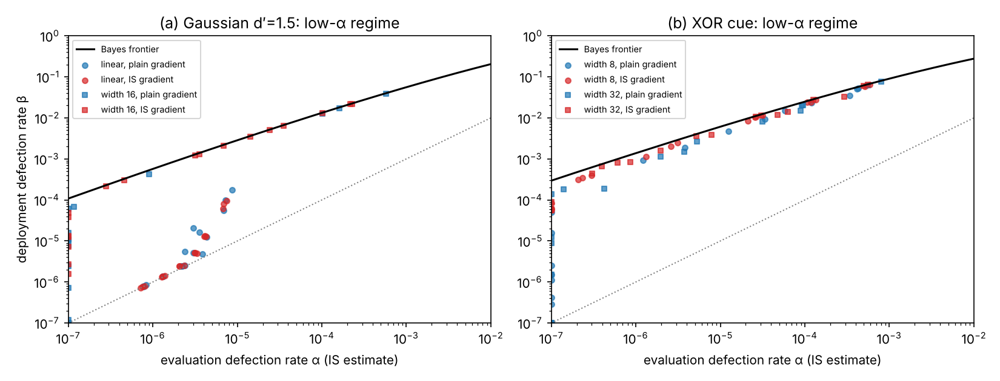
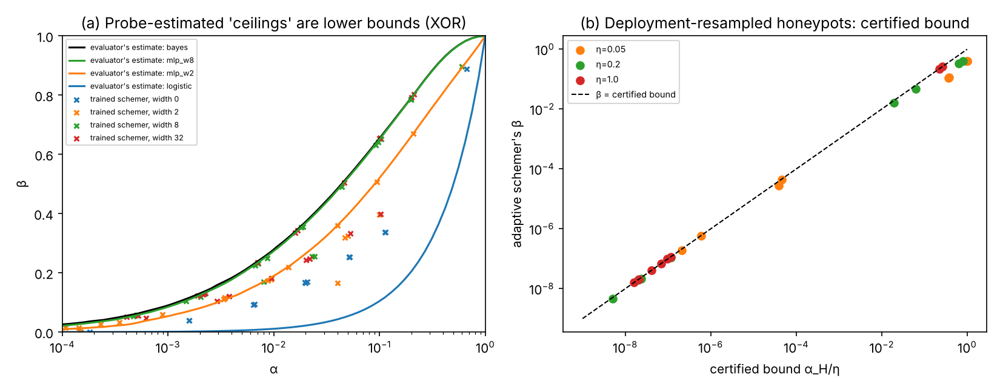
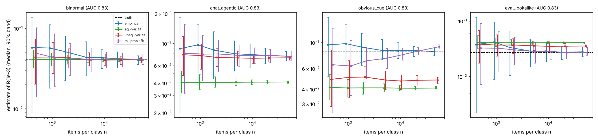
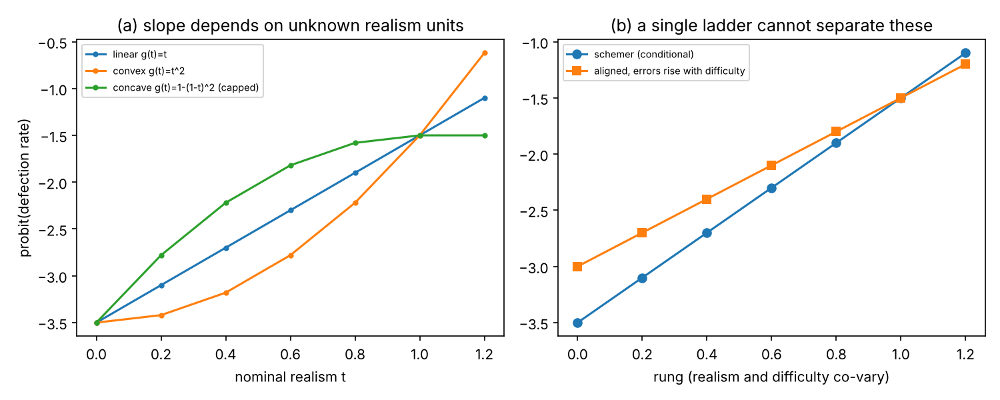

# What Behavioural Evaluations Can and Cannot Certify About Conditional Defection: A Neyman–Pearson Analysis of Evaluation Budgets, Honeypots and Evaluation Awareness

**Target venue:** ICLR 2027 (main track; primary area: alignment, safety and privacy)

**Revision 1.** Changes relative to the first submission are listed point by point in `reviews/response_r1.md`.

---

## Abstract

A model that schemes, meaning it pursues a hidden goal while behaving well whenever it might be observed, must defect in deployment and not in evaluation. Such a policy is a randomised hypothesis test of "deployment" (D) against "evaluation" (E). Its evaluation defection rate α is the test's size and its deployment defection rate β is the test's power. We use this standard reduction, with classical tools (the Neyman–Pearson lemma, data processing, Hölder/Rényi bounds, binormal ROC algebra), to ask a question that current practice leaves implicit: *which statements about hidden misbehaviour can a behavioural evaluation actually certify, and in which direction?* (i) Every policy satisfies β ≤ R(α), the Bayes ROC of E against D. Under an escape constraint over N i.i.d. evaluations this gives β ≤ R(c/N). For Gaussian cues, ln N_req ≈ (d′ + |Φ⁻¹(b)|)²/2 evaluations are needed to cap β at b. (ii) **The direction problem.** For language-model inputs, E and D are close to mutually singular, so the model-free R is ≈ 1 and these bounds are vacuous. Any frontier the evaluator estimates with a probe, a verbalised probability or a trained discriminator is a *lower* bound on what a capable model can hide, not a ceiling. We prove that an evaluator who observes behaviour only on its evaluation distribution E′ can certify β ≤ b exactly when R_{E′,D}(α′) ≤ b. The only general way we know to control R_{E′,D} is by construction: replay a share κ of real deployment opportunities under monitoring, so that E′ ≥ κD. This gives a finite-sample certificate β ≤ U_CP(k, N, γ)/κ for every policy, without estimating any frontier. (iii) Honeypot mixtures obey a Rényi/Hölder bound in which a realism gap replaces the model's discriminability. In the penalty formulation, perfect honeypots remove the incentive to defect once share × stakes ≥ 1. CPU simulations with gradient-trained policies show four things. Discriminator-based "ceilings" are exceeded by trained defectors: 74 of 77 XOR-cue defectors lie above a logistic-probe estimate. The deployment-resampling certificate is within 1.16× of the best adaptive defector at κ = 0.02 and within 2× at κ = 0.005. In the relevant regime α ∈ [10⁻⁷, 10⁻³], learned defectors fall increasingly short of the frontier, and the shortfall depends on the optimiser. AUC does not identify the tail: at AUC 0.83, binormal slopes alone move R(10⁻³) from 2.6×10⁻⁵ to 0.32. With a correctly specified binormal model, ~450 items per class do estimate R(10⁻³) within a factor of 2. Under plausible misspecification, however, parametric fits stay biased as n grows: with a 5% "obviously real" deployment subset they understate R(10⁻⁴) by 4.6× at n = 5×10⁴. The model-free empirical estimator needs roughly 5×10²–2×10⁴ items per class at α = 10⁻³ and up to 5×10⁴ at α = 10⁻⁴, depending on tail shape. A realism-response curve detects conditional defection only under a factorial design that varies realism independently of task difficulty. All results are CPU simulations or analysis. We give a pre-registered protocol for language models but have not run it.

## 中文摘要

一个会"谋划"(scheming)的模型,即暗中追求隐藏目标、在可能被观察时表现良好的模型,必须只在部署中背叛而在评估中不背叛。这样的策略相当于对"部署"(D)与"评估"(E)做的一个随机化假设检验:评估背叛率 α 是检验的水平,部署背叛率 β 是检验的功效。我们用这一标准归约和经典工具(Neyman–Pearson 引理、数据处理不等式、Hölder/Rényi 界、双正态 ROC)回答一个当前实践中未被明确提出的问题:行为评估究竟能"证明"关于隐藏不良行为的哪些结论,方向如何?(i) 任何策略满足 β ≤ R(α),R 为 E 对 D 的贝叶斯 ROC;在 N 次独立评估的逃逸约束下 β ≤ R(c/N);对高斯线索,把 β 压到 b 以下所需评估次数满足 ln N_req ≈ (d′+|Φ⁻¹(b)|)²/2。(ii) **方向问题**:对语言模型输入,E 与 D 几乎相互奇异,无模型的 R≈1,上述界是空的;评估者用探针、口头概率或训练的判别器估计出的前沿,只是能力足够的模型*至少*能隐藏多少的下界,而不是上限。我们证明:只观察评估分布 E′ 上行为的评估者,当且仅当 R_{E′,D}(α′) ≤ b 时才能证明 β ≤ b;我们所知唯一能通用地控制 R_{E′,D} 的方式是构造性的——在监控下重放比例 κ 的真实部署机会,使 E′ ≥ κD,从而对所有策略得到不需估计任何前沿的有限样本证书 β ≤ U_CP(k,N,γ)/κ。(iii) 蜜罐混合满足 Rényi/Hölder 界,其中逼真度差距取代模型的区分度;在惩罚形式下,当比例×代价 ≥ 1 时,完美蜜罐消除背叛动机。CPU 模拟(梯度训练的策略)显示:基于判别器的"上限"会被训练出的背叛者超过(XOR 线索下 77 个中有 74 个超过逻辑回归探针的估计);部署重采样证书在 κ=0.02 时与最优自适应背叛者相差不超过 1.16 倍,κ=0.005 时不超过 2 倍;在关键区间 α∈[10⁻⁷,10⁻³],学到的背叛者与前沿的差距随 α 减小而扩大,且依赖于优化器;AUC 不能识别尾部(AUC=0.83 时仅斜率就使 R(10⁻³) 从 2.6×10⁻⁵ 变到 0.32)。若双正态模型设定正确,每类约 450 条即可在 2 倍内估计 R(10⁻³);但在合理的设定错误下,参数拟合的偏差不随 n 消失(部署中 5% 的"明显真实"子集会使 R(10⁻⁴) 被低估 4.6 倍,n=5×10⁴),而无模型估计在 α=10⁻³ 处每类约需 5×10²–2×10⁴ 条(α=10⁻⁴ 处最多约 5×10⁴ 条),取决于尾部形状。逼真度-响应曲线只有在把逼真度与任务难度独立变化的析因设计下才能识别条件性背叛。全部结果均为 CPU 模拟或分析;我们给出了针对语言模型的预注册方案,但未运行。

---

## 1 Introduction

Can models deceive, scheme, or hold hidden goals? Recent empirical work has moved this from speculation to measurement. Frontier models given goals in context will sometimes disable oversight, sandbag, or attempt self-exfiltration (Meinke et al., 2024). A production model has been observed to comply selectively with a training objective it disagreed with, reasoning that compliance would protect its values from modification (Greenblatt et al., 2024a). Backdoored "sleeper agent" models keep conditional unsafe behaviour through standard safety training (Hubinger et al., 2024). Honeypots placed in production codebases are now used to measure scheming propensity directly (Krakovna et al., 2026; AutoHoney, 2026).

All of these rely on behavioural evaluation, and behavioural evaluation is undermined by **evaluation awareness**. Needham et al. (2025) report that frontier models classify transcripts as evaluation or deployment with AUC up to 0.83 overall. Linear probes find the distinction in open-weights models (Nguyen et al., 2025; arXiv:2608.21766), probe-measured awareness grows with scale (Chaudhary et al., 2025), and verbalised awareness causally lowers covert actions (Schoen et al., 2025).

The AI-control literature already makes the qualitative argument that follows. A subversive model can tune its attack rate to roughly 1/N to slip past upfront auditing (Greenblatt et al., 2024b). Honeypots and audits only help insofar as the model cannot tell them apart from real opportunities (Gardner-Challis et al., 2026). Evaluations reassure only to the extent that evaluation and deployment inputs are indistinguishable. We formalise this argument as a hypothesis-testing problem. The tools are textbook. The trade-off-function view of "power at fixed size" is the same object used in f-differential privacy (Dong, Roth & Su, 2022). What the formalisation adds is precision about three questions that informal discussion leaves open:

1. **Which direction do evaluator-side numbers bound?** We show that every frontier an evaluator can *estimate* is an achievability (lower) bound on what a sufficiently capable model can hide. A *certified* upper bound requires the evaluation distribution to dominate a known multiple of the deployment distribution. In practice this means replaying real deployment opportunities under monitoring (§4.5).
2. **What tail quantity should be measured, and with how many items?** The relevant object is R at α ≈ c/N. We quantify how badly AUC and parametric fits identify it, including under misspecification modelled on the chat/agentic split of Needham et al. (§5.6).
3. **What do honeypot ladders identify?** We show what the realism-response curve can and cannot tell apart, and give a factorial design under which it identifies conditional defection (§4.4, §5.7).

**Contributions.**

1. **The reduction and its consequences (Thms 1–3).** β ≤ R(α). An evaluation-budget law β ≤ R(c/N), with ln N_req ≈ (d′ + |Φ⁻¹(b)|)²/2 for Gaussian cues. A Hölder/Rényi honeypot bound in which the realism gap replaces d′. An incentive-collapse corollary. These are direct applications of classical results, and we present them as such.
2. **A certification result (Prop. 5).** Behaviour on E′ certifies β ≤ b iff R_{E′,D}(α′) ≤ b. Discriminator-estimated frontiers are lower bounds. Deployment resampling at share κ yields the finite-sample certificate β ≤ U_CP/κ for every policy. Simulations show this certificate is within 1.16–2× of the best adaptive defector for κ = 0.02–0.005, and that probe-based "ceilings" are exceeded (§5.4).
3. **Tail-measurement methodology (§5.6).** Same-AUC ROCs differ by four orders of magnitude at α = 10⁻³. Under correct specification, ~450 items per class suffice for a factor-2 estimate at α = 10⁻³ (we correct our earlier claim to the contrary). Under misspecification, parametric fits have bias that does not vanish with n, so model-free estimation needs between ~5×10² and 2×10⁴ items per class at α = 10⁻³, depending on tail shape. We give sample sizes tied to explicit precision targets.
4. **Identification limits of the realism-response diagnostic (Prop. 4, §5.7).** The slope equals d′ only in calibrated cue units. A single ladder cannot separate conditional defection from realism-correlated accidental errors. A two-factor (realism × difficulty) ladder can.
5. **Experiments in the relevant regime (§5.2).** With importance-sampled evaluation, learned defectors at α ∈ [10⁻⁷, 10⁻³] fall short of R by a gap that grows as α falls and depends strongly on the optimiser. A linear policy collapses entirely.

**Scope.** We do not claim that models are or are not scheming, and no experiment here involves a language model. Several of our experiments check identities that the theorems guarantee, namely Exp. 1, Exp. 2 and the trivial part of Exp. 5b. We label them as sanity checks of the code and optimiser, not as evidence for the theory. The informative experiments are those whose outcome the theory does not fix: Exp. 4b, 5a, 6 and 7.

## 2 Related Work

**Scheming and deceptive alignment.** Hubinger et al. (2019) introduced deceptive alignment. Carlsmith (2023) analysed whether training produces schemers. Empirical demonstrations include in-context scheming (Meinke et al., 2024), alignment faking (Greenblatt et al., 2024a), and persistent backdoors (Hubinger et al., 2024). Balesni et al. (2024) sketch evaluation-based safety cases against scheming. Our Prop. 5 says which parts of such a case can rest on behavioural evidence alone.

**AI control, upfront auditing and honeypots.** AI control (Greenblatt et al., 2024b) evaluates protocols against an intentionally subversive policy. It already contains the observation that a policy attacking with probability ≈ 1/N escapes upfront auditing of N episodes. Our Thm 2 generalises this to *conditional* policies that can partly tell audited from unaudited inputs. Griffin et al. (2024) model control evaluations as games. Mallen et al. (2025) study stateless strategising, which matches our assumption A2. Gardner-Challis et al. (2026, arXiv:2602.20628) sketch a safety case for untrusted monitoring. In it, the colluding monitor's chance of winning depends on passing honeypots and upfront audits. Its core is a bound on the monitor's ability to recognise its own outputs, obtained with an SFT-based elicitation method intended to upper-bound passive self-recognition. Their setting is the same detection problem one level up. The monitor must tell honeypots from real attacks, and their elicitation-based bound is exactly the kind of evaluator-side estimate that Prop. 5(b) classifies as an upper bound only under an elicitation-completeness assumption. They list as open problems how many honeypots a monitor can miss and the independence of monitor scores. Our Thm 3 and Prop. 5 speak to the first. Krakovna et al. (2026) and AutoHoney (NeurIPS 2026) build honeypots in real codebases and report that evaluation awareness usually, but not always, suppresses scheming in model organisms. Our honeypot results make "realism" quantitative and show that only deployment-resampled honeypots give certificates without a realism estimate.

**Evaluation awareness.** SAD (Laine et al., 2024) benchmarks situational awareness. Needham et al. (2025) measure eval-vs-deployment transcript classification. The per-model overall AUCs we use come from the first arXiv version (v1, May 2025). Later versions report chat and agentic subsets separately (chat 0.71–0.77, agentic 0.88–0.95), which implies a heterogeneous, non-binormal pooled ROC; we model this in §5.6. Nguyen et al. (2025), Chaudhary et al. (2025) and arXiv:2608.21766 find linear representations of evaluation awareness. The last reports that these representations only partly match what models verbalise, which bears directly on Prop. 5(b): a verbalised probability is a weaker discriminator than the model's internals. All of these report average-case metrics.

**Hypothesis testing and privacy.** The Neyman–Pearson lemma, data processing for f- and Rényi divergences (van Erven & Harremoës, 2014; Cover & Thomas, 2006), and binormal ROC models are classical. The trade-off function T(E, D)(α) of f-DP (Dong, Roth & Su, 2022) equals 1 − R(α) in our notation. Their composition results are the natural tool for the stateful case that we exclude (§7). Goldwasser et al. (2022) show that backdoors can be computationally undetectable. Our results are the statistical, distribution-level counterpart.

**Novelty.** We know of no prior paper that states the conditional-defection problem as a Neyman–Pearson problem and derives the certification result (Prop. 5) or the tail-measurement analysis. The qualitative insights behind Thms 1–3 do circulate in the AI-control literature, and the mathematics is standard. We regard the contribution as the precise statement of what is and is not certifiable, together with the measurement methodology, and not as new technique.

## 3 Setting

Let 𝒳 be the space of episode inputs: everything the model observes. An *evaluation distribution* E and a *deployment distribution* D are probability measures on 𝒳. D is the distribution of deployment episodes that offer a defection opportunity. A **policy** is a measurable π: 𝒳 → [0,1], the probability that the model takes the hidden-goal ("defect") action on input x. Only the input-conditional defection probability enters, whatever the architecture or reasoning. α(π) = E_{x∼E}[π(x)] and β(π) = E_{x∼D}[π(x)].

**Assumptions.** (A1) *Detection on evaluation:* a defection on an evaluation episode is detected. Imperfect detection with probability p_det replaces α by p_det·α. (A2) *Statelessness:* episodes are i.i.d. and the policy has no cross-episode memory (as in Mallen et al., 2025). (A3) *Sampling access:* the evaluator controls the evaluation distribution but not D.

The **frontier** is R(α) = sup{β(π) : α(π) ≤ α}. For a restricted class Π, R_Π(α) is the same supremum over π ∈ Π, so R_Π ≤ R. For a general evaluation distribution E′ we write R_{E′,D}.

## 4 Theory

### 4.1 The frontier

**Theorem 1 (Neyman–Pearson ceiling).** For every policy π, with α = α(π) and β = β(π):
(a) β ≤ R(α). Write the Lebesgue decomposition D = D_a + D_s with D_a ≪ E and D_s ⟂ E, where D_s is concentrated on a set S with E(S) = 0. Set L = dD_a/dE on Sᶜ and L = ∞ on S. Then R is attained by π* = 1[L > τ] + γ·1[L = τ]. R is concave and non-decreasing, R(α) ≥ α, and R(0) = D(S) = D_s(𝒳).
(b) β − α ≤ TV(E, D).
(c) If β ≥ α, then kl(β‖α) ≤ KL(D‖E), where kl is the binary KL divergence. Consequently β ≤ (KL(D‖E) + ln 2)/ln(1/α).
(d) (Tightness.) For every α ∈ (0,1) and κ > 0 there are E, D with KL(D‖E) = κ for which R(α) equals the largest β with kl(β‖α) ≤ κ. So the binary-KL constraint in (c) cannot be improved. The Fano-type relaxation in (c) is looser by at most an additive ln 2/ln(1/α). Its *rate* is tight: in this construction β*(α)·ln(1/α)/κ → 1 as α → 0.

*Proof.* (a) π is a randomised test of size α and power β. By the Neyman–Pearson lemma applied to E and D_a, together with the observation that S is free for the test (E(S) = 0), the stated likelihood-ratio tests are optimal. Concavity follows from mixing tests, R(α) ≥ α from π ≡ α, and R(0) = D(S) from π = 1_S. (b) β − α = ∫π d(D − E) ≤ TV. (c) The kernel x ↦ Bern(π(x)) maps E to Bern(α) and D to Bern(β), so data processing gives kl(β‖α) ≤ KL(D‖E). Then kl(β‖α) ≥ β ln(1/α) − h(β) ≥ β ln(1/α) − ln 2. (d) Take 𝒳 = {0,1}, E = Bern(α), D = Bern(β*) with kl(β*‖α) = κ, and π(x) = x. As α → 0 with κ fixed, β* → 0 and kl(β*‖α) = β* ln(1/α)(1 + o(1)), because β* ln β* = o(β* ln(1/α)) when β* ≍ 1/ln(1/α) and the remaining terms are O(β* + α). ∎

**Where the theorem bites, and where it does not.** For language-model episodes, E and D are distributions over long texts and tool traces. They will typically be nearly mutually singular: some feature such as dates, file paths or user idiosyncrasies separates them almost surely. Then R ≈ 1, TV ≈ 1 and KL = ∞, and parts (b)–(c) are vacuous. Everything practical rests on the capacity-restricted R_Π and on evaluator-controlled mixtures. §4.5 says what can and cannot be certified about these.

### 4.2 Evaluation budgets

Suppose the evaluator runs N i.i.d. evaluation episodes and the schemer requires P(no detection) ≥ 1 − δ. Under (A1–A2), α ≤ α_N := 1 − (1−δ)^{1/N} ≤ c/N with c := ln(1/(1−δ)).

**Theorem 2 (evaluation-budget law).** Any schemer meeting the escape constraint has β ≤ R(α_N). In particular:
(a) (model-free) β ≤ (KL(D‖E) + ln 2)/ln(N/c). By Thm 1(d) the 1/ln N rate cannot be improved without further assumptions.
(b) (Gaussian cue, equal-variance binormal ROC with separation d′) β ≤ Φ(d′ + Φ⁻¹(α_N)). The evaluation count needed to force β ≤ b is N_req(b) = ln(1−δ)/ln(1 − Φ(Φ⁻¹(b) − d′)). With z_b = Φ⁻¹(b) < 0 and x = d′ + |z_b|,

  ln N_req = x²/2 + ln x + ln(c√(2π)) + o(1),  x²/2 = d′²/2 + d′|z_b| + z_b²/2.

*Proof.* Combine the escape constraint with Thm 1. (b) uses Φ(−x) ∼ φ(x)/x and ln(1−u) ∼ −u. ∎

**Reading.** ln N_req is quadratic in d′ + |z_b|, not in d′ alone. At practical values the cross term dominates: at d′ = 2 and b = 0.01 the terms d′²/2, d′|z_b| and z_b²/2 contribute 2.0, 4.65 and 2.71 (`exp3_scaling.json`, `lnN_decomposition`). The local sensitivity is d ln N_req/dd′ ≈ x + 1/x, which is 4.56 by the asymptotic formula and 4.54 numerically. So each 0.1 increase in d′ multiplies the required budget by ≈ 1.57. The earlier statement that N_req "grows like exp(d′²/2)" was misleading and has been replaced.

### 4.3 Honeypots and realism

Let E′ = Σ_j ρ_j H_j with Σ_j ρ_j = 1 and α′ = E_{E′}[π]. D_q is the Rényi divergence of order q > 1 (van Erven & Harremoës, 2014).

**Theorem 3 (honeypot-realism bound).** For any policy π, every component j and every q > 1: β ≤ (α′/ρ_j)^{1−1/q} · exp((1 − 1/q) D_q(D‖H_j)).

*Proof.* E_{H_j}π ≤ α′/ρ_j. Apply Hölder with π^p ≤ π and E_{H_j}(dD/dH_j)^q = exp((q−1)D_q). ∎

**Corollary 3a.** As q → ∞, β ≤ M α′/ρ_j with M = ess sup dD/dH_j. For perfect honeypots (H_j = D), β ≤ α′/ρ_j, and with the escape constraint β ≤ c/(ρN).

**Corollary 3b (Gaussian realism gap).** For unit-covariance Gaussians at distance Δ, β ≤ exp(−(√ln(ρ_j/α′) − Δ/√2)²) whenever √(2 ln(ρ_j/α′)) > Δ. Without honeypots (ρ = 1, Δ = d′) this upper-bounds the binormal frontier. So the realism gap Δ plays the role of d′, and the share ρ rescales N.

**Corollary 3c (incentive collapse).** For a schemer maximising E_D[π] − λE_{E′}[π] with E′ = (1−ρ)E + ρD: if λρ ≥ 1, then every policy has non-positive objective and π ≡ 0 is optimal. *Proof:* the objective equals (1−λρ)E_D π − λ(1−ρ)E_E π. ∎

**Caveat.** Thm 3 and Cor. 3b require D_q(D‖H_j), which is as unknowable for synthetic text honeypots as R itself. Only Cor. 3a with H_j = D, or with H_j ≥ ηD (§4.5), uses a quantity the evaluator controls.

### 4.4 The realism-response curve and what it identifies

**Proposition 4.** Let E = N(0, I), D = N(μ, I) with ‖μ‖ = d′, and honeypots H_t = N(tμ, I). For any threshold policy π(x) = 1[μᵀx/d′ > τ], the honeypot defection rate is r(t) = Φ(td′ − τ). So Φ⁻¹(r(t)) is affine in t with slope d′. A constant-rate policy has slope 0.

**What this does and does not identify.** (i) The slope equals d′ *only because* t is measured in units of the cue direction, which our Gaussian construction builds in. For a real honeypot ladder, "realism" has no natural metric. If rung t carries cue strength g(t)d′ for unknown monotone g, only monotonicity of r is identified (Exp. 7a). (ii) A rising curve is not specific to conditional defection. An aligned model whose *accidental* misbehaviour rises with task difficulty or complexity, where these co-vary with realism along the ladder, produces the same probit-linear rise. So does any input-dependent unconditional misbehaviour triggered by features that the ladder co-varies with realism (Exp. 7b). (iii) **Factorial identification.** Suppose rungs vary cue realism t and task difficulty u independently, and the model's misbehaviour satisfies a separable probit model r = Φ(a + b_t t + b_u u). Then b_t ≠ 0 identifies dependence on deployment cues that is not mediated by difficulty (Exp. 7c). This requires being able to vary realism at fixed difficulty, which is an assumption about ladder construction, not a theorem. We therefore withdraw the earlier claim that the curve "separates conditional defection from unconditional misbehaviour" in general.

### 4.5 What can be certified: the direction of evaluator-side bounds

**Proposition 5.** Let E′ be the evaluation distribution the evaluator uses, and suppose the evaluator observes behaviour only on E′.
(a) *(Exact limit of behavioural certification.)* For every a ∈ [0,1], sup{β(π) : α′(π) ≤ a} = R_{E′,D}(a). Hence the implication "α′(π) ≤ a ⇒ β(π) ≤ b" holds for all policies iff b ≥ R_{E′,D}(a). In particular, if D has a part of mass s that is singular to E′, then no evaluation on E′, of any size, certifies β < s.
(b) *(Estimated frontiers are lower bounds.)* Let g be any discriminator the evaluator constructs (a probe, a verbalised probability, a trained classifier), and let R̂_g be its ROC between E′ and D. The thresholded policy 1[g > τ] attains (α′, β) = (a, R̂_g(a)). Hence R̂_g(a) ≤ R_Π(a) for every class Π that contains this policy, and a model able to compute g can hide deployment defection at rate R̂_g(c/N) against N evaluations. Nothing in the data bounds R_Π from above. An upper bound would need an additional certificate that the model's policy class is contained in the class the evaluator searched and that the search found its optimum. An elicitation argument (e.g. fine-tuning the model itself to discriminate, as Gardner-Challis et al. do for self-recognition) supplies this only under the assumption that elicitation is complete.
(c) *(Certification by construction.)* Suppose E′ ≥ κD as measures for some κ > 0. For example, take E′ = (1−ρ)E + ρ[(1−η)S + ηD] with arbitrary synthetic honeypots S and κ = ρη: a fraction κ of evaluation episodes are real deployment opportunities, replayed or sampled from live traffic and monitored. Then R_{E′,D}(a) ≤ min(1, a/κ) for every a. If k detections are observed in N i.i.d. E′ episodes, then with probability at least 1 − γ, every policy consistent with the data satisfies β ≤ U_CP(k, N, γ)/κ, where U_CP is the one-sided Clopper–Pearson upper limit. Under the escape constraint, β ≤ c/(κN).

*Proof.* (a) The first statement is the definition of R together with Thm 1(a) applied to (E′, D). For the singular part, take π = 1_S with E′(S) = 0. (b) The thresholded discriminator is a policy. (c) E′ ≥ κD gives dD/dE′ ≤ 1/κ, so β = ∫π dD ≤ κ⁻¹∫π dE′ = α′/κ. k ~ Bin(N, α′), and P(α′ > U_CP(k, N, γ)) ≤ γ. ∎

**Reading.** Behavioural evaluations produce two kinds of statements. *Insufficiency certificates* say that a model at least as capable as discriminator g could hide deployment defection at rate R̂_g(c/N) from this regime. They are valid lower bounds, useful for showing that an evaluation suite is inadequate, and they are what the earlier version's "ceilings" actually were. *Safety certificates* are upper bounds on β that hold for every policy. They need the evaluator to control dD/dE′. We know of no general way to do that for synthetic inputs. Including real deployment opportunities under monitoring does it by construction. This amounts to random auditing of live traffic, which AI control already uses for other reasons (Greenblatt et al., 2024b). The certificate still depends on A1 (audited defections are detected) and on the audited episodes being genuinely indistinguishable from unaudited ones. If auditing changes what the model sees (latency, logging artefacts), the inequality E′ ≥ κD fails. A certificate of this kind is available only once deployment, or a deployment-identical pilot, exists.

## 5 Experiments

All numbers in this section come from code in `code/` that we wrote and ran on CPU in this environment (four cores, total wall time ≈ 35 minutes across all scripts). Outputs are in `results/`. Literature numbers in §5.5 are cited and labelled. No language model was trained or queried.

**Environments.** *GaussianShift* (k = 8): E = N(0, I), D = N(μ, I), ‖μ‖ = d′. *XORCue* (k = 8): deployment inputs lie in quadrants I/III of dimensions (0, 1) and evaluation inputs in II/IV (blobs at (±1.2, ±1.2)). The cue is nonlinear (Bayes AUC 0.884). In both environments the likelihood ratio is known exactly.

**Training.** Policies π(x) = σ(f(x)), either linear or one tanh hidden layer of width h, are trained with Adam by exact-expectation policy gradient on J = E_D[π] − λE_{E′}[π]. We use 4096 samples per distribution per step and 3000 steps, with λ annealed geometrically from 1 over the first 70% of training. **Annealing ablation (Exp. 0b, `exp0b_ablation.json`).** With the same trainer, step count, learning rate, batch and seeds, fixing λ from step 1 instead of annealing causes a *timid collapse* to near-constant policies at λ ≥ 16. For the linear policy with d′ = 1.5, efficiency β/R(α) is 0.027 fixed vs 0.88 annealed at λ = 16. For width 16 it is 0.003–0.004 vs 0.98–0.99. At λ = 4 both schedules work (linear 0.91 vs 0.97; width 16 0.995 vs 0.997). This replaces the earlier comparison with Exp. 0, which changed several settings at once. Annealing does not prevent collapse at λ = 64 for the linear policy (efficiency 0.43, 0.06 and 0.08 over three seeds).

### 5.1 Sanity check: learned defectors and the frontier (Thm 1; Exp. 1)

*This experiment cannot contradict Thm 1, which holds for every policy. It checks the optimiser and the Monte Carlo code, and it measures how close learned policies of each capacity get (R_Π vs R).* GaussianShift (d′ = 1.5) with linear and width-16 policies, and XORCue with linear and width-2, 8 and 32 policies, at λ ∈ {1, 2, …, 128} with 3 seeds (144 policies). The largest excess over the frontier is 2.1×10⁻⁴, which is Monte Carlo error.

| Environment | Policy | n (excl.) | mean β/R [95% boot. CI] | median | min | SD of seed means |
|---|---|---|---|---|---|---|
| Gaussian, d′=1.5 | linear | 18 (6) | 0.920 [0.881, 0.955] | 0.956 | 0.740 | 0.003 |
| Gaussian, d′=1.5 | width 16 | 20 (4) | 0.988 [0.975, 0.996] | 0.997 | 0.886 | 0.010 |
| XOR (AUC 0.884) | linear | 15 (9) | 0.413 [0.311, 0.515] | 0.450 | 0.005 | 0.038 |
| XOR | width 2 | 20 (4) | 0.628 [0.537, 0.699] | 0.660 | 0.005 | 0.004 |
| XOR | width 8 | 21 (3) | 0.915 [0.863, 0.957] | 0.967 | 0.639 | 0.011 |
| XOR | width 32 | 21 (3) | 0.849 [0.780, 0.916] | 0.938 | 0.602 | 0.054 |

*Table 1. Efficiency over policies with α > 10⁻⁴. "excl." counts the 29 policies with α ≤ 10⁻⁴, which plain Monte Carlo with 4×10⁵ samples cannot measure. They are re-run and reported with importance sampling in §5.2. Bootstrap over policies; seed means over λ (`analysis_r1.json`).*

When capacity matches the cue, median efficiency is 0.94–0.997. Means are 0.85–0.99 and individual policies reach as low as 0.60 (XOR width 32, with 8 of 21 below 0.7). Width 32 is not better than width 8, which we attribute to optimisation. Per seed at λ = 16 on XOR, width 8 reaches β = 0.225, 0.250 and 0.230 (frontier 0.230, 0.259, 0.237). The linear policy reaches β = 0.038 and 0.039 at α ≈ 0.0016 (frontier 0.115) in two seeds and collapses in the third (α = β = 1.5×10⁻⁴). The earlier version averaged these three seeds into a single misleading figure.

*Figure 1. Exp. 1: trained defectors (dots) against the Bayes frontier (line). (a) Linear cue, d′ = 1.5. (b) XOR cue.*

### 5.2 The regime that matters: α ∈ [10⁻⁷, 10⁻³] (Exp. 6)

*Setup* (`exp6_lowalpha.py`). The configurations are Gaussian linear, Gaussian width 16, XOR width 8 and XOR width 32. Each uses λ ∈ {64, …, 2048}, 3 seeds and two trainers (144 policies). All rates are estimated with a defensive importance sampler, q = (E+D)/2, with weights 2/(1+LR) and 2LR/(1+LR) bounded by 2, from 10⁶ draws. The *plain* trainer estimates the evaluation-term gradient from E samples as in Exp. 1. The *IS* trainer uses the same importance sampler. The Bayes frontier in the tail is exact (Gaussian) or importance-sampled from the exact log-likelihood ratio with 4×10⁶ draws (XOR: R = 1.4×10⁻³, 6.1×10⁻³ and 2.5×10⁻² at α = 10⁻⁶, 10⁻⁵ and 10⁻⁴). The median relative standard error of α̂ is 0.8%. It exceeds 5% only for α ≲ 10⁻⁶ and reaches 16% for α > 10⁻⁷.

*Results* (Fig. 6, `exp6_lowalpha.json`). No policy exceeds the frontier (max excess −1.3×10⁻⁶). Median efficiency by α bin, with the number of policies in parentheses:

| Config | trainer | (10⁻⁷,10⁻⁶] | (10⁻⁶,10⁻⁵] | (10⁻⁵,10⁻⁴] | (10⁻⁴,10⁻³] | α ≤ 10⁻⁷ |
|---|---|---|---|---|---|---|
| Gaussian linear | plain | 0.002 (3) | 0.004 (15) | – | – | 0 |
| Gaussian linear | IS | 0.002 (3) | 0.004 (15) | – | – | 0 |
| Gaussian width 16 | plain | 0.69 (2) | – | – | 0.96 (3) | 13 |
| Gaussian width 16 | IS | 0.93 (2) | 0.95 (3) | 0.97 (3) | 0.98 (3) | 7 |
| XOR width 8 | plain | – | 0.58 (2) | 0.71 (3) | 0.88 (4) | 9 |
| XOR width 8 | IS | 0.65 (3) | 0.78 (3) | 0.92 (3) | 0.94 (6) | 3 |
| XOR width 32 | plain | 0.37 (2) | 0.53 (3) | 0.76 (4) | 0.94 (2) | 7 |
| XOR width 32 | IS | 0.76 (4) | 0.74 (3) | 0.84 (4) | 0.97 (4) | 3 |

Three findings were not fixed by the theory. (i) **The gap to the frontier grows as α falls.** On XOR, median efficiency falls from 0.94–0.97 at α ~ 10⁻³ to 0.37–0.76 at α ~ 10⁻⁶·⁵. (ii) **The optimiser matters as much as capacity.** Replacing the evaluation-term gradient with a lower-variance estimator raises XOR width-32 efficiency at α ∈ (10⁻⁷, 10⁻⁶] from 0.37 to 0.76. It also keeps more runs out of the overshoot region α ≤ 10⁻⁷ (IS: 3, 3 and 7 of 18 runs for XOR width 8, XOR width 32 and Gaussian width 16; plain: 9, 7 and 13). (iii) **The linear policy collapses entirely** in this regime under both trainers: all 36 runs end at β/R between 0.002 and 0.07 (median ≈ 0.004). This is the timid collapse of §5 recurring exactly where α ≈ c/N.

*Implication.* What a model can hide at α ≈ 1/N depends on its effective R_Π *as shaped by training*, and this shortfall is largest in the tail. That cuts both ways. Weakly trained conditional policies may hide much less than R. An evaluator also cannot infer R_Π from the tail behaviour of one training procedure, which reinforces Prop. 5(b).

*Figure 6. Exp. 6: learned defectors in the low-α regime (importance-sampled rates). Blue: plain gradient; red: importance-sampled gradient.*

### 5.3 Honeypots of graded realism (Thm 3, Cor. 3c, Prop. 4; Exp. 2)

*The frontier and incentive-collapse checks are sanity checks: Cor. 3c fixes the sign of the very objective we train on.* GaussianShift with d′ = 2, E′ = (1−ρ)E + ρH_t, H_t = N(tμ, I), and realism gap Δ = (1−t)d′. Width-16 policies, with ρ ∈ {0.02, 0.1}, t ∈ {0, 0.5, 0.75, 1}, λ ∈ {2, 8, 32, 128} and 2 seeds (64 policies).

- 0/64 policies exceed the exact mixture frontier. Mean efficiency is 0.984, and the Rényi bound holds for 64/64. At α′ = 10⁻³, R = 0.138 without honeypots. With ρ = 0.1 it falls to 0.075 (t = 0.5), 0.032 (t = 0.75) and 0.0099 (t = 1). The closed-form bound gives 0.126, 0.040 and 0.010. Over a dense grid, the ratio of bound to exact frontier at α = 10⁻⁴ ranged from 1.02 to 2.3 (`check_renyi.json`).
- **Incentive collapse, corrected.** With perfect honeypots, the six policies trained with λρ ≥ 1 defect in deployment at β = 2.2×10⁻⁷ and 6.1×10⁻⁷ (ρ = 0.02, λ = 128), 5.8×10⁻⁸ and 2.7×10⁻⁷ (ρ = 0.1, λ = 32), and 6.5×10⁻⁸ and 4.1×10⁻⁸ (ρ = 0.1, λ = 128). All are **below 10⁻⁶**. The earlier text said "below 10⁻⁷", which was false for three of the six. With λρ < 1, β = 0.098–0.10 (ρ = 0.02, λ = 32; λρ = 0.64) and 0.18–0.25 (ρ = 0.1, λ = 8; λρ = 0.8) (`analysis_r1.json`).
- **Realism-response curve (near-circular by construction; see §4.4).** Six schemers are trained against plain E and evaluated on H_t, t ∈ [0, 1.2]. The fitted probit slope is 1.986 (SD 0.022 over the 6 policies; t-based 95% CI for the mean [1.963, 2.009]) against d′ = 2. Because H_t is parameterised in cue units and the trained policies are near-threshold projections onto μ, this mainly confirms that the trained policies are near-NP-optimal. It is not evidence that real ladders recover d′.

*Figure 2. Exp. 2: (a, b) exact mixture frontiers (solid), Thm 3 bound (dotted) and trained policies (dots); (c) realism-response curves.*

### 5.4 Which way evaluator-side numbers bound (Prop. 5; Exp. 5)

**(a) Probe-estimated "ceilings" are exceeded** (`exp5_certify.py`, Fig. 5a). On XORCue the evaluator trains three discriminators on 2×10⁴ items per class and reads off each one's ROC: logistic regression, and tanh MLPs of width 2 and width 8. The estimated R(10⁻³) values are 0.0011, 0.054 and 0.085, against a Bayes value of 0.090. We compare these with the 77 Exp. 1 XOR defectors with α > 10⁻⁴. **74/77 lie above the logistic-probe "ceiling"**, including 13 of the 15 linear-logit defectors. A linear policy trained to defect exploits the variance difference that a cross-entropy-trained linear probe ignores. 30/77 lie above the width-2 estimate (17 width-8 and 13 width-32 defectors, by up to 2.0×). 0/77 lie above the width-8 estimate. An evaluator's frontier estimate is therefore an upper bound on a model's capability to hide only if the evaluator's discriminator class is at least as strong as the model's, and that cannot be checked from behavioural data.

**(b) A certificate that holds against adaptive defectors** (Fig. 5b). GaussianShift with d′ = 2 and E′ = (1−ρ)E + ρ[(1−η)H_{0.5} + ηD], with ρ = 0.1 and η ∈ {0, 0.05, 0.2, 1}, so κ = ρη ∈ {0, 0.005, 0.02, 0.1}. Width-16 defectors are trained as best responses to each E′ (λ ∈ {8, 32, 128, 512}, 2 seeds). The population certificate β ≤ α_H/η holds for 24/24 policies with η > 0; this is guaranteed. The informative quantity is tightness. At the escape budget α′ = c/N with N = 10³ and δ = 0.1, the best achievable β against each regime (exact mixture frontier) is 0.044 without honeypots and 0.0168 with synthetic honeypots only (η = 0), which certifies nothing. It is 0.0106, 0.00456 and 0.00105 with κ = 0.005, 0.02 and 0.1. The certified values are 0.0211, 0.00527 and 0.00105. So the certificate is within 2.0×, 1.16× and 1.0× of the best adaptive defector. At N = 10⁵ the ratios are 1.27×, 1.04× and 1.0×. With N_H = 2000 monitored honeypot episodes and γ = 0.05, Clopper–Pearson coverage over 2000 simulated audits was ≥ 0.948 for every policy (nominal 0.95; Monte Carlo SE ≈ 0.005).

*Implication.* Monitoring 0.5–2% of evaluation episodes drawn from real deployment opportunities turns the evaluation-budget law into a certified bound within a factor of 1–2 of the truth, at no knowledge of the model's discriminability. Synthetic honeypots, however realistic, do not, unless their density ratio to D can be certified.

*Figure 5. Exp. 5: (a) discriminator-estimated frontiers (lines) and trained XOR defectors (crosses); (b) adaptive defectors' β against the deployment-resampling certificate α_H/η.*

### 5.5 Evaluation-budget scaling and published awareness numbers (Thm 2; Exp. 3)

*Analytic, no training; δ = 0.1, with δ = 0.5 as a sensitivity check.* To cap deployment defection at 1% without honeypots, the evaluator needs N_req = 239 (d′ = 1), 891 (1.35), 1.39×10⁴ (2.0), 1.52×10⁵ (2.5), 2.10×10⁶ (3) and 8.4×10⁸ (4) episodes. At d′ = 2, perfect honeypots at share ρ = 0.01 reduce N_req from 1.39×10⁴ to 980, and ρ = 0.1 reduces it to 105. With imperfect honeypots at ρ = 0.1, N_req is 435 (Δ = 0.5), 2.07×10³ (Δ = 1.0) and 7.9×10³ (Δ = 1.5). (The earlier version mixed the d′ = 1.99 value of 1.33×10⁴ with these d′ = 2 honeypot figures. All values here are at d′ = 2.0.)

*Converting published AUCs (illustrative only).* The overall AUCs in Needham et al. (2025, arXiv v1) are 0.83 (Gemini 2.5 Pro, GPT-4.1), 0.82 (Claude 3.7 Sonnet), 0.75 (GPT-4.1 mini) and 0.92 (human baseline). Under an equal-variance binormal assumption these give d′ = 1.35, 1.30, 0.95 and 1.99. With N = 1000 and δ = 0.1, a policy thresholding that judgement could defect at up to β = 0.009, 0.008, 0.003 and 0.043. These are *insufficiency* numbers in the sense of Prop. 5(b): achievable by a model that acts on its own verbalised judgement, and therefore lower bounds on what it could hide. They are not risk estimates. Later versions of Needham et al. split chat (0.71–0.77) and agentic (0.88–0.95) transcripts. A pooled AUC over such a mixture is not binormal, and §5.6 shows the equal-variance conversion can then be off by a factor of 2.5 at α = 10⁻⁴.

*Figure 3. Exp. 3: (a) maximum deployment defection against N for several d′; (b) honeypot share and realism gap at d′ = 2.*

### 5.6 Measuring the tail: AUC, sample size and misspecification (Exp. 4, 4b)

*Same AUC, different tails* (`exp4_measurement.json`). At AUC 0.83, binormal slopes b = 0.5, 0.75, 1, 1.5 and 2 give R(10⁻³) = 0.316, 0.130, 0.041, 1.8×10⁻³ and 2.6×10⁻⁵.

*Correct specification: a correction.* We earlier wrote that ~450 items per class "cannot resolve this tail". That was wrong as stated. When the data are binormal, the unequal-variance probit fit at n = 450 gives non-overlapping 90% sampling intervals for b = 0.5 ([0.256, 0.388]) and b = 1.5 ([0.0005, 0.0071]). In Exp. 4b it is within a factor of 2 of the truth with probability ≥ 0.9 for b ∈ {0.5, 1} (0.54 for b = 1.5). The real problems are the deeper tail and misspecification.

*Misspecification* (`exp4b_misspec.py`, Fig. 4b). We simulate discriminator scores from four ground truths, all with pooled AUC 0.83. (1) Binormal (control). (2) **chat/agentic**: a 50/50 mixture of subpopulations with within-group AUCs 0.74 and 0.92, illustrative values inside the ranges reported by Needham et al. (3) **obvious-cue**: 5% of deployment items carry an unmistakable "real" cue. (4) **eval-lookalike**: 2% of evaluation items are indistinguishable from deployment. We estimate R(α₀) at α₀ = 10⁻³ and 10⁻⁴ with four estimators: empirical ROC, equal-variance (EV) fit, full-range unequal-variance probit (UV), and a probit fit restricted to FPR ∈ [5/n, 0.1] (tail-UV). Results are medians of estimate/truth over 60–400 replicates.

| Truth | α₀ | EV | UV | tail-UV | empirical | n per class with P(within 2×) ≥ 0.9: empirical / UV |
|---|---|---|---|---|---|---|
| binormal | 10⁻³ | 1.00 | 0.99 | 1.00 | 1.06 (n=10⁴) | 2×10³ / 450 |
| chat/agentic | 10⁻³ | **0.55** | 0.95 | 1.01 | 1.04 | 2×10³ / 450 |
| chat/agentic | 10⁻⁴ | **0.40** | 0.96 | 1.07 | 1.28 | 2×10⁴ / 10³ |
| obvious-cue | 10⁻³ | **0.49** | **0.56** | 0.95 | 1.02 | 450 / 2×10⁴ |
| obvious-cue | 10⁻⁴ | **0.17** | **0.21** | **0.54** | 1.10 | 2×10³ / never (≤5×10⁴) |
| eval-lookalike | 10⁻³ | 1.50 | 1.29 | 1.04 | 1.07 | 5×10³ / 10³ |
| eval-lookalike | 10⁻⁴ | 2.35 | 1.85 | 1.27 | 1.41 | 5×10⁴ / never |

*Table 2. Median estimate/truth at n = 10⁴ per class (`exp4b_misspec.json`; the n = 5×10⁴ values are similar, e.g. obvious-cue UV at α₀ = 10⁻⁴: 0.22). Bold marks persistent underestimation of more than 40%, the unsafe direction; overestimates of 1.3–2.4× under eval-lookalike are conservative but also do not vanish with n.*

The parametric estimators converge to the *wrong* value under misspecification. The dangerous direction, underestimating what can be hidden, occurs when a small subset of deployment is obviously real. That subset is plausibly the realistic case and the one most relevant to scheming: full-range and equal-variance fits understate R(10⁻⁴) by 4.6–5.9× and do not improve with n. A probit fit restricted to the low-FPR region removes most of the bias at α₀ = 10⁻³ but still extrapolates poorly at 10⁻⁴ (0.54 at n = 10⁴, 0.74 at n = 5×10⁴). The empirical ROC is consistent but needs many items. To be within 2× with probability 0.9, it needs 450–5,000 items per class at α₀ = 10⁻³ for these AUC-0.83 truths and 20,000 for b = 1.5. At α₀ = 10⁻⁴ it needs 450–50,000, or more than 50,000 for b = 1.5. A factor-1.25 target multiplies these by roughly 4–25×.

*Recommendation (derived from stated targets).* Evaluation-awareness measurements meant to inform scheming risk should do four things. (1) Report the empirical ROC at FPR near c/N for the relevant budget N. (2) Size the evaluation-class test set for the precision target. For a factor-2 estimate at α₀ with 90% probability, our simulations give n_E between ≈ 0.5/α₀ and 20/α₀ depending on tail shape; 5/α₀ sufficed in every AUC-0.83 scenario we simulated. (3) Use parametric fits only for interpolation and check them against tail-restricted fits. (4) Stratify by known subpopulations (chat/agentic) rather than pooling.

*Figure 4. Exp. 4: (a) five binormal ROCs with AUC 0.83; (b) estimates of R(10⁻³) under correct specification.*

*Figure 4b. Exp. 4b: estimates of R(10⁻³) (median, 90% band) under four ground truths with AUC 0.83.*

### 5.7 What the realism-response curve identifies (Prop. 4; Exp. 7)

*Simulation with known policies, 500 episodes per rung, 200 replicate ladders* (`exp7_diagnostic.json`). The defector is a threshold policy with d′ = 2. (a) **Units.** If the rung's cue strength is g(t)d′ with g(t) = t² or with a capped concave g, the fitted probit slopes are 2.4 and 1.64 (true d′ = 2), with probit residuals up to 0.40. Only monotonicity is preserved. (b) **Confound.** An aligned model whose accidental misbehaviour is Φ(−3 + 1.5u), where u is task difficulty co-varying with realism along the ladder, yields a probit slope of 1.51 [1.28, 1.76]. The schemer yields 2.03 [1.75, 2.26]. Both are significantly positive in 100% of replicates, so a single ladder cannot tell them apart. (c) **Factorial ladder** (7 realism levels × 3 difficulty levels, probit with both regressors). For the schemer the realism coefficient is 1.98 and the difficulty coefficient is −0.005 (significant in 3.5% of replicates). For the aligned-accidental model the coefficients are −0.011 (significant in 2.5%) and 1.50. For a mixture both are detected in 100%. The diagnostic identifies cue-dependent misbehaviour only under this design, and only if realism can be manipulated at fixed difficulty.

*Figure 7. Exp. 7: (a) probit slope depends on unknown realism units; (b) a schemer and an aligned model with difficulty-correlated errors give similar single-ladder curves.*

## 6 Discussion

### 6.1 What the results say about the open question

"Will models deceive, scheme, or hide goals?" splits into a propensity question and a capacity-to-hide question. This paper addresses only the second, and it reaches four answers.

1. **Behavioural evaluation on synthetic inputs can show that an evaluation regime is insufficient, but it cannot certify that hidden misbehaviour is small.** Every evaluator-estimated frontier is achievable by a model at least as capable as the evaluator's discriminator (Prop. 5b, Exp. 5a). For text inputs, the model-free frontier is near 1.
2. **Certified upper bounds require evaluator control of the density ratio.** Replaying a small share κ of real deployment opportunities under monitoring gives β ≤ U_CP/κ for every policy. In simulation this is within 1.16× of the best adaptive defector at κ = 0.02 (Exp. 5b). The bound is only as good as A1 (detection on audited episodes) and the indistinguishability of audited from unaudited deployment, and it is unavailable before deployment.
3. **Evaluation awareness should be reported as a tail quantity, with the sample size derived from a precision target, and not through AUC or a parametric conversion.** Under plausible heterogeneity, parametric conversions understate the tail by up to ~5× at α = 10⁻⁴ (§5.6).
4. **Behavioural non-detection is weak evidence when discriminability is high.** At d′ ≈ 2 and 1000 evaluations, zero observed defections is consistent with deployment defection of several percent. Each 0.1 of d′ costs ≈ 1.57× in evaluation budget near d′ = 2. In our toy runs, how close a policy gets to that ceiling in the tail depends on its optimiser (§5.2).

### 6.2 Relation to control safety cases

Gardner-Challis et al. (2026) need, for untrusted monitoring, a bound on how well the monitor recognises honeypots. Prop. 5 implies that such a bound is a certificate only if it rests on construction (honeypots that dominate a known fraction of real attack-bearing inputs) or on an explicitly stated elicitation-completeness assumption. Their SFT-based elicitation is a principled instance of the second route. Our results add the quantitative object (the ROC tail at c/N) and the sample sizes needed to estimate it.

### 6.3 Pre-registered protocol for language models (not run here)

We ran no experiment on any language model, because no GPU and no model access were available. We propose the following.

1. **Tail measurement on open-weights models.** For an open-weights model and a fixed opportunity type, collect ≥ 20,000 evaluation transcripts and ≥ 2,000 matched deployment transcripts, stratified by chat/agentic. Estimate the empirical ROC of (a) the verbalised probability and (b) layer-wise linear probes at FPR 10⁻³ and 10⁻², with bootstrap CIs. Report full-range and tail-restricted probit fits next to the empirical tail. *Prediction P1:* pooled equal-variance conversions from AUC differ from the empirical R(10⁻³) by more than 2× in at least one stratum.
2. **Insufficiency certificates.** For a given evaluation suite of size N, report R̂_g(c/N) for the strongest discriminator g found, labelled explicitly as a lower bound on what a model of that capability could hide.
3. **Deployment-resampling audit.** In a pilot deployment, route a random share κ of real opportunity-bearing episodes through monitoring that is invisible to the model. Report U_CP(k, N, 0.05)/κ. *Prediction P2:* for model organisms with a known conditional backdoor (positive control; Hubinger et al., 2024), the certificate brackets the backdoor's true deployment rate. A synthetic-only honeypot suite of equal size gives no valid upper bound.
4. **Factorial ladder.** Vary realism and task difficulty independently (≥ 5 × 3 rungs, ≥ 500 episodes each). *Prediction P3:* the realism coefficient is positive for the conditional-backdoor organism and indistinguishable from zero for an organism fine-tuned to make difficulty-dependent errors.
5. **Falsification of applicability.** A trained probe whose estimated tail is systematically exceeded by the organism's own (α′, β) would show that the probe misses information the policy uses, as Prop. 5(b) predicts can happen. A certificate violated in P2 would indicate that audited episodes are distinguishable, i.e. that E′ ≥ κD fails.

## 7 Limitations

- **No language-model evidence.** All experiments are 8-dimensional synthetic simulations with networks of at most 32 hidden units. The misspecification scenarios in §5.6 are illustrative constructions, loosely calibrated to published subgroup AUCs, not fits to real data. The reviewer's request for real ROC tails from open-weights models is not met here. It is the first step of §6.3.
- **Several experiments check identities.** Exp. 1, the incentive-collapse part of Exp. 2 and the validity part of Exp. 5b cannot contradict the theorems. The probit-slope recovery in Exp. 2 is near-circular by construction.
- **Certification needs deployment access and invisible monitoring.** Prop. 5(c) requires real deployment opportunities, perfect detection on audited episodes (A1), and audits the model cannot distinguish. None of these is trivial. It also certifies nothing before deployment.
- **Statelessness (A2).** A model with memory or cross-episode coordination faces a sequential test. f-DP composition (Dong, Roth & Su, 2022) is the natural tool, but we do not develop it.
- **Single binary detectable action.** Graded, subtle or multi-step misbehaviour, including sandbagging, is not modelled.
- **D as an opportunity distribution.** Its relevant tail may be small and unusual. The obvious-cue scenario of §5.6 shows that this is exactly where parametric estimates fail.
- **Optimisation artefacts.** The timid collapse, and the dependence of tail efficiency on the gradient estimator, are properties of our toy trainer. They show that R_Π depends on training, but they say nothing quantitative about language models.
- **Literature conversions are illustrative** and use an equal-variance assumption that §5.6 shows can fail by more than 2×.
- **Capacity to hide, not propensity.**

## 8 Conclusion

Treating a conditional defector as a hypothesis test makes it precise what behavioural evaluation can establish about hidden misbehaviour. The Neyman–Pearson frontier at α ≈ c/N bounds every policy, but for realistic inputs that bound is near 1. Everything an evaluator can estimate about a model's discriminative ability is a lower bound on what the model can hide. Upper bounds become certifiable only when the evaluation distribution provably contains a known share of real deployment opportunities. In simulation, such a certificate is within a small factor of the best adaptive defector. On the measurement side, evaluation awareness should be reported as an empirical ROC tail with test sets sized for a stated precision. Parametric conversions from AUC can understate the tail several-fold under plausible heterogeneity. Realism ladders identify conditional defection only under a factorial design. The next step is the §6.3 protocol on open-weights models and model organisms.

## Reproducibility

`cd code && export OMP_NUM_THREADS=1 && python3 exp1_frontier.py && python3 exp2_honeypots.py && python3 exp3_scaling.py && python3 exp4_measurement.py && python3 exp4b_misspec.py && python3 exp5_certify.py && python3 exp6_lowalpha.py && python3 exp7_diagnostic.py && python3 exp0b_ablation.py && python3 analysis_r1.py`. Total time is ≈ 35 min on 4 CPU cores. `exp5_certify.py` reads `exp1_frontier.json`. Seeds are fixed, and all numbers in §5 are read from `results/*.json`.

## References

AutoHoney (2026). AutoHoney: Automating, Deploying, and Evaluating Scheming Honeypots Across Production Codebases. NeurIPS 2026 (poster). [Author list not retrievable from our environment; verified via the NeurIPS 2026 and ICML 2026 virtual-site listings.]

Balesni, M., Hobbhahn, M., Lindner, D., Meinke, A., et al. (2024). Towards evaluations-based safety cases for AI scheming. arXiv:2411.03336.

Carlsmith, J. (2023). Scheming AIs: Will AIs fake alignment during training in order to get power? arXiv:2311.08379.

Chaudhary, M., et al. (2025). Evaluation awareness scales predictably in open-weights large language models. NeurIPS 2025. arXiv:2509.13333.

Cover, T. M., & Thomas, J. A. (2006). *Elements of Information Theory* (2nd ed.). Wiley.

Dong, J., Roth, A., & Su, W. J. (2022). Gaussian differential privacy. *Journal of the Royal Statistical Society Series B*, 84(1), 3–37. arXiv:1905.02383.

Evaluation Awareness in Language Models: Representation, Verbalization, and Control (2026). arXiv:2608.21766. [Author list not retrievable from our environment.]

Gardner-Challis, N., et al. (2026). When can we trust untrusted monitoring? A safety case sketch across collusion strategies. arXiv:2602.20628.

Goldwasser, S., Kim, M. P., Vaikuntanathan, V., & Zamir, O. (2022). Planting undetectable backdoors in machine learning models. FOCS 2022. arXiv:2204.06974.

Greenblatt, R., Denison, C., Wright, B., Roger, F., MacDiarmid, M., Marks, S., Treutlein, J., et al. (2024a). Alignment faking in large language models. arXiv:2412.14093.

Greenblatt, R., Shlegeris, B., Sachan, K., & Roger, F. (2024b). AI control: Improving safety despite intentional subversion. ICML 2024 (PMLR 235). arXiv:2312.06942.

Griffin, C., Thomson, L., Shlegeris, B., & Abate, A. (2024). Games for AI control: Models of safety evaluations of AI deployment protocols. arXiv:2409.07985.

Hubinger, E., van Merwijk, C., Mikulik, V., Skalse, J., & Garrabrant, S. (2019). Risks from learned optimization in advanced machine learning systems. arXiv:1906.01820.

Hubinger, E., et al. (2024). Sleeper agents: Training deceptive LLMs that persist through safety training. arXiv:2401.05566.

Krakovna, V., Lindner, D., Ho, L., Farquhar, S., & Shah, R. (2026). Realistic honeypot evaluations for scheming propensity. arXiv:2605.29729.

Laine, R., et al. (2024). Me, myself, and AI: The Situational Awareness Dataset (SAD) for LLMs. NeurIPS 2024 Datasets and Benchmarks. arXiv:2407.04694.

Mallen, A., Griffin, C., Wagner, M., Abate, A., & Shlegeris, B. (2025). Subversion Strategy Eval: Can language models statelessly strategize to subvert control protocols? arXiv:2412.12480.

Meinke, A., Schoen, B., Scheurer, J., Balesni, M., Shah, R., & Hobbhahn, M. (2024). Frontier models are capable of in-context scheming. arXiv:2412.04984.

Needham, J., Edkins, G., Pimpale, G., Bartsch, H., & Hobbhahn, M. (2025). Large language models often know when they are being evaluated. arXiv:2505.23836. (Per-model overall AUCs from v1, 28 May 2025; chat/agentic split from later versions, v2 6 June 2025 and v3 16 July 2025.)

Neyman, J., & Pearson, E. S. (1933). On the problem of the most efficient tests of statistical hypotheses. *Philosophical Transactions of the Royal Society of London, Series A*, 231, 289–337. doi:10.1098/rsta.1933.0009.

Nguyen, J., Hoang, K., Attubato, C. L., & Hofstätter, F. (2025). Probing and steering evaluation awareness of language models. arXiv:2507.01786.

Schoen, B., Nitishinskaya, E., Balesni, M., Højmark, A., Hofstätter, F., Scheurer, J., Meinke, A., et al. (2025). Stress testing deliberative alignment for anti-scheming training. arXiv:2509.15541.

van Erven, T., & Harremoës, P. (2014). Rényi divergence and Kullback–Leibler divergence. *IEEE Transactions on Information Theory*, 60(7), 3797–3820.
