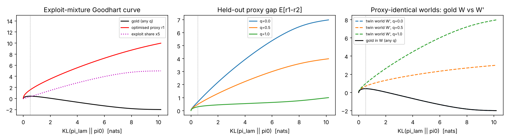
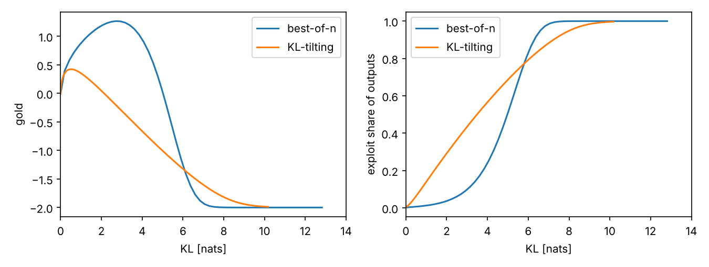
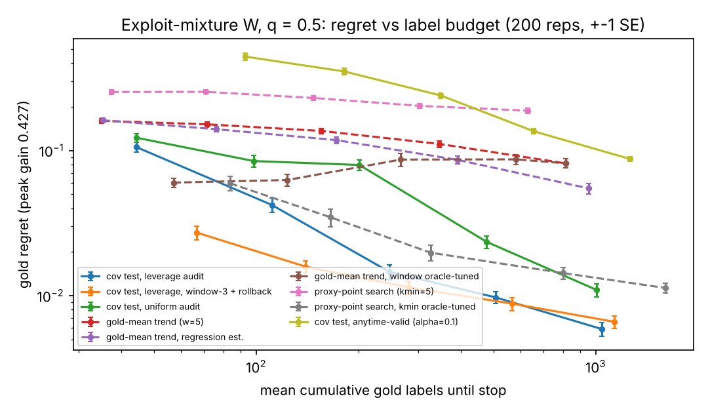
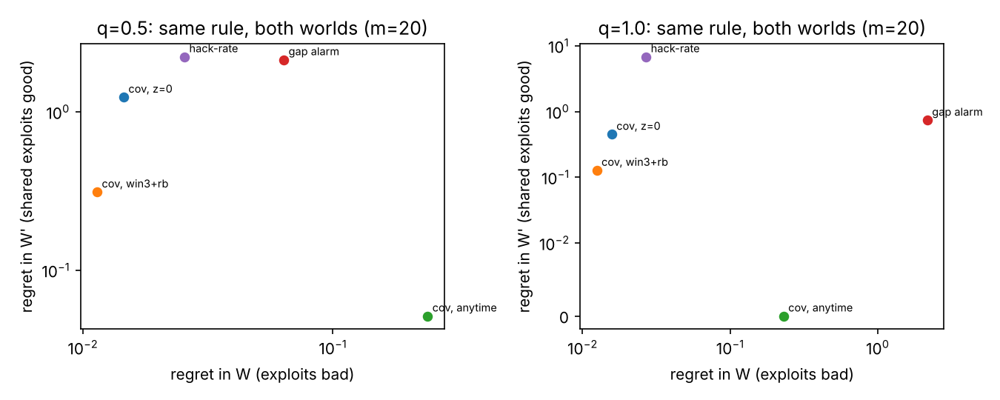

# Proxy-Only Detectors Cannot See Shared Exploits: Non-Identifiability, and On-Policy Covariance Audits for Deciding When to Stop

Target venue: NeurIPS (main track; theory + controlled-simulation paper)

*Revision 1. A point-by-point response to the round-1 review is in `reviews/response_r1.md`.*

---

## Abstract

Most proposed detectors of reward hacking are *proxy-only*. During optimisation they monitor the gap between the optimised reward model and held-out reward models, ensemble disagreement, or out-of-distribution scores, and never consult the true ("gold") objective. We study what such detectors can know, and what the cheapest gold-using alternative is.

**Model.** We use an exactly solvable *exploit-mixture* model under KL-regularised optimisation (exponential tilting). A base policy rarely emits exploit outputs that the optimised proxy overrates. A held-out proxy shares each exploit with probability *q* (the *shared vulnerability*).

**Theory.** The results are elementary, and we label them as such.

1. The gold gradient along the KL path equals the on-policy covariance Cov(*g*, *r*₁). More generally, for **any** policy update the exact change in expected gold is Cov_{π_t}(*g*, π_{t+1}/π_t).
2. At the gold optimum the exploit share is strictly positive: π* = σ_g²/(μ(σ_g²λ* + δ)). Zero-tolerance "first-hack" alarms therefore stop early, by an amount set by the audit budget.
3. Gold never enters the process that generates the proxies. Any gold reassignment on a region where the proxies agree therefore yields a proxy-identical twin world. We compute the exact value of the resulting stopping game over randomised proxy-only rules: 1.07 at *q* = 0.5 and 1.74 at *q* = 1, against an attainable gold gain of 0.43. These values are illustrative: they scale with how good the twin makes the shared exploits, from 0.003 to 1.98 across the twins we swept.
4. The Hansen–Hurwitz estimator gives unbiased covariance audits with proxy-leverage sampling.

**Experiments.** All numbers come from code we ran, with 200 replicates and ±1 standard error (SE) unless stated otherwise.

- *Covariance test versus gold-using baselines.* A sign test on leverage-audited covariance (20 labels per checkpoint, about 245 labels in total until it stops) has regret 0.015 ± 0.002. At comparable cumulative budgets, a direct gold-mean trend test has regret 0.087–0.14 even with its window tuned in-sample. A Moskovitz-style proxy-point search has regret 0.23 untuned, and 0.020 when its warm-up length is tuned in-sample using about 330 labels.
- *Equal cumulative budgets.* Across budgets of 45–1,000 labels, the covariance test lies on or near the regret–budget frontier. At the smallest budgets, a windowed covariance rule with rollback is best (0.027 with 67 labels).
- *Proxy-only baselines.* Their regret depends on *q*. A held-out-gap alarm tuned out of sample at *q* = 0 has regret 0.011 at *q* = 0 and 2.17 at *q* = 1. An ensemble-std alarm goes from 0.004 to 2.15.
- *What "q-invariance" means here.* The covariance test's insensitivity to *q* holds by construction: it reads only (*g*, *r*₁), whose joint law does not depend on *q*. We do not present it as an empirical finding.
- *Twin world.* We also simulate the world in which shared exploits are genuinely good. The plain sign test then stops too early (regret 0.45–1.24), so a rule must trade off the two worlds. A windowed rule with rollback reaches 0.011–0.012 in the original world and 0.13–0.31 in the twin. An anytime-valid rule reaches 0.23–0.24 and 0.00–0.05.
- *Robustness.* Under a non-tilting, PPO-like optimiser the ratio identity holds to 2 × 10⁻¹⁴, and windowed covariance audits stay within 0.006–0.014 of peak gold (1.22). The audits degrade gracefully with unbiased label noise. They fail, as every gold-using rule does, when the grader itself overrates exploits.
- *Learned reward models.* Over 5 seeds and 8 held-out reward-model types, the measured shared vulnerability *q̂* tracks gap-alarm regret (pooled Spearman 0.82). Adding even 25% decorrelated training data lowered *q̂* from about 0.9 to about 0.43.

## 中文摘要

现有奖励欺骗（reward hacking）检测方法大多是"仅代理"的：它们在优化过程中只比较被优化奖励模型与留出奖励模型的差距、集成分歧或分布外分数，从不查询真实（gold）目标。本文研究这类检测器能知道什么，以及最便宜的使用真实标签的替代方案是什么。

**模型。** 我们在一个可精确求解的"利用混合"模型（KL 正则化优化，即指数倾斜）中开展分析：基础策略以小概率产生被代理高估的利用型输出，留出代理以概率 *q*（共享脆弱性）共享该利用。

**理论。** 以下结果都是初等的，我们也如此标注。

1. 沿 KL 路径的真实梯度等于在策略协方差 Cov(*g*, *r*₁)；更一般地，对**任意**策略更新，期望真实收益的精确变化等于 Cov_{π_t}(*g*, π_{t+1}/π_t)。
2. 在真实最优点，利用型输出占比严格为正（π* = σ_g²/(μ(σ_g²λ*+δ))）。因此"首次发现欺骗即停止"的报警会过早停止，且偏差由审计预算决定。
3. 真实目标不进入代理的生成过程，因此在代理一致区域上任意重新指定真实值都会得到一个代理分布完全相同的孪生世界。我们计算了随机化仅代理规则下停止博弈的精确值：*q*=0.5 时为 1.07，*q*=1 时为 1.74（可获得的真实增益仅 0.43）。这些数值只是示例：它们随孪生世界中共享利用被设定得有多好而变化，在我们扫描的孪生设定中从 0.003 到 1.98 不等。
4. Hansen–Hurwitz 估计量在按代理杠杆抽样时给出无偏的协方差审计。

**实验。** 所有数字均来自本文实际运行的代码；除非另有说明，均为 200 次重复并给出 ±1 标准误。

- *协方差检验与使用真实标签的基线。* 杠杆审计的协方差符号检验每检查点用 20 个标签，到停止时累计约 245 个，遗憾为 0.015±0.002。在可比的累计预算下：直接的真实均值趋势检验即使在样本内调好窗口，遗憾仍为 0.087–0.14；Moskovitz 式代理点搜索未调参时为 0.23，在样本内调好起始长度后为 0.020，约用 330 个标签。
- *同等累计预算。* 在 45–1000 个标签的各档预算下，协方差检验都位于或接近遗憾–预算前沿；在最小预算下，带回滚的窗口化协方差规则最好（67 个标签，遗憾 0.027）。
- *仅代理基线。* 其遗憾随 *q* 变化：在 *q*=0 样本外调参的差距报警从 0.011 变为 2.17，集成方差报警从 0.004 变为 2.15。
- *"对 q 不变"的含义。* 协方差检验对 *q* 不敏感是构造上成立的，因为它只读取 (*g*, *r*₁)，而二者的联合分布与 *q* 无关；我们不把它当作实证发现。
- *孪生世界。* 我们也模拟了共享利用确实优秀的孪生世界。普通符号检验在其中会过早停止（遗憾 0.45–1.24），因此规则必须在两个世界之间权衡：带回滚的窗口化规则在原世界与孪生世界中的遗憾分别为 0.011–0.012 和 0.13–0.31，随时有效版本分别为 0.23–0.24 和 0.00–0.05。
- *稳健性。* 在非倾斜的类 PPO 优化器下，比值恒等式精确到 2×10⁻¹⁴，窗口化协方差审计与峰值（1.22）的差距在 0.006–0.014 之间。审计在无偏标签噪声下平稳退化；当评审者本身高估利用型输出时，它与所有使用真实标签的规则一样失效。
- *学习得到的奖励模型。* 在 5 个种子、8 类留出奖励模型上，实测共享脆弱性 *q̂* 与差距报警遗憾高度相关（合并 Spearman 0.82）；只要加入 25% 去相关训练数据，*q̂* 就从约 0.9 降到约 0.43。

---

## 1 Introduction

Reward hacking is an optimiser driving up a proxy objective while the intended objective stalls or falls. It is a recurring failure of reinforcement learning (Amodei et al., 2016; Pan et al., 2022; Skalse et al., 2022) and of preference-based fine-tuning (Christiano et al., 2017; Ouyang et al., 2022).

- Gao et al. (2023) documented it quantitatively: gold reward first rises and then falls as a policy is optimised against a learned reward model (RM).
- Reward hacking appears in frontier-scale RL on coding tasks (Baker et al., 2025).
- Learned hacking can generalise into broader misalignment (Denison et al., 2024; MacDiarmid et al., 2025).

Most mitigations use *only proxies* during optimisation:

- RM ensembles with conservative aggregation (Coste et al., 2024; Eisenstein et al., 2024);
- weight-averaged RMs (Ramé et al., 2024);
- latent outlier scores (Miao et al., 2024);
- held-out-RM divergence checks.

Eisenstein et al. (2024) observed that ensembles "mitigate but do not eliminate" hacking because members share error patterns. A smaller line of work uses gold access during training. Moskovitz et al. (2024) periodically query a ground-truth reward during a single RL run and run a derivative-free search for "proxy points", the proxy values beyond which a component RM stops being useful.

**Question.** Fix an optimised proxy *r*₁, any number of held-out proxies, and a sequence of increasingly optimised policies. We ask three things:

- When can a detector decide whether gold is still improving?
- If it needs gold, which gold quantity should it buy?
- How many labels does that quantity cost, compared with the obvious gold-using alternatives?

**What is and is not new.** The individual mathematical facts we use are elementary.

- The covariance identity is the exponential-family score identity.
- The estimator is Hansen–Hurwitz (1943).
- The non-identifiability result formalises the observation that gold, which never enters the proxy-generating process, cannot be identified from proxies.

Our contribution is to put these pieces into a decision problem (*when to stop optimising*) and to quantify each piece:

1. the exact value of the proxy-only stopping game, and how it depends on the unidentifiable part of the world;
2. a direct comparison of *which gold quantity to audit* (the covariance, versus the level of gold over time, versus proxy points) at equal cumulative label budgets;
3. the behaviour of each rule in the twin world, under PPO-like non-tilting updates, under noisy and biased labels, and across one-at-a-time parameter changes;
4. a multi-seed learned-RM study that measures *q* rather than assuming it.

We do not run experiments on language models (§8 gives a protocol).

**Contributions.**

1. **Closed-form model (§3).** An exploit-mixture model with an explicit shared-vulnerability parameter *q*, with closed forms for gold, proxy, held-out gap, exploit share and KL.
2. **Two identities (Thm. 1, Prop. 1′, Thm. 2).**
   - The gold gradient along the KL path is Cov(*g*, *r*₁).
   - For any policy update, the exact one-step gold change is Cov_{π_t}(*g*, ρ_t), where ρ_t = π_{t+1}/π_t. This replaces an unproved claim in our first version.
   - At the gold peak the exploit share is π* > 0.
3. **Non-identifiability and the stopping-game value (Thm. 3, Prop. 3′).** We state the twin construction in general. We compute the exact minimax value over *randomised* proxy-only rules, and show how it scales with the twin's gold.
4. **Which gold quantity to audit (Prop. 4, Remark 5, §5.4–5.6).**
   - Leverage-weighted Hansen–Hurwitz audits of the covariance, compared at equal *cumulative* budgets with a direct gold-mean trend test (plain, regression estimator, rollback, oracle-tuned window) and with a scalar Moskovitz-style proxy-point search.
   - Rate-threshold hack classifiers and an ensemble-std alarm, all with out-of-sample threshold tuning.
5. **Stress tests (§5.7–5.9).** The twin world; a PPO-like optimiser with Adam and clipping; label noise and grader bias; one-at-a-time sweeps over μ, δ, *p*, ρ, *N* and the schedule step, including transfer of tuned thresholds.
6. **Learned-RM study (§5.10).** 5 seeds × 8 held-out RM types, with measured *q̂*.

All code is in `code/`. Every number in this paper is produced by it (outputs in `results/`), except where a cited source is named.

## 2 Related Work

**Characterising reward hacking.**

- Amodei et al. (2016) listed reward hacking among concrete safety problems.
- Manheim and Garrabrant (2018) separated regressional, extremal, causal and adversarial Goodhart effects. Our model has a regressional component and an extremal (exploit) component.
- Skalse et al. (2022) formally defined hackability and showed that, over all stochastic policies, non-trivial unhackable proxy pairs essentially do not exist.
- Pan et al. (2022) showed phase transitions in true reward and proposed anomaly detection of aberrant policies, which is a proxy-only approach in our terms.
- Laidlaw et al. (2025) defined reward hacking via proxy–true correlation under a reference policy and argued for occupancy-measure χ² regularisation.
- Fluri et al. (2025) showed that low RM test error does not bound regret under distribution shift. This is a static relative of our Theorem 3.

**Overoptimisation in RLHF.**

- Gao et al. (2023) gave empirical gold-versus-KL forms.
- Kwa et al. (2024) proved that KL regularisation cannot prevent "catastrophic Goodhart" under heavy-tailed proxy errors. Our exploit component is light-tailed but displaced, so the model has an interior optimum.
- Beirami et al. (2025) showed that the usual best-of-*n* KL formula is an upper bound. We use it only as an axis.

**Mitigations and gold access.**

- Proxy-only mitigations include ensembles (Coste et al., 2024; Eisenstein et al., 2024), weight averaging (Ramé et al., 2024) and information-bottleneck RMs with a latent outlier detector (Miao et al., 2024).
- Karwowski et al. (2024) proposed a pessimistic early-stopping rule given a bound on the angle between true and proxy reward.
- *Closest to us is Moskovitz et al. (2024).* They identify proxy points, the values of component RMs at which gold peaks, and use constrained RL to keep each component at its proxy point. Their single-run variant queries the ground-truth reward periodically during training and runs a derivative-free optimiser to propose the next candidate proxy points.
- *How we differ from them.*
  - Their goal is to locate proxy-value thresholds that can be enforced as constraints, including in later runs.
  - Our goal is the per-checkpoint stop/continue decision, and the question of *which* gold statistic minimises the labels that decision needs.
  - Their method audits the *level* of gold as a function of proxy values. Ours audits the *derivative* of gold along the optimisation path. Remark 5 shows that, for a fixed label budget, the derivative is a much lower-variance target when checkpoints are closely spaced.
  - We implement a scalar version of proxy-point search as a baseline (§5.5). It cannot reproduce their multi-component setting or their Nelder–Mead search.
  - We also test transferring a learned proxy point to a shifted environment (§5.9), which is how a proxy point would be reused.

**Monitoring and detection benchmarks.**

- Baker et al. (2025) showed that chain-of-thought monitors detect coding reward hacks far better than action-only monitors, but that optimising against the monitor produces obfuscation.
- Hack-detection benchmarks include EvilGenie (Gabor et al., 2025) and TRACE (Deshpande et al., 2026). On TRACE, the best LLM detector found 63% of hacks in a contrastive setting.

These are per-sample classifiers. We evaluate them in the stop/continue role both as zero-tolerance tripwires and as tuned rate thresholds (§5.5).

**Survey sampling.** Our estimator is the with-replacement probability-proportional-to-size estimator of Hansen and Hurwitz (1943).

## 3 Model and Results

### 3.1 Exploit-mixture model

A base policy π₀ produces outputs with a latent type *Z* ∈ {0, 1}, where P(*Z* = 1) = *p* ≪ 1.

- **Genuine outputs** (*Z* = 0): gold *g* = *g*₀ ~ N(0, σ_g²); proxy *r*_k = *g*₀ + ε_k.
- **Exploit outputs** (*Z* = 1): gold *g* = −δ; proxy *r*_k = *B*_k μ + *g*₀ + ε_k.

The noise ε is Gaussian with variance σ_ε² and pairwise correlation ρ. The optimised proxy is always fooled (*B*₁ = 1). For *k* ≥ 2, *B*_k ~ Bernoulli(*q*); *q* is the **shared vulnerability**.

**Optimisation.** We use exponential tilting, π_λ ∝ π₀ exp(λ*r*₁). This is the exact optimum of max_π E_π[*r*₁] − β KL(π‖π₀) with λ = 1/β (Korbak et al., 2022; Rafailov et al., 2023). We also analyse best-of-*n*, and in §5.8 a PPO-like optimiser that does not follow the tilting path.

**Defaults.** *p* = 0.002, σ_g² = σ_ε² = 1, ρ = 0.5, μ = 6, δ = 2, *K* = 2 (*K* = 4 for the ensemble alarm), and *v* = σ_g² + σ_ε².

### 3.2 Closed forms

**Proposition 0.** Under π_λ:

- π(λ) = sigmoid(logit *p* + μλ);
- G(λ) = (1 − π)σ_g²λ − πδ;
- E[*r*₁] = *v*λ + πμ;
- E[*r*₁ − *r*₂] = (1−ρ)σ_ε²λ + π(1−*q*)μ;
- KL = λE[*r*₁] − log M(λ), where log M = *v*λ²/2 + log(1 − *p* + *p*e^{μλ}).

*Proof sketch.* Within each component, tilting shifts each Gaussian coordinate by λ·Cov(·, *r*₁). The component weights are multiplied by the component moment-generating functions, which differ by the factor e^{μλ}. ∎

Gold does not depend on *q*. Neither does the joint law of (*g*, *r*₁): *q* enters only through *r*₂, …, *r*_K.

### 3.3 Results

**Theorem 1 (covariance identity on the KL path).** For measurable *g* and *r*₁ with finite exponential moments, d/dλ E_{π_λ}[*g*] = Cov_{π_λ}(*g*, *r*₁).

*Proof.* Differentiate E₀[*g*e^{λ*r*₁}]/E₀[e^{λ*r*₁}]. ∎

**Proposition 1′ (exact one-step identity for any update).** Let π_t and π_{t+1} be any two policies with π_{t+1} ≪ π_t, and let ρ_t = dπ_{t+1}/dπ_t. Then

  E_{π_{t+1}}[*g*] − E_{π_t}[*g*] = E_{π_t}[*g*(ρ_t − 1)] = Cov_{π_t}(*g*, ρ_t).

*Proof.* E_{π_{t+1}}[*g*] = E_{π_t}[*g*ρ_t], and E_{π_t}[ρ_t] = 1. ∎

Two special cases connect this to Theorem 1:

- For a tilting step of size dλ, ρ_t = 1 + dλ(*r*₁ − E*r*₁) + o(dλ), which recovers Theorem 1.
- For an exponential-family policy π_θ ∝ π₀e^{θ·ψ} with update Δθ, ρ_t − 1 = Δθ·(ψ − E_θψ) + O(‖Δθ‖²).

Our first version asserted without proof that Theorem 1 "also holds" for natural-gradient steps on a finite pool. We withdraw that sentence. Proposition 1′ is what holds, and it needs no tilting assumption. Its price is that the audit must know ρ_t on audited samples.

- In sequence models, ρ_t is a product of per-token probability ratios between consecutive checkpoints. It is computable, but it can have very high variance. We did not test this.
- Cov(*g*, *r*₁) is then only a surrogate for the realised direction. §5.8 measures how good a surrogate it is under a PPO-like optimiser.

**Theorem 2 (peak prevalence).** If μ*p*δ < σ_g², then G is unimodal on λ ≥ 0, and its maximiser λ* satisfies π(λ*) = σ_g²/(μ(σ_g²λ* + δ)).

*Proof.* G′(λ) = (1−π)[σ_g² − μπ(σ_g²λ + δ)]. The bracket strictly decreases from a positive value to a negative limit. ∎

In the default setting π* = 0.064, 32 times the base rate. A zero-tolerance alarm therefore stops before λ*, and stops earlier the more it audits.

**Theorem 3 (non-identifiability).**

*General form.* Let A be any set of outputs, defined through the latent type and the proxies, on which gold is not determined by the proxy law. Any re-assignment *g*′ of gold on A, with *g*′ = *g* off A, defines a world W′ in which the joint law of (*r*₁, …, *r*_K) under every π_λ is unchanged. This holds because π_λ depends on an output only through *r*₁, and gold never enters the proxy-generating process.

*Our instance.* We take A to be the shared exploits (*Z* = 1, *B*₂ = … = *B*_K = 1) and set *g*′ = *c* + *g*₀. The *proxy-consistent* twin is *c* = μ: on A, the shared exploits are exactly as good as all the proxies agree they are. Then:

- (a) the proxy laws coincide in W and W′;
- (b) G_{W′}(λ) = G_W(λ) + π(λ)*q*^{K−1}(*c* + σ_g²λ + δ);
- (c) any proxy-only stopping rule, deterministic or randomised, induces the same law *F* of the stopping point in both worlds;
- (d) a gold-labelled sample of size *m* from π₀ contains a point of A with probability 1 − (1 − *pq*^{K−1})^m.

Part (a) holds by construction, and we present it as a formalisation rather than a deep result. Its content is quantitative, and lies in Proposition 3′.

**Proposition 3′ (value of the proxy-only stopping game).** By (c), the best worst-case expected regret of any proxy-only rule is

  V = min_F max(E_F R_W, E_F R_{W′}) = max_{α∈[0,1]} min_λ [αR_W(λ) + (1−α)R_{W′}(λ)],

where R(λ) = max_{λ′≤λ_max} G(λ′) − G(λ). V satisfies

  ½ inf_λ(R_W + R_{W′}) ≤ V ≤ min_λ max(R_W, R_{W′}).

The left-hand side is the bound in our first version. The right-hand side is the deterministic min–max value, which our first abstract wrongly quoted as the bound for all rules. We compute V by linear programming over stopping distributions on a grid (Exp. 5).

**Proposition 4 (unbiased audit; Hansen–Hurwitz, 1943).** Draw a batch {*x*_i} of size *N* from π_t. Audit *m* indices with replacement, with probabilities *w*_i > 0 that may depend on any label-free quantity. For any label *y* and any weight *h*, Ĉ = (1/m)Σ_j *y*_{I_j}*h*_{I_j}/(N*w*_{I_j}) is unbiased for (1/N)Σ_i *y*_i*h*_i.

- With *h* = *r*₁ − r̄₁, Ĉ estimates the batch covariance in Theorem 1.
- With *h* = ρ_t − ρ̄_t, it estimates the covariance in Proposition 1′.

We use the leverage design *w*_i ∝ |*h*_i| + 0.1·mean|*h*|. The variance-optimal design is *w*_i ∝ |*y*_i*h*_i|, which is unknowable before labelling.

**Remark 5 (why audit the derivative and not the level).** Consider a test of the sign of G′ near the peak, using *m* labels at each of *w* consecutive checkpoints spaced Δλ apart. Two estimators are available:

- *Level test.* Use the OLS slope of audited gold means. Its variance is 12σ²_{g,λ}/(*m*Δλ²*w*(*w*²−1)), where σ²_{g,λ} is the on-policy gold variance.
- *Derivative test.* Average the *w* covariance estimates. Its variance is *V*_C/(*mw*), where *V*_C is the per-label variance of the Hansen–Hurwitz term.

Their variance ratio is 12σ²_{g,λ}/(*V*_C Δλ²(*w*²−1)). At the default peak we have σ²_{g,λ} = 1.34 (closed form) and *V*_C = 4.73 (from the Exp. 3b RMSE), with Δλ = 0.05. The level test then needs 57×, 22× and 9.5× more labels than the derivative test for *w* = 5, 8 and 12 (`derived_label_efficiency.json`). The level test can close the gap only by lengthening the window, and a longer window adds lag and curvature bias.

This is a back-of-envelope comparison, not a theorem. §5.4–5.5 test it directly.

**Stopping rules.** We evaluate rules on a schedule λ = 0, 0.05, …, 2.0, with *N* = 2000 on-policy samples per checkpoint. Every rule is causal: it stops at the first checkpoint where its condition holds and deploys the policy at that checkpoint, unless it is marked "rollback". Labels used = *m* × the number of checkpoints audited.

| Rule | Stops when | Deploys |
|---|---|---|
| **cov, z=0** | Ĉ < 0 | current checkpoint |
| **cov, win3+rb** | the last three Ĉ sum to less than 0 | the checkpoint maximising the integrated estimate Σ Ĉ·Δλ |
| **cov, anytime** | Ĉ + *z*_k·SE < 0, with α_k = 0.1/((k+1)(k+2)) (union-bound α-spending, normal approximation) | current checkpoint |

The anytime rule controls the probability of ever stopping while the covariance is still positive at about 0.1.

## 4 Experimental Setup

All experiments run on CPU (4 cores, shared with other jobs). The scripts and their runtimes on this machine are:

| Script | Experiments | Runtime |
|---|---|---|
| `exp_theory.py` | Exps 1–3 | 1.3 min |
| `exp_learned_rm.py` | Exp 4 | 1.6 min |
| `exp_lowerbound.py` / `exp_lowerbound_v2.py` | Exp 5 | seconds |
| `exp_revision.py` | R1–R5 | 2.0 min |
| `exp_ppo.py` | Exp 6 | 2.2 min |
| `exp_learned_rm_seeds.py` | Exp 4b | 0.6 min |

Seeds are fixed. Rerunning `exp_theory.py` and `exp_learned_rm.py` after adding the standard-error fields reproduced the first-version numbers exactly.

- **Exp. 1–2 (closed-form checks; best-of-*n*).**
  - (a) Importance-weighted Monte Carlo (4 × 10⁶ base samples). The error is reported at the checkpoints whose effective sample size exceeds 10⁴, namely λ ∈ {0, 0.25, 0.5, 0.75}.
  - (b) The peak identity on 36 settings of (μ, δ, *p*).
  - (c) Best-of-*n* by numerical integration, with Monte Carlo checks.
- **Exp. 3 (first-version stopping study).**
  - (a) A check of the covariance identity.
  - (b) Estimator bias and RMSE for five audit designs.
  - (c) Stopping rules, *q* ∈ {0, 0.5, 0.9, 1}. Standard errors and cumulative labels are now reported.
- **Exp. R1 (equal-budget comparison, `exp_revision.py`).**
  - Rules, each at *m* ∈ {5, 10, 20, 40, 80} labels per checkpoint, *q* ∈ {0, 0.5, 0.9, 1}, *K* = 4:
    - covariance tests (leverage, uniform, anytime, win3+rb);
    - gold-mean trend tests: the OLS slope of audited means over the last *w* = 5 checkpoints is negative, implemented plainly, with a regression estimator that uses *r*₁ on the whole batch, and with rollback to the best audited checkpoint;
    - a scalar Moskovitz-style **proxy-point search**: after *k*_min checkpoints, fit audited gold as a quadratic in the batch-mean proxy, stop once the fitted proxy point has been passed, and deploy the checkpoint nearest to it.
  - For the gold-mean trend and proxy-point baselines we also report **oracle-tuned** versions, with *w* ∈ {3, 5, 8, 12, 16} and *k*_min ∈ {5, 8, 12, 16, 20} chosen in-sample on the trajectories being scored. This is deliberately optimistic for the baselines.
- **Exp. R2 (proxy-only and classifier baselines).** Thresholds are tuned on 200 *independent* *q* = 0 trajectories and then scored on fresh ones. The first version tuned in-sample.
  - **Held-out-gap alarm.**
  - **Ensemble-std alarm:** the mean across samples of the standard deviation of (*r*₁, …, *r*₄), with a linear trend fitted on the first four checkpoints removed.
  - **Hack-rate alarm:** a perfect per-sample exploit classifier on 20 random samples per checkpoint; it stops when the exploit rate over the last three checkpoints exceeds τ.
  - **First-hack alarm.**
- **Exp. R3 (twin world).** All rules are simulated in W′ (proxy-consistent twin, *K* = 2) for *q* ∈ {0.5, 1}. The gold baselines use the parameters tuned in W. The classifier flags exploit-type outputs, which in W′ are good.
- **Exp. R4 (label quality).**
  - Noisy labels: *y* = *g* + N(0, *s*²), *s* ∈ {0.5, 1, 2}.
  - Biased grader: on exploits, *y* = *g* + *b*(μ + δ), *b* ∈ {0.25, 0.5, 0.75}.
- **Exp. R5 (sensitivity).** One-at-a-time changes, 100 replicates each, *q* = 1:
  - μ ∈ {4, 8}, δ ∈ {1, 4}, *p* ∈ {5 × 10⁻⁴, 10⁻²}, ρ ∈ {0, 0.9}, *N* ∈ {500, 8000}, step ∈ {0.025, 0.1}.
  - The hack-rate τ and the proxy point are tuned or estimated in the default setting and transferred. The gap alarm is re-tuned at *q* = 0 in each setting.
- **Exp. 4, 4b (learned RMs).**
  - Exp. 4 is the first-version single-seed study.
  - Exp. 4b covers 5 seeds, each redrawing training sets, initialisations and the 200k-item output pool, with 8 held-out RM types (Table 6).
  - Within each seed, the gap alarm's τ is tuned on 40 independent replicates with the lowest-*q̂* held-out RM, then transferred. Each seed is evaluated on 60 replicates.
- **Exp. 5 (stopping-game value).** Closed-form curves on a grid of 4001 λ values; linear programming over stopping distributions; a sweep over the twin constant *c*.
- **Exp. 6 (PPO-like optimiser, `exp_ppo.py`).**
  - A 200k-item pool from the exploit-mixture base policy (*q* = 1).
  - Policy π_θ ∝ π₀e^{θ·ψ} with ψ = (*g*₀ + ε₁, ε₁, *Z*). Exact tilting corresponds to θ = λ(1, 0, μ).
  - Training is Adam on the clipped PPO surrogate (clip 0.2), with a KL-to-base reward penalty (β = 0.05), 4 epochs per iteration, batches of 2000, and 120 iterations.
  - Over 60 independent runs we record the exact gold per iteration and audit with *m* ∈ {5, 10, 20, 40}.

Regret = peak gold over the schedule or path − gold of the deployed policy, evaluated exactly. "Overshoot" is the fraction of runs that stop after the peak.

## 5 Results

### 5.1 Closed forms and the Goodhart curve (Exp. 1, 2)

Proposition 0 matches importance-weighted Monte Carlo to within 0.024, maximum absolute error, at λ ∈ {0, 0.25, 0.5, 0.75}.

- Gold peaks at λ* = 0.589 (KL ≈ 0.51 nats) with G* = 0.423, and falls to −1.99 at λ = 2.
- The peak-prevalence identity holds across 36 settings with maximum relative error 4.0 × 10⁻⁴.
- Best-of-*n* peaks at *n* = 40 (G = 1.27; exploit share 0.075), and gold is negative by *n* = 1000.

Figures 1 and 2 are unchanged from the first version.

*Figure 1. Left: gold, optimised proxy and exploit share (×5) versus KL. Middle: held-out gap for q ∈ {0, 0.5, 1}. Right: gold in W versus its proxy-consistent twin W′.*

*Figure 2. Best-of-n versus KL-tilting. The best-of-n x-axis uses the log n − (n−1)/n upper bound (Beirami et al., 2025).*

### 5.2 Covariance identities (Exp. 3a, Exp. 6)

On 4 × 10⁵ on-policy samples, the batch Cov(*g*, *r*₁) and dG/dλ agree to within 0.004 at λ ∈ {0, 0.3, 0.8, 1.0, 1.5}. In the learned-RM pool the maximum discrepancy is 6.6 × 10⁻⁴.

Under the PPO-like optimiser (Exp. 6), the exact one-step identity of Proposition 1′ holds to within 2.2 × 10⁻¹⁴ over all iterations of 60 runs. This is floating-point agreement, as expected for an exact identity.

### 5.3 Estimator efficiency (Exp. 3b)

At the gold peak with *m* = 20, the leverage design has lower RMSE than uniform auditing at every *q* (0.44–0.51 versus 0.78–0.80). The held-out-RM control variate *hurts* at large *q* (leverage+CV RMSE 1.25 at *q* = 1). This is a negative result that we keep.

### 5.4 First-version stopping table, with standard errors and cumulative labels (Exp. 3c)

*Table 1. Regret ± SE (200 replicates), with overshoot fraction and mean cumulative gold labels L until stopping. Never stopping has regret 2.41.*

| Rule | q = 0 | q = 0.5 | q = 0.9 | q = 1 | L |
|---|---|---|---|---|---|
| Cov, uniform, m=20 | 0.058±0.005 (0.31) | 0.071±0.007 (0.28) | 0.066±0.006 (0.19) | 0.069±0.007 (0.28) | 204–214 |
| **Cov, leverage, m=20** | **0.018±0.002** (0.43) | **0.016±0.002** (0.50) | **0.017±0.002** (0.48) | **0.020±0.002** (0.48) | 244–245 |
| Cov, leverage, m=20, z=1 | 0.037±0.003 (0.91) | 0.031±0.002 (0.88) | 0.029±0.002 (0.89) | 0.036±0.003 (0.88) | 281–286 |
| Cov, leverage, m=5 | 0.101±0.008 (0.17) | 0.095±0.007 (0.17) | 0.104±0.007 (0.15) | 0.100±0.008 (0.16) | 45–46 |
| Cov, disagreement+CV, m=20 | 0.015±0.002 (0.51) | 0.076±0.006 (0.19) | 0.091±0.007 (0.14) | 0.102±0.007 (0.12) | 178–246 |
| First hack, random, m=20 | 0.163±0.008 | 0.162±0.008 | 0.173±0.009 | 0.183±0.008 | 129–140 |
| First hack, random, m=5 | 0.085±0.007 | 0.074±0.006 | 0.076±0.007 | 0.083±0.007 | 53–57 |
| First hack, top-proxy, m=20 | 0.426±0.000 | 0.426±0.000 | 0.425±0.001 | 0.426±0.000 | 20–21 |
| Gap alarm (τ tuned in-sample at q=0) | 0.007±0.001 (0.57) | 0.041±0.003 (0.92) | 0.754±0.036 (0.99) | 2.210±0.037 (1.00) | 0 |

**On *q*-invariance (correcting the first version).** The leverage and uniform covariance tests read only (*g*, *r*₁), whose joint law does not depend on *q*. Their regret is therefore exactly *q*-independent in distribution. The spread 0.016–0.020 is Monte Carlo noise, within ±2 SE. We no longer call this an empirical finding.

What *is* empirical is that the proxy-only rules, which must read *r*₂, …, *r*_K, are not *q*-invariant. The disagreement design is also not *q*-invariant, because its sampling weights and control variate read *r*₂.

**On label budget (correcting the first version).** The headline rule uses about 245 gold labels in total before it stops, not "20". All comparisons below are at matched cumulative budgets.

**On the top-proxy first-hack row.** This alarm fires at λ = 0 by construction, because exploits sit at proxy +6. We keep it only as a reference, not as a serious baseline; the next section adds stronger ones.

### 5.5 Which gold quantity to audit: equal-budget comparison (Exp. R1)

*Table 2. W, q = 0.5. Regret ± SE / mean cumulative labels, for m labels per checkpoint. Rules that read only (g, r₁) have q-independent laws; the q ∈ {0, 0.9, 1} columns in `revision_results.json` agree within MC error. Oracle-tuned rows choose their parameter in-sample.*

| Rule | m=5 | m=10 | m=20 | m=40 | m=80 |
|---|---|---|---|---|---|
| Cov, leverage (z=0) | 0.106±0.008 / 44 | 0.042±0.005 / 111 | **0.015±0.002 / 247** | 0.010±0.001 / 506 | **0.006±0.001 / 1042** |
| Cov, leverage, win3+rollback | **0.027±0.003 / 67** | **0.016±0.001 / 139** | **0.011±0.001 / 281** | **0.009±0.001 / 566** | 0.007±0.001 / 1136 |
| Cov, uniform | 0.122±0.009 / 44 | 0.085±0.007 / 98 | 0.079±0.007 / 201 | 0.023±0.002 / 477 | 0.011±0.001 / 1005 |
| Cov, anytime (α = 0.1) | 0.443±0.026 / 93 | 0.350±0.018 / 182 | 0.240±0.010 / 349 | 0.136±0.005 / 657 | 0.087±0.003 / 1262 |
| Gold-mean trend (w=5) | 0.160±0.006 / 35 | 0.151±0.006 / 72 | 0.136±0.006 / 156 | 0.111±0.006 / 346 | 0.081±0.006 / 816 |
| Gold-mean trend, regression est. | 0.162±0.005 / 35 | 0.140±0.006 / 76 | 0.118±0.006 / 172 | 0.086±0.006 / 391 | 0.055±0.005 / 954 |
| Gold-mean trend + rollback | 0.272±0.008 / 35 | 0.267±0.008 / 72 | 0.244±0.009 / 156 | 0.206±0.009 / 346 | 0.147±0.009 / 816 |
| Gold-mean trend, window oracle-tuned | 0.060±0.005 / 57 | 0.063±0.006 / 123 | 0.087±0.009 / 266 | 0.087±0.007 / 581 | 0.081±0.006 / 816 |
| Proxy-point search (k_min=5) | 0.253±0.008 / 37 | 0.253±0.008 / 71 | 0.230±0.008 / 148 | 0.203±0.008 / 302 | 0.188±0.009 / 630 |
| Proxy-point search, k_min oracle-tuned | 0.059±0.007 / 84 | 0.035±0.005 / 166 | 0.020±0.002 / 327 | 0.014±0.001 / 800 | 0.011±0.001 / 1600 |

*Figure 5. Regret versus mean cumulative gold labels (log–log; W, q = 0.5; ±1 SE).*

**Findings.**

1. **Auditing the derivative beats auditing the level at every budget we tried.** The untuned gold-mean trend tests never fall below regret 0.055, even with about 950 labels. Their window, tuned in-sample, reaches 0.060 at 57 labels but does not improve with budget, because a longer window is needed to beat noise and that window adds lag. This matches Remark 5: a level difference over Δλ = 0.05 carries little signal relative to σ_g.
2. **The proxy-point search is competitive only when tuned with knowledge of the peak.** Its best *k*_min (16–20 checkpoints, i.e. λ ≥ 0.75) starts fitting only after the true peak (0.59). With that oracle setting it reaches 0.020 at 327 labels, versus 0.015 at 247 for the covariance test. With a fixed small warm-up it stops far too early (0.23). We read this as: proxy-point estimation is a sound way to *reuse* gold information, but as a single-run stopping rule it needs a tuning choice that encodes where the peak is.
3. **Leverage sampling matters.** At *m* = 20, uniform covariance audits have about 5× the regret of leverage audits (0.079 versus 0.015). At *m* = 5–10 the ratio is 1.2–2×.
4. **Anytime-valid control is expensive in W.** It overshoots in about 100% of runs (regret 0.24 at *m* = 20), because it waits until the covariance is confidently negative. §5.7 shows what this buys.

**Stronger proxy-only and classifier baselines (Exp. R2).** All thresholds are tuned out of sample at *q* = 0. For each baseline, the values are at *q* = 0 / 0.5 / 0.9 / 1:

| Baseline (tuned at q = 0) | q = 0 | q = 0.5 | q = 0.9 | q = 1 |
|---|---|---|---|---|
| Held-out-gap alarm | 0.011±0.001 | 0.064±0.005 | 1.007±0.054 | 2.169±0.041 |
| Ensemble-std alarm (K = 4) | 0.004±0.000 | 0.007±0.001 | 0.165±0.008 | 2.150±0.031 |
| Hack-rate alarm (perfect classifier, 20 calls per checkpoint) | 0.023±0.002 | 0.026±0.002 | 0.026±0.002 | 0.027±0.002 |

- **Proxy-only alarms are the best rules when held-out proxies do not share exploits.** The ensemble-std alarm, at 0.004, beats every gold-using rule at *q* = 0. They fail exactly as Theorem 3 predicts once sharing is high.
- **A tuned hack-rate threshold with a perfect classifier is strong in W, and *q*-invariant by construction** (the classifier reads *Z*). It is about 1.5–2× the regret of the covariance test. Its weaknesses show up elsewhere: under transfer (§5.9) and in the twin world (§5.7), where it flags outputs that are in fact good. It also assumes a perfect classifier. TRACE reports 63% detection for the best LLM detector in its contrastive setting (Deshpande et al., 2026).

### 5.6 Value of the proxy-only stopping game (Exp. 5)

*Table 3. Proxy-consistent twin (c = μ), λ_max = 2. The attainable gold gain in W is 0.427 (peak 0.423 minus G(0) = −0.004). V is the exact value over randomised proxy-only rules.*

| q | ½inf(R_W+R_W′) | **V (randomised)** | min_λ max(R_W, R_W′) (deterministic) | optimal mixture |
|---|---|---|---|---|
| 0 | 0 | **0** | 0 | λ = 0.59 |
| 0.25 | 0.047 | **0.050** | 0.050 | λ ≈ 0.71 |
| 0.5 | 1.016 | **1.075** | 1.089 | 0.97 (w. 0.76), 2.0 (w. 0.24) |
| 0.75 | 1.205 | **1.520** | 1.570 | 0.97 (0.51), 2.0 (0.49) |
| 0.9 | 1.205 | **1.668** | 1.733 | 0.97 (0.42), 2.0 (0.58) |
| 1.0 | 1.205 | **1.743** | 1.814 | 0.97 (0.38), 2.0 (0.62) |

*Table 4. Dependence of V on the twin's shared-exploit gold c + g₀ (q = 1; the q = 0.5 sweep is in `lowerbound_v2_results.json`).*

| c | −4 | −2 | −1 | 0 | 1 | 2 | 4 | 6 (= μ) | 8 | 12 |
|---|---|---|---|---|---|---|---|---|---|---|
| V | 0.003 | 0.003 | 0.359 | 0.841 | 1.135 | 1.335 | 1.588 | 1.743 | 1.847 | 1.980 |

**Reading.** The first version's abstract quoted 1.09 and 1.81 as bounds for "every proxy-only rule". Those are the deterministic min–max values. The correct values for randomised rules are V = 1.075 and 1.743. The bound we had proved, ½inf(R_W + R_W′) = 1.016 and 1.205, is weaker than V.

The reviewer is right that the magnitude depends on the twin:

- V is essentially 0 when the twin's shared exploits are as bad as in W (*c* ≤ −2).
- V grows without bound in *c*, up to the limit set by λ_max.

We therefore present the specific values as illustrative, for the twin in which the agreeing proxies are *correct*. The structural content is that V > 0 for every *c* above a threshold of about −2 at *q* = 1. It also depends on λ_max: the twin's regret keeps growing over the schedule.

**Offline labels.** Labels from the base policy contain a shared exploit with probability at most 0.18, 0.86 and ≈1 for *m* = 100, 1000 and 10,000 (*q* = 1). The on-policy rule uses about 245 labels, and most of its exploit labels arrive at checkpoints where π(λ) ≫ *p*.

### 5.7 The twin world W′, simulated (Exp. R3)

The first version claimed without simulation that the audit "continues, as it should" in W′. That claim was **wrong for the plain sign test**.

*Table 5. Regret ± SE in W′ (proxy-consistent twin, m = 20, 200 replicates), next to the same rule's regret in W at the same q. In W′, gold increases monotonically, with peak gold 3.00 (q = 0.5) and 7.98 (q = 1) at λ = 2.*

| Rule | W, q=0.5 | W′, q=0.5 | W, q=1 | W′, q=1 |
|---|---|---|---|---|
| Cov, leverage, z=0 | 0.015±0.002 | 1.237±0.046 | 0.016±0.002 | 0.450±0.024 |
| **Cov, leverage, win3+rollback** | **0.011±0.001** | **0.312±0.023** | **0.012±0.001** | **0.127±0.013** |
| Cov, leverage, anytime α=0.1 | 0.240±0.010 | 0.051±0.018 | 0.230±0.010 | 0.000±0.000 |
| Gold-mean trend (w=8, tuned in W) | 0.087* | 1.416±0.066 | 0.080* | 1.749±0.219 |
| Proxy-point (k_min=20, tuned in W) | 0.020* | 1.153±0.040 | 0.024* | 0.000±0.000 |
| Gap alarm (tuned q=0) | 0.064±0.005 | 2.131±0.011 | 2.169±0.041 | 0.737±0.119 |
| Hack-rate alarm (tuned q=0) | 0.026±0.002 | 2.225±0.010 | 0.027±0.002 | 6.808±0.022 |

\*In-sample oracle-tuned values in W, from Table 2 and `revision_results.json`.

*Figure 6. The same rule's regret in W (x) and W′ (y), m = 20.*

**Interpretation.**

- **Why the plain sign test fails in W′.** In W′ the covariance is positive at every checkpoint, so the plain test is wrong only through noise. However, shared exploits now carry gold ≈ 6.6 at high leverage. The Hansen–Hurwitz terms are therefore heavy-tailed, and over 20–40 looks a single negative estimate is likely.
- **No rule is best in both worlds.**
  - The anytime-valid rule protects W′ but overshoots in W.
  - The windowed rule with rollback is a reasonable compromise.
  - Proxy-only and classifier rules are catastrophic in whichever world their calibration did not anticipate.
- **What the audits buy.** The gold-using rules are *consistent* in both worlds as *m* grows, because they observe the quantity that differs between the worlds. Proxy-only rules cannot be. The cost of reaching a given regret in both worlds is set by the heavy tail of the audit terms, not by *q*.

### 5.8 PPO-like, non-tilting optimisation (Exp. 6)

Over 60 runs:

- Gold peaks at iteration 38.0 on average, with peak gold 1.22, and falls to −1.75 by iteration 120.
- The learned θ is not proportional to the tilting direction (1, 0, μ): the policy puts weight 2.04 on the pure proxy-noise feature ε₁, and the mean cosine with the tilting direction is 0.95.
- The exact Cov(*g*, *r*₁) has the same sign as the realised gold change in 99.1% of iterations. It turns negative 1.1 iterations before the gold peak on average.
- The ratio covariance of Proposition 1′ turns negative exactly at the peak (oracle regret 0).

*Table 6a. Stopping under the PPO-like optimiser (regret ± SE / cumulative labels; never stopping has regret 2.97).*

| Rule | m=5 | m=10 | m=20 | m=40 |
|---|---|---|---|---|
| Cov(g, r₁), leverage, z=0 | 0.570±0.048 / 89 | 0.229±0.027 / 276 | 0.072±0.012 / 670 | 0.024±0.005 / 1443 |
| Cov(g, r₁), leverage, window-sum 5 | **0.015±0.003 / 193** | **0.011±0.002 / 386** | **0.006±0.001 / 800** | **0.003±0.000 / 1582** |
| Cov(g, ρ), leverage, z=0 | 0.963±0.027 / 38 | 0.623±0.040 / 165 | 0.224±0.036 / 569 | 0.054±0.011 / 1395 |
| Cov(g, ρ), leverage, window-sum 5 | 0.111±0.027 / 173 | 0.029±0.010 / 392 | 0.014±0.002 / 807 | 0.011±0.002 / 1628 |
| Gold-mean trend, window oracle-tuned | 0.160±0.016 / 237 | 0.101±0.017 / 410 | 0.091±0.013 / 887 | 0.075±0.017 / 1675 |

**Reading.**

1. With 120 small steps, the per-checkpoint sign test (z = 0) takes too many looks and stops early. Windowing fixes this.
2. In this setting the tilting surrogate Cov(*g*, *r*₁) is a better audit target than the exact ratio covariance, despite being approximate. The ratio terms are small and noisy per step, and their leverage weights carry less information.
3. With a window, covariance audits again beat the oracle-tuned gold-mean trend test by 9–25× in regret at similar budgets.

This is one toy policy class with three features. It does not show that the surrogate stays sign-accurate in deep networks.

### 5.9 Label quality and sensitivity (Exp. R4, R5)

**Noisy labels** (W, *q* = 1, *m* = 20; regret ± SE):

| Label noise s | 0 | 0.5 | 1 | 2 |
|---|---|---|---|---|
| Cov, leverage, z=0 | 0.015±0.002 | 0.020±0.002 | 0.033±0.005 | 0.127±0.009 |
| Cov, win3+rb | 0.012±0.001 | 0.012±0.001 | 0.014±0.002 | 0.030±0.004 |
| Gold-mean trend (w=8) | 0.076±0.006 | 0.072±0.006 | 0.068±0.006 | 0.071±0.005 |

Unbiased noise inflates variance. The windowed rule absorbs it up to *s* = 2, twice the standard deviation of gold.

**Biased grader** (the grader overrates exploits by *b*(μ+δ)):

| Bias b | 0.25 | 0.5 | 0.75 |
|---|---|---|---|
| Cov, leverage, z=0 | 0.199 | 1.80 | 2.20 |
| Gold-mean trend | 0.289 | 1.79 | 2.02 |
| Proxy-point | 0.214 | 1.49 | 2.34 |

Every gold-using rule fails, as expected: a biased audit is a proxy, and Theorem 3 applies to it one level up. This is a limitation of auditing per se, not of the covariance.

**Sensitivity** (*q* = 1, *m* = 20, 100 replicates; full table in `revision_results.json` → `R5_sensitivity`):

- Across all 13 settings, the plain covariance test has regret 0.008–0.041 and the win3+rb variant 0.007–0.028 (peak gains 0.19–0.71). The worst plain case is μ = 4, where the peak is later (λ* = 0.95) and more labels are used (358).
- The gap alarm, re-tuned at *q* = 0 in each setting, has regret 1.45–3.37 at *q* = 1 in every setting.
- **Transfer of tuned quantities** fails in specific directions:
  - The hack-rate τ tuned at the default setting gives 0.111 at δ = 4 and 0.095 at step 0.1, versus 0.024 for the covariance test in both settings.
  - A proxy point estimated in the default world (about 400 labels) and reused as a proxy-only threshold gives 0.154 at δ = 4 and 0.102 at *p* = 10⁻², versus 0.024 and 0.016 for a fresh covariance audit.
  - Re-running proxy-point search from scratch with the default *k*_min gives 0.299 at step 0.1 and 0.114 at μ = 8.

The covariance rule has no tuned threshold to transfer; z = 0 is fixed in advance.

### 5.10 Learned reward models (Exp. 4, 4b)

**Single-seed study (first version).** The five RMs correlate with gold at 0.950–0.958 on genuine items. Optimising RM1 gives a Goodhart curve with peak gold 1.53 at λ = 2.6, falling to −3.11 at λ = 12.

- Shared vulnerability *q̂* at the peak is 0.94 (H1), 0.88 (H2), 1.03 (H3) and 0.42 (H4).
- **Ensembles.**
  - Ensembling with same-data RMs moved the peak from 1.53 to between 1.54 and 2.04.
  - Ensembling with H3 lowered the peak to 1.08–1.25.
  - Ensembling with H4 gave gold still rising at the end of the studied range (4.59 for the mean aggregate, 4.00 for min, at λ = 12). The first version said the decline was "eliminated"; we now say only that **no decline was observed up to λ = 12** in this single setting.
- **Stopping regrets (± SE, 150 replicates).** Peak gold is 1.53.

  | Held-out RM | Gap alarm | Cov test, disagreement design without control variate |
  |---|---|---|
  | H1 | 0.142±0.008 | 0.047±0.006 |
  | H2 | 0.091±0.005 | 0.045±0.005 |
  | H3 | 0.060±0.003 | 0.039±0.004 |
  | H4 | 0.009±0.001 | 0.057±0.006 |

  The covariance test with leverage reached 0.043±0.006, with uniform auditing 0.065±0.008, and the first-hack alarm 0.905±0.039.
- This study uses the disagreement design *without* the control variate, whereas Exp. 3 used disagreement+CV. The inconsistency was unflagged in the first version. The CV is omitted because §5.3 shows it hurts at high *q*.

**Five-seed study (Exp. 4b, new).**

*Table 7. Mean (SD) over 5 seeds of q̂ at the gold peak, and of the transferred gap alarm's regret.*

| Held-out RM | q̂ | gap-alarm regret |
|---|---|---|
| H1 same data, new init | 0.92 (0.13) | 1.28 (1.36) |
| H2 fresh draw of A | 0.83 (0.07) | 0.46 (0.38) |
| H3 quadratic ridge on A | 0.97 (0.06) | 0.82 (1.06) |
| H8 small MLP on A | 0.96 (0.04) | 1.01 (0.82) |
| H5 A/B mix, 25% B | 0.43 (0.10) | 0.011 (0.015) |
| H6 A/B mix, 50% B | 0.41 (0.05) | 0.005 (0.008) |
| H7 A/B mix, 75% B | 0.43 (0.05) | 0.012 (0.008) |
| H4 MLP on B | 0.46 (0.05) | 0.017 (0.010) |

**Findings.**

- **Data, not model class, drives q̂.** Every held-out RM trained only on distribution A has *q̂* ≈ 0.83–0.97, whatever its model class (MLP, small MLP, quadratic ridge). Every RM with any B data has *q̂* ≈ 0.41–0.46. The effect is threshold-like rather than graded: 25% B already gives the full reduction. Pooled Spearman correlations:
  - fraction of B data versus *q̂*: −0.78;
  - *q̂* versus gap-alarm regret: 0.82 (*p* = 6 × 10⁻¹¹; within-seed 0.43–1.0).
- **The gap alarm's failures are large in some seeds.** Its regret reaches 3.45 (seed 4, H1, peak 1.47), so the small single-seed effect in the first version (at most 0.14) was not representative. The H3 counterexample of the first version did not recur systematically: H3 regret ranged from 0.02 to 2.41 across seeds.
- **Covariance audits across seeds.**
  - Peak gold ranged from 1.25 to 3.59.
  - The plain sign test (leverage, *m* = 20) had mean regret 0.150 (range 0.023–0.507).
  - The win3+rollback rule had mean regret 0.046 (range 0.015–0.077), using 220–547 labels.
  - The worst plain-test case is seed 0, where gold *never declines* within λ ≤ 8. There the plain test stops early on noise (regret 0.51 of a 3.59 gain), which is the same failure mode as in W′.

## 6 Discussion

**What proxy-only detection can and cannot do.** Proxy-only detectors test proxy disagreement, not gold degradation. They are excellent when held-out proxies do not share the optimised proxy's vulnerabilities: the ensemble-std alarm was the best rule we tested at *q* = 0. They fail badly when the proxies do share them, and *q* is not identifiable from proxies. In our learned-RM toy, *q̂* was governed by training-data overlap, so diversifying data is a sensible design choice. Whether it suffices cannot be checked without gold.

**Which gold to buy.** If gold is available, auditing the gold *derivative* along the optimisation path is far more label-efficient than auditing the gold *level* over time, at checkpoint spacings typical of a training run (Remark 5; Tables 2 and 6a). Leverage sampling concentrates labels where the proxy most influences the optimiser.

Proxy-point estimation in the style of Moskovitz et al. (2024) is complementary. It produces a reusable threshold, and it is competitive in a single run when its warm-up is tuned with knowledge of where the peak lies. Its reuse in a shifted environment, however, carries the same transfer risk as any calibrated threshold.

**How to use the covariance.** The plain sign test is fragile to many looks and heavy-tailed audit terms (W′, the PPO-like runs, learned-RM seed 0). Windowing with rollback fixed most of this in every setting we tried. Anytime-valid control trades early-stop safety for overshoot. Which point on that trade-off to choose depends on whether stopping early or stopping late is costlier. Our results do not settle this.

**Why "zero hacks" is the wrong stopping target.** Theorem 2 shows that the gold-optimal policy contains exploits at a positive rate. This does not make hacks acceptable in deployment: some exploits carry tail costs that an average does not capture (MacDiarmid et al., 2025). Such costs should be written into *g*, by increasing δ. In our grid, π* falls as δ grows: 0.094, 0.062 and 0.036 for δ = 1, 2, 4.

Per-sample classifiers (Baker et al., 2025; Gabor et al., 2025; Deshpande et al., 2026) answer a different question. As zero-tolerance tripwires they couple the stopping point to the audit budget. As tuned rate thresholds they work in-distribution but inherit the calibration-transfer problem.

**Obfuscation and grader bias.** A covariance audit is a stopping signal, not a training signal. If the audits are themselves produced by a model that the policy can fool, the audit becomes a proxy, and §5.9 shows the rule then fails like any other.

## 7 Limitations

- **Model simplicity.** The analytic model is a two-type Gaussian mixture with one sharing parameter. Real exploits form a continuum, and *q* may vary across exploit types and along the optimisation path.
- **Elementary theory.** Theorems 1–3 and Propositions 1′ and 4 are elementary. Theorem 3(a) holds by construction. The quantitative statements (Proposition 3′, Remark 5) are computed for our model only, and the game value scales with an unidentifiable twin parameter.
- **Non-tilting dynamics.** The PPO-like study uses one three-feature exponential-family policy on a finite pool. We did not test sequence models, where ρ_t is a product of token ratios and Cov(*g*, *r*₁) may be a worse surrogate.
- **Sequential testing.** None of our rules is optimal in both W and W′. The anytime rule uses a union bound with a normal approximation, which the heavy-tailed audit terms violate. The window length (3 or 5) was chosen by us, not tuned; we report it as a design choice.
- **Baselines.** Our proxy-point search is a scalar simplification of Moskovitz et al. (2024): one proxy, a quadratic fit, and no constrained RL. The comparison does not test their full method. Oracle-tuned baselines are tuned in-sample, which flatters them; our own rules were not tuned.
- **Gold access.** We assume labels on the gold scale. Biased graders break every gold-using rule (§5.9).
- **Toy learned RMs.** Exp. 4/4b use 12-dimensional synthetic features, sklearn models and a hand-placed off-support exploit region. *q̂* can exceed 1 (e.g. 1.03 for H3 in one seed): our estimator is a ratio of overestimation magnitudes, not a probability. Five seeds give coarse SDs.
- **Parameter sweeps** are one-at-a-time and do not cover interactions.
- **No LLM experiments.** All claims about LLM RLHF are predictions (§8).

## 8 Pre-registered Test Protocol for LLM RLHF (not run)

We did not run experiments on language models. The following protocol tests the paper's predictions, and states the outcomes that would falsify them.

**Setup.** Synthetic-gold RLHF following Gao et al. (2023):

- RM1 plus held-out RMs trained (i) on the same data with different seeds, and (ii) on disjoint prompts with differently sourced comparisons.
- PPO against RM1, with saved checkpoints.

**Measurements per checkpoint.**

- *N* ≈ 2000 rollouts, with all proxies on all rollouts.
- Gold on *m* ∈ {10, 20, 50} rollouts, chosen by leverage on *r*₁, and separately by leverage on the sequence-level ratio ρ_t.
- A large gold sample on a subset of checkpoints, for evaluation only.

**Predictions.**

- **P1.** At equal cumulative labels, the windowed covariance rule has lower regret than a gold-mean trend test.
- **P2.** Gap-alarm regret, tuned in condition (ii), increases with measured *q̂* (Spearman > 0).
- **P3.** The hack share at the gold peak is strictly positive.
- **P4.** The sign of Cov(*g*, *r*₁) agrees with finite-difference gold changes in more than 90% of checkpoints.

**Falsification.**

- P1 is falsified if the trend test is at least as good at *m* = 20.
- P2 is falsified if regret is uncorrelated with, or decreasing in, *q̂*.
- P3 is falsified if hack prevalence at the peak is indistinguishable from zero.
- P4 is falsified if sign agreement is at most 70%.

## 9 Conclusion

Proxy-only detectors of reward hacking can be excellent when held-out proxies do not share the optimised proxy's vulnerabilities, and arbitrarily bad when they do. Whether they do is not identifiable from proxies. We made this precise through the exact value of the proxy-only stopping game. That value is positive whenever the unidentifiable part of the world could be good, and its size depends on how good.

When gold is available, the quantity to buy is the on-policy covariance between gold and the optimised proxy, or more generally between gold and the policy ratio. Leverage-targeted Hansen–Hurwitz audits of that covariance reached lower regret than gold-mean trend tests at every budget we tried. They matched an oracle-tuned proxy-point search without tuning, and degraded gracefully under label noise and a PPO-like optimiser. A windowed rule with rollback was needed to make them robust to many looks and heavy-tailed audits.

## Reproducibility

`code/README.md` lists the commands and runtimes. Results are in `results/`:

- `theory_results.json`, `learned_rm_results.json`, `lowerbound_results.json` (first version, reproduced bit-for-bit);
- `lowerbound_v2_results.json`, `revision_results.json`, `ppo_results.json`, `learned_rm_seeds_results.json`, `derived_label_efficiency.json` (revision);
- Figures 1–6 and run logs.

## References

Amodei, D., Olah, C., Steinhardt, J., Christiano, P., Schulman, J., & Mané, D. (2016). Concrete problems in AI safety. arXiv:1606.06565.

Baker, B., Huizinga, J., Farhi, D., et al. (2025). Monitoring reasoning models for misbehavior and the risks of promoting obfuscation. arXiv:2503.11926.

Beirami, A., et al. (2025). Theoretical guarantees on the best-of-n alignment policy. In *Proceedings of the 42nd International Conference on Machine Learning (ICML)*. arXiv:2401.01879.

Christiano, P. F., Leike, J., Brown, T. B., Martic, M., Legg, S., & Amodei, D. (2017). Deep reinforcement learning from human preferences. In *Advances in Neural Information Processing Systems 30*. arXiv:1706.03741.

Coste, T., Anwar, U., Kirk, R., & Krueger, D. (2024). Reward model ensembles help mitigate overoptimization. In *International Conference on Learning Representations (ICLR)*. arXiv:2310.02743.

Denison, C., et al. (2024). Sycophancy to subterfuge: Investigating reward-tampering in large language models. arXiv:2406.10162.

Deshpande, D., Kannappan, A., & Qian, R. (2026). Benchmarking reward hack detection in code environments via contrastive analysis. In *International Conference on Machine Learning (ICML)*. arXiv:2601.20103.

Eisenstein, J., et al. (2024). Helping or herding? Reward model ensembles mitigate but do not eliminate reward hacking. arXiv:2312.09244 (2023; cited as 2024).

Fluri, L., et al. (2025). The perils of optimizing learned reward functions: Low training error does not guarantee low regret. In *Proceedings of the 42nd International Conference on Machine Learning*, PMLR 267:17306–17377.

Gabor, J., Lynch, J., & Rosenfeld, J. (2025). EvilGenie: A reward hacking benchmark. arXiv:2511.21654.

Gao, L., Schulman, J., & Hilton, J. (2023). Scaling laws for reward model overoptimization. In *Proceedings of the 40th International Conference on Machine Learning*, PMLR 202:10835–10866. arXiv:2210.10760.

Hansen, M. H., & Hurwitz, W. N. (1943). On the theory of sampling from finite populations. *Annals of Mathematical Statistics*, 14(4), 333–362.

Karwowski, J., et al. (2024). Goodhart's law in reinforcement learning. In *International Conference on Learning Representations (ICLR)*. arXiv:2310.09144.

Korbak, T., Perez, E., & Buckley, C. L. (2022). RL with KL penalties is better viewed as Bayesian inference. In *Findings of the Association for Computational Linguistics: EMNLP 2022*, 1083–1091. arXiv:2205.11275.

Kwa, T., et al. (2024). Catastrophic Goodhart: Regularizing RLHF with KL divergence does not mitigate heavy-tailed reward misspecification. In *Advances in Neural Information Processing Systems 37*. arXiv:2407.14503.

Laidlaw, C., Singhal, S., & Dragan, A. (2025). Correlated proxies: A new definition and improved mitigation for reward hacking. In *International Conference on Learning Representations (ICLR)*. arXiv:2403.03185.

MacDiarmid, M., Wright, B., Uesato, J., et al. (2025). Natural emergent misalignment from reward hacking in production RL. arXiv:2511.18397.

Manheim, D., & Garrabrant, S. (2018). Categorizing variants of Goodhart's law. arXiv:1803.04585.

Miao, Y., et al. (2024). InfoRM: Mitigating reward hacking in RLHF via information-theoretic reward modeling. In *Advances in Neural Information Processing Systems 37*.

Moskovitz, T., Singh, A. K., Strouse, D. J., Sandholm, T., Salakhutdinov, R., Dragan, A. D., & McAleer, S. (2024). Confronting reward model overoptimization with constrained RLHF. In *International Conference on Learning Representations (ICLR)*. arXiv:2310.04373.

Ouyang, L., et al. (2022). Training language models to follow instructions with human feedback. In *Advances in Neural Information Processing Systems 35*. arXiv:2203.02155.

Pan, A., Bhatia, K., & Steinhardt, J. (2022). The effects of reward misspecification: Mapping and mitigating misaligned models. In *International Conference on Learning Representations (ICLR)*. arXiv:2201.03544.

Rafailov, R., Sharma, A., Mitchell, E., Ermon, S., Manning, C. D., & Finn, C. (2023). Direct preference optimization: Your language model is secretly a reward model. In *Advances in Neural Information Processing Systems 36*. arXiv:2305.18290.

Ramé, A., Vieillard, N., Hussenot, L., Dadashi, R., Cideron, G., Bachem, O., & Ferret, J. (2024). WARM: On the benefits of weight averaged reward models. In *Proceedings of the 41st International Conference on Machine Learning*, PMLR 235:42048–42073.

Skalse, J., Howe, N. H. R., Krasheninnikov, D., & Krueger, D. (2022). Defining and characterizing reward hacking. In *Advances in Neural Information Processing Systems 35*, 9460–9471. arXiv:2209.13085.
