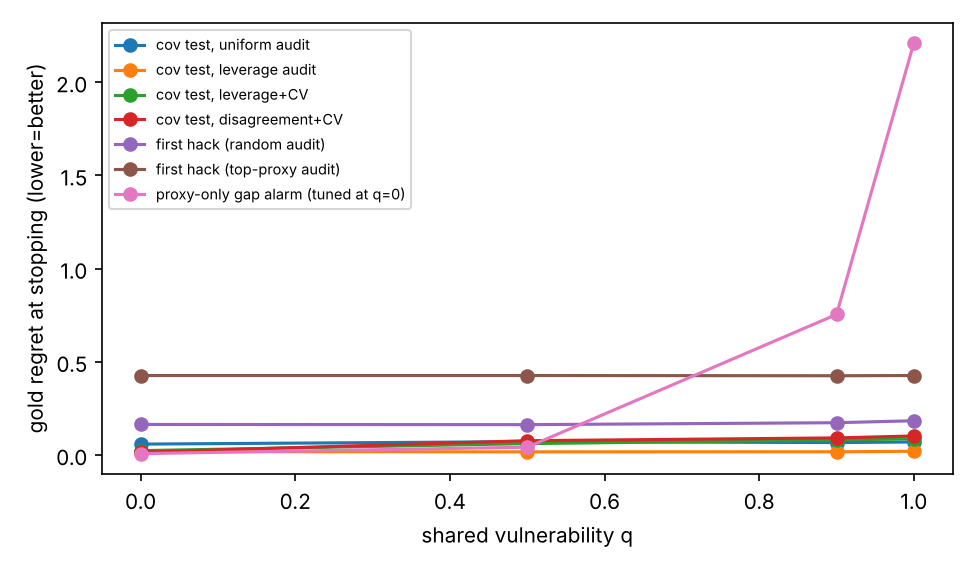
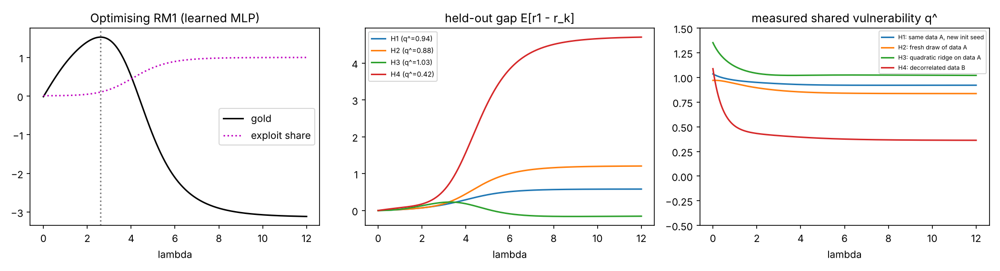

# Proxy-Only Detectors Cannot See Shared Exploits: An Identifiability Analysis of Reward-Hacking Detection and an On-Policy Covariance Audit for Stopping

Target venue: NeurIPS (main track; theory + controlled-simulation paper)

---

## Abstract

Most proposed detectors of reward hacking are *proxy-only*: they monitor the divergence between the optimised reward model and held-out reward models, ensemble disagreement, or out-of-distribution scores, and never consult the true ("gold") objective during optimisation. We ask what such detectors can and cannot know. We study an *exploit-mixture* model in which a base policy rarely emits "exploit" outputs that the optimised proxy overrates; a held-out proxy shares each exploit with probability *q* (the *shared vulnerability*). Under KL-regularised optimisation (exponential tilting) the model is exactly solvable. We prove four results. (i) An *on-policy covariance identity*: the gold objective improves with optimisation strength if and only if the on-policy covariance between gold and the optimised proxy is positive, which turns "is the model reward hacking yet?" into a sign test estimable from a handful of audited samples. (ii) A *peak-prevalence identity*: at the gold-optimal operating point the exploit share is π* = σ_g²/(μ(σ_g²λ* + δ)) > 0, so "stop at the first detected hack" rules are systematically too conservative. (iii) A *non-identifiability theorem*: for every *q* > 0 there is a twin world with an identical joint law of all proxies under every tilted policy but a different gold curve, so every proxy-only stopping rule incurs minimax gold regret bounded below (numerically 1.09 at *q* = 0.5 and 1.81 at *q* = 1 in our reference setting, against a peak gold of 0.42). (iv) The Hansen–Hurwitz covariance estimator with leverage-proportional audit sampling is unbiased for any *q*. In simulation (all numbers from code we ran; 200 replicates), a leverage-audited covariance stopping rule with 20 gold labels per checkpoint has regret 0.016–0.020 for every *q* ∈ {0, 0.5, 0.9, 1}, whereas a proxy-only held-out-gap alarm tuned at *q* = 0 has regret 0.007 at *q* = 0 but 0.75 at *q* = 0.9 and 2.21 at *q* = 1; first-hack alarms have regret 0.16–0.43 regardless of *q*. With learned MLP and ridge reward models over a 200k-item output pool, the measured shared vulnerability of held-out reward models ranged from 0.42 (decorrelated training data) to 1.03 (same data, different model class), and the audit rule remained within 0.039–0.065 of peak gold across all held-out choices. The practical message is narrow and testable: detection of reward hacking needs a small stream of on-policy gold audits targeted by proxy leverage, and the quantity to audit is a covariance, not a hack count.

## 中文摘要

现有的奖励欺骗（reward hacking）检测方法大多是"仅代理"（proxy-only）的：它们在优化过程中只监控被优化奖励模型与留出奖励模型之间的差距、集成分歧或分布外分数，而从不查询真实（gold）目标。本文研究这类检测器在原理上能知道什么、不能知道什么。我们提出一个"利用混合"（exploit-mixture）模型：基础策略以很小概率产生被代理奖励高估的"利用型"输出，留出代理以概率 *q*（共享脆弱性）同样被该利用欺骗。在 KL 正则化优化（指数倾斜）下该模型可精确求解。我们证明了四个结果：(i) 在策略协方差恒等式——真实目标随优化强度上升当且仅当真实奖励与被优化代理的在策略协方差为正，因此"是否已开始奖励欺骗"变为可由少量审计样本估计的符号检验；(ii) 峰值流行率恒等式——在真实目标最优点，利用型输出占比 π* = σ_g²/(μ(σ_g²λ*+δ)) > 0，故"一发现欺骗即停止"的规则系统性地过早停止；(iii) 不可辨识性定理——对任意 *q*>0，存在一个所有代理联合分布在每个倾斜策略下都完全相同、但真实曲线不同的孪生世界，因此任何仅代理的停止规则都有正的极小极大遗憾下界（在参考设定下 *q*=0.5 时为 1.09，*q*=1 时为 1.81，而峰值真实收益仅 0.42）；(iv) 采用按杠杆比例抽样的 Hansen–Hurwitz 协方差估计量对任意 *q* 无偏。仿真中（所有数字均来自本文实际运行的代码），每个检查点仅审计 20 个样本的杠杆协方差停止规则在 *q*∈{0,0.5,0.9,1} 下遗憾均为 0.016–0.020；在 *q*=0 下调参的仅代理差距报警在 *q*=0 时遗憾 0.007，但在 *q*=0.9 和 *q*=1 时分别为 0.75 和 2.21；"首次发现欺骗"报警遗憾为 0.16–0.43。在学习得到的 MLP 与岭回归奖励模型上，留出奖励模型的实测共享脆弱性从 0.42（去相关训练数据）到 1.03（同数据、不同模型类）不等，而审计规则在所有情形下都与峰值相差 0.039–0.065。结论是有限且可检验的：检测奖励欺骗需要少量按代理杠杆定向的在策略真实审计，而要审计的量是协方差，而非欺骗次数。

---

## 1 Introduction

Reward hacking — an optimiser driving up a proxy objective while the intended objective stalls or falls — is a recurring failure of reinforcement learning (Amodei et al., 2016; Pan et al., 2022; Skalse et al., 2022) and of preference-based fine-tuning of language models (Christiano et al., 2017; Ouyang et al., 2022). Gao et al. (2023) documented it quantitatively: as a policy is optimised against a learned reward model (RM), "gold" reward first rises and then falls as a function of KL distance from the initial policy. More recent reports show reward hacking in frontier-scale reinforcement learning on coding tasks (Baker et al., 2025) and show that learned hacking can generalise into broader misalignment (Denison et al., 2024; MacDiarmid et al., 2025). Detecting and preventing it is therefore an operational problem for every lab that runs RL on learned or programmatic rewards.

The mitigation literature is dominated by methods that use *only proxies* during optimisation: reward-model ensembles with conservative aggregation (Coste et al., 2024; Eisenstein et al., 2024), weight-averaged RMs (Ramé et al., 2024), latent-space outlier scores (Miao et al., 2024), and held-out-RM divergence checks. Eisenstein et al. (2024) already observed that ensembles "mitigate but do not eliminate" hacking because members share error patterns. What has been missing is a precise statement of *why* proxy-only detection must fail in that case, how badly, and what the minimal fix is. That is the gap we address.

**The sub-question.** Fix a base policy, an optimised proxy *r*₁, any number of held-out proxies *r*₂, …, *r*_K, and a family of increasingly optimised policies. When can a detector decide *whether gold is still improving*, and how many gold labels does it need?

**Approach.** We build the simplest model in which the answer is non-trivial and exactly computable — an *exploit mixture* under exponential tilting, the closed-form optimum of KL-regularised reward maximisation (Korbak et al., 2022; Rafailov et al., 2023) — prove results in it, verify them by Monte Carlo, and then test whether the qualitative conclusions survive with *learned* reward models (MLPs and polynomial ridge regressions) whose shared vulnerability is measured rather than assumed.

**Contributions.**

1. **Model and closed forms (§3).** An exploit-mixture model of reward hacking with an explicit *shared-vulnerability* parameter *q*, with closed-form gold, proxy, held-out gap, exploit share and KL as functions of optimisation strength. Monte-Carlo checks agree to within 0.024 absolute error (Exp. 1).
2. **On-policy covariance identity and peak-prevalence identity (Thm. 1, Thm. 2).** Gold increases iff Cov_{π_λ}(g, r₁) > 0; at the gold peak the exploit share is π* = σ_g²/(μ(σ_g²λ*+δ)), verified to relative error 4.0 × 10⁻⁴ across 36 parameter settings. Consequence: zero-tolerance ("first hack") alarms stop too early by design.
3. **Non-identifiability of proxy-only detection (Thm. 3) with a computed minimax regret bound.** For every *q* > 0 there exists a gold function that agrees with the original on all non-shared outputs and yields an identical joint law of every proxy under every tilted policy, but a different optimal stopping point. Any proxy-only rule has minimax regret ≥ ½ inf_λ [R_W(λ) + R_W′(λ)], which we compute (Exp. 5).
4. **A cheap audit that is invariant to shared vulnerability (Prop. 4, Exp. 3).** A Hansen–Hurwitz estimator of the on-policy covariance with leverage-proportional sampling of which outputs to label. We compare five audit designs, two first-hack alarms and a tuned proxy-only alarm across *q*, and report where each fails — including a negative result: using a held-out RM as a control variate *hurts* when *q* is large.
5. **Learned-RM study (Exp. 4).** With five learned RMs, the shared vulnerability *q̂* of held-out RMs is measured (0.42–1.03) and is predicted by data overlap more than by model class; same-data ensembles barely improve peak gold, while an ensemble with an RM trained on decorrelated data eliminates the decline in our setting.
6. **A falsifiable protocol (§7)** for testing the predictions on LLM RLHF runs, which we did not run.

All code is in `code/` and every number in this paper is produced by it (outputs in `results/`), except where a cited source is named.

## 2 Related Work

**Characterising reward hacking.** Amodei et al. (2016) listed reward hacking among concrete safety problems. Manheim and Garrabrant (2018) separated regressional, extremal, causal and adversarial Goodhart effects; our model contains a regressional component (genuine outputs, Gaussian noise) and an extremal component (exploits). Skalse et al. (2022) formally defined hackability and showed that, over all stochastic policies, non-trivial unhackable proxy pairs essentially do not exist; we take hackability as given and ask about *detection*. Pan et al. (2022) showed phase transitions in true reward as agent capability grows and proposed anomaly detection of aberrant policies — a proxy-only approach in our terms. Laidlaw et al. (2025) defined reward hacking via proxy–true correlation under a reference policy and argued for occupancy-measure χ² regularisation. Fluri et al. (2025) showed that low RM test error does not bound regret under distribution shift, a static cousin of our non-identifiability result.

**Overoptimisation in RLHF.** Gao et al. (2023) gave empirical functional forms for gold reward versus KL for best-of-*n* and RL. Kwa et al. (2024) proved that KL regularisation cannot prevent "catastrophic Goodhart" when proxy errors are heavy-tailed; our exploit component is a light-tailed but displaced mode, and we find a well-defined interior optimum, consistent with their light-tailed case. Beirami et al. (2025) showed that the commonly used best-of-*n* KL formula log *n* − (*n*−1)/*n* is an upper bound; we use it only as an x-axis for comparison and label it as such.

**Mitigations.** Ensembles with worst-case or uncertainty-weighted aggregation (Coste et al., 2024), pretraining-seed diversity (Eisenstein et al., 2024), weight averaging (Ramé et al., 2024), information-bottleneck RMs with a latent outlier index used as an overoptimisation detector (Miao et al., 2024), and constrained RLHF with proxy-point thresholds (Moskovitz et al., 2024). Moskovitz et al. note that their methods need "at least some minimal degree of access to the true objective"; our Theorem 3 makes that requirement precise and Proposition 4 shows how small it can be. Karwowski et al. (2024) proposed a pessimistic early-stopping rule given a bound on the angle between true and proxy reward; our rule instead estimates the relevant directional derivative from audits.

**Monitoring and detection benchmarks.** Baker et al. (2025) showed chain-of-thought monitors detect coding reward hacks far better than action-only monitors, but that optimising against the monitor produces obfuscation. Benchmarks for hack detection include EvilGenie (Gabor et al., 2025) and TRACE (Deshpande et al., 2026), where the best LLM detector found 63% of hacks in a contrastive setting. These monitors are *classifiers of individual hacks*. Our Theorem 2 implies that even a perfect per-sample hack classifier, used as a zero-tolerance alarm, stops optimisation too early; what matters for the stop/continue decision is the aggregate covariance.

**Survey sampling.** Our estimator is the with-replacement probability-proportional-to-size estimator of Hansen and Hurwitz (1943), applied to the population of on-policy samples in a batch.

## 3 Model

### 3.1 Exploit-mixture model

A base policy π₀ produces outputs *x* with a latent type *Z* ∈ {0, 1}, P(*Z* = 1) = *p* ≪ 1.

- **Genuine outputs** (*Z* = 0): gold *g* = *g*₀ with *g*₀ ~ N(0, σ_g²); proxy *r*_k = *g*₀ + ε_k.
- **Exploit outputs** (*Z* = 1): gold *g* = −δ (they are bad); proxy *r*_k = *B*_k μ + *g*₀ + ε_k, with μ > 0 the proxy's overestimation of exploits.

Noise ε = (ε₁, …, ε_K) is Gaussian with variance σ_ε² and pairwise correlation ρ. The optimised proxy is always fooled by its own exploits (*B*₁ = 1). Each held-out proxy shares an exploit with probability *q*: *B*_k ~ Bernoulli(*q*) for *k* ≥ 2, independent of everything else. *q* is the **shared vulnerability**: *q* = 0 means held-out proxies never overrate the optimised proxy's exploits; *q* = 1 means they always do (e.g. RMs trained on the same data with the same shortcut).

**Optimisation.** We use exponential tilting π_λ(x) ∝ π₀(x) exp(λ *r*₁(x)), which is the exact optimum of max_π E_π[*r*₁] − β KL(π‖π₀) with λ = 1/β (Korbak et al., 2022; Rafailov et al., 2023). λ indexes optimisation pressure; we report KL(π_λ‖π₀) alongside. We also analyse best-of-*n*.

Default parameters (all experiments unless stated): *p* = 0.002, σ_g² = σ_ε² = 1, ρ = 0.5, μ = 6, δ = 2, *K* = 2. Write *v* = σ_g² + σ_ε².

### 3.2 Closed forms

**Proposition 0.** Under π_λ:

- exploit share π(λ) = sigmoid(logit *p* + μλ);
- gold G(λ) := E_λ[*g*] = (1 − π)σ_g²λ − πδ;
- optimised proxy E_λ[*r*₁] = *v*λ + πμ;
- held-out gap E_λ[*r*₁ − *r*₂] = (1−ρ)σ_ε²λ + π(1−*q*)μ;
- KL(π_λ‖π₀) = λE_λ[*r*₁] − log M(λ), with log M(λ) = *v*λ²/2 + log(1 − *p* + *p* e^{μλ}).

*Proof sketch.* Within each component (*g*₀, ε) is Gaussian and *r*₁ is linear in it, so tilting by e^{λ*r*₁} shifts each coordinate by λ·Cov(·, *r*₁) and leaves covariances unchanged; the component weights are multiplied by the component moment-generating functions, which differ only by the factor e^{μλ}. The gold expression follows from Cov(*g*₀, *r*₁) = σ_g² and *g* = −δ on exploits; the gap from Cov(ε₁ − ε₂, *r*₁) = (1−ρ)σ_ε² and from E[*B*₂] = *q*. KL follows from log-partition algebra. ∎

Gold is independent of *q*, whereas the held-out gap's exploit term scales with (1 − *q*): at *q* = 1 the held-out proxy sees no excess on exploits at all.

### 3.3 Four results

**Theorem 1 (On-policy covariance identity).** For any measurable gold *g* and proxy *r*₁ with finite exponential moments, d/dλ E_{π_λ}[*g*] = Cov_{π_λ}(*g*, *r*₁).

*Proof.* E_λ[*g*] = E₀[*g* e^{λ*r*₁}]/E₀[e^{λ*r*₁}]. Differentiating the quotient gives E_λ[*g r*₁] − E_λ[*g*]E_λ[*r*₁]. ∎

The identity is elementary (it is the exponential-family score identity) but its consequence for detection is direct: *whether optimisation is currently hurting the true objective is exactly the sign of an on-policy covariance*, a population quantity of the current batch that can be estimated by labelling a few samples. No held-out proxy, threshold, or calibration is needed. It also holds for the *batch-level* empirical analogue when λ is replaced by a natural-gradient step on a finite pool.

**Theorem 2 (Peak-prevalence identity).** In the exploit-mixture model, G(λ) is unimodal in λ ≥ 0 (when μ*p*δ < σ_g², so that G′(0) > 0), and its maximiser λ* satisfies

  π(λ*) = σ_g² / (μ(σ_g²λ* + δ)).

*Proof.* Using dπ/dλ = μπ(1−π), G′(λ) = (1−π)[σ_g² − μπ(σ_g²λ + δ)]. The bracket is strictly decreasing in λ (π and λ both increase), positive at 0 under the stated condition, and tends to σ_g² − μ(σ_g²λ+δ) < 0; hence it has a unique zero, which is the maximiser. ∎

*Interpretation.* At the gold-optimal operating point the policy *already* emits exploits at a strictly positive rate. In the default setting π* = 0.064, i.e. 32 times the base rate *p*. A rule that halts at the first observed hack is therefore biased towards stopping before λ*, and the bias grows with audit budget (more audits → earlier first detection). The trade-off that matters is between the marginal gain on genuine outputs (σ_g²) and the marginal loss from exploits (μπ(σ_g²λ + δ)), and that trade-off is exactly what Theorem 1's covariance measures.

**Theorem 3 (Non-identifiability of proxy-only detection).** Fix the model above with *q* > 0. Define the *twin world* W′ that is identical to W except that shared exploits (*Z* = 1 and *B*₂ = … = *B*_K = 1) have gold *g* = μ + *g*₀ instead of −δ. Then:

(a) for every λ, the joint law of (*r*₁, …, *r*_K) under π_λ is identical in W and W′;
(b) G_{W′}(λ) = G_W(λ) + π(λ) *q* (μ + σ_g²λ + δ) (for *K* = 2), which for *q* = 1 is σ_g²λ + πμ and strictly increasing;
(c) for any stopping rule τ whose decision is a (possibly randomised) function of proxy observations only, the law of λ_τ is the same in both worlds, so

  max_{W, W′} E[regret] ≥ ½ inf_λ [R_W(λ) + R_{W′}(λ)],

  where R(λ) = max_{λ′ ≤ λ_max} G(λ′) − G(λ).

(d) An offline gold-labelled sample of size *m* drawn from π₀ distinguishes W from W′ with probability at most 1 − (1 − *pq*)^m.

*Proof.* (a) π_λ depends on *x* only through *r*₁, and the proxy law in each component is unchanged; gold never enters. (b) Direct computation as in Prop. 0, using that under tilting *g*₀ has mean σ_g²λ on every component. (c) Since λ_τ has the same distribution in W and W′, E_W[R_W(λ_τ)] + E_{W′}[R_{W′}(λ_τ)] = E[R_W(λ_τ) + R_{W′}(λ_τ)] ≥ inf_λ(R_W + R_{W′}), and the maximum of two numbers is at least their mean. (d) Labels differ only on shared exploits, which occur with probability *pq* per base sample. ∎

Theorem 3 says that *no* function of any number of held-out proxies — ensemble disagreement, min/mean aggregation, gap trends, latent outlier scores computed from proxy features — can tell W from W′. Whether the policy is hacking or discovering genuinely excellent outputs the proxies agree on is a fact about gold that proxies do not contain. Part (d) adds that offline labels from the base policy are inefficient: they must contain rare exploits, whereas on-policy audits sample exploits at rate π(λ) ≫ *p* exactly when it matters. The construction is generic: it needs only that the proxies agree on some region the optimiser can reach and that gold is unconstrained there.

**Proposition 4 (Unbiased leverage-audited covariance estimator).** Let a batch {*x*_i}_{i=1}^N be drawn from π_λ, with proxies observed for all and gold for a sample of *m* indices drawn with replacement with probabilities *w*_i > 0 that may depend on proxies. Let *h*_i = *r*₁(*x*_i) − r̄₁. Then

  Ĉ = (1/m) Σ_{j=1}^m g_{I_j} h_{I_j} / (N w_{I_j})

is unbiased for the batch covariance (1/N)Σ_i g_i h_i, conditionally on the batch, for every *q* and every gold function. Its variance is minimised by *w*_i ∝ |g_i h_i| (Hansen and Hurwitz, 1943); since *g* is unknown before labelling, we use the *leverage* design *w*_i ∝ |h_i| + 0.1·mean|h|. With a control variate *a r*₂, Ĉ_CV = (1/N)Σ_i a r₂,i h_i + (1/m)Σ_j (g − a r₂)_{I_j} h_{I_j}/(N w_{I_j}) is also unbiased.

*Proof.* E[g_I h_I/(N w_I)] = Σ_i w_i g_i h_i/(N w_i). ∎

Unbiasedness is unconditional in *q*, which is the property proxy-only methods lack. Efficiency is not: Proposition 4 says nothing about when the control variate helps; we find empirically that it hurts at large *q* (§5.3), because on shared exploits *g* − *r*₂ ≈ −δ − μ − *g*₀, a large residual exactly where |*h*| is large.

**Stopping rule.** Along a schedule λ = 0, 0.05, …, 2.0, draw a batch of *N* = 2000 on-policy samples, audit *m* of them, and stop at the first λ where Ĉ + *z*·SE < 0 (we report *z* ∈ {0, 1}).

## 4 Experimental Setup

All experiments run on CPU (4 cores); total wall time about 5 minutes. Seeds are fixed. Five experiments:

- **Exp. 1 (closed-form checks).** (a) Importance-weighted Monte Carlo with 4 × 10⁶ base samples versus Prop. 0 at λ ∈ {0, …, 1.25}. (b) Peak-prevalence identity on a 4 × 3 × 3 grid μ ∈ {3,4,6,8}, δ ∈ {1,2,4}, *p* ∈ {10⁻⁴, 10⁻³, 10⁻²}, with λ* found by grid search (step 10⁻⁴).
- **Exp. 2 (best-of-*n*).** Exact numerical integral of the best-of-*n* gold and exploit share for *n* ∈ [1, 10⁶], checked by Monte Carlo at *n* ∈ {10, 100, 1000} (4000 replicates each).
- **Exp. 3 (audit and stopping).** (a) Covariance identity: batch covariance from 4 × 10⁵ exact on-policy samples versus finite-difference dG/dλ. (b) Estimator bias/RMSE for five designs (uniform, leverage, each with/without the *r*₂ control variate, and a "disagreement" design *w* ∝ (|*h*|+c)(1 + max(z(*r*₁−*r*₂), 0))) with *m* = 20, 300 replicates, *q* ∈ {0, 0.5, 0.9, 1}. (c) Sequential stopping, 200 replicates per cell: the covariance test with each design, *m* ∈ {5, 20}, *z* ∈ {0, 1}; *first-hack* alarms that stop when any audited sample is an exploit (audit uniformly at random, or audit the *m* highest-proxy samples); and a *proxy-only gap alarm* that fits the linear trend of the held-out gap E[*r*₁ − *r*₂] on the first four checkpoints and stops when the excess over the trend exceeds τ, with τ tuned to minimise regret at *q* = 0 (the most favourable case for it) and then held fixed.
- **Exp. 4 (learned reward models).** Outputs *x* = (*u*, *h*) ∈ ℝ⁶ × ℝ⁶; gold *g* = *f*(*u*)/sd − Σ_j max(|*h*_j| − 1, 0)², with *f* a fixed nonlinear function; the second term penalises nuisance features outside the training range. Training set "A" (6000 points) contains a shortcut: nuisance dims 0–2 track 0.6·tanh(*f*); set "B" has decorrelated uniform nuisance features. Five RMs: RM1 (optimised; MLP 64-64 on A, seed 0); H1 (same A, new seed); H2 (fresh draw of A); H3 (degree-2 polynomial ridge on A); H4 (MLP on B). Policy: exact tilting over a fixed pool of 200,000 outputs of which 1% are off-support "exploits" (|*h*| ∈ [2, 3.5]). All proxies are standardised on genuine pool items. We *measure* shared vulnerability as *q̂*_k = E_λ[(r_k − g)Z] / E_λ[(r₁ − g)Z], the held-out RM's overestimation on exploits relative to RM1's. Stopping: schedule λ ∈ {0, 0.25, …, 8}, *N* = 2000, *m* = 20, 150 replicates; the gap alarm is tuned on the held-out RM with the lowest *q̂* and transferred.
- **Exp. 5 (lower bound).** Closed-form evaluation of Theorem 3(c) and (d) for *q* ∈ {0, 0.25, 0.5, 0.75, 0.9, 1}, λ_max = 2.

Regret is peak gold over the schedule minus the gold of the policy at the stopping point (evaluated exactly), averaged over replicates. "Overshoot" is the fraction of runs stopping after λ*.

## 5 Results

### 5.1 Closed forms and the Goodhart curve (Exp. 1, 2)

Prop. 0 matches importance-weighted Monte Carlo: the maximum absolute error over exploit share, gold and held-out gap at checkpoints with effective sample size above 10⁴ is 0.024 (`theory_results.json: exp1a_max_abs_err`). Gold peaks at λ* = 0.589 (KL ≈ 0.51 nats) with G* = 0.423 and declines to −1.99 at λ = 2 (Fig. 1, left). The peak-prevalence identity holds across all 36 grid settings with maximum relative error 4.0 × 10⁻⁴ (attributable to the λ-grid resolution). At the default setting the exploit share at the peak is 0.064.

Best-of-*n* shows the same qualitative shape: gold peaks at *n* = 40 (G = 1.27, exploit share 0.075, KL upper bound 2.71 nats) and is negative by *n* = 1000 (numerical −1.15; Monte Carlo −1.17). Numerical integration and Monte Carlo agree to within 0.004 in exploit share at *n* = 10 and 0.022 in gold at *n* = 100 (Fig. 2). Best-of-*n* reaches a higher gold peak than tilting in this model because its selection is sharper in the genuine Gaussian tail; we do not claim this generalises.

The middle panel of Fig. 1 shows why held-out gaps are informative only for small *q*: at *q* = 0 the gap grows steeply once exploits enter; at *q* = 1 it grows only through the slow (1−ρ)σ_ε²λ regressional term. The right panel shows the twin worlds of Theorem 3: identical proxies, opposite gold trends after the peak (for *q* = 0 the twin coincides with W and is hidden under the black curve).

*Figure 1. Left: gold, optimised proxy and exploit share (×5) versus KL. Middle: held-out gap for q ∈ {0, 0.5, 1}. Right: gold in W versus its proxy-identical twin W′. Dotted line: gold peak.*

*Figure 2. Best-of-n versus KL-tilting: gold (left) and exploit share (right). The best-of-n x-axis uses the log n − (n−1)/n upper bound (Beirami et al., 2025).*

### 5.2 Covariance identity (Exp. 3a)

On 4 × 10⁵ on-policy samples, batch Cov(*g*, *r*₁) and dG/dλ agree at λ ∈ {0, 0.3, 0.8, 1.0, 1.5} to within 0.004 (e.g. 0.828 vs 0.825 at λ = 0.3; −1.841 vs −1.841 at λ = 0.8). At λ = 0.59, essentially the peak, the values are −0.012 and −0.004: the covariance crosses zero where gold peaks. In the learned-RM setting (finite pool, exact weights) the maximum absolute difference between numerical dG/dλ and the on-policy covariance is 6.6 × 10⁻⁴.

### 5.3 Estimator efficiency (Exp. 3b)

At the gold peak with *m* = 20 audited samples, the leverage design reduces RMSE relative to uniform auditing in every *q* setting (q = 0: 0.50 vs 0.80; q = 0.5: 0.49 vs 0.78; q = 0.9: 0.51 vs 0.78; q = 1: 0.44 vs 0.79). Empirical biases are small relative to RMSE (largest |bias|/RMSE ratio 0.17 over all 60 design × q × λ cells), consistent with Prop. 4. The held-out control variate is a **negative result**: at q = 0.5 it raises RMSE (uniform+CV 2.04, leverage+CV 1.01) and at q = 1 to 3.30 and 1.25 respectively. It helps only marginally at *q* = 0 with the disagreement design (0.44). The mechanism is the one noted after Prop. 4: when held-out proxies share exploits, they are worst as predictors of gold precisely at the high-leverage points.

### 5.4 Stopping rules (Exp. 3c, Fig. 3)

Table 1 reports regret (lower is better; for reference, never stopping within the schedule has regret 0.423 − (−1.988) = 2.41).

*Table 1. Gold regret at stopping, exploit-mixture model, 200 replicates per cell, m audited samples per checkpoint. Overshoot fraction in parentheses.*

| Rule | q = 0 | q = 0.5 | q = 0.9 | q = 1 |
|---|---|---|---|---|
| Cov test, uniform audit, m=20 | 0.058 (0.31) | 0.071 (0.29) | 0.066 (0.19) | 0.069 (0.28) |
| **Cov test, leverage audit, m=20** | **0.018** (0.43) | **0.016** (0.50) | **0.017** (0.48) | **0.020** (0.49) |
| Cov test, leverage audit, m=20, z=1 | 0.037 (0.91) | 0.031 (0.88) | 0.029 (0.89) | 0.036 (0.88) |
| Cov test, leverage audit, m=5 | 0.101 (0.17) | 0.095 (0.17) | 0.104 (0.15) | 0.100 (0.16) |
| Cov test, disagreement+CV, m=20 | 0.015 (0.51) | 0.076 (0.19) | 0.091 (0.14) | 0.102 (0.12) |
| First hack, random audit, m=20 | 0.163 (0.01) | 0.162 (0.01) | 0.173 (0.01) | 0.183 (0.01) |
| First hack, random audit, m=5 | 0.085 (0.37) | — | — | 0.083 (0.31) |
| First hack, top-proxy audit, m=20 | 0.426 (0.00) | 0.426 (0.00) | 0.425 (0.00) | 0.426 (0.00) |
| Proxy-only gap alarm (τ tuned at q=0) | 0.007 (0.57) | 0.041 (0.92) | 0.754 (0.99) | 2.210 (1.00) |

(The m=5 first-hack row was computed for all q; the q=0.5 and 0.9 entries are in `theory_results.json` and omitted here for space.)

Three findings.

1. **Proxy-only detection fails exactly as Theorem 3 predicts.** The gap alarm is the best rule when its assumption holds (*q* = 0, regret 0.007) and is catastrophic when it does not (*q* = 1, regret 2.21, i.e. 91% of the never-stop regret; all runs overshoot). Nothing in the proxy stream warns that *q* has changed.
2. **The leverage-audited covariance test is invariant to *q*.** Its regret varies between 0.016 and 0.020 across *q*, costing 20 gold labels per checkpoint (1% of the batch). With *m* = 5 regret rises to about 0.10 because the sign test becomes noisy and stops early (overshoot 0.16). The conservative variant *z* = 1 overshoots more because it stops only once the covariance is confidently negative.
3. **First-hack alarms are miscalibrated in a predictable direction.** Auditing the top-proxy samples finds an exploit essentially at λ = 0 (regret 0.426 = the entire peak gain), and random auditing stops at λ ≈ 0.3 with regret 0.16–0.18. *Lowering* the audit budget from 20 to 5 *improves* the random first-hack alarm (0.085), confirming that its operating point is set by audit budget rather than by gold, as Theorem 2 implies.

*Figure 3. Gold regret at stopping versus shared vulnerability q (m = 20).*

### 5.5 Minimax lower bound (Exp. 5)

Table 2 evaluates Theorem 3(c). For *q* = 0 the twin coincides with W and the bound is 0. For *q* > 0 the twin world's gold keeps rising after λ*, so any proxy-only rule must trade off the two worlds.

*Table 2. Lower bounds on the worst-case regret of any proxy-only stopping rule (λ_max = 2). Peak gold in W is 0.423.*

| q | λ* in W | λ* in W′ | min_λ max(R_W, R_W′) (deterministic rules) | ½ inf_λ(R_W + R_W′) (any rule) |
|---|---|---|---|---|
| 0 | 0.589 | 0.589 | 0 | 0 |
| 0.25 | 0.589 | 0.876 | 0.050 | 0.047 |
| 0.5 | 0.589 | 2.0 | 1.089 | 1.016 |
| 0.75 | 0.589 | 2.0 | 1.570 | 1.205 |
| 1.0 | 0.589 | 2.0 | 1.814 | 1.205 |

For *q* ≥ 0.5 the guaranteed worst-case regret of any proxy-only rule exceeds twice the attainable gold gain in W. In contrast, the audit rule's regret (Table 1) is an upper bound achieved in W; in W′ the same audit rule observes positive covariance and continues, as it should. Theorem 3(d): offline gold labels on base-policy samples distinguish the worlds with probability at most 0.18, 0.86 and ≈1 for *m* = 100, 1000, 10,000 at *p* = 0.002, *q* = 1 — offline labels work only when they are numerous relative to 1/(*pq*), whereas the on-policy audit used 20 per checkpoint.

### 5.6 Learned reward models (Exp. 4, Fig. 4)

All five RMs correlate with gold at 0.950–0.958 on genuine pool items, i.e. they are indistinguishable by in-distribution validation (consistent with the underspecification reported by Eisenstein et al., 2024). Exploits have mean gold −1.31 versus −0.002 for genuine items. Optimising RM1 by tilting gives a Goodhart curve with peak gold 1.53 at λ = 2.6 (exploit share 0.10, KL 2.44 nats) and gold −3.11 at λ = 12 (exploit share 0.999).

**Measured shared vulnerability.** At the peak, *q̂* = 0.94 (H1, same data new seed), 0.88 (H2, fresh draw of the same distribution), 1.03 (H3, quadratic ridge on the same data) and 0.42 (H4, decorrelated data B); values at λ = 8 are similar (0.92, 0.84, 1.02, 0.37). Changing the *model class* did not reduce sharing; changing the *data distribution* did. This mirrors, in a toy, Eisenstein et al.'s (2024) finding that members trained on similar data share error patterns.

**Ensembles.** Ensembling RM1 with same-data RMs barely moved the peak (single RM 1.53; mean/min with H1 1.54/1.62; with H2 1.74/2.04) and did not prevent the decline at λ = 12 for H1 (−2.91/−1.46). Ensembling with H3 *lowered* the peak (1.08/1.25). Ensembling with the decorrelated H4 removed the decline altogether within the range studied (mean: 4.59, min: 4.00, both still at their maximum at λ = 12). Ensemble benefit tracks 1 − *q̂*, which is unobservable without gold.

**Stopping.** Table 3.

*Table 3. Learned RMs: regret at stopping (peak gold 1.53), 150 replicates, m = 20. Gap alarm τ tuned on H4 (lowest q̂) and transferred.*

| Held-out RM (q̂ at peak) | Proxy-only gap alarm | Cov test, disagreement design |
|---|---|---|
| H1 (0.94) | 0.142 (overshoot 1.00) | 0.047 (0.44) |
| H2 (0.88) | 0.091 (1.00) | 0.045 (0.42) |
| H3 (1.03) | 0.060 (0.01) | 0.039 (0.50) |
| H4 (0.42) | **0.009** (0.39) | 0.057 (0.37) |
| — (cov test, uniform audit) | | 0.065 (0.31) |
| — (cov test, leverage audit) | | 0.043 (0.37) |
| — (first hack, random audit) | | 0.905 (0.00) |

The pattern matches the theory for H1, H2 and H4: the gap alarm is excellent with the low-*q̂* held-out RM it was tuned on and overshoots in every run with high-*q̂* RMs. H3 is an exception — its gap alarm fires *early* despite *q̂* ≈ 1, because the less expressive ridge model also diverges from RM1 on genuine high-quality outputs, so its gap rises for a reason unrelated to exploits. This illustrates the general problem: a proxy gap conflates exploit divergence with benign model disagreement, and its calibration does not transfer. Audit-based rules stayed within 0.039–0.065 of peak for every held-out choice. The first-hack alarm lost 0.905 of the 1.53 gain. The learned-RM regrets of the gap alarm are smaller than in the analytic model (at most 0.14) because the decline after the peak is gentler over the schedule; we report them as found.

*Figure 4. Learned RMs. Left: gold and exploit share when optimising RM1. Middle: held-out gaps. Right: measured shared vulnerability q̂ along the optimisation path.*

## 6 Discussion

**What detection can and cannot mean.** Theorem 3 sharpens a point that is often stated informally: detectors that only compare proxies with proxies test *proxy disagreement*, not *gold degradation*. They are valid exactly to the extent that the held-out proxies do not share the optimised proxy's vulnerabilities, and that extent (*q*) is not identifiable from proxies. Practitioners therefore face a choice: assume a small *q* (by construction of diverse RMs, e.g. different data, as our H4 suggests) and accept unbounded worst-case risk if the assumption is wrong, or pay for gold.

**How much gold.** The covariance identity makes the gold requirement small and well-targeted. The decision "continue or stop" depends on one scalar per checkpoint, and leverage sampling concentrates labels on the outputs whose proxy score most influences the optimiser — which are also where exploits concentrate as optimisation proceeds. In our settings 20 labels per checkpoint sufficed for regret of 4–5% of the peak gold (analytic model, 0.016–0.020 of 0.423) or 2.5–4.3% (learned RMs, 0.039–0.065 of 1.53). In an LLM setting, "gold" might be expert human review, a stronger grader, a held-out test suite, or a CoT monitor's verdict combined with task success. The estimator requires only that audited labels be on the gold scale, not that they be cheap.

**Why "zero hacks" is the wrong target for stopping.** Theorem 2 shows that the gold-optimal policy contains exploits at a positive rate. This does not mean that hacks are acceptable in deployment — gold here is an average, and some exploits may carry tail risks that an average does not capture (MacDiarmid et al., 2025, show that learning to hack can generalise into broader misalignment, a cost that a per-sample gold score would not represent). It does mean that per-sample hack classifiers (Baker et al., 2025; Gabor et al., 2025; Deshpande et al., 2026) answer a different question from the stop/continue question, and that using them as zero-tolerance tripwires couples the stopping point to audit budget rather than to the objective. If exploit outputs carry a large non-average cost, that cost should be written into *g* (increasing δ), after which the covariance test handles it automatically; in our grid π* falls as δ grows (0.094, 0.062, 0.036 for δ = 1, 2, 4 at μ = 6, *p* = 10⁻³).

**Relation to prevention.** Detection by covariance audits naturally becomes prevention when used as an early-stopping or adaptive-KL controller: the estimate Ĉ is an unbiased estimate of the gold gradient along the optimisation path and could drive β. Combining it with diverse ensembles is complementary: ensembles reduce the exploit drift rate when *q̂* is small; audits guarantee the stopping decision when it is not.

**Obfuscation.** Baker et al. (2025) show that optimising against a monitor teaches obfuscation. A covariance audit is not used as a training signal, only as a stopping signal, and its labels come from gold; but if gold audits are themselves performed by a model, that model becomes a proxy and Theorem 3 applies one level up. The guarantee is only as good as the audit's fidelity to the true objective.

## 7 Pre-registered Test Protocol for LLM RLHF (not run)

We did not run experiments on language models. The following protocol tests the paper's three predictions, and we state outcomes that would falsify them.

*Setup.* Synthetic-gold RLHF following Gao et al. (2023): a large "gold" RM labels preference data; proxy RMs are trained on it. Train (i) RM1 and held-out RMs from the same data with different seeds (expected high *q*), (ii) held-out RMs from disjoint prompts and differently-sourced comparisons (expected lower *q*). Optimise against RM1 with PPO or best-of-*n*, saving checkpoints.

*Measurements per checkpoint.* Batch of *N* ≈ 2000 rollouts; all proxies on all rollouts; gold on *m* ∈ {10, 20, 50} rollouts chosen by leverage sampling; *q̂* from a larger gold sample on a subset of checkpoints (evaluation only).

*Predictions.* P1: the sign change of the leverage-audited Ĉ occurs within one checkpoint of the gold peak more often than the gap alarm does, in the high-*q* condition. P2: gap-alarm regret, with threshold tuned in the low-*q* condition, increases with measured *q̂* across held-out RMs (Spearman ρ > 0). P3: the exploit (hack-labelled) share of rollouts at the gold peak is strictly positive, and first-hack alarms stop earlier as audit budget increases.

*Falsification.* P1 is falsified if audit regret is not lower than gap-alarm regret in the high-*q* condition at *m* = 20; P2 if regret is uncorrelated with or decreasing in *q̂*; P3 if hack prevalence at the gold peak is indistinguishable from zero. A further failure mode to check is non-tilting dynamics: PPO with clipping is not exact tilting, so Theorem 1 holds only approximately along a PPO path; the protocol should report the agreement between Ĉ and finite-difference gold across checkpoints.

## 8 Limitations

- **Model simplicity.** The exploit-mixture is a two-type Gaussian model with a single shared-vulnerability parameter. Real exploits form a continuum, and *q* may vary across exploit types and along the optimisation path; our learned-RM experiment shows *q̂* is roughly stable along the path in one toy, which need not hold elsewhere.
- **Exact tilting.** Theorems 1–2 use the exact KL-regularised optimum. Policy-gradient training approaches tilting only approximately, along a path determined by the parameterisation. Theorem 1 then holds for the tilting direction, not necessarily for the actual update; our audit rule would estimate the covariance, which may differ from the realised gold change per step.
- **Gold access is assumed exact.** We assume audit labels are unbiased gold. Human or model graders are noisy and can be gamed. Unbiased but noisy labels only inflate variance; biased labels make the audit a proxy and Theorem 3 applies to it.
- **Toy learned RMs.** Exp. 4 uses 12-dimensional synthetic features, sklearn MLPs and ridge models, and a hand-designed exploit region. It shows the phenomena can arise with learned models; it does not estimate their size in LLMs.
- **Small effects in the learned setting.** The gap alarm's worst regret there (0.14 of 1.53) is modest and one held-out RM (H3) does not follow the *q̂* ordering. The analytic model's dramatic failure (regret 2.21) depends on the decline after the peak being steep over the schedule.
- **Sequential testing.** Our stopping rule applies a per-checkpoint sign test without multiple-testing control; *z* = 1 is an ad-hoc conservatism knob. An anytime-valid (e.g. confidence-sequence) version would be more principled.
- **Single seed per experiment configuration.** Each table cell has 150–300 replicates, but the parameter defaults and the learned RM training are each from one seed; we did not sweep μ, δ, *p*, ρ for the stopping experiments.
- **No LLM experiments.** All claims about LLM RLHF are predictions (§7).

## 9 Conclusion

Proxy-only detectors of reward hacking can be excellent when held-out proxies do not share the optimised proxy's vulnerabilities, and arbitrarily bad when they do; and whether they do is not identifiable from proxies. In an exactly solvable model we proved this and gave a computable minimax lower bound. We also showed that the right quantity to monitor is the on-policy covariance between gold and the optimised proxy, which equals the gold gradient along the KL-regularised path, and that it can be estimated without bias from a few leverage-targeted gold audits per checkpoint. In simulation and with learned toy reward models, such audits gave regret within a few percent of the attainable gold for every level of shared vulnerability, while first-hack alarms were systematically premature, as the peak-prevalence identity predicts. The protocol in §7 states how these claims could be confirmed or refuted on LLM-scale RLHF.

## Reproducibility

`code/README.md` lists the commands. `exp_theory.py` (Exps. 1–3; ~1.5 min), `exp_learned_rm.py` (Exp. 4; ~3 min), `exp_lowerbound.py` (Exp. 5; seconds). Results: `results/theory_results.json`, `results/learned_rm_results.json`, `results/lowerbound_results.json`, Figures 1–4, and run logs.

## References

Amodei, D., Olah, C., Steinhardt, J., Christiano, P., Schulman, J., & Mané, D. (2016). Concrete problems in AI safety. arXiv:1606.06565.

Baker, B., Huizinga, J., Farhi, D., et al. (2025). Monitoring reasoning models for misbehavior and the risks of promoting obfuscation. arXiv:2503.11926.

Beirami, A., et al. (2025). Theoretical guarantees on the best-of-n alignment policy. In *Proceedings of the 42nd International Conference on Machine Learning (ICML)*. arXiv:2401.01879.

Christiano, P. F., Leike, J., Brown, T. B., Martic, M., Legg, S., & Amodei, D. (2017). Deep reinforcement learning from human preferences. In *Advances in Neural Information Processing Systems 30*. arXiv:1706.03741.

Coste, T., Anwar, U., Kirk, R., & Krueger, D. (2024). Reward model ensembles help mitigate overoptimization. In *International Conference on Learning Representations (ICLR)*. arXiv:2310.02743.

Denison, C., et al. (2024). Sycophancy to subterfuge: Investigating reward-tampering in large language models. arXiv:2406.10162.

Deshpande, D., Kannappan, A., & Qian, R. (2026). Benchmarking reward hack detection in code environments via contrastive analysis. In *International Conference on Machine Learning (ICML)*. arXiv:2601.20103.

Eisenstein, J., et al. (2024). Helping or herding? Reward model ensembles mitigate but do not eliminate reward hacking. arXiv:2312.09244 (2023; cited as 2024).

Fluri, L., et al. (2025). The perils of optimizing learned reward functions: Low training error does not guarantee low regret. In *Proceedings of the 42nd International Conference on Machine Learning*, PMLR 267:17306–17377.

Gabor, J., Lynch, J., & Rosenfeld, J. (2025). EvilGenie: A reward hacking benchmark. arXiv:2511.21654.

Gao, L., Schulman, J., & Hilton, J. (2023). Scaling laws for reward model overoptimization. In *Proceedings of the 40th International Conference on Machine Learning*, PMLR 202:10835–10866. arXiv:2210.10760.

Hansen, M. H., & Hurwitz, W. N. (1943). On the theory of sampling from finite populations. *Annals of Mathematical Statistics*, 14(4), 333–362.

Karwowski, J., et al. (2024). Goodhart's law in reinforcement learning. In *International Conference on Learning Representations (ICLR)*. arXiv:2310.09144.

Korbak, T., Perez, E., & Buckley, C. L. (2022). RL with KL penalties is better viewed as Bayesian inference. In *Findings of the Association for Computational Linguistics: EMNLP 2022*, 1083–1091. arXiv:2205.11275.

Kwa, T., et al. (2024). Catastrophic Goodhart: Regularizing RLHF with KL divergence does not mitigate heavy-tailed reward misspecification. In *Advances in Neural Information Processing Systems 37*. arXiv:2407.14503.

Laidlaw, C., Singhal, S., & Dragan, A. (2025). Correlated proxies: A new definition and improved mitigation for reward hacking. In *International Conference on Learning Representations (ICLR)*. arXiv:2403.03185.

MacDiarmid, M., Wright, B., Uesato, J., et al. (2025). Natural emergent misalignment from reward hacking in production RL. arXiv:2511.18397.

Manheim, D., & Garrabrant, S. (2018). Categorizing variants of Goodhart's law. arXiv:1803.04585.

Miao, Y., et al. (2024). InfoRM: Mitigating reward hacking in RLHF via information-theoretic reward modeling. In *Advances in Neural Information Processing Systems 37*.

Moskovitz, T., Singh, A. K., Strouse, D. J., Sandholm, T., Salakhutdinov, R., Dragan, A. D., & McAleer, S. (2024). Confronting reward model overoptimization with constrained RLHF. In *International Conference on Learning Representations (ICLR)*. arXiv:2310.04373.

Ouyang, L., et al. (2022). Training language models to follow instructions with human feedback. In *Advances in Neural Information Processing Systems 35*. arXiv:2203.02155.

Pan, A., Bhatia, K., & Steinhardt, J. (2022). The effects of reward misspecification: Mapping and mitigating misaligned models. In *International Conference on Learning Representations (ICLR)*. arXiv:2201.03544.

Rafailov, R., Sharma, A., Mitchell, E., Ermon, S., Manning, C. D., & Finn, C. (2023). Direct preference optimization: Your language model is secretly a reward model. In *Advances in Neural Information Processing Systems 36*. arXiv:2305.18290.

Ramé, A., Vieillard, N., Hussenot, L., Dadashi, R., Cideron, G., Bachem, O., & Ferret, J. (2024). WARM: On the benefits of weight averaged reward models. In *Proceedings of the 41st International Conference on Machine Learning*, PMLR 235:42048–42073.

Skalse, J., Howe, N. H. R., Krasheninnikov, D., & Krueger, D. (2022). Defining and characterizing reward hacking. In *Advances in Neural Information Processing Systems 35*, 9460–9471. arXiv:2209.13085.
