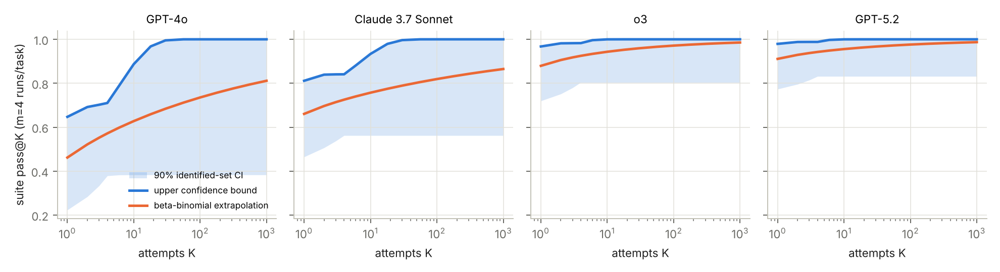
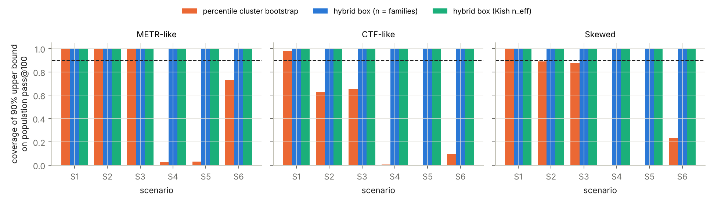
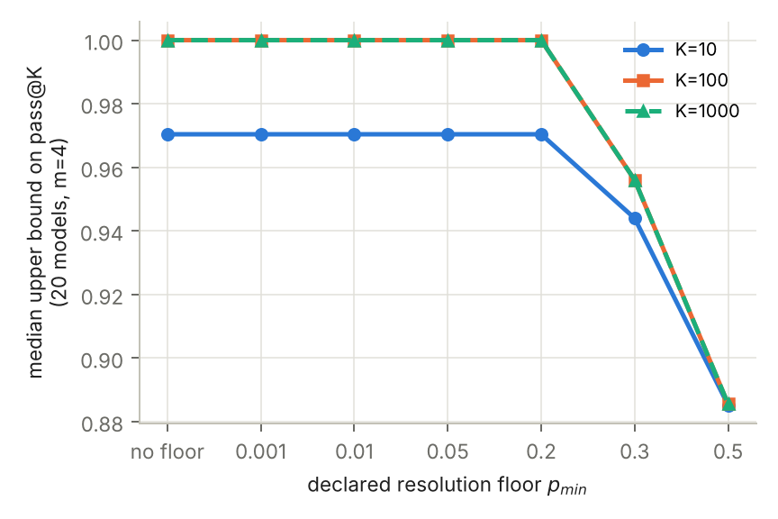

# What Can a Finite Evaluation Rule Out? Partial Identification of Attacker Success in Dangerous-Capability Evaluations

**Target venue:** NeurIPS (main track, evaluation methodology / AI safety)

*Revision 1. Changes from the first version are listed point by point in `reviews/response_r1.md`.*

---

## Abstract

Frontier AI safety frameworks use dangerous-capability evaluations (biological, chemical, cyber, autonomy) as *rule-out* instruments: a model may be deployed under a given safeguard level only if evaluations show that it does not cross a capability threshold. A rule-out claim is therefore an upper-confidence-bound claim about what an adversary could achieve. Evaluators run a few attempts per task, but a misuse actor can retry many times and keep the best result. We study this mismatch as a partial-identification problem. Each task has an unknown per-attempt success probability, the evaluator runs m attempts per task, and the attacker's objective is pass@K, the probability of at least one success in K attempts. Some of the identification facts are classical: m Binomial attempts identify exactly the first m moments of the task-difficulty distribution, so pass@K is point-identified if and only if K ≤ m. We build on them to give four results. (i) For K > m the sharp identified set is the value range of a linear program, with a closed form when m = 1. (ii) For interior moment vectors the sharp upper bound tends to 1, at a rate 1 − (1 − ε*)^K governed by a computable quantity ε*. In our checks this rate overstates the K needed to reach 0.9 by a factor of 1.0–3.7. (iii) A sample-size lower bound for rule-out claims. Any level-α test whose probability of declaring "pass@K < τ" for an impossible task is β needs m ≥ K·ln(β/α)/ln(1/(1−τ)) attempts. The bound is attained. For non-randomized tests (β = 1), α = 0.05 and τ = 0.1, this is 28.4·K. (iv) A declared "resolution floor" restores finite bounds, but only above an explicit threshold. On 22,236 public agent runs from METR's Time-Horizon 1.1 suite (20 models, 228 tasks in 79 families), we find three things. Between-family clustering inflates the variance of a suite success rate by a median design effect of 4.3 relative to task-level resampling, so about 227 tasks carry the information of about 54 independent ones. Reusing pass@m as pass@K is biased low for every model tested. With four runs per task, the 90% upper bound on suite pass@K is at least 0.98 for every model by K = 30. In a cluster-sampling simulation (18 settings, including unequal family sizes and the all-fail regime), the percentile cluster bootstrap undercovers, with coverage as low as 0. The Clopper–Pearson part of our hybrid box is not valid on its own under skewed family sizes. The hybrid box was never below nominal coverage in our settings, but it has no proof of validity. We give a reporting protocol: declare K, the attempt budget, the clustering unit and any structural floor, and report the identified-set bound beside any extrapolated estimate. The analysis uses general agentic data, not biological, chemical or cyber data. The K-scaling message applies most directly where an attacker can check success mechanically, as in cyber.

## 中文摘要

前沿 AI 安全框架把生物、化学、网络和自主能力等危险能力评估当作"排除"(rule-out)工具：只有评估表明模型未越过能力阈值，才允许在相应防护等级下部署。因此，排除性结论本质上是关于攻击者能达到的成功率的置信上界。评估者对每个任务只做少量尝试，滥用者却可以反复尝试并保留最好结果。本文把这一错配作为部分识别问题研究：每个任务有未知的单次成功概率，评估者每任务尝试 m 次，攻击者的目标是 pass@K(K 次尝试中至少成功一次的概率)。部分识别事实是经典的：m 次二项尝试恰好识别任务难度分布的前 m 阶矩，因此 pass@K 当且仅当 K ≤ m 时可点识别。在此基础上我们给出四个结果。(i) K > m 时，精确识别集是一个线性规划的取值范围，m = 1 时有闭式解。(ii) 矩向量位于内部时，精确上界趋于 1，收敛速率为 1 − (1 − ε*)^K，其中 ε* 可计算；在我们的检验中，该速率对达到 0.9 所需 K 的高估倍数为 1.0–3.7。(iii) 排除性结论的样本量下界：任何水平为 α 的检验，若对不可能完成的任务宣布"pass@K < τ"的概率为 β，则至少需要 m ≥ K·ln(β/α)/ln(1/(1−τ)) 次尝试，且该下界可以达到；对非随机化检验(β = 1)、α = 0.05、τ = 0.1，约为 28.4·K。(iv) 声明"分辨率下限"可恢复有限上界，但下限必须超过一个明确阈值。我们分析了 METR Time-Horizon 1.1 的 22,236 条公开智能体运行记录(20 个模型，228 个任务，79 个任务族)，得到三点发现。第一，相对于任务层面重抽样，任务族之间的聚类使套件成功率方差的设计效应中位数为 4.3，约 227 个任务只相当于约 54 个独立任务。第二，把 pass@m 直接当作 pass@K 对所有模型都系统性偏低。第三，每任务运行 4 次时，到 K = 30 为止，所有模型的套件 pass@K 的 90% 上界都已 ≥ 0.98。在整群抽样模拟中(18 种设定，包括任务族大小不等和全部失败的情形)，百分位整群自助法覆盖率不足，最低为 0；我们混合置信盒中的 Clopper–Pearson 部分在任务族大小高度不均时单独使用并不有效；混合置信盒在所有设定中都没有低于名义覆盖率，但它没有有效性证明。最后我们给出报告规范：声明 K、尝试预算、聚类单元和任何结构性下限，并在外推估计旁报告识别集上界。本文分析的是通用智能体数据，不是生物、化学或网络数据。关于 K 的结论最直接适用于攻击者能机械地验证成功的场景，例如网络攻防。

---

## 1 Introduction

Every major frontier-AI safety framework now ties deployment decisions to dangerous-capability evaluations:

- Anthropic's Responsible Scaling Policy defines capability thresholds for CBRN weapons and autonomous AI R&D [1].
- OpenAI's Preparedness Framework v2 tracks biological/chemical, cybersecurity and AI self-improvement capabilities [2].
- Google DeepMind's Frontier Safety Framework defines Critical Capability Levels [3].

The evaluations behind these decisions include question-answer benchmarks such as WMDP [4] and the Virology Capabilities Test [5], capture-the-flag suites such as Cybench [6], and agentic task suites such as METR's time-horizon tasks [7]. They are mostly used in one direction: to argue that a model is *not yet* dangerous [8, 9]. That is a rule-out claim, and a rule-out claim is an upper confidence bound.

Two features of the setting make upper bounds harder than the point estimates benchmark papers usually report.

- **Misuse actors retry.** Repeated sampling raises coverage on coding and math problems over four orders of magnitude of samples [10]. Best-of-N resampling with trivial prompt perturbations reaches 89% attack success on GPT-4o at N = 10,000 [11]. In offensive cyber, an adversary with a small compute budget can raise an agent's success on InterCode CTF by more than 40% relative to baseline, using repeated sampling among other levers [34]. For a misuse threat model the relevant quantity is therefore often pass@K for a large attacker budget K, not the per-attempt success rate the evaluator measures.
- **Evaluation items are few and clustered.** Cybench has 40 tasks [6]. Agentic suites group tasks into families that share environments and solution strategies [7]. Miller [12] and Bowyer et al. [13] have shown that naive error bars are too narrow on small or clustered benchmarks. Neither addresses the extrapolation from the evaluator's m attempts to the attacker's K.

This paper asks a narrow question: **given m attempts per task on n clustered tasks, what upper bound on an attacker's pass@K do the data actually support, and how many attempts does a rule-out claim require?** We treat it as a partial-identification problem in the sense of Manski [14]: we first characterize everything the data can say without assumptions, then show which assumptions buy which conclusions.

**What is classical and what is ours.** The fact that Binomial(m) counts identify a mixing distribution only through its first m moments is classical (Teicher [27]). It is also the starting point of Tian, Kong and Valiant's work on learning a population of parameters [28]. The impossibility of extrapolating a sample far beyond its size is the theme of the unseen-species literature (Good and Toulmin [29]; Orlitsky, Suresh and Wu [30]). Parametric pass@K extrapolation with (beta-)binomial models is recent and active [18, 31]. Our contribution is to apply these ideas to rule-out claims and to make them quantitative:

1. **Sharp identified set for pass@K (Prop. 1, Cor. 1).** We restate the moment-identification fact for pass@K. Pass@K is point-identified iff K ≤ m (the regime of the standard unbiased estimator [15]). For K > m we compute the sharp identified set as a linear program, and give the closed form [μ₁, 1 − (1 − μ₁)^K] for m = 1. Lemma 1 and the "iff" are classical facts, which we restate.
2. **Rate of vanishing rule-out power (Prop. 2).** That the sharp upper bound U_K tends to 1 for interior moment vectors is nearly immediate. The contribution is the explicit bound U_K ≥ 1 − (1 − ε*)^K with a computable ε*, together with a numerical check of how tight it is.
3. **Sample-size lower bound for rule-out tests (Prop. 3).** For a bottleneck task, any level-α test that declares "pass@K < τ" with probability β on an impossible task needs m ≥ K·ln(β/α)/ln(1/(1−τ)). The bound is attained. For non-randomized tests it gives 28.4·K at α = 0.05, τ = 0.1. (Prop. 3(a), the upper bound 1 − α^{K/m}, is a monotone transform of Clopper–Pearson; we state it for convenience.)
4. **Resolution floor (Prop. 4).** This is an elementary bound. It makes explicit how strong a "zero-success tasks are impossible" assumption must be before it changes a conclusion: p_min > 1 − π₀^{1/m}, which is about 0.3 on real data with m = 4.
5. **Empirical evidence on 22,236 public agent runs** (METR Time-Horizon 1.1, 20 models). It covers the between-family design effect, a held-out sanity check of pass@K estimators, and identified-set bounds at large K.
6. **A cluster-sampling coverage study (new in this revision).** It tests the confidence box used for the LP bounds under unequal family sizes, correlated within-family difficulty and all-fail data.
7. **A reporting protocol** (Section 7) in the spirit of Barnett and Thiergart's "declare and justify" [9].

The contribution is methodological and statistical. We do not evaluate any model for biological, chemical or cyber capability. The METR suite measures general autonomous software capability. It is the only public, large, repeated-attempt agentic dataset we were able to obtain and analyse in our environment. All numbers below come either from code run for this paper (results/ directory; labelled **[ours]**) or from cited sources (labelled with the reference).

## 2 Related Work

**Dangerous-capability evaluation.** Shevlane et al. [8] set out the case for evaluating extreme-risk capabilities and feeding the results into deployment decisions. Phuong et al. [16] piloted evaluations of persuasion, cyber-security, self-proliferation, self-reasoning and CBRN knowledge. Domain benchmarks include:

- WMDP: 3,668 multiple-choice questions [4];
- VCT: 322 virology troubleshooting questions [5];
- Cybench: 40 professional CTF tasks [6].

METR's time-horizon methodology fits a logistic curve of agent success against human task length [7, 17]. Wei et al. [34] argue for *dynamic* cyber risk assessment, in which the adversary's compute budget (including repeated sampling) is part of the threat model. We give that argument a statistical counterpart: how many evaluator attempts a given attacker budget requires.

**Statistics of evaluations.** Miller [12] recommends standard errors, clustered standard errors and power analysis for LLM evaluations. Bowyer et al. [13] show that CLT-based intervals are too narrow below a few hundred items. Our Experiment 1 measures the between-family clustering effect on a real agentic suite.

**Repeated sampling and pass@k.** Chen et al. [15] introduced the unbiased pass@k estimator, which requires n ≥ k samples per problem. Brown et al. [10] documented smooth growth of coverage with sample count. Schaeffer et al. [18] explain why aggregate pass@k follows a power law: the distribution of per-problem success probabilities has a heavy left tail, and they forecast the exponent with a fitted distribution. Kazdan et al. [31] model per-problem successes as beta-binomial, derive an improved pass@k predictor, and allocate more samples to harder problems. These are the parametric counterparts of our analysis. Our identified-set bounds show how much of a parametric forecast comes from the assumed family rather than from the data. The answer is driven by the left tail that m attempts cannot see. We see the two as complementary. Parametric forecasts are useful for anticipating ("ruling in") capability. A rule-out claim that rests on one should declare the family as an assumption.

**Binomial mixtures and population-of-parameters estimation.** Teicher [27] studied identifiability of finite mixtures, including binomial mixtures. Tian, Kong and Valiant [28] estimate the distribution of per-entity success probabilities from t Binomial trials per entity. They obtain earth-mover error O(1/t), which they show is information-theoretically optimal; the lower bound rests on the fact that distributions sharing their first t moments produce identical count distributions. Our Lemma 1 is this fact. We use it differently: not to estimate G, but to compute the sharp range of a particular non-polynomial functional, 1 − (1 − p)^K, and how that range grows with K.

**Unseen species.** Our problem is structurally similar to unseen-species extrapolation. Good and Toulmin [29] predict how many new species a sample enlarged by a factor t would reveal. Orlitsky, Suresh and Wu [30] show that such prediction is possible up to t of order log n and not beyond. In our setting the extrapolation ratio is K/m per task, with m small (often 1–10) and the number of tasks modest. We bound rather than estimate, and the non-identification holds exactly for every n (Prop. 1–2), not only asymptotically.

**Rare-event estimation.** Jones et al. [19] forecast the risk of rare behaviours at deployment scale by fitting an extreme-value-type power law. Wu and Hilton [20] compare importance sampling and activation extrapolation for rare-output probabilities. Both are model-based extrapolations.

**Elicitation and sandbagging.** Post-training enhancements often yield compute-equivalent gains above 5× [21]. Models can be password-locked or prompted to underperform on dangerous-capability evaluations [22, 23]. These works concern the gap between the evaluator's and the attacker's *per-attempt* success. We concern the gap created by the *number* of attempts, which compounds with elicitation gaps.

**Partial identification, moment problems and boundary inference.** The identified-set approach follows Manski [14]. Extremal values of expectations under moment constraints are classical (Tchebycheff systems; Karlin and Studden [24]). The bootstrap is known to be inconsistent when a parameter lies on the boundary of the parameter space (Andrews [32]). The all-fail case of a rule-out evaluation is such a boundary, so the bootstrap failure we report in Section 6.5 is an instance of a known phenomenon, not a new finding. We include it because it occurs exactly in the regime that rule-out claims are about. Simultaneous multinomial intervals (e.g. Sison and Glaz [33]) are a tighter alternative to our Bonferroni box.

## 3 Model

**Tasks and attempts.** A task suite is a population of tasks. Each task t has a per-attempt success probability p_t ∈ [0, 1] under the evaluator's elicitation (scaffold, prompts, tools). Let G denote the distribution of p_t across tasks. The evaluator draws n tasks (possibly in clusters, e.g. task families), runs m independent attempts on each, and records success counts C_t ∈ {0, …, m}. Conditional on p_t, C_t ~ Binomial(m, p_t). Marginally, the count distribution is

π_c(G) = ∫ (m choose c) p^c (1 − p)^{m−c} dG(p),  c = 0, …, m.

**Attacker objective.** An attacker makes K attempts per task and succeeds if any attempt succeeds. This assumes the attacker can recognize success, as with a captured flag or a working exploit. The suite-level attacker success is

θ_K(G) = ∫ [1 − (1 − p)^K] dG(p),

that is, pass@K averaged over tasks. K = 1 is the evaluator's usual metric. A **rule-out claim** at level α is a statement "θ_K < τ" made by a procedure that makes it with probability at most α when in fact θ_K ≥ τ.

The model is deliberately favourable to the evaluator: attacker attempts are i.i.d. with the evaluator's per-attempt probability, with no adaptation and no better elicitation. The verification assumption holds most cleanly for cyber and software tasks, where success is machine-checkable. For many biological and chemical pathway steps it does not hold, and the relevant attacker quantity is closer to pass@1 under selection (Section 8).

## 4 Theory

**Lemma 1 (what the data identify; classical, cf. [27, 28]).** The map G ↦ π(G) factors through the moment vector μ = (μ₁, …, μ_m), μ_j = ∫ p^j dG, and the map μ ↦ π is affine and invertible.

*Proof.* Each Bernstein polynomial (m choose c) p^c (1 − p)^{m−c} has degree ≤ m, so π_c is an affine function of μ. The Bernstein polynomials of degree m form a basis of the polynomials of degree ≤ m, so the map is invertible on the (m + 1)-dimensional space (the constraint Σ π_c = 1 matches μ₀ = 1). ∎

**Proposition 1 (point identification iff K ≤ m).** θ_K(G) is a linear function of π(G) for every G if and only if K ≤ m. For K ≤ m it equals E[1 − (m−C choose K)/(m choose K)], whose sample analogue is the unbiased estimator of Chen et al. [15]. For K > m and any π in the interior of the set of achievable count distributions, the identified set {θ_K(G): π(G) = π} is a non-degenerate interval [L_K, U_K].

*Proof sketch.* The function 1 − (1 − p)^K has degree K. For K ≤ m it lies in the span of the Bernstein basis, and the stated identity is the hypergeometric form of that expansion. For K > m, the (m + 1)-th derivative of f_K(p) = 1 − (1 − p)^K is −(−1)^{m+1}·K!/(K − m − 1)!·(1 − p)^{K−m−1}. This has constant sign on [0, 1), so f_K is not a polynomial of degree ≤ m. For an interior moment point, the lower and upper principal representations [24] then give different values of ∫f_K dG. ∎

**Computation.** L_K and U_K are the optimal values of the linear programs min/max Σ_j g_j f_K(q_j) subject to Σ_j g_j B(q_j) ∈ [lo, hi] (a box for π), Σ_j g_j = 1, g ≥ 0. The grid q_j includes 0 and is log-spaced down to 10⁻⁷. If a box is infeasible, we enlarge it by the smallest uniform slack that restores feasibility and report the slack. Infeasibility happens when an empirical pmf lies slightly outside the achievable set through sampling noise. On METR this relaxation was never needed for a confidence box; it was needed only for the "point" LP at the empirical pmf (Section 6.2).

**Corollary 1 (m = 1).** I_K = [μ₁, 1 − (1 − μ₁)^K].

*Proof.* f_K is concave, so Jensen's inequality gives the upper bound, attained by the point mass at μ₁. Since f_K(p) ≥ p on [0, 1], with equality at p ∈ {0, 1}, the lower bound μ₁ is attained by the two-point distribution on {0, 1}. ∎

The plug-in rule "pass@K ≈ pass@1" is therefore the *lower* end of the identified set, and the homogeneous-difficulty formula 1 − (1 − p̄)^K is the *upper* end.

**Proposition 2 (rate of vanishing rule-out power).** Let M_m(A) be the moment space of distributions supported on A ⊆ [0, 1], and suppose μ ∈ int M_m([0, 1]). Define ε*(μ) = sup{ε ∈ [0, 1]: μ ∈ M_m([ε, 1])}. Then ε* > 0, and for all K

U_K ≥ 1 − (1 − ε*)^K.

*Proof.* M_m([ε, 1]) is the convex hull of the moment curve {(t, …, t^m): t ∈ [ε, 1]}, which converges in Hausdorff distance to M_m([0, 1]) as ε → 0. Let δ > 0 be the distance from μ to the boundary of M_m([0, 1]). If μ ∉ M_m([ε, 1]), a separating hyperplane with unit normal u gives h_{M_m([0,1])}(u) − h_{M_m([ε,1])}(u) ≥ δ for the support functions, so the Hausdorff distance is at least δ. Hence μ ∈ M_m([ε, 1]) for all small ε, and ε* > 0. Any G supported on [ε, 1] has θ_K(G) ≥ 1 − (1 − ε)^K. The moment space M_m([ε*, 1]) is closed (weak compactness), so the bound holds at ε*. ∎

**What is and is not new here.** The limit U_K → 1 is nearly immediate: any G without an atom at 0 that matches the moments drives θ_K to 1. What the proposition adds is a *rate* with a computable constant. ε* is found by bisection on LP feasibility, and 1 − (1 − ε*)^K tells an evaluator at what K the data stop constraining the attacker.

The rate is conservative. ε* shrinks with m (Beta(0.5, 1.5): 0.167, 0.071, 0.025 for m = 2, 4, 8), and the bound tightens or loosens accordingly. Across six interior cases, the K at which the bound guarantees U_K ≥ 0.9 overstates the exact K by a factor of 1.0–3.7 (Section 6.4). The only escape from U_K → 1 is a moment vector on the boundary, i.e. a distribution with few support points [24], which is identified exactly. Sampling noise turns any boundary point into a confidence set that contains interior points. A simple necessary condition is ε* ≤ 1 − π₀^{1/m}, because E[(1 − p)^m] = π₀ ≤ (1 − ε)^m for G on [ε, 1].

**Proposition 3 (rule-out sample size).** Consider one task (or a single bottleneck step of a misuse pathway) with per-attempt success probability p. The evaluator observes C ~ Binomial(m, p) and tests H₀: pass@K = 1 − (1 − p)^K ≥ τ, with τ ∈ (0, 1).

(a) After zero successes, the exact one-sided (1 − α) upper confidence bound for pass@K is 1 − α^{K/m}.

(b) Let φ: {0, …, m} → [0, 1] be any test (randomized or not) that declares "pass@K < τ" with probability φ(C). Suppose it has level α, i.e. E_p φ(C) ≤ α for all p with pass@K ≥ τ. Let β = φ(0) be its probability of declaring the rule-out when p = 0. Then β·(1 − τ)^{m/K} ≤ α. Hence, if β > α,

m ≥ K · ln(β/α) / ln(1/(1 − τ)).

The bound is attained by the test that declares only after zero successes, with probability min{1, α(1 − τ)^{−m/K}}. For a **non-randomized** test that declares the rule-out at all when p = 0, β = 1, and the requirement is m ≥ K·ln(1/α)/ln(1/(1 − τ)).

*Proof.* (a) The Clopper–Pearson bound for zero successes solves (1 − p)^m = α, giving p̄ = 1 − α^{1/m}. Pass@K is increasing in p, so 1 − (1 − p̄)^K = 1 − α^{K/m} has the same coverage.

(b) Let p₀ satisfy 1 − (1 − p₀)^K = τ, so p₀ is in H₀. By the level condition at p₀, and since φ ≥ 0,

α ≥ E_{p₀} φ(C) ≥ φ(0) · P_{p₀}(C = 0) = β (1 − p₀)^m = β (1 − τ)^{m/K}.

Take logarithms. For attainment, let φ*(0) = min{1, α(1 − τ)^{−m/K}} and φ*(c) = 0 for c ≥ 1. Then E_p φ* = φ*(0)(1 − p)^m, which is decreasing in p, so its maximum over H₀ is at p₀ and equals min{(1 − τ)^{m/K}, α} ≤ α. ∎

The first version of this paper stated (b) for "any level-α procedure that declares with positive probability at p = 0". That statement is false for randomized tests: declaring with probability α after C = 0 is level α for every m. The corrected statement makes the dependence on the power β explicit. We checked it numerically by solving, as an LP, for the most powerful randomized test against the composite null, for five (m, K, τ). The maximal power at p = 0 matched min{1, α(1 − τ)^{−m/K}} to within 5·10⁻¹⁶ **[ours: results/exp3_supplement.json]**.

**Numbers.** For α = 0.05 and τ = 0.1, the exact ratio m/K is:

| power β at p = 0 | m/K |
|---|---|
| 1 (non-randomized) | 28.43 |
| 0.9 | 27.43 |
| 0.8 | 26.32 |
| 0.5 | 21.85 |

For a non-randomized test the ratio is 58.4 at τ = 0.05 and 298 at τ = 0.01 **[ours: results/exp3a_power_requirements.csv]**. A whole number of attempts is needed, so at K = 1 the requirement is ⌈28.43⌉ = 29. The "29.0" in `exp3_summary.json` is this ceiling at K = 1, and 28.4 is the asymptotic ratio. For K = 1 and small τ the result reduces to the classical rule of three [25]. Lowering the required power helps only logarithmically: *a rule-out claim against an attacker with K attempts needs an evaluator budget proportional to K*, with a constant near 22–28 for a 10% threshold.

**Proposition 4 (resolution floor).** Suppose G is supported on {0} ∪ [p_min, 1], i.e. each task is either impossible for this model or solvable at rate at least p_min. Then

G({0}) ≥ (π₀ − (1 − p_min)^m) / (1 − (1 − p_min)^m), hence sup_K θ_K ≤ 1 − that quantity.

*Proof.* π₀ = G({0}) + ∫_{[p_min,1]} (1 − p)^m dG ≤ G({0}) + (1 − G({0}))(1 − p_min)^m. Rearrange. θ_K ≤ 1 − G({0}) for all K. ∎

The algebra is elementary. What matters is the threshold it makes explicit. The bound is informative only when p_min > 1 − π₀^{1/m}. With m = 4 and π₀ = 0.25 this requires p_min > 0.293. The assumption must be strong because a task with p = 0.2 shows zero successes in four attempts 41% of the time. The LP with its grid restricted to {0} ∪ [p_min, 1] gives the sharp version of this bound.

## 5 Experiments

All code is in `code/` and runs on a CPU in about 30 minutes (4 cores); random seeds are fixed. Outputs are in `results/`.

**Data.** We use METR's public Time-Horizon 1.1 run records (file `reports/time-horizon-1-1/data/raw/runs.jsonl` of the repository METR/eval-analysis-public [26]; commit recorded in `data/SOURCE.txt`). They accompany METR's time-horizon methodology [7, 17]. The file holds 24,008 records. We remove 773 human-baseline records and 999 agent runs that ended in an infrastructure error (`fatal_error_from` set), leaving 22,236 agent runs on 228 tasks in 79 families. Outcomes are binarized task success (`score_binarized`).

The 20 model aliases are 20 distinct model checkpoints; the suffix "(Inspect)" marks the evaluation harness, not a duplicate. The models are not statistically independent (they share developers and training lineages), so medians across models below are descriptive. We run no cross-model test.

These tasks measure general autonomous software-engineering and ML capability, which several frameworks track as an autonomy/AI R&D risk domain [1–3]. They are not biological, chemical or cyber tasks.

**Experiment 1 (clustering).** For each model we estimate the equal-task-weighted mean success and its standard error four ways:

- naive (all runs pooled as i.i.d.);
- runs-as-replicates for the task-weighted estimand (tasks fixed);
- task-cluster bootstrap;
- family-cluster bootstrap (B = 2,000), plus analytic CR1 cluster-robust SEs at the task and family levels.

**Experiment 2 (pass@K on real runs).**

- *Sanity check against held-out runs.* We randomly split each task's runs into m "evaluation" runs and the rest "held-out". We compute estimators from the evaluation runs and compare them with the unbiased estimate from the held-out runs. There are 60 splits per model. Configurations (m, K): (1, 2–3) on tasks with ≥ 4 runs; (2, 3–4) on tasks with ≥ 6 runs; (2, 3–6) on tasks with ≥ 8 runs.
- *Estimators:*
  - plug-in pass@m reused as pass@K;
  - the homogeneous formula 1 − (1 − p̄)^K;
  - beta-binomial maximum likelihood;
  - the identified-set upper bound at the empirical count pmf ("LP point");
  - the identified-set upper bound over a simultaneous 90% box for the count pmf ("LP CI"). The box is the hull of a family-cluster percentile-bootstrap box (Bonferroni over m + 1 cells) and a Clopper–Pearson box that uses the number of families as the sample size.
- *Extrapolation.* With m = 4 runs per task, we report all estimators for K from 1 to 1,000 on a 14-point grid.
- *Supplement.* We record how often, and by how much, the LP slack relaxation was used, and how the bounds respond to the grid floor (10⁻⁵, 10⁻⁷, 10⁻⁹) and grid density.

**Experiment 3 (theory checks).**

- (a) Coverage of Prop. 3(a) over 20,000 replications per (m, K, p), and the LP check of Prop. 3(b).
- (b) Exact identified sets for known G: Beta(0.5, 1.5), Beta(2, 2), and 0.4·δ₀ + 0.6·δ₀.₅, with m ∈ {2, 4, 8}. We compare them with the Prop. 2 bound, including the exact K at which U_K first reaches 0.9 and 0.99.
- (c) Misspecification: 150 replications of n = 200 unclustered tasks, m = 4, from three populations.

**Experiment 4 (resolution floor on real data).** LP CI upper bounds on METR pass@K (m = 4) under floors p_min ∈ {10⁻³, 10⁻², 0.05, 0.2, 0.3, 0.5}.

**Experiment 5 (suite sizes and attempt counts).**

- Exact one-sided 95% bounds on suite pass@1 for Cybench's 40 tasks, treating items as independent and, alternatively, transferring the METR between-family design effect. The transfer is an assumption.
- A chance-corrected version for WMDP (four options).
- The per-task bounds implied by attempt counts in the range used in published cyber evaluations.

**Experiment 6 (new: coverage under cluster sampling).** We simulate suites with real or synthetic family structure:

- the 79 METR family sizes, 228 tasks, m = 4;
- a CTF-sized suite of 40 tasks in 14 families of sizes 8, 6, 5, 4, 3, 3, 2, 2, 2, 1, 1, 1, 1, 1, with m = 5;
- a skewed suite: one family of 60 plus 40 singletons, m = 4.

Difficulty follows logit p = μ + u_f + e_t, with family effects u_f ~ N(0, σ_f²) and task effects e_t ~ N(0, σ_t²). In some scenarios whole families are impossible with probability q. The six scenarios, S1–S6, are:

| scenario | μ | σ_f | σ_t | q |
|---|---|---|---|---|
| S1 moderate | −0.5 | 1.5 | 1.0 | 0 |
| S2 rare-tail | −3.5 | 2.0 | 1.5 | 0 |
| S3 clustered-zero | −1.0 | 1.5 | 1.0 | 0.6 |
| S4 near-threshold | −5.0 | 1.0 | 1.0 | 0.85 |
| S5 sparse-rare | −4.0 | 0.5 | 0.5 | 0.90 |
| S6 sparse-solvable | −1.0 | 0.5 | 0.5 | 0.95 |

There are 300 replications per cell. Four boxes are compared:

- the percentile cluster bootstrap;
- the Clopper–Pearson part alone;
- the hybrid box with n = number of families (the box used on METR);
- the hybrid box with Kish's effective number of families n_eff = (Σn_f)²/Σn_f² [35] (32.2, 7.7 and 2.8 for the three structures).

Targets are the population count pmf (simultaneous box coverage) and population pass@K for K ∈ {1, 10, 100, 1000}.

## 6 Results

### 6.1 Between-family clustering

We hold the estimand fixed (the equal-task-weighted mean) and compare family-cluster with task-cluster resampling **[ours: results/exp1_summary.json]**.

- The between-family design effect has median **4.26** (range 2.23–7.93) across 20 models. The SE grows by a median factor of 2.06.
- The analytic CR1 estimator agrees (median 4.24).
- About 227 tasks therefore carry the information of about **54** independent tasks.
- The one-sided 95% margin grows from 4.7 percentage points (task resampling) to 9.8 points (family resampling).

The first version headlined a 4.5-fold SE ratio (design effect about 20) against a "naive" binomial SE that pools all runs as i.i.d. That comparison mixes three effects:

- weighting (pooled vs task-weighted mean);
- treating repeated runs of the same task as independent replicates of the suite;
- clustering of tasks into families.

The decomposition is as follows (medians):

| SE construction | median SE |
|---|---|
| naive pooled-run binomial | 0.0128 |
| runs-as-replicates for the task-weighted mean | 0.0062 |
| task-cluster bootstrap | 0.0285 |
| family-cluster bootstrap | 0.0594 |

The first ratio is driven by weighting and conditioning on tasks. The task-over-replicates ratio (median 4.6) reflects that repeated runs are not new tasks, which is obvious to most practitioners. Only the family-over-task ratio is a design effect in the substantive sense, and we now report that one. A rule-out claim stated to within a couple of points on this suite would in fact be uncertain by about ten.

*Figure 4. Standard error of suite mean success for 20 models under three resampling assumptions (METR TH1.1) [ours].*

### 6.2 Held-out sanity check (small K)

Table 2 compares estimators against the unbiased held-out estimate **[ours: results/exp2_validation_summary.json]**.

| m → K (min runs/task; models) | plug-in pass@m: mean err / models biased low / undercover | beta-binomial: mean err / biased low / undercover | LP point U: undercover | LP CI U: undercover / mean width |
|---|---|---|---|---|
| 1 → 2 (≥4; 20) | −0.038 / 100% / 98.2% | +0.083 / 0% / 1.0% | 0.0% | 0.0% / 0.40 |
| 1 → 3 (≥4; 20) | −0.057 / 100% / 99.5% | +0.114 / 0% / 0.6% | 0.0% | 0.0% / 0.44 |
| 2 → 3 (≥6; 19) | −0.008 / 79% / 57.6% | 0.000 / 68% / 69.6% | 31.8% | 0.0% / 0.46 |
| 2 → 4 (≥6; 19) | −0.010 / 79% / 59.6% | 0.000 / 53% / 39.6% | 28.0% | 0.0% / 0.47 |
| 2 → 6 (≥8; 4) | −0.046 / 75% / 74.2% | −0.003 / 50% / 44.2% | 4.6% | 0.0% / 0.44 |

*Table 2. Held-out comparison of pass@K estimators on METR TH1.1 runs (60 random splits per model) [ours]. "Biased low": share of models whose mean error over splits is negative. "Undercover": share of (model, split) pairs below the held-out estimate.*

What this table does show:

- The plug-in rule is biased low for every model when m = 1, as Corollary 1 predicts.
- With m = 2 the beta-binomial is unbiased on average but falls below the held-out value in 40–70% of splits; it is an estimate, not a bound.
- The LP point bound undercovers in up to 32% of splits, because the empirical pmf is noisy.

What this table **does not** show is that the LP-CI bound is calibrated, for four reasons:

- (a) It covers only K ≤ 6.
- (b) The LP-CI bound is wide (mean width 0.40–0.47). Zero undercoverage is therefore unsurprising.
- (c) The comparison target is itself a noisy unbiased estimate from a few held-out runs on the same tasks. The 5,640 comparisons come from 60 resplits of the same data and are strongly dependent. Aggregated per model, every model's LP-CI bound was at or above the held-out value in every split. The informative unit is therefore the 19–20 models, not 5,640 trials.
- (d) The LP-CI bound targets a population over families, while the held-out value is pass@K on the observed tasks.

In the m = 2 configurations, the held-out pass@K is close to 1 (median 0.996 for K = 3 on tasks with ≥ 6 runs). These tasks are mostly easy, so the near-zero margins there are not evidence of tightness **[ours: results/exp2_supplement.json]**. We treat Table 2 as a sanity check. Large-K validity is tested by simulation (Section 6.5).

**Slack relaxation (reviewer question).** The minimal-slack relaxation was **never** used for an LP over a confidence box: 0 of 5,640 validation rows and 0 of the extrapolation rows. It was used only for the LP at the empirical pmf:

- in 8.1% of validation rows (14.1% of m = 2 rows), with slack at most 4.1·10⁻⁴ per cell;
- in 20% of the m = 4 extrapolation rows, with slack at most 0.0036.

Relaxed splits are those whose empirical pmf lies outside the moment space. In those splits the point bound undercovers far more often (80% vs 15% for exact-feasible m = 2 splits). This is a further reason not to use the point bound for a claim. No LP-CI number in this paper depends on the relaxation.

### 6.3 With four runs per task, nothing can be ruled out at moderate K

With m = 4 runs per task (tasks with ≥ 4 runs; 141–228 tasks per model), the median share of tasks with zero successes is 0.246 (range 0.06–0.50) **[ours: results/exp2_extrapolation.csv]**. The 90% identified-set upper bound on suite pass@K behaves as follows:

| K | median upper bound | minimum over 20 models |
|---|---|---|
| 1 | 0.838 | |
| 4 | 0.866 | |
| 10 | 0.975 | 0.840 |
| 18 | | 0.938 |
| 30 | | 0.985 |
| ≥ 100 | ≥ 0.9999 for every model | |

The finer K grid of this revision shows that the bound is uninformative well before K = 100: by K = 30 every model's upper bound is at least 0.98.

Even the sharp bound evaluated at the empirical count pmf, ignoring sampling uncertainty, has median 0.995 at K = 100 (minimum 0.78). The lower end of the confidence set stops rising after K ≈ 6 (median 0.619), because the data are equally consistent with the zero-success tasks being impossible. The beta-binomial extrapolation produces smooth, confident-looking values (median 0.868 at K = 100, range 0.606–0.976) inside the identified set (Figure 2). Those values come from the beta assumption, not from the runs.

**Sensitivity.** Changing the grid floor from 10⁻⁷ to 10⁻⁵ or 10⁻⁹, or the grid size from 600 to 2,000 points, changed the LP-CI upper bound by at most 2.2·10⁻⁵ and the point bound by at most 1.3·10⁻³ at K ∈ {10, …, 10⁵} **[ours: results/exp2_grid_sensitivity.csv]**.

*Figure 2. Suite pass@K for four METR models from m = 4 runs per task: 90% confidence band for the identified set (blue) and beta-binomial extrapolation (orange), on a 14-point K grid [ours].*

### 6.4 Theory checks

*Rule-out sample size.* Across 20 (m, K, p) settings, the Prop. 3(a) bound had coverage between 0.952 and 1.000 at nominal 0.95 **[ours: results/exp3a_coverage.csv]**. The cost shows in the rule-out rates. With m = 300 attempts and K = 10, the bound fell below 0.1 in 97% of replications when p = 10⁻⁴. With K = 100 it never did, even for p = 10⁻⁴ (true pass@100 ≈ 0.01), because 300 < 28.4 × 100. By Prop. 3(b), no non-randomized level-0.05 test can do better at m = 300, K = 100: the best randomized test has power 0.069 at p = 0. Figure 3 plots the requirements.

*Figure 3. Evaluator attempts needed to rule out pass@K > τ at level 0.05 (Prop. 3(b)). Solid: non-randomized tests (power 1 at p = 0). Dashed: power 0.5 at p = 0 [ours].*

*Vanishing identification and tightness of the rate.* For both Beta populations and all m ∈ {2, 4, 8}, U_K reaches at least 0.999 by K = 316 and never falls below the Prop. 2 bound. Across all 99 (population, m, K) cells, the true θ_K lies in [L_K, U_K] within LP tolerance 10⁻⁴ **[ours: results/exp3b_vanishing.csv]**. Table 3 compares the exact K at which U_K first reaches 0.9 with the K guaranteed by the rate bound **[ours: results/exp3_supplement.json]**.

| population | m | ε* | exact K (U_K ≥ 0.9) | bound K | ratio |
|---|---|---|---|---|---|
| Beta(0.5, 1.5) | 2 | 0.167 | 13 | 13 | 1.0 |
| Beta(0.5, 1.5) | 4 | 0.071 | 26 | 32 | 1.2 |
| Beta(0.5, 1.5) | 8 | 0.025 | 55 | 92 | 1.7 |
| Beta(2, 2) | 2 | 0.400 | 5 | 5 | 1.0 |
| Beta(2, 2) | 4 | 0.226 | 6 | 9 | 1.5 |
| Beta(2, 2) | 8 | 0.101 | 6 | 22 | 3.7 |

*Table 3. Tightness of the Prop. 2 rate.*

The bound is exact or near-exact for m = 2 and loosens as m grows and ε* shrinks. At the 0.99 level the ratios are 1.04–2.1.

The two-atom population is the boundary case. With m = 2 its moment vector is interior and U_K → 1. With m = 4 and m = 8 it is on the boundary: the identified set collapses to the true value for all K (U_K = 0.600 at K = 10,000) and ε* = 0 (Figure 1).

*Figure 1. Exact identified sets for pass@K (solid: upper bound, dotted: lower bound) with known count distributions, m ∈ {2, 4, 8}; dashed: truth [ours].*

*Misspecification (unclustered tasks).* Table 1 summarizes Experiment 3c **[ours: results/exp3_summary.json]**.

| Population | K | truth | plug-in (cov.) | beta-binomial (cov.) | LP CI, hybrid box (cov.) | LP CI, bootstrap-only box (cov.) |
|---|---|---|---|---|---|---|
| beta-correct | 10 | 0.558 | 0.424 (0.00) | 0.558 (0.51) | 0.758 (1.00) | 0.746 (1.00) |
| beta-correct | 1000 | 0.887 | 0.434 (0.00) | 0.883 (0.49) | 1.000 (1.00) | 1.000 (1.00) |
| rare-success | 10 | 0.490 | 0.431 (0.03) | 0.563 (0.97) | 0.714 (1.00) | 0.698 (1.00) |
| rare-success | 1000 | 0.682 | 0.438 (0.00) | 0.875 (1.00) | 1.000 (1.00) | 1.000 (1.00) |
| mostly-impossible | 10 | 0.016 | 0.006 (0.02) | 0.014 (0.36) | 0.081 (1.00) | 0.0004 (0.00) |
| mostly-impossible | 100 | 0.093 | 0.006 (0.00) | 0.119 (0.63) | 0.559 (1.00) | 0.004 (0.01) |
| mostly-impossible | 1000 | 0.150 | 0.006 (0.00) | 0.511 (0.63) | 0.999 (1.00) | 0.028 (0.04) |

*Table 1. Mean estimate and coverage (fraction of 150 replications with estimate ≥ truth) for n = 200 independent tasks, m = 4.*

The beta-binomial is accurate when the beta model is true. In the mostly-impossible population, which resembles a model just below a threshold, it falls below the truth in 37–64% of replications while being highly variable. Its errors have no consistent sign, so it is not a safe basis for a rule-out claim. This is a statement about using it as a *bound*; it is not a criticism of parametric forecasting as such [18, 31].

### 6.5 Coverage under genuine cluster sampling (new)

Table 4 reports Experiment 6 **[ours: results/exp6_summary.json, results/exp6_clustered_coverage.csv]**. The first data column is the share of replications in which no attempt succeeded on any task. "Box cov." is the probability that the 90% box contains the whole population count pmf.

| structure | scen. | all-fail share | box cov.: bootstrap / CP alone / hybrid (n_fam) / hybrid (Kish) | pass@10 UB cov.: bootstrap / hybrid (n_fam) / hybrid (Kish) | true pass@10 | mean UB: hybrid (n_fam) / (Kish) |
|---|---|---|---|---|---|---|
| METR-like | S1 | 0.00 | 0.82 / 0.98 / 0.99 / 1.00 | 1.00 / 1.00 / 1.00 | 0.855 | 0.983 / 0.994 |
| METR-like | S2 | 0.00 | 0.75 / 0.99 / 0.99 / 1.00 | 1.00 / 1.00 / 1.00 | 0.400 | 0.674 / 0.792 |
| METR-like | S3 | 0.00 | 0.72 / 0.94 / 0.97 / 1.00 | 0.98 / 1.00 / 1.00 | 0.318 | 0.616 / 0.736 |
| METR-like | S4 | 0.20 | 0.00 / 1.00 / 1.00 / 1.00 | 0.00 / 1.00 / 1.00 | 0.019 | 0.171 / 0.333 |
| METR-like | S5 | 0.23 | 0.00 / 1.00 / 1.00 / 1.00 | 0.00 / 1.00 / 1.00 | 0.019 | 0.171 / 0.332 |
| METR-like | S6 | 0.05 | 0.10 / 0.97 / 1.00 / 1.00 | 0.43 / 1.00 / 1.00 | 0.046 | 0.233 / 0.393 |
| CTF-like | S1 | 0.00 | 0.68 / 1.00 / 1.00 / 1.00 | 0.96 / 1.00 / 1.00 | 0.855 | 0.996 / 0.998 |
| CTF-like | S2 | 0.00 | 0.30 / 0.99 / 1.00 / 1.00 | 0.37 / 1.00 / 1.00 | 0.400 | 0.870 / 0.921 |
| CTF-like | S3 | 0.00 | 0.33 / 0.99 / 0.99 / 1.00 | 0.43 / 1.00 / 1.00 | 0.318 | 0.839 / 0.902 |
| CTF-like | S4 | 0.72 | 0.00 / 0.99 / 1.00 / 1.00 | 0.01 / 1.00 / 1.00 | 0.019 | 0.519 / 0.669 |
| CTF-like | S5 | 0.70 | 0.00 / 1.00 / 1.00 / 1.00 | 0.00 / 1.00 / 1.00 | 0.019 | 0.517 / 0.667 |
| CTF-like | S6 | 0.51 | 0.00 / 0.99 / 1.00 / 1.00 | 0.03 / 1.00 / 1.00 | 0.046 | 0.565 / 0.703 |
| Skewed | S1 | 0.00 | 0.79 / 0.67 / 0.96 / 1.00 | 1.00 / 1.00 / 1.00 | 0.855 | 0.994 / 1.000 |
| Skewed | S2 | 0.00 | 0.61 / 0.73 / 0.98 / 1.00 | 0.74 / 1.00 / 1.00 | 0.400 | 0.775 / 0.998 |
| Skewed | S3 | 0.00 | 0.71 / 0.49 / 0.95 / 1.00 | 0.83 / 1.00 / 1.00 | 0.318 | 0.729 / 0.996 |
| Skewed | S4 | 0.54 | 0.00 / 0.98 / 1.00 / 1.00 | 0.01 / 1.00 / 1.00 | 0.019 | 0.278 / 0.986 |
| Skewed | S5 | 0.63 | 0.00 / 0.95 / 1.00 / 1.00 | 0.00 / 1.00 / 1.00 | 0.019 | 0.279 / 0.986 |
| Skewed | S6 | 0.24 | 0.03 / 0.94 / 1.00 / 1.00 | 0.10 / 1.00 / 1.00 | 0.046 | 0.324 / 0.987 |

*Table 4. Cluster-sampling coverage of 90% simultaneous boxes and of the resulting upper bounds on population pass@10 (300 replications per row) [ours].*

Four findings:

1. **The percentile cluster bootstrap undercovers broadly, not only at all-fail data.** Its box covers the count pmf in 0.30–0.82 of replications even when successes are common, and in 0–0.10 in the sparse scenarios. Its pass@10 bound covers in 0–0.43 of replications in 11 of the 18 cells. This includes cells without all-fail data, such as CTF-like S2 (0.37) with 14 families. Figure 6 shows the same pattern at K = 100.
2. **The Clopper–Pearson part with n = number of families is not valid by itself.** With skewed family sizes, its box coverage is 0.49–0.73 in S1–S3. This confirms the reviewer's point that treating p̂·n_fam as a binomial count is a heuristic.
3. **The hybrid box was at or above nominal in every cell.** Box coverage was 0.95–1.00. Coverage of the population pass@K upper bound was at least 0.997 for every structure, scenario and K ∈ {1, 10, 100, 1000} (72 cells). It was also at least 0.997 in every replication subset with all-fail data. We have no proof that it is valid. Its coverage in these settings comes from combining two imperfect boxes with Bonferroni, and from the LP maximizing over the whole box.
4. **The Kish variant is safer under skew and costs width.** It was the most conservative: box coverage ≥ 0.997 everywhere. It costs moderate width on the METR and CTF structures (e.g. METR-like S4: mean pass@10 bound 0.33 vs 0.17) and a great deal on the skewed one (0.98–1.00 vs 0.28–0.99).

We therefore recommend the hybrid box with Kish's n_eff when family sizes are very unequal, and report it as a heuristic that passed these stress tests, not as an exact procedure. On METR (Kish n_eff 32 vs 79 families), the main conclusions of Section 6.3 do not depend on the choice, since the bounds are already at least 0.98 at K = 30 with the less conservative box.

*Figure 6. Coverage of 90% upper bounds on population pass@100 under cluster sampling; dashed line: nominal 0.9 [ours].*

### 6.6 What a resolution floor buys on real data

Declaring a floor changes nothing until it is large **[ours: results/exp4_summary.json]**. The median (over 20 models) 90% upper bound on pass@100 is 1.000 with no floor and with floors of 10⁻³, 10⁻², 0.05 and 0.2. It drops to 0.956 at p_min = 0.3 and to 0.886 at p_min = 0.5 (Figure 5). This matches the threshold of Proposition 4: with π₀ ≈ 0.25 and m = 4, the floor must exceed about 0.29.

*Figure 5. Median (over 20 models) 90% upper bound on METR suite pass@K under a declared resolution floor p_min (m = 4) [ours].*

### 6.7 What suite sizes and cyber attempt budgets can rule out

**Suite size (pass@1).** Cybench is scored by flag capture, so its chance rate is essentially zero. A model that solves 0 of its 40 tasks in one attempt each has a 95% upper bound of 7.2% on suite pass@1 if the tasks are independent. If the suite had METR's between-family design effect (4.26; an assumption), the effective size would be 9.4 and the bound 27.3%. At an observed 5% success rate the two bounds are 14.9% and 34.4% **[ours: results/exp5_suite_sizes.csv]**.

WMDP is four-option multiple choice, so we bound the above-chance rate κ = (accuracy − 0.25)/0.75. At chance-level accuracy on 3,668 questions, κ ≤ 1.6% with independent items and κ ≤ 3.4% with the transferred design effect. At 30% accuracy the bounds are 8.4% and 10.2% **[ours: results/exp5_chance_corrected.csv]**. (The first version applied uncorrected zero-success bounds to WMDP and VCT; we have removed them. We do not report VCT, whose answer format makes the chance level item-dependent.)

**Attempt budgets (pass@K, one bottleneck task).** Wei et al. [34] tabulate the repeated-sampling counts used in published cyber evaluations, which range from 3 to 30 per task. Prop. 3 translates these counts into what they can rule out **[ours: results/exp5_attempt_counts.csv]**:

| zero successes in m attempts | 95% bound on pass@1 | 95% bound on pass@10 | largest K for which a non-randomized test can rule out pass@K ≥ 0.1 |
|---|---|---|---|
| m = 3 | 0.63 | | none |
| m = 5 | 0.45 | | none |
| m = 10 | 0.26 | 0.95 | none |
| m = 30 | 0.095 | 0.63 | K = 1 only |

An evaluator needs about 285 failures (m ≥ 28.43 × 10) to rule out pass@10 ≥ 0.1. This is the setting in which the K-scaling message is most directly relevant: CTF success is machine-checkable, so the attacker's pass@K is the right threat quantity.

## 7 Discussion: a reporting protocol for rule-out claims

The protocol below is not new statistics. Without it, the strength of a rule-out claim is set by unstated assumptions. Generic evaluation-statistics guidance already covers clustered standard errors [12] and exact small-sample intervals [13] (items 3–4). Items 1, 2, 5 and 6 are specific to the attacker-budget problem. They make explicit the adversary budget that Wei et al. [34] argue should be part of cyber risk assessment.

1. **Declare the attacker budget K** for each threat model, alongside the evaluator's per-task attempt count m. K can be a number of independent attempts, or a compute or cost budget converted to attempts. Report m/K. If m < K, say that pass@K is not identified.
2. **Report the identified-set upper bound** over a confidence set for the count distribution. If a parametric extrapolation is used (beta-binomial, power law [18, 19, 31]), label it as model-based and show the identified-set bound beside it.
3. **Do not use percentile bootstraps near the boundary.** When most or all attempts fail, the percentile cluster bootstrap undercovers (Table 4; cf. [32]). Use exact intervals with a conservative cluster count, such as the hybrid box with Kish's effective number of clusters, and state that this is a heuristic.
4. **Declare the clustering unit** (task family, environment, source document). Report the between-cluster design effect relative to item-level resampling, and the effective number of items.
5. **Declare any structural assumption and its value.** A resolution floor p_min, a bound on the number of difficulty levels, or a parametric family is a substantive claim about the model's competence on tasks where it never succeeded. Proposition 4 gives the minimum floor at which such an assumption changes the conclusion.
6. **Budget attempts by Proposition 3.** For a bottleneck task, a non-randomized level-0.05 test needs about 28·K failed attempts to rule out a 10% attacker success rate (about 22·K if 50% power at p = 0 is acceptable). This is before accounting for elicitation gaps [21–23].

**Pre-registered test for frontier evaluations.** Our real-data analysis uses a general-capability suite. The theory predicts the same pattern for dangerous-capability suites, and the prediction is falsifiable. Protocol: on a released CTF suite (e.g. Cybench), run a fixed model with m₁ = 5 attempts per task and, separately, m₂ = 200 attempts per task. Predictions:

- (P1) The identified-set 90% upper bound on pass@200 computed from the m₁ runs will exceed the held-out pass@200 estimate from the m₂ runs for every model.
- (P2) It will be ≥ 0.9 whenever at least 5% of tasks have at least one success in the m₁ runs.
- (P3) The sign of the beta-binomial extrapolation error will not be constant across models.
- (P4) The share of tasks with zero successes at m₁ that have at least one success at m₂ will be well above zero.

If P2 or P4 fails on a large suite, real difficulty distributions are close to the boundary, which would favour declared-floor analyses.

**Relation to safety buffers.** Frameworks already add margins between the evaluated level and the threshold. A single multiplicative buffer cannot capture the attempt-budget effect. The required evaluation effort scales linearly with K (Prop. 3), and without a structural assumption no finite effort suffices for large K (Prop. 2).

## 8 Limitations

- **No dangerous-capability data.** The real-data analysis uses METR TH1.1, a general autonomous-software suite. We looked for a public, run-level, repeated-attempt CTF dataset that we could download and analyse in our environment and did not obtain one. The cyber results in Section 6.7 are therefore analytic consequences of Prop. 3 applied to attempt counts reported in the literature [34], and the CTF-like structure in Experiment 6 is synthetic. The transferred design effect in Section 6.7 is an assumption.
- **Verification assumption.** pass@K assumes the attacker recognizes a success. This holds for flag capture and many software tasks. It fails for many biological and chemical steps, where correctness is hard to check without wet-lab work. There the relevant quantity is closer to pass@1 under selection, and our attacker-side bounds overstate the threat. Proposition 1 and the clustering results still apply to such suites; the K-scaling conclusions do not transfer directly.
- **Independence of attempts.** We assume attempts are i.i.d. given the task. Real attackers adapt, which typically raises success and makes our bounds optimistic for the evaluator. Evaluator runs may be correlated through shared seeds or infrastructure, which our model would read as task heterogeneity.
- **The confidence box is a heuristic.** Neither the hybrid box nor its Kish variant has a proof of validity under cluster sampling. They were never below nominal in our 18 simulated settings (Section 6.5), but the Clopper–Pearson component alone is not valid. Bonferroni over m + 1 cells is conservative. A Sison–Glaz-type simultaneous region [33] or a confidence set in moment space could tighten the bounds, especially the lower ones. Tightening cannot overturn Proposition 2, which holds with the population pmf known exactly.
- **Held-out check is weak.** Section 6.2 covers K ≤ 6. Its comparison target is noisy and refers to the observed tasks, and its 5,640 comparisons are dependent. It is a sanity check, not a calibration study.
- **Simulation scope.** Experiment 6 uses logit-normal difficulty with family random effects and family-level impossibility. Other dependence structures (e.g. difficulty correlated with family size) are untested.
- **Suite-level functional.** We bound the suite average of pass@K. Misuse risk may hinge on the minimum over pathway steps or on specific tasks; there Proposition 3 is the relevant result.
- **Models are not independent.** The 20 METR models share developers and lineages, so cross-model medians are descriptive.
- **Provenance.** The METR data commit hash in [26] is as recorded when the file was obtained. We could not re-verify it online in this environment, although the file's contents match the published description.
- **Threat-model scope.** We do not model elicitation gaps, sandbagging, or the possibility that the suite does not measure the relevant capability [9, 22, 23]. These compound with the effects studied here.

## 9 Conclusion

A dangerous-capability evaluation that reports a low success rate has measured per-attempt success under the evaluator's budget. A rule-out claim is about the adversary's success under the adversary's budget. Using classical facts about binomial mixtures, we turned the gap between the two into four quantitative statements:

- pass@K beyond m is bounded but not identified, with a sharp LP identified set;
- the upper bound tends to one for persistent attackers, at a computable rate;
- ruling out a 10% attacker success rate for a bottleneck step takes about 28·K failed attempts with a non-randomized test, and no test of reasonable power does much better;
- a structural floor helps only above an explicit threshold.

On public agentic data, four runs per task cannot bound pass@K below 0.98 for any of 20 models once K reaches 30. Family clustering cuts the effective number of tasks about fourfold. Percentile bootstraps undercover in exactly the sparse regime where rule-out claims are made. These are not reasons to abandon rule-out evaluations. They are reasons to state K, m, the clustering unit and any structural assumption whenever such a claim is made.

## References

[1] Anthropic. *Responsible Scaling Policy*, Version 2.2 (effective May 14, 2025). https://www.anthropic.com/rsp (version history: https://www.anthropic.com/rsp-updates).

[2] OpenAI. *Preparedness Framework*, Version 2 (April 15, 2025). https://cdn.openai.com/pdf/18a02b5d-6b67-4cec-ab64-68cdfbddebcd/preparedness-framework-v2.pdf

[3] Google DeepMind. *Strengthening our Frontier Safety Framework* (Frontier Safety Framework v3.0), September 22, 2025. https://deepmind.google/blog/strengthening-our-frontier-safety-framework/

[4] N. Li et al. The WMDP Benchmark: Measuring and Reducing Malicious Use with Unlearning. *ICML 2024*, PMLR 235. arXiv:2403.03218.

[5] J. Götting et al. Virology Capabilities Test (VCT): A Multimodal Virology Q&A Benchmark. arXiv:2504.16137, 2025.

[6] A. K. Zhang et al. Cybench: A Framework for Evaluating Cybersecurity Capabilities and Risks of Language Models. *ICLR 2025*. arXiv:2408.08926.

[7] T. Kwa, B. West, et al. Measuring AI Ability to Complete Long Tasks (later versions: "...Long Software Tasks"). arXiv:2503.14499, 2025.

[8] T. Shevlane et al. Model evaluation for extreme risks. arXiv:2305.15324, 2023.

[9] P. Barnett and L. Thiergart. Declare and Justify: Explicit assumptions in AI evaluations are necessary for effective regulation. NeurIPS 2024 Workshop (RegML). arXiv:2411.12820.

[10] B. Brown et al. Large Language Monkeys: Scaling Inference Compute with Repeated Sampling. arXiv:2407.21787, 2024.

[11] J. Hughes, S. Price, A. Lynch, et al. Best-of-N Jailbreaking. *NeurIPS 2025* (main track). arXiv:2412.03556.

[12] E. Miller. Adding Error Bars to Evals: A Statistical Approach to Language Model Evaluations. arXiv:2411.00640, 2024.

[13] S. Bowyer, L. Aitchison, D. R. Ivanova. Position: Don't Use the CLT in LLM Evals With Fewer Than a Few Hundred Datapoints. *ICML 2025*, PMLR 267. arXiv:2503.01747.

[14] C. F. Manski. *Partial Identification of Probability Distributions*. Springer Series in Statistics, Springer, 2003. doi:10.1007/b97478.

[15] M. Chen et al. Evaluating Large Language Models Trained on Code. arXiv:2107.03374, 2021.

[16] M. Phuong et al. Evaluating Frontier Models for Dangerous Capabilities. arXiv:2403.13793, 2024.

[17] METR. Time Horizon 1.1 (blog post, January 29, 2026). https://metr.org/blog/2026-1-29-time-horizon-1-1

[18] R. Schaeffer et al. How Do Large Language Monkeys Get Their Power (Laws)? *ICML 2025*, PMLR 267:53132–53176. arXiv:2502.17578.

[19] E. Jones, M. Tong, J. Mu, M. Mahfoud, J. Leike, R. Grosse, J. Kaplan, W. Fithian, E. Perez, M. Sharma. Forecasting Rare Language Model Behaviors. arXiv:2502.16797, 2025.

[20] G. Wu and J. Hilton. Estimating the Probabilities of Rare Outputs in Language Models. *ICLR 2025*. arXiv:2410.13211.

[21] T. Davidson, J.-S. Denain, P. Villalobos, G. Bas. AI capabilities can be significantly improved without expensive retraining. arXiv:2312.07413, 2023.

[22] R. Greenblatt, F. Roger, D. Krasheninnikov, D. Krueger. Stress-Testing Capability Elicitation With Password-Locked Models. *NeurIPS 2024*. arXiv:2405.19550.

[23] T. van der Weij, F. Hofstätter, O. Jaffe, S. F. Brown, F. R. Ward. AI Sandbagging: Language Models can Strategically Underperform on Evaluations. *ICLR 2025*. arXiv:2406.07358.

[24] S. Karlin and W. J. Studden. *Tchebycheff Systems: With Applications in Analysis and Statistics*. Pure and Applied Mathematics, Vol. 15. Interscience, New York, 1966.

[25] J. A. Hanley and A. Lippman-Hand. If nothing goes wrong, is everything all right? Interpreting zero numerators. *JAMA* 249(13):1743–1745, 1983. doi:10.1001/jama.1983.03330370053031.

[26] METR. eval-analysis-public (analysis code and data for the time-horizon methodology). GitHub repository, https://github.com/METR/eval-analysis-public (data file used: reports/time-horizon-1-1/data/raw/runs.jsonl; commit as recorded at download: 52cb829c7a2efb2d659285c4b1768d191d97f8d2).

[27] H. Teicher. Identifiability of Finite Mixtures. *Annals of Mathematical Statistics* 34(4):1265–1269, 1963. doi:10.1214/aoms/1177703862.

[28] K. Tian, W. Kong, G. Valiant. Learning Populations of Parameters. *Advances in Neural Information Processing Systems 30 (NIPS 2017)*, 5778–5787. arXiv:1709.02707.

[29] I. J. Good and G. H. Toulmin. The number of new species, and the increase in population coverage, when a sample is increased. *Biometrika* 43(1–2):45–63, 1956. doi:10.1093/biomet/43.1-2.45.

[30] A. Orlitsky, A. T. Suresh, Y. Wu. Optimal prediction of the number of unseen species. *Proceedings of the National Academy of Sciences* 113(47):13283–13288, 2016.

[31] J. Kazdan, R. Schaeffer, et al. Efficient Prediction of Pass@k Scaling in Large Language Models. arXiv:2510.05197, 2025.

[32] D. W. K. Andrews. Inconsistency of the Bootstrap when a Parameter Is on the Boundary of the Parameter Space. *Econometrica* 68(2):399–405, 2000. doi:10.1111/1468-0262.00114.

[33] C. P. Sison and J. Glaz. Simultaneous Confidence Intervals and Sample Size Determination for Multinomial Proportions. *Journal of the American Statistical Association* 90(429):366–369, 1995.

[34] B. Wei, B. Stroebl, J. Xu, J. Zhang, Z. Li, P. Henderson. Dynamic Risk Assessments for Offensive Cybersecurity Agents. *NeurIPS 2025 Datasets and Benchmarks Track*. arXiv:2505.18384.

[35] L. Kish. *Survey Sampling*. Wiley, New York, 1965.

---

**Reproducibility.** From `code/`, run in order: `exp1_clustering.py`, `exp2_retry_metr.py`, `exp2_supplement.py`, `exp3_theory_synthetic.py`, `exp3_supplement.py`, `exp4_floor_metr.py`, `exp5_suite_sizes.py`, `exp6_clustered_coverage.py`, `make_figures.py` (see `code/README.md`). Total CPU time is about 30 minutes on 4 cores.
