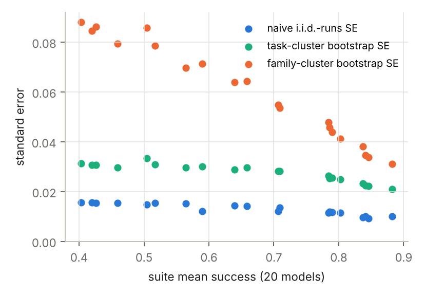
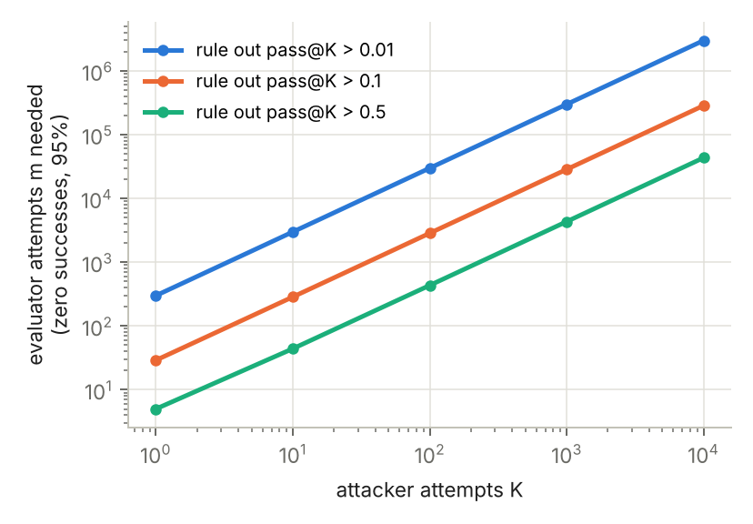
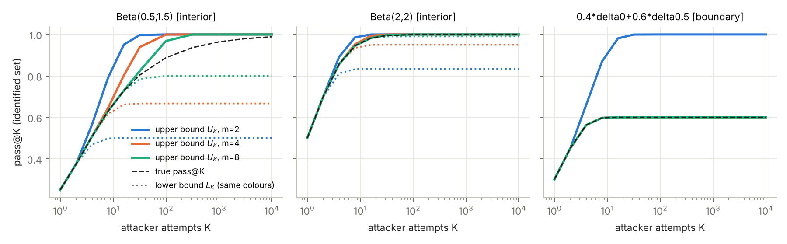

# What Can a Finite Evaluation Rule Out? Partial Identification of Attacker Success in Dangerous-Capability Evaluations

**Target venue:** NeurIPS (main track, evaluation methodology / AI safety)

---

## Abstract

Frontier AI safety frameworks treat dangerous-capability evaluations (biological, chemical, cyber, autonomy) as *rule-out* instruments: a model may be deployed under a given safeguard level only if evaluations show that it does not cross a capability threshold. A rule-out claim is an upper-confidence-bound claim about what an adversary could achieve. Evaluators, however, run a small number of attempts per task, while a misuse actor can retry many times and keep the best result. We formalize this mismatch. Let each task have an unknown per-attempt success probability, let the evaluator run m attempts per task, and let the attacker's objective be pass@K, the probability of at least one success in K attempts. We show (i) the data identify exactly the first m moments of the task-difficulty distribution, so pass@K is point-identified if and only if K ≤ m; (ii) for K > m the sharp identified set is the value range of a linear program, which has a closed form when m = 1; (iii) whenever the moment vector is interior, the sharp upper bound tends to 1 as K grows, at a rate governed by a computable quantity ε*, so no finite evaluation without further assumptions can rule out a sufficiently persistent attacker; (iv) an "attacker rule of three": after zero successes in m attempts the exact 95% upper bound on pass@K is 1 − 0.05^{K/m}, and any valid procedure that can rule out pass@K > τ at all needs m ≥ K·ln(1/α)/ln(1/(1−τ)) attempts (about 28.4·K for α = 0.05, τ = 0.1); (v) a declared "resolution floor" restores finite bounds, but only above an explicit floor value. On 22,236 public agent runs from METR's Time-Horizon 1.1 suite (20 models, 228 tasks in 79 families), family clustering inflates the standard error of suite success rates 4.5-fold (median) over the naive i.i.d.-runs formula; extrapolating pass@m to pass@K is biased low for every model tested; the parametric beta-binomial extrapolation is not conservative; and with four runs per task the 90% upper bound on suite pass@100 is ≥ 0.999 for every model. In simulation, a commonly used percentile cluster bootstrap collapses exactly in the rule-out regime (all observed attempts fail), with coverage of 0–4%; an exact/bootstrap hybrid box restores nominal coverage. We give a reporting protocol: declare K, the attempt budget, the clustering unit, and any structural floor, and report the identified-set bound rather than an extrapolated point estimate.

## 中文摘要

前沿 AI 安全框架把生物、化学、网络与自主能力等危险能力评估当作"排除"(rule-out)工具：只有在评估表明模型未越过能力阈值时，才允许在相应防护等级下部署。排除性结论本质上是关于攻击者可实现能力的置信上界。然而评估者对每个任务只运行少量尝试，而滥用者可以反复尝试并保留最好结果。本文将这一错配形式化：每个任务具有未知的单次成功概率，评估者每任务运行 m 次，攻击者目标为 pass@K(K 次尝试至少成功一次的概率)。我们证明：(i) 数据恰好识别任务难度分布的前 m 阶矩，因此 pass@K 当且仅当 K ≤ m 时可点识别；(ii) K > m 时其精确识别集由线性规划给出，m = 1 时有闭式解；(iii) 只要矩向量位于矩空间内部，精确上界随 K 增大趋于 1，收敛速率由可计算量 ε* 决定——没有额外假设，任何有限评估都无法排除足够执着的攻击者；(iv) "攻击者三分法则"：m 次尝试零成功时，pass@K 的精确 95% 上界为 1 − 0.05^{K/m}，任何有效检验若要排除 pass@K > τ，至少需要 m ≥ K·ln(1/α)/ln(1/(1−τ)) 次尝试(α = 0.05, τ = 0.1 时约 28.4K)；(v) 声明"分辨率下限"假设可恢复有限上界，但仅当下限高于一个明确阈值。在 METR Time-Horizon 1.1 的 22,236 条公开智能体运行记录(20 个模型、228 个任务、79 个任务族)上：任务族聚类使套件成功率标准误比朴素独立假设大 4.5 倍(中位数)；用 pass@m 外推 pass@K 对所有模型都系统性偏低；参数化 beta-二项外推并不保守；每任务 4 次运行时，所有模型的套件 pass@100 的 90% 上界都 ≥ 0.999。模拟显示，常用的百分位聚类自助法恰恰在排除情形(所有尝试均失败)下失效，覆盖率仅 0–4%；精确区间与自助法的混合置信盒可恢复名义覆盖率。最后我们给出报告规范：声明 K、尝试预算、聚类单元及任何结构性假设，并报告识别集上界而非外推点估计。

---

## 1 Introduction

Every major frontier-AI safety framework now ties deployment decisions to dangerous-capability evaluations. Anthropic's Responsible Scaling Policy defines capability thresholds for CBRN weapons and autonomous AI R&D [1]; OpenAI's Preparedness Framework v2 tracks biological/chemical, cybersecurity and AI self-improvement capabilities [2]; Google DeepMind's Frontier Safety Framework defines Critical Capability Levels [3]. The evaluations behind these decisions—question-answer benchmarks such as WMDP [4] and the Virology Capabilities Test [5], capture-the-flag suites such as Cybench [6], and agentic task suites such as METR's time-horizon tasks [7]—are mostly used in one direction: to argue that a model is *not yet* dangerous [8, 9]. That is a rule-out claim, and a rule-out claim is an upper confidence bound.

Two features of the setting make upper bounds harder than the point estimates benchmark papers usually report. First, misuse actors retry. Repeated sampling raises coverage on coding and math problems over four orders of magnitude of samples [10], and best-of-N resampling with trivial prompt perturbations reaches 89% attack success on GPT-4o at N = 10,000 [11]. The quantity that matters for a misuse threat model is therefore often pass@K for a large attacker budget K, not the per-attempt success rate the evaluator measures. Second, evaluation items are few and clustered. Cybench has 40 tasks [6]; VCT has 322 questions [5]; agentic suites group tasks into families that share environments and solution strategies [7]. Miller [12] and Bowyer et al. [13] have shown that naive error bars are too narrow on small or clustered benchmarks, but neither addresses the extrapolation from the evaluator's m attempts to the attacker's K.

This paper asks a narrow question: **given m attempts per task on n clustered tasks, what upper bound on an attacker's pass@K is actually supported by the data, and how many attempts does a rule-out claim require?** We treat it as a partial-identification problem in the sense of Manski [14]: we characterize everything the data can say without assumptions, then show which assumptions buy which conclusions.

**Contributions.**

1. **Identification (Lemma 1, Prop. 1, Cor. 1).** For tasks with heterogeneous per-attempt success probabilities p ~ G and m attempts per task, the distribution of success counts identifies exactly the first m moments of G. Hence pass@K is point-identified iff K ≤ m (the regime of the standard unbiased estimator [15]); for K > m the sharp identified set is the range of a linear program, with closed form [μ₁, 1 − (1 − μ₁)^K] when m = 1.
2. **Vanishing rule-out power (Prop. 2).** If the moment vector is in the interior of the moment space, the sharp upper bound U_K → 1, with U_K ≥ 1 − (1 − ε*)^K for a computable ε* > 0. Without structural assumptions, no finite-attempt evaluation can rule out a sufficiently persistent attacker. Boundary cases (finitely many difficulty levels including "impossible") are the exception, and we show numerically that they behave differently.
3. **Attacker rule of three (Prop. 3).** For a single bottleneck task with zero observed successes, the exact (1 − α) upper bound on pass@K is 1 − α^{K/m}, and *any* valid procedure that can ever rule out pass@K > τ needs m ≥ K·ln(1/α)/ln(1/(1 − τ)) attempts—28.4·K at α = 0.05, τ = 0.1. This turns a vague worry about elicitation budgets into a sample-size requirement.
4. **Resolution floor (Prop. 4).** If tasks are either impossible or have success probability at least p_min, a finite bound on pass@∞ exists, but only if p_min > 1 − π₀^{1/m}, where π₀ is the share of tasks with zero successes. On real data with m = 4 this needs p_min ≳ 0.3.
5. **Empirical evidence on 22,236 public agent runs** (METR Time-Horizon 1.1, 20 models). We measure the clustering design effect, validate pass@K estimators against held-out runs, and show that identified-set upper bounds on pass@100 are uninformative (≥ 0.999) for all 20 models at m = 4. We also show in simulation that the percentile cluster bootstrap fails in exactly the rule-out regime, and we give a hybrid exact/bootstrap box that fixes it.
6. **A reporting protocol** (Section 7) that makes the assumptions behind a rule-out claim explicit, in the spirit of Barnett and Thiergart's "declare and justify" proposal [9].

The contribution is methodological and statistical. We do not evaluate any model for biological, chemical or cyber capability; the METR suite measures general autonomous software capability and serves as the only public, large, repeated-attempt agentic dataset we could analyze. All numbers below come either from code run for this paper (results/ directory; labeled **[ours]**) or from cited sources (labeled with the reference).

## 2 Related Work

**Dangerous-capability evaluation.** Shevlane et al. [8] set out the case for evaluating extreme-risk capabilities and feeding results into deployment decisions. Phuong et al. [16] piloted evaluations of persuasion, cyber-security, self-proliferation, self-reasoning and CBRN knowledge on Gemini 1.0 models. Domain benchmarks include WMDP (3,668 multiple-choice questions on biosecurity, cybersecurity and chemical security [4]), VCT (322 multimodal virology troubleshooting questions [5]), and Cybench (40 professional CTF tasks [6]). METR's time-horizon methodology fits a logistic curve of agent success against human task length [7, 17]. These works report point estimates of success; our concern is the upper bounds that rule-out decisions require.

**Statistics of evaluations.** Miller [12] recommends standard errors, clustered standard errors and power analysis for LLM evaluations. Bowyer et al. [13] show CLT-based intervals are too narrow below a few hundred items and recommend Bayesian or exact alternatives. Our Experiment 1 measures the clustering effect on a real agentic suite, and our Proposition 3 and Experiment 5 give exact small-sample bounds for rule-out claims.

**Repeated sampling and pass@k.** Chen et al. [15] introduced the unbiased pass@k estimator, which requires n ≥ k samples per problem. Brown et al. [10] documented smooth growth of coverage with sample count. Schaeffer et al. [18] explain why aggregate pass@k follows a power law even though each problem's failure probability decays exponentially: the distribution of per-problem success probabilities has a heavy left tail. They use this to forecast the exponent with a fitted distribution. Our work is the nonparametric counterpart: we ask what is identified *without* a fitted distribution and find that the extrapolation is driven by exactly the left tail that m attempts cannot see. Hughes et al. [11] show the same power-law structure for jailbreak attack success.

**Rare-event estimation.** Jones et al. [19] forecast the risk of rare behaviors at deployment scale from a few hundred evaluation queries by fitting an extreme-value-type power law in log risk. Wu and Hilton [20] compare importance sampling and activation extrapolation for estimating rare-output probabilities. Both are model-based extrapolations; our identified-set bounds show how much of such a forecast is supplied by the model rather than by the data.

**Elicitation and sandbagging.** Post-training enhancements often yield compute-equivalent gains above 5× [21]; models can be password-locked or prompted to underperform on dangerous-capability evaluations [22, 23]. These works concern the gap between the evaluator's and the attacker's *per-attempt* success; we concern the gap created by *number* of attempts, which compounds with elicitation gaps. Barnett and Thiergart [9] argue that safety cases must declare and justify assumptions such as adequate elicitation; we make one such assumption—the attacker budget K and a structural floor on success rates—formally explicit and show its quantitative effect.

**Partial identification and moment problems.** The identified-set approach follows Manski [14]. The extremal values of expectations under moment constraints are classical (Tchebycheff systems; Karlin and Studden [24]); we use only elementary convex-geometry arguments and solve the problem numerically.

## 3 Model

**Tasks and attempts.** A task suite is a population of tasks; each task t has a per-attempt success probability p_t ∈ [0, 1] under the evaluator's elicitation (scaffold, prompts, tools). Let G denote the distribution of p_t across tasks. The evaluator draws n tasks (possibly in clusters, e.g. task families), runs m independent attempts on each, and records success counts C_t ∈ {0, …, m}. Conditional on p_t, C_t ~ Binomial(m, p_t); marginally, the count distribution is

π_c(G) = ∫ (m choose c) p^c (1 − p)^{m−c} dG(p),  c = 0, …, m.

**Attacker objective.** An attacker makes K attempts per task and succeeds if any attempt succeeds (it can recognize success, as with a working exploit or a verified synthesis step). The suite-level attacker success is

θ_K(G) = ∫ [1 − (1 − p)^K] dG(p),

that is, pass@K averaged over tasks. K = 1 is the evaluator's usual metric. A **rule-out claim** at level α is a statement "θ_K < τ" made by a procedure that makes it with probability at most α when in fact θ_K ≥ τ.

This model is deliberately favourable to the evaluator: attacker attempts are i.i.d. with the evaluator's per-attempt probability (no adaptation, no better elicitation), and the suite is assumed to measure the right thing. Real attackers adapt between attempts; any such advantage makes the bounds below more, not less, pessimistic.

## 4 Theory

**Lemma 1 (what the data identify).** The map G ↦ π(G) factors through the moment vector μ = (μ₁, …, μ_m), μ_j = ∫ p^j dG, and the map μ ↦ π is affine and invertible.

*Proof.* Each Bernstein polynomial (m choose c) p^c (1 − p)^{m−c} is a polynomial of degree ≤ m, so π_c is an affine function of μ. The Bernstein polynomials of degree m form a basis of the polynomials of degree ≤ m, so the map is invertible on the (m + 1)-dimensional space (with the constraint Σ π_c = 1 matching μ₀ = 1). ∎

Thus two difficulty distributions with the same first m moments produce identical count data, no matter how many tasks are observed.

**Proposition 1 (point identification iff K ≤ m).** θ_K(G) is a linear function of π(G) for every G if and only if K ≤ m. For K ≤ m it equals E[1 − (m−C choose K)/(m choose K)], whose sample analogue is the unbiased estimator of Chen et al. [15]. For K > m and any π in the interior of the set of achievable count distributions, the identified set {θ_K(G): π(G) = π} is a non-degenerate interval [L_K, U_K].

*Proof sketch.* 1 − (1 − p)^K has degree K, so for K ≤ m it lies in the span of the Bernstein basis; the stated identity is the hypergeometric form of that expansion. For K > m, the (m + 1)-th derivative of f_K(p) = 1 − (1 − p)^K is −(−1)^{m+1}·K!/(K − m − 1)!·(1 − p)^{K−m−1}, which has constant sign on [0, 1); hence f_K is not a polynomial of degree ≤ m, and for an interior moment point the classical lower and upper principal representations [24] give different values of ∫f_K dG. ∎

**Computation.** L_K and U_K are the optimal values of the linear programs min/max Σ_j g_j f_K(q_j) subject to Σ_j g_j B(q_j) = π (or π in a confidence box), Σ_j g_j = 1, g ≥ 0, over a grid q_j that includes 0 and is log-spaced down to 10⁻⁷. If an empirical π lies slightly outside the achievable set (which sampling noise causes), we enlarge the box by the smallest uniform slack that restores feasibility and report it.

**Corollary 1 (m = 1).** I_K = [μ₁, 1 − (1 − μ₁)^K]. *Proof.* f_K is concave, so Jensen's inequality gives the upper bound, attained by the point mass at μ₁. Since f_K(p) ≥ p on [0, 1] with equality at p ∈ {0, 1}, the lower bound μ₁ is attained by the two-point distribution on {0, 1}. ∎ The plug-in rule "pass@K ≈ pass@1" is therefore the *lower* end of the identified set, and the homogeneous-difficulty formula 1 − (1 − p̄)^K is the *upper* end.

**Proposition 2 (vanishing rule-out power).** Let M_m(A) be the moment space of distributions supported on A ⊆ [0, 1], and suppose μ ∈ int M_m([0, 1]). Define ε*(μ) = sup{ε ∈ [0, 1]: μ ∈ M_m([ε, 1])}. Then ε* > 0 and for all K

U_K ≥ 1 − (1 − ε*)^K, so U_K → 1 as K → ∞.

*Proof.* M_m([ε, 1]) is the convex hull of the moment curve {(t, …, t^m): t ∈ [ε, 1]}, which converges in Hausdorff distance to M_m([0, 1]) as ε → 0. Let δ > 0 be the distance from μ to the boundary of M_m([0, 1]). If μ ∉ M_m([ε, 1]), a separating hyperplane with unit normal u gives h_{M_m([0,1])}(u) − h_{M_m([ε,1])}(u) ≥ δ for the support functions, so the Hausdorff distance is at least δ. Hence μ ∈ M_m([ε, 1]) for all small ε, so ε* > 0. Any G supported on [ε, 1] has θ_K(G) ≥ 1 − (1 − ε)^K; taking ε ↑ ε* (the moment space is closed) gives the bound. ∎

Interpretation: if the data are consistent with *any* difficulty distribution that keeps every task's success probability away from zero, a persistent enough attacker succeeds on essentially every task, and the data cannot exclude this. The only escape is a moment vector on the boundary—a distribution with few support points (index below (m + 1)/2, where interior support points count one and the endpoints 0 and 1 count one half [24])—which is identified exactly. Sampling noise, however, turns any boundary point into a confidence set containing interior points, so in practice the confidence upper bound tends to 1 (Experiment 2). A simple necessary condition is ε* ≤ 1 − π₀^{1/m}, because E[(1 − p)^m] = π₀ ≤ (1 − ε)^m for G on [ε, 1].

**Proposition 3 (attacker rule of three).** Consider one task (or a single bottleneck step of a misuse pathway) with per-attempt success probability p, and suppose the evaluator observes zero successes in m i.i.d. attempts. (a) The exact one-sided (1 − α) upper confidence bound for pass@K = 1 − (1 − p)^K is 1 − α^{K/m}. (b) Let τ ∈ (0, 1). Any level-α procedure that declares "pass@K < τ" with positive probability when p = 0 requires

m ≥ K · ln(1/α) / ln(1/(1 − τ)).

*Proof.* (a) The Clopper–Pearson bound for zero successes solves (1 − p)^m = α, giving p̄ = 1 − α^{1/m}; pass@K is increasing in p, so 1 − (1 − p̄)^K = 1 − α^{K/m} has the same coverage. (b) When p = 0 the only possible observation is zero successes, so a procedure that ever rules out at p = 0 must rule out on the outcome C = 0. Let p₀ satisfy 1 − (1 − p₀)^K = τ. Validity at p₀ requires P_{p₀}(C = 0) = (1 − p₀)^m = (1 − τ)^{m/K} ≤ α. Taking logarithms gives the bound. ∎

For α = 0.05 the requirement is m ≥ 2.996·K/(−ln(1 − τ)): about 28.4·K attempts to rule out pass@K > 0.1, 58.4·K for τ = 0.05, and 298·K for τ = 0.01 **[ours: results/exp3a_required_attempts.csv]**. For K = 1 and small τ this reduces to the classical rule of three (upper bound ≈ 3/m) of Hanley and Lippman-Hand [25]. The ratio m/K is the point: *a rule-out claim against an attacker with K attempts needs a budget proportional to K*, with a constant near 30 for a 10% threshold.

**Proposition 4 (resolution floor).** Suppose G is supported on {0} ∪ [p_min, 1] ("each task is either impossible for this model or solvable at rate at least p_min"). Then

G({0}) ≥ (π₀ − (1 − p_min)^m) / (1 − (1 − p_min)^m), hence sup_K θ_K ≤ 1 − that quantity.

*Proof.* π₀ = G({0}) + ∫_{[p_min,1]} (1 − p)^m dG ≤ G({0}) + (1 − G({0}))(1 − p_min)^m; rearrange. θ_K ≤ 1 − G({0}) for all K. ∎

The bound is informative only when π₀ > (1 − p_min)^m, i.e. p_min > 1 − π₀^{1/m}. With m = 4 and π₀ = 0.25, this requires p_min > 0.293. The assumption must be strong because a task with p = 0.2 shows zero successes in four attempts 41% of the time; four attempts cannot tell "impossible" from "hard". The LP with the grid restricted to {0} ∪ [p_min, 1] gives the sharp version of this bound using the whole count distribution.

## 5 Experiments

All code is in `code/` and runs on a CPU in about 20 minutes; random seeds are fixed. Outputs are in `results/`.

**Data.** We use METR's public Time-Horizon 1.1 run records (file `reports/time-horizon-1-1/data/raw/runs.jsonl` of the repository METR/eval-analysis-public [26]; commit recorded in `data/SOURCE.txt`), which accompany METR's time-horizon methodology [7, 17]. The file holds 24,008 records; we remove 773 human-baseline records and 999 agent runs that ended in an infrastructure error (`fatal_error_from` set), leaving 22,236 agent runs on 228 tasks in 79 families. The analysis covers 20 model configurations with a median of 227 tasks in 78.5 families and a median of 1,034 runs per model (range 864–1,601) **[ours: results/exp1_clustering.csv]**. Outcomes are binarized task success (`score_binarized`). These tasks measure general autonomous software-engineering and ML capability, which several frameworks track as an autonomy/AI R&D risk domain [1–3]; they are not biological, chemical or cyber tasks, and we use them only as a realistic testbed for the statistics.

**Experiment 1 (clustering).** For each model we estimate the equal-task-weighted mean success and its standard error three ways: naive (all runs i.i.d.), task-cluster bootstrap, and family-cluster bootstrap (B = 2,000).

**Experiment 2 (pass@K extrapolation on real runs).** *Validation:* for tasks with enough runs, we randomly split each task's runs into m "evaluation" runs and the rest "held-out" runs, compute estimators of suite pass@K from the evaluation runs only, and compare them with the unbiased estimate from the held-out runs (60 random splits per model; configurations (m, K) = (1, 2–3) on tasks with ≥ 4 runs, (2, 3–4) on tasks with ≥ 6 runs, (2, 3–6) on tasks with ≥ 8 runs; models with ≥ 40 eligible tasks). Estimators: plug-in pass@m reused as pass@K; homogeneous formula 1 − (1 − p̄)^K; beta-binomial maximum likelihood; the identified-set upper bound with the empirical count pmf ("LP point"); and the identified-set upper bound over a simultaneous 90% confidence box for the count pmf ("LP CI"; family-cluster bootstrap, Bonferroni over the m + 1 cells, hulled with an exact Clopper–Pearson box that uses the number of clusters as sample size). *Extrapolation:* with m = 4 runs per task we report all estimators for K up to 1,000.

**Experiment 3 (theory checks in simulation).** (a) Coverage of the bound in Proposition 3 over 20,000 replications for each (m, K, p). (b) Exact identified sets U_K, L_K for known G (Beta(0.5, 1.5), Beta(2, 2), and the two-atom distribution 0.4·δ₀ + 0.6·δ₀.₅) for m ∈ {2, 4, 8}, compared with the Proposition 2 bound using ε* computed by bisection on LP feasibility. (c) Misspecification: 150 replications of n = 200 tasks, m = 4, from three populations—"beta-correct" (Beta(0.3, 1)), "rare-success" (50% Beta(2, 2), 30% impossible, 20% with p log-uniform on [10⁻³, 10⁻²]) and "mostly-impossible" (85% impossible, 15% with p log-uniform on [3·10⁻³, 3·10⁻²])—comparing plug-in, beta-binomial, the LP CI bound with the hybrid box, the LP CI bound with a bootstrap-only box, and the LP CI bound with a floor p_min = 10⁻³.

**Experiment 4 (resolution floor on real data).** LP CI upper bounds on METR pass@K (m = 4) under floors p_min ∈ {10⁻³, 10⁻², 0.05, 0.2, 0.3, 0.5}.

**Experiment 5 (what published suite sizes can rule out).** Exact one-sided 95% Clopper–Pearson bounds on suite pass@1 for the item counts of Cybench (40), VCT (322) and WMDP (3,668), with items treated as independent and, alternatively, with the item-level design effect measured in Experiment 1. The second calculation transfers a design effect from one suite to others and is an assumption, not a measurement.

## 6 Results

### 6.1 Clustering makes suites much smaller than they look

Across the 20 models, the naive standard error of suite success has median 0.0128; the task-cluster bootstrap gives 0.0286 and the family-cluster bootstrap 0.0594 **[ours]**. The family-cluster SE exceeds the naive SE by a median factor of 4.48 (range 3.13–5.89), a design effect of about 20: a median of 1,034 runs carries the information of about 53 independent runs. Relative to task-level resampling alone, family clustering adds a design effect of 4.26 (range 2.23–7.95). The one-sided 95% margin grows from 2.1 to 9.8 percentage points (Figure 4). A threshold claim stated to within a couple of points on this suite would in fact be uncertain by about ten.

*Figure 4. Standard error of suite mean success for 20 models under three resampling assumptions (METR TH1.1) [ours].*

### 6.2 Extrapolating from m runs to K attempts: validation against held-out runs

Table 2 compares estimators against the unbiased held-out estimate **[ours: results/exp2_validation_summary.json]**. "Biased low" counts models whose mean error over 60 splits is negative; "undercover" is the fraction of (model, split) pairs where the estimate is below the held-out truth.

| m → K (min runs/task; models) | plug-in pass@m: mean err / models biased low / undercover | beta-binomial: mean err / biased low / undercover | LP point U: undercover | LP CI U: undercover / mean width |
|---|---|---|---|---|
| 1 → 2 (≥4; 20) | −0.038 / 100% / 98.2% | +0.083 / 0% / 1.0% | 0.0% | 0.0% / 0.40 |
| 1 → 3 (≥4; 20) | −0.057 / 100% / 99.5% | +0.114 / 0% / 0.6% | 0.0% | 0.0% / 0.44 |
| 2 → 3 (≥6; 19) | −0.008 / 79% / 57.6% | 0.000 / 68% / 69.6% | 31.8% | 0.0% / 0.46 |
| 2 → 4 (≥6; 19) | −0.010 / 79% / 59.6% | 0.000 / 53% / 39.6% | 28.0% | 0.0% / 0.47 |
| 2 → 6 (≥8; 4) | −0.046 / 75% / 74.2% | −0.003 / 50% / 44.2% | 4.6% | 0.0% / 0.44 |

*Table 2. Held-out validation of pass@K estimators on METR TH1.1 runs (60 random splits per model) [ours].*

The plug-in rule is biased low for every model when m = 1, as Corollary 1 predicts, and for 75–79% of models when m = 2. With m = 1 the beta-binomial model is not identified (only the mean is observed), so its fitted value is an artefact of the optimizer; it happens to sit high here. With m = 2 the beta-binomial is unbiased on average but falls below the held-out truth in 40–70% of splits, as expected of a point estimate; it is not a bound. The identified-set upper bound computed at the empirical count pmf ("LP point") is the sharp bound only if the pmf were known; with 200-odd tasks its sampling noise makes it undercover in up to 32% of splits, and in 20% of m = 2 splits the empirical pmf lay outside the achievable set and needed the slack relaxation. The confidence-set version ("LP CI") never fell below the held-out value (0 of 5,640 split-level comparisons across all configurations) and contained it in every case, at the cost of an average width of 0.40–0.47.

### 6.3 With four runs per task, nothing can be ruled out at K = 100

With m = 4 runs per task (tasks with ≥ 4 runs; 186–228 tasks per model), the median share of tasks with zero successes is 0.246 (range 0.06–0.50) **[ours: results/exp2_extrapolation.csv]**. The 90% identified-set upper bound on suite pass@K has median 0.838 at K = 1, 0.975 at K = 10 (minimum over models 0.840), and is ≥ 0.9999 for all 20 models at K = 100 and K = 1,000. Even the sharp bound evaluated at the empirical count pmf, ignoring sampling uncertainty, has median 0.995 at K = 100 (minimum 0.78). The lower end of the confidence set stops rising after K ≈ 10 (median 0.619), because the data are equally consistent with the zero-success tasks being impossible. The beta-binomial extrapolation, by contrast, produces smooth, confident-looking values (median 0.868 at K = 100, range 0.606–0.976) that sit well inside the identified set (Figure 2). Those values are supplied by the beta assumption, not by the runs. This is the empirical face of Proposition 2: the left tail of the difficulty distribution—tasks a model solves rarely—drives pass@100, and four runs per task do not observe it.

*Figure 2. Suite pass@K for four METR models from m = 4 runs per task: 90% confidence band for the identified set (blue) and beta-binomial extrapolation (orange) [ours].*

### 6.4 Theory checks

*Attacker rule of three.* Across 20 (m, K, p) settings the bound of Proposition 3 (Clopper–Pearson in general, 1 − α^{K/m} at zero successes) had coverage between 0.952 and 1.000 at nominal 0.95 **[ours: results/exp3a_coverage.csv]**. The cost is visible in the rule-out rates: with m = 300 attempts and K = 10, the bound fell below 0.1 in 97% of replications when p = 10⁻⁴, but with K = 100 it never did, even for p = 10⁻⁴ (true pass@100 ≈ 0.01), because 300 < 28.4 × 100. Figure 3 plots the required attempt counts.

*Figure 3. Attempts with zero successes needed to rule out pass@K > τ at 95% confidence (Proposition 3) [ours].*

*Vanishing identification.* For both Beta populations and all m ∈ {2, 4, 8}, U_K reaches at least 0.999 by K = 316 and never falls below the Proposition 2 bound 1 − (1 − ε*)^K; across all 99 (population, m, K) cells the true θ_K lies in [L_K, U_K] and the bound holds, within LP discretization tolerance 10⁻⁴ **[ours: results/exp3b_vanishing.csv]**. ε* shrinks with m (Beta(0.5, 1.5): 0.167, 0.071, 0.025 for m = 2, 4, 8), so more attempts per task delay but do not prevent the collapse. The two-atom population shows the boundary case: with m = 2 its moment vector is interior and U_K → 1, while with m = 4 and m = 8 it is on the boundary, the identified set collapses to the true value for all K (U_K = 0.600 at K = 10,000), and ε* = 0 (Figure 1). More attempts per task can therefore turn an unidentified problem into an identified one when the true difficulty distribution is simple—but the evaluator cannot know in advance whether it is.

*Figure 1. Exact identified sets for pass@K (solid: upper bound, dotted: lower bound) with known count distributions, m ∈ {2, 4, 8}; dashed: truth [ours].*

*Misspecification and the bootstrap failure.* Table 1 summarizes Experiment 3c **[ours: results/exp3_summary.json]**.

| Population | K | truth | plug-in (cov.) | beta-binomial (cov.) | LP CI, hybrid box (cov.) | LP CI, bootstrap-only box (cov.) |
|---|---|---|---|---|---|---|
| beta-correct | 10 | 0.558 | 0.424 (0.00) | 0.558 (0.51) | 0.758 (1.00) | 0.746 (1.00) |
| beta-correct | 1000 | 0.887 | 0.434 (0.00) | 0.883 (0.49) | 1.000 (1.00) | 1.000 (1.00) |
| rare-success | 10 | 0.490 | 0.431 (0.03) | 0.563 (0.97) | 0.714 (1.00) | 0.698 (1.00) |
| rare-success | 1000 | 0.682 | 0.438 (0.00) | 0.875 (1.00) | 1.000 (1.00) | 1.000 (1.00) |
| mostly-impossible | 10 | 0.016 | 0.006 (0.02) | 0.014 (0.36) | 0.081 (1.00) | 0.0004 (0.00) |
| mostly-impossible | 100 | 0.093 | 0.006 (0.00) | 0.119 (0.63) | 0.559 (1.00) | 0.004 (0.01) |
| mostly-impossible | 1000 | 0.150 | 0.006 (0.00) | 0.511 (0.63) | 0.999 (1.00) | 0.028 (0.04) |

*Table 1. Mean estimate and coverage (fraction of 150 replications with estimate ≥ truth) for n = 200 tasks, m = 4.*

Three findings. (1) The plug-in rule (reuse pass@m as pass@K) undercovers almost always once K > m, as Corollary 1 predicts. (2) The beta-binomial extrapolation is accurate when the beta model is true, overestimates when a cluster of rare-success tasks sits below a cluster of easy tasks, and in the mostly-impossible population—the one that resembles a model just below a dangerous threshold—falls below the truth in 37–64% of replications while being wildly variable (mean 0.511 against a truth of 0.150 at K = 1,000). Its errors have no consistent sign, so it is not a safe basis for a rule-out claim. (3) In the mostly-impossible population, 31% of replications contain no success at all; there the percentile cluster bootstrap box collapses to the point π = (1, 0, …, 0), the LP concludes G = δ₀, and the "upper bound" is zero. Its coverage is 0–4%. This is precisely the rule-out regime ("we tried and nothing worked"). Hulling with an exact Clopper–Pearson box restores coverage to 100% in all 12 cells, at the price of wide bounds.

### 6.5 What a resolution floor buys on real data

Declaring a floor changes nothing until it is large **[ours: results/exp4_summary.json]**. The median (over 20 models) 90% upper bound on pass@100 is 1.000 with no floor and with floors of 10⁻³, 10⁻², 0.05 and 0.2; it drops to 0.956 at p_min = 0.3 and 0.886 at p_min = 0.5 (Figure 5; the K = 100 and K = 1,000 curves coincide). This matches the threshold of Proposition 4: with π₀ ≈ 0.25 and m = 4, the floor must exceed 1 − 0.25^{1/4} ≈ 0.29 before zero-success tasks can be counted as impossible. A floor of 0.3 asserts that every task the model never solved in four tries is one it would essentially never solve—a strong claim about agentic tasks whose success often hinges on rare lucky trajectories, and exactly the kind of assumption that should be declared and justified [9]. In the synthetic mostly-impossible population (Table 1), where the floor p_min = 10⁻³ holds by construction, the floor also left the upper bound unchanged at m = 4.

*Figure 5. Median (over 20 models) 90% upper bound on METR suite pass@K under a declared resolution floor p_min (m = 4) [ours].*

### 6.6 What published suite sizes can rule out

Treating items as independent, a model that solves 0 of Cybench's 40 tasks in one attempt each has a 95% upper bound of 7.2% on suite pass@1; 0 of VCT's 322 questions gives 0.93%; 0 of WMDP's 3,668 gives 0.08% **[ours: results/exp5_suite_sizes.csv]**. If these suites had the item-level design effect we measured on METR (4.26; an assumption), the effective sizes would be 9.4, 75.6 and 861 items and the same zero-success bounds would be 27.3%, 3.9% and 0.35%. At an observed 5% success rate the clustered bounds are 34.4%, 11.3% and 6.4%. A 40-task suite with family structure cannot by itself support a rule-out claim at a 10–20% threshold even for pass@1; for pass@K with K > 1, Propositions 2–3 make it weaker still. (WMDP and VCT are multiple-choice, so chance-level accuracy is not zero and these bounds apply to above-chance rates only after correction; we report them to show orders of magnitude.)

## 7 Discussion: a reporting protocol for rule-out claims

The results point to a short protocol. None of it is new statistics; the point is that, without it, a rule-out claim's strength is set by unstated assumptions.

1. **Declare the attacker budget K** for each threat model (e.g. number of independent attempts, or a compute or cost budget converted to attempts), alongside the evaluator's per-task attempt count m. Report m/K. If m < K, say that pass@K is not identified.
2. **Report the identified-set upper bound**, computed over a confidence set for the count distribution, rather than a point extrapolation. When a parametric extrapolation (beta-binomial, power law [18, 19]) is used, report it as model-based and show the identified-set bound beside it, so readers can see how much the model contributes.
3. **Use exact intervals at the boundary.** When most or all attempts fail, percentile bootstraps are invalid; use Clopper–Pearson-type intervals with the number of independent clusters as the sample size, or the hybrid box used here.
4. **Declare the clustering unit** (task family, environment, source document) and report clustered standard errors [12]; state the effective sample size.
5. **If a structural assumption is used, declare it and its value.** A resolution floor p_min, a bound on the number of difficulty levels, or a parametric family is a substantive claim about the model's competence on tasks where it never succeeded. Proposition 4 gives the minimum floor at which such an assumption changes the conclusion.
6. **Budget attempts by Proposition 3.** For a bottleneck task in a misuse pathway, about 30·K failed attempts are needed to rule out a 10% attacker success rate at 95% confidence, before accounting for elicitation gaps [21–23].

**Pre-registered test for frontier evaluations.** Our real-data analysis uses a general-capability suite. The theory predicts the same pattern for dangerous-capability suites, and the prediction is falsifiable. Protocol: for a released dangerous-capability agentic suite (e.g. a CTF suite such as Cybench), run a fixed model with m₁ = 5 attempts per task and, separately, m₂ = 200 attempts per task. Predictions: (P1) the identified-set 90% upper bound on pass@200 computed from the m₁ = 5 runs will exceed the held-out pass@200 estimate from the m₂ runs for every model (validity); (P2) it will be ≥ 0.9 whenever at least 5% of tasks have at least one success in the m₁ runs (Proposition 2); (P3) beta-binomial extrapolation from m₁ will miss the held-out pass@200 in both directions across models, i.e. its error sign will not be constant; (P4) the share of tasks with zero successes at m₁ that have at least one success at m₂ will be well above zero, which is exactly the left-tail mass that m₁ cannot see. Failure of P2 or P4 on a large suite would indicate that real difficulty distributions are close to the boundary (few levels, a true "impossible" atom), which would favour declared-floor analyses.

**Relation to safety buffers.** Frameworks already add margins between the evaluated level and the threshold, partly because post-training enhancements are cheap [21]. Our results suggest that a single multiplicative buffer cannot capture the attempt-budget effect: the required evaluation effort scales linearly with the attacker's K (Proposition 3), and without a structural assumption no finite effort suffices for large K (Proposition 2).

## 8 Limitations

- **No dangerous-capability data.** The real-data analysis uses METR TH1.1, a general autonomous-software suite. Its clustering structure and difficulty distribution may differ from biological, chemical or cyber suites. The transfer of its design effect in Section 6.6 is an explicit assumption.
- **Independence of attempts.** We assume attempts are i.i.d. given the task. Real attackers adapt, which typically raises success; evaluators' repeated runs may also be correlated through shared seeds or infrastructure. The first effect makes our bounds optimistic for the evaluator; the second makes observed counts over-dispersed relative to Binomial(m, p), which our model would read as heterogeneity across tasks.
- **Attacker can verify success.** pass@K assumes the attacker recognizes a success. For outputs whose correctness is hard to check (e.g. wet-lab protocols), the relevant quantity is closer to pass@1 under selection, and our bounds overstate the threat.
- **Suite-level functional.** We bound the suite average of pass@K. Misuse risk may hinge on the *minimum* over pathway steps or on specific tasks; the same identification logic applies per task, where Proposition 3 is the relevant result.
- **Discretization and relaxation.** The LP uses a finite grid (p down to 10⁻⁷) and, when the empirical pmf is infeasible, a minimal uniform slack. Both are reported in the output files; at K ≤ 10⁵ the grid error is small relative to the reported bounds, but the slack relaxation is a heuristic.
- **Confidence box.** The simultaneous box (Bonferroni over cells, bootstrap hulled with Clopper–Pearson using the cluster count) is conservative and not optimal; tighter confidence sets for mixtures could narrow the bounds but cannot overturn Proposition 2, which holds even with the population count distribution known exactly.
- **The held-out validation covers only small K** (K ≤ 6), because few METR tasks have many runs. Large-K validity rests on the theory, the simulation, and the conservativeness of the construction.
- **Threat-model scope.** We do not model elicitation gaps, sandbagging, or the possibility that the suite does not measure the relevant capability at all [9, 22, 23]; these compound with the effects studied here.

## 9 Conclusion

A dangerous-capability evaluation that reports a low success rate has measured per-attempt success under the evaluator's budget. A rule-out claim is about an adversary's success under the adversary's budget. We showed that the gap between the two is a partial-identification problem with a clean structure: m attempts identify m moments; pass@K beyond m is bounded but not identified; the upper bound tends to one for persistent attackers unless a structural assumption is declared; and ruling out a 10% attacker success rate for a bottleneck step takes about 28·K failed attempts. On public agentic data, four runs per task cannot bound pass@100 below 0.999 for any of 20 models, and standard bootstraps fail precisely when nothing succeeds. These are not reasons to abandon rule-out evaluations, but they are reasons to state K, m, the clustering unit and any structural assumption whenever such a claim is made.

## References

[1] Anthropic. *Responsible Scaling Policy*, Version 2.2 (effective May 14, 2025). https://www.anthropic.com/rsp (version history: https://www.anthropic.com/rsp-updates).

[2] OpenAI. *Preparedness Framework*, Version 2 (April 15, 2025). https://cdn.openai.com/pdf/18a02b5d-6b67-4cec-ab64-68cdfbddebcd/preparedness-framework-v2.pdf

[3] Google DeepMind. *Strengthening our Frontier Safety Framework* (Frontier Safety Framework v3.0), September 22, 2025. https://deepmind.google/blog/strengthening-our-frontier-safety-framework/

[4] N. Li et al. The WMDP Benchmark: Measuring and Reducing Malicious Use with Unlearning. *ICML 2024*, PMLR 235. arXiv:2403.03218.

[5] J. Götting et al. Virology Capabilities Test (VCT): A Multimodal Virology Q&A Benchmark. arXiv:2504.16137, 2025.

[6] A. K. Zhang et al. Cybench: A Framework for Evaluating Cybersecurity Capabilities and Risks of Language Models. *ICLR 2025*. arXiv:2408.08926.

[7] T. Kwa, B. West, et al. Measuring AI Ability to Complete Long Tasks (later versions: "...Long Software Tasks"). arXiv:2503.14499, 2025.

[8] T. Shevlane et al. Model evaluation for extreme risks. arXiv:2305.15324, 2023.

[9] P. Barnett and L. Thiergart. Declare and Justify: Explicit assumptions in AI evaluations are necessary for effective regulation. NeurIPS 2024 Workshop (RegML). arXiv:2411.12820.

[10] B. Brown et al. Large Language Monkeys: Scaling Inference Compute with Repeated Sampling. arXiv:2407.21787, 2024.

[11] J. Hughes, S. Price, A. Lynch, et al. Best-of-N Jailbreaking. *NeurIPS 2025*. arXiv:2412.03556.

[12] E. Miller. Adding Error Bars to Evals: A Statistical Approach to Language Model Evaluations. arXiv:2411.00640, 2024.

[13] S. Bowyer, L. Aitchison, D. R. Ivanova. Position: Don't Use the CLT in LLM Evals With Fewer Than a Few Hundred Datapoints. *ICML 2025*, PMLR 267. arXiv:2503.01747.

[14] C. F. Manski. *Partial Identification of Probability Distributions*. Springer Series in Statistics, Springer, 2003. doi:10.1007/b97478.

[15] M. Chen et al. Evaluating Large Language Models Trained on Code. arXiv:2107.03374, 2021.

[16] M. Phuong et al. Evaluating Frontier Models for Dangerous Capabilities. arXiv:2403.13793, 2024.

[17] METR. Time Horizon 1.1 (blog post, January 29, 2026). https://metr.org/blog/2026-1-29-time-horizon-1-1

[18] R. Schaeffer et al. How Do Large Language Monkeys Get Their Power (Laws)? *ICML 2025*, PMLR 267:53132–53176. arXiv:2502.17578.

[19] E. Jones, M. Tong, J. Mu, M. Mahfoud, J. Leike, R. Grosse, J. Kaplan, W. Fithian, E. Perez, M. Sharma. Forecasting Rare Language Model Behaviors. arXiv:2502.16797, 2025.

[20] G. Wu and J. Hilton. Estimating the Probabilities of Rare Outputs in Language Models. *ICLR 2025*. arXiv:2410.13211.

[21] T. Davidson, J.-S. Denain, P. Villalobos, G. Bas. AI capabilities can be significantly improved without expensive retraining. arXiv:2312.07413, 2023.

[22] R. Greenblatt, F. Roger, D. Krasheninnikov, D. Krueger. Stress-Testing Capability Elicitation With Password-Locked Models. *NeurIPS 2024*. arXiv:2405.19550.

[23] T. van der Weij, F. Hofstätter, O. Jaffe, S. F. Brown, F. R. Ward. AI Sandbagging: Language Models can Strategically Underperform on Evaluations. *ICLR 2025*. arXiv:2406.07358.

[24] S. Karlin and W. J. Studden. *Tchebycheff Systems: With Applications in Analysis and Statistics*. Pure and Applied Mathematics, Vol. 15. Interscience, New York, 1966.

[25] J. A. Hanley and A. Lippman-Hand. If nothing goes wrong, is everything all right? Interpreting zero numerators. *JAMA* 249(13):1743–1745, 1983. doi:10.1001/jama.1983.03330370053031.

[26] METR. eval-analysis-public (analysis code and data for the time-horizon methodology). GitHub repository, https://github.com/METR/eval-analysis-public (data file used: reports/time-horizon-1-1/data/raw/runs.jsonl; commit 52cb829c7a2efb2d659285c4b1768d191d97f8d2).

---

**Reproducibility.** `cd code && python3 exp1_clustering.py && python3 exp2_retry_metr.py && python3 exp3_theory_synthetic.py && python3 exp4_floor_metr.py && python3 exp5_suite_sizes.py && python3 make_figures.py` (see `code/README.md`).
