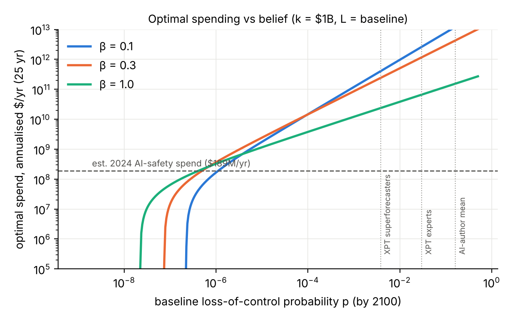
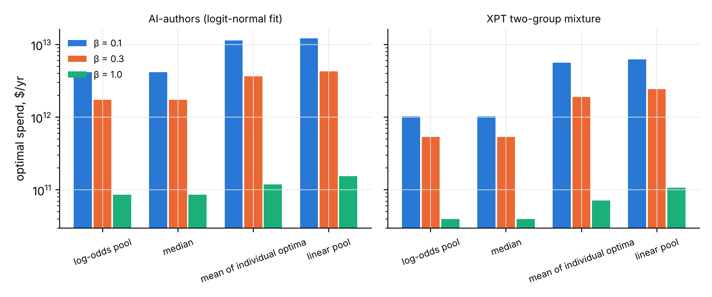
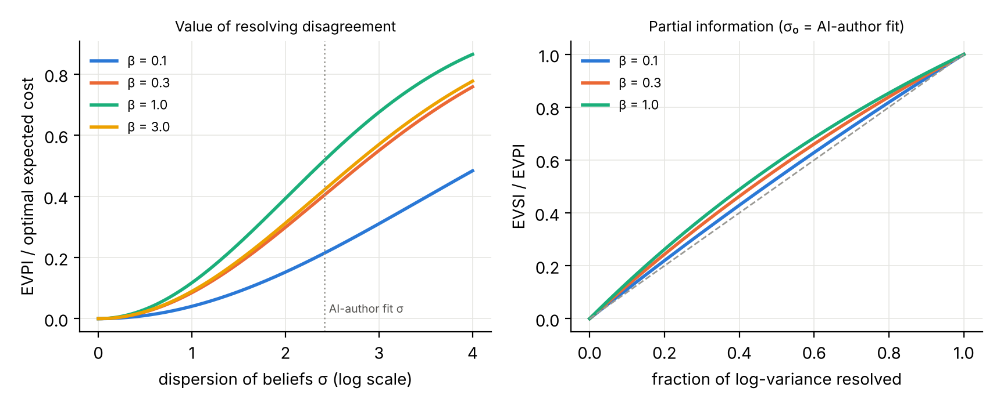
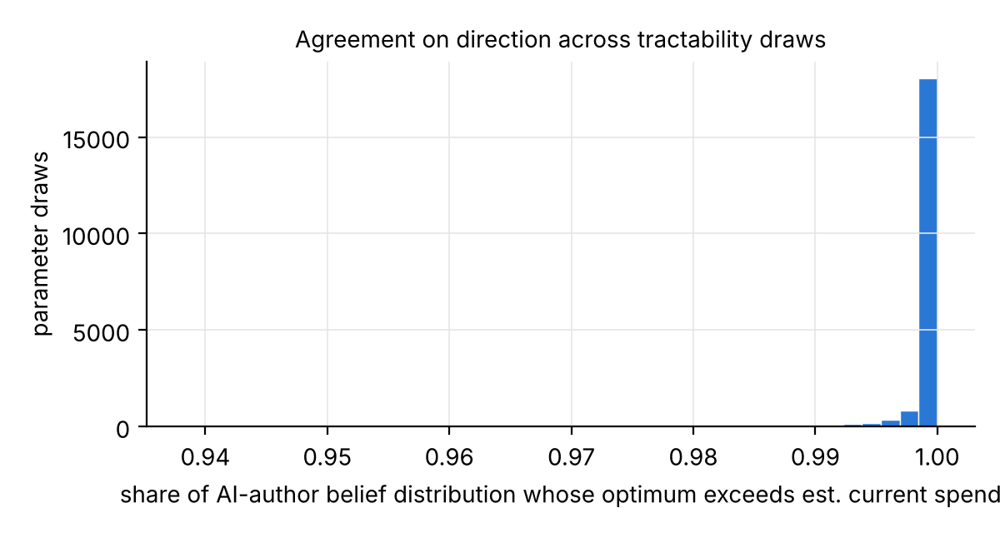
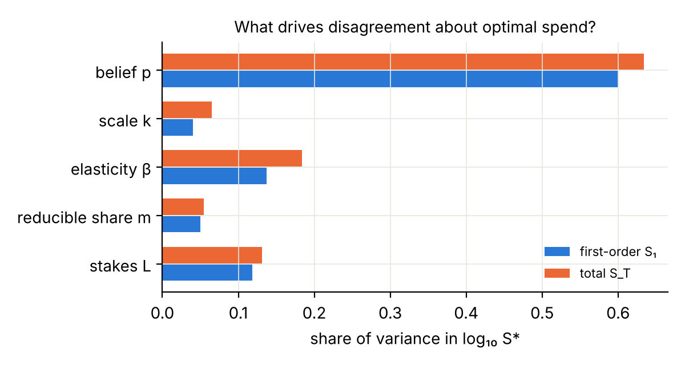
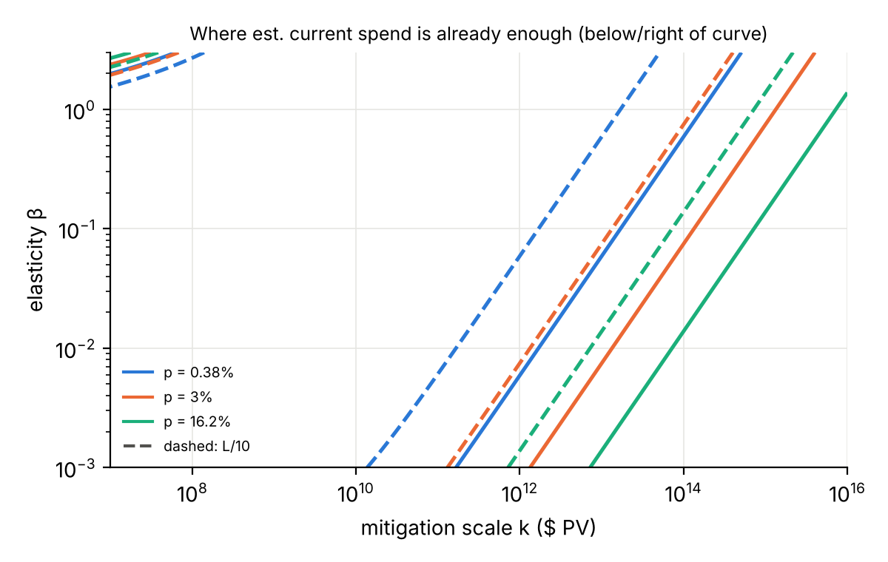

# Disagreeing About p(doom), Agreeing About the Budget? Belief Pooling, Tractability, and the Value of Information in Loss-of-Control Mitigation Spending

**Target venue:** AAAI/ACM Conference on AI, Ethics, and Society (AIES). A longer version would suit *Risk Analysis*.

**Code and data:** `code/` (run `python3 code/run_all.py`, ~10 s CPU). All model outputs are in `results/results.json`.

---

## Abstract

Published estimates of the probability that advanced AI causes an extinction-level loss-of-control (LoC) catastrophe span more than two orders of magnitude. The median superforecaster in the Existential Risk Persuasion Tournament (XPT) gave 0.38% by 2100. Domain experts in the same tournament gave 3%. Surveyed AI authors gave a median of 5% and a mean of 16.2%. Policy discussion often assumes that this disagreement must be settled before a mitigation budget can be set. We test that assumption with a minimal, fully analytic decision model. A planner chooses present-value mitigation spending $S$ against a baseline catastrophe probability $p$ and a present-value loss $L$, and mitigation follows an isoelastic residual-risk curve with scale $k$, elasticity $\beta$ and reducible share $m$.

We derive five analytical results and one numerical finding:
1. Optimal spending has the closed form $S^*=k[(mp\beta L/k)^{1/(1+\beta)}-1]^+$. Its elasticity with respect to the believed risk is $1/(1+\beta)<1$, so belief disagreement is compressed.
2. Below the threshold belief $p_{\min}=k/(m\beta L)$, zero spending is optimal. With sourced stakes, this threshold is around $10^{-7}$, orders of magnitude below any published forecast.
3. Linear pooling of forecasters always implies at least as much spending as log-odds pooling, and at least as much as the average of the forecasters' individual optima. The spending gap between pooling rules is the belief gap raised to $1/(1+\beta)$.
4. The expected value of perfect information (EVPI) about $p$ has a closed form. For lognormal beliefs, EVPI as a share of optimal expected cost is $1-\exp(-a(1-a)\sigma^2/2)$ with $a=1/(1+\beta)$, which peaks at $\beta=1$.
5. For any convex mitigation curve, current spending is too low if and only if the marginal dollar buys more than $1/L$ of absolute risk reduction. This test does not depend on the functional form.
6. Numerically, minimax-regret spending under belief ambiguity lies between the low-belief optimum and the maxmin rule. In our calibrations it sits close to the linear-pool optimum, because the regret from underspending exceeds the regret from overspending.

We calibrate the model with sourced inputs: US DOT VSL of $13.7M, world population of 8.2 billion, and published forecast summaries. The model then implies three things.

- **Pooling is a first-order budget choice.** The linear and log-odds pools of the AI-author distribution differ by 3.2× in belief and by 1.8–2.9× in optimal spending.
- **Under our baseline tractability priors, more spending is optimal for every forecaster.** At the XPT superforecaster median, the model's optimum exceeds an estimated $189M/yr of current AI-safety spending in 100% of 20,000 tractability draws. However, it does so in only 54–66% of a deliberately agnostic $(k,\beta)$ box.
- **The crux can be stated as one measurable quantity.** At 0.38% risk, current spending is adequate only if an extra $1B (present value) reduces LoC risk by less than about $6\times10^{-6}$ of itself.

Global sensitivity analysis shows that belief dispersion dominates variance in log optimal spending under narrow tractability priors. Under wide priors, disagreement about tractability ($k$, $\beta$) matters as much or more. We close with a pre-registered elicitation protocol that can falsify the model's behavioural predictions. Our contribution is a decision-analytic decomposition, not a new estimate of p(doom).

## 中文摘要

关于先进人工智能导致"失控"（loss of control）级灾难的概率，已发表的估计跨越两个数量级以上。存在性风险说服锦标赛（XPT）中，超级预测者给出的2100年前中位数为0.38%，领域专家为3%。对AI论文作者的大规模调查给出的中位数为5%，均值为16.2%。政策讨论常常默认必须先消除这种分歧，才能确定防范预算。本文用一个极简、完全可解析的决策模型检验这一假设。社会规划者针对基线灾难概率 $p$ 与现值损失 $L$ 选择缓解投入 $S$，剩余风险随投入呈等弹性下降，参数为尺度 $k$、弹性 $\beta$ 和可降低比例 $m$。

我们给出五个解析结果和一个数值结果：
1. 最优投入有闭式解，且对信念 $p$ 的弹性为 $1/(1+\beta)<1$，信念分歧在预算上被压缩。
2. 存在一个阈值信念，低于它时零投入才是最优。在有来源的参数下，该阈值约为 $10^{-7}$，远低于任何已发表的预测。
3. 线性汇总得出的预算不低于对数几率汇总，也不低于各预测者个人最优预算的平均值，二者的预算比等于信念比的 $1/(1+\beta)$ 次方。
4. 完全信息期望价值（EVPI）有闭式解。在对数正态信念下，它占最优期望成本的比例为 $1-\exp(-a(1-a)\sigma^2/2)$，在 $\beta=1$ 时最大。
5. 对任意凸的缓解曲线，"当前投入过低"当且仅当边际一美元带来的绝对风险下降超过 $1/L$，这一检验与函数形式无关。
6. 极小化最大遗憾规则给出的投入接近线性汇总的最优值，因为投入不足的遗憾大于投入过度的遗憾。

我们用有来源的数据标定模型：统计生命价值1370万美元，世界人口82亿，以及已发表的预测摘要统计量。主要发现有三点：
- 汇总规则本身是一阶的预算决策：两种汇总的信念相差3.2倍，预算相差1.8–2.9倍。
- 在基准可处理性先验下，每一位预测者的最优预算都更高。即便采用超级预测者0.38%的信念，在全部两万次参数抽样中，模型最优值都高于估计的当前约每年1.89亿美元的投入；但在一个刻意不设倾向的宽泛参数区域中，这一比例只有54–66%。
- 分歧的关键可以归结为一个可测量量：在0.38%的风险下，只有当额外10亿美元（现值）使失控风险相对下降不到约百万分之六时，当前投入才算足够。

全局敏感性分析显示，可处理性先验较窄时，信念分歧主导最优预算对数的方差；先验较宽时，可处理性分歧与信念分歧同等重要甚至更重要。最后，我们给出一个可证伪模型行为预测的预注册调查方案。本文的贡献是一个决策分析分解，而不是对失控概率的新估计。

---

## 1 Introduction

How likely is it that advanced AI systems escape meaningful human control, and how much should societies spend to prevent it? Both halves of this question are contested.

On probability, the spread among informed forecasters is very large. In the 2022 Existential Risk Persuasion Tournament (XPT), the median superforecaster put the probability of AI-caused human extinction by 2100 at 0.38%, against 3% for domain experts. Four months of structured argument did not materially move either group [Karger et al., 2025]. In a 2023 survey of 2,778 authors of top AI venues, the question on "human extinction or similarly permanent and severe disempowerment" drew a median of 5% and a mean of 16.2% [Grace et al., 2024]. Individual analyses range from about 5% by 2070 for misaligned power-seeking [Carlsmith, 2022] to much higher figures. Consensus statements describe loss of control as a serious possibility without assigning it a probability [Bengio et al., 2024; Bengio et al., 2025].

On resources, the most developed economic treatment is Jones [2025]. Using value-of-statistical-life (VSL) reasoning that places no weight on future generations, it argues that spending at least 1% of GDP per year on mitigating AI existential risk is justified in most of its scenarios. Disclosed AI-safety funding is far smaller. A widely cited compilation estimates about $189M in 2024 [McAleese, 2025 update], and this figure excludes undisclosed internal lab budgets.

The two halves are usually linked by plugging *one* probability into *one* cost-benefit calculation. That step hides three questions that matter for policy when forecasters disagree this much:

1. **How much does belief disagreement actually move the budget?** If spending is very sensitive to $p$, there is no defensible budget until the disagreement is resolved. If it is insensitive, a budget can be robust to the disagreement.
2. **Whose probability?** A committee or funder must combine forecasts. Standard pooling rules, such as averaging probabilities or averaging log-odds [Genest and Zidek, 1986; Satopää et al., 2014], can differ by several-fold on heavy-tailed forecast distributions. It is not known how such differences pass through to the budget.
3. **What is resolving the disagreement worth?** Evaluations, forecasting tournaments and threat-model research are partly *information* purchases. Their value should be compared with direct mitigation in the same units.

**This paper.** We build the simplest model that answers these three questions in closed form, and calibrate it only with sourced inputs plus clearly labelled assumptions. The model deliberately omits growth benefits of AI, multiple catastrophes and dynamics. Those are studied by Jones [2024, 2025] and Martin and Pindyck [2015]. We isolate the mapping from *disagreement* to *budget*.

**Contributions.**

- **C1 (closed form and compression).** We derive $S^*(p)$, the minimised cost $C^*(p)$ and the zero-spending threshold $p_{\min}$ for an isoelastic mitigation curve. We show that budget elasticity with respect to belief is $1/(1+\beta)$, so belief ratios are compressed in the budget. The model reproduces this numerically (0.7693 vs the theoretical 0.7692 at $\beta=0.3$).
- **C2 (pooling).** We prove an ordering of the budgets implied by log-odds pooling, the mean of individual optima, and linear pooling. We quantify the gap on a logit-normal distribution fitted to the AI-author survey, which reproduces the survey's independently reported share of respondents at or above 10%. The gap is 1.8–2.9× in budget for a 3.2× gap in pooled belief.
- **C3 (value of information).** We give closed-form EVPI and EVSI for beliefs about $p$. For lognormal beliefs, the share of expected cost that information can save is $1-\exp(-a(1-a)\sigma^2/2)$, which is maximised at $\beta=1$. Numerically, perfect resolution of the AI-author disagreement is worth 47–76% of the optimal mitigation budget at the pooled belief.
- **C4 (functional-form-free crux).** For *any* convex mitigation curve, current spending is too low exactly when the marginal dollar buys more than $1/L$ of absolute risk reduction. We translate this into the breakeven *relative* risk reduction per $1B for each published forecast. That turns a disagreement about p(doom) into a single, in-principle measurable quantity.
- **C5 (sensitivity and robustness).** Sobol analysis and minimax-regret calculations show when belief disagreement dominates and when tractability disagreement dominates. Under our baseline priors, every forecaster's optimum exceeds estimated current spending. In an agnostic tractability box, current spending is adequate for a large minority of parameter space, and we map that region.
- **C6 (falsifiable protocol).** We propose a pre-registered elicitation that tests three behavioural predictions of the model in expert populations.

We do not claim a new estimate of the LoC probability, and the absolute dollar figures should not be read as a budget recommendation. They depend on a mitigation technology that nobody has measured. The structural results (C1–C4) hold within the model class. The numerical results inherit every limitation in §8.

## 2 Related Work

**Estimates of AI catastrophic and LoC risk.** Carlsmith [2022] decomposes the risk from power-seeking AI into six premises and reaches about 5% by 2070. Grace et al. [2024] survey 2,778 AI authors. Karger et al. [2025] report the XPT, in which superforecasters and experts forecast existential risks with incentives to persuade each other and stayed far apart on AI. Field [2025] surveys 111 AI experts and finds two clusters of views ("controllable tool" vs "uncontrollable agent"). Truong, Puranam and Koçak [2025] trace doomer/boomer disagreement to causal rather than moral premises. Hendrycks, Mazeika and Woodside [2023] give a taxonomy of catastrophic AI risks. Bengio et al. [2024] and the *International AI Safety Report* [Bengio et al., 2025] put loss of control among the principal risks of general-purpose AI. This literature produces *inputs* to our model. We take its summary statistics as given and ask how their dispersion should enter resource decisions.

**Economics of catastrophe and AI risk.** Weitzman [2009] shows how structural uncertainty fattens the tails of damage distributions and can dominate discounting. Martin and Pindyck [2015] show that with several catastrophes, averting each one whose benefit exceeds its cost is not optimal in general. Millett and Snyder-Beattie [2017] apply expected-value reasoning to extinction-level biorisk and conclude that its reduction can be cost-effective even at low probabilities. Jones [2024] models the trade-off between AI-driven growth and existential risk. Jones [2025] asks directly how much to spend on reducing AI existential risk, and finds that at least 1% of GDP per year is justified for most parameter combinations. Our model is a deliberately stripped-down static relative of Jones [2025]. It drops consumption, growth and timing in order to obtain closed forms for the *comparative statics in belief*, for pooling, and for the value of information. None of these is the focus of that paper.

**Pooling and ambiguity.** Genest and Zidek [1986] review rules for combining probability distributions. Satopää et al. [2014] show that averaging log-odds, especially when extremised, aggregates probability forecasts well. In decision theory, maxmin expected utility [Gilboa and Schmeidler, 1989] and smooth ambiguity [Klibanoff, Marinacci and Mukerji, 2005] give alternatives to collapsing disagreement into one prior. We compare rules by the *budget* they imply rather than by forecast accuracy, which cannot be scored for a one-shot event in 2100.

**Gap.** We found no paper that (i) derives how belief dispersion about LoC risk passes through to optimal mitigation spending, (ii) compares pooling rules by their budget consequences, or (iii) prices the resolution of the disagreement in the same units as mitigation. Our literature search (web search, November 2026) found Jones [2025] as the closest work, and it uses scenario values of risk rather than a belief distribution.

## 3 Model

### 3.1 Set-up

A planner chooses present-value (PV) mitigation spending $S\ge 0$. Absent additional mitigation, an LoC catastrophe occurs over the horizon with probability $p$. If it occurs, the PV loss is $L$. Mitigation scales the residual probability by

$$g(S)=(1-m)+m\,(1+S/k)^{-\beta},\qquad 0<m\le 1,\;k>0,\;\beta>0. \tag{1}$$

Here $m$ is the reducible share of risk, $k$ is the spending scale at which mitigation begins to bite, and $\beta$ is the elasticity of reducible risk to spending once $S\gg k$. With $\beta=1$, doubling large-scale spending halves the reducible risk. With $\beta=0.1$, it cuts the reducible risk by 7%. The planner minimises expected social cost

$$C(S;p)=p\,L\,g(S)+S. \tag{2}$$

Eq. (1) is a two-parameter family with diminishing returns that nests near-linear returns (small $S/k$) and power-law returns (large $S/k$). As $\beta\to\infty$ with $k/\beta$ fixed, it tends to the exponential form $e^{-S\beta/k}$. We use it for tractability. §6.4 gives a test that does not depend on it.

### 3.2 Closed forms

**Proposition 1 (optimal spending, threshold, compression).** Let $A\equiv mp\beta L/k$ and $a\equiv 1/(1+\beta)$.
(i) $S^*(p)=k\,(A^{a}-1)$ if $A>1$, and $S^*=0$ otherwise.
(ii) Zero spending is optimal if and only if $p\le p_{\min}\equiv k/(m\beta L)$.
(iii) For $A\gg1$, $\partial\ln S^*/\partial\ln p\to a=1/(1+\beta)$, $\partial\ln S^*/\partial\ln L\to a$, and $\partial\ln S^*/\partial\ln k\to \beta/(1+\beta)$. In particular, two forecasters whose beliefs differ by a factor $R$ disagree about the budget by a factor of only about $R^{1/(1+\beta)}$.

*Proof.* $C$ is strictly convex in $S$ because $g''>0$. The first-order condition is $mp\beta L k^{-1}(1+S/k)^{-(1+\beta)}=1$, which gives (i). The derivative at $S=0$ is $1-A$, which gives (ii). Differentiating $\ln(k(A^a-1))$ and taking $A\to\infty$ gives (iii). $\square$

**Lemma 2 (minimised cost).** For $A>1$,
$$C^*(p)=pL(1-m)+k\big[(1+\tfrac1\beta)A^{a}-1\big],$$
and $C^*(p)=pL$ for $A\le1$. $C^*$ is concave in $p$.

*Proof.* Substitute $(1+S^*/k)=A^a$ into (2) and use $A\cdot A^{-a\beta}=A^{a}$. $C^*$ is a pointwise minimum of functions linear in $p$, so it is concave. $\square$

### 3.3 Pooling disagreeing forecasters

Let forecasters $i$ hold beliefs $p_i$ with weights $w_i$. We compare four candidate budgets:

- $S^*(\bar p_{\text{lin}})$, the optimum at the linear pool $\bar p_{\text{lin}}=\sum w_ip_i$;
- $S^*(\bar p_{\text{lo}})$, the optimum at the log-odds pool $\bar p_{\text{lo}}=\mathrm{logit}^{-1}(\sum w_i\,\mathrm{logit}\,p_i)$;
- the optimum at the median forecaster, which equals the median of individual optima because $S^*$ is monotone;
- the mean of individual optima $\sum w_iS^*(p_i)$, a "compromise" budget.

**Proposition 3 (budget ordering).** (i) If all $p_i\le\tfrac12$, then $S^*(\bar p_{\text{lo}})\le S^*(\bar p_{\text{lin}})$.
(ii) If every $p_i>p_{\min}$, then $\sum w_iS^*(p_i)\le S^*(\bar p_{\text{lin}})$.
(iii) If both pooled beliefs exceed $p_{\min}$ and $A\gg1$, then $S^*(\bar p_{\text{lin}})/S^*(\bar p_{\text{lo}})\approx(\bar p_{\text{lin}}/\bar p_{\text{lo}})^{1/(1+\beta)}$.

*Proof.* (i) We prove it under the sufficient condition that all $p_i\le\tfrac12$. Since $\mathrm{logit}''(p)=-(1-2p)/(p^2(1-p)^2)\le0$ on $(0,\tfrac12]$, the logit is concave there. Jensen's inequality gives $\sum w_i\,\mathrm{logit}\,p_i\le\mathrm{logit}\,\bar p_{\text{lin}}$, so $\bar p_{\text{lo}}\le\bar p_{\text{lin}}$, and $S^*$ is non-decreasing in $p$. Without the condition the inequality can fail for distributions with substantial mass above ½. (ii) On $p>p_{\min}$, $S^*$ is a positive multiple of a concave power minus a constant, so it is concave, and Jensen's inequality applies. (iii) follows from Proposition 1(iii). $\square$

*Remark.* Part (i) needs a sufficient condition because it is not a universal inequality. The fitted AI-author distribution has 11% of its mass above ½ (computed from the fit), so it does not meet the condition. For it, and for every distribution in §5, we compute the pooled values directly and check the ordering numerically.

### 3.4 Value of information about $p$

Suppose the planner's uncertainty about $p$ is a distribution $F$, here taken to be the distribution of forecaster beliefs. Without further information the planner minimises $\mathbb E_F[C(S;p)]=C(S;\bar p)$, because $C$ is linear in $p$, and so attains $C^*(\bar p)$. If $p$ is learned before $S$ is chosen, expected cost is $\mathbb E_F[C^*(p)]$.

**Proposition 4 (EVPI and EVSI).** (i) $\mathrm{EVPI}=C^*(\bar p)-\mathbb E_F C^*(p)\ge0$, which follows from Lemma 2 and Jensen's inequality.
(ii) If $p$ is lognormal with log-s.d. $\sigma$ and $A\gg1$ on its support, then
$$\frac{\mathrm{EVPI}}{C^*(\bar p)}\approx 1-\exp\!\big(-a(1-a)\sigma^2/2\big),$$
which is maximised over $\beta$ at $\beta=1$ ($a=\tfrac12$).
(iii) If an unbiased Gaussian signal on $\ln p$ reduces the posterior log-variance from $\sigma_0^2$ to $\sigma_1^2$, then
$$\frac{\mathrm{EVSI}}{\mathrm{EVPI}}=\frac{1-\exp(-c(\sigma_0^2-\sigma_1^2))}{1-\exp(-c\sigma_0^2)},\qquad c=\tfrac{a(1-a)}2.$$
This is concave in the fraction of variance resolved, so the first units of information are the most valuable.

*Proof.* (ii) For large $A$, $C^*(p)\approx K p^{a}-k$ with $K=k(1+1/\beta)(m\beta L/k)^{a}$. With $\ln p\sim N(\mu,\sigma^2)$: $\mathbb E p^{a}=e^{a\mu+a^2\sigma^2/2}$ and $\bar p^{a}=e^{a\mu+a\sigma^2/2}$. Their ratio is $e^{-a(1-a)\sigma^2/2}$, and $a(1-a)$ is maximised at $a=\tfrac12$. (iii) By normal–normal conjugacy, the posterior mean of $p$ is $\hat p=e^{\hat\mu+\sigma_1^2/2}$ with $\hat\mu\sim N(\mu,\sigma_0^2-\sigma_1^2)$. Compute $\mathbb E\hat p^{a}$ in the same way and take the ratio of differences. $\square$

The intuition for $\beta=1$ is as follows. When $\beta\to0$, mitigation is nearly useless, so knowing $p$ changes little. When $\beta\to\infty$, the budget barely responds to $p$ (elasticity $\to0$). Information is most valuable in between.

### 3.5 Robust rules

Treat the disagreement as a set $\mathcal P=[p_L,p_H]$ of priors with no weights. Under maxmin expected utility [Gilboa and Schmeidler, 1989], the planner spends $S^*(p_H)$, because $C$ increases in $p$ for every $S$. Under minimax regret, the planner minimises $\max_{p\in\mathcal P}[C(S;p)-C^*(p)]$. We compute this numerically on a grid of 60 values of $p$ in $\mathcal P$.

## 4 Calibration

All inputs and their status are listed in Table 1. Inputs marked "assumption" are not data. They are the quantities on which §6 shows the conclusions depend.

**Table 1. Inputs.**

| Quantity | Value | Status / source |
|---|---|---|
| VSL | $13.7M | US DOT guidance, 2024 base year [US DOT, 2024] |
| World population | 8.2×10⁹ | UN WPP 2024 [UN DESA, 2024] |
| Catastrophe timing | uniform on 2026–2100 | assumption |
| Discount rate | 3%/yr | assumption, giving PV factor $D=0.398$ (computed) |
| $L$ (baseline) | VSL × pop. × $D$ = 4.47×10¹⁶ $ | computed. People alive today only, no future generations, US VSL applied globally |
| $L$ (low / high) | ÷10 / undiscounted (1.12×10¹⁷) | assumption (low ≈ income-adjusted global VSL) |
| XPT AI-extinction-by-2100 medians | 0.38% (superforecasters), 3% (experts) | Karger et al. [2025] and FRI reporting |
| AI-author extinction/disempowerment Q | median 5%, mean 16.2% | Grace et al. [2024] |
| Current AI-safety spend | ≈$189M/yr (2024) | McAleese [2025 update]; excludes undisclosed lab budgets |
| Current spend (PV) | $3.29B | computed, 25-yr annuity at 3% |
| $k$, $\beta$ (illustrative) | $1B, 0.3 | assumption |
| $k$, $\beta$, $m$ priors (Sobol, E6) | log-U[$10^8$,$10^{11}$], log-U[0.05,1], U[0.1,1] | assumption |

**Belief distributions.** Individual-level forecasts are not public for either source, so we build three belief distributions from published summaries:

- **AI-author distribution.** A logit-normal with median 5%, which fixes $\mu=\text{logit}(0.05)$, and mean 16.2%, solved numerically. The result is $\sigma=2.414$ on the logit scale, with 10th and 90th percentiles of 0.24% and 53.7%. *Validation:* the fitted distribution puts 37.8% of mass at or above 10%. Grace et al. [2024] independently report that 38–51% of respondents gave at least 10% to extinction-level outcomes, with the figure depending on question framing. Our fit reproduces the lower end of that range, and we did not fit to this statistic.
- **XPT two-group mixture.** An equal mixture of logit-normals centred at the two XPT medians, with within-group dispersion borrowed from the AI-author fit. *The within-group dispersion is an assumption*, because XPT dispersion statistics were not available to us.
- **XPT two-point.** Mass ½ on each XPT median. This is the minimal representation of the superforecaster–expert split.

Forecaster populations are represented by a 4,000-point equal-weight quantile grid. Probabilities are clipped to $[10^{-12},1-10^{-12}]$ so that logits stay finite.

**Verification (E0).** We compared the closed forms with bounded numerical minimisation (`scipy.optimize.minimize_scalar`) in 300 random cases spanning $p\in[10^{-6},0.5]$, $L\in[10^{15},10^{17.1}]$, $k\in[10^7,10^{12}]$, $\beta\in[0.03,3.2]$ and $m\in[0.05,1]$. The closed-form cost was never worse than the numerical optimum. The maximum relative cost discrepancy was $3.9\times10^{-15}$.

## 5 Results

All numbers in this section are model outputs from `results/results.json` unless a citation is attached.

### 5.1 Compression of belief disagreement (E1)

Figure 1 plots $S^*$ against $p$ for $k=\$1$B. Between the XPT superforecaster median (0.38%) and the expert median (3%), a belief ratio of 7.9, the optimal budget rises by:

| $\beta$ | 0.1 | 0.3 | 1.0 |
|---|---|---|---|
| Budget ratio (experts/superforecasters) | 6.54 | 4.90 | 2.81 |
| Numerical elasticity | 0.909 | 0.769 | 0.501 |
| Theory, $1/(1+\beta)$ | 0.909 | 0.769 | 0.500 |
| Threshold belief $p_{\min}$ | 2.2×10⁻⁷ | 7.5×10⁻⁸ | 2.2×10⁻⁸ |

The threshold belief below which zero spending is optimal is four to five orders of magnitude below the lowest published median forecast. Within this model, then, no published forecaster's belief implies that zero additional spending is optimal. Disagreement concerns the *size* of spending, not whether to spend.

*Figure 1. Optimal spending (annualised over 25 years) vs belief, for three mitigation elasticities. Dashed line: an estimate of 2024 AI-safety funding (McAleese, 2025). Absolute levels depend on the assumed $k$ and should not be read as recommendations.*

The *absolute* optima are very large. At $\beta=0.3$ and $k=\$1$B, the superforecaster optimum is $4.2T PV (about $240B/yr) and the expert optimum is $20.5T PV. This comes from the isoelastic curve having no absorptive-capacity limit and from the large stakes ($L=\$4.5\times10^{16}$). We treat these levels as conditional illustrations, as discussed in §8.

### 5.2 Pooling is a budget decision (E2)

**Table 2. Pooled beliefs and implied budgets (PV, $k=\$1$B).**

| Belief model | linear pool | log-odds pool | ratio (belief) | budget ratio lin/log-odds, β=0.1 / 0.3 / 1 | mean-of-optima ÷ linear, β=0.1 / 0.3 / 1 |
|---|---|---|---|---|---|
| AI-author logit-normal | 16.2% | 5.0% | 3.24 | 2.91 / 2.47 / 1.80 | 0.93 / 0.85 / 0.77 |
| XPT two-group mixture | 7.76% | 1.07% | 7.23 | 6.04 / 4.58 / 2.69 | 0.90 / 0.78 / 0.67 |
| XPT two-point | 1.69% | 1.07% | 1.57 | 1.51 / 1.42 / 1.25 | 0.97 / 0.94 / 0.90 |

These results confirm Proposition 3 numerically. On heavy-tailed belief distributions, the linear pool is driven by the minority of forecasters with very high probabilities, and the budget gap between the two standard rules is several-fold. The "mean of individual optima" sits between the two pools. It is 67–97% of the linear-pool budget, and the gap widens as $\beta$ rises, because higher $\beta$ makes $S^*$ more concave in $p$. In the logit-normal models the median forecaster coincides with the log-odds pool (5.0% and 1.07%), because the distribution is symmetric on the logit scale. Figure 2 shows the budgets.

*Figure 2. Implied annualised budgets under four aggregation rules for two belief models.*

*Implication.* A funder who reports "we used the expert consensus" has implicitly chosen a pooling rule, and that choice can move the budget by up to 6× on the XPT mixture. The forecasting literature favours log-odds pooling for *accuracy* on resolvable questions [Satopää et al., 2014]. Accuracy for a one-shot catastrophe cannot be scored, however, and nothing in decision theory makes the accuracy-optimal pool the budget-optimal one. We recommend reporting budgets under at least the linear and log-odds pools.

### 5.3 Robust rules (E3)

For the XPT interval $[0.38\%,3\%]$ at $\beta=0.3$:

| Rule | Budget (PV) |
|---|---|
| Optimum at low belief | $4.17T |
| Minimax regret | $11.6T |
| Optimum at linear midpoint | $13.2T |
| Maxmin (optimum at high belief) | $20.5T |

The minimax-regret budget lies close to the linear-midpoint budget and well above the low-belief optimum. Regret is asymmetric. Spending the low-belief optimum when the high belief is true costs $25.4T in regret. Spending the high-belief optimum when the low belief is true costs $11.0T. The same ordering holds for $\beta\in\{0.1,1\}$ and for the AI-author 10–90% interval, where low-at-high regret is $1.38\times10^{15}$ and high-at-low regret is $1.78\times10^{14}$ at $\beta=0.3$. The asymmetry follows from the model. Underspending exposes the full loss $L$ scaled by the high probability, while overspending wastes at most the dollar difference in budgets.

### 5.4 Value of resolving the disagreement (E4)

**Table 3. EVPI about $p$ (PV), relative to the optimal budget at the pooled belief and to the optimal expected cost.**

| Belief model | β | EVPI / $S^*(\bar p)$ | EVPI / $C^*(\bar p)$ |
|---|---|---|---|
| AI-author logit-normal | 0.1 / 0.3 / 1.0 | 0.76 / 0.65 / 0.47 | 0.07 / 0.15 / 0.23 |
| XPT two-group mixture | 0.1 / 0.3 / 1.0 | 1.14 / 0.96 / 0.67 | 0.10 / 0.22 / 0.33 |
| XPT two-point | 0.1 / 0.3 / 1.0 | 0.32 / 0.28 / 0.19 | 0.03 / 0.06 / 0.10 |

Even the minimal two-point XPT split has an EVPI equal to 19–32% of the optimal mitigation budget. For the AI-author distribution, perfect resolution would be worth about half to three-quarters of the optimal mitigation budget. These are upper bounds, because no real programme delivers perfect information. Proposition 4(iii) and Figure 3 (right panel) show, however, that EVSI is concave in the share of log-variance resolved. Resolving half of the log-variance captures more than half of EVPI for every $\beta$ we considered. The lognormal closed form (Figure 3, left panel) overstates the share relative to the logit-normal numerics, for example 0.40 vs 0.15 at $\beta=0.3$, because probabilities are bounded by 1 and the logit-normal tail is truncated. The *shape* in $\beta$ (peaking near $\beta=1$) is preserved.

*Figure 3. Left: closed-form EVPI share vs belief dispersion (lognormal approximation). Right: EVSI/EVPI vs the fraction of log-variance resolved, with the dashed diagonal for reference.*

*Implication.* Within the model, research that narrows the LoC probability is a large-value activity in its own right. Examples include dangerous-capability and control evaluations, empirical tests of threat-model premises, and better-calibrated forecasting. Its value is commensurable with mitigation and of similar order. A portfolio that spends almost nothing on resolving the disagreement is unlikely to be optimal unless such research is very ineffective at reducing variance.

### 5.5 Agreement on direction under baseline priors (E6)

We drew 20,000 tractability parameter sets $(k,\beta,m,L)$ from the baseline priors in Table 1. For each draw we computed the share of the AI-author belief distribution whose individual optimum exceeds the estimated current spend ($3.29B PV ≈ $189M/yr):

- Median share: 1.000. 10th percentile: 0.9985.
- The majority of forecasters' optima exceed current spend in 100% of draws, and exceed 5× current spend in 100% of draws.
- At the XPT superforecaster median (0.38%), $S^*$ exceeds current spending in 100% of draws and exceeds 10× current spending in 99.98% of draws. The annualised optimum has quantiles of $19B (10%), $86B (50%) and $361B (90%) per year.

*Figure 5. Across 20,000 baseline tractability draws, the share of the AI-author belief distribution whose optimum exceeds estimated current spending.*

This near-unanimity is a consequence of the baseline priors*, so §6 removes it on purpose.

### 5.6 What drives disagreement about the budget? (E5, E8)

We ran a variance-based (Sobol) decomposition of $\log_{10}S^*$ using Jansen estimators with $2^{17}$ base samples and 100 bootstrap replicates. Total-effect indices are below, with 95% bootstrap CIs no wider than ±0.006.

| Scenario | belief $p$ | scale $k$ | elasticity $\beta$ | reducible share $m$ | stakes $L$ |
|---|---|---|---|---|---|
| AI-author beliefs, baseline tractability priors | **0.63** | 0.07 | 0.18 | 0.05 | 0.13 |
| AI-author beliefs, wide priors ($k\in[10^7,10^{13}]$, $\beta\in[0.01,3]$) | 0.62 | 0.41 | 0.43 | 0.09 | 0.17 |
| XPT two-point beliefs, baseline priors | 0.32 | 0.12 | 0.24 | 0.11 | 0.26 |
| XPT two-point beliefs, wide priors | 0.31 | **0.62** | **0.60** | 0.17 | 0.29 |

*Figure 4. First-order and total Sobol indices for $\log_{10}S^*$ (AI-author beliefs, baseline priors).*

Under the very wide AI-author dispersion ($\sigma=2.4$ logits) and narrow tractability priors, belief disagreement explains most of the variance in log budget. This partly contradicts the intuition that compression makes $p$ unimportant: compression by $1/(1+\beta)$ does not offset a belief spread of two to three orders of magnitude. When belief disagreement is limited to the superforecaster–expert split, or when tractability priors are as uncertain as we believe the evidence warrants, tractability parameters jointly carry as much variance as belief or more. Their total indices sum above 1 because of interactions.

## 6 The crux, stated without functional form

### 6.1 A general marginal test

**Proposition 5.** Let $g$ be any differentiable, decreasing, convex residual-risk curve, and let current spending be $S_c$. Then $S^*>S_c$ if and only if $-p\,L\,g'(S_c)>1$. Equivalently, the marginal dollar at $S_c$ must buy more than $1/L$ of absolute risk reduction. In relative terms, it must cut the risk by more than $1/(pL)$ of itself.

*Proof.* $C(S;p)=pLg(S)+S$ is convex, so it is increasing at $S_c$ exactly when $S_c\ge S^*$. $\square$

The proposition is elementary, but it changes what the dispute is about. Two parties who disagree about whether to spend more need not disagree about $p$ at all. The decision depends on $p$ only through the product of $p$ and the marginal *relative* effectiveness of the next dollar.

### 6.2 Breakeven numbers (E7)

**Table 4. Breakeven marginal effectiveness for an extra $1B PV beyond current spending.**

| | $L$ low (4.5×10¹⁵) | $L$ base (4.5×10¹⁶) | $L$ high (1.1×10¹⁷) |
|---|---|---|---|
| Value of 1 basis point of absolute risk | $0.45T | $4.5T | $11.2T |
| Breakeven absolute reduction per $1B | 2.2×10⁻⁷ | 2.2×10⁻⁸ | 8.9×10⁻⁹ |
| Breakeven *relative* reduction per $1B, $p$=0.38% | 5.9×10⁻⁵ | 5.9×10⁻⁶ | 2.3×10⁻⁶ |
| … $p$=3% | 7.5×10⁻⁶ | 7.5×10⁻⁷ | 3.0×10⁻⁷ |
| … $p$=16.2% | 1.4×10⁻⁶ | 1.4×10⁻⁷ | 5.5×10⁻⁸ |

Take a forecaster at the superforecaster median who uses baseline stakes. For that forecaster to judge current spending adequate, they must believe that the next $1B (present value) reduces the probability of LoC catastrophe by less than 0.0006% of itself. With stakes cut tenfold, the bar is 0.006%. This number can be elicited, it can be argued about with evidence (for example, about the marginal productivity of alignment and control research), and it does not depend on Eq. (1).

### 6.3 Where current spending is enough (E7 frontier)

Return to the isoelastic family with $m=1$, and scan a deliberately agnostic log-uniform box: $k\in[10^7,10^{16}]$ and $\beta\in[10^{-3},3]$. The share of the box where more spending is optimal is:

| Belief | $L$ base | $L$ low |
|---|---|---|
| XPT superforecasters (0.38%) | 66% | 54% |
| XPT experts (3%) | 76% | 65% |
| AI-author mean (16.2%) | 84% | 73% |

Figure 6 shows the frontier. Current spending is adequate in two regions:

- **The intractable corner** (large $k$, small $\beta$). Here nothing helps until spending reaches the tens of trillions. At $\beta=0.3$ and baseline stakes, the superforecaster belief implies more spending unless $k>\$5.1\times10^{13}$, or $k>\$5.1\times10^{12}$ with low stakes.
- **The already-solved corner** (small $k$, large $\beta$). Here current spending has already driven reducible risk near zero.

The near-unanimity in §5.5 therefore holds exactly when one rules out both corners a priori. Whether that is justified is the real empirical question.

*Figure 6. Frontier in $(k,\beta)$ space at which estimated current spending is optimal, for three beliefs (solid: baseline $L$; dashed: $L/10$). More spending is optimal to the left of each main diagonal curve. Current spending is adequate to its right (intractable corner) and also in the small top-left corner beyond the short curves (already-solved corner).*

## 7 Discussion

**How likely, and how much?** Our answer to the motivating question is conditional and structural. This paper does not narrow the LoC probability. It shows four things about how the probability enters the budget:

1. Belief disagreement is compressed by the exponent $1/(1+\beta)$.
2. Every published forecast lies far above the zero-spending threshold.
3. The choice of pooling rule moves the budget by up to several-fold.
4. Information about $p$ is worth a large fraction of the mitigation budget itself.

The question "how much to spend" is therefore at least as much a question about *tractability* as about probability. Proposition 5 reduces it to a single quantity: the marginal relative risk reduction per dollar at current spending.

**Policy implications, stated with the caveats.**

- **(a) Report a pooling rule.** Budgets derived from expert elicitation should state the pooling rule and report at least the linear and log-odds budgets (Table 2).
- **(b) Fund disagreement resolution.** Programmes that resolve the disagreement, such as evaluations, threat-model research and forecasting, should be valued on the same scale as mitigation. EVPI is 19–114% of the optimal mitigation budget across our belief models (Table 3).
- **(c) Argue about marginal effectiveness.** Disputes about whether to spend more should be reframed as disputes about marginal effectiveness at current spending, and the breakeven values in Table 4 make those disputes concrete.
- **(d) Contest tractability, not just probability.** Low current spending is consistent with low-but-published beliefs only if one believes either that mitigation is extremely intractable or that the risk is already largely solved at current spending (Figure 6). Proponents of the status quo should defend one of these positions explicitly.

**Relation to Jones [2025].** Jones finds that budgets of at least 1% of GDP can be justified even without weighting future generations. Our baseline results are consistent in order of magnitude: the superforecaster-belief optimum has a median of $86B/yr across draws. We add the mapping from forecast *dispersion* to the budget. We also show that, in an agnostic tractability box, current spending is adequate in roughly a quarter to a third of the parameter space under the expert belief, and in a third to nearly half under the superforecaster belief. That mitigation-effectiveness assumption is what any such calculation turns on.

### 7.1 Falsifiable predictions and a pre-registered test protocol

The model implies three behavioural predictions about how coherent experts should answer, and these can fail.

- **H1 (compression).** Within experts, regress log recommended annual spending on log $p$. The slope should be below 1. Under Eq. (1) it should be $1/(1+\hat\beta_i)$, where $\hat\beta_i$ is each expert's elicited elasticity.
- **H2 (tractability crux).** Among experts with $p<1\%$, those who judge current spending adequate should report marginal relative effectiveness per $1B below the Table 4 breakeven (about 6×10⁻⁶ at baseline stakes). Experts who report higher effectiveness but still endorse the status quo would be evidence that something other than expected-cost reasoning drives budget views, for example discounting, distrust of spending channels or ambiguity attitudes.
- **H3 (pooling sensitivity).** When the same elicited distribution is presented under linear vs log-odds aggregation, recommended committee budgets should differ by roughly the factor in Proposition 3(iii).

**Protocol.**
- *Sample:* authors at top ML venues together with forecasting-tournament participants, at least 300 respondents.
- *Elicitation items:*
  1. $p$, the probability of LoC catastrophe by 2100;
  2. the relative risk reduction from an extra $1B, $10B and $100B (PV) of global spending on alignment, control and governance, which identifies $(k,\beta,m)$ per respondent;
  3. a recommended annual global budget;
  4. a VSL-based stakes calibration item.
- *Pre-registered analyses:* the H1 slope with a bootstrap CI; for H2, the share of status-quo endorsers above breakeven; for H3, a within-subject randomised framing experiment.
- *Falsification criteria:*
  - H1 fails if the slope CI includes 1 or more.
  - H2 fails if more than 50% of low-$p$ status-quo endorsers report effectiveness above breakeven.
  - H3 fails if the framing effect is below 20% of the predicted factor.

We have not run this survey.

## 8 Limitations

1. **The mitigation technology is assumed, not measured.** $k$, $\beta$ and $m$ have no empirical estimates that we could find. The absolute budgets in §5 (trillions of dollars PV) come mainly from Eq. (1), which has no absorptive-capacity or talent constraints [McAleese, 2025, discusses whether the field is funding- or talent-constrained] and no possibility of counterproductive spending, such as safety work that speeds up capabilities. Proposition 5 and Table 4 are the results that do not depend on Eq. (1).
2. **Static, single-catastrophe, no benefits side.** We ignore the growth benefits of AI and their interaction with risk [Jones, 2024], the timing of spending and learning, competing catastrophes [Martin and Pindyck, 2015], and strategic interaction between labs or states. Mitigation spending is treated as a pure resource cost, although some mitigation (for example slowing deployment) has costs that are not budgetary.
3. **Belief inputs are reconstructions.** We did not have individual-level forecast data. The AI-author distribution is a two-moment logit-normal fit, checked against one independent summary statistic. The XPT within-group dispersion is borrowed from that fit. The surveys ask about extinction or "permanent and severe disempowerment", which is not identical to LoC. The XPT ran before ChatGPT's release, and beliefs may since have changed.
4. **Stakes.** Applying the US VSL to the world population overstates willingness to pay in lower-income countries. Our "low" case divides by 10 as a rough income adjustment, not a sourced global VSL. We place no value on future generations, which would raise $L$ by orders of magnitude and strengthen the "spend more" conclusions [cf. Millett and Snyder-Beattie, 2017].
5. **Current spending is uncertain.** The $189M/yr figure is a blog-based compilation of mostly philanthropic grants. It excludes internal lab safety budgets, which could raise the true figure several-fold. Our 5× and 10× comparisons address this only partly.
6. **Treating forecaster dispersion as epistemic uncertainty.** EVPI treats the forecaster distribution as the planner's prior. If disagreement reflects differing values or definitions rather than differing information, as Truong et al. [2025] suggest for some disputes, then the value of "information" is overstated.
7. **Proposition 3(i) is conditional.** The log-odds ≤ linear ordering holds for all distributions used here but is not universal for distributions with substantial mass above ½.

## 9 Conclusion

Disagreement about the probability of AI loss of control is large and persistent. In a transparent expected-cost model, however, it is less paralysing for budgeting than often assumed. Belief ratios are compressed in the budget, every published forecast clears the zero-spending threshold by orders of magnitude, and the crux reduces to a measurable marginal-effectiveness quantity. Two choices that are usually left implicit, the pooling rule and the amount of resources devoted to resolving the disagreement, are first-order budget decisions. The weakest link is the absence of any empirical estimate of how LoC risk responds to spending. Measuring it, for example through the elicitation protocol in §7.1 and through evaluation programmes designed to estimate marginal risk reduction, is the most decision-relevant next step this analysis identifies.

---

## References

All entries were verified to exist by web search in November 2026.

- Bengio, Y., Hinton, G., Yao, A., Song, D., Abbeel, P., et al. (2024). Managing extreme AI risks amid rapid progress. *Science*, 384(6698), 842–845. doi:10.1126/science.adn0117. (arXiv:2310.17688)
- Bengio, Y., et al. (2025). *International AI Safety Report* (International Scientific Report on the Safety of Advanced AI), January 2025. UK Department for Science, Innovation and Technology / AI Security Institute. https://assets.publishing.service.gov.uk/media/679a0c48a77d250007d313ee/International_AI_Safety_Report_2025_accessible_f.pdf
- Carlsmith, J. (2022). Is power-seeking AI an existential risk? arXiv:2206.13353.
- Field, S. (2025). Why do experts disagree on existential risk and P(doom)? A survey of AI experts. arXiv:2502.14870.
- Genest, C., and Zidek, J. V. (1986). Combining probability distributions: A critique and an annotated bibliography. *Statistical Science*, 1(1), 114–135. doi:10.1214/ss/1177013825.
- Gilboa, I., and Schmeidler, D. (1989). Maxmin expected utility with non-unique prior. *Journal of Mathematical Economics*, 18(2), 141–153. doi:10.1016/0304-4068(89)90018-9.
- Grace, K., Stewart, H., Sandkühler, J. F., Thomas, S., Weinstein-Raun, B., and Brauner, J. (2024). Thousands of AI authors on the future of AI. arXiv:2401.02843. (Journal version, with additional authors: *Journal of Artificial Intelligence Research*, 84, Article 9, 2025, doi:10.1613/jair.1.19087.)
- Hendrycks, D., Mazeika, M., and Woodside, T. (2023). An overview of catastrophic AI risks. arXiv:2306.12001.
- Jones, C. I. (2024). The A.I. dilemma: Growth versus existential risk. *American Economic Review: Insights*, 6(4), 575–590. doi:10.1257/aeri.20230570.
- Jones, C. I. (2025). How much should we spend to reduce A.I.'s existential risk? NBER Working Paper 33602. (Also a chapter in *The Economics of Transformative AI*, NBER/University of Chicago Press.)
- Karger, E., Rosenberg, J., Jacobs, Z., Hickman, M., and Tetlock, P. E. (2025). Subjective-probability forecasts of existential risk: Initial results from a hybrid persuasion-forecasting tournament. *International Journal of Forecasting*, 41(2), 499–516. doi:10.1016/j.ijforecast.2024.11.008. (Working-paper version: Forecasting Research Institute, "Forecasting Existential Risk: Evidence from a Long-Run Forecasting Tournament", 2023.)
- Klibanoff, P., Marinacci, M., and Mukerji, S. (2005). A smooth model of decision making under ambiguity. *Econometrica*, 73(6), 1849–1892. doi:10.1111/j.1468-0262.2005.00640.x.
- Martin, I. W. R., and Pindyck, R. S. (2015). Averting catastrophes: The strange economics of Scylla and Charybdis. *American Economic Review*, 105(10), 2947–2985. doi:10.1257/aer.20140806.
- McAleese, S. (2023; updated January 2025). An overview of the AI safety funding situation. LessWrong. https://www.lesswrong.com/posts/WGpFFJo2uFe5ssgEb/an-overview-of-the-ai-safety-funding-situation
- Millett, P., and Snyder-Beattie, A. (2017). Existential risk and cost-effective biosecurity. *Health Security*, 15(4), 373–383. doi:10.1089/hs.2017.0028.
- Satopää, V. A., Baron, J., Foster, D. P., Mellers, B. A., Tetlock, P. E., and Ungar, L. H. (2014). Combining multiple probability predictions using a simple logit model. *International Journal of Forecasting*, 30(2), 344–356. doi:10.1016/j.ijforecast.2013.09.009.
- Truong, N., Puranam, P., and Koçak, Ö. (2025). Why they disagree: Decoding differences in opinions about AI risk on the Lex Fridman podcast. arXiv:2512.06350.
- UN DESA, Population Division (2024). *World Population Prospects 2024: Summary of Results*. United Nations.
- US Department of Transportation (2024). Departmental guidance on valuation of a statistical life in economic analysis (VSL table by base year; $13.7M for 2024). https://www.transportation.gov/office-policy/transportation-policy/revised-departmental-guidance-on-valuation-of-a-statistical-life-in-economic-analysis
- Weitzman, M. L. (2009). On modeling and interpreting the economics of catastrophic climate change. *Review of Economics and Statistics*, 91(1), 1–19. doi:10.1162/rest.91.1.1.
