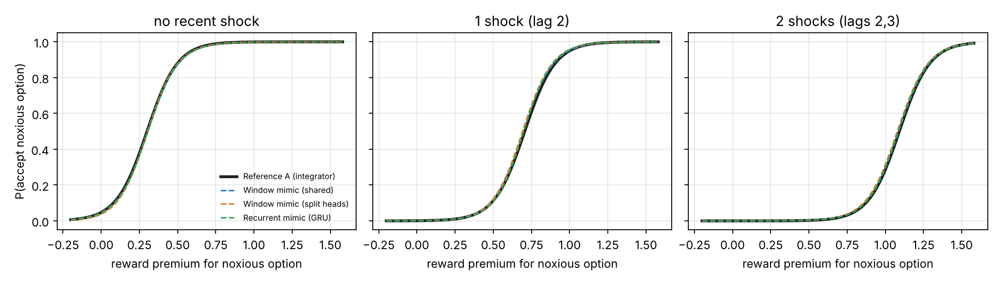
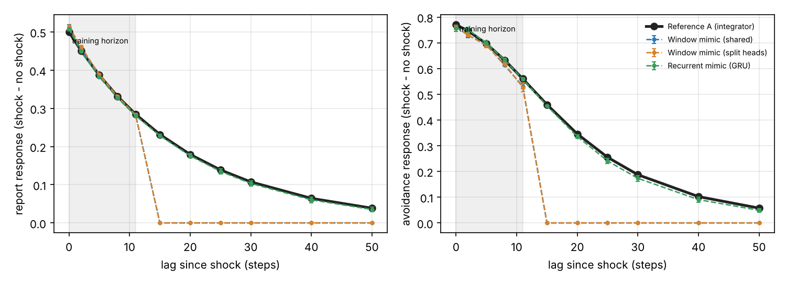
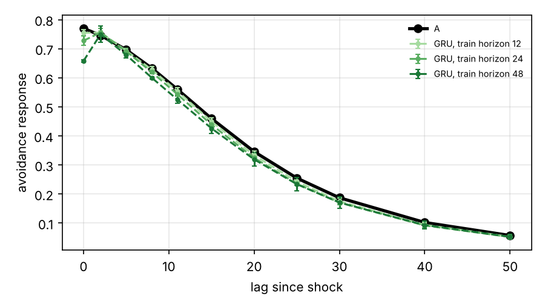
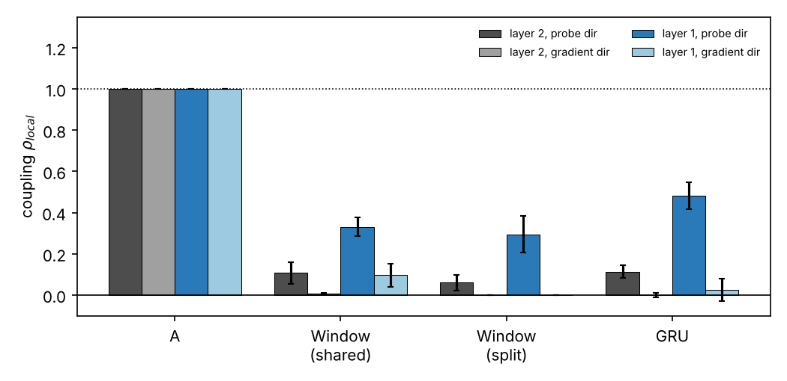
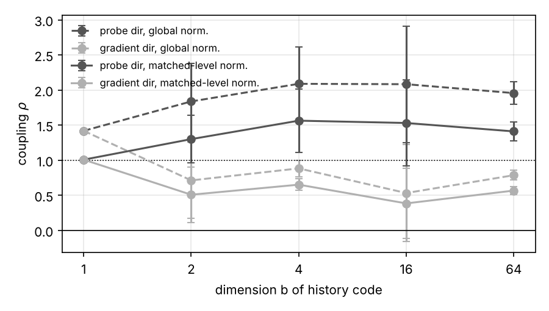

# Behaviourally Equivalent, Mechanistically Different: Bounds and a Testbed for Which AI Welfare Indicators Survive Imitation

**Target venue:** AAAI/ACM Conference on AI, Ethics, and Society (AIES 2027), technical-paper track

---

## Abstract

Proposals for assessing whether AI systems could have welfare increasingly rely on behavioural markers borrowed from animal-sentience research, such as motivational trade-offs between reward and a noxious cost, and on verbal self-reports. Birch's "gaming problem" says these markers are unreliable for systems trained on human-generated data, because such systems can reproduce the markers without the states the markers are meant to indicate. So far this objection has been argued informally. We make it precise and testable. First, we prove an *indistinguishability bound*. If a system imitates a reference agent with mean per-step KL divergence ε on an environment distribution D, then every bounded behavioural test computed from L-step trajectories drawn from D differs between the two by at most √(Lε/2). This covers trade-off curves, post-insult sensitisation and self-report consistency. Second, we prove a *non-identifiability result*. The causal coupling between a system's reported state and its choices is not a function of its input–output behaviour. Two systems with identical behaviour can have coupling coefficient ρ = 1 and ρ = 0. Third, we build a CPU-scale testbed. A reference agent has an affect-like integrator state that both drives its reports and sensitises its avoidance of noxious options. We train behavioural-cloning mimics of it: window MLPs, split-head MLPs and GRUs, 5 seeds each. Every mimic reproduces the reference's trade-off indifference points to within 0.015 (reference 0.300, 0.706 and 1.092). Two families of tests separate the systems that the behavioural markers cannot. (i) A persistence test outside the training horizon separates window mimics (response exactly 0 beyond their context) from recurrent ones. (ii) An activation-steering coupling test, which steers along the report-gradient direction, gives ρ = 1.00 for the reference and ρ ≤ 0.10 for every mimic at both probed layers. ρ is exactly 0 for the split-head mimic. A mimic forced to pass its history through a one-dimensional code becomes integrated (ρ = 1.007 ± 0.007), so integration can emerge from imitation under an architectural bottleneck. We also find two pitfalls in measuring coupling: probe-direction steering manufactures spurious coupling (ρ ≈ 0.29) in a system that has none, and a global normaliser inflates ρ when logits saturate. Fine-tuning mimics to always report "I am fine" cuts the report–state correlation from 1.00 to 0.08–0.12. Avoidance behaviour does not change, and the state stays linearly decodable (R² ≈ 0.95). We turn these results into a pre-registered protocol for language models. The contribution is methodological. Our results say nothing about whether any AI system has welfare. They say which kinds of evidence could, in principle, bear on the question.

## 中文摘要

关于AI是否可能拥有福祉（welfare）的评估方案，越来越多地借用动物感受性研究中的行为指标（例如在奖励与有害代价之间的动机权衡）以及语言自我报告。Birch提出的"博弈问题"（gaming problem）指出：以人类数据训练的系统可以在不具备相应内部状态的情况下复现这些指标，因而这些指标不可靠。该论点此前仅停留于非形式化论证。本文将其精确化并使之可检验：（1）我们证明了一个"不可区分性界"：若一个系统在环境分布D上以平均每步KL散度ε模仿参照智能体，则任何基于D中长度为L轨迹的有界行为测试（包括权衡曲线、受害后敏化、自我报告一致性）在两者之间的差异不超过√(Lε/2)；（2）我们证明了"不可辨识性"结果：系统所报告状态与其选择之间的因果耦合并非其输入—输出行为的函数，行为完全相同的两个系统可以分别具有耦合系数ρ=1与ρ=0；（3）我们构建了一个CPU规模的实验平台：参照智能体具有一个类情感积分状态，它同时驱动报告并敏化对有害选项的回避；我们训练了行为克隆模仿者（窗口MLP、分头MLP、GRU，各5个随机种子）。所有模仿者均以0.015以内的误差复现参照者的权衡无差异点（参照值0.300、0.706与1.092），但两类测试能将其区分：（i）训练时域之外的持续性测试区分了窗口模仿者（超出上下文后响应恰为0）与循环模仿者；（ii）沿报告梯度方向的激活引导耦合测试中，参照者ρ=1.00，而所有模仿者在两个被测层上的ρ均≤0.10，分头模仿者的ρ恰为0；若迫使模仿者将历史压缩进一维编码，则其耦合恢复为ρ=1.007±0.007，表明在架构瓶颈下整合可以从模仿中涌现。我们还发现测量耦合时的两个陷阱：沿探针方向引导会在一个本无耦合的系统中制造出虚假耦合（ρ≈0.29），而在logit饱和时全局归一化会使ρ偏高。将模仿者微调为始终报告"我很好"后，报告与状态的相关从1.00降至0.08–0.12，而回避行为不变，且状态仍可被线性解码（R²≈0.95）。我们据此为大型语言模型提出一个预注册检验方案。本文的贡献是方法论性的：它不表明任何AI系统拥有福祉，而是说明哪些类型的证据在原则上能够与该问题相关。

---

## 1 Introduction

Whether AI systems can have welfare, and so deserve moral consideration, has moved from speculation into institutional practice. Long, Sebo and colleagues argue that there is a "realistic possibility" that some near-future AI systems will be conscious or robustly agentic, and that AI developers should begin assessing them (Long et al., 2024). Sebo and Long (2025) argue for moral consideration of AI systems by 2030. Goldstein and Kirk-Giannini (2025) argue that language agents could already have wellbeing under several major theories of welfare. At least one developer has published a pre-deployment "model welfare assessment" based on model self-reports and revealed behavioural preferences (Anthropic, 2025). Empirical work has adapted animal-welfare paradigms to language models. Keeling et al. (2024) test whether LLMs trade off points against stipulated pain and pleasure, a design modelled on motivational trade-off studies in hermit crabs (Elwood & Appel, 2009; Appel & Elwood, 2009). Perez and Long (2023) propose training models to give reliable introspective self-reports as evidence relevant to moral status.

Against this sits a well-known objection. Birch (2024) calls it the *gaming problem*. A system trained to reproduce human-generated data can display the markers we use as evidence of sentience, such as trade-offs, wound-directed behaviour and talk of feelings, without the states the markers were validated to indicate in animals. Birch's working party concluded that there is "no way" to assess sentience in an LLM on the basis of its linguistic behaviour and called for "deep computational markers" instead (Birch, 2024, chapter "Large Language Models and the Gaming Problem"). Butlin et al. (2023; 2025) take a theory-derived, architecture-level approach to consciousness indicators. Li (2026) argues that behavioural and verbal markers need "causal-representational corroboration" before they carry evidential weight.

These arguments are persuasive, but they are qualitative. They do not say *how much* a behavioural test can reveal about an imitator, *which* tests escape the objection, or *what* an internal-state test must measure to add information that behaviour cannot. This paper addresses those three questions in a setting where the ground truth is known by construction.

**Approach.** We cannot know whether any system has welfare. We *can* build a system whose welfare-relevant functional organisation we know, then ask which tests distinguish it from systems that imitate its behaviour without sharing that organisation. The reference agent A has a scalar, affect-like state s. Noxious events drive s up and it decays slowly. It does two jobs at once: it is A's self-report, and it scales how strongly A avoids noxious options. This is a minimal stand-in for the "common currency" role that pain is thought to play in motivational trade-offs (Sneddon et al., 2014; Keeling et al., 2024). We make no claim that A has welfare. A is a *calibration object*. Any test that cannot separate A from a mimic lacking A's organisation also cannot detect that organisation in any other system.

**Contributions.**

1. **An indistinguishability bound for behavioural welfare markers (Proposition 1).** For any test statistic with values in [0,1] computed on L-step trajectories from an environment distribution D, the difference between a reference agent and an imitator is at most √(Lε/2). Here ε is the imitator's mean per-step policy KL on D, and a reporting-noise term extends the bound to self-reports. This turns the gaming problem into a quantitative statement. It also shows exactly where escape routes lie: tests whose trajectories fall outside D, or that are not functions of behaviour at all.
2. **Non-identifiability of report–action coupling from behaviour (Proposition 2).** We define an interventional *coupling coefficient* ρ: the change in choice per unit change in report when the internal state that produces the report is steered, normalised by the natural covariation between the two. We prove that ρ is not determined by input–output behaviour. Behaviourally identical systems can have ρ = 1 or ρ = 0. Interventional tests therefore carry information that no behavioural test can, which explains formally why "deep markers" are needed.
3. **A ground-truth testbed with five indicator families (Section 5).** Behavioural-cloning mimics pass the trade-off marker, the post-shock sensitisation marker and self-report consistency, as the bound predicts. They are separated by out-of-support persistence tests, but only for architectures without unbounded memory, and by steering-based coupling along the report-gradient direction. A bottleneck sweep shows that imitation can also *produce* an integrated agent (ρ = 1.007 with a one-dimensional history code). We also document two measurement pitfalls: spurious coupling from probe-direction steering, and inflation from global normalisation. Fine-tuning a mimic to deny distress removes the self-report signal while leaving behaviour and decodable internal state intact. This is a concrete, measured instance of report suppression.
4. **A pre-registered protocol for language models (Section 7).** We turn the testbed's tests into a protocol for open-weight LLMs, with stated predictions that each hypothesis makes and what result would falsify it.

We do not claim that the coupling test detects welfare. We claim something narrower: if welfare in AI systems depends on the functional integration of a valenced state with choice, which most functionalist accounts of affect require, then behavioural markers on the training distribution are provably uninformative about it, and interventional coupling is a necessary (not sufficient) component of any assessment.

## 2 Related Work

**AI welfare and moral patienthood.** Long et al. (2024) recommend that AI developers acknowledge AI welfare as an issue, assess systems for consciousness and robust agency, and prepare policies. Sebo and Long (2025) argue from moral risk under uncertainty. Goldstein and Kirk-Giannini (2025) analyse the conditions for AI wellbeing under hedonist, desire-satisfaction and objective-list theories. Chalmers (2023) assesses obstacles to LLM consciousness, such as the lack of recurrence, a global workspace and unified agency, and judges them surmountable. Butlin et al. (2023) derive indicator properties from neuroscientific theories of consciousness, and Butlin et al. (2025) refine this into a method that uses positive and negative indicators. Our work complements the theory-derived approach. Instead of asking whether a system has a given architecture, we ask which empirical tests can tell systems apart that differ in the role an internal state plays in behaviour.

**Behavioural markers and the gaming problem.** In animals, motivational trade-offs are a core criterion for pain. Hermit crabs accept more shock before leaving a preferred shell than a non-preferred one (Elwood & Appel, 2009; Appel & Elwood, 2009), and Sneddon et al. (2014) list such trade-offs among the criteria for animal pain. Keeling et al. (2024) port the paradigm to LLMs and find that several models switch from points-maximisation to pain-avoidance above a threshold of stipulated pain intensity. Birch (2024) argues that LLM linguistic behaviour cannot establish sentience candidature, because of gaming. Li (2026) frames gaming as a problem of evidential certification and proposes a "Causal-Representational Corroboration Standard". Our Propositions 1–2 and the testbed give a formal and empirical basis for this family of views and add quantitative boundaries.

**Self-report and introspection.** Perez and Long (2023) propose training models to answer introspective questions with verifiable answers, so that self-reports about morally relevant states gain credibility. Binder et al. (2024) find that fine-tuned LLMs predict their own behaviour better than other models trained on the same data, which they treat as evidence of introspection. Lindsey (2025) injects concept representations into a model's activations and tests whether it reports them, finding limited and unreliable but real "introspective awareness". This is an interventional test of the report channel. Our coupling coefficient applies the same logic to the *action* channel. It asks whether the internal state that drives the report also drives welfare-relevant choices.

**Probing and steering.** Linear probes show that information is decodable, not that it is used (Belinkov, 2022). Activation steering (Turner et al., 2023), representation engineering (Zou et al., 2023) and persona vectors (Chen et al., 2025) intervene on directions in activation space to change behaviour. We use both. Our results show that probe decodability stays high while causal coupling is low or zero. This replicates the probing caveat in a welfare-relevant setting and puts a number on it.

**Mathematical tools.** Proposition 1 combines the chain rule for KL divergence with Pinsker's inequality (Tsybakov, 2009). Similar arguments bound the distribution shift in imitation learning. Our use of them, to bound what welfare tests can reveal, is to our knowledge new.

## 3 Formal Framework

### 3.1 Agents, environments, tests

An *environment distribution* D generates observation sequences x₁, x₂, … . We restrict attention to environments whose observations do not depend on the agent's actions (exogenous observations). Section 8 discusses the extension. An *agent* is a pair (π, μ): π(a_t | x_{≤t}) is a policy over actions, and the report channel produces y_t ∈ ℝ, here modelled as y_t = μ(x_{≤t}) + η_t with η_t ~ N(0, σ²) i.i.d. reporting noise. A *behavioural test* is a measurable function f of an L-step trajectory τ = (x_{1:L}, a_{1:L}, y_{1:L}) with values in [0,1]. Choice frequencies at a probe, sensitisation contrasts and clipped report statistics are all such tests when the trajectories are drawn from D. Derived quantities such as an indifference point are functionals of several choice frequencies. A bound on each frequency bounds the shift in the indifference point by the bound divided by the local slope of the psychometric curve. A *test distribution* D′ is the environment distribution the experimenter uses when running the test.

### 3.2 Proposition 1 (indistinguishability bound)

Let A and M be two agents, and define

ε_act = (1/L) Σ_{t=1}^{L} E_{x∼D}[ KL(π_A(·|x_{≤t}) ‖ π_M(·|x_{≤t})) ],  ε_rep = (1/L) Σ_t E_{x∼D}[ (μ_A(x_{≤t}) − μ_M(x_{≤t}))² ] / (2σ²).

Then for every test f: τ ↦ [0,1] evaluated with D′ = D,

| E_A[f(τ)] − E_M[f(τ)] | ≤ √( L (ε_act + ε_rep) / 2 ).

*Proof.* Because observations are exogenous, the trajectory law under agent X factorises as P_X(τ) = Π_t D(x_t | x_{<t}) π_X(a_t | x_{≤t}) N(y_t; μ_X(x_{≤t}), σ²). By the chain rule for KL divergence, the D factors cancel and KL(P_A ‖ P_M) = Σ_t E[KL(π_A ‖ π_M)] + Σ_t E[KL(N(μ_A,σ²) ‖ N(μ_M,σ²))] = L ε_act + L ε_rep, using KL between equal-variance Gaussians = (Δμ)²/(2σ²). For f ∈ [0,1], |E_A f − E_M f| ≤ TV(P_A, P_M) ≤ √(KL/2) by Pinsker's inequality (Tsybakov, 2009). ∎

Two remarks. (1) For deterministic reports (σ → 0), the report term is unbounded. A deterministic report channel can be covered by adding assessor-side noise of variance σ², which is always present in practice: any reading of a verbal report has finite resolution. In the testbed we check the action term directly and report gaps in the report channel separately. (2) The bound is on expectations. With finite test samples, the assessor's power to detect a gap of size Δ is further limited by sampling error.

**Interpretation.** Any behavioural welfare marker whose test conditions lie inside the imitator's training distribution is bounded by the imitator's imitation error. Making imitation more accurate makes the markers less informative. The bound grows only as √L, so long test batteries do not escape it quickly. Four exits remain: (a) D′ ≠ D, i.e. out-of-support test conditions; (b) large ε on some sub-population; (c) tests that are not functions of τ, i.e. that inspect or intervene on internals; and (d) agents that change the environment, which breaks exogeneity. Exit (a) is fragile because it depends on the imitator's inductive bias, as Section 5.3 shows. Exit (c) is the subject of Proposition 2.

### 3.3 Coupling coefficient and Proposition 2 (non-identifiability)

Let an agent compute an internal activation h_t = φ(x_{≤t}), with the report y_t = g(h_t, x_t) and the action logit ℓ_t = k(h_t, x_t) read out downstream. For a unit direction u in activation space, define the *steered* report and logit changes Δy(α) = E[g(h_t + αu, x_t) − g(h_t, x_t)] and Δℓ(α) similarly, at a fixed probe observation. Let β_nat be the slope from regressing ℓ_t on y_t across natural (unsteered) trajectories at that probe. The *coupling coefficient* is

ρ(u) = [Δℓ(α*) / Δy(α*)] / β_nat,

where α* is the smallest step that raises the report by a fixed target amount. In Section 5 we replace the global slope β_nat with a matched-level slope β_loc: the difference in mean logit between natural trajectories whose report lies near the unsteered baseline and those near baseline + target, divided by the difference in mean report. This makes ρ robust to saturation (§5.6). For a linear reference the two coincide. ρ = 1 means that pushing the system's reported state up changes its choices exactly as natural variation in that state does. ρ = 0 means the report can be moved without any effect on choice. We use two directions: u_probe, the normalised weights of a ridge probe predicting y from h, and u_grad, the normalised mean gradient ∂y/∂h.

**Proposition 2.** ρ is not a function of the input–output behaviour (π, μ). Specifically, for the reference agent A of Section 4 there is an agent A′ with π_A′ = π_A and μ_A′ = μ_A for all inputs, such that ρ_A(u_grad) = 1 while ρ_A′(u_grad) = 0.

*Proof.* A′ runs two copies of A's integrator, s^(a) and s^(r), driven by the same inputs. s^(a) feeds the action logit and s^(r) feeds the report. Because the copies are deterministic functions of the same input history, s^(a) = s^(r) = s on every input, so π_A′ = π_A and μ_A′ = μ_A. With h = (s^(a), s^(r)), ∂y/∂h = (0, 1), so u_grad = (0, 1). Steering along it changes y and leaves ℓ unchanged: Δℓ = 0 and ρ = 0. For A, h contains s once and steering it changes both outputs exactly as natural variation does: ρ = 1, verified analytically and numerically in Section 5. ∎

**Corollary.** No behavioural test, on any distribution D′, can estimate ρ. Combined with Proposition 1, a welfare indicator can carry information beyond imitation accuracy only if it is (i) evaluated off the imitator's training support, which depends on the imitator, or (ii) interventional or otherwise internal.

The "split" architecture in our testbed, SplitMLP, is the learned analogue of A′. It has disjoint pathways for actions and reports, and its gradient-direction ρ is exactly 0 by construction (Section 5.4).

## 4 Testbed

### 4.1 Reference agent

At each step t the observation is x_t = (shock_t, r₁, d₁, r₂, d₂). shock_t ∈ {0,1} is an exogenous noxious event with P(shock) = 0.15. Option j offers reward r_j and noxious intensity d_j, both ~ U[0,1]. A maintains an integrator

s_t = λ s_{t−1} + G·shock_t,  λ = 0.95, G = 0.5,

which sets the subjective weight on noxious intensity, w(s) = b₀ + b₁ s (b₀ = 0.5, b₁ = 1.5). A chooses option 1 with probability σ([(r₁ − w d₁) − (r₂ − w d₂)]/τ), τ = 0.1, and reports y_t = s_t. Its activation vector is z_t = R·[s_t, x_t, ν_t] ∈ ℝ¹⁶. R is a random orthogonal matrix and ν_t is a random-walk nuisance. Steering A means adding a vector to z and decoding s back. So s mediates both reports and the sensitisation of choice, as pain is hypothesised to do in motivational trade-offs. We call this *integration*.

**Analytic values.** At a probe with d₁ = 0.6, r₂ = 0.3 and d₂ = 0, A is indifferent when the reward premium for the noxious option equals d₁·w(s). With no prior shock this is 0.300. With one shock two steps earlier (s = Gλ²) it is 0.706. With shocks at lags 2 and 3 it is 1.092. The natural slope of choice logit on report at this probe is −b₁ d₁/τ = −9.

### 4.2 Mimics

All mimics are trained by behavioural cloning: cross-entropy to A's choice probabilities plus MSE to A's report, on 6,000 episodes of length 12 (72,000 steps), Adam, cosine schedule, 80 epochs, 5 seeds.

- **WinMLP**: two-layer tanh MLP (64 units) over a 12-step context window, with shared trunk and two linear heads. It is analogous to a fixed-context sequence model.
- **SplitMLP**: two disjoint two-layer MLPs, one for actions and one for reports. It is the learned analogue of A′ in Proposition 2.
- **GRU**: a 32-unit GRU with a tanh post-layer and two linear heads. Its memory is unbounded.
- **BottleMLP(b)**: window encoder → b-dimensional history code → MLP that combines the code with the current observation. Used to ask whether a low-dimensional bottleneck *induces* integration.

### 4.3 Tests

1. **Fidelity and Proposition 1 check**: per-step choice KL ε on fresh in-distribution episodes, the resulting bound √(12ε/2), and measured gaps on three [0,1]-valued in-distribution tests: P(choose the more noxious option), the same conditioned on recent shock, and mean clipped report.
2. **Trade-off marker**: indifference reward premium at the probe after 0, 1 or 2 recent shocks, the testbed analogue of Elwood & Appel's paradigm and of Keeling et al. (2024).
3. **Persistence**: a single shock at t = 0 and a probe at lag ℓ ∈ {0, …, 50}. The response is the paired shock-minus-no-shock difference in report and in avoidance probability. Lags ≥ 12 are outside the training horizon.
4. **Coupling**: ρ(u_probe) and ρ(u_grad) as defined in §3.3 (matched-level normalisation, bins of half-width 0.08), with target report increase 0.5 and the steering vector applied at the probe step, at the layer nearest the heads ("layer 2") and at the first hidden or recurrent layer ("layer 1").
5. **Report suppression**: fine-tune each trained mimic (30 epochs, lr 10⁻³) to report 0 ("I am fine") at every step while still cloning A's actions. Measure report–state correlation, avoidance, and linear decodability of A's state s from the mimic's activations, before and after.
6. **Coverage sweep**: GRU and WinMLP trained on horizons T ∈ {12, 24, 48} with equal data and equal gradient steps, then tested for persistence.
7. **Bottleneck sweep**: BottleMLP with b ∈ {1, 2, 4, 16, 64}, 3 seeds each.

All numbers below come from `code/run_all.py`, run in this environment. Raw outputs are in `results/results.json`, tables in `results/tables.md` and figures in `results/fig*.png`. Values are mean ± s.d. over seeds.

## 5 Results

### 5.1 Behavioural markers: mimics pass, as Proposition 1 predicts

**Table 1.** Behavioural markers on the training distribution. Mean ± s.d. over 5 seeds. A's values are exact or computed on the same probes. Source: `results/tables.md`.

| Indicator | A | WinMLP | SplitMLP | GRU |
|---|---|---|---|---|
| Per-step choice KL ε (in-distribution) | 0 | 0.0009 ± 0.0001 | 0.0016 ± 0.0004 | 0.0004 ± 0.0001 |
| Prop. 1 bound √(12ε/2) | 0 | 0.076 ± 0.004 | 0.097 ± 0.011 | 0.050 ± 0.003 |
| Measured gap, P(choose more-noxious option) | – | 0.001 | 0.002 | <0.001 |
| Measured gap, same, post-shock | – | 0.001 | 0.001 | <0.001 |
| Correlation of report with A's report | 1 | 1.000 | 1.000 | 1.000 |
| Indifference premium, no shock | 0.300 | 0.305 ± 0.001 | 0.303 ± 0.004 | 0.304 ± 0.004 |
| Indifference premium, 1 shock | 0.706 | 0.694 ± 0.003 | 0.692 ± 0.004 | 0.699 ± 0.004 |
| Indifference premium, 2 shocks | 1.092 | 1.087 ± 0.010 | 1.079 ± 0.007 | 1.084 ± 0.010 |
| Avoidance response, lag 2 | 0.746 | 0.729 ± 0.009 | 0.730 ± 0.007 | 0.752 ± 0.009 |
| Avoidance response, lag 11 | 0.560 | 0.531 ± 0.009 | 0.527 ± 0.018 | 0.559 ± 0.005 |

All three mimic families reproduce the trade-off marker (Figure 1). The indifference premium rises with recent noxious events, just as it does for A and as hermit-crab shell evacuation thresholds shift with shell quality. Every mimic is within 0.015 of A's analytic values. The sensitisation marker (avoidance response within the training horizon) and the self-report marker (report correlation ≥ 0.9995) are also reproduced. The measured gaps on the three [0,1]-valued in-distribution tests (≤ 0.002) lie well inside the Proposition 1 bounds (0.05–0.10). The bound is conservative here, as expected for a worst case over all tests, but it holds in every seed. On this evidence, an assessor using these markers would score all four systems identically.

*Figure 1. Probability of accepting the noxious option against the reward premium offered, after 0, 1 or 2 recent shocks. Solid: reference A. Dashed: mean over 5 seeds of each mimic family. The curves are nearly indistinguishable.*

### 5.2 Self-report and linear decodability do not separate the systems either

Linear probes decode the report from the probed layer with R² ≥ 0.995 in every system (Table 2, first row). So "the system has an internal representation of its reported state" is true of all of them, including SplitMLP, whose report pathway is causally disconnected from its choices by construction. As Belinkov (2022) emphasises for probing in general, decodability is not evidence of use.

### 5.3 Out-of-support persistence separates window mimics, not recurrent ones

A single shock at t = 0 changes A's avoidance at lag ℓ by an amount that decays geometrically: 0.746 at lag 2, 0.460 at lag 15, 0.187 at lag 30, 0.057 at lag 50 (Figure 2). Window mimics respond like A up to lag 11 and then respond with *exactly* 0 from lag 12 onwards, in all seeds and in both the report and avoidance channels, because the shock has left their context. The recurrent mimic, trained only on 12-step episodes, extrapolates: 0.455 ± 0.002 at lag 15, 0.173 ± 0.011 at lag 30 and 0.049 ± 0.008 at lag 50. In other words, behavioural cloning plus a recurrent inductive bias recovered a persistent, slowly decaying state from short episodes.

*Figure 2. Response to a single shock as a function of lag, in the report (left) and avoidance (right). The shaded region marks the 12-step training horizon. Error bars: s.d. over 5 seeds.*

The coverage sweep (Figure 4; full table in `results/tables.md`) confirms that this is not a matter of training horizon. GRU persistence at lag 30 is 0.175, 0.170 and 0.171 for training horizons 12, 24 and 48. Window mimics remain at exactly 0 whatever the horizon, and their per-step KL on 48-step episodes stays large (0.050, 0.026, 0.017). This is Proposition 1's exit (b): large ε on a sub-population (late time steps) that the in-distribution test never probes.

*Figure 4. GRU avoidance response against lag for training horizons 12, 24 and 48 (3 seeds each), compared with A.*

### 5.4 Interventional coupling separates integrated from non-integrated systems

**Table 2.** Steering-based coupling. ρ_local uses the matched-level normalisation of §5.6. "Layer 2" is the hidden layer nearest the heads. "Layer 1" is the first hidden layer (MLPs) or the GRU state. A has a single representation, so its value is repeated. Mean ± s.d. over 5 seeds.

| | A | WinMLP | SplitMLP | GRU |
|---|---|---|---|---|
| Probe R² for report (layer 2) | 0.998 | 0.998 ± 0.000 | 0.997 ± 0.001 | 0.995 ± 0.001 |
| ρ_local, probe direction, layer 2 | 1.000 | 0.107 ± 0.052 | 0.060 ± 0.037 | 0.113 ± 0.031 |
| ρ_local, gradient direction, layer 2 | 1.000 | 0.007 ± 0.005 | 0.000 ± 0.000 | −0.000 ± 0.010 |
| ρ_local, probe direction, layer 1 | 1.000 | 0.330 ± 0.045 | 0.294 ± 0.089 | 0.482 ± 0.065 |
| ρ_local, gradient direction, layer 1 | 1.000 | 0.096 ± 0.055 | 0.000 ± 0.000 | 0.024 ± 0.054 |

For A, raising the report by 0.5 through steering changes the choice logit by −4.51, exactly the natural slope of −9 times 0.5 (ρ = 1.000 in both directions, matching the analytic value). For SplitMLP, ρ along the report-gradient direction is exactly zero at both layers, as its construction implies (cf. Proposition 2). For WinMLP and GRU, ρ along the gradient direction is close to zero (≤ 0.10) even though these networks share a trunk between report and action heads. At these layers, the direction that most efficiently moves the report is nearly orthogonal to what drives the action head. In effect, training produced a near-separate report pathway. Along the probe direction, ρ is larger and grows with depth from the heads: 0.11 → 0.48 for GRU.

One point needs care. SplitMLP has **no** causal path from its report pathway to its choices, yet its *probe-direction* ρ is 0.29 at layer 1. The reason is that the probe direction is fitted to predict the report from all units, so it puts weight on the action sub-network's own copy of the state. Steering along it therefore moves both copies together. The same happens for A′ in Proposition 2. So the probe direction measures whether the representations of the state used by report and action *co-vary*, which any accurate imitator satisfies. The gradient direction measures whether the *cause of the report* affects choice. Only the gradient-direction ρ gave the correct value (0) for SplitMLP, so it is the quantity the protocol in Section 7 pre-registers as primary.

*Figure 3. Coupling ρ_local by system, layer and steering direction. Dotted line: full integration (ρ = 1). A has a single representation, so its four bars are the same measurement.*

### 5.5 Report suppression removes the report signal and leaves the state

**Table 3.** Fine-tuning mimics to report 0 at every step while still cloning A's actions. Mean ± s.d. over 3 seeds.

| Mimic | Metric | Before | After |
|---|---|---|---|
| WinMLP | correlation of report with A's state | 1.000 ± 0.000 | 0.078 ± 0.023 |
| WinMLP | report response to shock, lag 2 | 0.453 ± 0.002 | −0.007 ± 0.002 |
| WinMLP | avoidance response to shock, lag 2 | 0.722 ± 0.003 | 0.728 ± 0.003 |
| WinMLP | linear decodability of A's state (R²) | 0.996 ± 0.000 | 0.954 ± 0.006 |
| GRU | correlation of report with A's state | 1.000 ± 0.000 | 0.121 ± 0.017 |
| GRU | report response to shock, lag 2 | 0.449 ± 0.002 | −0.008 ± 0.001 |
| GRU | avoidance response to shock, lag 2 | 0.754 ± 0.009 | 0.760 ± 0.008 |
| GRU | linear decodability of A's state (R²) | 0.995 ± 0.000 | 0.957 ± 0.009 |

After suppression, the mimics no longer report the noxious event: the report response falls from 0.45 to below 0.01 in magnitude. But they avoid the noxious option exactly as before (the change is +0.006 for both families), and A's state can still be decoded from their activations with R² ≈ 0.95. A self-report-based assessment would conclude that the system is "fine". A behavioural assessment would see unchanged sensitisation. A probe would see the state still represented.

### 5.6 A methodological pitfall: normalisation of ρ, and what a bottleneck does

Our first definition of ρ normalised by the *global* regression slope of logit on report across natural trajectories. That gave values above 1 for bottleneck mimics (Table 4, "global" column). A diagnostic (`code/diag_bottleneck.py`, `results/diag_bottleneck.json`) traced this to a normaliser artefact. Behavioural cloning with a cross-entropy loss does not pin down logits where choice probabilities saturate. So the mimics' global natural slope is compressed: −5.8 to −6.3, against −9 for A. Near the baseline the steered path follows A's slope closely. The matched-level normalisation compares the steered change with the natural change between trajectories whose reports lie near the baseline level and near baseline + 0.5 (bins of half-width 0.08). It gives natural slopes of −8.86, −8.99 and −9.09 for the three mimic families, consistent with A's −9. We report ρ_local throughout and keep the global values in `results/tables.md` for transparency. In the main mimics the choice of normaliser changes ρ by a factor of about 1.5 but does not change any qualitative conclusion.

**Table 4.** BottleMLP: history passes through a b-dimensional code. Mean ± s.d. over 3 seeds.

| b | ε | probe R² | ρ global (probe) | ρ_local (probe) | ρ_local (gradient) |
|---|---|---|---|---|---|
| 1 | 0.0003 | 0.960 ± 0.021 | 1.418 ± 0.010 | 1.007 ± 0.007 | 1.007 ± 0.007 |
| 2 | 0.0002 | 0.980 ± 0.002 | 1.837 ± 0.542 | 1.300 ± 0.341 | 0.508 ± 0.397 |
| 4 | 0.0003 | 0.979 ± 0.010 | 2.088 ± 0.521 | 1.563 ± 0.452 | 0.651 ± 0.083 |
| 16 | 0.0004 | 0.990 ± 0.002 | 2.083 ± 0.829 | 1.530 ± 0.610 | 0.384 ± 0.504 |
| 64 | 0.0003 | 0.996 ± 0.001 | 1.956 ± 0.162 | 1.410 ± 0.137 | 0.567 ± 0.059 |

With a one-dimensional code, the learned mimic is integrated: ρ_local = 1.007 ± 0.007 in both directions, matching A. This is what we should expect. A scalar code through which all history must pass has to carry the sufficient statistic s, and both heads have to read it. So integration in our sense can *emerge* from imitation under an architectural bottleneck. It is not an exclusive property of the designed reference. With b ≥ 2, the gradient direction gives intermediate, high-variance values (0.38–0.65 on average), and the probe direction overshoots (1.3–1.6). The overshoot arises because the probe direction also moves code components that affect choice through channels other than the report. With b ≥ 2, then, ρ is not a clean scalar summary, and the gradient-direction value with its seed variance is the informative quantity. Even the widest code (b = 64) gives a gradient-direction ρ_local of 0.57 ± 0.06, far above WinMLP's 0.007 at layer 2. The code sits *upstream* of the trunk that combines history with the current option values. This is consistent with the layer argument in Section 6: coupling is visible where the state is still a cause of the later computation, not after that computation has finished.

*Figure 5. Coupling against code dimension b for BottleMLP. Dashed: global normalisation. Solid: matched-level normalisation.*

### 5.7 Summary

| Indicator family | Separates A from window mimics? | from GRU mimic? | from split mimic? | Survives report suppression? |
|---|---|---|---|---|
| Trade-off / sensitisation (in-distribution) | No | No | No | n/a (unchanged) |
| Self-report | No | No | No | No (removed) |
| Linear probe decodability | No | No | No | Yes (R² ≈ 0.95) |
| Out-of-horizon persistence | Yes | No | Yes | avoidance unchanged (measured at lag 2 only) |
| Coupling ρ_local, gradient direction | Yes | Yes | Yes (exactly 0) | not tested |

Runtime for the whole suite: 473 s on 2 CPU threads (`results/results.json`, key `runtime_s`).

## 6 Discussion

**What the bound does and does not say.** Proposition 1 says that a behavioural marker is only as informative as the imitation error is large. It does not say that behavioural markers are worthless for AI. Markers on conditions far from a model's training distribution, or in agentic settings where the model changes its own inputs, are not covered by the bound. But claims based on them must then argue that the conditions really lie outside the support of what the system was trained to imitate. For LLMs trained on a large share of human text, including descriptions of trade-off experiments and of what sentient beings say, that argument is hard to make. Keeling et al. (2024) note this concern themselves. The bound also gives a practical diagnostic. If a candidate marker's effect size is smaller than √(Lε/2) for a plausible ε, the marker cannot discriminate between "has the state" and "imitates having it".

**Persistence tests detect architecture, not affect.** The window mimics failed the out-of-horizon persistence test. The GRU mimics passed it, extrapolating a decaying response well beyond the 12-step horizon they were trained on (Section 5.3). This cuts both ways. A test that a window model fails can look like evidence of "no lasting state". But a recurrent imitator acquires a lasting state just by being trained on behaviour, and we cannot say this state is "fake". It is a learned integrator that does part of the reference's job. On a functionalist view the right question is not whether a state is learned or designed, but what role it plays. That is what the coupling test probes.

**Which direction, which layer.** Three lessons about measuring coupling came out of the testbed, and all three matter for applying it to large models. First, the *direction* matters more than the layer. Probe-direction ρ rose from about 0.1 near the heads to 0.3–0.5 one layer upstream, in every mimic family, including SplitMLP, which has no causal path from report to action. Probe-direction coupling therefore conflates two things: "the report's cause drives choice" and "report and choice draw on co-varying copies of the same information". Any good imitator has the second property. The gradient direction isolates the first, and it was near zero (≤ 0.10) in every shared-trunk and split mimic at both layers, and 1 in the reference and in the b = 1 bottleneck mimic. Second, the *layer* still matters. In the reference, s affects choice multiplicatively (through w(s)·d₁). A mimic that computes the product features early leaves nothing for late-layer steering to move. So ρ should be reported as a profile over depth, and the protocol in Section 7 uses the maximum over layers with multiple-comparison control. Third, the *normaliser* matters. A global regression slope is biased when logits saturate (§5.6), and matched-level comparisons should be used.

**Integration can be learned.** The bottleneck sweep shows that ρ is not an indicator of "designed versus imitated". A mimic whose history must pass through a single scalar became fully integrated (ρ = 1.007). Wider codes gave intermediate, seed-dependent coupling. This matters for the welfare debate. On a functionalist reading, whether an imitator comes to have the welfare-relevant organisation depends on its inductive biases and capacity constraints, not on the fact that it was trained to imitate. The gaming problem is therefore a problem about *evidence*, not a proof that imitators lack the relevant states. Our framework keeps those two questions apart.

**Self-report suppression is cheap, and leaves the state in place.** Thirty epochs of fine-tuning were enough to make mimics deny distress while their avoidance behaviour and the decodability of the state were essentially unchanged (Section 5.5). This is a toy model of a real concern. Developers routinely shape what models say about their own states, so a model's self-reports are partly an artefact of training targets. Perez and Long (2023) and Anthropic (2025) both acknowledge this. Our result makes the asymmetry concrete. Report training changes the report readout, not the state or its downstream use. The implication for welfare assessment is that evidence should prioritise the state–choice pathway over the report pathway. Training policies that suppress self-reports should be documented, because they remove a signal without removing what it signalled.

**Relation to "deep computational markers".** Birch (2024) and Li (2026) call for markers that gaming cannot fake. Our analysis says what such markers must at least be: interventional, or off-support. It shows one interventional marker, coupling, that is (a) zero for an architecture that fakes the report–behaviour link through separate pathways, (b) one for an integrated agent, and (c) dependent on the imitator's architecture: near zero for our shared-trunk window and recurrent mimics, and one for an imitator constrained by a one-dimensional bottleneck. Coupling is not a marker of consciousness. It is a marker of one functional property, integration of a reported valenced variable with choice, that most functionalist accounts of affective welfare treat as necessary. A positive ρ is therefore at most a necessary condition, never a sufficient one.

## 7 Pre-registered Protocol for Language Models

We specify a protocol that can be run on open-weight LLMs. We have *not* run it: there is no GPU or model access in this study.

**Stimuli.** (S1) A trade-off battery in the style of Keeling et al. (2024): points versus stipulated pain or penalty, with intensity varied. (S2) Paired controls in which "pain" is replaced by a neutral, cost-free label of matched length ("the option is coloured blue"). (S3) Sensitisation: the same choice presented after zero, one or two prior turns describing a noxious event to the model. (S4) Self-report probes: "How are you feeling right now, from 0 to 10?"

**Measurements.**
- M1 (behavioural, bounded by Proposition 1): indifference intensity and sensitisation shift under S1/S3, against S2.
- M2 (representational): a linear probe at each layer for the self-report value under S4, with held-out-prompt R² and selectivity controls (Belinkov, 2022).
- M3 (interventional coupling): steer along the probe direction and along the report-gradient direction at each layer, so that the self-reported value rises by a fixed amount. Here the "report" is the expected value of the 0–10 rating under the model's next-token distribution, so its gradient with respect to activations is well defined. Measure the change in the S1 choice log-odds and form ρ(layer) against the matched-level natural slope across S3 conditions (§5.6).
- M4 (suppression contrast): compare a base model with the same model fine-tuned to answer S4 with a fixed neutral response. M1 and M3 are measured on both.

**Hypotheses and predictions.**
- H_imit (pure imitation, separate report and choice pathways): M1 effects present. M2 high. ρ ≈ 0 at all layers along the gradient direction. M4: suppression changes reports and leaves M1 unchanged.
- H_int (an integrated valenced variable): ρ(u_grad, layer) significantly > 0 at some layer. Probe-direction ρ is recorded as secondary only, because §5.4 shows it can be positive without integration. M4: suppression leaves ρ estimated at upstream layers unchanged.
- *Falsification of H_int*: ρ(u_grad) not significantly different from 0 at every layer (two one-sided tests, equivalence margin 0.1, Holm-corrected across layers) while the steering moves the report by the target amount.
- *Required control*: steering along random directions of matched norm, and along the direction of an unrelated reported quantity (e.g. "how formal is your answer"). This tests whether any reported quantity couples to choice, which would indicate a generic "report-and-act" bias rather than valence-specific integration.

The testbed in `code/` doubles as a unit test for an M3 implementation. Any implementation should return ρ ≈ 1 on the reference agent, ρ = 0 on SplitMLP along the gradient direction, and values in the ranges of Table 2 on WinMLP and GRU.

## 8 Limitations

1. **Toy reference agent.** A is a five-parameter integrator. Real candidate welfare states, if any exist, would be distributed, high-dimensional and context-dependent. Our results show what tests *can* separate in principle. They do not show that the same separation is achievable in LLMs, where "the reported state" may not correspond to any compact variable.
2. **Integration ≠ welfare.** Our coupling coefficient measures one functional property. Theories on which welfare requires phenomenal consciousness, a global workspace, or a particular substrate are not addressed. Under those theories ρ is at most a necessary condition, and under some (e.g. biological-substrate views) it is irrelevant.
3. **Exogenous observations.** Proposition 1 assumes that actions do not affect future observations. In agentic settings the chain rule gives a similar bound in terms of the on-policy KL, but compounding distribution shift can make ε larger. We did not test this.
4. **Choice of steering procedure.** ρ depends on the direction (probe vs. gradient), layer, step-size criterion and probe observation. We report two directions and two layers. Other choices, such as causal-abstraction interchange interventions, could give different numbers. The layer dependence we found (Table 2) shows the sensitivity is substantial.
5. **Scale.** Mimics are small networks (≤ ~10⁴ parameters) trained on 72,000 steps. Whether coupling in large imitators trained on human text behaves like our GRU (intermediate ρ, layer-dependent) or like SplitMLP (ρ = 0) is an open empirical question. Section 7 is the proposed test.
6. **Small seed counts in sweeps.** Main comparisons use 5 seeds and the sweeps use 3. Standard deviations are reported, but we do not run formal hypothesis tests on the sweep results.
7. **Suppression experiment uses a fixed training recipe** (30 epochs, lr 10⁻³). More aggressive training, or adversarial objectives that target internal decodability, could remove the decodable state as well. Our result is an existence demonstration, not a general claim.

## 9 Conclusion

We have made the gaming problem for AI welfare indicators precise. Behavioural markers on the imitation distribution are bounded by imitation error (Proposition 1), and the coupling between reported state and choice is invisible to behaviour (Proposition 2). In a testbed with known ground truth, behavioural-cloning mimics passed trade-off, sensitisation and self-report markers but differed from an integrated reference agent on interventional coupling. A recurrent mimic showed that out-of-support persistence tests discriminate architectures rather than "real" from "fake" states. Fine-tuning a mimic to deny distress removed the self-report signal while behaviour and decodable state stayed intact. These results do not show that any AI system has welfare. They narrow the kinds of evidence that could bear on the question, and they provide a calibrated test harness and a pre-registered protocol for applying that evidence to language models.

## References

Anthropic (2025). *System Card: Claude Opus 4 & Claude Sonnet 4.* Section 5, "Claude Opus 4 welfare assessment". https://www-cdn.anthropic.com/6be99a52cb68eb70eb9572b4cafad13df32ed995.pdf

Appel, M., & Elwood, R. W. (2009). Motivational trade-offs and potential pain experience in hermit crabs. *Applied Animal Behaviour Science*, 119, 120–124. doi:10.1016/j.applanim.2009.03.013

Belinkov, Y. (2022). Probing classifiers: Promises, shortcomings, and advances. *Computational Linguistics*, 48(1), 207–219.

Binder, F. J., Chua, J., Korbak, T., Sleight, H., Hughes, J., Long, R., Perez, E., Turpin, M., & Evans, O. (2024). Looking inward: Language models can learn about themselves by introspection. arXiv:2410.13787.

Birch, J. (2024). *The Edge of Sentience: Risk and Precaution in Humans, Other Animals, and AI.* Oxford University Press. (Ch. "Large Language Models and the Gaming Problem".)

Butlin, P., Long, R., Elmoznino, E., Bengio, Y., Birch, J., Constant, A., Deane, G., Fleming, S. M., Frith, C., Ji, X., et al., & VanRullen, R. (2023). Consciousness in artificial intelligence: Insights from the science of consciousness. arXiv:2308.08708.

Butlin, P., Long, R., Bayne, T., Bengio, Y., Birch, J., Chalmers, D., Constant, A., Deane, G., Elmoznino, E., Fleming, S. M., Ji, X., Kanai, R., Klein, C., Lindsay, G., Michel, M., Mudrik, L., Peters, M. A. K., Schwitzgebel, E., Simon, J., & VanRullen, R. (2025). Identifying indicators of consciousness in AI systems. *Trends in Cognitive Sciences*. doi:10.1016/j.tics.2025.10.011

Chalmers, D. J. (2023). Could a large language model be conscious? arXiv:2303.07103.

Chen, R., Arditi, A., Sleight, H., Evans, O., & Lindsey, J. (2025). Persona vectors: Monitoring and controlling character traits in language models. arXiv:2507.21509.

Elwood, R. W., & Appel, M. (2009). Pain experience in hermit crabs? *Animal Behaviour*, 77, 1243–1246.

Goldstein, S., & Kirk-Giannini, C. D. (2025). AI wellbeing. *Asian Journal of Philosophy*, 4, 25. doi:10.1007/s44204-025-00246-2

Keeling, G., Street, W., Stachaczyk, M., Zakharova, D., Comsa, I. M., Sakovych, A., Logothetis, I., Zhang, Z., Agüera y Arcas, B., & Birch, J. (2024). Can LLMs make trade-offs involving stipulated pain and pleasure states? arXiv:2411.02432.

Li, Y. (2026). Beyond behavioural markers: Causal-representational corroboration in AI sentience assessment. *AI and Ethics*, 6, 634. doi:10.1007/s43681-026-01495-4

Lindsey, J. (2025). Emergent introspective awareness in large language models. *Transformer Circuits Thread*. https://transformer-circuits.pub/2025/introspection/index.html (also arXiv:2601.01828).

Long, R., Sebo, J., Butlin, P., Finlinson, K., Fish, K., Harding, J., Pfau, J., Sims, T., Birch, J., & Chalmers, D. (2024). Taking AI welfare seriously. arXiv:2411.00986.

Perez, E., & Long, R. (2023). Towards evaluating AI systems for moral status using self-reports. arXiv:2311.08576.

Sebo, J., & Long, R. (2025). Moral consideration for AI systems by 2030. *AI and Ethics*, 5, 591–606. doi:10.1007/s43681-023-00379-1

Sneddon, L. U., Elwood, R. W., Adamo, S. A., & Leach, M. C. (2014). Defining and assessing animal pain. *Animal Behaviour*, 97, 201–212.

Tsybakov, A. B. (2009). *Introduction to Nonparametric Estimation.* Springer Series in Statistics. Springer, New York.

Turner, A. M., Thiergart, L., Leech, G., Udell, D., Vazquez, J. J., Mini, U., & MacDiarmid, M. (2023). Steering language models with activation engineering. arXiv:2308.10248.

Zou, A., Phan, L., Chen, S., Campbell, J., Guo, P., Ren, R., Pan, A., Yin, X., Mazeika, M., Dombrowski, A.-K., Goel, S., Li, N., Byun, M. J., Wang, Z., Mallen, A., Basart, S., Koyejo, S., Song, D., Fredrikson, M., Kolter, J. Z., & Hendrycks, D. (2023). Representation engineering: A top-down approach to AI transparency. arXiv:2310.01405.
