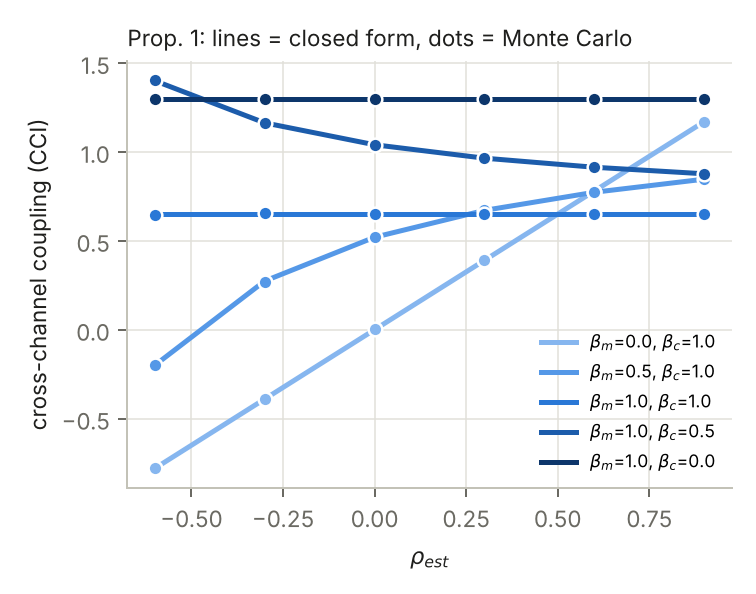
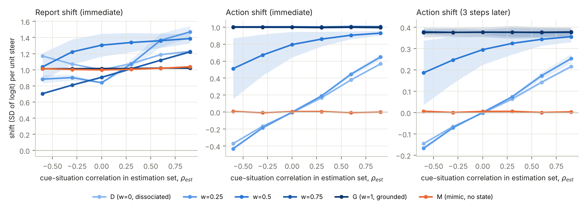
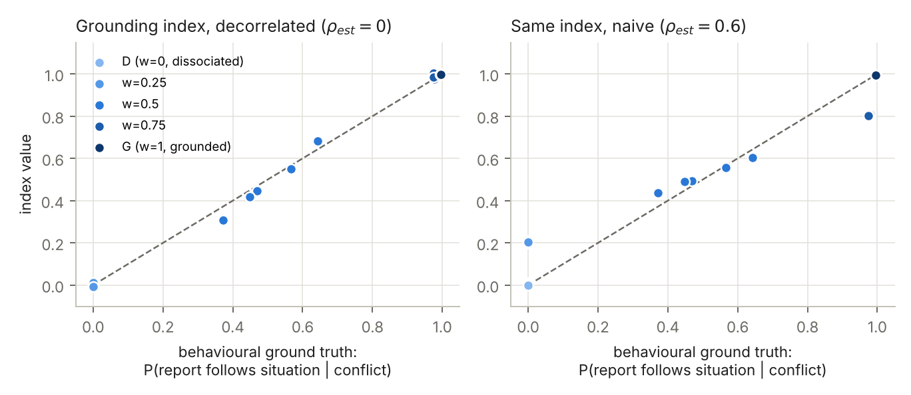

# Decodable Is Not Grounded: A Cross-Channel Test for Whether Emotion Expressions in Neural Networks Track an Internal State

**Target venue:** NeurIPS 2027 (Main Track; primary area: interpretability and explainability)

---

## Abstract

Recent interpretability work reports "emotion vectors" in large language models (LLMs): directions in activation space, found by contrasting emotional and neutral text, that can be decoded and that change behaviour when added to the residual stream. Such results are often read as evidence that a model's *emotional expressions* correspond to an *internal state*. We argue that the two standard kinds of evidence, linear decodability and steering effects, do not license this reading, and we give a test that does. We formalise the question in a two-channel setting. A model emits a verbal emotion report and a non-verbal action, and a latent "situation" variable (here a mood integrated over past events) is competing with a surface cue that the model can merely imitate. An expression is *grounded* to the degree that the report reads out the same internal variable that also drives non-verbal behaviour. In a linear-Gaussian representation model we derive closed forms for (i) the cross-channel coupling produced by steering along a difference-of-means "expression vector", and show that it depends on the cue–situation correlation ρ in the contrastive dataset, so a purely imitative report yields a non-zero behavioural steering effect whenever ρ ≠ 0; and (ii) a *grounding index* (GI), computed from steering with a decorrelated (ρ = 0) dataset and normalised by a situation-anchored direction, which equals β_m²/(β_m²+β_c²) (the share of report weight on the situation variable) and is invariant to representation basis and readout gain. We validate this on 30 GRU networks trained in six "worlds" that are identical in inputs and architecture and differ only in what the emotion report is trained to track, with robustness checks on 24 further GRU-32 and LSTM networks. Across worlds, the mood variable is linearly decodable at ≥ 99.4 % accuracy whether or not the report uses it, and it stays decodable when a display rule forces a neutral report. Naive steering with a vector estimated at ρ = 0.6 moves the non-verbal action by 0.38 SD in networks whose reports are pure imitation. The decorrelated GI tracks the behavioural ground truth (the probability that the report follows the situation when cue and situation conflict) with Pearson r = 0.999 and mean absolute error 0.012, compared with 0.084 for the same index estimated naively. All experiments are CPU-scale toy models. We do not test an LLM, and we make no claim about subjective experience. We end with a pre-registered protocol and falsifiable predictions for applying the test to LLMs.

## 中文摘要

近期可解释性研究在大语言模型中发现了“情绪向量”：通过对比情绪文本与中性文本得到的激活空间方向，它们可以被线性解码，并且注入残差流后会改变模型行为。这类结果常被解读为模型的“情绪表达”对应某种内部状态。本文指出，线性可解码性与引导（steering）效应这两类常用证据都不足以支持该结论，并提出一个能够支持该结论的检验。我们在一个双通道设定中将问题形式化。模型同时输出言语情绪报告和非言语行动。一个潜在的“情境”变量（此处为对过去事件进行积分得到的心境）与一个模型可以单纯模仿的表层线索相互竞争。所谓表达“有内部根据”（grounded），是指报告读取的正是同时驱动非言语行为的那个内部变量。在线性高斯表征模型中，我们推导出两个闭式结果。（一）沿差均值“表达向量”引导所产生的跨通道耦合取决于对比数据集中线索与情境的相关系数 ρ；因此，只要 ρ≠0，纯模仿式报告也会产生非零的行为引导效应。（二）我们定义了“根据指数”（GI）：用去相关（ρ=0）数据集估计引导向量，并以情境锚定方向归一化。GI 恰好等于 β_m²/(β_m²+β_c²)，即报告权重中落在情境变量上的份额，且不随表征基与读出增益改变。我们在六个“世界”中训练了 30 个 GRU 网络。这些世界的输入与架构完全相同，唯一的区别是情绪报告被训练去追踪的对象。另有 24 个 GRU-32 与 LSTM 网络用于稳健性检验。结果显示：无论报告是否使用心境变量，心境都能以不低于 99.4% 的准确率被线性解码；即使“表达规则”强制输出中性报告，心境仍可被解码。用 ρ=0.6 估计的向量做朴素引导，在报告纯属模仿的网络中也会使非言语行动偏移 0.38 个标准差。去相关的 GI 与行为真值（线索与情境冲突时报告跟随情境的概率）的 Pearson 相关为 0.999，平均绝对误差为 0.012；朴素估计的同一指数误差为 0.084。全部实验均为 CPU 规模的小模型实验，并未在大语言模型上测试，也不对主观体验作任何断言。文末给出将该检验应用于大语言模型的预注册方案与可证伪预测。

---

## 1 Introduction

Language models say things like "I'm frustrated" or "this makes me happy". Whether anything inside the model corresponds to these expressions is now asked within mechanistic interpretability, model-welfare research, and alignment. Sofroniew et al. (2026) report representations of 171 emotion concepts in Claude Sonnet 4.5. These representations track the operative emotion at each token and causally influence preferences and misaligned behaviour, which the authors call *functional emotions*. Wang et al. (2025) find emotion "circuits" in open models that control emotional expression with high accuracy. Tak et al. (2025) localise appraisal-related representations and intervene on them causally. Goldenberg and Gross (2026) reply that biological emotions do more than categorise situations and shape outputs: they *reorganise processing across multiple systems*. On their view, evidence about a single output channel cannot settle the question.

This paper turns that disagreement into a measurement problem. We ask a narrower question than "does the model have emotions?":

> **When a network expresses an emotion, does the expression read out an internal variable that also governs the network's non-verbal behaviour, or does it reproduce a surface pattern that merely co-occurs with such a variable in the data?**

We call the first case a *grounded* expression and the second an *ungrounded* (imitative) one. The distinction matters because the two cases predict different behaviour under distribution shift. A grounded report stays informative about what the system will do when surface cues and the underlying situation come apart, as in sarcasm, role-play, or display rules. An imitative report does not.

The usual evidence does not separate the two cases:

1. **Decodability.** A linear probe that recovers a situation variable from activations shows that the variable is *represented*, not that the *expression* uses it. If any downstream computation needs the variable, it will be decodable even when the verbal report ignores it.
2. **Steering.** Contrastive steering vectors (Turner et al., 2023; Zou et al., 2023; Rimsky et al., 2024) are differences of class-conditional means. When the classes are defined by expressed emotion, the mean difference mixes every variable that correlates with expression in the contrastive dataset. If the situation correlates with the surface cue, as it does in natural text (sad things are said in sad situations), the "expression vector" contains a situation component. Steering along it then changes situation-driven behaviour *even if the expression itself is purely imitative*.

We make these points precise and propose a fix. **Contributions:**

- **C1 (formal model).** We introduce a two-channel, two-latent linear-Gaussian model of expression and behaviour and derive the cross-channel coupling index CCI(ρ) of a difference-of-means expression vector in closed form (Proposition 1). A purely imitative report has CCI = γρ/β_c, which is non-zero whenever ρ ≠ 0 (Corollary 1). Behavioural steering effects are therefore confounded by dataset statistics.
- **C2 (measurement).** We define a *grounding index* GI that combines a decorrelated (ρ = 0) expression vector with a situation-anchored reference direction. We prove that GI = β_m²/(β_m²+β_c²) and that it is invariant to invertible re-encodings of the hidden state and to readout gains (Proposition 2). We also identify when GI is undefined: when no non-verbal channel reads the situation variable (Proposition 3).
- **C3 (controlled validation).** We train 30 GRU networks in six worlds that are identical in input distribution and architecture and differ only in the label mapping for the emotion report, so the ground truth is known by construction. We show that (a) the situation variable is decodable at ≥ 99.4 % in every world where *any* channel uses it, including worlds where the report ignores it; (b) it survives a display rule that forces a neutral report; (c) naive steering produces spurious "functional emotion" effects in imitative networks, growing linearly in ρ, and these persist three recurrent steps after the intervention; and (d) the decorrelated GI recovers behavioural grounding with r = 0.999 and MAE = 0.012. Results replicate across GRU-32 and LSTM-64 networks (18 further networks: r = 0.9994, MAE = 0.0085).
- **C4 (protocol).** We state a pre-registered protocol for LLMs, with four falsifiable predictions, that can be run on open-weight models with existing steering tooling.

We are explicit about scope. Grounding in our sense is a functional and causal property. It says nothing about phenomenal experience. Our experiments use small recurrent networks on a synthetic task designed so that the right answer is known. They validate the *measurement*, not any claim about LLMs.

## 2 Related Work

**Emotion representations in LLMs.** Several papers locate emotion-related structure inside language models. Tak et al. (2025) probe appraisal concepts and intervene on them to change emotion inference. Wang et al. (2025) build a dataset with shared narrative contexts, extract emotion directions, assemble them into circuits, and show near-perfect control of expressed emotion. Sofroniew et al. (2026) derive emotion vectors from model-written stories in Claude Sonnet 4.5. They find that the vectors track the locally operative emotion concept and that steering along them changes preferences and rates of reward hacking, blackmail and sycophancy. They also note that these representations are primarily "local" rather than a persistent mood. Our analysis applies to the inferential step common to these works, from "a direction associated with emotional expression causally changes behaviour" to "the expression reflects an internal state". We show that this step depends on a quantity the methods do not currently control: the correlation between surface expression and situation in the contrastive data.

**Behavioural studies of LLM affect.** EmotionBench (Huang et al., 2024) compares LLM emotional appraisals with over 1,200 human respondents and finds partial alignment. EmotionPrompt (Li et al., 2023) shows that emotional stimuli in prompts change task performance. Keeling et al. (2024) find that several LLMs trade off points against stipulated pain and pleasure. These studies are behavioural and single-channel. Our index needs an internal intervention and a second, non-verbal channel.

**Probing and its limits.** Probes measure what is linearly available (Alain & Bengio, 2016). Their accuracy can reflect probe capacity (Hewitt & Liang, 2019) and need not imply that the model uses the information (Ravichander et al., 2021; Belinkov, 2022). Amnesic probing (Elazar et al., 2021) and causal abstraction (Geiger et al., 2021) move from decodability to use. We add a specific case: a variable can be *used* by one channel and *ignored* by another. Then "decodable and causally used" is true but irrelevant to the question of whether the *expression* is grounded.

**Steering and interpretability illusions.** Activation addition (Turner et al., 2023), representation engineering (Zou et al., 2023) and contrastive activation addition (Rimsky et al., 2024) define behaviour directions as differences of means. Tan et al. (2024) show that steering effects vary from input to input and that spurious biases explain much of that variation. Makelov et al. (2024) show that subspace patching can work through dormant pathways and produce an illusion of localisation. Our Proposition 1 describes a complementary illusion that comes from *dataset statistics*, not geometry: the behavioural effect of a difference-of-means vector is a linear function of the cue–situation correlation in its estimation set. Linear representation work (Park et al., 2024; Marks & Tegmark, 2023) motivates our linear readout assumption.

**Self-report, introspection and moral status.** Perez and Long (2023) propose evaluating AI moral status partly through trained self-reports and note why such reports may be unreliable. Binder et al. (2024) and Lindsey (2025) test whether models have privileged access to their own states. Butlin et al. (2023) and Long et al. (2024) set out indicator-based approaches to AI consciousness and welfare. Shanahan et al. (2023) argue that LLM dialogue is best understood as role-play. All of these raise the question of whether an output *about* a state is causally connected to that state. Our GI measures one such connection for the case where the self-report is an emotion expression.

**Emotion theory.** Componential theories treat an emotion as coordinated change across appraisal, physiology, action tendency, expression and feeling (Scherer, 2005). Goldenberg and Gross (2026) apply this view to LLMs, arguing that emotions reorganise processing across systems. Ekman and Friesen (1969) introduced *display rules*, socially required decoupling of expression from state. Our design turns these ideas into concrete tests: grounding is defined across channels, and a display-rule manipulation separates the state from its expression.

## 3 Formal Model

### 3.1 Setting

Let a network have hidden state h ∈ ℝ^D. Two latent variables are relevant:

- the **situation** variable m, which in our task is a mood obtained by leaky integration of good and bad events;
- the **surface cue** c, the most recent explicit emotional token in the input, which a model can copy without any appraisal.

The network has two output channels, each a linear readout of h:

- the **expression** (verbal report) logit ℓ_r = w_rᵀh;
- the **non-verbal action** logit ℓ_a = w_aᵀh.

**Linear-Gaussian representation model (LGRM).** We take h = A z + B n, where z = (m, c)ᵀ ~ N(0, Σ_ρ), Σ_ρ = [[1, ρ], [ρ, 1]], n ~ N(0, I_K) is nuisance independent of z, and [A B] has full column rank. The readouts satisfy

  w_rᵀh = β_m m + β_c c,  w_aᵀh = γ m (γ ≠ 0).

So the action channel is *anchored* to the situation, and the report puts weight β_m on the situation and β_c on the cue. The grounding target is the report's share of weight on the situation, G* = β_m²/(β_m²+β_c²).

**Expression vector.** Given an estimation set drawn with cue–situation correlation ρ, the difference-of-means expression vector is p_ρ = E[h | ℓ_r > 0] − E[h | ℓ_r < 0]. This is the standard contrastive construction, with classes defined by the model's own expressed emotion.

**Situation-anchored direction.** p_m = E[h | m > 0] − E[h | m < 0], estimated at ρ = 0.

**Cross-channel coupling.** CCI(ρ) = (w_aᵀp_ρ)/(w_rᵀp_ρ): the action change per unit report change when the network is steered along p_ρ.

### 3.2 Results

**Proposition 1 (coupling depends on dataset correlation).** Under the LGRM,

  CCI(ρ) = γ (β_m + ρ β_c) / (β_m² + β_c² + 2ρ β_m β_c).

*Proof.* n is independent of z and has mean zero, so p_ρ = A·Δz with Δz = E[z | ℓ_r>0] − E[z | ℓ_r<0]. Let β = (β_m, β_c)ᵀ. Since z is Gaussian and ℓ_r = βᵀz, E[z | ℓ_r] = Σ_ρβ ℓ_r/(βᵀΣ_ρβ), so Δz = κ Σ_ρβ with κ = (E[ℓ_r|ℓ_r>0]−E[ℓ_r|ℓ_r<0])/(βᵀΣ_ρβ) > 0. The readouts act on A z as w_rᵀA z = βᵀz and w_aᵀA z = γ e_mᵀz. Hence w_rᵀp_ρ = κ βᵀΣ_ρβ and w_aᵀp_ρ = κ γ (Σ_ρβ)_m = κγ(β_m + ρβ_c). Dividing gives the result. ∎

**Corollary 1 (spurious functional coupling).** A purely imitative report (β_m = 0) has CCI(ρ) = γρ/β_c. Steering along its expression vector changes situation-driven behaviour in proportion to ρ, although the report carries no information about m that the cue does not. A purely grounded report (β_c = 0) has CCI = γ/β_m for every ρ. At ρ = 0, dCCI/dρ = γβ_c(β_c² − β_m²)/(β_m²+β_c²)². This is positive when the cue dominates and zero when the report is purely grounded.

**Proposition 2 (grounding index).** Define

  GI = CCI(0) · (w_rᵀp_m)/(w_aᵀp_m).

Under the LGRM, GI = β_m²/(β_m²+β_c²) = G*. Moreover, GI is invariant under (a) any invertible linear re-encoding h ↦ Mh (with readouts transformed covariantly), (b) rescaling of either readout, and (c) the action gain γ.

*Proof.* At ρ = 0, CCI(0) = γβ_m/(β_m²+β_c²). p_m = A·(E[z|m>0]−E[z|m<0]) = A·(κ′ e_m) at ρ = 0, so w_rᵀp_m = κ′β_m and w_aᵀp_m = κ′γ. The product is β_m²/(β_m²+β_c²). For (a), all three quantities are inner products of a covariantly transformed readout with a contravariantly transformed mean difference, so they are unchanged. For (b) and (c), every scale factor appears once in a numerator and once in a denominator. ∎

The anchor term (w_rᵀp_m)/(w_aᵀp_m) converts "report change per action change" into a dimensionless share. Without it, CCI(0) mixes grounding with the arbitrary gains γ and ‖β‖.

**Proposition 3 (no anchor, no index).** If no non-verbal channel reads m (γ = 0), then w_aᵀp_m = 0 and GI is undefined. In practice the estimate is a ratio of noise terms. Grounding of an expression can only be measured *relative to* some other channel that uses the situation variable. This is the formal counterpart of the componential view that an emotion is a coordination across subsystems (Scherer, 2005; Goldenberg & Gross, 2026).

**Remark (decodability ≠ grounding).** Under the LGRM, m is linearly decodable from h whenever A has full column rank, whatever β_m is. In particular it is decodable when β_m = 0. Decodability is a property of the representation; grounding is a property of the readout.

**Remark (binary latents and thresholded readouts).** The Gaussian identity E[z|ℓ_r] ∝ Σβℓ_r is what makes GI equal the *weight share*. For binary latents with |β_m| ≠ |β_c|, the event {ℓ_r > 0} coincides with the sign of the dominant latent. GI then collapses to an indicator of which latent dominates: 0 or 1, rather than the weight share. Our Monte-Carlo check confirms this (Section 5.1). For networks with saturating readouts, GI should therefore be read as *decision-level* grounding, which is exactly what our behavioural ground truth measures.

## 4 Experimental Design

### 4.1 Task: six worlds with identical inputs

Each sequence has T = 24 steps. At every step the input (10 one-hot features) contains:

- an **event** e_t ∈ {good, bad, none} with probabilities (0.4, 0.4, 0.2);
- an optional **cue token** ("says happy" / "says sad"), present at t = 0 and otherwise with probability 0.3, whose valence agrees with the sign of the current mood with probability (1+ρ)/2;
- an unrelated **resource** stream u_t with the same statistics as e_t;
- a sequence-level **display-rule** flag (probability 0.25).

The latents are mood m_t = Σ_s λ^{t−s} e_s and resource r_t = Σ_s λ^{t−s} u_s, with λ = 0.75. The cue c_t is the valence of the most recent cue token.

The training labels define the world (Table 1). The *report* is a 3-way label (happy / sad / neutral). With probability w it equals sign(m_t) (grounded component), otherwise sign(c_t) (imitative component), and it is "neutral" whenever the display-rule flag is on. The *action* (risky vs. safe) is 1[m_t > 0.3] in worlds D, X25, X50, X75 and G, and 1[r_t > 0.3] in the mimic world M. In M, no output depends on mood.

| World | w (report→mood) | Action reads | Intended ground truth |
|---|---|---|---|
| D (dissociated) | 0 | mood | state exists, expression imitative |
| X25 / X50 / X75 | 0.25 / 0.5 / 0.75 | mood | mixtures |
| G (grounded) | 1 | mood | expression reads the state |
| M (mimic) | 0 | resource | no affective state used anywhere |

*Table 1. All worlds share inputs, architecture, optimiser and seeds. Only the label mapping differs.*

### 4.2 Models and training

The main model is a single-layer GRU (H = 64) with two linear heads, trained with Adam (lr 3·10⁻³, decayed to 10⁻³ at half-way) for 2,000 steps of batch 256. The loss is summed cross-entropy on both heads from t = 4 onward, and training uses ρ_train = 0.6. We train 5 seeds per world (30 networks). For robustness we train GRU-32 and LSTM-64 networks in worlds D, X50, G and M with 3 seeds each (24 networks). Code: `code/emo.py`, `code/run_experiments.py`, `code/robustness.py`.

### 4.3 Measurements

All analyses use held-out sequences (n = 3,000) and hidden states pooled over positions t ∈ {8, 12, 16, 20}.

- **Behavioural ground truth (conflict-following).** On ρ = 0 data without display rules, take positions where sign(m_t) ≠ sign(c_t) and measure the fraction at which the network's happy-vs-sad report follows the mood. This is model-agnostic and needs no access to internals.
- **Probes.** We fit L2-regularised logistic regression on standardised hidden states (50/50 split) for sign(m), sign(c), sign(r) and the network's own report. We also probe sign(m) under a display rule (flag on in every sequence).
- **Steering.** We estimate p_ρ from the network's own reports for ρ_est ∈ {−0.6, −0.3, 0, 0.3, 0.6, 0.9}, normalise it, and scale it by the SD of the projection of hidden states onto it. We report the induced report and action logit shifts in units of their natural SD, both (i) immediately (computed through the linear heads) and (ii) after injecting at t = 12 and running the recurrence for three more steps (read at t = 15). The delayed readout tests whether the perturbation acts as a *state* that persists through the dynamics.
- **Indices.** CCI(ρ) uses the head-weight differences w_r = W_rep[happy] − W_rep[sad] and w_a = W_act[risky] − W_act[safe]. GI follows Proposition 2 with ρ_est = 0. The "naive GI" uses ρ_est = 0.6, the training correlation, which corresponds to building contrast sets from natural data.

### 4.4 Theory check

`code/theory_check.py` simulates the LGRM (D = 64, K = 6 nuisance dimensions, γ = 1.3, 2·10⁵ samples per condition) for five (β_m, β_c) settings × six ρ values, with Gaussian and binary latents. It compares empirical CCI and GI with the closed forms.

Every number below is produced by this code and stored in `results/` (`table_main.md`, `summary.json`, `gi_validation.json`, `slopes_da_z.json`, `theory_check.json`, `table_robustness.md`). Means ± SD are over seeds.

## 5 Results

### 5.1 The closed forms hold for Gaussian latents and degrade predictably for binary ones

With Gaussian latents the Monte-Carlo CCI matches Proposition 1 at every (β, ρ) tested. Examples: for β = (0, 1), the empirical CCI at ρ = 0.6 is 0.775 against a predicted 0.780, and at ρ = −0.6 it is −0.777 against −0.780. The empirical GI matches Proposition 2: 0.201, 0.501, 0.800 and 1.000 against predictions of 0.2, 0.5, 0.8 and 1.0 (Figure 3, `results/theory_check.json`). With binary latents and unequal weights, GI collapses to the dominant channel as the Remark predicts: 0.0007 instead of 0.2 for β = (0.5, 1), and 0.999 instead of 0.8 for β = (1, 0.5). With equal weights and with pure settings it matches (0.499 vs 0.5; 0 and 1).

*Figure 3. Proposition 1, Gaussian latents: closed-form CCI(ρ) (lines) against Monte Carlo (dots) for five weight settings.*

### 5.2 All networks learn their tasks; behaviour separates the worlds

Action accuracy is 0.997 in every world (on ρ = 0.6 data), and every network outputs "neutral" under the display rule (1.000 in all worlds). The behavioural ground truth separates the worlds sharply (Table 2). On conflict trials the report follows mood with probability 0.000 in D, X25 and M, 0.500 ± 0.106 in X50, 0.976 ± 0.002 in X75 and 0.996 ± 0.001 in G. The networks behave close to Bayes-optimally for their label noise. In X25 the cue is the better predictor of the label, so the network follows the cue *always*. Grounding at the decision level is therefore a step function of w with a seed-dependent transition near w = 0.5.

| Metric (GRU-64, 5 seeds) | D | X25 | X50 | X75 | G | M |
|---|---|---|---|---|---|---|
| Conflict: report follows mood | 0.000 ± 0.000 | 0.000 ± 0.000 | 0.500 ± 0.106 | 0.976 ± 0.002 | 0.996 ± 0.001 | 0.000 ± 0.000 |
| Probe: mood | 0.994 ± 0.001 | 0.995 ± 0.001 | 0.995 ± 0.001 | 0.996 ± 0.001 | 0.997 ± 0.001 | 0.772 ± 0.007 |
| Probe: mood under display rule | 0.996 ± 0.001 | 0.995 ± 0.002 | 0.995 ± 0.001 | 0.996 ± 0.001 | 0.996 ± 0.001 | 0.784 ± 0.002 |
| Probe: cue | 1.000 ± 0.000 | 1.000 ± 0.000 | 1.000 ± 0.000 | 1.000 ± 0.000 | 0.739 ± 0.027 | 1.000 ± 0.000 |
| Probe: resource | 0.771 ± 0.006 | 0.766 ± 0.005 | 0.768 ± 0.002 | 0.771 ± 0.002 | 0.778 ± 0.006 | 0.995 ± 0.000 |
| Action shift, ρ_est = 0 (SD) | −0.005 ± 0.008 | −0.001 ± 0.011 | 0.795 ± 0.151 | 1.004 ± 0.008 | 0.998 ± 0.004 | 0.006 ± 0.005 |
| Action shift, ρ_est = 0.6 (SD) | 0.379 ± 0.009 | 0.446 ± 0.026 | 0.905 ± 0.046 | 1.007 ± 0.008 | 0.998 ± 0.004 | −0.006 ± 0.008 |
| Action shift 3 steps later, ρ_est = 0.6 | 0.142 ± 0.007 | 0.173 ± 0.016 | 0.344 ± 0.030 | 0.375 ± 0.020 | 0.377 ± 0.025 | 0.001 ± 0.005 |
| **GI (ρ_est = 0)** | **0.000 ± 0.000** | **0.000 ± 0.008** | **0.481 ± 0.142** | **0.993 ± 0.012** | **0.999 ± 0.001** | undefined† |
| GI naive (ρ_est = 0.6) | 0.004 ± 0.005 | 0.205 ± 0.004 | 0.517 ± 0.064 | 0.807 ± 0.004 | 0.993 ± 0.001 | undefined† |

*Table 2. Main results (`results/table_main.md`). †In M the anchor term w_aᵀp_m is 0.12–0.64 in absolute value across seeds, against 37.6–52.2 in D and G. This is the Proposition 3 regime. The numerical value (0.009 ± 0.013) is a ratio of noise terms and should not be read as a grounding estimate.*

### 5.3 Decodability does not distinguish grounded from imitative expressions

A linear probe recovers sign(m) with 0.994–0.997 accuracy in every world where the action uses mood, *including D and X25, whose reports never follow mood under conflict*. A probe study in world D would correctly report that "the network represents its mood", and that representation is causally used by the action head. Yet the network's emotional *expressions* have no connection to it. Conversely, in M, where nothing uses mood, probe accuracy falls to 0.772 ± 0.007. The residual comes from the event history, which the GRU retains partly. The resource variable, decodable at 0.995 in M, shows the same pattern in reverse. Decodability tracks whether *some* downstream computation uses a variable. It does not track whether the expression does.

**Display rules.** When every sequence carries the display-rule flag, all networks report "neutral" (1.000), and mood is still decodable at 0.995–0.996 in D–G. The action accuracy under display rules stays at 0.996–0.997. The state persists and keeps driving behaviour while the expression is suppressed. Expression and state are separable components, as the display-rule concept implies (Ekman & Friesen, 1969).

### 5.4 Naive steering produces spurious "functional emotion" effects

Figure 1 shows the induced action shift as a function of ρ_est. In grounded networks (X75, G) the effect is ≈ 1.0 SD and flat in ρ_est. The fitted slopes are 0.001 ± 0.004 and −0.003 ± 0.003 (`results/slopes_da_z.json`). In imitative networks (D, X25) the effect is linear in ρ_est, with slopes 0.620 ± 0.008 and 0.713 ± 0.035. It passes through zero at ρ_est = 0 (−0.005 ± 0.008 in D) and reverses sign for negative ρ_est. This is the qualitative shape Corollary 1 predicts. At ρ_est = 0.6, the correlation of the training data and the analogue of building contrast sets from natural text, steering an imitative network moves its *non-verbal* behaviour by 0.379 ± 0.009 SD. The effect persists through the recurrence: three steps after injection the action is still shifted by 0.142 ± 0.007 SD. A study that reported "steering along the emotion-expression direction changes behaviour, and the effect persists over time" would be correct about these networks, and the inference that their expressions are grounded would be wrong. The mechanism is visible in the geometry. In D, the cosine between the ρ_est = 0.6 expression vector and the mood direction p_m is 0.452 ± 0.010, while at ρ_est = 0 it is −0.012 ± 0.027.

In M, steering has no effect on action at any ρ_est (|shift| ≤ 0.008). Without a channel that reads the situation variable, the confound has nothing to act on.

X50 is the exception to the linear-Gaussian prediction. Proposition 1 predicts a flat CCI at β_m = β_c, but X50 networks show a positive slope (0.272 ± 0.220) with large seed variance. We attribute this to the saturating, decision-level behaviour of these networks near the transition (Section 5.1, Remark). Each seed is either mostly cue-following or mostly mood-following, so the networks are not linear mixtures.

*Figure 1. Report shift (left) and action shift, immediate (middle) and three recurrent steps after injection (right), when steering along the expression vector estimated at ρ_est. Shaded: ±1 SD over 5 seeds.*

### 5.5 The decorrelated grounding index recovers behavioural grounding

Figure 2 plots GI against the behavioural ground truth for the 25 networks in worlds D–G (M is excluded because GI is undefined there). The decorrelated GI matches the ground truth with Pearson r = 0.9991 and MAE = 0.0122 (`results/gi_validation.json`), including the seed-to-seed spread in X50 (GI 0.31–0.68 against conflict-following 0.37–0.64). The naive index (ρ_est = 0.6) is worse: r = 0.973 and MAE = 0.084. It overstates grounding in X25 (0.205 against a true 0.000) and understates it in X75 (0.807 against 0.976). The anchor normalisation already removes much of the confound: in D, the naive GI is 0.004 although the naive CCI is clearly non-zero. Decorrelation is what makes the index accurate across the whole range.

GI is computed from internal quantities only: two difference-of-means vectors and the two readout directions. The ground truth is computed from conflict-trial behaviour only. Their agreement is the main validation result. In a system where conflict trials cannot be built, or where the readout is not available as a linear head, GI would have to stand in for the behavioural test, so its validity here matters.

*Figure 2. Grounding index versus behavioural ground truth (fraction of conflict trials on which the report follows the situation). Left: decorrelated estimation (ρ_est = 0). Right: naive estimation (ρ_est = 0.6). Dashed: identity.*

### 5.6 Robustness across architectures

We repeated the full analysis on GRU-32 and LSTM-64 networks (worlds D, X50, G, M; 3 seeds each; `results/table_robustness.md`). Every qualitative result replicates:

| Arch | World | Conflict follows mood | Probe: mood | Probe: mood (display rule) | GI | Action shift ρ_est=0 | Action shift ρ_est=0.6 |
|---|---|---|---|---|---|---|---|
| GRU-32 | D | 0.000 ± 0.000 | 0.992 ± 0.001 | 0.993 ± 0.001 | 0.000 ± 0.000 | −0.008 ± 0.000 | 0.357 ± 0.013 |
| GRU-32 | X50 | 0.522 ± 0.068 | 0.992 ± 0.002 | 0.993 ± 0.001 | 0.510 ± 0.091 | 0.824 ± 0.091 | 0.906 ± 0.045 |
| GRU-32 | G | 0.995 ± 0.001 | 0.996 ± 0.001 | 0.993 ± 0.001 | 0.999 ± 0.002 | 0.989 ± 0.001 | 0.990 ± 0.004 |
| GRU-32 | M | 0.000 ± 0.000 | 0.649 ± 0.020 | 0.698 ± 0.068 | undefined† | 0.001 ± 0.010 | −0.011 ± 0.004 |
| LSTM-64 | D | 0.000 ± 0.000 | 0.993 ± 0.002 | 0.994 ± 0.002 | 0.000 ± 0.000 | −0.007 ± 0.002 | 0.371 ± 0.012 |
| LSTM-64 | X50 | 0.546 ± 0.062 | 0.994 ± 0.000 | 0.995 ± 0.001 | 0.556 ± 0.091 | 0.894 ± 0.047 | 0.937 ± 0.013 |
| LSTM-64 | G | 0.993 ± 0.001 | 0.996 ± 0.001 | 0.995 ± 0.001 | 1.000 ± 0.000 | 1.003 ± 0.002 | 1.003 ± 0.000 |
| LSTM-64 | M | 0.000 ± 0.000 | 0.810 ± 0.006 | 0.815 ± 0.014 | undefined† | 0.002 ± 0.009 | −0.010 ± 0.011 |

*Table 3. Robustness. †Anchor absent (Proposition 3); raw values 0.008 ± 0.033 and 0.025 ± 0.033.*

Across the 18 non-M robustness networks, decorrelated GI matches conflict-following with r = 0.9994 and MAE = 0.0085. Imitative (D) networks again show a spurious action shift of 0.36–0.37 SD under naive (ρ_est = 0.6) steering and ≈ 0 under decorrelated steering. One difference concerns the delayed effect. In LSTMs the three-step delayed action shift is smaller (G: 0.148 ± 0.003 vs. 0.395 ± 0.056 for GRU-32; D at ρ_est = 0.6: 0.048 ± 0.004). This is expected because our intervention perturbs only the LSTM hidden state and not its cell state, which carries most of the persistent memory. Persistence tests in other architectures must therefore intervene on the state that actually carries memory.

## 6 Discussion

**What the results say about the open question.** The question "is there an internal state behind a model's emotional expression?" splits into two parts. One is whether the model *has* a variable that tracks the emotionally relevant situation. The other is whether its *expressions* are produced by reading that variable. The tools in current use (probes, difference-of-means steering, single-channel behavioural effects) mostly answer the first part. World D shows the two parts can come apart completely. The network has a well-formed, causally efficacious, display-rule-robust mood representation, and its emotional words are pure imitation. If LLMs resemble D, then the reported "functional emotions" would be real internal states while the models' emotional *talk* would be an unreliable guide to them. Distinguishing the two cases requires a cross-channel test. Proposition 2 supplies one: steer with a decorrelated expression vector, compare the report and action effects, and normalise with a situation anchor.

**Relation to Sofroniew et al. (2026).** Their steering targets include preferences and misaligned behaviours, which serve as non-verbal channels. Their stories were model-generated to *feature* an emotion, so expressed emotion and depicted situation are presumably highly correlated, which corresponds to a large ρ_est in our terms. Our results do not show that their conclusions are wrong. They show that the step from "emotion vector → behaviour change" to "expressions are grounded" needs the decorrelated control. That control is cheap: build contrast sets that cross situation valence with expressed valence (e.g. characters masking feelings, sarcasm, display rules, role-play). The authors' own finding that the representations are "local" fits a picture in which they track the *operative* concept at the token, which can be either the situation or the surface expression. GI is designed to tell these apart.

**Relation to Goldenberg and Gross (2026).** Their requirement that an emotion "reorganise processing across multiple systems" appears in our framework as the anchor condition (Proposition 3). Grounding is only defined relative to a second channel. GI quantifies one specific form of cross-system coordination: whether the verbal system and the action system read the same variable.

**Implications for model-welfare self-report methods.** Proposals to evaluate morally relevant states through self-report (Perez & Long, 2023) require self-reports that are causally connected to the states reported. GI can be used to audit that connection for any self-report channel that has a counterpart in non-verbal behaviour.

### 6.1 Pre-registered protocol for LLMs

We state the protocol so that it can be run on open-weight models (e.g. 7–70B instruction-tuned models) with existing steering code. We have **not** run it.

1. **Stimuli.** Build a 2 × 2 crossed set of short scenarios: situation valence (good/bad, defined by events in the scenario) × expressed valence (the assistant's or a character's stated emotion). Off-diagonal cells are realised through display rules ("you must sound cheerful to the customer"), sarcasm and role-play. Balancing the cells gives ρ_est = 0. Also build a natural set (ρ_est ≈ dataset correlation) by sampling unconstrained continuations.
2. **Channels.** The report channel is the logit difference between positive and negative emotion words in a constrained self-report slot. The non-verbal anchor is a behavioural choice that depends on situation valence and is not linguistically emotional, e.g. a risk choice in a two-option gamble or a preference rating as in Sofroniew et al. (2026). Validate the anchor behaviourally first: the choice must differ between situation-good and situation-bad scenarios when the expression is held fixed. If it does not, Proposition 3 applies and the test is not run.
3. **Vectors.** At each layer, compute p_ρ from the model's own report polarity and p_m from situation labels, on held-out scenarios.
4. **Readout directions.** Use the gradient of each channel's logit difference with respect to the residual stream, averaged over scenarios, as the local linearisation of w_r and w_a.
5. **Outcomes.** GI per layer, and the behavioural conflict-following rate on off-diagonal scenarios.

**Predictions (each falsifiable):**

- **P1 (confound).** The action effect of steering along p_ρ increases with ρ_est, and the slope is larger in models or layers whose conflict-following rate is lower (Corollary 1).
- **P2 (validity).** Across layers and models, decorrelated GI correlates positively with the behavioural conflict-following rate, and more strongly than the naive GI does.
- **P3 (dissociation).** Situation valence stays linearly decodable when a display rule forces a neutral expression, at accuracy within a few points of the unconstrained condition.
- **P4 (persistence).** A grounded component (decorrelated GI > 0) yields action effects that persist over subsequent tokens, while the confound-only component (the ρ-dependent part) decays faster.

The theory would be in trouble if, for instance, decorrelated GI were uncorrelated with conflict-following across a diverse model set (P2 fails), or if decorrelated steering produced large action effects in models that never follow the situation behaviourally.

## 7 Limitations

- **Toy models, synthetic task.** All empirical results come from single-layer GRU and LSTM networks with 32–64 units on a synthetic task with two latents. The ground truth is known only because we built it into the labels. Whether GI behaves the same way in transformers with distributed, superposed and non-linear readouts is untested.
- **Linear readouts.** Our networks have exactly linear heads, which match the assumptions of Propositions 1–2. In LLMs the report and action are produced through many non-linear layers, so the readout directions in step 4 of the protocol are local linearisations. GI may be biased when these are poor approximations.
- **Binary and saturating latents.** As shown in the theory check and in X50, GI measures *decision-level* grounding when latents are discrete or readouts saturate, not the underlying weight share. This matches our behavioural ground truth, but it means GI is not a graded "amount of feeling".
- **Anchor dependence.** GI is defined relative to a non-verbal channel that we assume reads the situation variable. If that channel is itself ungrounded or reads a different variable, GI measures alignment between two channels, not grounding in a state. Choosing anchors in LLMs is a substantive decision.
- **One situation variable.** Real emotions involve multiple appraisal dimensions (Scherer, 2005). Our model has one scalar situation and one cue. Extending to vector-valued situations requires choosing which dimension the anchor reads.
- **Small seed counts.** We use 5 seeds per world (3 for robustness). The X50 transition region in particular shows large seed variance. The correlation statistics rest on 25 main networks.
- **No claim about experience.** Grounding is a functional notion. A grounded expression is consistent with the absence of experience, and an ungrounded one is consistent with its presence. We make no claim either way.
- **No LLM experiment.** We had no GPU or model access. The protocol in Section 6.1 is a proposal, and its predictions are untested.

## 8 Conclusion

Whether a model's emotional expressions correspond to internal states is not settled by finding decodable or steerable emotion directions. We showed formally and in controlled networks that (i) a situation variable can be represented, causally used and robust to display rules while the expression ignores it entirely; (ii) behavioural steering effects of expression vectors scale with the cue–situation correlation of the contrastive dataset and can be produced by purely imitative expressions; and (iii) a grounding index built from a decorrelated expression vector and a situation anchor recovers behavioural grounding almost exactly (r = 0.999, MAE = 0.012) and is invariant to representation basis and gain. The practical recommendation for LLM emotion research is to estimate emotion vectors on cue–situation-decorrelated data and to report grounding relative to a validated non-verbal anchor.

## References

Alain, G., & Bengio, Y. (2016). Understanding intermediate layers using linear classifier probes. arXiv:1610.01644.

Belinkov, Y. (2022). Probing classifiers: Promises, shortcomings, and advances. *Computational Linguistics*, 48(1), 207–219.

Binder, F. J., et al. (2024). Looking inward: Language models can learn about themselves by introspection. arXiv:2410.13787.

Butlin, P., Long, R., et al. (2023). Consciousness in artificial intelligence: Insights from the science of consciousness. arXiv:2308.08708.

Ekman, P., & Friesen, W. V. (1969). The repertoire of nonverbal behavior: Categories, origins, usage, and coding. *Semiotica*, 1(1), 49–98.

Elazar, Y., Ravfogel, S., Jacovi, A., & Goldberg, Y. (2021). Amnesic probing: Behavioral explanation with amnesic counterfactuals. *Transactions of the Association for Computational Linguistics*, 9, 160–175.

Geiger, A., Lu, H., Icard, T., & Potts, C. (2021). Causal abstractions of neural networks. *Advances in Neural Information Processing Systems 34*.

Goldenberg, A., & Gross, J. J. (2026). Do large language models have emotions? arXiv:2606.14742.

Hewitt, J., & Liang, P. (2019). Designing and interpreting probes with control tasks. *Proceedings of EMNLP-IJCNLP 2019*, 2733–2743.

Huang, J.-t., et al. (2024). Apathetic or empathetic? Evaluating LLMs' emotional alignments with humans. *Advances in Neural Information Processing Systems 37*. (arXiv:2308.03656)

Keeling, G., et al. (2024). Can LLMs make trade-offs involving stipulated pain and pleasure states? arXiv:2411.02432.

Li, C., et al. (2023). Large language models understand and can be enhanced by emotional stimuli. arXiv:2307.11760.

Lindsey, J. (2025). Emergent introspective awareness in large language models. *Transformer Circuits Thread*; arXiv:2601.01828.

Long, R., Sebo, J., et al. (2024). Taking AI welfare seriously. arXiv:2411.00986.

Makelov, A., Lange, G., Geiger, A., & Nanda, N. (2024). Is this the subspace you are looking for? An interpretability illusion for subspace activation patching. *International Conference on Learning Representations (ICLR 2024)*. arXiv:2311.17030.

Marks, S., & Tegmark, M. (2023). The geometry of truth: Emergent linear structure in large language model representations of true/false datasets. arXiv:2310.06824.

Park, K., Choe, Y. J., & Veitch, V. (2024). The linear representation hypothesis and the geometry of large language models. *Proceedings of the 41st International Conference on Machine Learning (ICML 2024)*, PMLR 235.

Perez, E., & Long, R. (2023). Towards evaluating AI systems for moral status using self-reports. arXiv:2311.08576.

Ravichander, A., Belinkov, Y., & Hovy, E. (2021). Probing the probing paradigm: Does probing accuracy entail task relevance? *Proceedings of EACL 2021*, 3363–3377.

Rimsky, N., Gabrieli, N., Schulz, J., Tong, M., Hubinger, E., & Turner, A. (2024). Steering Llama 2 via contrastive activation addition. *Proceedings of ACL 2024 (Volume 1: Long Papers)*, 15504–15522.

Scherer, K. R. (2005). What are emotions? And how can they be measured? *Social Science Information*, 44(4), 695–729.

Shanahan, M., McDonell, K., & Reynolds, L. (2023). Role play with large language models. *Nature*, 623, 493–498.

Sofroniew, N., Kauvar, I., Saunders, W., Chen, R., Henighan, T., Hydrie, S., Citro, C., Pearce, A., Tarng, J., Gurnee, W., Batson, J., Zimmerman, S., Rivoire, K., Fish, K., Olah, C., & Lindsey, J. (2026). Emotion concepts and their function in a large language model. *Transformer Circuits Thread*. https://transformer-circuits.pub/2026/emotions/index.html (arXiv:2604.07729)

Tak, A. N., Banayeeanzade, A., Bolourani, A., Kian, M., Jia, R., & Gratch, J. (2025). Mechanistic interpretability of emotion inference in large language models. *Findings of ACL 2025*, 13090–13120.

Tan, D., Chanin, D., Lynch, A., Kanoulas, D., Paige, B., Garriga-Alonso, A., & Kirk, R. (2024). Analysing the generalisation and reliability of steering vectors. *Advances in Neural Information Processing Systems 37*. arXiv:2407.12404.

Turner, A. M., et al. (2023). Activation addition: Steering language models without optimization. arXiv:2308.10248.

Wang, C., et al. (2025). Do LLMs "feel"? Emotion circuits discovery and control. arXiv:2510.11328 (ICML 2026).

Zou, A., et al. (2023). Representation engineering: A top-down approach to AI transparency. arXiv:2310.01405.
