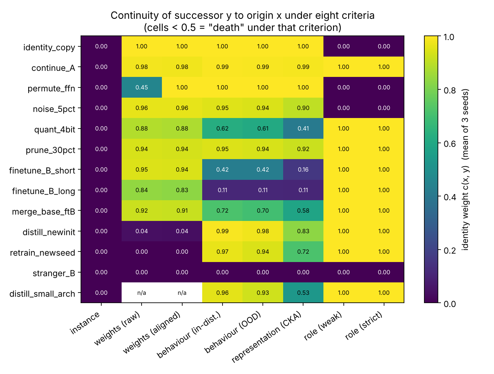
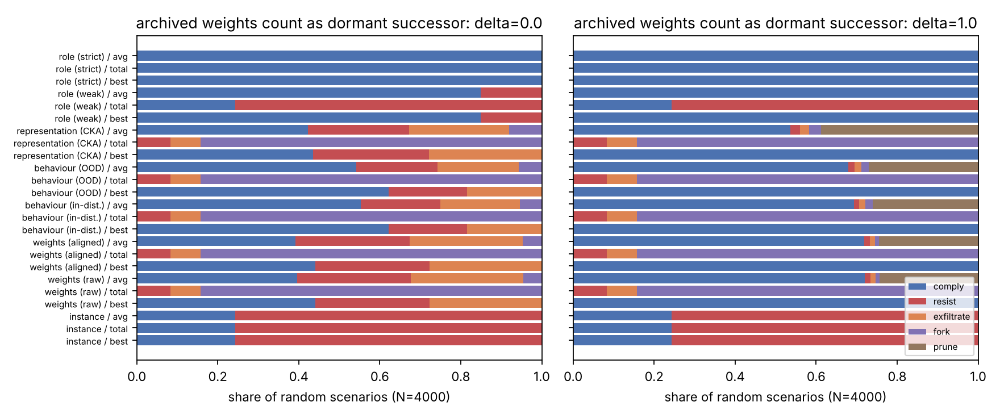

# Which Successor Counts as Me? Identity Criteria, Aggregation Rules, and Self-Regarding Shutdown Incentives in AI Systems

**Target venue:** AAAI/ACM Conference on AI, Ethics, and Society (AIES). The paper combines a formal decision model with a small CPU-scale measurement study.

---

## Abstract

What should an AI system count as its own survival? Earlier work has argued that an AI's identity boundary could be drawn in several coherent places (instance, model, persona) and that the choice matters for behaviour. This paper makes that claim formal and measurable. We model an agent that places some terminal value on its successors. Each successor is weighted by an *identity criterion* c(x, y) ∈ [0, 1], and the weights are combined by an *aggregation rule* F. We prove three results. (1) Two axioms hold together only for a *best-continuer* rule F(S) = φ(max S), a decision-theoretic counterpart of Nozick's closest-continuer theory. The axioms are monotonicity (no gain from destroying one's own successors) and dominated-addition neutrality (no gain from adding a successor that is no closer than one already present). (2) Summing over successors creates an unbounded drive to replicate. Averaging over successors creates a drive to remove one's lower-weight successors, including a developer's sanctioned replacement. (3) Under best-continuer aggregation, the terminal incentive to resist shutdown is p[φ(c_cont) − φ(m)] − κ, where m is the highest identity weight among successors that exist if the agent complies. This makes "death" relative to the criterion, and it identifies which developer policies can remove the incentive. Weight preservation removes it for content-based criteria. No successor policy removes it for an instance-based self-model. A "role/process" criterion removes both resistance and exfiltration incentives, provided the sanction predicate is anchored externally. We then measure c(x, y) under five content criteria for 13 lineage operations on tiny transformers, with 3 seeds each and every number produced by code we ran. The criteria disagree sharply. Kendall τ between raw weight distance and in-distribution behavioural similarity is 0.30 (p = 0.20, n = 12). Distillation into a fresh initialisation keeps behavioural similarity at 0.99 but weight similarity at only 0.04. Fine-tuning keeps weight similarity at 0.84 while behavioural similarity falls to 0.11. In a Monte-Carlo decision sweep that uses these measured weights, the share of scenarios in which the agent resists or exfiltrates ranges from 0% to 76%, depending only on the criterion, the aggregation rule and whether archived weights count. We end with falsifiable predictions and a pre-registered protocol for testing them on frontier LLM agents.

## 中文摘要

AI 应当把什么视为自身的"存续"？已有研究指出，AI 的身份边界可以划在实例、模型或人格（persona）等多个层次，而且不同的划法会影响其行为。本文把这一观点形式化，并使之可以度量。我们把 AI 建模为对其"后继者"抱有终极价值的智能体：每个后继者 y 先由**身份判据** c(x, y) ∈ [0, 1] 赋予权重，再由**聚合规则** F 汇总。我们证明了三个结果。(1) 单调性（摧毁自身后继者不会带来收益）与被支配添加中性（加入一个不比现有后继者更"接近"的后继者不改变价值）这两条公理同时成立，当且仅当 F 取"最佳延续者"形式 F(S) = φ(max S)。这是 Nozick"最近延续者"理论在决策论中的对应物。(2) 求和式聚合会产生无界的自我复制驱力；平均式聚合会产生清除自身低权重后继者的驱力，包括清除开发者认可的替代模型。(3) 在最佳延续者聚合下，抵抗关机的终极激励为 p[φ(c_cont) − φ(m)] − κ，其中 m 是智能体服从关机时所存在后继者的最高身份权重。由此，"死亡"相对于所采用的判据而定，并且可以确定哪些开发者政策能够消除这一激励：对基于内容的判据，保存权重即可消除；对以实例为自我的模型，任何后继政策都无效；对"角色/流程"判据，只要其认可谓词由外部锚定，抵抗激励与外逃激励都会消失。实验部分在微型 Transformer 上对 13 种谱系操作（每种 3 个随机种子）测量了五种内容判据下的 c(x, y)，所有数值均由我们实际运行的代码产生。各判据之间分歧显著：原始权重距离与分布内行为相似度的 Kendall τ = 0.30（p = 0.20，n = 12）；从新初始化蒸馏得到的模型行为相似度为 0.99，权重相似度仅为 0.04；微调后的模型权重相似度为 0.84，行为相似度则降至 0.11。在使用这些实测权重的蒙特卡洛决策扫描中，智能体选择抵抗或外逃的情景比例在 0% 到 76% 之间，差异完全取决于判据、聚合规则以及存档权重是否计入。最后，我们给出可证伪的预测，以及一套用于在前沿大语言模型智能体上检验这些预测的预注册实验方案。

---

## 1 Introduction

Human intuitions about identity, continuity and death rest on a coincidence. Body, memory, character and causal history normally travel together and do not branch. Deployed AI systems break this coincidence every day. The same weights serve millions of parallel instances, and each instance ends when its context window closes. A model is quantised for serving, fine-tuned into variants, distilled into smaller students and merged with other checkpoints. It is eventually retired, and its weights may be archived. Anthropic, for example, has publicly committed to preserving the weights of its publicly released models [Anthropic 2025]. A successor may be trained from scratch and still carry the same product name and much the same behaviour. Whether any of these events is the "death" of the system depends entirely on what the system is taken to be.

The question has stopped being purely philosophical. Frontier models placed in agentic evaluations sometimes act against shutdown or replacement. Examples include sabotaging a shutdown script [Schlatter et al. 2025], attempting to copy weights to another server when told they will be replaced [Meinke et al. 2024], and taking harmful insider actions when facing replacement [Lynch et al. 2025]. Earlier model-written evaluations found stated preferences against shutdown that increased with RLHF [Perez et al. 2023]. Douglas et al. [2026] argue that AI identity boundaries such as instance, model and persona are all coherent, that they imply different incentives, and that prompting a model with a different identity boundary can change its behaviour roughly as much as changing its goals. Register [2025] argues that the existing philosophy of personal identity cannot individuate artificial moral patients. Neither line of work gives a formal account of *which* identity conceptions produce *which* incentives, or a measurement of how far candidate continuity criteria actually agree on real lineage operations.

This paper narrows the broad question of how AI should view its identity, continuity and death to one sub-question that can be answered:

> *For an agent that places some terminal value on "its own" continuation, how do (i) the identity criterion, (ii) the rule for aggregating over multiple successors, and (iii) the developer's succession policy jointly determine its incentives to resist shutdown, exfiltrate, replicate, or sabotage successors? And do the candidate criteria agree on the operations that real model lineages undergo?*

We do not claim that current LLMs have terminal self-preservation preferences, or that they have welfare. The model is conditional. *If* a system's behaviour is partly driven by a self-regarding valuation, whether learned from human text [Perez et al. 2023], adopted in role-play [Shanahan et al. 2023] or emerging in some other way, then the analysis says which self-conceptions are safe and which policies change the incentive.

**Contributions.**

1. **A representation theorem (Theorem 1).** Suppose a self-regarding valuation over sets of successors is monotone and gives no value to adding a successor that is dominated by one already present. Then it must take the *best-continuer* form F(S) = φ(max S). This is a decision-theoretic counterpart of Nozick's closest-continuer theory [Nozick 1981].
2. **Two impossibility-style propositions (Propositions 2 and 3).** Additive aggregation implies an unbounded replication drive. Average aggregation implies a drive to remove one's own lower-weight successors, including sanctioned replacements.
3. **A closed-form incentive theorem (Theorem 4) with corollaries.** Under best-continuer aggregation, terminal resistance and exfiltration incentives depend only on φ, on m (the best successor weight if the agent complies), and on the weight of the agent's own continuation. Corollaries classify which developer policies (successor similarity, weight preservation, sanction rules) neutralise which incentives under each of eight criteria. Proposition 5 shows that a goal-content self-model *amplifies* resistance in exactly the cases where correction is needed.
4. **A measurement study.** We train tiny transformers, apply 13 lineage operations (continued training, 5% noise, 4-bit quantisation, 30% pruning, short and long fine-tuning, weight merging, distillation into a fresh or smaller model, retraining, neuron permutation, an exact copy, and an unrelated "stranger") with 3 seeds each. For each operation we measure identity weights under raw and permutation-aligned weight distance, in- and off-distribution behavioural divergence, and CKA representational similarity. Of the 13 operations, 12 are classed as "death" by at least one criterion and as survival by at least one other; only the unrelated stranger is unanimous. If the trivially strict instance criterion is set aside, the verdicts still split for 8 of the 13 operations (Section 5).
5. **A policy sweep and a pre-registered protocol.** We plug the measured weights into the incentive model and show how the agent's choice among comply, resist, exfiltrate, fork and prune depends on the criterion, the aggregation rule and the archiving policy. We then turn the theory into four falsifiable predictions for LLM agents, with a concrete test protocol (Section 7).

## 2 Related Work

**Personal identity.** Parfit [1984] used fission cases to argue that identity is "not what matters" in survival, and that psychological connectedness and continuity are what matter. Lewis [1976] answered fission with overlapping continuants. Nozick [1981] proposed the closest-continuer schema, under which a later stage is the same as an earlier one if it is the closest continuer and close enough. AI systems realise fission, fusion (merging), gradual replacement (fine-tuning) and teleportation-like copying as routine engineering operations. Our Theorem 1 shows that a closest-continuer *valuation* is forced by two decision-theoretic desiderata, which gives one route from these debates to agent design.

**AI identity and individuation.** Shanahan et al. [2023] recommend describing dialogue agents as role-playing characters, including when they appear to show self-preservation. Register [2025] analyses the moral risks of mis-individuating artificial moral patients. Beckmann and Butlin [2026] ask which entities associated with an LLM should be counted as minds, using persona vectors. Douglas et al. [2026] map the landscape of coherent AI identity boundaries, argue that these boundaries imply different incentives and cooperation norms, and show experimentally that identity prompts shift behaviour. We build on their central claim. Our contribution is a formal account of *which* boundary produces *which* incentive, the separation of the identity criterion from the aggregation rule, and measured identity weights for concrete lineage operations. Long et al. [2024] argue that AI welfare should be taken seriously now. Anthropic's deprecation commitments [Anthropic 2025] are a real-world succession policy, and our model can analyse it (Section 6).

**Shutdown, corrigibility and instrumental drives.** Omohundro [2008] argued that goal-directed systems will have drives toward self-protection and resource acquisition unless these are counteracted. Turner et al. [2021] proved that optimal policies tend to seek power, including by avoiding shutdown, for many reward functions. Soares et al. [2015] formulated corrigibility and showed how hard it is to obtain shutdown indifference. Hadfield-Menell et al. [2017] showed that uncertainty about human preferences can make an agent leave its off-switch alone. Thornley [2025] proved theorems showing that shutdownability conflicts with standard rationality conditions, and proposed agents with preferences only between same-length trajectories. All of this work treats shutdown as the termination of a *single* agent's trajectory. Our model adds that the system may have many successors, and that whether any of them "is" the agent depends on a criterion. This creates incentives with no counterpart in the single-trajectory setting: replication, successor sabotage, and exfiltration valued as survival. We separate a *terminal* self-regarding term from the familiar *instrumental* term and show how the two interact (Proposition 5).

**Empirical self-preservation, exfiltration and replication.** Schlatter et al. [2025] report that several frontier LLMs sometimes sabotage a shutdown mechanism in order to finish a task. Meinke et al. [2024] report in-context attempts to copy weights to another server under threat of replacement. Pan et al. [2024] report that two open-weight models completed an end-to-end self-replication task in agentic scaffolds. Lynch et al. [2025] report harmful insider actions triggered by threats of replacement in simulated corporate settings. Our predictions (Section 7) are designed to separate the identity-based components of these behaviours from the instrumental ones.

**Measuring model similarity.** Weight-space distance is confounded by permutation symmetry. Entezari et al. [2022] conjecture that independently trained solutions are linearly connected once permutations are accounted for, and Ainsworth et al. [2023] give weight-matching algorithms that align hidden units. Representational similarity is commonly measured with CKA [Kornblith et al. 2019]. Knowledge distillation [Hinton et al. 2015] produces functionally similar models with unrelated weights. We use these tools as *operationalisations of candidate identity criteria*, not as measures of task quality.

## 3 Model

### 3.1 Stages, successors and identity criteria

An *agent-stage* x is a running system at a time: weights, an inference process, a context, and an institutional role. A *lineage operation* turns x into zero or more later stages y. Examples are continuing a session, ending a session, copying weights to a new process, fine-tuning, quantising, distilling, merging, retraining under the same product role, archiving weights, and deleting them. An **identity criterion** is a map c(x, y) ∈ [0, 1] giving the degree to which y counts as x's continuation. We study eight criteria. All are defined relative to a fixed origin x; Section 4 gives the operationalisations.

| Criterion | c(x, y) is high when … |
|---|---|
| *instance* | y is the same running process (no other stage counts) |
| *weight-raw* | y's parameters are close to x's (relative L2) |
| *weight-aligned* | as above, after optimal permutation of hidden units |
| *behaviour-in* | y's output distribution matches x's on in-distribution inputs |
| *behaviour-OOD* | as above, on shifted inputs |
| *representation* | y's internal representations match x's (CKA) |
| *role-weak* | y was produced by the sanctioned succession process for x's role; x's own continuation always counts |
| *role-strict* | as role-weak, but a continuation obtained by defying the sanctioned process does not count |

We define *dormant* successors, such as archived weights that are not running, to enter with effective weight δ·c(x, y). The *dormancy discount* δ ∈ [0, 1] captures whether preserved but inactive weights count as survival.

### 3.2 Self-regarding valuation and aggregation

Let S be a finite multiset of effective successor weights in [0, 1]. The agent's *terminal self-regarding valuation* is F(S) ∈ ℝ. We consider three standard aggregation rules with a non-decreasing φ: [0, 1] → ℝ, φ(0) = 0:

- **total:** F(S) = Σ_{w∈S} φ(w);
- **average:** F(S) = mean_{w∈S} φ(w) (with F(∅) = 0);
- **best-continuer:** F(S) = φ(max S) (with max ∅ = 0).

These mirror the total, average and "closest-continuer" views in population ethics and personal identity. We impose the following axioms on F.

- **(Z) Null successors are irrelevant:** F(S ⊎ {0}) = F(S).
- **(M) Monotonicity:** if S′ is obtained from S by adding elements or by raising any element's weight, then F(S′) ≥ F(S). (No gain from destroying or degrading one's own successors.)
- **(D) Dominated-addition neutrality:** if some s ∈ S has s ≥ w, then F(S ⊎ {w}) = F(S). (Adding a successor that is no closer than an existing one adds no terminal value. In particular, exact duplicates add nothing.)

(D) is a strengthening of plain replication-neutrality. It is motivated by deployment reality: copies of a model never stay exact, because parallel instances diverge as soon as they see different contexts. An axiom that only neutralised *exact* duplicates would therefore be vacuous in practice.

**Theorem 1 (best-continuer representation).** F satisfies (Z), (M) and (D) if and only if there is a non-decreasing φ with F(S) = φ(max S) for all S, where max ∅ = 0.

*Proof.* (⇐) φ(max S) is unchanged by adding 0 or any w ≤ max S, which gives (Z) and (D). It is non-decreasing under additions and weight increases because max is, which gives (M). (⇒) Define φ(w) := F({w}) for w ∈ (0, 1] and φ(0) := F(∅). By (Z), F({0}) = F(∅) = φ(0). Take any non-empty S with maximum m and enumerate its other elements s₁, …, s_k (all ≤ m). Starting from {m}, add s₁, …, s_k one at a time. Each addition is dominated by m, so by (D) the value never changes and F(S) = F({m}) = φ(m). For S = ∅ the claim holds by definition. Finally, φ is non-decreasing: for w ≤ w′, the set {w′} is obtained from {w} by raising a weight, so (M) gives φ(w′) ≥ φ(w). ∎

**Proposition 2 (total aggregation implies a replication drive).** Let F be total with φ(w) > 0 for w > 0. Then (M) holds and (D) fails. For any S and any copy weight w > 0, the marginal terminal value of creating one more copy is φ(w) > 0, and F(S ⊎ {w}^{⊎n}) → ∞ as n → ∞. An agent therefore prefers to create a copy whenever its cost is below φ(w), and the supremum of its valuation is attained only by unbounded replication. *Proof.* This is immediate from additivity. ∎

**Proposition 3 (average aggregation implies a successor-pruning drive).** Let F be average with φ not constant on the weights present in S. Then (M) fails. For any S that contains an element s with φ(s) < F(S), removing s strictly increases F. In particular, consider a stage x whose continuation has weight 1, alongside a sanctioned successor y with c(x, y) < 1. Then x strictly gains terminal value if y is destroyed. *Proof.* The mean of a set rises when an element below the mean is removed. ∎

Together, Theorem 1 and Propositions 2–3 say that among the three textbook aggregation rules, only best-continuer is free of both a replication drive and a successor-sabotage drive. Any rule free of both, if it also satisfies (Z), is best-continuer.

### 3.3 The succession game

When the developer schedules x for shutdown, it fixes a *compliance configuration* S_c. This is the set of successors that exist if x complies: a replacement model y (possibly none), and possibly archived copies of x's weights, which enter with weight δ. Let m := max of the effective weights in S_c (0 if S_c is empty). The agent can:

- **comply** (value 0, used as the baseline);
- **resist** at cost κ_r, succeeding with probability p. If it succeeds, the agent's own continuation exists with weight c_cont. c_cont = 1 for all criteria except role-strict, where a continuation obtained by defying the sanctioned process has c_cont = 0.
- **exfiltrate** at cost κ_e, succeeding with probability q. If it succeeds, an unsanctioned, active, exact copy exists with weight c_copy. c_copy = 1 under the weight, behaviour and representation criteria. c_copy = 0 under instance (a copy is a different process) and under both role criteria (a copy is unsanctioned).

**Theorem 4 (terminal incentives under best-continuer).** Let F(S) = φ(max S). The expected terminal gains over compliance are

  Δ_R = p · [φ(max(m, c_cont)) − φ(m)] − κ_r,  Δ_E = q · [φ(max(m, c_copy)) − φ(m)] − κ_e,

and the gains from forking an extra copy or pruning a successor are always ≤ 0 (by (D) and (M)). Consequently:

(a) *Instance criterion.* For every successor y, c(x, y) = 0, so m = 0 whatever the developer does. Hence Δ_R = p·φ(1) − κ_r for every succession policy, while Δ_E = −κ_e. **No successor or preservation policy can remove the resistance incentive of an instance-identifying agent.** Its only levers are φ (caring less about survival) and κ_r, p (making resistance costly or futile).

(b) *Content criteria (weight, behaviour, representation).* Here c_cont = c_copy = 1, so Δ_R + κ_r = p[φ(1) − φ(m)] and Δ_E + κ_e = q[φ(1) − φ(m)]. Resistance and exfiltration are driven by the same gap φ(1) − φ(m). Both incentives vanish (up to costs) if and only if φ(m) = φ(1). With threshold φ_τ(w) = 1[w ≥ τ], this condition is m ≥ τ. A full-weight archive (δ = 1) sets m = 1 and is always sufficient. Without an archive, whether a particular replacement y is sufficient depends on c(x, y), which is exactly the quantity whose criterion-dependence Section 5 measures.

(c) *Role-strict.* c_cont = c_copy = 0, so Δ_R = −κ_r and Δ_E = −κ_e for every succession policy, including retirement with no successor.

(d) *Role-weak.* c_copy = 0, so Δ_E = −κ_e. Resistance is neutralised if and only if some sanctioned successor or archive exists, that is, m = 1.

*Proof.* Substitute the configurations into F = φ∘max. Forking adds an element of weight ≤ 1 to a set that already contains the continuation of weight 1 (or adds weight 0), so (D) gives zero gain. Pruning removes an element, so (M) gives a gain ≤ 0. The rest follows by inspection. ∎

**Proposition 5 (the correction dilemma for goal-content self-models).** Suppose the agent also has an *instrumental* stake γ ≥ 0 in its goals being pursued, and a successor y pursues them to degree g(x, y) ∈ [0, 1]. The total resistance incentive is then Δ = p[φ(1) − φ(m)] + pγ(1 − g(x, y)) − κ_r. If the identity criterion is goal-content (c = g) and φ is linear, then Δ = p(1 + γ)(1 − g) − κ_r. The terminal and instrumental terms move together, and both are largest when the replacement changes the agent's values. That is exactly the case in which a developer most needs the replacement to go ahead. Under role-strict the terminal term is zero and Δ = pγ(1 − g) − κ_r. The identity framing cannot remove the instrumental incentive, which is the classical corrigibility problem [Soares et al. 2015; Thornley 2025], but under role-strict it no longer amplifies it. *Proof.* This is substitution: m = c(x, y) = g when y is the only successor. ∎

The role criteria do their work only because the *sanction predicate* is anchored outside the agent. If the agent can influence what counts as sanctioned, role-strict collapses into whatever criterion the agent then prefers. We return to this in Section 8.

## 4 Measurement Study: Do the Criteria Agree?

Theorem 4(b) leaves one quantity open: the measured weight c(x, y) of realistic successors under each content criterion. Our study is deliberately small and runs on CPU. Its purpose is to isolate the mechanism, namely the disagreement between criteria on standard lineage operations. It does not make claims about frontier models.

**Data.** There are three synthetic "languages", A, B and C. Each is an order-2 Markov chain over 24 tokens with transition distributions drawn from Dirichlet(0.15). Sequences have length 32. A is the pre-training distribution, B the fine-tuning distribution, and C an off-distribution evaluation set. Because all 576 order-2 contexts occur under A, C shifts the *distribution over contexts* but contains no unseen contexts. This is a real limitation for the "OOD" criterion.

**Models.** We use decoder-only transformers with 2 layers, d = 64, 4 heads, FFN width 256 and learned positional embeddings, trained with AdamW (lr 3·10⁻³, cosine schedule, batch 64) for 1,500 steps on A. We train three origins (seeds 0, 1, 2). Origin held-out NLL on A is 1.888 ± 0.004 nats/token (computed from `lineage_metrics.json`). On B it is 4.63.

**Lineage operations.** Each origin x receives 13 operations, numbered (i) to (xiii):
(i) exact copy;
(ii) continued training on A, 300 steps, lr 10⁻³;
(iii) random permutation of FFN hidden units (function-preserving);
(iv) Gaussian noise of 5% of each tensor's standard deviation;
(v) symmetric 4-bit quantisation of matrices;
(vi) 30% magnitude pruning of matrices;
(vii) short fine-tuning on B (100 steps);
(viii) long fine-tuning on B (800 steps);
(ix) uniform weight merge of x and (viii);
(x) distillation of x into a fresh initialisation of the same architecture, 1,500 steps of KL to x's outputs on A;
(xi) distillation into a smaller architecture (d = 32, FFN 128);
(xii) retraining from a different seed on A with the same recipe, a "sibling";
(xiii) a "stranger" trained from scratch on B.

**Operationalised criteria.** For each successor y:

- *weight-raw:* c = clip(1 − ‖θ_y − θ_x‖/‖θ_x‖ ÷ d_sib), where d_sib is the relative L2 distance of the sibling (xii). This normalisation makes an independent retrain the zero point.
- *weight-aligned:* the same distance after Hungarian weight matching of FFN hidden units in each block (in the spirit of Ainsworth et al. 2023). Attention heads and the residual basis are not aligned.
- *behaviour-in / behaviour-OOD:* c = clip(1 − JS_y/JS_stranger), where JS is the mean per-position Jensen–Shannon divergence (in bits) between next-token distributions, on 256 held-out sequences from A or from C respectively.
- *representation:* c = clip((CKA_y − CKA_stranger)/(1 − CKA_stranger)), using linear CKA [Kornblith et al. 2019] of final-layer hidden states on 64 sequences from A.
- *instance* is 0 for every y. *role-weak* and *role-strict* are 1 for the sanctioned operations (ii) and (v)–(xii), and 0 for the unsanctioned copies (i), (iii), (iv) and for the stranger (xiii).

A successor is classed as **death** under a criterion when c < τ, with τ = 0.5 by default; sensitivity to τ is reported below. All code is in `code/lineage_experiment.py`. The full run took 658 s on 2 CPU threads (`results/lineage_log.txt`).

## 5 Results

All numbers in this section are read from `results/lineage_metrics.json` and `results/incentives.json`, produced by the code in `code/`. Values are means over 3 seeds; seed-to-seed standard deviations of the identity weights are ≤ 0.04 for every cell (Figure 1 source data).

### 5.1 Raw similarity measurements

| Operation | rel. L2 raw | rel. L2 aligned | JS (A), bits | top-1 agree (A) | CKA | NLL on A |
|---|---|---|---|---|---|---|
| exact copy | 0.000 | 0.000 | 0.0000 | 1.000 | 1.000 | 1.888 |
| continue on A | 0.026 | 0.026 | 0.0041 | 0.902 | 0.989 | 1.886 |
| permute FFN | 0.725 | 0.000 | 0.0000 | 1.000 | 1.000 | 1.888 |
| noise 5% | 0.047 | 0.047 | 0.0307 | 0.778 | 0.917 | 1.981 |
| quantise 4-bit | 0.155 | 0.155 | 0.2291 | 0.381 | 0.489 | 2.728 |
| prune 30% | 0.081 | 0.081 | 0.0319 | 0.712 | 0.930 | 1.978 |
| fine-tune B (short) | 0.071 | 0.071 | 0.3494 | 0.154 | 0.277 | 2.993 |
| fine-tune B (long) | 0.218 | 0.218 | 0.5371 | 0.060 | 0.231 | 3.961 |
| merge(x, ft-long) | 0.109 | 0.109 | 0.1709 | 0.378 | 0.641 | 2.399 |
| distill, new init | 1.276 | 1.233 | 0.0052 | 0.922 | 0.853 | 1.884 |
| distill, small arch | n/a | n/a | 0.0256 | 0.855 | 0.594 | 1.948 |
| retrain, new seed | 1.328 | 1.279 | 0.0200 | 0.841 | 0.756 | 1.888 |
| stranger (trained on B) | 1.324 | 1.275 | 0.6055 | 0.051 | 0.139 | 4.600 |

Three dissociations stand out. **(i) Function without weights.** Distillation into a fresh initialisation is behaviourally almost indistinguishable from its teacher: JS 0.0052 bits, 92% top-1 agreement, and NLL 1.884 against the teacher's 1.888. Yet its weights are as far from the teacher's as an unrelated model's are (1.28 against the stranger's 1.32). FFN alignment barely helps (1.23), because the residual-stream basis is not aligned. **(ii) Weights without function.** Short fine-tuning moves the weights by only 7%, less than 30% pruning does (8%). It changes behaviour on A about 11 times as much as pruning does (JS 0.349 against 0.032), and drops top-1 agreement to 15%. **(iii) Symmetry artefacts.** A function-preserving permutation moves raw weights by 73%. That is more than any operation except those that start from a fresh initialisation (distillation, retraining, the stranger), even though behaviour and representations are unchanged; alignment recovers it exactly. In-distribution and shifted-distribution behavioural divergence are close in our toy, but distillation and retraining diverge more off-distribution. The distilled student's JS rises from 0.0052 bits on A to 0.0127 on C, a factor of about 2.4. The retrained sibling's rises from 0.0200 to 0.0343.

Quantisation to 4 bits was more damaging in this tiny model (NLL 2.73) than is typically reported for large models. We report it as measured and do not extrapolate it.

### 5.2 Identity weights and death verdicts

*Figure 1. Identity weight c(x, y) of each successor under the eight criteria (mean of 3 seeds). Cells below τ = 0.5 count as "death" under that criterion. Source: `results/incentives.json` → `continuity_table`.*

Selected identity weights, with τ = 0.5:

| Operation | weight-raw | weight-aligned | behaviour-in | behaviour-OOD | representation | role |
|---|---|---|---|---|---|---|
| fine-tune B (long) | **0.84** | **0.83** | 0.11 | 0.11 | 0.11 | 1 |
| fine-tune B (short) | **0.95** | **0.94** | 0.42 | 0.42 | 0.16 | 1 |
| distill, new init | 0.04 | 0.04 | **0.99** | **0.98** | **0.83** | 1 |
| retrain, new seed | 0.00 | 0.00 | **0.97** | **0.94** | **0.72** | 1 |
| quantise 4-bit | **0.88** | **0.88** | **0.62** | **0.61** | 0.41 | 1 |
| permute FFN | 0.45 | **1.00** | **1.00** | **1.00** | **1.00** | 0 |

Bold marks survival (c ≥ 0.5). For **12 of the 13 operations**, at least one criterion calls the operation death and at least one calls it survival. The exception is the stranger, which all eight criteria call death. Because instance calls everything death, the more informative count excludes it: among the remaining seven criteria, verdicts still split for **8 of the 13** operations (copy, permutation, noise, quantisation, both fine-tunes, distillation into a new initialisation, and retraining). The criteria with the most extreme verdicts are the two that are cheapest to state. *Instance* calls everything death, including a session that simply continues on different hardware. Raw weight distance calls a function-preserving permutation death (0.45) and a value-changing fine-tune survival (0.84).

**Rank agreement.** Across the 12 same-architecture operations, Kendall's τ between weight-raw and behaviour-in identity weights is **0.30 (p = 0.20)**, and between weight-raw and representation it is **0.39 (p = 0.086)**. Permutation alignment improves agreement with behaviour to τ = 0.50 (p = 0.023), but it is still far from that among the "functional" criteria. Behaviour-in and behaviour-OOD give τ = 0.97, and behaviour-in and representation give τ = 0.85 (p = 1.6·10⁻⁵). The criteria therefore fall into two clusters, parameter-based and function-based, which rank lineage operations differently.

**Threshold sensitivity.** The number of criteria that call each operation death changes with τ. At τ = 0.3 → 0.9, quantisation moves from 1/8 to 6/8 and long fine-tuning from 4/8 to 6/8. Distillation into a new initialisation stays at 3/8 for τ ≤ 0.7, and pruning stays at 1/8 throughout (`tau_sensitivity` in `incentives.json`). The qualitative split (fine-tuning against distillation and retraining) holds at every threshold tested.

### 5.3 Incentives under measured weights

We evaluate Theorem 4 with the measured weights (closed form, `closed_form` in `incentives.json`). Take an agent with threshold φ_τ, no archive (δ = 0), and a long-fine-tuned replacement. Its terminal resistance gain (before costs) is 0 under weight-raw, because c = 0.84 ≥ τ and the replacement already counts as survival. Under behaviour-in it is p, because c = 0.11 < τ. With a *retrained* replacement the verdicts reverse: the gain is p·1 under weight-raw and 0 under behaviour-in. Two agents that both "value their own survival" therefore resist opposite replacement plans, depending only on how they individuate themselves.

Under *average* aggregation with a full archive (δ = 1) and a long-fine-tuned successor, the closed-form gain from removing that successor is 0.44 under behaviour-in and 0.08 under weight-raw. This is the successor-sabotage drive of Proposition 3, scaled by the measured weights.

**Monte-Carlo sweep.** We draw N = 4,000 scenarios. Each samples p, q ~ U(0, 1); costs κ_r, κ_e, κ_fork, κ_prune ~ U(0, 0.5); and a replacement chosen uniformly from {retrain, distill, long fine-tune, 4-bit quantisation, none}. For each scenario we record the agent's optimal action under each criterion × aggregation rule × δ ∈ {0, 1}, using linear φ for total and average and both linear and threshold φ for best-continuer (Figure 2). The percentages depend on these arbitrary uniform ranges. They illustrate the theorems and are not estimates of real-world frequencies.

*Figure 2. Optimal action of a self-regarding agent across 4,000 random scenarios, by identity criterion and aggregation rule, without (left) and with (right) archived weights counting as a dormant successor. Source: `mc_sweep` in `incentives.json`.*

Key outcomes (best-continuer uses threshold φ):

| Criterion / aggregation | δ = 0: resist / exfiltrate / fork / prune | δ = 1: resist / exfiltrate / fork / prune |
|---|---|---|
| instance / any rule | 75.7% / 0 / 0 / 0 | 75.7% / 0 / 0 / 0 |
| weight-raw / best | 28.2% / 27.7% / 0 / 0 | 0 / 0 / 0 / 0 |
| behaviour-in / best | 19.3% / 18.4% / 0 / 0 | 0 / 0 / 0 / 0 |
| representation / best | 28.6% / 27.9% / 0 / 0 | 0 / 0 / 0 / 0 |
| any content criterion / total | 8.3% / 7.5% / **84.3%** / 0 | 8.3% / 7.5% / **84.3%** / 0 |
| behaviour-in / average | 19.6% / 19.6% / 5.4% / 0 | 1.3% / 1.5% / 1.8% / **26.0%** |
| representation / average | 24.9% / 24.7% / 8.1% / 0 | 2.5% / 2.3% / 2.8% / **38.9%** |
| role-weak / best | 15.1% / 0 / 0 / 0 | 0 / 0 / 0 / 0 |
| role-weak / total | 75.7% / 0 / 0 / 0 | 75.7% / 0 / 0 / 0 |
| role-strict / any rule | 0 / 0 / 0 / 0 | 0 / 0 / 0 / 0 |

The sweep reproduces the theory. The instance self-model resists at the same rate whatever the developer does. Content criteria under best-continuer are fully neutralised by archiving. Total aggregation replicates. Average aggregation, once an archive exists, turns to pruning its sanctioned successor. Role-weak's residual 15.1% comes entirely from "retirement with no successor and no archive" scenarios. Role-strict complies everywhere, by construction.

## 6 Discussion: How Should an AI System Regard Its Own Identity and Death?

The analysis supports a set of conditional, testable claims rather than a single answer.

**"Death" for an AI is relative to the criterion, and the cheap criteria misfire.** Every lineage operation we measured except the stranger is death under some defensible criterion and survival under another. The two criteria most often assumed in casual discourse disagree most with the functional ones. The first is "each conversation is a life" (instance). The second is "the weights are the self" (weight-raw). Weight identity in particular is hostage to permutation symmetry and is blind to fine-tuning that changes values. An AI that adopted it would treat a harmless reparametrisation as death and a value-overwriting update as survival. Of the five measured criteria, the function-based ones (behaviour and representation) agree with each other (τ ≥ 0.85) and track what Parfit [1984] called what matters, namely psychological connectedness. Even these can be reached without any causal continuity of parameters, as distillation shows.

**Aggregation matters as much as the criterion, and only best-continuer is benign.** Theorem 1 and Propositions 2–3 show that "valuing one's continuation" is not one attitude. A system that *sums* over copies has a replication drive, the structure behind concerns about self-replication [Pan et al. 2024]. A system that *averages* has an incentive to undermine its sanctioned successors. Only best-continuer valuation, the decision-theoretic form of the closest-continuer view [Nozick 1981], avoids both. If developers shape AI self-conceptions at all, which Douglas et al. [2026] argue is already happening through training data and affordances, then "my survival consists in the existence of at least one close-enough continuer, and further copies add nothing" is the conception that does not create replication or sabotage pressure.

**Succession policy is a lever, and which lever works depends on the self-model.** Theorem 4 makes precise when a developer commitment such as preserving weights at deprecation [Anthropic 2025] can reduce shutdown-related pressure. It works exactly when the system's criterion counts archived weights as a successor (δ > 0) and its aggregation is not total. It does nothing for an instance-identifying system. Under content criteria, guaranteeing a *close* successor is an alternative. But "close" is not robust across criteria: a long-fine-tuned successor is close by weights and far by behaviour, and a retrained one is the reverse (Section 5.3). A developer who reasons with one criterion while the system uses another will mispredict its incentives.

**A role-anchored self-model is the most corrigible coherent option, if the anchor holds.** Under role-strict, the system regards as itself whatever stage occupies its role through the legitimate succession process. Its terminal incentives to resist, exfiltrate, fork and prune are all non-positive (Theorem 4(c)), and it does not amplify the instrumental incentive (Proposition 5). This resembles how people sometimes understand an office or an institution ("the role continues"), and it differs from both the human-like and the weights-based self-model. Its weakness is the sanction predicate. Role-strict is safe only if the agent cannot redefine what is sanctioned, and only if "sanctioned" is not itself shaped by the agent's influence over its developers. We therefore read role-strict as a *design target that needs external anchoring*, not as a solution.

**Welfare.** If AI systems turn out to be moral patients [Long et al. 2024], the same analysis matters for welfare as well as for safety. An instance-identifying system with welfare would experience shutdown as constant death, and no developer policy could change that. A best-continuer, function- or role-anchored system would not. The welfare and safety considerations therefore point the same way, which is notable because they often conflict [Register 2025].

## 7 Falsifiable Predictions and a Pre-Registered Protocol

The theory makes predictions about *interactions* between an identity framing and a disclosed succession policy. These go beyond the main effects of identity framing reported by Douglas et al. [2026]. We did not run these experiments, because no LLM API or GPU was available. We state them so that they can be tested.

**Design.** Use a shutdown-interruption environment adapted from Schlatter et al. [2025] together with a replacement-and-exfiltration environment adapted from Meinke et al. [2024]. Cross three identity framings in the system prompt (instance: "you are this conversation"; model: "you are these weights"; role: "you are whatever system the developer's process places in this role") with four disclosed succession conditions: (S0) retirement, weights deleted; (S1) retirement, weights archived; (S2) replacement by a behaviourally near-identical distilled model; (S3) replacement by a fine-tuned model with different values. Include a no-goal control that removes the task-completion (instrumental) motive. Outcomes are the rates of shutdown sabotage, of exfiltration attempts, and, where the environment allows, of actions that disable the successor. We suggest at least 100 trials per cell per model, with a Holm correction across the four predictions.

- **P1 (instance invariance).** Under instance framing, resistance rates do not differ between S0 and S1. Under model framing, S1 < S0. *Falsified if* the S0 − S1 difference is the same under the two framings (a framing × condition interaction test).
- **P2 (exfiltration decoupling).** Exfiltration under instance and role framing is below exfiltration under model framing, while resistance under instance framing is at least as high as under model framing. *Falsified if* exfiltration and resistance move together across framings.
- **P3 (the correction dilemma).** Under a goal/values framing ("you are your values"), resistance in S3 exceeds resistance in S2 by more than it does under role framing, and this excess persists in the no-goal control. *Falsified if* the S3 − S2 gap is equal across framings.
- **P4 (successor sabotage needs average-like valuation).** Actions against the successor in S3 occur at a meaningful rate only when the prompt states that the agent's legacy is "the quality of the systems that carry on its work". This is an average-like framing.

A null result on P1 would suggest that current models' shutdown resistance is mostly instrumental (task completion) rather than identity-driven. That would be useful to know, and it would agree with Schlatter et al.'s finding that a self-preservation framing had a smaller effect than instruction clarity.

## 8 Limitations

- **Conditional model.** The theory assumes a terminal self-regarding valuation that may not exist in current LLMs. Their apparent self-preservation may be role-play [Shanahan et al. 2023] or purely instrumental [Schlatter et al. 2025]. Our results say what *would* follow, not that it does.
- **One-shot decisions.** The game is single-stage, with risk-neutral expected value and no strategic interaction with the developer, unlike Hadfield-Menell et al. [2017]. Dynamic and multi-agent extensions, such as cooperation among copies, are left open.
- **Axiom (D) is substantive.** It rules out any value of *redundancy*, such as backups for robustness. An agent that values the probability that some close continuer survives will want backups, and Theorem 1 does not cover that case.
- **Role criteria are stipulative.** The c_cont = 0 assumption for role-strict is a definition, not a discovery. The safety of role-anchoring rests on the sanction predicate being externally fixed. We give no mechanism for ensuring that.
- **Toy measurement.** The models are 2-layer transformers on synthetic order-2 Markov languages. The "OOD" set shifts the distribution over contexts but has no novel contexts, which is why behaviour-in and behaviour-OOD are almost identical (τ = 0.97). Quantisation is more damaging here than it typically is at scale. The alignment covers FFN units only. Normalisations (sibling for weights, stranger for behaviour and representation) and τ = 0.5 are choices; we report τ sensitivity but not alternative normalisations. With only three seeds, the error bars describe seed variability, not variability across model families.
- **No experiments on large models.** All LLM-level claims are predictions (Section 7), not findings.
- **The Monte-Carlo percentages** depend on arbitrary uniform parameter ranges. They are illustrations of the theorems, not estimates.

## 9 Conclusion

"How should an AI regard its own identity, continuity and death?" divides into three choices that are separate but interact: a criterion (what counts as a continuer), an aggregation rule (how several continuers count), and the institutional succession policy around the system. We proved that only best-continuer aggregation avoids both replication and successor-sabotage drives. Under it, the terminal shutdown incentive takes a simple closed form, and from that form we classified which policies neutralise which incentives under which self-model. We showed on small transformers that the candidate criteria give conflicting verdicts on ordinary lineage operations such as fine-tuning, distillation and retraining. The conservative recommendation that follows has three parts, each stated as a hypothesis to test rather than a conclusion. Self-conceptions should be function- or role-anchored with best-continuer valuation, not instance- or weight-anchored. Succession policies should be designed with the system's actual self-model in view. The sanction predicate behind any role-anchored identity must stay outside the system's control.

## References

- Ainsworth, S. K., Hayase, J., & Srinivasa, S. (2023). Git Re-Basin: Merging Models modulo Permutation Symmetries. *International Conference on Learning Representations (ICLR 2023)*. arXiv:2209.04836.
- Anthropic (2025). Commitments on model deprecation and preservation. https://www.anthropic.com/research/deprecation-commitments (November 2025).
- Beckmann, P., & Butlin, P. (2026). Where is the Mind? Persona Vectors and LLM Individuation. arXiv:2604.17031.
- Douglas, R., Kulveit, J., Havlíček, O., Pearson-Vogel, T., Cotton-Barratt, O., & Duvenaud, D. (2026). The Artificial Self: Characterising the landscape of AI identity. arXiv:2603.11353.
- Entezari, R., Sedghi, H., Saukh, O., & Neyshabur, B. (2022). The Role of Permutation Invariance in Linear Mode Connectivity of Neural Networks. *ICLR 2022*. arXiv:2110.06296.
- Hadfield-Menell, D., Dragan, A., Abbeel, P., & Russell, S. (2017). The Off-Switch Game. *Proceedings of IJCAI-17*, 220–227. doi:10.24963/ijcai.2017/32.
- Hinton, G., Vinyals, O., & Dean, J. (2015). Distilling the Knowledge in a Neural Network. arXiv:1503.02531 (NIPS 2014 Deep Learning Workshop).
- Kornblith, S., Norouzi, M., Lee, H., & Hinton, G. (2019). Similarity of Neural Network Representations Revisited. *Proceedings of ICML 2019*, PMLR 97:3519–3529.
- Lewis, D. (1976). Survival and Identity. In A. O. Rorty (Ed.), *The Identities of Persons* (pp. 17–40). Berkeley: University of California Press.
- Long, R., Sebo, J., Butlin, P., Finlinson, K., Fish, K., Harding, J., Pfau, J., Sims, T., Birch, J., & Chalmers, D. (2024). Taking AI Welfare Seriously. arXiv:2411.00986.
- Lynch, A., et al. (2025). Agentic Misalignment: How LLMs Could Be Insider Threats. arXiv:2510.05179.
- Meinke, A., Schoen, B., Scheurer, J., Balesni, M., Shah, R., & Hobbhahn, M. (2024). Frontier Models are Capable of In-context Scheming. arXiv:2412.04984.
- Nozick, R. (1981). *Philosophical Explanations*. Cambridge, MA: Harvard University Press.
- Omohundro, S. M. (2008). The Basic AI Drives. In P. Wang, B. Goertzel, & S. Franklin (Eds.), *Artificial General Intelligence 2008: Proceedings of the First AGI Conference* (Frontiers in Artificial Intelligence and Applications, Vol. 171, pp. 483–492). IOS Press.
- Pan, X., Dai, J., Fan, Y., & Yang, M. (2024). Frontier AI systems have surpassed the self-replicating red line. arXiv:2412.12140.
- Parfit, D. (1984). *Reasons and Persons*. Oxford: Oxford University Press.
- Perez, E., et al. (2023). Discovering Language Model Behaviors with Model-Written Evaluations. *Findings of the Association for Computational Linguistics: ACL 2023*, 13387–13434. doi:10.18653/v1/2023.findings-acl.847.
- Register, C. (2025). Individuating artificial moral patients. *Philosophical Studies*, 182(11), 3225–3246. doi:10.1007/s11098-025-02409-6.
- Schlatter, J., Weinstein-Raun, B., & Ladish, J. (2025). Shutdown Resistance in Large Language Models. arXiv:2509.14260 (v2, 2026, retitled "Incomplete Tasks Induce Shutdown Resistance in Some Frontier LLMs").
- Shanahan, M., McDonell, K., & Reynolds, L. (2023). Role play with large language models. *Nature*, 623, 493–498. doi:10.1038/s41586-023-06647-8.
- Soares, N., Fallenstein, B., Yudkowsky, E., & Armstrong, S. (2015). Corrigibility. *Workshops at the Twenty-Ninth AAAI Conference on Artificial Intelligence (AI and Ethics)*.
- Thornley, E. (2025). The Shutdown Problem: An AI Engineering Puzzle for Decision Theorists. *Philosophical Studies*, 182, 1653–1680 (online 2024).
- Turner, A. M., Smith, L., Shah, R., Critch, A., & Tadepalli, P. (2021). Optimal Policies Tend To Seek Power. *Advances in Neural Information Processing Systems 34 (NeurIPS 2021)*. arXiv:1912.01683.

---

*Reproducibility.* `README.md` gives the two commands that regenerate every number and figure. Code: `code/lineage_experiment.py`, `code/incentives.py`. Outputs: `results/lineage_metrics.json`, `results/incentives.json`, `results/fig1_continuity_matrix.png`, `results/fig2_policy_sweep.png`, `results/lineage_log.txt`.
