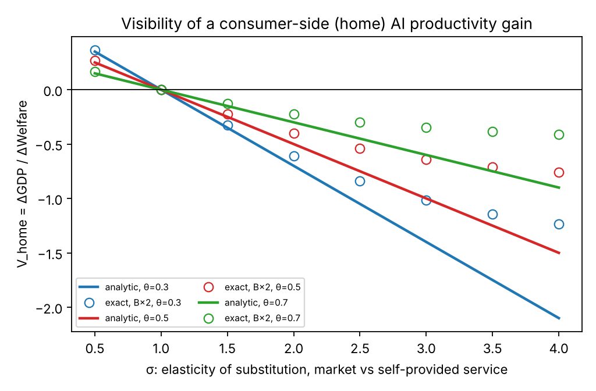
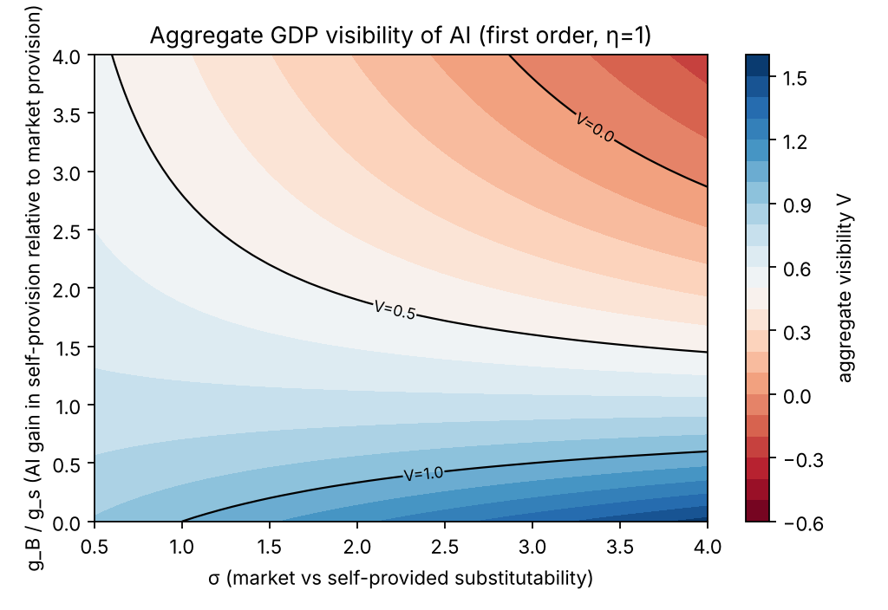
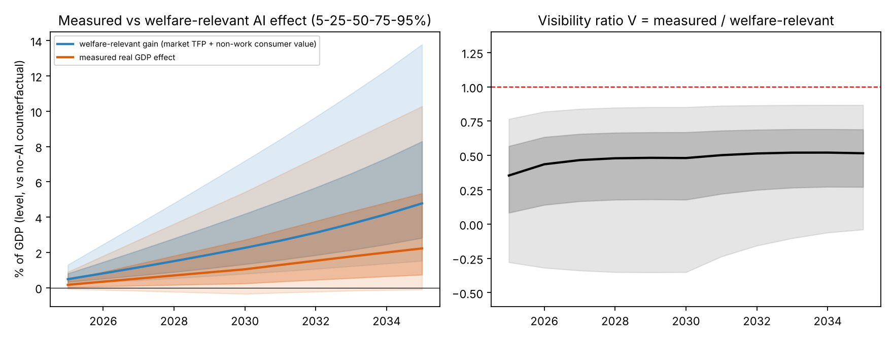
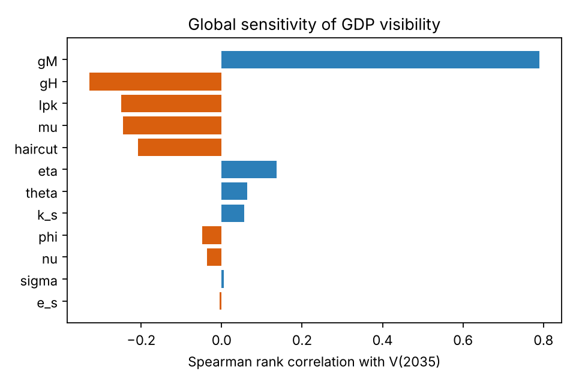
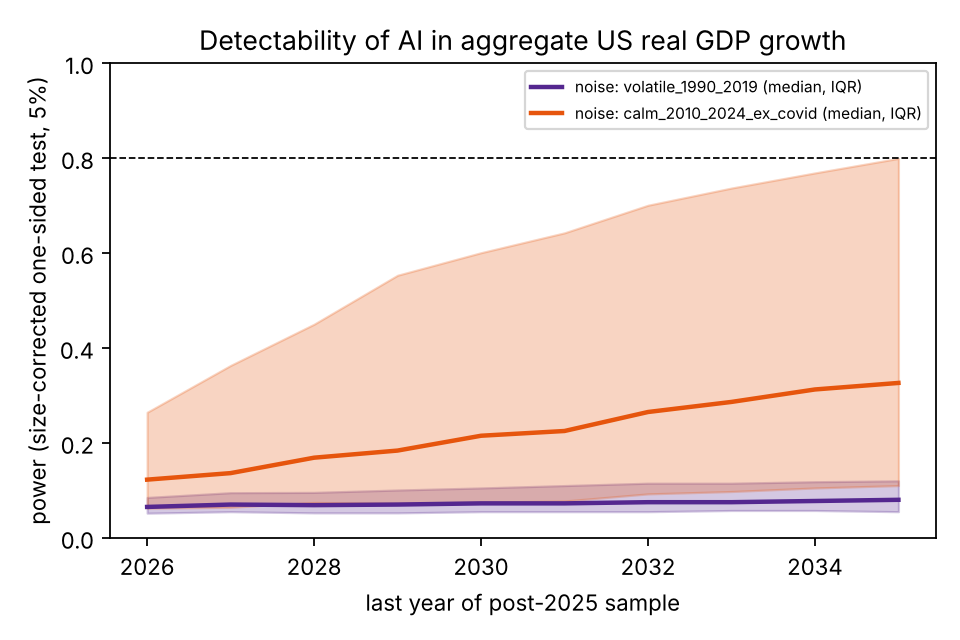

# Visible, Invisible, and Negative: A Visibility-Ratio Framework for Whether AI Productivity Gains Show Up in GDP

**Target venue:** *Review of Income and Wealth* (measurement and national-accounts track)

---

## Abstract

Will AI-driven productivity growth show up in GDP? We argue that the question has no single answer, because GDP registers different channels of AI use with different signs. We build a general-equilibrium accounting model with market production, household self-provision and leisure. Consumers can obtain a service either by buying it (tutoring, translation, copywriting, simple legal or tax help) or by producing it themselves with their own time and a free AI assistant. We define a *visibility ratio* V: the change in chained real GDP divided by the welfare gain (equivalent variation) from an AI productivity shock. We derive closed-form first-order visibility coefficients for three channels. (i) Market-good gains have V_c = 1 − (1−η)(e_x + e_sθ), which equals 1 in the Hulten benchmark. (ii) Gains in market-provided substitutable services have V_s = 1 + Λ + (σ−1)θ, which exceeds 1 when σ > 1 ("marketization"). (iii) Gains in AI-assisted self-provision have V_h = Λ − (σ−1)(1−θ), which is *negative* whenever market and self-provided services are gross substitutes (η = 1, σ > 1). Here σ is the market-versus-self-provision elasticity, θ the self-provided share, and η the upper-nest elasticity governing leisure. The two service coefficients satisfy the identity V_s − V_h = σ. The mechanism is that time reallocated between market and home is welfare-neutral to first order (envelope theorem) but changes GDP to first order. We verify the formulas numerically to within 1.1×10⁻⁴ over 300 random parameterizations and characterize the large-shock attenuation. We then calibrate a 2025–2035 Monte Carlo for the United States, anchored on published macro estimates of AI's effect on total factor productivity, survey-based consumer-surplus estimates for generative AI, and the observed non-work share of chatbot use. In the median draw, measured real GDP captures about half of the welfare-relevant AI gain (V₂₀₃₅ median 0.52, 90% interval −0.04 to 0.87; P(V<1) = 0.99). The consumer self-provision channel is negative but small in aggregate (median −0.09% of GDP by 2035). Using World Bank data on US growth, we show that a median AI contribution to measured growth of roughly 0.2 pp/yr is statistically undetectable in aggregate GDP before 2035 under historical volatility (minimum detectable shift ≈ 2.3 pp). The answer to the title question is therefore "partly, with a lag, and not detectably in the aggregate." This shifts the empirical burden to sector- and time-use-level tests. We pre-specify five falsifiable predictions and a test protocol.

## 中文摘要

AI 带来的生产力增长会体现在 GDP 中吗？本文认为这个问题没有统一答案，因为 GDP 对 AI 不同使用渠道的记录方式不同，方向甚至相反。我们构建了一个包含市场生产、家庭自我供给与闲暇的一般均衡核算模型。消费者获得某项服务（如辅导、翻译、文案、简单法律或税务咨询）有两种方式：在市场上购买，或借助免费 AI 助手用自己的时间完成。我们定义"可见度比率" V：AI 生产率冲击引起的链式实际 GDP 变化，除以其福利收益（等价变化）。我们对三个渠道推导出闭式的一阶可见度系数：(i) 市场商品渠道 V_c = 1 − (1−η)(e_x + e_sθ)，在 Hulten 基准下等于 1；(ii) 可替代服务的市场供给渠道 V_s = 1 + Λ + (σ−1)θ，当 σ>1 时大于 1（"市场化"效应）；(iii) AI 辅助的家庭自我供给渠道 V_h = Λ − (σ−1)(1−θ)，只要市场服务与自我供给互为总替代品（η=1、σ>1），该系数即为负。并且恒有 V_s − V_h = σ。机制在于：市场与家庭之间的时间再配置在一阶上对福利是中性的（包络定理），但对 GDP 有一阶影响。我们在 300 组随机参数下数值验证了上述公式（最大误差 1.1×10⁻⁴），并刻画了大冲击下的衰减。随后，我们以已发表的 AI 宏观 TFP 估计、基于调查的生成式 AI 消费者剩余估计，以及聊天机器人非工作用途的观测占比为锚，对美国 2025–2035 年做蒙特卡洛校准。中位情形下，实际 GDP 只记录约一半的福利相关 AI 收益（2035 年 V 中位数 0.52，90% 区间 −0.04 至 0.87；P(V<1)=0.99）。家庭自我供给渠道对 GDP 的贡献为负，但总量很小（2035 年中位数为 GDP 的 −0.09%）。利用世界银行的美国增长数据，我们发现：在历史波动水平下，约 0.2 个百分点/年的中位 AI 增长贡献在 2035 年前无法从总量 GDP 中统计识别（最小可检测效应约 2.3 个百分点）。因此，对题目问题的回答是："部分会、有滞后、在总量上难以检测"，实证检验的重心应转向行业层面和时间使用层面。文末给出五个可证伪预测及检验方案。

---

## 1 Introduction

Robert Solow's remark that "you can see the computer age everywhere but in the productivity statistics" (Solow, 1987) has been revived for generative AI. Adoption has been fast. By 2025, US consumer-facing generative AI tools had on the order of 100 million adult users (Brynjolfsson, Collis, Eggers, Kazinnik & Nguyen, 2026). About 18% of US firms reported using AI in some business function by year-end 2025 (Federal Reserve Board, 2026). Randomized and quasi-experimental studies find large task-level gains: 14–15% more issues resolved per hour in customer support (Brynjolfsson, Li & Raymond, 2025) and about 40% faster completion of professional writing tasks (Noy & Zhang, 2023). Macro projections are far apart. Acemoglu (2025) bounds the ten-year TFP effect at about 0.66%. Aghion & Bunel (2024) estimate 0.07–1.24 pp per year of additional productivity growth with a task-based method and 0.8–1.3 pp per year by historical analogy. Filippucci, Gal & Schief (2024) give 0.25–0.6 pp per year for TFP. Early labor-market evidence shows small effects on earnings and hours (Humlum & Vestergaard, 2025).

This paper addresses a narrower question that matters for interpreting all of these numbers. **Given some AI productivity gain, how much of it will chained real GDP record, and with what sign?** This differs from asking how large AI's productivity effect is. The existing mismeasurement literature for digital technology gives two partial answers. One is about free goods: consumer surplus from zero-price digital services lies outside GDP by construction (Brynjolfsson, Collis, Diewert, Eggers & Fox, 2019; Hulten & Nakamura, 2017; Goolsbee & Klenow, 2006). The other is about intangible investment: complementary intangibles are expensed rather than capitalized, which creates a productivity J-curve (Brynjolfsson, Rock & Syverson, 2021; Corrado, Hulten & Sichel, 2009). Against both stands the skeptical finding that mismeasurement explained little of the post-2004 productivity slowdown (Byrne, Fernald & Reinsdorf, 2016; Syverson, 2017).

Generative AI differs from the earlier digital goods in one way these frameworks do not address. A large and growing share of its use is not consumption of a new free good like social media. It is **self-provision of services that are otherwise bought on the market**. Examples include drafting a letter instead of hiring a writer, getting a tutoring explanation instead of paying a tutor, and translating a document instead of buying translation. Chatterji et al. (2025) find that non-work messages rose from about 53% to more than 70% of ChatGPT consumer traffic by mid-2025. Hui, Reshef & Zhou (2024) find falling employment and earnings for online freelancers in writing-related occupations after ChatGPT's release. When AI makes self-provision cheaper and households substitute away from the market, the market sector shrinks. Measured GDP can then *fall* while welfare rises. This is the household-production margin of Becker (1965), and its accounting consequences have long been recognized for the national accounts (Bridgman, Dugan, Lal, Osborne & Villones, 2012). To our knowledge it has not been formalized as a channel through which AI productivity growth enters GDP with a negative sign, nor been quantified next to the other wedges.

**Contributions.**

1. **A visibility-ratio framework with closed-form results.** We define V = (Δ chained real GDP)/(equivalent variation) for an AI productivity shock in a nested-CES economy with market goods, substitutable market services, AI-assisted self-provision and leisure. We derive first-order visibility coefficients for each channel (Proposition 1). Hulten's (1978) theorem appears as the special case V_c = 1. We show V_h < 0 under gross substitutability (Corollary 2) and prove the identity V_s − V_h = σ (Corollary 3).
2. **An aggregation result and a gap decomposition** (Proposition 2). Aggregate V is a welfare-weighted average of channel coefficients. GDP understates the welfare gain exactly when the AI gain in self-provision, relative to market provision, exceeds a threshold that depends only on (σ, θ). We also give the exact large-shock (path-integral) version, under which first-order formulas overstate the magnitude of the negative channel (Proposition 3).
3. **Numerical verification.** Chained-Fisher and equivalent-variation computations confirm the formulas to within 1.1×10⁻⁴ across 300 random parameterizations and quantify large-shock attenuation (code and outputs released).
4. **A sourced calibration for the US, 2025–2035,** with explicit separation of sourced inputs and assumptions. It yields distributions for measured versus welfare-relevant AI effects, a five-way decomposition of the gap, and global sensitivity. Measured GDP captures about half of the welfare-relevant gain in the median draw. The variable that matters most is the size of market TFP gains, not the measurement wedges.
5. **A detectability analysis** on World Bank US growth data with size-corrected tests. Plausible AI contributions to measured growth are not detectable in aggregate GDP within a decade under historical volatility. Combined with contribution 1, this motivates **five pre-specified, falsifiable sectoral and time-use predictions** with a test protocol.

We do not claim to estimate AI's productivity effect. The framework takes that effect as an input and shows how it maps into GDP.

## 2 Related Work

**Macroeconomics of AI.** Acemoglu (2025) combines task exposure with micro estimates of cost savings in a Hulten-style aggregation and finds a TFP increase of at most about 0.66% over ten years. Aghion & Bunel (2024) revisit those components and obtain larger values. Filippucci, Gal, Jona-Lasinio, Leandro & Nicoletti (2024) and Filippucci, Gal & Schief (2024) survey mechanisms and give OECD projections. All of these map micro gains into *measured* TFP through Hulten's (1978) theorem, which assumes market production and fixed factor supplies. Our framework asks what happens to *measured GDP* when those assumptions are relaxed on the household side.

**Mismeasurement of digital technology.** Brynjolfsson, Collis & Eggers (2019) use large online choice experiments to value free digital goods (median WTA of about $48 per month for Facebook). Brynjolfsson et al. (2019, published 2025 in AEJ: Macroeconomics) propose GDP-B, which adds the welfare value of new and free goods. Hulten & Nakamura (2017) model "output-saving" technical change that raises welfare without raising GDP. Goolsbee & Klenow (2006) value the internet from time use. Coyle (2025) argues more broadly that the mid-twentieth-century statistical framework misses dematerialized and free production. For generative AI, Collis & Brynjolfsson (2025) estimated US consumer surplus of about $97 billion in 2024. Brynjolfsson, Collis, Eggers, Kazinnik & Nguyen (2026) report a rise to about $172 billion as users grew from 98 to 115 million. These works treat the invisible part as consumer surplus that is *added* to GDP. We show that when the new technology helps households substitute away from market purchases, there is also a *subtraction* from measured GDP. A welfare-adjusted measure must therefore add the surplus and undo the induced market contraction.

**Skeptical evidence.** Byrne, Fernald & Reinsdorf (2016) and Syverson (2017) argue that mismeasurement cannot explain the post-2004 slowdown. Their main reasons are that the plausible size of missing surplus is small compared with the output shortfall and that the slowdown occurred across countries regardless of ICT intensity. Our calibration agrees with this on magnitudes. Plausible consumer-side wedges are fractions of a percent of GDP, and most of the variance in visibility comes from market TFP.

**Intangibles and the J-curve.** Corrado, Hulten & Sichel (2009) document large uncounted intangible investment. Brynjolfsson, Rock & Syverson (2021) show that intangible investment complementary to general-purpose technologies first depresses and later inflates measured TFP growth. Investment in AI hardware and data centers is itself counted and visible in GDP. One prominent back-of-the-envelope estimate attributes about 92% of US GDP growth in the first half of 2025 to information-processing equipment and software investment (Furman, as reported by Fortune, 2025). That is a demand-side effect of AI *capex*, distinct from AI *productivity*, and we keep the two separate.

**Household production and the national accounts.** Becker (1965) introduced household production with time and goods. Rupert, Rogerson & Wright (1995) estimate market–home substitution elasticities and find them large enough for some household types to matter in general equilibrium. Aguiar, Hurst & Karabarbounis (2013) show that home production absorbs about 30% of forgone market hours in recessions. BEA's satellite accounts value household production (Bridgman et al., 2012). The 2025 SNA keeps free digital services and unpaid household work in extended rather than core accounts (IMF, 2025). Our contribution is to bring this margin into the AI-and-GDP debate formally and to derive its sign.

**Micro evidence on generative AI.** Bick, Blandin & Deming (2024) report self-assessed time savings of about 1.4% of all US work hours. Humlum & Vestergaard (2025) find null effects on earnings and hours in Denmark. Hui, Reshef & Zhou (2024) find declines for exposed freelancers. The last finding is the market-side mirror of our self-provision channel.

## 3 Model

### 3.1 Environment

A representative household has one unit of time and faces wage w ≡ 1 (numeraire). Full income is F = 1 (pure profits are zero under constant returns). Four "goods" enter utility:

- a **market good** c, produced from labor with productivity A_c and price p_c = 1/A_c;
- a **market service** s_m (the market version of a substitutable service), price p_s = 1/A_s;
- a **self-provided service** s_h, produced at home with time h and productivity B, which includes free consumer AI, so s_h = B·h with shadow price p_h = 1/B;
- **leisure** x, with price 1.

Preferences are homothetic nested CES:

U = [a_c c^r + a_s s^r + a_x x^r]^{1/r}, with η ≡ 1/(1−r),
s = [ω s_m^ρ + (1−ω) s_h^ρ]^{1/ρ}, with σ ≡ 1/(1−ρ).

Here σ is the elasticity of substitution between buying the service and self-providing it, and η governs substitution among the market good, the service composite and leisure, and therefore labor supply. Let e_c, e_s, e_x be full-income expenditure shares in the upper nest and θ the self-provided share of the service composite. Market labor is ℓ = 1 − h − x = e_c + e_s(1−θ).

**AI shocks.** AI is represented by log productivity changes g_c = dln A_c (AI used by firms producing market goods), g_s = dln A_s (AI used by firms selling substitutable services), and g_B = dln B (free or near-free consumer AI used for self-provision). Paid consumer AI subscriptions are a market good. Their unmeasured quality change is handled as a measurement wedge in §5.

**Measured GDP.** Measured real GDP is a chained Fisher quantity index over market final output {c, s_m}. Final-good deflators are taken as correct, apart from an explicit quality wedge in §5. Because AI services used *by firms* are intermediates, mismeasured intermediate prices only shift measured productivity across industries and do not change aggregate real GDP when final deflators are right. This is Hulten's (1978) logic.

**Welfare.** The welfare gain is the equivalent variation in base-period dollars, EV = (P₀/P₁ − 1)·F, where P is the ideal (unit-expenditure) price index of U.

**Visibility ratio.** V ≡ ΔGDP (base-year dollars) / EV.

### 3.2 First-order results

**Lemma 1 (envelope / full-income Hulten).** To first order, EV/F = e_c g_c + e_s(1−θ) g_s + e_sθ g_B.
*Proof.* dln P = Σ_i e_i dln P_i, with dln P_s = (1−θ) dln p_s + θ dln p_h. Each dln p_j = −g_j. Reallocations of time across uses are second order by the envelope theorem. ∎

The weights in Lemma 1 are Domar weights in *full* income. Home production carries the weight e_sθ even though it is not in GDP.

**Proposition 1 (channel visibility coefficients).** Let Λ ≡ (1−η)[e_c − (1−e_s)(1−θ)]. To first order:

- V_c = 1 − (1−η)(e_x + e_sθ),
- V_s = 1 + Λ + (σ−1)θ,
- V_h = Λ − (σ−1)(1−θ).

*Proof.* Upper-nest CES shares satisfy dln e_i = (1−η)(dln P_i − dln P) and inner shares satisfy dθ = (σ−1)θ(1−θ)(g_B − g_s). Real GDP at base prices changes by Σ_j p_j dq_j over market goods. For c, p_c dq_c = de_c + e_c g_c. For s_m, p_s dq_{s_m} = d[e_s(1−θ)] + e_s(1−θ) g_s.

*Home shock* (g_B = g, others 0). dln P_s = −θg, so de_c = (1−η)e_c e_s θ g and de_s = −(1−η)e_s(1−e_s)θg. Then dGDP = de_c + (1−θ)de_s − e_s dθ = e_sθg{(1−η)[e_c − (1−e_s)(1−θ)] − (σ−1)(1−θ)}. Dividing by EV = e_sθg (Lemma 1) gives V_h.

*Market-service shock* (g_s = g). dln P_s = −(1−θ)g and dθ = −(σ−1)θ(1−θ)g, so dGDP = e_s(1−θ)g[1 + Λ + (σ−1)θ]. EV = e_s(1−θ)g.

*Market-good shock* (g_c = g). dln P_c = −g, de_c = −(1−η)e_c(1−e_c)g, de_s = (1−η)e_c e_s g, and dθ = 0. So dGDP = e_c g[1 − (1−η)(1−e_c) + (1−η)e_s(1−θ)] = e_c g[1 − (1−η)(e_x + e_sθ)]. EV = e_c g. ∎

**Corollary 1 (Hulten benchmark).** With η = 1 (Cobb–Douglas upper nest, so labor supply does not respond through leisure), V_c = 1: market-good AI gains are fully visible. If also σ = 1, then V_s = 1 and V_h = 0, so self-provision gains are invisible but cause no market contraction. This is the "free good" case treated by GDP-B.

**Corollary 2 (negative visibility).** V_h < 0 if and only if σ > 1 + Λ/(1−θ). With η = 1 this is σ > 1. Whenever buying and self-providing a service are gross substitutes, an AI gain in self-provision *lowers* measured real GDP while raising welfare. For η = 1, σ = 3 and θ = 0.5, V_h = −1: GDP falls by as much as welfare rises.

**Corollary 3 (identity).** V_s − V_h = σ for all parameters. The more substitutable market and self-provision are, the more GDP overstates market-side gains in substitutable services and understates (or reverses) household-side gains. The two errors have opposite signs and their difference has the same size.

The economics is a **reallocation wedge**. Moving an hour from market work to home production is welfare-neutral at the margin, because both uses of time earn the same shadow value at an optimum. GDP, however, counts only the market hour. Any shock that moves hours between home and market therefore changes GDP at first order and welfare not at all. Hulten's theorem escapes this because it holds factor supplies to the market fixed. The household margin is the factor-supply response that Hulten-based AI projections leave out.

### 3.3 Aggregation and the welfare–GDP gap

**Proposition 2 (aggregate visibility).** For a vector shock (g_c, g_s, g_B), the aggregate first-order visibility is
V = (W_c V_c + W_s V_s + W_h V_h)/(W_c + W_s + W_h), with W_c = e_c g_c, W_s = e_s(1−θ) g_s, W_h = e_sθ g_B.
With η = 1, the welfare–GDP gap is
EV − ΔGDP = e_sθ[(1 + (σ−1)(1−θ)) g_B − (σ−1)(1−θ) g_s],
so GDP understates the AI welfare gain if and only if
g_B / g_s > (σ−1)(1−θ) / [1 + (σ−1)(1−θ)].
*Proof.* Linearity of the first-order expressions in Proposition 1 and Lemma 1, followed by algebra. ∎

This threshold is economically useful. If consumer AI makes self-provision improve at least as fast as AI-using market providers improve (g_B ≥ g_s), GDP understates the gain for *every* σ. GDP can overstate the gain only when AI mainly strengthens market providers relative to do-it-yourself. In that case, households hand activities over to the market, as happened with past marketization of household services. Figure 2 maps aggregate V over (σ, g_B/g_s).

**Proposition 3 (large shocks).** Along any smooth path of productivities, the Divisia real-GDP change equals ∫ V(θ(τ), e(τ)) dEV(τ), with V evaluated at the current state. Under η = 1 and σ > 1, θ rises with B, so |V_h| = (σ−1)(1−θ) falls along a path of rising B. The first-order formula therefore *overstates* the magnitude of the negative channel for large consumer-AI shocks.
*Proof.* Proposition 1 holds at every point of the path, and chained (Divisia) indices integrate the local changes. dθ/dln B = (σ−1)θ(1−θ) > 0. ∎

## 4 Numerical Verification

We implement the model (`code/model.py`). We compute real GDP as a chained Fisher index along a 60-step log-linear path and welfare as exact equivalent variation from the ideal price index (Section 3.1). All results in this section come from `code/verify_propositions.py` (outputs in `results/verify_summary.json` and `results/vhome_global_vs_firstorder.csv`).

**First-order accuracy.** Across 300 random parameterizations (e_s ∈ [0.03, 0.25], e_x ∈ [0.2, 0.6], θ ∈ [0.1, 0.9], σ ∈ [0.3, 4], η ∈ [0.4, 1.8]) and shocks of 10⁻⁴, the maximum absolute deviation between numerical and analytic coefficients across all three channels is **1.1×10⁻⁴**. The identity V_s − V_h = σ holds to machine precision (max deviation 4.4×10⁻¹⁶).

**Large shocks.** Figure 1 plots V_h against σ for θ ∈ {0.3, 0.5, 0.7} (η = 1), showing the analytic line and the exact value when consumer-AI productivity *doubles* (g_B = ln 2). The sign is always as predicted. As Proposition 3 implies, the magnitude is attenuated: at θ = 0.5 and σ = 3, the first-order value is −1.00 and the exact value for a doubling is −0.64. At σ = 2 the values are −0.50 and −0.40. For 100 random draws with g_B ∈ [0.05, 0.7] and η ∈ [0.6, 1.4], the median absolute gap between exact and first-order V_h is 0.033 and the 90th percentile is 0.30. The calibration in §5 uses shocks at the low end of this range, where first-order is accurate, and is conservative (it overstates the negative channel) otherwise.

*Figure 1. Visibility of a consumer-side (self-provision) AI gain. Lines: first-order V_h = −(σ−1)(1−θ) (η = 1). Circles: exact chained-Fisher/EV computation when B doubles.*

*Figure 2. Aggregate first-order visibility for a shock (g_c, g_s, g_B) = (0.01, 0.05, 0.05·ratio), with e_c = 0.45, e_s = 0.10, e_x = 0.45, θ = 0.5, η = 1. Contours mark V = 0, 0.5 and 1.*

## 5 Calibrated Application: United States, 2025–2035

### 5.1 Mapping and inputs

We translate the framework into level effects relative to a no-AI counterfactual, expressed as % of GDP for each year t = 2025, …, 2035.

- **Market AI TFP** accumulates linearly: G_M(t) = g_M·(t − 2024). A share μ of market gains takes the form of service-quality improvements that final-good deflators miss. Of the remainder, a share k_s falls in household-substitutable services (coefficient V_s) and 1 − k_s in other goods (coefficient V_c).
- **Consumer-side AI value** H(t) is anchored on the survey-based consumer-surplus estimates, haircut by a factor h, and grows at rate g_H. Only the non-work share ν counts as household-side value, on the assumption that work use by employees is already in market TFP. This avoids double counting. A share φ of this non-work value is in activities with market substitutes (coefficient V_h). The remainder is a pure free good (coefficient 0).
- **Unmeasured complementary intangible investment** I(t) rises linearly to a peak by 2030 and lowers measured GDP one-for-one (J-curve wedge).

Measured effect: M(t) = G_M(1−μ)[(1−k_s)V_c + k_sV_s] + νH·φ·V_h − I.
Welfare-relevant effect: T(t) = G_M + νH.
Visibility: V(t) = M/T.

**Table 1. Inputs.** S = sourced; A = assumption (sampled uniformly unless noted).

| Parameter | Range | Basis |
|---|---|---|
| US nominal GDP 2025 / 2024 | $30.77T / $29.30T | S: World Bank WDI (downloaded; `data/`) |
| Consumer surplus of gen-AI | $97B (2024); $172B (latest) | S: Collis & Brynjolfsson (2025); Brynjolfsson et al. (2026) |
| ⇒ surplus share of GDP | 0.33% (2024), 0.56% (2025 anchor) | computed |
| Market AI TFP g_M (pp/yr) | log-uniform [0.066, 1.3] | S: Acemoglu (2025) lower; Aghion & Bunel (2024) upper |
| Non-work share ν | [0.53, 0.73] | S: Chatterji et al. (2025) |
| Survey haircut h | log-uniform [0.2, 1.0] | A: WTA surveys may overstate |
| Growth of surplus/GDP g_H | [0.05, 0.35]/yr | A (cf. ≈50% rise reported within a year in Brynjolfsson et al., 2026) |
| Substitutable share φ | [0.1, 0.5] | A |
| σ | [1.0, 3.0] | A, informed by Rupert, Rogerson & Wright (1995) |
| θ | [0.3, 0.8] | A |
| η | [0.7, 1.3] | A |
| e_s; e_x | [0.03, 0.10]; 0.40 | A |
| Unmeasured quality share μ | [0, 0.3] | A |
| Market share in substitutable services k_s | [0.02, 0.15] | A |
| Peak unmeasured intangible investment | [0, 1.0]% of GDP | A, motivated by Brynjolfsson, Rock & Syverson (2021) |

The σ prior has support on [1, 3], so the negativity of V_h in the calibration follows largely from the prior. Corollary 2 states the condition exactly. We draw N = 20,000 parameter vectors (`code/calibrate.py`, seed fixed). All numbers below are from `results/mc_summary.json` and `results/scenarios.csv`.

### 5.2 Results

**Channel coefficients.** Across draws, V_c has median 1.00 (5–95%: 0.88–1.12), V_s has median 1.51 (1.05–2.22), and V_h has median −0.40 (−1.05 to −0.04). V_h < 0 in 98.3% of draws.

**Levels and visibility.** Table 2 and Figure 3 report results.

**Table 2. Measured vs welfare-relevant AI effects (% of GDP, level vs no-AI counterfactual; median [5%, 95%]).** Model output.

| | 2030 | 2035 |
|---|---|---|
| Measured real GDP effect M | 1.04 [−0.35, 5.42] | 2.22 [−0.10, 10.28] |
| Welfare-relevant effect T | 2.26 [0.79, 7.19] | 4.78 [1.52, 13.78] |
| Visibility V = M/T | 0.48 [−0.35, 0.85] | 0.52 [−0.04, 0.87] |
| P(V < 1) | 0.996 | 0.994 |
| P(V < 0.5) | 0.52 | 0.48 |
| Self-provision channel in measured GDP | −0.04 [−0.20, −0.003] | −0.09 [−0.67, −0.006] |
| Welfare–GDP gap T − M | 1.23 [0.45, 2.39] | 2.17 [0.67, 5.65] |

*Figure 3. Left: fan charts (5–25–50–75–95%) for the welfare-relevant and measured AI effects. Right: visibility ratio.*

**Decomposition of the gap** (mean contributions, % of GDP, 2035; residual of the decomposition < 10⁻¹⁶):

- free, non-substitutable household value: 0.94;
- substitutable household value, including the market-contraction wedge: 0.58;
- unmeasured market quality: 0.68;
- unmeasured intangible investment: 0.50;
- market reallocation/labor supply: −0.18 (negative because V_s > 1 makes GDP *overstate* gains in substitutable market services).

For 2030 the corresponding values are 0.32, 0.20, 0.37, 0.50 and −0.10. The intangible J-curve wedge is the largest single item early on. The household-side items dominate later.

**Annual contribution to measured growth.** The median AI contribution to measured real GDP growth is 0.18 pp in 2026, 0.17 pp in 2030 and 0.23 pp in 2035. The 90% intervals reach about 0.9–1.0 pp, and the lower tail is slightly negative through 2030 because of the intangible ramp and the self-provision channel.

**Sensitivity.** Spearman rank correlations with V₂₀₃₅ (Figure 4):

- market TFP g_M: +0.79;
- growth of consumer surplus g_H: −0.33;
- intangible wedge: −0.25;
- unmeasured quality share μ: −0.25;
- survey haircut: −0.21;
- η: +0.14;
- σ, θ, φ: |ρ| ≤ 0.06.

Visibility is governed mainly by *how large the market-side gains are*. Market gains are visible and the consumer-side wedges are of the order of 1% of GDP or less, so when market gains are large, V approaches its market-channel value. The sign-reversing self-provision channel is theoretically sharp but quantitatively second-order in the aggregate, which is why σ hardly affects aggregate V.

*Figure 4. Global sensitivity of V(2035).*

**Scenarios** (2035, other parameters at medians; `results/scenarios.csv`):

| Scenario | M (% GDP) | T (% GDP) | V |
|---|---|---|---|
| Acemoglu-low TFP (0.066 pp/yr), full surplus, σ = 2.5, φ = 0.4 | −0.43 | 2.92 | −0.15 |
| Acemoglu-low TFP, 30% of surplus, σ = 1.5, φ = 0.2 | 0.10 | 1.39 | 0.07 |
| OECD-mid TFP (0.4 pp/yr), central consumer side | 3.23 | 5.72 | 0.57 |
| Aghion–Bunel-high TFP (1.0 pp/yr), central consumer side | 9.10 | 12.32 | 0.74 |
| High TFP, full surplus, σ = 3, φ = 0.5 | 8.74 | 13.20 | 0.66 |

The first row is the paper's sharpest quantitative statement. If AI's market TFP effect is as small as Acemoglu's bound while consumer use is as valuable as survey estimates suggest and substitutes strongly for purchased services, then AI's *net* contribution to measured GDP by 2035 is negative (−0.43% of GDP) while the welfare gain is about 2.9% of GDP. "No AI in the GDP statistics" would then be fully consistent with a large AI welfare gain.

### 5.3 Detectability in aggregate GDP

Even a visible contribution may be undetectable. We use World Bank US real GDP growth (1990–2019: mean 2.51%, SD 1.52 pp, AR(1) 0.40). We test whether post-2025 mean growth exceeds the pre-sample mean (2010–2019 and 2022–2024, excluding the pandemic years; 13 observations). The test is a one-sided Welch t-test whose critical values are size-corrected by simulation for AR(1) dependence. Empirical size is 0.055 and 0.051 in the two regimes. Noise is simulated in two regimes: "volatile" (1990–2019 moments) and "calm" (pre-sample moments: SD 0.43 pp, AR(1) −0.02). We add each Monte Carlo draw's path of measured growth contributions (400 draws × 400 noise replications).

**Table 3. Detectability of AI in aggregate US growth.** Model output, `results/mc_summary.json`.

| Noise regime | Median power, 2030 | Median power, 2035 | Share of draws with power ≥ 0.8 by 2035 | Constant shift detectable at 80% power by 2030 / 2035 |
|---|---|---|---|---|
| Volatile (1990–2019) | 0.07 | 0.08 | 0.00 | 2.8 / 2.25 pp |
| Calm (2010–24 ex-COVID) | 0.22 | 0.33 | 0.25 | 0.60 / 0.45 pp |

Under historical volatility, a median measured AI contribution of about 0.2 pp per year cannot be distinguished from noise in aggregate GDP within a decade. Even in the unusually calm regime, detection by 2035 occurs only in the upper quartile of scenarios (Figure 5). Aggregate GDP therefore has little power to answer the title question, which is a further reason to test the mechanisms at the sector and time-use level.

*Figure 5. Power of a size-corrected test for a post-2025 shift in US real GDP growth, by end of sample, across Monte Carlo draws.*

## 6 Falsifiable Predictions and Test Protocol

The framework yields predictions that do not depend on knowing aggregate AI productivity. We state them so that they can fail.

**P1 (self-provision contraction).** In industries whose output households can self-provide with consumer AI, real output and hours decline relative to matched non-substitutable service industries after late 2022, *without* a matching decline in output prices. Examples are translation and interpretation, tutoring and test preparation, writing and editing services, and simple tax and legal document preparation. A price-driven decline would indicate the market-provider channel (g_s) instead. *Falsified if* real output in substitutable industries rises relative to controls, or if declines are fully explained by price falls. Hui, Reshef & Zhou (2024) are consistent with P1 for online freelancing but do not test it at the industry-accounts level.

**P2 (time-use signature).** In the American Time Use Survey, time spent self-providing these services (household administration, own-education activities, personal correspondence) rises among consumer-AI users relative to non-users after conditioning on demographics. Purchases of the corresponding services fall (Consumer Expenditure Survey). *Falsified if* time in these activities falls or purchases rise among users.

**P3 (sign of the gap moves with the g_B/g_s mix).** Across countries or US states, conditional on business AI adoption (e.g., the Census Business Trends and Outlook Survey), a higher intensity of consumer AI use predicts *lower* measured growth in household-facing services. This follows from Proposition 2. *Falsified if* the partial correlation is non-negative with adequate power.

**P4 (labor-supply neutrality of market AI).** If η ≈ 1, market-good AI gains do not change aggregate hours through the leisure margin (V_c ≈ 1). Hours responses in AI-exposed industries should mainly reflect reallocation, which is consistent with the null hours effects in Humlum & Vestergaard (2025). *Falsified if* AI-exposed regions show systematic aggregate hours changes that are not reflected in other industries.

**P5 (GDP-B divergence).** A GDP-B-style series that adds survey-measured consumer surplus (Brynjolfsson et al., 2019, 2026) grows faster than real GDP by an amount that exceeds the surplus increment itself. Our framework says the market-contraction wedge adds to the divergence. *Falsified if* the divergence equals the surplus increment exactly, which would imply σ ≈ 1.

**Protocol.** (i) Use BEA GDP-by-industry and Quarterly Census of Employment and Wages data at the 6-digit NAICS level. Pre-register the list of "self-providable" industries using an exposure classifier fixed before outcome data are examined. Estimate an event study around 2022Q4, with matched non-substitutable service industries as controls. Decompose nominal output changes into price and quantity components. (ii) Estimate σ directly from the cross-industry response of market quantity to the relative price of market provision versus AI self-provision. Use subscription price changes and capability releases as shifters. (iii) Plug the estimated σ and θ into Proposition 1 to obtain V_h and V_s. Compare the predicted industry output effects with those observed (an out-of-sample check). (iv) Report power calculations in advance. Table 3 shows that aggregate tests are underpowered, and industry-level panels must be checked the same way.

## 7 Discussion

**Answer to the question.** Will AI productivity growth show up in GDP? The model says the answer depends on the channel:

- AI used by firms to produce final goods shows up almost fully, as Hulten's theorem predicts.
- AI that strengthens market providers of household-substitutable services shows up *more* than fully, because it pulls activity into the market.
- AI that strengthens household self-provision does not show up and, under gross substitutability, *subtracts* from measured GDP.

In aggregate, under our sourced anchors and stated priors, measured GDP records roughly half of the welfare-relevant gain in the median case. The visible part is small relative to GDP's noise, so aggregate data will not settle the question for years.

**Relation to the skeptical literature.** Our results support the Byrne–Fernald–Reinsdorf and Syverson position on magnitudes. Consumer-side wedges are of the order of 1% of GDP or less over a decade, and most variation in visibility comes from the size of market TFP gains. A future finding of "no AI in GDP" should therefore be read first as evidence of small market TFP gains, not as mismeasurement. The exception is the low-TFP, high-consumer-value corner (Scenario 1), where measured GDP can decline. Those are exactly the conditions in which the welfare gap is largest *relative* to measured gains.

**Policy and statistics.** The 2025 SNA keeps free digital services and household work in extended accounts (IMF, 2025). Our framework implies that extended accounts for AI need two components. They must add the value of AI-assisted self-provision, and they must also *flag the market contraction it induces* in specific industries. Otherwise, analysts may read industry declines as productivity failures or demand shocks. Industry-level productivity statistics for translation, education support and writing services are where this will appear first.

**Capex versus productivity.** The visible effect of AI on GDP growth in 2025 was dominated by investment spending on data centers and equipment (Fortune, 2025, reporting Furman's estimate). That spending is a demand-side contribution and does not show that AI raises productivity. In our framework it is outside V. If the invested capital later earns returns, those returns show up through G_M.

## 8 Limitations

1. **Representative-agent, static, linear technologies.** The model has a single household and labor-only constant-returns production. Capital accumulation, which would amplify visible market gains by roughly 1/(1 − capital share) in a neoclassical model, is omitted. So are distributional effects, firm markups and AI-provider profits. Including capital deepening would raise both M and T for the market channel and would push V upward.
2. **Welfare as equivalent variation of a homothetic utility.** Non-homotheticity, heterogeneity in σ across households, and attention or time costs of using AI are not modeled.
3. **Priors on unsourced parameters.** σ, θ, φ, μ, k_s and the intangible peak are assumptions. In particular, restricting σ ∈ [1, 3] makes V_h < 0 nearly by construction. The analytic results hold for any σ, but the calibrated sign of the self-provision channel is only as good as this prior. No AI-specific estimate of σ exists, and producing one is the first item in our protocol.
4. **Consumer-surplus anchors are survey-based willingness-to-accept estimates** from a working paper (Brynjolfsson et al., 2026) and a newspaper op-ed (Collis & Brynjolfsson, 2025). They may overstate value, which we address only through a haircut prior. Surplus is an infra-marginal (consumer-surplus) concept, whereas Proposition 1 is marginal. Proposition 3 and Figure 1 indicate that this makes our use of first-order coefficients conservative in magnitude, but the mapping is approximate.
5. **Work/non-work split.** We assume that work use of consumer tools is captured by market TFP. If employees use free tools at work and the gains accrue as on-the-job leisure, part of the work-use value is also invisible. We do not model this.
6. **Market TFP path.** We assume linear accumulation of a constant annual contribution. Adoption S-curves and the Baumol effects emphasized by OECD work would change timing but not the channel coefficients.
7. **Detectability analysis.** We use a simple mean-shift test on annual data. Richer approaches (quarterly data, structural break tests, cross-country panels) would have more power. Our volatile and calm regimes bracket, but do not model, regime change in macro volatility.
8. **No new micro data.** All empirical content is from published sources and World Bank aggregates. The predictions in §6 have not been tested here.

## 9 Conclusion

Whether AI productivity growth appears in GDP depends on where the AI is used. We give closed-form visibility coefficients that make this precise:

- full visibility for market goods (Hulten);
- more than full visibility for AI-strengthened market providers of household-substitutable services;
- invisible or negative visibility for AI-strengthened self-provision, linked by the identity V_s − V_h = σ.

Calibrated to current US evidence, measured GDP captures about half of the welfare-relevant AI gain in the median case. Within a decade the visible part is too small relative to growth volatility to be detected in aggregate data. The productive empirical question is therefore not whether AI is in GDP but whether the sector- and time-use signatures predicted by the reallocation wedge appear. We give five falsifiable predictions and a protocol for testing them.

## Reproducibility

All code is in `code/` and all outputs are in `results/`. `python3 code/verify_propositions.py` and `python3 code/calibrate.py` regenerate every number and figure in Sections 4–5 in under one minute on a CPU. Number provenance: Section 4 and Tables 2–3 are model outputs from our code. Table 1 sourced rows come from the cited works or from World Bank data saved in `data/`.

## References

Acemoglu, D. (2025). The simple macroeconomics of AI. *Economic Policy*, 40(121), 13–58. https://doi.org/10.1093/epolic/eiae042 (NBER Working Paper 32487, 2024.)

Aghion, P., & Bunel, S. (2024). AI and growth: Where do we stand? Working paper, June 2024. https://www.frbsf.org/wp-content/uploads/AI-and-Growth-Aghion-Bunel.pdf

Aguiar, M., Hurst, E., & Karabarbounis, L. (2013). Time use during the Great Recession. *American Economic Review*, 103(5), 1664–1696.

Becker, G. S. (1965). A theory of the allocation of time. *The Economic Journal*, 75(299), 493–517. https://doi.org/10.2307/2228949

Bick, A., Blandin, A., & Deming, D. J. (2024). The rapid adoption of generative AI. NBER Working Paper 32966 (revised 2025).

Bridgman, B., Dugan, A., Lal, M., Osborne, M., & Villones, S. (2012). Accounting for household production in the national accounts, 1965–2010. *Survey of Current Business*, May 2012. Bureau of Economic Analysis.

Brynjolfsson, E., Collis, A., Diewert, W. E., Eggers, F., & Fox, K. J. (2019). GDP-B: Accounting for the value of new and free goods in the digital economy. NBER Working Paper 25695. Published as "GDP-B: Accounting for the Value of New and Free Goods," *American Economic Journal: Macroeconomics*, 17(4), 312–344 (2025).

Brynjolfsson, E., Collis, A., & Eggers, F. (2019). Using massive online choice experiments to measure changes in well-being. *Proceedings of the National Academy of Sciences*, 116(15), 7250–7255.

Brynjolfsson, E., Collis, A., Eggers, F., Kazinnik, S., & Nguyen, D. (2026). What is generative AI worth? Working paper, Stanford Digital Economy Lab, April 2026.

Brynjolfsson, E., Li, D., & Raymond, L. (2025). Generative AI at work. *Quarterly Journal of Economics*, 140(2), 889–942.

Brynjolfsson, E., Rock, D., & Syverson, C. (2021). The productivity J-curve: How intangibles complement general purpose technologies. *American Economic Journal: Macroeconomics*, 13(1), 333–372. https://doi.org/10.1257/mac.20180386

Byrne, D. M., Fernald, J. G., & Reinsdorf, M. B. (2016). Does the United States have a productivity slowdown or a measurement problem? *Brookings Papers on Economic Activity*, Spring 2016, 109–182.

Chatterji, A., Cunningham, T., Deming, D. J., Hitzig, Z., Ong, C., Shan, C., & Wadman, K. (2025). How people use ChatGPT. NBER Working Paper 34255.

Collis, A., & Brynjolfsson, E. (2025). AI's overlooked $97 billion contribution to the economy. *The Wall Street Journal*, August 2025 (opinion).

Corrado, C., Hulten, C., & Sichel, D. (2009). Intangible capital and U.S. economic growth. *Review of Income and Wealth*, 55(3), 661–685. https://doi.org/10.1111/j.1475-4991.2009.00343.x

Coyle, D. (2025). *The Measure of Progress: Counting What Really Matters*. Princeton University Press.

Federal Reserve Board (2026). Monitoring AI adoption in the U.S. economy. *FEDS Notes*, April 3, 2026. https://www.federalreserve.gov/econres/notes/feds-notes/monitoring-ai-adoption-in-the-u-s-economy-20260403.html

Filippucci, F., Gal, P., Jona-Lasinio, C., Leandro, A., & Nicoletti, G. (2024). The impact of artificial intelligence on productivity, distribution and growth: Key mechanisms, initial evidence and policy challenges. *OECD Artificial Intelligence Papers*, No. 15.

Filippucci, F., Gal, P., & Schief, M. (2024). Miracle or myth? Assessing the macroeconomic productivity gains from artificial intelligence. *OECD Artificial Intelligence Papers*, No. 29.

Fortune (2025). Without data centers, GDP growth was 0.1% in the first half of 2025, Harvard economist says. *Fortune*, October 7, 2025. https://fortune.com/2025/10/07/data-centers-gdp-growth-zero-first-half-2025-jason-furman-harvard-economist/

Goolsbee, A., & Klenow, P. J. (2006). Valuing consumer products by the time spent using them: An application to the Internet. *American Economic Review*, 96(2), 108–113. https://doi.org/10.1257/000282806777212521

Hui, X., Reshef, O., & Zhou, L. (2024). The short-term effects of generative artificial intelligence on employment: Evidence from an online labor market. *Organization Science*, 35(6), 1977–1989. https://doi.org/10.1287/orsc.2023.18441

Hulten, C. R. (1978). Growth accounting with intermediate inputs. *Review of Economic Studies*, 45(3), 511–518. https://doi.org/10.2307/2297252

Hulten, C., & Nakamura, L. (2017). Accounting for growth in the age of the internet: The importance of output-saving technical change. NBER Working Paper 23315.

Humlum, A., & Vestergaard, E. (2025). Large language models, small labor market effects. NBER Working Paper 33777 (later retitled "Still Waters, Rapid Currents: Early Labor Market Transformation under Generative AI").

International Monetary Fund (2025). New standards for economic data aim to sharpen view of global economy. *IMF Blog*, July 31, 2025. https://www.imf.org/en/blogs/articles/2025/07/31/new-standards-for-economic-data-aim-to-sharpen-view-of-global-economy

Noy, S., & Zhang, W. (2023). Experimental evidence on the productivity effects of generative artificial intelligence. *Science*, 381, 187–192. https://doi.org/10.1126/science.adh2586

Rupert, P., Rogerson, R., & Wright, R. (1995). Estimating substitution elasticities in household production models. *Economic Theory*, 6(1), 179–193. https://doi.org/10.1007/BF01213946

Solow, R. M. (1987). We'd better watch out. *New York Times Book Review*, July 12, 1987, p. 36.

Syverson, C. (2017). Challenges to mismeasurement explanations for the US productivity slowdown. *Journal of Economic Perspectives*, 31(2), 165–186.

World Bank (2026). World Development Indicators: NY.GDP.MKTP.KD.ZG and NY.GDP.MKTP.CD, United States. Retrieved 22 November 2026 from https://api.worldbank.org/v2/.
