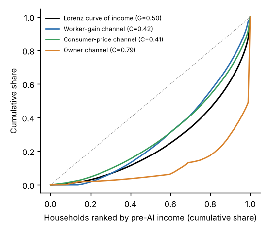
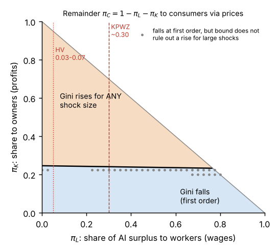
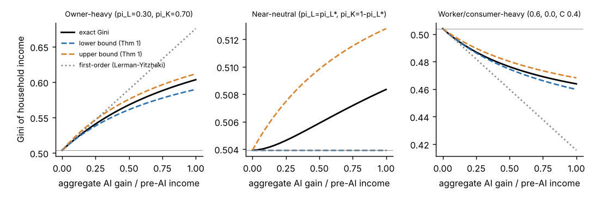
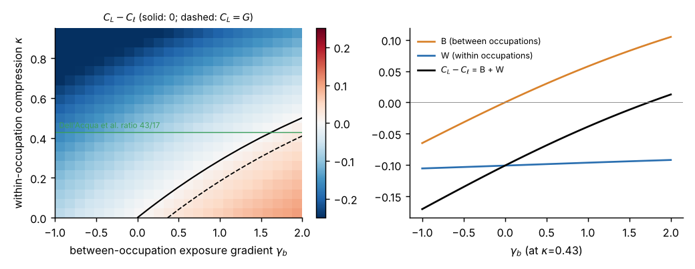
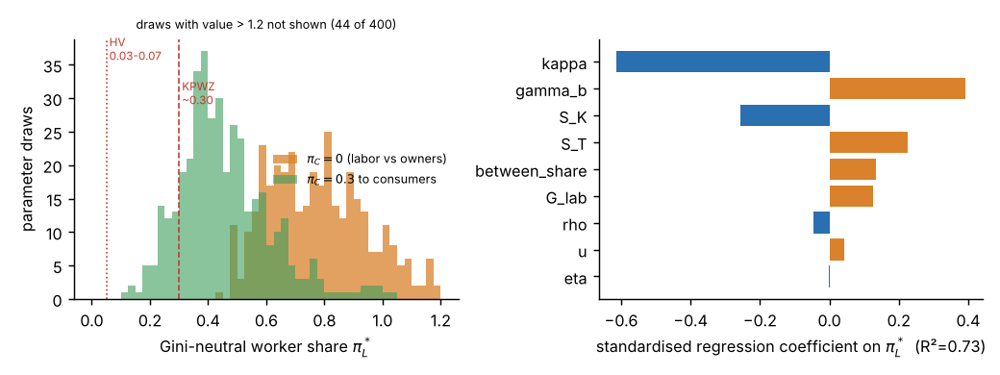
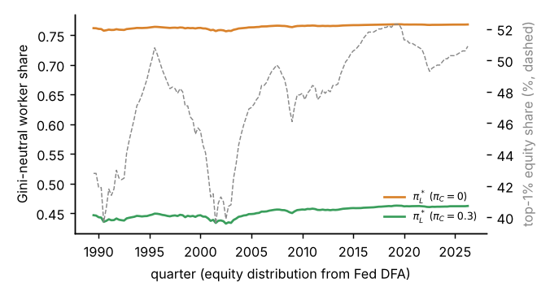
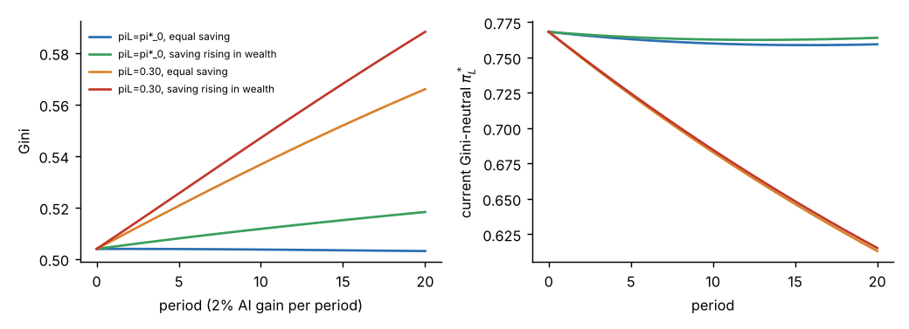
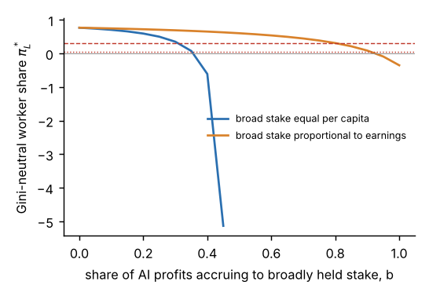

# Skill Compression Is Not Enough: Distribution-Free Incidence Bounds and Pass-Through Thresholds for the Gains from Generative AI

**Target venue:** *Journal of Economic Inequality* (alternative: AAAI/ACM Conference on AI, Ethics, and Society, AIES)

---

## Abstract

Field experiments find that generative AI raises the productivity of less-experienced workers more than that of experienced ones. This is often read as evidence that AI will reduce inequality. We argue that this reading skips a step. The economy-wide effect of an AI productivity gain on household income inequality depends on *who receives the surplus*: workers through wages, owners through profits, or consumers through lower prices. It also depends on how concentrated each of these receipt channels is, measured against the existing income distribution. We make the point precise with three results. (i) A *global* incidence bound. For any income vector y and gain vector z, the post-shock Gini coefficient lies between two weighted averages. The lower average uses the concentration coefficient of z ranked by y; the upper uses the Gini of z. The bound holds for shocks of any size, so "the gain is more concentrated than income" is sufficient for inequality to rise whatever the eventual scale of AI. A Lorenz-curve analogue extends the conclusion to every Lorenz-consistent inequality index. (ii) A *neutrality hyperplane* in surplus-division space, which gives closed-form thresholds for the worker share of the surplus. (iii) An exact *between/within-occupation decomposition* of the labor channel. It shows that within-occupation skill compression, the quantity field experiments identify, neither determines nor bounds the sign of the economy-wide labor-channel effect. We calibrate a synthetic U.S. household population to Federal Reserve Distributional Financial Accounts data on equity ownership (2026Q2: top 1% hold 50.9% of corporate equities and mutual fund shares). In the baseline, the owner channel's concentration coefficient is 0.79 against an income Gini of 0.50. If no surplus reaches consumers, workers must receive at least 77% of the AI surplus for the Gini to stay constant. Across 400 draws over a wide prior, the median threshold is 0.80 and every draw exceeds 0.30. Published pass-through estimates are about 0.30 for patent rents and 0.03–0.07 for early chatbot productivity gains. In the model, the verdict therefore turns mainly on the product-market channel: with worker pass-through of 0.30, consumers must receive a median 41% of the surplus (90% interval 25–64%). The thresholds are stable across 37 years of DFA equity data. Their main sensitivities are the degree of compression and the occupational exposure gradient. Every number we report comes from code released with the paper or from a cited source.

## 中文摘要

现场实验发现，生成式AI对经验较少的员工带来的生产率提升大于对资深员工的提升，这常被解读为"AI将降低不平等"的证据。我们认为这一推论缺少关键一环：AI生产率收益对全社会家庭收入不平等的影响，取决于剩余如何在三个渠道之间分配——通过工资归于劳动者、通过利润归于资本所有者、通过降价归于消费者——以及每个渠道相对于现有收入分布的集中程度。我们给出三个结果：（1）全局归宿界：对任意收入向量y与收益向量z，冲击后的基尼系数被夹在两个加权平均之间，下界使用z按y排序的集中系数，上界使用z自身的基尼系数。该界对任意冲击规模成立，因此"收益比收入更集中"是不平等上升的充分条件，与AI最终规模无关；其洛伦兹曲线形式把结论推广到所有满足洛伦兹一致性的不平等指数。（2）剩余分配空间中的"中性超平面"，给出劳动者份额阈值的闭式解。（3）劳动渠道的职业间/职业内精确分解，表明现场实验所识别的职业内技能压缩既不能决定、也不能界定全经济劳动渠道效应的符号。我们以美联储分配金融账户（DFA）的股权分布数据（2026年第二季度：前1%家庭持有50.9%的公司股票和共同基金份额）校准了一个合成的美国家庭总体。基准情形下，所有者渠道的集中系数为0.79，而收入基尼系数为0.50；若消费者得不到任何剩余，劳动者至少需获得AI剩余的77%，基尼系数才能保持不变。在宽先验下的400次抽样中，该阈值中位数为0.80，且全部超过0.30；而已发表的传导率估计约为0.30（专利租金）和0.03–0.07（早期聊天机器人生产率收益）。因此在模型中，结论主要取决于产品市场渠道：若劳动者传导率为0.30，消费者需获得剩余的中位数41%（90%区间25–64%）。阈值在37年的DFA股权数据中保持稳定，主要敏感于技能压缩程度和职业暴露梯度。文中所有数字均来自随文发布的代码或所引文献。

---

## 1 Introduction

The question "how will the gains from AI be distributed, and will AI increase inequality?" now has two literatures that rarely meet. The first is a set of careful micro studies of AI-assisted work. Customer-support agents given a generative-AI assistant resolved about 14% more issues per hour on average and about 34% more for novice and low-skilled workers, with minimal effect on the most experienced (Brynjolfsson, Li and Raymond, 2025). In a preregistered writing experiment, ChatGPT reduced time taken by 40%, raised quality by 18%, and *decreased* inequality between participants (Noy and Zhang, 2023). Consultants who scored below average at baseline gained 43% with GPT-4, against 17% for those above average (Dell'Acqua et al., 2023). Read together, these studies show *within-task skill compression*.

The second literature is macroeconomic and asks about factor shares and ownership. Acemoglu (2025) projects modest total-factor-productivity effects and predicts that AI will widen the gap between capital and labor income even if it does not raise labor-income inequality much. Moll, Rachel and Restrepo (2022) show that automation can raise inequality mainly by raising the returns to wealth, not through wages. Korinek and Stiglitz (2019) separate innovator surplus from factor-price redistribution. Early administrative evidence from Denmark finds that only about 3–7% of chatbot-induced productivity gains passed through to workers' earnings (Humlum and Vestergaard, 2025).

The two literatures are linked by an accounting question: *what share of the AI surplus goes where, and how concentrated is each destination relative to the existing income distribution?* Compression evidence answers only part of one of these sub-questions. This paper gives a small, exact apparatus for the linking step, together with a calibration that makes the stakes concrete. We do not forecast the size of AI gains. Our results are stated so that they hold *whatever the size of the shock*, because that size is the most uncertain quantity in the debate.

**Contributions.**

1. **A global, distribution-free incidence bound (Theorem 1).** The classical Lerman–Yitzhaki (1985) result gives the marginal effect of an income source on the Gini. We show that for a non-marginal gain vector z added to incomes y, the post-shock Gini is bracketed by $\frac{Y G(y)+\varepsilon Z\,C(z|y)}{Y+\varepsilon Z}$ and $\frac{Y G(y)+\varepsilon Z\,\Gamma(z)}{Y+\varepsilon Z}$. Consequently, if the gain's concentration coefficient exceeds the current Gini, inequality rises *for every shock size*. The proof follows from the rearrangement inequality. Theorem 2 gives the Lorenz-curve analogue: if the gain's concentration curve lies below the income Lorenz curve, then every Lorenz-consistent relative inequality index rises, again for every shock size.
2. **Neutrality hyperplane and pass-through thresholds (Corollary 2).** If AI surplus is split among workers, owners and consumers in shares $(\pi_L,\pi_K,\pi_C)$, the inequality verdict is determined by the sign of $\sum_j \pi_j C_j - G$. This yields closed-form thresholds such as $\pi_L^*=(C_K-G)/(C_K-C_L)$.
3. **An exact between/within decomposition of the labor channel (Proposition 3).** It shows formally why within-occupation compression, which is what field experiments identify, is neither necessary nor sufficient for the labor channel to be equalizing.
4. **A transparent calibration with sensitivity analysis.** We use Federal Reserve DFA equity-ownership shares (1989Q3–2026Q2), a 400-draw Monte Carlo over structural parameters, a 37-year history of the threshold, a dynamic reinvestment exercise, and a "broad ownership" policy counterfactual. The calibration indicates that the *owner share of the surplus*, not skill compression, is the quantity that decides the sign. It also indicates that observed labor pass-through rates are far below the neutrality threshold unless a large share of the surplus reaches consumers through prices.
5. **Falsifiable predictions and a measurement protocol (Section 7).** We state what should be measured, chiefly the three incidence shares and the concentration coefficients of the receipt channels, and which findings would refute our conclusions.

We do not claim the inequalities in Theorems 1–2 are deep. They are elementary consequences of convexity, and close relatives appear in the redistribution literature on reranking (Lambert, 2001). Our contribution is to apply them to the AI-incidence question, where they show that the debate's two empirical literatures can be combined through a few sufficient statistics.

## 2 Related Work

**Micro evidence on AI and worker productivity.** Brynjolfsson, Li and Raymond (2025) study the staggered rollout of a generative-AI conversational assistant to customer-support agents and find the largest gains for novices. Noy and Zhang (2023) randomize ChatGPT access in occupation-specific writing tasks and find that inequality between workers falls. Dell'Acqua et al. (2023) find larger gains for below-average consultants on tasks inside the "jagged frontier", but a 19-percentage-point drop in correctness on a task outside it. Humlum and Vestergaard (2025) link Danish survey data to administrative records. They find precise null effects on earnings and hours, with modest time savings and weak pass-through. These studies identify *within-occupation* heterogeneity in uplift and, in one case, the *pass-through* of uplift to pay. They do not identify the distribution of the surplus that is not passed through.

**Exposure measures.** Eloundou et al. (2024) build occupation-level LLM exposure measures. They find that exposure spans all wage levels and that higher-income jobs potentially face greater exposure. In our framework this is the *between-occupation exposure gradient*, which can offset within-occupation compression.

**Macro and distribution.** Acemoglu and Restrepo (2022) attribute 50–70% of U.S. wage-structure changes over four decades to task displacement from automation. Acemoglu (2025) applies a task framework to AI and predicts a widening capital–labor gap. Moll, Rachel and Restrepo (2022) emphasize returns to wealth. Korinek and Stiglitz (2019) set out the innovator-surplus and factor-price channels and the conditions for compensation. Our analysis is reduced-form relative to these general-equilibrium models. It takes the division of surplus as a parameter, whereas they derive it from technology and market structure. In return, its conclusions do not depend on any particular model and its inputs can be measured.

**Rent sharing and pass-through.** Kline et al. (2019) estimate that workers capture roughly 30 cents of every dollar of patent-induced operating surplus. Card et al. (2018) summarize rent-sharing elasticities of wages with respect to value added per worker of 0.05–0.15. We use these numbers only as reference points for $\pi_L$.

**Inequality measurement.** Lerman and Yitzhaki (1985) derive the marginal effect of an income source on the Gini via its concentration coefficient. Stark, Taylor and Yitzhaki (1986) apply it to remittances, a direct analogue of a new income source. Kakwani (1977) introduces concentration curves. Atkinson (1970) links Lorenz dominance to welfare rankings. Yitzhaki and Slemrod (1991) use concentration-curve dominance to rank marginal tax reforms. Lambert (2001) treats reranking in redistribution. Attanasio and Pistaferri (2016) review evidence that consumption is distributed differently from income, which is relevant to our consumer channel. Dynan, Skinner and Zeldes (2004) document saving rates that rise with lifetime income, which motivates the reinvestment exercise.

**Gap.** We are not aware of work that (a) decomposes AI-induced income gains into worker, owner and consumer channels, (b) gives shock-size-robust sufficient conditions for the sign of the inequality change, and (c) shows quantitatively that micro compression evidence is a second-order input relative to the division of surplus. Here "decides the sign" means it has the largest standardized effect on the neutrality threshold in our sensitivity analysis after the compression parameter itself, and it is the only margin on which observed values sit far from the threshold.

## 3 Theory

### 3.1 Setup

There are $N$ households with pre-shock incomes $y\in\mathbb{R}^N$, total $Y=\sum_i y_i>0$. An AI shock adds $\varepsilon z$, where $z\in\mathbb{R}^N$ is a gain vector with $Z=\sum_i z_i>0$ and $\varepsilon\ge 0$ is the shock size. Entries of $z$ may be negative (displacement). For any vector $v$ with positive sum, write $v_{(1)}\le\dots\le v_{(N)}$ for its order statistics and define

$$G(v)=\frac{2\sum_{i} i\,v_{(i)}}{N\sum_i v_i}-\frac{N+1}{N}.$$

Let $\sigma_y$ be a permutation that ranks households by $y$ in ascending order, breaking ties arbitrarily. The **concentration coefficient** of $z$ with respect to $y$ is

$$C(z|y)=\frac{2\sum_i \sigma_y(i)\,z_i}{N Z}-\frac{N+1}{N},$$

and $\Gamma(z):=C(z|z)$, which equals $G(z)$ when $z\ge 0$.

### 3.2 A global incidence bound

**Theorem 1.** For all $\varepsilon\ge0$ with $Y+\varepsilon Z>0$,

$$\frac{Y\,G(y)+\varepsilon Z\,C(z|y)}{Y+\varepsilon Z}\;\le\;G(y+\varepsilon z)\;\le\;\frac{Y\,G(y)+\varepsilon Z\,\Gamma(z)}{Y+\varepsilon Z}.$$

*Proof.* Define $H(v)=\frac{2}{N}\sum_i i\,v_{(i)}-\frac{N+1}{N}\sum_i v_i$, so that $H(v)=G(v)\sum_i v_i$. By the rearrangement inequality, $\sum_i i\,v_{(i)}=\max_{\sigma}\sum_i\sigma(i)v_i$, where the maximum runs over permutations. Hence $H$ is a pointwise maximum of linear functions. It is therefore convex and positively homogeneous of degree one, which makes it subadditive. *Lower bound:* evaluating the maximum at the particular permutation $\sigma_y$ gives $H(y+\varepsilon z)\ge \frac{2}{N}\sum_i\sigma_y(i)(y_i+\varepsilon z_i)-\frac{N+1}{N}(Y+\varepsilon Z)=H(y)+\varepsilon Z\,C(z|y)$. *Upper bound:* subadditivity and homogeneity give $H(y+\varepsilon z)\le H(y)+\varepsilon H(z)=H(y)+\varepsilon Z\,\Gamma(z)$. Divide both inequalities by $Y+\varepsilon Z>0$. ∎

**Corollary 1 (shock-size-robust sign tests).** (a) If $C(z|y)\ge G(y)$, then $G(y+\varepsilon z)\ge G(y)$ for every $\varepsilon\ge 0$. (b) If $\Gamma(z)\le G(y)$, then $G(y+\varepsilon z)\le G(y)$ for every $\varepsilon\ge0$. (c) If $y$ has no ties, $\frac{d}{d\varepsilon}G(y+\varepsilon z)|_{0}=\frac{Z}{Y}\,(C(z|y)-G(y))$, which is the Lerman–Yitzhaki (1985) marginal formula. (d) When $C(z|y)<G(y)<\Gamma(z)$, the Gini falls for small shocks, and Theorem 1 alone does not rule out a rise for large ones. The bracket width $\varepsilon Z(\Gamma-C)/(Y+\varepsilon Z)$ measures the room for reranking.

Part (a) matters for the AI debate because shock sizes are deeply uncertain. Projections range from fractions of a percent of TFP over a decade (Acemoglu, 2025) to transformative scenarios. Corollary 1(a) means that a finding of "AI gains are more concentrated than incomes" settles the *sign* without settling the *size*. Convexity also implies an asymmetry: at the first-order neutral point ($C=G$), non-marginal shocks can only *raise* the Gini (a "convexity premium").

**Theorem 2 (Lorenz version).** Suppose $y\ge0$ and $y+\varepsilon z\ge0$. Let $L_v(p)$ be the Lorenz ordinate of $v$ at population share $p=k/N$, and let $CC_{z|y}(p)$ be the share of $Z$ received by the bottom $p$ of households ranked by $y$. Then
$$L_{y+\varepsilon z}(p)\le\frac{Y L_y(p)+\varepsilon Z\,CC_{z|y}(p)}{Y+\varepsilon Z}.$$
Hence, if $CC_{z|y}(p)\le L_y(p)$ for all $p$, the post-shock Lorenz curve lies weakly below the pre-shock one for every $\varepsilon\ge0$. Every relative inequality index consistent with the Lorenz order (Gini, Theil, Atkinson indices, top shares; Atkinson, 1970; Lambert, 2001) then weakly rises.

*Proof.* The bottom-$k$ sum $S_k(v)=\min_{|A|=k}\sum_{i\in A}v_i$ is a minimum of linear functions. Evaluating at the set $A_y$ of the $k$ lowest-$y$ households gives $S_k(y+\varepsilon z)\le S_k(y)+\varepsilon\sum_{i\in A_y}z_i = Y L_y(p)+\varepsilon Z\,CC_{z|y}(p)$. Divide by $Y+\varepsilon Z$. ∎

### 3.3 Incidence channels and the neutrality hyperplane

Write the AI surplus as the sum of three receipt channels, each normalized to sum to one:

- **Workers** ($z_L$): wage gains proportional to $a_i\ell_i$, where $\ell_i$ is labor earnings and $a_i$ the proportional productivity uplift.
- **Owners** ($z_K$): profit gains proportional to equity holdings $e_i$. This includes rents accruing to AI providers and to adopting firms.
- **Consumers** ($z_C$): real-income gains through lower prices, proportional to spending on AI-affected goods, proxied by $c_i\propto y_i^{\eta}$.

With surplus shares $\pi_L+\pi_K+\pi_C=1$ the gain vector is $z=\sum_j\pi_j z_j$. Because $Z\cdot C(z|y)$ is linear in $z$, $C(z|y)=\sum_j\pi_jC_j$ with $C_j:=C(z_j|y)$.

**Corollary 2 (neutrality hyperplane).** The first-order effect on the Gini is zero exactly on the hyperplane $\sum_j\pi_jC_j=G$. Where $\sum_j\pi_jC_j\ge G$, the Gini rises for every shock size. Two special cases:

$$\pi_L^*\big|_{\pi_C=0}=\frac{C_K-G}{C_K-C_L},\qquad \pi_C^*(\pi_L)=\frac{C_K-G-\pi_L(C_K-C_L)}{C_K-C_C}.$$

If $C_L\approx C_C=:\bar C$, the hyperplane is approximately $\pi_K=\pi_K^*:=(G-\bar C)/(C_K-\bar C)$. The *owner share alone* then decides the sign.

The same algebra applies to the top-10% income share: replace $C_j$ by the share of channel $j$ received by the top decile of $y$ (a special case of Theorem 2 at $p=0.9$).

### 3.4 What compression evidence identifies: a between/within decomposition

Let household $i$ work in occupation $o(i)$. Let $\bar a=\sum_i a_i\ell_i/\sum_i\ell_i$ be the earnings-weighted mean uplift and $\alpha_o$ its within-occupation analogue. Write $\sigma_i=\sigma_y(i)$.

**Proposition 3.** 
$$C(a\ell\,|\,y)-C(\ell\,|\,y)=\underbrace{\frac{2\sum_i\sigma_i\ell_i(\alpha_{o(i)}-\bar a)}{N\sum_i a_i\ell_i}}_{B\ \text{(between occupations)}}+\underbrace{\frac{2\sum_i\sigma_i\ell_i(a_i-\alpha_{o(i)})}{N\sum_i a_i\ell_i}}_{W\ \text{(within occupations)}}.$$

*Proof.* $C(a\ell|y)-C(\ell|y)=\frac{2}{N}\big[\frac{\sum\sigma a\ell}{\sum a\ell}-\frac{\sum\sigma\ell}{\sum\ell}\big]=\frac{2}{N\sum a\ell}\sum_i\sigma_i\ell_i(a_i-\bar a)$. Then add and subtract $\alpha_{o(i)}$. ∎

$W$ is an earnings-weighted covariance between the *within-occupation deviation* of uplift and the economy-wide income rank. Within-occupation compression ($a$ decreasing in skill within each occupation), which is what Brynjolfsson et al., Noy and Zhang, and Dell'Acqua et al. measure, makes $W<0$ when within-occupation skill is positively related to household income rank. $B$ is governed by the occupational exposure gradient, which Eloundou et al. (2024) find to be increasing in wages, so $B>0$. The sign of the labor channel relative to labor income is $\operatorname{sign}(B+W)$. Its sign relative to total income inequality ($C_L$ vs $G$) further depends on $C(\ell|y)-G$. Field experiments therefore identify the sign of one of three terms. Moreover, even $C_L<G$ is not sufficient for AI to be equalizing, because by Corollary 2 the owner channel enters with weight $\pi_K$ and $C_K\gg G$.

## 4 Calibration

All model numbers below are produced by `code/run_all.py`, stored in `results/summary.json`, and labelled **[sim]**. Numbers from the literature are labelled with their citation.

**Equity ownership (data).** We use the Fed Distributional Financial Accounts shares of corporate equities and mutual fund shares by wealth group, retrieved from FRED (series WFRBST01122, WFRBSN09149, WFRBSN40176, WFRBSB50203). For 2026Q2 the shares are: top 1%, 50.9%; 90th–99th percentile, 37.2%; 50th–90th, 11.4%; bottom 50%, 0.6% (Board of Governors, DFA via FRED). The full quarterly series 1989Q3–2026Q2 is in `data/dfa_equity_shares.csv`. The bottom-50% share is observed for 2025Q2–2026Q2 and imputed as the residual elsewhere (flagged). Within each wealth group, holdings rise mildly (±10%) with rank. This *understates* concentration inside the top 1% and so biases $C_K$ downward, which makes our thresholds conservative.

**Synthetic households (assumptions).** We use $N=100{,}000$ households (baseline). Labor earnings are lognormal across 40 occupations, with 40% of log-earnings variance between occupations. The target earnings Gini is 0.45; the realized earner Gini is 0.42 **[sim]**, because of finite-occupation sampling. 15% of households have no earnings (retirees, non-participants). Wealth ranks are linked to earnings through a Gaussian copula with $\rho=0.5$. Equity income is 20% of household income and an equal per-capita transfer is 8%. These are assumptions, not estimates, and each is varied in Section 5.4.

**Gain channels.** Uplift is $a_i=\exp(\gamma_b(r_{o}-\tfrac12))\cdot(1+\kappa(1-2q_i))$. Here $r_o\in[0,1]$ is the occupation's wage rank and $q_i$ the worker's within-occupation skill rank. $\gamma_b$ is the between-occupation exposure gradient (baseline 0.5, positive per Eloundou et al., 2024). $\kappa$ sets within-occupation compression. The baseline $\kappa=0.43$ reproduces a lowest-to-highest-skill uplift ratio of $(1+\kappa)/(1-\kappa)\approx 2.5$, matching the 43%/17% contrast in Dell'Acqua et al. (2023). The near-zero gains for experienced agents in Brynjolfsson et al. (2025) correspond to $\kappa$ near 1. Consumer gains are $\propto y^{\eta}$ with $\eta=0.8$ (baseline), reflecting that consumption is less dispersed than income (Attanasio and Pistaferri, 2016); $\eta$ is varied.

**Reference pass-through values (literature).** Workers capture about 30% of patent-induced surplus (Kline et al., 2019). About 3–7% of early chatbot productivity gains passed through to earnings (Humlum and Vestergaard, 2025). These come from very different settings and are reference points, not estimates of $\pi_L$ for AI.

## 5 Results

### 5.1 Baseline concentration coefficients and thresholds

Table 1 reports baseline statistics **[sim]**.

| Quantity | Value |
|---|---|
| Household income Gini $G$ | 0.504 |
| Labor-earnings concentration $C(\ell\mid y)$ | 0.482 |
| Worker channel $C_L$ | 0.418 |
| Consumer channel $C_C$ | 0.412 |
| Owner channel $C_K$ | 0.786 |
| Gini of owner gains $\Gamma(z_K)$ | 0.880 |
| Top-10% income share | 0.380 |
| Top-10% share of worker / consumer / owner gains | 0.271 / 0.305 / 0.700 |
| $\pi_L^*$ (Gini-neutral, $\pi_C=0$) | **0.767** |
| $\pi_L^*$ for top-10% share ($\pi_C=0$) | 0.745 |
| $\pi_L^*$ with $\pi_C=0.3$ / $0.5$ | 0.462 / 0.258 |
| $\pi_C^*$ needed if $\pi_L=0.07$ / $0.30$ | 0.685 / 0.459 |
| Between / within terms $B$ / $W$ | +0.030 / −0.093 |

*Table 1. Baseline calibration (results/summary.json, key E1_baseline).*

Under Dell'Acqua-scale compression, the worker channel is *less* concentrated than income ($C_L=0.42<G=0.50$). The within-occupation term $W=-0.093$ outweighs the between term $B=+0.030$. On its own, the worker channel is equalizing. The owner channel, however, has $C_K=0.79$. Because $C_L\approx C_C$, the neutrality hyperplane is almost flat in Figure 2: inequality rises whenever owners receive more than roughly a quarter of the surplus ($\pi_K^*\approx 0.23$–$0.25$), however the remainder is divided between workers and consumers. With no consumer channel, workers must receive 77% of the surplus. The top-10%-share version of the threshold is similar (0.745).

Figure 1 shows the concentration curves. Theorem 2's stronger, all-indices conclusion is checked exactly at every household: the concentration curve of the gain vector lies weakly below the income Lorenz curve everywhere for $\pi_L=0.30$ and $\pi_L=0.60$ (with $\pi_C=0$). For these splits, every Lorenz-consistent index rises for every shock size **[sim]**. At $\pi_L=0.07$ the curves cross, even though $C(z|y)=0.76\gg G$. Some very-high-earning, low-equity households in the synthetic population receive less than their income share of the gain. The Gini verdict (Corollary 1a) still holds there, but the all-indices verdict does not.

*Figure 1. Lorenz curve of baseline household income and concentration curves of the three gain channels (households ranked by pre-AI income).*

*Figure 2. Neutrality simplex. Orange: $\sum_j\pi_jC_j\ge G$, so the Gini rises for any shock size (Corollary 1a). Blue: the Gini falls at first order. Grey dots: grid points (41×41) where first-order effects are equalizing but the Theorem 1 upper bound does not exclude a rise for large shocks (31 of the grid points). Red lines: literature pass-through reference values.*

### 5.2 Validation of the bounds and size of the convexity premium

Across 300 random instances ($N\in[20,600]$, lognormal incomes, including signed and income-correlated gain vectors) and 25 shock sizes each (7,500 checks), the largest violation of the lower bound is $6.7\times10^{-16}$ and of the upper bound $0$, i.e. none beyond floating-point error **[sim]**. Figure 3 compares the exact Gini, the two bounds, and the first-order (Lerman–Yitzhaki) approximation on the calibrated population. The shock size is the aggregate gain as a share of pre-AI income, from 0 to 1. Two observations follow.

- The first-order approximation can be badly wrong for large shocks, while the bounds stay tight. For an owner-heavy split ($\pi_L=0.3,\pi_K=0.7$) at a gain equal to 100% of income, the exact Gini is 0.603, the bounds are [0.590, 0.612], and the linear extrapolation gives 0.675 **[sim]**.
- At the first-order neutral split, the convexity premium is small but strictly non-negative: +0.00003 Gini points at a 4% aggregate gain, +0.0005 at 20%, +0.0014 at 40%, and +0.0044 at 100% **[sim]**. Reranking effects are second-order for plausible shock sizes. The *sign* of $\sum\pi_jC_j-G$ is the first-order object.

*Figure 3. Exact post-shock Gini vs. Theorem 1 bounds and first-order approximation for three surplus splits.*

### 5.3 Compression vs. exposure: the between/within decomposition

Figure 4 maps $C_L-C(\ell|y)$ over the exposure gradient $\gamma_b\in[-1,2]$ and compression $\kappa\in[0,0.95]$. The decomposition identity holds to $7\times10^{-16}$ **[sim]**. With no within-occupation compression ($\kappa=0$), the worker channel becomes more concentrated than total income once $\gamma_b>0.37$ **[sim]**. At Dell'Acqua-scale compression ($\kappa\approx0.43$–0.45), the worker channel stays less concentrated than labor income unless $\gamma_b>1.73$, which corresponds to a top-to-bottom occupational uplift ratio of about $e^{1.73}\approx5.6$. It remains below $G$ throughout the grid **[sim]**. So compression evidence, *if* it generalizes to all occupations at Dell'Acqua strength, makes the labor channel equalizing. Without compression, a modest positive exposure gradient makes it disequalizing. Neither case changes the owner-channel arithmetic in Section 5.1.

*Figure 4. Left: $C_L-C(\ell|y)$; solid contour $=0$, dashed contour $C_L=G$. Right: decomposition into between (B) and within (W) terms at $\kappa=0.43$.*

### 5.4 Monte Carlo sensitivity

We draw 400 parameter vectors uniformly from wide priors: earnings Gini $[0.38,0.55]$, between-occupation variance share $[0.25,0.55]$, no-earnings share $[0.05,0.25]$, copula $\rho\in[0.2,0.8]$, capital-income share $[0.10,0.30]$, transfer share $[0.03,0.15]$, $\gamma_b\in[-0.5,1.5]$, $\kappa\in[0,0.9]$, $\eta\in[0.5,1.0]$. Each draw uses $N=40{,}000$ households. Results **[sim]**:

| Statistic | 5th pct. | Median | 95th pct. |
|---|---|---|---|
| Income Gini $G$ | 0.445 | 0.524 | 0.600 |
| Owner channel $C_K$ | 0.709 | 0.785 | 0.836 |
| Worker channel $C_L$ | 0.275 | 0.456 | 0.608 |
| $\pi_L^*$ ($\pi_C=0$) | 0.546 | 0.798 | 1.432 |
| $\pi_L^*$ ($\pi_C=0.3$) | 0.237 | 0.431 | 0.772 |
| $\pi_L^*$ ($\pi_C=0.5$) | −0.055 | 0.199 | 0.462 |
| $\pi_L^*$, top-10% share ($\pi_C=0$) | 0.569 | 0.741 | 1.066 |
| $\pi_C^*$ needed at $\pi_L=0.07$ | 0.422 | 0.612 | 0.867 |
| $\pi_C^*$ needed at $\pi_L=0.30$ | 0.247 | 0.414 | 0.642 |

*Table 2. Monte Carlo over 400 parameter draws (results/E4_montecarlo.csv).*

Key shares across draws **[sim]**: $\pi_L^*>0.30$ in 100% of draws and $>0.50$ in 97% (with $\pi_C=0$). $\pi_L^*>1$ in 21.5%, meaning that in those draws even passing the *entire* surplus to workers raises the Gini, because $C_L>G$. With $\pi_C=0.3$, $\pi_L^*>0.30$ in 86.75% of draws; with $\pi_C=0.5$, in 24.75%. $C_L<G$ in 78.5% of draws, and $W<0$ in all draws. For the split $\pi_L=0.3,\pi_K=0.7$, the all-indices Lorenz condition of Theorem 2 holds in 56.25% of draws.

A standardized regression of $\pi_L^*$ on the parameters ($R^2=0.73$) gives these coefficients: compression $\kappa$ −0.61; exposure gradient $\gamma_b$ +0.39; capital-income share −0.26; transfer share +0.23; between-occupation variance share +0.13; earnings Gini +0.12; $|\cdot|<0.05$ for $\rho$, the no-earnings share and $\eta$ **[sim]** (Figure 5). Compression matters most *for the threshold's level*. Even so, at the most favorable compression in the prior, the threshold stays above the reference pass-through values unless the consumer channel is large.

*Figure 5. Left: distribution of $\pi_L^*$ across draws, without and with a 30% consumer share. Right: standardized regression coefficients.*

### 5.5 Thirty-seven years of equity concentration

Re-running the baseline with each quarter's DFA equity shares (holding all else fixed), the top-1% equity share moves from 42.8% (1989Q3) to 50.9% (2026Q2) **[data]**. Over the same period $C_K$ rises from 0.725 to 0.784 and the threshold $\pi_L^*$ ranges only between 0.757 (2002Q3) and 0.769 (2019Q2) **[sim]**. The threshold co-moves with equity concentration (correlation 0.93), but the effect is muted: more concentrated ownership raises both $C_K$ and, through capital income, the baseline $G$. The practical implication is that the high threshold is not an artefact of a particular year (Figure 6).

*Figure 6. Gini-neutral worker share computed from each quarter's DFA equity distribution, 1989Q3–2026Q2.*

### 5.6 Dynamics: reinvestment and returns to wealth

The static results take ownership as fixed. Figure 7 iterates 20 periods with a 2% aggregate AI gain per period, under two saving rules. Under *equal* reinvestment, ownership shares are unchanged. Under *rising* reinvestment, saving rates on capital income are 5%, 15%, 30% and 50% for the bottom 50%, 50–90th, 90–99th and top 1% of wealth. These rates are an illustrative assumption motivated by Dynan, Skinner and Zeldes (2004), not an estimate. Results **[sim]**:

- At the initial neutral split $\pi_L=\pi_L^*(0)=0.768$ with equal saving, the Gini is essentially flat (0.504→0.503). With rising saving, the top-1% ownership share drifts from 0.51 to 0.64 and the Gini reaches 0.518. Differential reinvestment alone turns a statically neutral split into a disequalizing one.
- At $\pi_L=0.30$, the capital share of household income rises from 0.20 to 0.36 over 20 periods. The Gini rises to 0.566 (equal saving) or 0.588 (rising saving). This is the returns-to-wealth mechanism of Moll, Rachel and Restrepo (2022), here driven by the division of AI surplus.

*Figure 7. Gini and current neutrality threshold over 20 periods of AI gains.*

### 5.7 Policy counterfactual: broadly held AI capital

Suppose a fraction $b$ of owner-channel gains accrues to a broadly held stake instead of to DFA-distributed equity. The stake is either equal per capita (a social-wealth-fund dividend) or proportional to earnings (a pension-like stake). With an equal per-capita stake, the owner channel itself becomes Gini-neutral or better ($C_K\le G$) at $b\ge0.40$, and at $b=0.25$ the threshold falls to $\pi_L^*=0.50$ **[sim]**. An earnings-proportional stake is much weaker: it needs $b\ge0.95$, and $\pi_L^*$ is 0.71 at $b=0.25$ and 0.60 at $b=0.5$ **[sim]** (Figure 8). *Who* holds broad capital matters as much as *whether* it is broad.

*Figure 8. Gini-neutral worker share as a function of the broadly held fraction of AI profits.*

## 6 Discussion

**The question is mis-posed if it is asked only of workers.** Whether "AI reduces inequality" is often argued from worker-level heterogeneity in uplift. Theorem 1 and Corollary 2 show that the answer is a property of the *gain vector*: how much goes through each channel and how concentrated each channel is. In our calibration, the owner channel is about 0.28 Gini points more concentrated than income, while the labor and consumer channels are about 0.09 points less concentrated. In shares, the owner share must be held below roughly 0.23 (baseline) for AI not to raise the Gini. The pass-through evidence we can cite (0.03–0.07 for early chatbot gains; about 0.30 for patent rents) suggests that, absent large price pass-through, the realized division sits on the disequalizing side.

**The consumer channel is pivotal and under-measured.** In the Monte Carlo, the consumer share needed for neutrality at $\pi_L=0.30$ has a median of 41%. Competitive diffusion of AI could plausibly produce this, for example if model access is commoditized and gains show up as lower prices for services. Persistent rents to model providers and adopting incumbents could prevent it. Who captures AI rents in product markets is therefore at least as distributionally important as labor-market pass-through. It is also measurable: it shows up in markups and in prices of AI-intensive services.

**Compression evidence is informative but second-order for the sign.** Within-occupation compression is the largest single driver of the threshold's level (Figure 5). It does not alter the conclusion that neutrality requires most of the surplus to leave the owner channel. Without compression, a positive occupational exposure gradient is enough to make the worker channel itself disequalizing (Figure 4).

**Size uncertainty is less of an obstacle than it appears.** Because the sign tests in Corollary 1 hold for every shock size, distributional analysis need not wait for consensus on whether AI will add 0.5% or 50% to output. Reranking makes the first-order neutral point mildly disequalizing (Section 5.2), but this effect is small for plausible shocks.

## 7 Falsifiable Predictions and a Measurement Protocol

The framework reduces the distributional question to five sufficient statistics: $G$, $C_L$, $C_K$, $C_C$ and $(\pi_L,\pi_K,\pi_C)$. We state predictions that follow from the calibration, conditional on its assumptions, and how each could be refuted.

- **P1 (sign).** In linked employer–employee–owner data (e.g. Scandinavian registers that link firm AI adoption, wages and shareholdings), the gain vector from AI adoption will have $C(z|y)>G$. Refuted if measured $\sum\pi_jC_j<G$ in adoption studies with at least two years of follow-up.
- **P2 (channel ranking).** Measured concentration coefficients will satisfy $C_K>G>C_L$ in settings with Dell'Acqua-scale compression, and $C_L>G$ where compression is weak and exposure rises with wages. Refuted by $C_L>G$ in high-compression settings.
- **P3 (pivot).** Across industries, the AI-induced change in household-income inequality will be decreasing in the share of AI gains passed to consumers through prices, with a neutral point near $\pi_C\approx0.4$ when $\pi_L\approx0.3$. Refuted by no relationship between price pass-through and distributional outcomes.
- **P4 (dynamics).** Where AI gains accrue mainly to owners, the top-1% share of equity will rise faster than in non-adopting comparison periods. Refuted by stable ownership concentration in high-adoption periods.

**Protocol.** (1) Estimate $\pi_L$ as the earnings response divided by the value-added response, using difference-in-differences around firm-level AI adoption (as in Humlum and Vestergaard, 2025, extended to value added). (2) Estimate $\pi_C$ from changes in output prices of AI-intensive goods and services relative to unit-cost reductions. (3) Obtain $\pi_K$ as the residual. (4) Compute $C_j$ by linking recipients to household income ranks: workers through payroll, owners through dividend and holdings registers (including indirect holdings through funds and pensions), consumers through expenditure surveys. (5) Report $\sum_j\pi_jC_j-G$ with bootstrap intervals, and check the Theorem 2 concentration-curve condition. All steps use standard administrative data. No step requires forecasting AI capabilities.

## 8 Limitations

- **Synthetic population.** Household incomes are generated from a lognormal–copula model calibrated to aggregate moments, not drawn from survey microdata. The realized earner Gini (0.42) is below its 0.45 target. The joint distribution of earnings and wealth is set by a single copula parameter. The DFA shares we use are by *wealth* group, while our ranking is by *income*. A replication on SCF microdata, which contains income and holdings for the same households, is the most important next step.
- **Ownership coverage.** We use corporate equities and mutual fund shares only. Pension entitlements, private businesses, foreign and government ownership of AI firms, and the private (unlisted) ownership of frontier AI developers are not modeled. Pension inclusion would lower $C_K$. The Section 5.7 counterfactual shows that an earnings-proportional broad stake moves the threshold only modestly, but this is not a substitute for data. Our within-group linear holdings understate top-1% concentration, which pushes in the other direction.
- **Reduced form.** The surplus shares $\pi_j$ are parameters, not equilibrium outcomes. We do not model labor displacement, general-equilibrium wage effects for non-adopters, or how market structure determines $\pi_C$. Signed gain vectors are allowed by Theorem 1 but were not calibrated. Displacement (negative $z$ for exposed workers) would raise $C_L$ if displaced workers are lower-income.
- **Consumer channel.** Gains proportional to $y^\eta$ is a crude proxy. AI-affected goods may be consumed disproportionately by richer or by poorer households. $\eta$ had a negligible effect within $[0.5,1]$, but the functional form was not varied.
- **Literature reference values.** The 0.30 and 0.03–0.07 pass-through values come from different contexts (patent rents; early chatbot adoption in Denmark) and are not direct estimates of $\pi_L$ for AI. We use them only as reference lines.
- **Dynamics.** The saving rates in Section 5.6 are illustrative. The dynamic exercise holds asset prices fixed and abstracts from lifecycle, taxes and bequests.
- **Inequality index.** We study the Gini, top-10% shares and Lorenz-consistent indices of *income*, not wealth or consumption inequality, and not absolute inequality. With absolute measures, any growth that is not perfectly equal raises gaps in levels.
- **Novelty of the mathematics.** Theorems 1–2 are short convexity arguments. Related reranking bounds exist in the redistribution literature. Our contribution is their application and calibration for AI incidence, not new inequality theory.

## 9 Conclusion

Whether AI gains increase inequality depends on how the surplus is divided among workers, owners and consumers, and on how concentrated each channel is relative to current incomes. Global incidence bounds make the sign of the effect independent of the size of AI's eventual impact. Under a transparent calibration built on Federal Reserve equity-ownership data, the owner channel is concentrated enough that neutrality requires workers to receive roughly three-quarters of the surplus, or consumers a large share through lower prices. Within-occupation skill compression lowers this bar but does not remove it. The most useful empirical work is therefore to measure the three incidence shares and the concentration of each receipt channel. The most direct policy levers act on the owner channel, through competition that passes gains to consumers or through broad, per-capita ownership of AI capital, rather than on worker skills alone.

## Code and Data Availability

All code, data transcriptions and outputs are in `code/`, `data/` and `results/`. `python3 code/run_all.py` reproduces every simulated number and figure in about 30 seconds on one CPU core.

## References

Acemoglu, D. (2025). The simple macroeconomics of AI. *Economic Policy*, 40(121), 13–58. https://doi.org/10.1093/epolic/eiae042

Acemoglu, D., & Restrepo, P. (2022). Tasks, automation, and the rise in U.S. wage inequality. *Econometrica*, 90(5), 1973–2016. https://doi.org/10.3982/ECTA19815

Atkinson, A. B. (1970). On the measurement of inequality. *Journal of Economic Theory*, 2(3), 244–263. https://doi.org/10.1016/0022-0531(70)90039-6

Attanasio, O. P., & Pistaferri, L. (2016). Consumption inequality. *Journal of Economic Perspectives*, 30(2), 3–28. https://doi.org/10.1257/jep.30.2.3

Board of Governors of the Federal Reserve System. Distributional Financial Accounts: Share of Corporate Equities and Mutual Fund Shares Held by the Top 1% (WFRBST01122), 90th to 99th Wealth Percentiles (WFRBSN09149), 50th to 90th Wealth Percentiles (WFRBSN40176), Bottom 50% (WFRBSB50203). Retrieved from FRED, Federal Reserve Bank of St. Louis, 22 November 2026 (last updated 18 September 2026). https://fred.stlouisfed.org/

Brynjolfsson, E., Li, D., & Raymond, L. (2025). Generative AI at work. *Quarterly Journal of Economics*, 140(2), 889–942. https://doi.org/10.1093/qje/qjae044

Card, D., Cardoso, A. R., Heining, J., & Kline, P. (2018). Firms and labor market inequality: Evidence and some theory. *Journal of Labor Economics*, 36(S1), S13–S70. https://doi.org/10.1086/694153

Dell'Acqua, F., McFowland III, E., Mollick, E., Lifshitz-Assaf, H., Kellogg, K., Rajendran, S., Krayer, L., Candelon, F., & Lakhani, K. R. (2023). Navigating the jagged technological frontier: Field experimental evidence of the effects of AI on knowledge worker productivity and quality. Harvard Business School Technology & Operations Mgt. Unit Working Paper No. 24-013. https://papers.ssrn.com/abstract=4573321

Dynan, K. E., Skinner, J., & Zeldes, S. P. (2004). Do the rich save more? *Journal of Political Economy*, 112(2), 397–444. https://doi.org/10.1086/381475

Eloundou, T., Manning, S., Mishkin, P., & Rock, D. (2024). GPTs are GPTs: Labor market impact potential of LLMs. *Science*, 384(6702), 1306–1308. https://doi.org/10.1126/science.adj0998

Humlum, A., & Vestergaard, E. (2025). Large language models, small labor market effects. NBER Working Paper No. 33777 (later retitled "Still Waters, Rapid Currents: Early Labor Market Transformation under Generative AI"). https://www.nber.org/papers/w33777

Kakwani, N. C. (1977). Applications of Lorenz curves in economic analysis. *Econometrica*, 45(3), 719–727. https://doi.org/10.2307/1911684

Kline, P., Petkova, N., Williams, H., & Zidar, O. (2019). Who profits from patents? Rent-sharing at innovative firms. *Quarterly Journal of Economics*, 134(3), 1343–1404.

Korinek, A., & Stiglitz, J. E. (2019). Artificial intelligence and its implications for income distribution and unemployment. In A. Agrawal, J. Gans, & A. Goldfarb (Eds.), *The Economics of Artificial Intelligence: An Agenda* (pp. 349–390). University of Chicago Press. (NBER Working Paper No. 24174.)

Lambert, P. J. (2001). *The Distribution and Redistribution of Income* (3rd ed.). Manchester University Press.

Lerman, R. I., & Yitzhaki, S. (1985). Income inequality effects by income source: A new approach and applications to the United States. *Review of Economics and Statistics*, 67(1), 151–156.

Moll, B., Rachel, L., & Restrepo, P. (2022). Uneven growth: Automation's impact on income and wealth inequality. *Econometrica*, 90(6), 2645–2683. https://doi.org/10.3982/ECTA19417

Noy, S., & Zhang, W. (2023). Experimental evidence on the productivity effects of generative artificial intelligence. *Science*, 381, 187–192. https://doi.org/10.1126/science.adh2586

Stark, O., Taylor, J. E., & Yitzhaki, S. (1986). Remittances and inequality. *Economic Journal*.

Yitzhaki, S., & Slemrod, J. (1991). Welfare dominance: An application to commodity taxation. *American Economic Review*, 81(3), 480–496.
