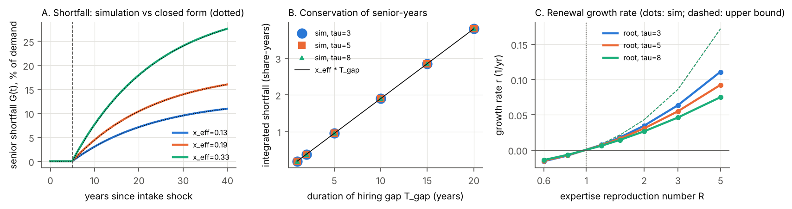
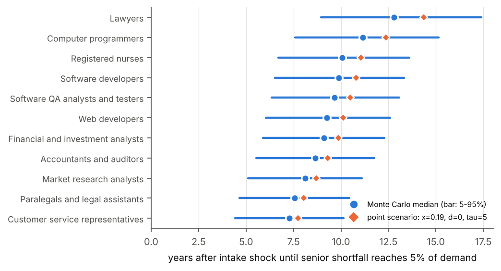
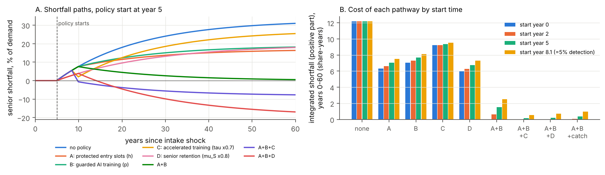
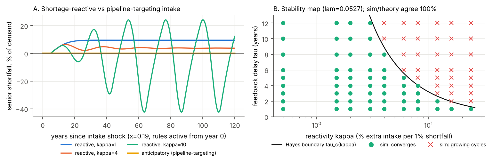
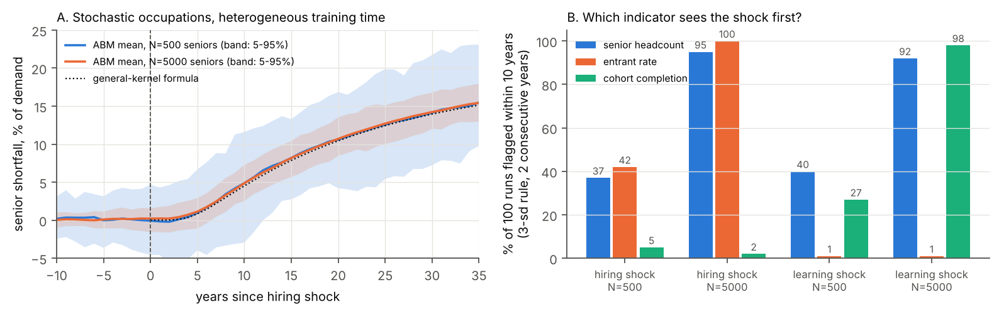

# Rebuilding the Expertise Pipeline after Entry-Level Automation: Detection Lags, Locked-in Deficits, and the Timing of Talent-Development Policy

**Target venue:** AAAI/ACM Conference on AI, Ethics, and Society (AIES), full paper track

---

## Abstract

Early evidence suggests that generative AI cuts hiring into entry-level positions in AI-exposed occupations. Senior experts, however, have historically been produced *from* juniors. Recent theory asks whether apprenticeship stays viable once AI performs junior tasks. This paper asks a different, operational question: when an occupation's intake of novices falls, **when does the senior shortage become visible, how large is the damage already locked in by then, and which rebuilding instruments can still help?**

We model an occupation as a renewal process in which juniors become seniors after a training delay. We define an *expertise reproduction number* $\mathcal R$: the expected number of future seniors that one senior-year of intake produces, discounted for attrition. We prove five results:

1. A Lotka-type threshold with explicit bounds on how fast expertise can regrow.
2. A closed-form *detection lag*: the senior shortfall is exactly zero for one training duration and then rises toward its long-run level at rate $\mu_S+g$.
3. A *conservation law*: every year of an $x$-share intake gap costs exactly $x$ share-years of senior shortfall. As a corollary, any intake-side policy started at $t_p$ cannot reduce the shortfall before $t_p+\tau$.
4. A *level-versus-speed decomposition*: protected entry slots and better learning per slot shift the sustainable level one-for-one, while shorter training mostly buys speed.
5. An instability result: intake rules that react to *visible* senior shortages oscillate once their gain exceeds one and the training delay exceeds a critical value from Hayes's (1950) theorem. Rules that target the observable pipeline do not.

We calibrate to 11 occupations using Bureau of Labor Statistics (BLS) 2025–35 separation and growth projections. Shock sizes are scenarios bracketing published estimates: a 13–19% hiring cut and a 17% learning loss. Under these scenarios, a 5% senior shortfall appears 6.5–10.1 years after the intake shock (point scenario: both shocks, 5-year training). Monte Carlo medians are 7.3–12.8 years. Waiting until the shortage is visible locks in 2.1–3.3 share-years of shortfall per occupation.

A stochastic individual-level simulation confirms the formulas. It also shows that entrant rates detect a hiring shock within about 2 years, but are blind to a learning shock. Cohort promotion rates detect the learning shock after about 8 years. The policy implication is concrete: rebuild talent pathways by tracking $\mathcal R$ and its components *now*, and combine two kinds of instrument. One kind restores intake and learning per slot; the other acts on incumbents (retention, accelerating trainees already in the pipeline), which are the only levers that touch the locked-in shortfall.

## 中文摘要

已有初步证据表明，生成式人工智能正在减少AI暴露职业的初级岗位招聘，而资深专家历来是由初级人员培养而来的。现有理论主要讨论"AI承担初级任务后，学徒制是否仍然可行"。本文提出一个更具操作性的问题：当一个职业的新人流入下降时，资深人才短缺**何时才会被观察到**？到那时**已经锁定了多大的损失**？**哪些重建手段仍然有效**？

我们把职业建模为一个"初级—资深"的更新（renewal）过程，并定义"专业能力再生数" $\mathcal R$，即每一资深人员年的新人流入，在扣除流失之后，预期能产出的未来资深人员数。我们证明了五个结论：

1. Lotka型阈值定理，并给出专业能力再生速度的显式上下界；
2. "检测滞后"的闭式解：资深缺口在一个培养周期内恒为零，此后以 $\mu_S+g$ 的速率趋近长期水平；
3. "守恒律"：初级流入每缺口 $x$ 比例持续一年，就恰好造成 $x$ 个"份额·年"的资深缺口。由此推出，任何只作用于新人流入、在 $t_p$ 才启动的政策，都无法缩小 $t_p+\tau$ 之前的缺口；
4. "水平与速度分解"：保护性入门岗位和提高单位岗位的学习效果会一比一地提高可持续水平，而缩短培养周期主要换来的是速度；
5. 若招聘规则对"可见的"资深短缺作出反应，那么当反应增益大于1、且培养延迟超过由Hayes（1950）定理给出的临界值时，系统会出现振荡；以可观测的培养管道为目标的规则则不会振荡。

我们用美国劳工统计局（BLS）2025–35年的职业离职率与增长预测，对11个职业进行校准。冲击规模采用覆盖已发表估计的情景：招聘下降13–19%、学习损失17%。在这些情景下，资深缺口达到5%需要6.5–10.1年（点情景：两种冲击同时发生、培养周期5年），蒙特卡洛中位数为7.3–12.8年。若等短缺"看得见"才行动，每个职业将锁定2.1–3.3个份额·年的缺口。

个体层面的随机模拟验证了上述公式，并显示：新人流入率约2年即可识别招聘冲击，但对学习冲击完全不敏感；队列晋升率约8年后才能识别学习冲击。政策含义很明确：重建人才培养路径，应当**现在**就监测 $\mathcal R$ 及其构成，并组合两类手段：一类是恢复新人流入和单位岗位的学习效果；另一类作用于存量人员（留任、加速已在培养中的学员），只有后者能够触及已被锁定的缺口。

---

## 1 Introduction

Most experts were once novices who learned by doing simple versions of expert work: drafting the first version of a contract, writing the boilerplate module, reconciling the ledger. Lave and Wenger (1991) called this *legitimate peripheral participation*. Junior work is both production and training. If AI performs the peripheral tasks, firms have less reason to hire juniors, and the juniors who are hired may learn less per task.

Evidence for the first channel is accumulating. Using ADP payroll records, Brynjolfsson, Chandar and Chen (2025) report a relative employment decline for 22–25-year-olds in the most AI-exposed occupations. The figure is 13% in the August 2025 version, 16% in the November 2025 version and 19% in the August 2026 revision, and it runs mainly through reduced hiring. Hosseini and Lichtinger (2025) use résumé data on 62 million workers and find that firms adopting generative AI employ fewer juniors, mostly because they hire fewer. Evidence for the second channel is experimental: in a field experiment, high-school students who practised with an unguarded GPT-4 tutor performed 17% worse once access was removed (Bastani et al., 2025). An ethnography of robotic surgery shows trainees losing hands-on practice when technology absorbs it (Beane, 2019), a modern instance of Bainbridge's (1983) "ironies of automation".

A theoretical literature now asks whether apprenticeship survives these pressures (Section 2). These models mostly characterise steady states and welfare: the viability threshold of an apprenticeship contract (Garicano and Rayo, 2025), growth effects of eroded tacit-knowledge transmission (Ide, 2025), and multiple learning equilibria (Afrouzi et al., 2026).

A policymaker or firm asking *"初级岗位消失后，人才培养路径如何重建？"* ("how do we rebuild talent pathways once junior jobs disappear?") needs a different set of answers. The binding problems are about time:

1. **Detection.** Senior labour markets look healthy for years after junior intake collapses, because seniors are produced with a delay. How long is the delay, and which data would reveal the problem earlier?
2. **Irreversibility.** How much of the eventual shortfall is already committed by the time it becomes visible, and which instruments can still reduce it?
3. **Instrument choice.** Rebuilding proposals include subsidised apprenticeships, AI tutoring with guardrails, simulation-based accelerated training, and retention of senior staff. Do these act on the same margin?
4. **Control.** If firms or governments respond to visible senior shortages, does the response stabilise the system, or does it produce the boom-bust "cobweb" familiar from engineering labour markets (Freeman, 1976)?

We answer these questions with a deliberately minimal model. It borrows renewal theory from demography and epidemiology (Sharpe and Lotka, 1911; Feller, 1941; Diekmann, Heesterbeek and Metz, 1990) and stability theory for delay equations (Hayes, 1950). We then calibrate it to published occupational flow data.

**Contributions.**

- **C1 (concept).** We define the *expertise reproduction number* $\mathcal R = h\,p\,e^{-\mu_J\tau}/\mu_S$, where $h$ is entrants per senior per year, $p$ the probability of completing training, $e^{-\mu_J\tau}$ the probability of surviving training, and $1/\mu_S$ expected senior tenure. We give its sustainability threshold under demand growth, $\mathcal R^* = (1+g/\mu_S)e^{g\tau}$ (Proposition 1). We also bound the renewal rate: $\mu_S(\mathcal R-1)/(1+\mu_S\mathcal R\tau) \le r \le \min\{\mu_S(\mathcal R-1),\ \ln\mathcal R/\tau\}$.
- **C2 (detection lag).** We give a closed-form senior-shortfall path after an intake shock, including a general training-time kernel. The path implies a detection time $t_\varepsilon=\tau-\ln(1-\varepsilon/x_{\rm eff})/(\mu_S+g)$ (Proposition 2).
- **C3 (conservation and lock-in).** Integrated senior shortfall equals the integrated intake gap. Any intake-side policy started at $t_p$ leaves the shortfall path unchanged up to $t_p+\tau_{\min}$ (Proposition 3). Waiting for visibility therefore has a computable, unavoidable cost.
- **C4 (instrument decomposition).** Entry slots and learning per slot have unit elasticity on $\mathcal R/\mathcal R^*$. Training duration has elasticity only $-(\mu_J+g)\tau$, about $-0.26$ in our calibration. Shortening training mainly raises the speed ceiling $\ln\mathcal R/\tau$, shortens the dead time, and yields a one-time "bunching" dividend (Proposition 4).
- **C5 (control).** Shortage-reactive intake rules either leave a persistent gap ($x/(1+\kappa)$) or oscillate when $\tau$ exceeds Hayes's critical delay. Pipeline-targeting rules avoid both (Proposition 5).
- **C6 (calibration and measurement).** We calibrate to 11 occupations from the BLS 2025–35 projections, with Monte Carlo over the unobserved parameters. We validate in a stochastic individual-level simulation, compare three observable indicators, and pre-register a test protocol with four falsifiable predictions.

All numbers come either from cited sources or from code we ran; we label them [S] and [C] where the distinction matters. The code runs in under a minute on a CPU (`code/run_all.sh`).

## 2 Related Work

**Empirical evidence on entry-level displacement.** Brynjolfsson, Chandar and Chen (2025) document relative employment declines for early-career workers in AI-exposed occupations. They describe the estimates as descriptive rather than causal, and the estimates have grown across revisions (13% → 16% → 19%). Hosseini and Lichtinger (2025) frame generative AI as *seniority-biased technological change* using firm-level adoption measures. Brynjolfsson, Li and Raymond (2025) find that an AI assistant raises productivity most for novice customer-support agents. This is a reminder that AI can also *compress* experience curves, a channel our model captures through the training time $\tau$ and the completion probability $p$. We take these studies as motivation and as a source of scenario magnitudes. We do not re-estimate them.

**Learning, tacit skill and automation.** Situated-learning theory (Lave and Wenger, 1991) and the ironies-of-automation literature (Bainbridge, 1983) predict that removing peripheral tasks removes practice. Beane (2019) documents "shadow learning" in robotic surgery: only a minority of trainees reached competence when approved means failed, which shrank the supply of experts. Bastani et al. (2025) show that unguarded generative-AI practice harms subsequent unaided performance, and that a guarded tutor largely mitigates the harm. We use this result to motivate the *intensive-margin* shock $d$ and the "guarded AI training" instrument.

**Economics of training.** Becker (1962) explains why firms underinvest in general training. Acemoglu and Pischke (1998) show how labour-market frictions make firm-sponsored general training possible. Garicano and Rayo (2017) model apprenticeships as relational contracts in which novices pay for knowledge with labour. Task-based models of automation (Acemoglu and Restrepo, 2018) provide the background in which entry-level tasks are automated.

**Theory of AI and apprenticeship.** Five recent papers are closest to ours.
- Garicano and Rayo (2025) show that AI threatens apprenticeship viability when it takes over the menial work juniors use to pay for training. Their viability condition compares an "expertise leverage ratio" with $e$. That firm-level contracting threshold differs from our population-level $\mathcal R$.
- Ide (2025) builds an overlapping-generations model in which entry-level automation raises short-run output but erodes tacit-knowledge transmission across generations and can lower growth and welfare.
- Afrouzi, Blanco, Drenik and Hurst (2026) find two stationary learning equilibria and an automation-induced human-capital trap.
- Catalini, Hui and Wu (2026) argue that automating entry-level execution undermines the production of future verifiers.
- Gan (2026) separates execution from evaluation tasks. Gan hypothesises that the supply of evaluators falls only after a cohort lag, and notes that this prediction is untested.

Our paper complements this work. We take the *existence* of an intake shock as given and characterise its **transitional dynamics and observability**: exact detection lags, a conservation law and a lock-in bound, instrument elasticities, the stability of reactive policy, and indicator design. We also provide an occupational calibration and a test protocol. To our knowledge, none of these papers derives the detection-time formula, the conservation and lock-in results, or the reactive-policy stability boundary for this setting.

**Mathematical tools.** The renewal equation and stable population theory go back to Sharpe and Lotka (1911) and Feller (1941). The reproduction-number concept in its next-generation form is due to Diekmann, Heesterbeek and Metz (1990). Stability of $y'=-ay-by(t-\tau)$ was characterised by Hayes (1950). Freeman (1976) showed empirically that lagged supply responses produce cobweb cycles in the market for new engineers. Our Proposition 5 applies the same logic to senior-expertise production under AI.

## 3 Model

### 3.1 An occupation as a renewal process

Time $t\ge0$ is continuous, in years. An occupation contains juniors (trainees) and seniors (independently competent workers).

- **Intake.** $B(t)$ novices enter per year.
- **Training.** A junior who enters at $s$ leaves the occupation at hazard $\mu_J$ while training. With fixed training duration $\tau$, a junior still present at $s+\tau$ becomes a senior with probability $p$; otherwise they leave. In the general case, the training duration has density $k(u)$ on $[\tau_{\min},\infty)$.
- **Seniors.** Seniors leave at hazard $\mu_S$, through labour-force exit or occupational transfer.
- **Demand.** Senior demand is $D(t)=D_0e^{gt}$. The senior stock obeys

$$\dot S(t)=p\int_0^\infty B(t-u)\,e^{-\mu_J u}k(u)\,du-\mu_S S(t),\qquad(1)$$

which reduces to $\dot S=p\,e^{-\mu_J\tau}B(t-\tau)-\mu_S S$ when training time is fixed. We write $l=e^{-\mu_J\tau}$ and $\lambda=\mu_S+g$, and measure the **senior shortfall** as $G(t)=1-S(t)/D(t)$.

### 3.2 Two intake regimes

- **Demand-led intake.** Firms hire juniors in proportion to the junior work they need: $B(t)=h\,D(t)$, where $h$ is entrants per unit of senior demand per year. This is the regime in which automating junior *tasks* reduces junior *hiring*.
- **Mentor-capacity-led intake.** Intake is limited by seniors' capacity to supervise: $B(t)\le \bar m\,S(t)$. This regime governs how fast expertise can be *regrown*, because trainers are themselves the scarce output.

### 3.3 Two AI shocks

From $t=0$, AI reduces intake by a fraction $x$ (the **extensive margin**, $h\to(1-x)h$). It also reduces the completion probability of AI-era cohorts by a fraction $d$ (the **intensive margin**, $p\to(1-d)p$), standing for learning lost when AI does the practice tasks. Because the two enter multiplicatively, the **effective intake shock** is

$$x_{\rm eff}=1-(1-x)(1-d).$$

### 3.4 The expertise reproduction number

$$\mathcal R \;=\; \underbrace{h}_{\text{entrants per senior-year}}\;\times\;\underbrace{p}_{\text{completion}}\;\times\;\underbrace{e^{-\mu_J\tau}}_{\text{survive training}}\;\times\;\underbrace{1/\mu_S}_{\text{senior tenure}}.\qquad(2)$$

$\mathcal R$ is the expected number of future seniors produced by the intake associated with one senior over that senior's career. (With a kernel, replace $e^{-\mu_J\tau}$ by $\int e^{-\mu_J u}k(u)du$.) Unlike an equilibrium wage or a vacancy rate, each factor of $\mathcal R$ is a measurable flow: entrants per incumbent, cohort completion rates, junior and senior separation rates.

## 4 Theory

**Proposition 1 (renewal threshold and regrowth bounds).** In the capacity regime with $B=\bar mS$ and fixed $\tau$, let $\mathcal R=\bar m\,p\,l/\mu_S$. The senior stock grows asymptotically as $e^{rt}$, where $r$ is the unique real root of

$$r+\mu_S=\mu_S\mathcal R\,e^{-r\tau},\qquad(3)$$

and $r$ is the dominant root. In particular, $r>0\iff\mathcal R>1$, and for $\mathcal R>1$

$$\frac{\mu_S(\mathcal R-1)}{1+\mu_S\mathcal R\tau}\;\le\; r\;\le\;\min\Big\{\mu_S(\mathcal R-1),\ \frac{\ln\mathcal R}{\tau}\Big\}.\qquad(4)$$

In the demand regime, the senior stock tracks demand growing at rate $g$ if and only if $\mathcal R=\mathcal R^*\equiv(1+g/\mu_S)e^{g\tau}$, equivalently $h=h^*\equiv(g+\mu_S)e^{g\tau}/(pl)$.

*Proof.* Substituting $S=e^{rt}$ into $\dot S=\mu_S\mathcal R S(t-\tau)-\mu_S S$ gives (3).
- *Uniqueness and sign.* Let $f(r)=r+\mu_S-\mu_S\mathcal Re^{-r\tau}$. It is strictly increasing, with $f(-\mu_S)<0$ and $f(\infty)=\infty$, so it has a unique real root. Since $f(0)=\mu_S(1-\mathcal R)$, the root is positive if and only if $\mathcal R>1$.
- *Dominance.* For a complex root $z=\alpha+i\beta$, $|z+\mu_S|=\mu_S\mathcal Re^{-\alpha\tau}$ and $\alpha+\mu_S\le|z+\mu_S|$, so $f(\alpha)\le0$ and hence $\alpha\le r$. Equality requires $\beta=0$.
- *Lower bound.* Use $e^{-r\tau}\ge1-r\tau$: then $r+\mu_S\ge\mu_S\mathcal R(1-r\tau)$, which rearranges to the bound.
- *Upper bounds.* $r>0$ implies $e^{-r\tau}<1$, so $r<\mu_S(\mathcal R-1)$. Also $r+\mu_S>\mu_S$ implies $\mathcal Re^{-r\tau}>1$, so $r<\ln\mathcal R/\tau$.
- *Demand regime.* Substitute $S=D_0e^{gt}$ and $B=hD$ into (1) and match coefficients. ∎

The upper bound $\ln\mathcal R/\tau$ says that regrowth is limited by the length of the training delay as much as by intake: a pipeline cannot double faster than $\tau\ln2/\ln\mathcal R$ years.

**Proposition 2 (shortfall path and detection lag).** Start on the balanced path ($h=h^*$, $G\equiv0$). Apply a permanent effective intake shock $x_{\rm eff}$ to all cohorts hired from $t=0$. With fixed $\tau$,

$$G(t)=x_{\rm eff}\big(1-e^{-\lambda(t-\tau)}\big)\mathbf 1\{t\ge\tau\},\qquad \lambda=\mu_S+g,\qquad(5)$$

so the first time the shortfall reaches $\varepsilon<x_{\rm eff}$ is

$$t_\varepsilon=\tau-\frac{\ln(1-\varepsilon/x_{\rm eff})}{\mu_S+g}.\qquad(6)$$

With a general training-time kernel,

$$G(t)=x_{\rm eff}\int_0^t\lambda e^{-\lambda(t-v)}W(v)\,dv,$$

where $W$ is the CDF of the tilted density $w(u)\propto e^{-(\mu_J+g)u}k(u)$. In particular, $G\equiv0$ on $[0,\tau_{\min}]$.

*Proof.* Let $s=S/D$. Dividing (1) by $D$ gives $\dot s=p\int h(t-u)e^{-(\mu_J+g)u}k(u)\,du-\lambda s$. On the balanced path the integral equals $\lambda$. After the shock it equals $\lambda[1-x_{\rm eff}W(t)]$, because cohorts hired after $0$ have age below $t$. Hence $\dot G=\lambda x_{\rm eff}W(t)-\lambda G$ with $G(0)=0$; solving gives the convolution. With fixed $\tau$, $W=\mathbf 1\{t\ge\tau\}$, which gives (5) and (6). ∎

Two features matter for policy. First, the shortfall is *exactly zero* for one full training duration, whatever the size of the shock. Second, it then approaches $x_{\rm eff}$ at rate $\mu_S+g$, which is slow in occupations with long careers. For software developers, $\mu_S+g\approx0.053$, so the half-life of the approach is about 13 years.

**Proposition 3 (conservation of senior-years; locked-in shortfall).**
(a) Let the intake gap be any integrable profile $\delta(t)$ (a share of $h^*$, where negative values mean over-hiring), and suppose $G(t)\to0$. Then

$$\int_0^\infty G(t)\,dt=\int_0^\infty\delta(t)\,dt.$$

In particular, an $x_{\rm eff}$ gap lasting $T$ years costs exactly $x_{\rm eff}T$ share-years of senior shortfall, independently of $\tau$, $\mu_S$, $\mu_J$ and $g$.

(b) Suppose a policy changes intake, completion or training time only for cohorts hired at or after $t_p$, and leaves incumbents unchanged. Then it cannot change $G$ on $[0,t_p+\tau_{\min}]$. With fixed $\tau$, the shortfall reached at $t_p+\tau$ is at least $x_{\rm eff}(1-e^{-\lambda t_p})$ under *every* such policy.

*Proof.* (a) From the proof of Proposition 2, $\dot G=\lambda(\delta*w)(t)-\lambda G$. Integrate over $[0,\infty)$ and use $\int w=1$, $G(0)=G(\infty)=0$. (b) Senior inflows before $t_p+\tau_{\min}$ come only from cohorts hired before $t_p$, and $\mu_S$ for incumbents is unchanged, so $S$ is identical on that interval. Evaluate (5) at $t_p+\tau$. ∎

Proposition 3 turns "waiting" into an accounting identity. A decision-maker who acts only when the shortfall is visible (at $t_\varepsilon$) has already committed $x_{\rm eff}t_\varepsilon$ share-years of shortfall. That shortfall can be repaid only by later over-hiring, which mentor capacity bounds (Proposition 1). The peak shortfall cannot be avoided by intake policy at all. Only instruments that act on *incumbents* can lower it: retention, lateral entry, and accelerating trainees already in the pipeline.

**Proposition 4 (level versus speed).** In the demand regime, sustainability is governed by

$$\frac{\mathcal R}{\mathcal R^*}=\frac{h\,p\,e^{-\mu_J\tau}}{(g+\mu_S)\,e^{g\tau}}.$$

Its elasticity is $+1$ with respect to $h$ and $p$, $-(\mu_J+g)\tau$ with respect to $\tau$, and $-\mu_S/(g+\mu_S)$ with respect to $\mu_S$ ($\approx-0.82$ for software developers; $-1$ at zero growth). By contrast, the regrowth ceiling $\ln\mathcal R/\tau$ (Proposition 1), the dead time $\tau_{\min}$ (Proposition 2) and the lock-in window $[t_p,t_p+\tau]$ (Proposition 3) all scale with $\tau$ at elasticity of order $-1$. Cutting $\tau$ to $\theta\tau$ for new cohorts also brings forward graduations: cohorts hired during the last $(1-\theta)\tau$ years before the switch and those hired just after it graduate together, a one-time *bunching dividend*.

*Proof.* Direct differentiation of the ratio, together with Propositions 1–3. ∎

The implication is that protected entry slots ($h$) and learning per slot ($p$) restore the *level* of expertise production. Faster, AI- or simulation-accelerated training ($\tau$) mostly restores *speed*: it shortens detection and lock-in windows and raises the regrowth ceiling. Retention ($\mu_S$) both raises the level and is one of the few levers that act on the locked-in shortfall.

**Proposition 5 (reactive versus anticipatory intake).** Suppose a subsidy or firm rule tops up intake in response to the *observed* senior shortfall, reported with lag $\delta$:

$$h(t)=h^*(1-x)+\kappa h^*G(t-\delta).$$

Then the deviation of $G$ from its rest point satisfies

$$\dot y=-\lambda y-\kappa\lambda\,y(t-\tau-\delta).$$

By Hayes (1950), the rest point is asymptotically stable for every delay if $\kappa\le1$. If $\kappa>1$, it is stable if and only if

$$\tau+\delta<\tau_c(\kappa)=\frac{\arccos(-1/\kappa)}{\lambda\sqrt{\kappa^2-1}}.$$

The rest point itself is $G^\infty=x/(1+\kappa)$, so the shortfall never closes under proportional reaction.

In contrast, an *anticipatory* rule sets $B(t)$ so that the projected senior stock at $t+\tau$ equals $D(t+\tau)$. The projection uses only the current stock and the cohorts already in training, both observable. Whenever this intake is feasible ($0\le B\le\bar mS$), the rule gives $G(t)=0$ for all $t\ge t_p+\tau$. The shortfall before $t_p+\tau$ is the locked-in part from Proposition 3, which no intake rule can affect.

*Proof.* Linearise $\dot s=\lambda[(1-x)+\kappa G(t-\tau-\delta)]-\lambda s$ around the rest point and apply Hayes's theorem for $\dot y=-ay-by(t-T)$ with $a=\lambda$ and $b=\kappa\lambda$. For the anticipatory rule, the deterministic dynamics are exactly those projected. ∎

Reactive rules therefore face a trade-off with no free option. A weak reaction ($\kappa\le1$) is stable but leaves at least half the gap open. A strong reaction closes more of the gap but becomes oscillatory once the training pipeline is long relative to $\tau_c(\kappa)$; this is Freeman's (1976) cobweb in the market for experts. Pipeline-targeting avoids the trade-off because it uses a leading indicator in place of the lagging one.

## 5 Calibration and Experimental Design

**Data [S].** We take 11 occupations from the BLS Employment Projections table *Occupational separations and openings, projected 2025–35*, accessed 22 November 2026. The selection covers AI-exposed knowledge work (software, accounting, finance, law, marketing, customer service) plus registered nurses as a lower-exposure comparison. From each row we use the total occupational separations rate (labour-force exits plus occupational transfers) and projected 2025 and 2035 employment. We set $\mu_S$ equal to the separations rate and $g=\ln(E_{2035}/E_{2025})/10$. For example, software developers (SOC 15-1252) have a separations rate of 4.3%/yr (1.4% exits + 2.9% transfers) and projected growth from 1,717.8k to 1,892.6k, so $g=0.0097$.

**Unobserved parameters (assumptions, with sensitivity analysis).**
- *Training time $\tau$.* We use 5 years in point scenarios and $U[2,8]$ in the Monte Carlo.
- *Junior hazard.* $\mu_J=\mu_S$. The detection-lag results do not depend on $\mu_J$ (only $h^*$ does).
- *Completion probability.* $p=0.8$. It cancels from every result except the level of $h^*$.

**Shock scenarios.**
- *Hiring cut $x$.* $x\in\{0.13,0.16,0.19\}$, bracketing the successive estimates of Brynjolfsson et al. (2025) [S]. Treating a relative employment gap for 22–25-year-olds as an intake cut is our interpretive assumption.
- *Learning loss $d$.* $d\in\{0,0.17\}$, using the 17% performance reduction in Bastani et al. (2025) [S] as an illustrative magnitude. Mapping a high-school exam effect onto a professional completion probability is a strong assumption, which is why $d$ is varied over $U[0,0.17]$ in the Monte Carlo.

**Experiments [C].**
- **E1** checks Propositions 1–3 against a monthly cohort simulator.
- **E2** computes detection lags and locked-in shortfalls for all 11 occupations, with a 20,000-draw Monte Carlo over $(\tau,x,d)$.
- **E3** compares rebuilding pathways for software developers under $x=0.19$, $d=0.17$, started at years 0, 2, 5 and 8.1 (= $t_{5\%}$).
- **E4** compares reactive and anticipatory rules and maps stability over 90 $(\kappa,\tau)$ points.
- **E5** runs a stochastic individual-level simulation. It uses Poisson hiring, gamma-distributed training times (mean 5 years, shape 6), and occupations of 500 and 5,000 seniors, with 100 replications per cell. It checks the general-kernel formula and compares three detection indicators.

Each indicator is flagged when its value falls more than 3 pre-shock standard deviations below its pre-shock mean for two consecutive years; flows are smoothed as 3-year trailing means. The three indicators are:
- the senior-to-demand ratio;
- the entrant rate (entrants per senior);
- cohort completion (share of an entry cohort promoted within 6 years, observable one year later).

## 6 Results

### 6.1 The theory matches the simulator (E1)

*Figure 1. (A) Shortfall after a permanent intake shock: simulation (solid) versus Eq. (5) (dotted). (B) Integrated shortfall versus gap duration for three training times: all points lie on $x_{\rm eff}T$. (C) Renewal growth rate versus $\mathcal R$ in the capacity regime: root of Eq. (3) (lines), simulation (dots), upper bound (dashed).*

All checks pass to within discretisation error of the monthly simulator [C]:
- the largest deviation of the shortfall path from Eq. (5) is 0.0014 (as a share of demand) across $x_{\rm eff}\in\{0.13,0.19,0.33\}$;
- the largest error of the conservation law is 0.0013 share-years across 18 combinations of gap duration (1–20 years) and $\tau\in\{3,5,8\}$;
- the largest error of the Lotka growth rate is 0.0005/yr across 21 $(\mathcal R,\tau)$ pairs, and the bounds in (4) hold in every case with $\mathcal R>1$.

### 6.2 Senior shortages surface late, and late action locks in shortfall (E2)

**Table 1.** Calibrated detection of a 5% senior shortfall [C], from BLS inputs [S]. $t_{5\%}$ is in years since the intake shock; "locked-in" is $x_{\rm eff}\,t_{5\%}$ in share-years of senior demand; MC gives the 5th/50th/95th percentiles over $\tau\sim U[2,8]$, $x\sim U[.13,.19]$, $d\sim U[0,.17]$.

| Occupation | $\mu_S$ | $g$ | $\mathcal R^*$ | $t_{5\%}$ ($x$=.19) | $t_{5\%}$ ($x$=.19, $d$=.17) | locked-in ($x$=.19, $d$=.17) | MC $t_{5\%}$ [5, 50, 95] |
|---|---|---|---|---|---|---|---|
| Software developers | .043 | +.0097 | 1.29 | 10.8 | 8.1 | 2.67 | [6.5, 9.9, 13.3] |
| Computer programmers | .049 | −.0076 | 0.81 | 12.4 | 9.0 | 2.95 | [7.6, 11.2, 15.1] |
| Software QA analysts/testers | .050 | +.0055 | 1.14 | 10.5 | 8.0 | 2.62 | [6.4, 9.6, 13.1] |
| Web developers | .056 | +.0036 | 1.08 | 10.1 | 7.8 | 2.55 | [6.0, 9.3, 12.6] |
| Accountants and auditors | .066 | +.0049 | 1.10 | 9.3 | 7.3 | 2.40 | [5.5, 8.6, 11.8] |
| Financial/investment analysts | .056 | +.0069 | 1.16 | 9.9 | 7.6 | 2.50 | [5.9, 9.1, 12.3] |
| Market research analysts | .076 | +.0067 | 1.13 | 8.7 | 7.0 | 2.29 | [5.1, 8.1, 11.1] |
| Lawyers | .028 | +.0046 | 1.19 | 14.4 | 10.1 | 3.30 | [8.9, 12.8, 17.4] |
| Paralegals/legal assistants | .101 | −.0003 | 1.00 | 8.0 | 6.6 | 2.18 | [4.7, 7.6, 10.4] |
| Customer service reps | .117 | −.0055 | 0.93 | 7.7 | 6.5 | 2.12 | [4.4, 7.3, 10.1] |
| Registered nurses | .045 | +.0055 | 1.15 | 11.1 | 8.3 | 2.71 | [6.7, 10.1, 13.6] |

*Figure 2. Years until the senior shortfall reaches 5% of demand. Dots and bars: Monte Carlo median and 5–95% range. Diamonds: point scenario with $x=0.19$, $d=0$, $\tau=5$.*

**Detection takes years.** Across occupations, the point-scenario $t_{5\%}$ ranges from 7.7 years (customer service) to 14.4 years (lawyers) for a pure 19% hiring cut, and from 6.5 to 10.1 years when a 17% learning loss is added. Monte Carlo medians range from 7.3 to 12.8 years.

**Ordering.** Detection is earliest in high-turnover occupations (customer service, paralegals) and latest where careers are long (lawyers). This follows directly from $\lambda=\mu_S+g$ in Eq. (6).

**What drives the lag.** For software developers, the unobserved training time dominates the uncertainty: the Spearman correlation of $t_{5\%}$ with $\tau$ is 0.84, with $d$ −0.47 and with $x$ −0.18 [C]. Measuring time-to-competence is therefore the most valuable single piece of data for forecasting when shortages will surface.

**Lock-in.** A policy triggered at $t_{5\%}$ has already locked in 2.1–3.3 share-years of shortfall per occupation (point scenario with both shocks; MC medians 1.6–2.9). For scale, 2.67 share-years in software development equals the entire senior workforce missing for 2.7 years, spread over two decades. With both shocks and $\tau=5$, the long-run shortfall without policy is $x_{\rm eff}=32.8\%$. For software developers its half-life from shock onset is 18.2 years: the 5-year dead time plus $\ln2/\lambda$.

### 6.3 Rebuilding pathways: what each instrument buys (E3)

We compare, for software developers with $x=0.19$ and $d=0.17$:
- **(A)** protected entry slots, restoring $h$;
- **(B)** guarded AI training, restoring $p$ (in the spirit of the guarded tutor of Bastani et al., 2025);
- **(C)** accelerated training, $\tau\times0.7$ for new cohorts;
- **(D)** senior retention, $\mu_S\times0.8$;
- combinations, and A+B with 25% temporary catch-up hiring capped at 1.3$h^*$ entrants per senior (a mentor-capacity constraint).

*Figure 3. (A) Shortfall paths for policies starting at year 5. (B) Integrated positive shortfall over years 0–60, by pathway and start year.*

**Table 2.** Selected E3 outcomes [C]: integrated shortfall over years 0–60 (share-years), peak shortfall, and shortfall at year 40.

| Pathway | start | integrated (0–60) | peak | $G$(40) |
|---|---|---|---|---|
| none | – | 12.17 | 32.2%* | 27.6% |
| A only | 5 | 7.05 | 16.8%* | 15.1% |
| B only | 5 | 7.70 | 18.7%* | 16.7% |
| C only | 5 | 9.36 | 26.6%* | 22.1% |
| D only | 5 | 6.76 | 18.9%* | 15.5% |
| A+B | 0 / 2 / 5 / 8.1 | 0.00 / 0.62 / 1.54 / 2.49 | 0 / 3.3 / 7.6 / 11.5% | 0 / 0.6 / 1.6 / 2.8% |
| A+B+C | 5 / 8.1 | 0.14 / 0.54 | 5.5 / 9.7% | −6.7 / −5.5% |
| A+B+D | 5 / 8.1 | 0.18 / 0.70 | 3.9 / 7.9% | −13.3 / −11.1% |
| A+B+catch-up | 5 / 8.1 | 0.38 / 0.97 | 7.6 / 11.5% | −0.4 / −0.8% |

\*Still rising at the end of the 80-year horizon. Negative values are surpluses relative to demand, which a real policymaker would trim.

Six regularities follow, each predicted by Section 4.

1. **No single instrument suffices against a two-margin shock.** Restoring only intake (A) or only learning (B) leaves a long-run shortfall near 15–17%, because $x_{\rm eff}$ factorises.
2. **Start time dominates instrument choice.** For A+B, integrated shortfall rises from 0 to 0.62, 1.54 and 2.49 share-years as the start moves from year 0 to 2, 5 and 8.1. This matches Proposition 3: $x_{\rm eff}t_p=0.328\,t_p$ gives 0.66, 1.64 and 2.67 over an infinite horizon.
3. **Intake policy cannot reduce the peak.** A+B and A+B+catch-up have identical peaks (7.59% at $t_p=5$; 11.46% at $t_p=8.1$), equal to $x_{\rm eff}(1-e^{-\lambda t_p})$ (Proposition 3b). Catch-up hiring only repays the integral afterwards, and mentor capacity slows the repayment.
4. **Acceleration (C) is a speed instrument.** Alone it lowers the long-run shortfall only from 27.6% to 22.1%. Within A+B, cutting $\tau$ by 30% raises $\mathcal R/\mathcal R^*$ by $e^{(\mu_J+g)\cdot1.5}-1=8.2\%$, which appears as an 8.2% long-run surplus when started at year 0. It also brings forward the bunching dividend (Proposition 4), which cuts the A+B peak from 7.6% to 5.5% when started at year 5.
5. **Retention (D) is the only instrument that acts on incumbents at once.** It lowers the year-5-start peak from 7.6% (A+B) to 3.9% (A+B+D).
6. **Instrument settings must be recalibrated.** Combinations that include C or D overshoot (negative $G$) unless intake is re-tuned. This is itself an argument for the anticipatory rule.

### 6.4 Reacting to visible shortages oscillates; targeting the pipeline does not (E4)

*Figure 4. (A) Shortfall under reactive top-up rules with a 1-year reporting lag ($\kappa=1,4,10$) and under the pipeline-targeting rule, with all rules active from year 0. (B) Stability over 90 $(\kappa,\tau)$ points with no reporting lag: simulation classification versus the Hayes boundary.*

**Reactive rules (1-year reporting lag, $\tau=5$).**
- With $\kappa=1$, the shortfall settles at 9.5% $=x/(1+\kappa)$.
- With $\kappa=4$, the effective delay of 6 years is below $\tau_c=8.9$; the shortfall shows damped oscillations and settles near $x/(1+\kappa)=3.8\%$.
- With $\kappa=10$ ($\tau_c=3.2$ years), the system enters a sustained cycle between roughly +24% shortage and −42% surplus. The cycle is bounded only because hiring cannot be negative.

**Pipeline-targeting rule.** Active from year 0, it keeps $|G|\le0.04\%$. Started at year 5, its peak is 4.4%, exactly the locked-in bound $0.19(1-e^{-5\lambda})$. It is back below 1% by year 10.3, and its integrated positive shortfall is 0.12 share-years. A reactive $\kappa=4$ rule started at the same time accumulates 4.38 share-years [C].

**Stability map.** Across the 90-point grid, the simulation's stable/unstable classification agrees with the Hayes boundary in 100% of cases [C].

### 6.5 Which indicator sees the shock first? (E5)

*Figure 5. (A) Mean shortfall in the stochastic simulation with heterogeneous training times (bands: 5–95% across 100 runs) versus the general-kernel formula. (B) Share of runs in which each indicator flags the shock within 10 years. The entrant rate under a learning shock and cohort completion under a hiring shock measure false alarms.*

**Formula check.** With gamma-distributed training times, the general-kernel formula matches the large-occupation mean path to within 0.36 percentage points [C]. Training-time heterogeneity changes the path by at most 0.85 points relative to the fixed-$\tau$ formula: Proposition 2 is robust to dispersion around the mean training time.

**Indicators, occupation with 5,000 seniors.**

| Shock | Entrant rate | Senior headcount | Cohort completion |
|---|---|---|---|
| Hiring | flags 100% of runs within 10 yr; median 2 yr | flags 95% within 10 yr; median 7 yr | 2% (false alarms) |
| Learning | 1% (false alarms) | flags 92% within 10 yr; median 8 yr | flags 98% within 10 yr; median 8 yr |

**Smaller occupation (500 seniors, e.g. a regional labour market or a large firm).** Demographic noise makes every indicator weak: 37–42% of runs are flagged within 10 years for the hiring shock. In this simulation, headcount noise is purely demographic, so real occupations, whose headcounts also move with the business cycle, will be noisier still.

**Implication.** The extensive margin is cheap to monitor with flows. The intensive margin is invisible to flows and can be seen only through cohort outcomes, which arrive about one training duration late, or through direct competence assessment of AI-era trainees, which we propose but did not simulate.

## 7 Falsifiable Predictions and a Pre-registered Test Protocol

The model yields predictions that can be checked against linked employer–employee data: ADP or Revelio-type payroll and résumé panels, LEHD, or national registers.

**H1 (dead time).** In occupations with a post-2022 entry-level hiring decline, senior-level indicators should show no shortage signal attributable to the decline for at least $\hat\tau_{\min}$ years. These indicators are seniors' wage premia relative to less-exposed occupations, vacancy durations for senior postings, and senior-to-demand ratios. Here $\hat\tau_{\min}$ is the estimated minimum time-to-seniority. The shortfall should then rise approximately as $1-e^{-(\mu_S+g)(t-\tau)}$. *Refuted if* senior shortages attributable to the hiring decline appear within $\hat\tau_{\min}$, or if no shortage appears by $t_{5\%}$ when the decline has persisted and has not been offset by intake or retention changes.

**H2 (cross-occupation ordering).** Conditional on the size of the intake shock, the onset of senior shortage should be ordered by $\mu_S+g$ and $\tau$ as in Table 1. Earliest onset should be in high-separation occupations, latest in long-career professions such as law. *Test:* rank correlation between predicted $t_\varepsilon$ and the observed onset across occupations, with a pre-specified threshold of $\rho>0.5$.

**H3 (two margins).** AI-era entry cohorts trained with unguarded AI assistance should show lower 5–7-year promotion-to-independent-role rates than earlier cohorts. Comparable cohorts trained under guarded or structured protocols should not. Entrant rates should *not* predict this difference. *Test:* cohort-level difference-in-differences on completion, using firms' documented AI training policies as the treatment.

**H4 (reactive cycles).** Where intake responds strongly to senior wage signals ($\hat\kappa>1$) and training is long ($\tau>\tau_c(\hat\kappa)$), senior shortages and surpluses should alternate. The cycle period is of the order of $2\pi/(\lambda\sqrt{\kappa^2-1})$ near the stability boundary, the AI-era analogue of Freeman's (1976) engineering cobweb. *Refuted if* such occupations show monotone convergence.

**Protocol.**
1. For each occupation and year, estimate $\hat h$ (entrants per incumbent senior), $\hat p\hat l$ (share of each entry cohort reaching independent status within the occupation by $\tau$, using cohorts old enough to be observed), $\hat\mu_S$ (senior separation hazard) and $\hat\tau$ (median time-to-independence).
2. Compute $\hat{\mathcal R}$ and $\hat{\mathcal R}/\hat{\mathcal R}^*$ with bootstrap intervals.
3. Pre-register $t_\varepsilon$ forecasts from Eq. (6) using the observed post-2022 change in $\hat h$.
4. Evaluate H1–H4 against outcomes as they arrive, reporting all four regardless of sign.

All quantities are flows that payroll and résumé data already contain. The only new measurement we recommend is a competence assessment of AI-era trainees, so that the intensive margin can be seen before cohort completion data arrive.

## 8 Discussion: How to Rebuild Talent Pathways

Read through the model, the question "how to rebuild talent pathways after junior jobs disappear" splits into four design principles.

**(i) Treat the pipeline as a stock-flow system and monitor $\mathcal R$, not shortages.** Senior shortages are a lagging indicator by construction (Proposition 2). By the time they are visible, roughly 2–3 share-years of shortfall are committed in our calibrations (Table 1). The components of $\mathcal R$ are observable today. A "pipeline health" report, analogous to epidemiological surveillance of a reproduction number, would let firms, professional bodies and ministries act inside the window in which intake policy still works.

**(ii) Pair an intake instrument with a learning instrument.** AI hits both the number of novices and how much each novice learns, and the two multiply. Protected entry positions restore $h$: examples are apprenticeship quotas, levies that fund junior slots, or public "residency" programmes for knowledge occupations. Restoring $p$ means designing AI use so that practice is not substituted away, for example tutors with guardrails, deliberate "AI-off" practice and graded autonomy. The simulations show that either alone leaves a long-run shortfall of 15–17%.

**(iii) Use acceleration and retention for what they are good at.** Simulation-based or AI-assisted accelerated training does little for the sustainable level (elasticity ≈ −0.26). It does shorten every lag in the system, raise the regrowth ceiling and deliver a one-time bunching dividend. Retention of seniors, including phased retirement and re-entry of former practitioners as mentors, is the main lever (together with lateral entry) that acts on the locked-in peak. Mentor capacity also bounds catch-up (Proposition 1), so retaining seniors relaxes the constraint on rebuilding itself.

**(iv) Make policy anticipatory rather than reactive.** Subsidies that switch on when shortages are reported either leave much of the gap open or oscillate (Proposition 5). Rules that budget intake against projected senior demand one training-duration ahead, using the observable pipeline, avoid both problems.

**Relation to welfare-oriented theory.** Garicano and Rayo (2025), Ide (2025) and Afrouzi et al. (2026) ask *whether* AI-era apprenticeship is viable or efficient. Our results concern *when* society finds out and *what is still possible* by then. The two kinds of result combine naturally. A model that predicts a new, lower steady state still faces the detection lag and lock-in characterised here on the way to it. And if AI also makes seniors more productive, so that senior demand per unit of output falls, then $D(t)$ in our model falls and part of the measured gap is efficient rather than a shortage. Our framework accommodates this through $g$, but it cannot say how large that offset is.

**Equity.** In the model, the cost of delay falls on the cohorts who would have entered during the gap, and later on clients of under-staffed senior functions. Because detection lags exceed typical political and corporate planning horizons, the externality is intertemporal as well as across firms (Becker, 1962; Acemoglu and Pischke, 1998). This is a reason for professional bodies or the public sector to own pipeline monitoring.

## 9 Limitations

- **Reduced form.** Hiring is exogenous or rule-based. We do not derive firms' intake from profit maximisation, wages do not clear the market, and AI does not change senior demand per unit of output except through the exogenous $g$. Endogenous wage and price responses would add feedbacks that Proposition 5 captures only in linear, rule-based form.
- **Two-state skill.** Workers are either juniors or seniors. Partial competence, AI-augmented "semi-seniors", and quality differences among seniors (the focus of Ide, 2025) are absent. A shortfall in senior *quality* could arrive with a different lag structure.
- **Calibration proxies.**
  - $\mu_S$ is the occupation-wide separations rate, which includes juniors and so probably overstates senior exits; this would make our detection lags too short.
  - $\tau$ and $p$ are not observed and are set by assumption with sensitivity analysis.
  - The shock sizes are scenarios. The 13–19% figures are relative employment gaps for young workers, not measured intake cuts, and the authors describe them as descriptive.
  - The 17% learning effect comes from a high-school experiment and is used only as an illustrative upper value.
  - BLS projections pre-date any long-run AI effect on senior demand.
- **Closed occupations.** Lateral entry from adjacent occupations, immigration and re-entry are not modelled except implicitly through $\mu_S$. These could substantially shorten shortages in practice.
- **Stochastic simulation.** Noise is demographic only. Business-cycle and measurement noise would further delay detection by headcount-based indicators. The 3-sd, two-year detection rule is one reasonable choice among many.
- **No causal estimates.** We do not estimate $\mathcal R$ from microdata. Section 7 is a protocol, not a result. All empirical numbers in this paper are either quoted from cited sources or are outputs of our simulations under stated assumptions.

## 10 Conclusion

When AI absorbs entry-level work, the expertise pipeline fails quietly. The senior shortfall is exactly zero for one training duration, then grows slowly. In our calibrations, by the time it is visible, 2–3 share-years of shortfall per occupation are already committed, and no intake policy can remove the coming peak. The expertise reproduction number $\mathcal R$ makes the problem measurable now. It factorises the rebuilding problem into intake, learning per slot, training speed and retention, and it supports anticipatory rules that avoid the cobweb dynamics of shortage-reactive policy. We hope the formulas, calibration and test protocol help researchers and institutions measure and rebuild talent pathways before the senior shortage becomes visible.

## Reproducibility

All code is in `code/`. Running `bash code/run_all.sh` regenerates every figure and every [C] number in under a minute on one CPU core. Raw outputs are in `results/` (`exp1`–`exp5` JSON/CSV and stdout files). BLS inputs are transcribed in `code/bls_data.py` with the source URL.

## References

Acemoglu, D., and Pischke, J.-S. (1998). Why Do Firms Train? Theory and Evidence. *Quarterly Journal of Economics*, 113(1), 79–119. https://doi.org/10.1162/003355398555531

Acemoglu, D., and Restrepo, P. (2018). The Race between Man and Machine: Implications of Technology for Growth, Factor Shares, and Employment. *American Economic Review*, 108(6), 1488–1542. https://doi.org/10.1257/aer.20160696

Afrouzi, H., Blanco, A., Drenik, A., and Hurst, E. (2026). Automation, Learning, and Career Dynamics. NBER Working Paper 35157. https://www.nber.org/papers/w35157

Bainbridge, L. (1983). Ironies of Automation. *Automatica*, 19(6), 775–779. https://doi.org/10.1016/0005-1098(83)90046-8

Bastani, H., Bastani, O., Sungu, A., Ge, H., Kabakcı, Ö., and Mariman, R. (2025). Generative AI without guardrails can harm learning: Evidence from high school mathematics. *Proceedings of the National Academy of Sciences*, 122(26), e2422633122.

Beane, M. (2019). Shadow Learning: Building Robotic Surgical Skill When Approved Means Fail. *Administrative Science Quarterly*, 64(1), 87–123. https://doi.org/10.1177/0001839217751692

Becker, G. S. (1962). Investment in Human Capital: A Theoretical Analysis. *Journal of Political Economy*, 70(5, Part 2), 9–49. https://doi.org/10.1086/258724

Brynjolfsson, E., Chandar, B., and Chen, R. (2025). Canaries in the Coal Mine? Six Facts about the Recent Employment Effects of Artificial Intelligence. Working paper, Stanford Digital Economy Lab (versions August 2025, November 2025; revised August 2026). https://digitaleconomy.stanford.edu/publication/canaries-in-the-coal-mine/

Brynjolfsson, E., Li, D., and Raymond, L. (2025). Generative AI at Work. *Quarterly Journal of Economics*, 140(2), 889–942. (NBER Working Paper 31161, 2023.)

Bureau of Labor Statistics (2026). Employment Projections: Occupational separations and openings, projected 2025–35. U.S. Department of Labor. https://www.bls.gov/emp/tables/occupational-separations-and-openings.htm (accessed 22 November 2026).

Catalini, C., Hui, X., and Wu, J. (2026). Some Simple Economics of AGI. arXiv:2602.20946.

Diekmann, O., Heesterbeek, J. A. P., and Metz, J. A. J. (1990). On the definition and the computation of the basic reproduction ratio R0 in models for infectious diseases in heterogeneous populations. *Journal of Mathematical Biology*, 28(4), 365–382. https://doi.org/10.1007/BF00178324

Feller, W. (1941). On the Integral Equation of Renewal Theory. *Annals of Mathematical Statistics*, 12(3), 243–267. https://doi.org/10.1214/aoms/1177731708

Freeman, R. B. (1976). A Cobweb Model of the Supply and Starting Salary of New Engineers. *Industrial and Labor Relations Review*, 29(2), 236–248.

Gan, L. (2026). Execution and Evaluation: Task Content, Labor Demand, and the Evaluator Pipeline. arXiv:2607.20807 (also SSRN 7662918).

Garicano, L., and Rayo, L. (2017). Relational Knowledge Transfers. *American Economic Review*, 107(9), 2695–2730. https://doi.org/10.1257/aer.20160194

Garicano, L., and Rayo, L. (2025). Training in the Age of AI: A Theory of Career Viability. CEPR Discussion Paper 20634.

Hayes, N. D. (1950). Roots of the Transcendental Equation Associated with a Certain Difference-Differential Equation. *Journal of the London Mathematical Society*, s1-25(3), 226–232. https://doi.org/10.1112/jlms/s1-25.3.226

Hosseini, S. M., and Lichtinger, G. (2025). Generative AI as Seniority-Biased Technological Change: Evidence from U.S. Résumé and Job Posting Data. Working paper, SSRN 5425555 (revised May 2026).

Ide, E. (2025). Automation, AI, and the Intergenerational Transmission of Knowledge. arXiv:2507.16078 (also CEPR Discussion Paper 20940).

Lave, J., and Wenger, E. (1991). *Situated Learning: Legitimate Peripheral Participation*. Cambridge University Press. https://doi.org/10.1017/CBO9780511815355

Sharpe, F. R., and Lotka, A. J. (1911). A problem in age-distribution. *Philosophical Magazine*, Series 6, 21, 435–438.
