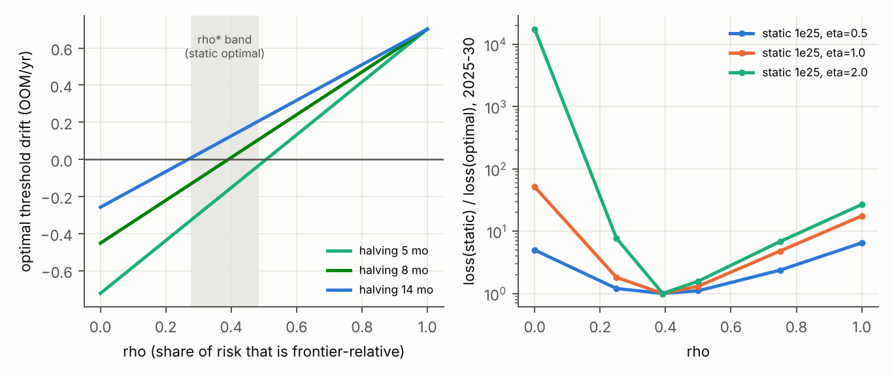
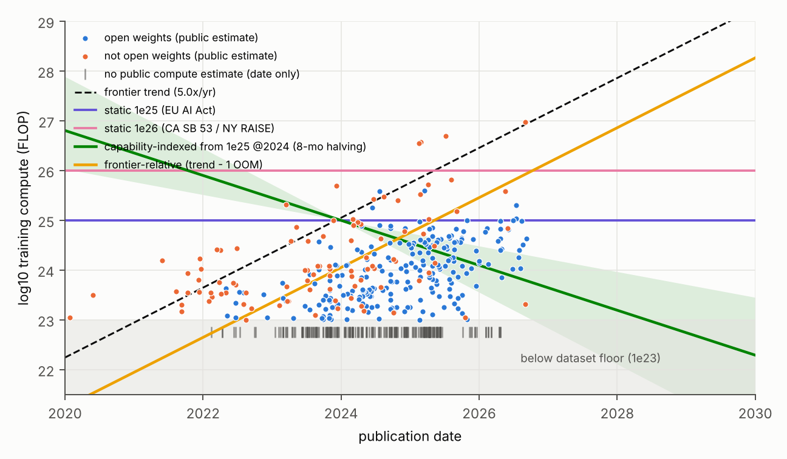
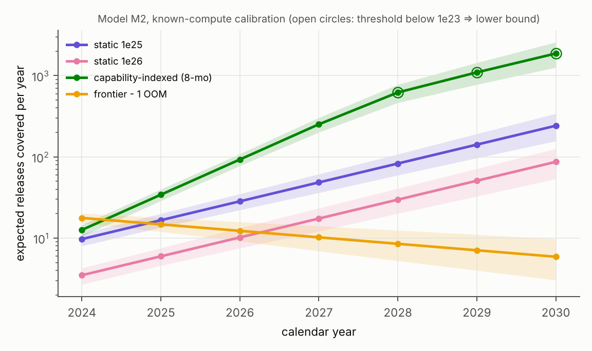
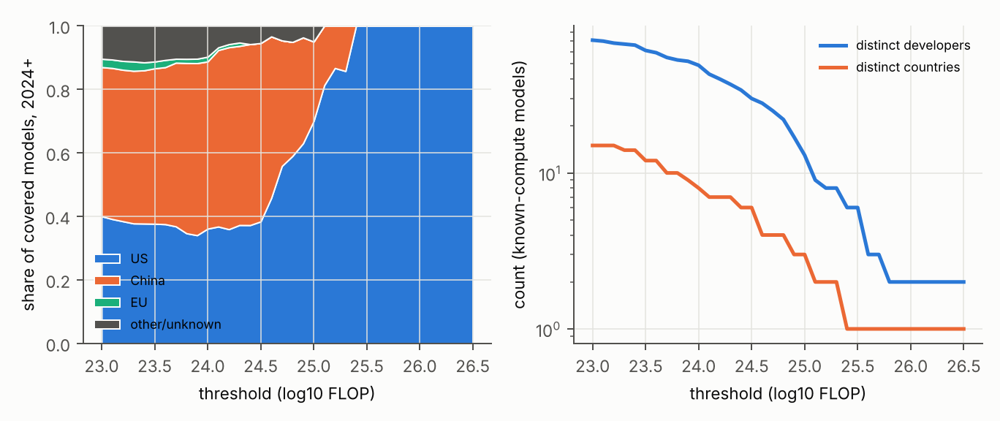
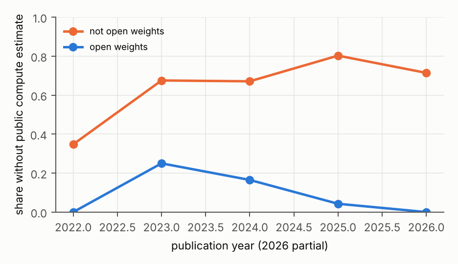
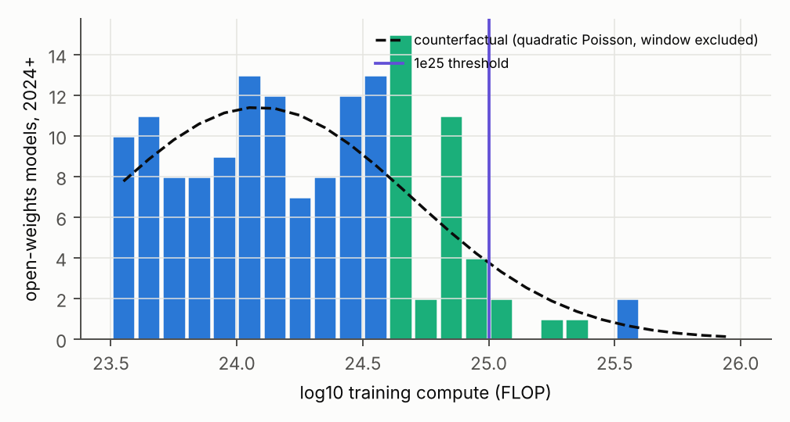

# Threshold Drift: How Compute Thresholds for Frontier AI Should Move Over Time, and Why the Answer Decides Who Can Regulate

**Target venue:** ACM Conference on Fairness, Accountability, and Transparency (FAccT 2027), socio-technical / policy track

---

## Abstract

Frontier AI regulation in force today identifies covered models by a fixed amount of training compute: 10^25 FLOP in the EU AI Act, and 10^26 operations in California's SB 53 and New York's RAISE Act. Two trends pull these lines in opposite directions. Algorithmic progress lowers the compute needed for a given capability. Frontier compute growth raises the compute of the models regulators worry about most. We formalise this tension and ask two questions. How should a compute threshold move over time? And how does the answer change who can regulate? Our theory has one result. If harm from an unregulated model rises with its effective compute (algorithmic progress included), measured relative to a weighted share ρ of frontier capability, then the loss-minimising threshold has log-slope dx*/dt = −α + ρ(α+g). Here α is the rate of algorithmic efficiency gains and g is frontier compute growth. The result holds for any distribution of models over compute. A static threshold is optimal only at the knife-edge ρ* = α/(α+g). We calibrate the model on a public snapshot of Epoch AI's large-scale model database (532 models with ≥10^23 FLOP, 324 of them with compute estimates, through September 2026). We estimate frontier growth at 5.0×/yr (90% CI 4.6–5.5). With Ho et al.'s 8-month halving time for algorithmic progress, this gives ρ* ≈ 0.39 (range 0.28–0.48). A Poisson intensity model shows that each order of magnitude (OOM) in threshold changes the covered count by 2.8×. Because of this, rules at the two ends of the ρ range diverge by 3.3× per year in the number of models they cover. The choice of rule also decides who is regulated. Among 2024–2026 models with public estimates, a 10^26 line covers 2 developers, all in the US. A 10^24 line covers 49 developers in 8 countries, and a majority of the models are Chinese. A capability-indexed rule anchored at 10^25 in 2024 would already have covered 47 models from 24 developers in 2025, and only 23% of those were US models. No public compute estimate exists for 80% of 2025 models that are not open-weights, against 4% of open-weights models, so outsiders cannot check threshold status for closed models. Open-weights models show excess mass just below 10^25. The excess is consistent with threshold avoidance but is not statistically significant. We state falsifiable predictions and a pre-registered bunching test.

## 中文摘要

现行前沿AI监管以固定的训练算力门槛界定受监管模型：欧盟《人工智能法》为10^25 FLOP，加州SB 53与纽约RAISE法案为10^26次运算。算法进步降低了达到同等能力所需的算力，前沿算力增长则抬高了最值得关注的模型的算力，二者使固定门槛朝相反方向"漂移"。本文把这一张力形式化，并回答两个问题：门槛应如何随时间调整？调整方式又如何决定"由谁来监管"？理论部分给出一个与模型分布无关的结论：如果未受监管模型的危害随其有效算力（含算法进步）上升，并相对于前沿能力的一个权重份额ρ来度量，那么损失最小化门槛的对数斜率为 dx*/dt = −α + ρ(α+g)，其中α为算法效率提升速度，g为前沿算力增长速度。固定门槛只在临界点 ρ* = α/(α+g) 处最优。我们用Epoch AI大规模模型数据库的公开快照（532个≥10^23 FLOP的模型，其中324个有算力估计，截至2026年9月）做标定。前沿算力增长估计为每年5.0倍（90%置信区间4.6–5.5）；结合Ho等人估计的8个月算法减半期，得到 ρ* ≈ 0.39（区间0.28–0.48）。泊松强度模型显示，门槛每变动一个数量级，覆盖模型数变化2.8倍；因此ρ取值两端的规则所覆盖的模型数每年相差3.3倍。规则的选择也决定了谁受监管。在2024–2026年有公开算力估计的模型中，10^26门槛只覆盖2家开发者，全部在美国；10^24门槛覆盖8个国家的49家开发者，且多数模型来自中国；若2024年以10^25为锚点采用能力指数化门槛，2025年就已覆盖24家开发者的47个模型，其中美国模型仅占23%。2025年非开放权重模型中80%没有公开算力估计（开放权重模型仅4%），外部无法核实闭源模型是否越过门槛。开放权重模型在10^25以下存在超额聚集，与规避门槛的行为一致，但统计上不显著。文末给出可证伪的预测与预注册的聚集检验方案。

---

## 1 Introduction

"How should frontier AI be regulated, and by whom?" is too broad to answer directly. Every binding frontier-AI statute so far shares one design choice that can be studied precisely: covered models are identified by a **training-compute threshold**. The EU AI Act presumes "high-impact capabilities", and hence systemic risk, for general-purpose models trained with more than 10^25 FLOP (Art. 51(2)) and lets the Commission amend the threshold by delegated act [EU 2024]. California's Transparency in Frontier Artificial Intelligence Act (SB 53, signed 29 September 2025) and New York's RAISE Act (signed 19 December 2025, amended 27 March 2026) both use 10^26 operations, with a revenue test for the "large developer" tier [CA 2025; NY 2025/2026]. The rescinded US Executive Order 14110 also used 10^26 [EO 14110; EO 14148].

Compute thresholds have well-known strengths: they are quantifiable, known before training, and hard to game cheaply [Heim & Koessler 2024]. They also have well-known weaknesses: compute is a crude proxy for capability, and the relationship between the two shifts [Hooker 2024]. The existing literature mostly treats the second problem qualitatively ("thresholds should be updated"). Epoch AI has projected how many models will exceed fixed thresholds [Cottier & Owen 2025]. What is missing is a model that says **in which direction and how fast** a threshold should move, what that depends on, and what each choice implies for the size and nationality of the regulated population. The last point is what links "how" to "who".

**This paper.** We separate two causes of drift. Algorithmic efficiency α (OOM/yr) means a model trained with fixed physical compute becomes more capable each year [Ho et al. 2024]. Frontier growth g (OOM/yr) means the most capable models use more compute each year [Sevilla & Roldán 2024]. A threshold indexed to capability should fall at rate α. A threshold indexed to "near the frontier" should rise at rate g. Which one is right depends on whether risk is **absolute** (a fixed capability is dangerous regardless of what else exists) or **relative** (danger depends on capability relative to the frontier, because defenses, monitoring and other actors improve too). We make this a single parameter ρ ∈ [0,1].

**Contributions.**

1. **A distribution-free optimal-indexing result (Proposition 1).** For any intensity of model releases over compute, the loss-minimising threshold follows x*(t) = x̄ − α(t−t₀) + ρ(α+g)(t−t₀): a convex combination of capability indexing and frontier indexing. A static threshold is optimal only when ρ = ρ* = α/(α+g) (Corollary 1). We verify the result numerically.
2. **A coverage-growth law (Proposition 3)** for exponential-tail release intensities. The number of covered releases grows at d ln N/dt = θ₁ + θ₂·s for a rule with log-slope s. Rules at the two ends of ρ diverge at |θ₂|(α+g) per year.
3. **Calibration on real data.** Using Epoch AI's large-scale model database (snapshot through 2026-09-09), we estimate g = 0.70 OOM/yr (5.0×), θ₂ = −1.02 per OOM (90% CI −1.10 to −0.96), ρ* ≈ 0.39, and a cross-rule divergence of 3.3× per year. We validate the release model out-of-sample on 2025 and report where it fails.
4. **"How" decides "who".** We measure how the developer and country composition of the covered population changes with the threshold. High thresholds are a US domestic matter. Thresholds a capability-indexed rule would reach by 2025–2026 cover a majority of Chinese models and several dozen developers. That rules out any single domestic regulator.
5. **An observability gap and a bunching test.** Public compute estimates are missing for most closed frontier models, so only the regulated firm (or its compute provider) knows its threshold status. We find excess mass of open-weights models just below 10^25. The excess is not statistically significant. We provide a pre-registered test and several falsifiable predictions.

We do not argue for compute thresholds over capability evaluations. Both literatures agree that thresholds work best as a *filter* that triggers further scrutiny [Heim & Koessler 2024; Koessler et al. 2024]. Our question is narrower: given that a compute filter is used, how should it move, and what does the choice imply for who must run it?

## 2 Related Work

**Compute governance.** Sastry et al. [2024] survey how compute can make AI development visible, allocate resources, and enforce rules. Compute is detectable and excludable, which makes it a natural regulatory handle. Heim and Koessler [2024] argue that training-compute thresholds are suitable as an initial filter for notification and further scrutiny, not as a direct measure of risk. Anderljung et al. [2023] set out the case for regulating "frontier AI" through standards, registration and licensing. Shevlane et al. [2023] argue for dangerous-capability evaluations as the main gate. Koessler, Schuett and Anderljung [2024] distinguish risk thresholds from capability and compute thresholds and discuss how they should relate.

**Limits of compute thresholds.** Hooker [2024] documents that the compute–performance relationship is unstable: smaller models increasingly match larger ones, and inference-time compute and data quality matter. Pilz, Heim and Brown [2025] show that falling compute requirements create an "access effect" (more actors can reach a given capability) and a "performance effect". They conclude that the governance of frontier capabilities must deal with proliferation. Our contribution makes the threshold-design consequences of these observations quantitative.

**Trends.** Sevilla et al. [2022] identify a large-scale era of training compute. Sevilla and Roldán [2024] estimate frontier compute growth of about 4–5×/yr. Ho et al. [2024] estimate that the compute needed to reach a fixed language-modelling performance halved about every 8 months (95% CI ≈ 5–14 months) between 2012 and 2023. Cottier and Owen [2025] project the number of notable models above fixed thresholds, reaching over 200 models above 10^26 FLOP by 2030. We use their projection as an independent cross-check (Section 5.3). Their work does not derive how a threshold *should* move or address jurisdiction.

**Who regulates.** Trager et al. [2023] propose jurisdictional certification on the ICAO/FATF model, in which states rather than firms are certified and trade is restricted with non-compliant jurisdictions. Bradford [2020] explains how market-access rules let the EU regulate global firms (the "Brussels effect"). Stigler [1971] warns that regulation of a small, concentrated industry is prone to capture. We connect these institutional arguments to a measurable quantity: how concentrated the covered population is as a function of the threshold rule.

**Bunching.** Public economics estimates behavioural responses to notches and kinks from excess mass near thresholds [Saez 2010; Kleven 2016]. We adapt the estimator to training-compute thresholds, where the EU AI Act creates a notch for open-weights models: the open-source exemption in Art. 53(2) does not apply to models with systemic risk [EU 2024].

## 3 Model

### 3.1 Setup

Let x denote log₁₀ physical training compute (FLOP) and t calendar time, with anchor t₀ (we use 2024.0, when the EU AI Act's threshold was adopted) and τ = t − t₀. Two exogenous trends are given.

- **Algorithmic efficiency.** A model trained with compute x at time t has *effective* compute x_e = x + ατ, measured in t₀-equivalent FLOP. A halving time of h months gives α = 12·log₁₀2 / h. That is 0.45 OOM/yr at h = 8, 0.72 at h = 5, and 0.26 at h = 14.
- **Frontier.** The frontier's physical compute is f(t) = f₀ + gτ, and its effective compute is f_e(t) = f(t) + ατ.

Models are released according to an inhomogeneous Poisson process with intensity λ(t,x) > 0 over (t,x). A regulator chooses a threshold x̂(t) and regulates every model with x ≥ x̂(t). Regulation of a model costs κ (compliance plus oversight). We assume, as a simplification, that it removes the model's excess harm; partial mitigation rescales κ. An unregulated model at (t,x) causes expected harm

  H(x,t) = κ · 10^{ η [ (x_e − x̄) − ρ (f_e(t) − f_e(t₀)) ] } = κ · 10^{ η [ (x − x̄) + ατ − ρ(α+g)τ ] },  (1)

where η > 0 is the elasticity of harm with respect to effective compute, x̄ is the threshold the regulator would choose at t₀, and **ρ ∈ [0,1] is the share of risk that is frontier-relative**. At ρ = 0, harm depends only on absolute capability: a model that can give meaningful uplift to a bioweapons attempt is equally dangerous whatever else exists. At ρ = 1, harm depends only on the distance to the frontier: what matters is capability that defenders, monitors and other labs have not yet seen. Intermediate values mix the two. ρ is partly empirical (how fast does societal resilience scale with frontier capability?) and partly normative. The point of the model is to make the dependence on ρ explicit.

Per-period loss is

  L(x̂, t) = ∫_{x̂}^{∞} κ λ(t,x) dx + ∫_{x_min}^{x̂} H(x,t) λ(t,x) dx.  (2)

### 3.2 Results

**Proposition 1 (optimal indexing).** For any intensity λ(t,·) > 0 and any η > 0, L(·,t) has a unique minimiser

  x*(t) = x̄ − ατ + ρ(α+g)τ = (1−ρ)(x̄ − ατ) + ρ(x̄ + gτ).  (3)

*Proof.* ∂L/∂x̂ = λ(t,x̂)[H(x̂,t) − κ]. Since λ > 0 and H is strictly increasing in x̂, the derivative is negative for x̂ < x* and positive for x̂ > x*, where H(x*,t) = κ. Taking log₁₀ of H(x*,t) = κ gives (x* − x̄) + ατ − ρ(α+g)τ = 0. ∎

Three features matter for policy. (i) The optimal slope does not depend on λ or η. The distribution of models determines *how many* are covered, not *where the line goes*. (ii) The rule is a convex combination of a **capability-indexed** threshold (ρ=0, falling at α) and a **frontier-relative** threshold (ρ=1, rising at g). (iii) η matters only for the *cost* of being wrong (Proposition 2).

**Corollary 1 (the static knife-edge).** A static threshold (dx*/dt = 0) is optimal if and only if ρ = ρ* ≡ α/(α+g). Any statute with a fixed FLOP number implicitly asserts that ρ = ρ*.

**Proposition 2 (cost of mis-indexing).** Suppose a rule's threshold deviates from the optimum by δ(t) = x̂(t) − x*(t), and λ has a locally exponential tail λ(t, x*+s) = λ(t,x*)e^{θ₂ s}. Then the excess loss per period is

  ΔL(t) = κ λ(t,x*) ∫_0^{δ} (10^{ηs} − 1) e^{θ₂ s} ds,  (4)

which is positive for δ ≠ 0. For a rule with slope s_rule, δ grows linearly, δ = (s_rule − dx*/dt)τ. The excess loss therefore grows exponentially in |ρ − ρ_rule|(α+g)τ when the threshold sits too low (δ<0, harm term) and through over-coverage when it sits too high. *Proof.* Direct integration of ∂L/∂x̂ from x* to x* + δ. ∎

**Proposition 3 (coverage growth).** Let λ(t,x) = exp(θ₀ + θ₁τ + θ₂(x − 25)) with θ₂ < 0, and suppose the threshold follows x̂(t) = x̂₀ + sτ. The expected covered count per unit time, N(t) = ∫_{x̂(t)}^∞ λ dx = e^{θ₀+θ₁τ+θ₂(x̂(t)−25)}/|θ₂|, then satisfies

  d ln N / dt = θ₁ + θ₂ s.  (5)

Hence the capability-indexed (s = −α) and frontier-relative (s = g) rules diverge in covered count at rate |θ₂|(α+g) in natural-log units per year. *Proof.* Direct differentiation. ∎

Equation (5) is the quantitative core of the "who" question. A regulator that picks ρ also picks a growth path for its regulated population. Section 6 shows that the population's composition (developers, countries) changes with it.

## 4 Data and Estimation

**Data.** We use Epoch AI's "Data on AI models" [Epoch AI 2026], in a snapshot whose latest record in the large-scale file is dated 2026-09-09. Epoch.ai was not reachable from our compute environment, so we used an unmodified copy committed to a public GitHub repository on 2026-10-22. SHA-256 hashes are recorded in the repository. The `large_scale_ai_models` table lists 532 models believed to exceed 10^23 FLOP, and 324 of them have a training-compute estimate. Epoch attaches confidence labels to each estimate, corresponding to 90% intervals of ±3× ("Confident"), ±10× ("Likely") and ±31× ("Speculative") [Epoch AI, estimation documentation]. We attribute each model to the country of its first-listed organisation. "Open weights" means Epoch's accessibility field begins with "Open weights".

**Frontier trend (g).** We flag a model as frontier if its compute is in the top 10 of all models (from the full 3,628-row `all_ai_models` table) released up to its date. We then regress log₁₀ compute on date for the 91 flagged models released since 2018. Uncertainty comes from 2,000 bootstrap resamples.

**Release intensity (θ).** We fit the Poisson intensity of Proposition 3 by maximum likelihood to models with x ≥ 23 released in 2020–2025 (298 points). Model **M2** (primary) has a constant tail slope θ₂. Model **M1** adds a drift term θ₃τ(x−25) to the slope. We bound missing data in two ways. The *known-compute* calibration uses only models with estimates, which gives lower bounds. The *MAR-weighted* calibration weights each point by its year's ratio of all to known models, i.e. it assumes estimates are missing at random within a year. Section 6.2 shows this assumption is false in a specific direction, so we treat these two calibrations as brackets, not as point estimates. Confidence intervals use a Poisson bootstrap (300 replicates).

**Algorithmic progress (α).** We take this from Ho et al. [2024] rather than estimating it, with central h = 8 months and range 5–14 months. We note that their estimate concerns pre-training perplexity up to 2023 (Section 8).

**Rules compared.** (a) static 10^25; (b) static 10^26; (c) capability-indexed, x̂ = 25 − ατ (ρ=0, anchored at 10^25 in 2024); (d) frontier-relative, x̂ = f(t) − 1 and f(t) − 0.5 (ρ=1, with an offset). Note that f(2024) = 10^25.05, so rule (d) with a −1 offset sits at 10^24.05 in 2024.

All numbers below are produced by `code/analysis.py` and saved in `results/`. Numbers attributed to other papers are cited as such.

## 5 Results I: Calibration and Coverage

### 5.1 Parameters

| Quantity | Estimate | Source |
|---|---|---|
| Frontier growth g | 0.70 OOM/yr = 5.0×/yr (90% CI 4.6–5.5×); 4.6×/yr on 2020+ only | this paper (91 frontier models) |
| Algorithmic efficiency α | 0.45 OOM/yr (h = 8 mo); 0.26–0.72 for h = 14–5 mo | Ho et al. [2024] |
| Static-optimal ρ* = α/(α+g) | 0.39; 0.27 (h=14) to 0.51 (h=5); 90% band 0.28–0.48 over h ∈ [5,14] and bootstrap g | this paper |
| Tail slope θ₂ (M2, known) | −1.02 per OOM (90% CI −1.10, −0.96): covered count falls 2.8× per OOM of threshold | this paper |
| Release growth θ₁ (M2, known) | 0.54/yr (0.48–0.59), i.e. 1.71×/yr at a fixed threshold | this paper |
| θ (MAR-weighted) | θ₁ = 0.55, θ₂ = −1.03 | this paper |

Our g matches Epoch's published 4–5×/yr [Sevilla & Roldán 2024]. This is a consistency check, not independent confirmation, since the data overlap.

**Interpretation of ρ*.** At the central parameters, a fixed 10^25 or 10^26 threshold is optimal only if about 39% of the relevant risk is frontier-relative and 61% absolute. No statute or legislative record we are aware of states such a judgement. Corollary 1 shows that a fixed number makes the judgement anyway.

### 5.2 Numerical check of Proposition 1

We minimised the loss (2) on a 0.01-OOM grid using the fitted M2 intensity, at t ∈ {2026.5, 2029.5}, ρ ∈ {0, 0.5, 1} and η ∈ {0.5, 2}. In all 12 cases the numerical minimiser matched Equation (3) to within 0.01 OOM, independent of η (`results.json: prop1_numeric_check`).

**Cost of mis-indexing (Proposition 2, numerically).** We evaluated loss (2) over 2025–2030 under the fitted M2 intensity, normalising κ so that 10^25 is optimal in 2024 (`loss_ratios.csv`, Figure 3). If ρ = 0.5 and η = 1, the static 10^25 rule's loss is 1.30× the optimum, while the pure capability-indexed rule's is 8.0× and the frontier − 1 OOM rule's is 9.4×. If ρ = 0 (purely absolute risk), the static rule's loss is 5.0× (η=0.5) to 51× (η=1) the optimum. If ρ = 1, it is 6.5× to 17.5×. Near ρ*, a static rule therefore costs little, but both pure indexing schemes are costly when risk is mixed. The penalty for choosing the wrong end of the ρ range is far larger than the penalty for staying static. Values for η = 2 are extreme (up to 10^4) and mainly show that (1) makes harm explode for large effective-compute gaps. We do not interpret them quantitatively.

*Figure 3. Left: optimal threshold drift dx*/dt as a function of ρ for three algorithmic halving times; the shaded band is the range of ρ* (static optimal). Right: loss of a static 10^25 threshold relative to the optimal path over 2025–2030.*

### 5.3 How fast the covered population grows under each rule

Proposition 3 with the fitted M2 parameters gives the following growth rates for covered releases:

| Rule | slope s (OOM/yr) | d ln N/dt (90% CI) | annual multiplier |
|---|---|---|---|
| static (10^25 or 10^26) | 0 | 0.54 (0.48–0.59) | 1.71× |
| capability-indexed (ρ=0, h=8) | −0.45 | 1.00 (0.95–1.05) | 2.71× |
| frontier-relative (ρ=1) | +0.70 | −0.18 (−0.27 to −0.11) | 0.83× |
| divergence, ρ=0 vs ρ=1 | — | 1.18 (1.11–1.27) | **3.26×/yr** |

The frontier-relative rule's *declining* count means that in the data with public estimates, the population of models within one OOM of the frontier has been thinning: the frontier has run ahead of followers. Part of this is an observability artefact, because frontier closed models increasingly lack estimates (Section 6.2). We therefore read this row as "roughly flat to declining".

Expected annual covered releases (M2, known-compute calibration; 90% bootstrap intervals; MAR-weighted calibration in brackets):

| Rule | 2025 | 2027 | 2028 |
|---|---|---|---|
| static 10^25 | 16.6 (13.5–20.0) [27.7] | 48.5 (36–61) [83] | 83 (59–108) [143] |
| static 10^26 | 6.0 (4.6–7.6) [9.9] | 17.4 (12–23) [30] | 30 (20–41) [51] |
| capability-indexed, h=8 | 34 (29–40) [57] | 252 (201–304) [433] | ≥621 (threshold < 10^23) |
| capability-indexed, h=14 / h=5 | — | 124 / 376 | — |
| frontier − 1 OOM | 14.8 (12–18) [25] | 10.2 (7–14) [17] | 8.5 (5–12) [14] |

By 2028 the 8-month capability-indexed threshold falls below 10^23 FLOP, the floor of Epoch's large-scale tracker, so the projection there is a lower bound (Figure 2). Summing the static 10^26 row cumulatively, with the four models above 10^26 known before 2024 counted, gives about 20 models by end-2026 and 205 by end-2030 under the known calibration (354 under MAR weights). Cottier and Owen [2025] independently project about 10 models above 10^26 by 2026 and over 200 by 2030 for notable models, using a different method (hardware and spending extrapolation). Our 2030 figure agrees with theirs; for 2026 ours is roughly twice as high.

*Figure 1. Large-scale models (≥10^23 FLOP) with public compute estimates, by access type. Ticks at the bottom mark models without public estimates (date only). Lines show the four rule families; the green band covers algorithmic halving times of 5–14 months.*

*Figure 2. Expected covered releases per year by rule (M2, known-compute calibration; shaded 90% bootstrap bands). Open circles mark years where the threshold is below the data floor, so the value is a lower bound.*

### 5.4 Out-of-sample validation and its failure modes

We refit M2 on 2020–2024 and predicted 2025. Observed 2025 counts can only be bracketed. The lower bound counts known-compute models above the threshold. The upper bound adds every 2025 large-scale model without an estimate (61 models; 33 from the 15 "frontier developers" that have at least one known ≥10^25 model, which is the relevant set for thresholds ≥10^25).

| threshold | predicted 2025 (90% PI) | observed bracket | overlap? |
|---|---|---|---|
| 10^23 | 232 (183–287) | 104–165 | **no** |
| 10^23.5 | 125 (95–158) | 90–151 | yes |
| 10^24 | 67 (48–89) | 71–132 | yes |
| 10^24.5 | 36 (23–51) | 37–98 | yes |
| 10^25 | 19.6 (11–29) | 9–42 | yes |
| 10^26 | 5.7 (2–10) | 3–36 | yes |

The model fails at the 10^23 floor. Large-scale releases in the database did not grow from 2024 (167) to 2025 (165), while M2 extrapolated 1.7×/yr growth. We cannot tell from the data whether this reflects a real plateau in mid-scale releases or a lag in database coverage. Model M1, with a drifting slope, performs no better at the floor and predicts implausibly fast growth at high thresholds (over 10^4 releases/yr above 10^26 by 2030), so we do not use it for projection. At thresholds relevant to regulation, the brackets are wide and the test is weak. We also checked January–September 2026 against the full-year model: 5 known models ≥10^25 against 17.8 predicted. The shortfall is consistent with reporting lag plus the observability gap, but we cannot separate these from model error.

**What survives.** Absolute counts depend on θ₁, which is the least reliable parameter. The paper's main claims depend only on θ₂, g and α: the optimal slope (Proposition 1 does not use λ at all), ρ*, and the cross-rule divergence. θ₂ is tightly estimated and stable between calibrations (−1.02 vs −1.03).

## 6 Results II: Who Is Covered, and Who Can See It

### 6.1 The threshold decides the jurisdictional problem

Table: composition of the covered population among models released 2024-01 to 2026-09 with public compute estimates (`jurisdiction_by_threshold.csv`). An upper-bound imputation (in brackets) assigns ≥10^25 to the 69 models without estimates from the 15 frontier developers.

| threshold | models | developers | countries | countries for 90% | US share | China share |
|---|---|---|---|---|---|---|
| ≥10^26 | 4 | 2 | 1 | 1 | 100% | 0% |
| ≥10^25.5 | 10 | 6 | 1 | 1 | 100% | 0% |
| ≥10^25 | 20 [89] | 13 [14] | 3 | 2 | 70% [76%] | 25% [22%] |
| ≥10^24.5 | 73 [142] | 30 [31] | 6 | 2 | 38% [58%] | 56% [39%] |
| ≥10^24 | 133 [202] | 49 | 8 | 3 [2] | 36% [50%] | 53% [42%] |
| ≥10^23 | 230 | 71 | 15 | 3 | 40% | 47% |

*Figure 4. Left: developer-country shares of covered models (2024+, public estimates) as a function of threshold. Right: number of distinct developers and countries covered.*

Retrospectively, the rules imply very different regulated populations (`retrospective_coverage.csv`):

- **Static 10^25**: 6 models / 6 developers (2024), 9 / 7 (2025), 5 / 5 (2026 to September). 60–78% US.
- **Static 10^26**: 0 (2024), 3 models / 2 developers (2025), 1 (2026). All US.
- **Capability-indexed (ρ=0, h=8)**: 14 models / 10 developers (2024), **47 models / 24 developers / 5 countries (2025)** with 23% US and 66% Chinese, and 23 / 16 (2026 to September). Of the 47 models in 2025 that the capability-indexed target identifies, a static 10^25 line misses 38. Of the missed models, 36 are open-weights, from 22 developers.

Combined with Proposition 3, this gives a conditional answer to "who should regulate".

- **If risk is mostly frontier-relative (ρ near 1)**, the covered population stays small (about 5–15 releases/yr) and concentrated: two to seven developers, today almost all in the US. Home-country supervision is feasible: a federal regulator, or in its absence state laws such as SB 53/RAISE, plus a bilateral channel with the only other country that has produced ≥10^25 models in volume. Concentration has a cost. With 2–7 supervised firms, Stigler-type capture [Stigler 1971] is the main institutional risk. That argues for independent evaluators and transparency obligations, which is the design SB 53 adopted [CA 2025].
- **If risk is mostly absolute (ρ near 0)**, the regulated population grows about 2.7× per year and, already in 2025, is majority non-US and spread across about two dozen developers, mostly releasing open weights. No single domestic regulator covers it. Only three mechanisms reach such a population: (i) market-access regulation, which works on what is *placed on a market* but cannot recall open weights already released [Bradford 2020]; (ii) international jurisdictional certification [Trager et al. 2023]; or (iii) control at the compute layer [Sastry et al. 2024]. Under ρ≈0, the open-weights release decision is itself the regulated event, because once released, the capability is available everywhere.
- **At ρ ≈ ρ* (static thresholds)**, the covered population grows about 1.7×/yr from a base that is mostly US (10^26) or mixed US-led (10^25). Each EU or US-state regulator then supervises 10–50 releases a year by around 2027. That is manageable for a dedicated office, but the trend implies the need for routine revision.

### 6.2 The observability gap

The share of large-scale models without any public compute estimate differs sharply by access type (`observability_gap.csv`, Figure 5):

| year | not open-weights: missing | open-weights: missing |
|---|---|---|
| 2023 | 68% | 25% |
| 2024 | 67% | 16% |
| 2025 | **80%** | **4%** |
| 2026 (to Sep.) | 71% | 0% |

*Figure 5. Share of large-scale models without a public training-compute estimate, by access type.*

Among the 15 developers with any known ≥10^25 model, 41% of 2025 releases lack estimates. Even where estimates exist, Epoch's stated uncertainty bands blur the line. Of the models released since 2024, 20 have point estimates ≥10^25, but the expected number above 10^25 under Epoch's intervals is 33. For 70 models the probability of exceeding 10^25 lies between 0.1 and 0.9; for 10^26 the corresponding numbers are 4 point estimates, 7.1 expected, and 15 ambiguous.

The implication for "who": threshold status of closed frontier models is known only to the developer and its compute provider. Any regime that relies on compute thresholds therefore needs compelled disclosure: developer notification (EU Art. 52; SB 53 transparency reports) or provider-side reporting. It also needs a regulator able to audit those disclosures. Public-interest monitoring by civil society, which works for open-weights models, is unavailable for closed ones. The populations that public data can and cannot see also differ in nationality. Open-weights models dominate the covered population at lower thresholds and are majority Chinese (Section 6.1).

### 6.3 Bunching below 10^25

The EU AI Act creates a notch for open-weights developers. Above 10^25 they lose the Art. 53(2) open-source exemption and incur systemic-risk obligations [EU 2024]. Using models with estimates released since 2024, we binned log₁₀ compute in 0.1-OOM bins over [23.5, 26.0). We fitted a quadratic Poisson counterfactual excluding a ±0.4-OOM window around the threshold, and bootstrapped over models (400 resamples).

| sample (n) | threshold | obs. [T−0.4,T) | counterfactual | obs. [T,T+0.4) | counterfactual | excess below (90% CI) | P_boot(excess>0) |
|---|---|---|---|---|---|---|---|
| open weights (187) | **10^25** | 32 | 23.3 | 4 | 9.0 | **+8.7 (−2.4, 20.5)** | 0.90 |
| open weights | placebo 10^24.5 | 39 | 33.4 | 41 | 19.1 | +5.6 (−16, 21) | 0.71 |
| open weights | placebo 10^24 | 36 | 60.0 | 40 | 69.6 | −24.0 (−48, 0.3) | 0.06 |
| open weights | placebo 10^25.5 | 2 | 9.5 | 2 | 2.7 | −7.5 (−12, −2) | 0.01 |
| not open weights (43) | 10^25 | 7 | 6.2 | 4 | 5.2 | +0.8 (−5, 7) | 0.60 |
| all (230) | 10^25 | 39 | 32.6 | 8 | 17.1 | +6.4 (−5.6, 18.4) | 0.78 |

*Figure 6. Open-weights models released 2024+ by compute bin, with quadratic Poisson counterfactual (window around 10^25 excluded, shown in aqua).*

Among open-weights models, the ratio of models just below to just above 10^25 is 8.0, against 2.6 under the smooth counterfactual. The excess is the largest of the placebo thresholds we tried, and it is absent among closed models. **But the 90% interval includes zero.** The counterfactual's polynomial is sensitive to the thinning upper tail. Clustering just below 10^25 could also have non-regulatory causes, such as standard training-run sizes on common cluster configurations. Before 2024 there were too few models near 10^25 for a before/after comparison (2 models below vs 2 above). We report this as a suggestive pattern and turn it into a pre-registered test (Section 7).

## 7 Falsifiable Predictions and Test Protocol

Each prediction states a quantity, the expected value from this paper, and what would falsify it.

**P1 (EU notification growth).** If the EU keeps 10^25 static, the annual number of new models notified as general-purpose AI with systemic risk grows about 1.7×/yr (d ln N/dt 0.48–0.59). *Test:* AI Office notification counts for 2026–2028. *Falsified* if the fitted log-growth of notifications falls outside [0.3, 0.8] over three years. Notifications include models without public estimates, so the MAR-weighted level (about 28 in 2025, 83 in 2027) is the relevant reference for levels.

**P2 (bunching, pre-registered).** Applying the Section 6.3 estimator unchanged (0.1-OOM bins, [23.5, 26.0), quadratic Poisson, ±0.4 window, 400 bootstrap resamples) to open-weights models released 2026-10-01 to 2027-12-31 in a future Epoch snapshot, the excess below 10^25 will be positive with bootstrap P > 0.9, and larger than at placebo thresholds 10^24.5 and 10^25.5. *Corollary:* if the Commission moves the threshold by delegated act, the excess mass should move with it within about 12 months. *Falsified* if the excess at 10^25 is ≤ 0, or does not exceed the placebo excesses.

**P3 (nationality crossover).** In any 12-month window, among models with public compute estimates, the share of US-developed models among those above a threshold x falls below 50% for x ≤ 10^24.5 and stays above 60% for x ≥ 10^25, as long as open-weights release patterns persist. *Falsified* by a crossover point outside [10^24.3, 10^25.2] in 2027 data.

**P4 (cumulative 10^26).** Cumulative models above 10^26: roughly 20 by end-2026 and 60–115 by end-2028 (known vs MAR bounds). *Falsified* by counts outside [10, 160] by end-2028 in Epoch data or official notifications.

**P5 (direction of statutory revisions).** Corollary 1 implies that a legislator who revises a threshold reveals its ρ. Raising a threshold implies ρ > ρ* (frontier-relative risk); lowering it implies ρ < ρ*. We predict that revisions justified by "keeping the regime focused on the frontier" will raise thresholds, and revisions justified by misuse risk (CBRN uplift, for example) will lower them or replace them with capability triggers. *Test:* code the stated rationales of revisions (EU delegated acts, state amendments) against direction of change.

## 8 Discussion

**Statutes contain an unstated parameter.** The main conceptual point is that a numeric compute threshold encodes a view on how much AI risk is absolute versus relative. Proposition 1 makes the view explicit and gives it a value (ρ* ≈ 0.39 at central parameters). This turns a debate that usually runs "compute is a bad proxy" against "compute is the best proxy we have" into a sharper question: *what fraction of the harm we care about scales with distance from the frontier?* Different harms plausibly have different answers. Uplift to unsophisticated actors in established domains is close to absolute (ρ≈0). Loss-of-control and novel-capability risks are closer to relative (ρ≈1). This suggests **two thresholds for two purposes**. One is a frontier-relative line (rising at about g) that triggers heavy pre-deployment obligations on a small, mostly domestic population. The other is a capability-indexed line (falling at about α) that triggers light, scalable obligations such as notification or standardised dangerous-capability evaluations [Shevlane et al. 2023] on a large, international population. The second population grows about 2.7× per year, so the obligations attached to it must be cheap per model, ideally automated.

**"Who" follows from "how".** The jurisdictional analysis gives a concrete answer to the "by whom" question. Today, high-threshold frontier regulation is effectively US domestic regulation of a handful of firms. Whether that domestic regulator is federal or a state is a question of US politics; the data say it covers almost all models above 10^25.5. Capability-indexed regulation is international by necessity within one or two years, and it concerns open-weights releases above all. Since the EU sits at 10^25 and US states at 10^26, the two regimes already cover different populations. Up to the end of 2026, the EU line catches a minority of Chinese models that the US-state line does not.

**Observability determines enforcement design.** Public information covers open models well and closed models poorly, so the two regimes need different enforcement. For closed frontier models, compelled disclosure audited by the regulator is unavoidable. For open models, public monitoring works, but intervention after release has little effect.

## 9 Limitations

- **Compute is not capability.** Our model treats effective training compute as the capability index. Post-training, inference-time compute, distillation and tool use break this link [Hooker 2024]. The RAISE Act's 2026 amendment, which includes later fine-tuning and modification compute, partly responds to this [NY 2026]. ρ and the harm function (1) are stylised. Regulation is assumed to remove harm, and κ is constant over time and across firms.
- **α is borrowed, and dated.** Ho et al.'s 8-month halving time covers pre-training perplexity on two benchmarks through 2023, with a wide confidence interval. Downstream-capability efficiency may differ. We report h ∈ [5,14] months throughout, and ρ* moves from 0.27 to 0.51 across that range.
- **Data are incomplete in a biased way.** 39% of large-scale models lack compute estimates, concentrated among closed frontier models (Section 6.2). Known-compute results are lower bounds, MAR weighting is demonstrably wrong in direction, and our upper-bound imputation (≥10^25 for missing frontier-developer models) is crude. Estimates themselves carry 3–31× uncertainty.
- **The release model fails at the floor** out of sample (Section 5.4). Absolute projections beyond about 2027 should be read as scenarios. The frontier-relative "declining count" result may be an observability artefact.
- **Country attribution** uses the first-listed organisation's headquarters. Legal reach depends on market placement, subsidiaries and compute location, not headquarters. EU market-access rules reach non-EU developers that place models on the EU market.
- **Bunching** is underpowered (n = 187 open-weights models) and not statistically significant. Non-regulatory causes of clustering near 10^25 cannot be excluded.
- **Data provenance.** We used a third-party copy of Epoch's public dataset (hashes recorded) because epoch.ai was unreachable from our environment. We did not independently re-estimate any model's compute.
- **Frontier definition.** Our top-10-at-release frontier mixes domains (language, video, image). A language-only frontier would give a somewhat different g (Epoch reports about 5×/yr for language models since 2020 [Sevilla & Roldán 2024]).

## 10 Conclusion

A fixed compute threshold is not a neutral administrative device. It is optimal only if risk is a particular mix of absolute and relative (ρ* ≈ 0.39). It grows its regulated population about 1.7× per year, and it determines which countries' developers are regulated. Indexing to capability and indexing to the frontier are the two extremes of a one-parameter family. Their regulated populations diverge by about 3.3× per year: at one end a few US firms that a domestic regulator can supervise, at the other several dozen mostly open-weights developers that only international or compute-layer mechanisms can reach. The practical recommendations are: make ρ explicit, use two thresholds for two kinds of harm, and attach compelled, auditable disclosure to whichever line covers closed models. The predictions in Section 7 will be testable against AI Office notifications and future Epoch snapshots within about two years.

---

## Reproducibility statement

All code is in `code/` (`analysis.py`, `figures.py`, `common.py`), and all outputs are in `results/` (run log: `results/run_log.txt`). A full run takes about 30 s of CPU time. Random seed 20261122. Data: `data/` (Epoch AI, CC BY 4.0; SHA-256 in `data/SHA256SUMS`).

## References

- [Anderljung et al. 2023] Anderljung, M., Barnhart, J., Korinek, A., Leung, J., O'Keefe, C., Whittlestone, J., et al. (2023). Frontier AI Regulation: Managing Emerging Risks to Public Safety. arXiv:2307.03718.
- [Bradford 2020] Bradford, A. (2020). *The Brussels Effect: How the European Union Rules the World*. Oxford University Press.
- [CA 2025] California Senate Bill 53, Transparency in Frontier Artificial Intelligence Act (2025), signed 29 September 2025. Office of the Governor, "Governor Newsom signs SB 53", https://www.gov.ca.gov/2025/09/29/governor-newsom-signs-sb-53-advancing-californias-world-leading-artificial-intelligence-industry/
- [Cottier & Owen 2025] Cottier, B., & Owen, D. (2025, May 30). How many AI models will exceed compute thresholds? Epoch AI. https://epoch.ai/blog/model-counts-compute-thresholds
- [Epoch AI 2026] Epoch AI (2026). Data on AI models (Notable, Large-Scale, Frontier and All AI Models datasets; snapshot with latest large-scale record 2026-09-09). CC BY 4.0. https://epoch.ai/data/ai-models
- [Epoch AI, estimation documentation] Epoch AI. AI models documentation – Estimation (confidence levels: Confident ±3×, Likely ±10×, Speculative ±31×, as 90% CIs). https://epoch.ai/data/ai-models-documentation/estimation
- [EO 14110] Executive Order 14110, Safe, Secure, and Trustworthy Development and Use of Artificial Intelligence, 30 October 2023.
- [EO 14148] Executive Order 14148, Initial Rescissions of Harmful Executive Orders and Actions, 20 January 2025 (Federal Register doc. 2025-01901).
- [EU 2024] Regulation (EU) 2024/1689 of the European Parliament and of the Council (Artificial Intelligence Act), in particular Articles 51–55. Official Journal of the European Union. Article texts: https://artificialintelligenceact.eu/article/51/ and https://artificialintelligenceact.eu/article/53/
- [Heim & Koessler 2024] Heim, L., & Koessler, L. (2024). Training Compute Thresholds: Features and Functions in AI Regulation. arXiv:2405.10799.
- [Ho et al. 2024] Ho, A., Besiroglu, T., Erdil, E., Owen, D., et al. (2024). Algorithmic progress in language models. *Advances in Neural Information Processing Systems 37 (NeurIPS 2024)*. arXiv:2403.05812.
- [Hooker 2024] Hooker, S. (2024). On the Limitations of Compute Thresholds as a Governance Strategy. arXiv:2407.05694.
- [Kleven 2016] Kleven, H. J. (2016). Bunching. *Annual Review of Economics*, 8, 435–464. doi:10.1146/annurev-economics-080315-015234.
- [Koessler et al. 2024] Koessler, L., Schuett, J., & Anderljung, M. (2024). Risk thresholds for frontier AI. arXiv:2406.14713.
- [NY 2025/2026] New York Responsible AI Safety and Education (RAISE) Act, signed 19 December 2025; amended version signed 27 March 2026. Summaries: Davis Polk, "Governor Hochul signs final version of Responsible AI Safety and Education Act" (2026); Cooley, "New York's Frontier AI Law Gets a California Makeover – With Some Key Differences" (31 March 2026), https://www.cooley.com/news/insight/2026/2026-03-31-new-yorks-frontier-ai-law-gets-a-california-makeover-with-some-key-differences
- [Pilz et al. 2025] Pilz, K. F., Heim, L., & Brown, N. (2025). Increased Compute Efficiency and the Diffusion of AI Capabilities. *Proceedings of the AAAI Conference on Artificial Intelligence*, 39(26), 27582–. (arXiv preprint 2023.)
- [Saez 2010] Saez, E. (2010). Do Taxpayers Bunch at Kink Points? *American Economic Journal: Economic Policy*, 2(3), 180–212. doi:10.1257/pol.2.3.180.
- [Sastry et al. 2024] Sastry, G., Heim, L., Belfield, H., Anderljung, M., et al. (2024). Computing Power and the Governance of Artificial Intelligence. arXiv:2402.08797.
- [Sevilla et al. 2022] Sevilla, J., Heim, L., Ho, A., Besiroglu, T., Hobbhahn, M., & Villalobos, P. (2022). Compute Trends Across Three Eras of Machine Learning. *2022 International Joint Conference on Neural Networks (IJCNN)*. arXiv:2202.05924.
- [Sevilla & Roldán 2024] Sevilla, J., & Roldán, E. (2024, May 28). Training compute of frontier AI models grows by 4-5x per year. Epoch AI. https://epoch.ai/blog/training-compute-of-frontier-ai-models-grows-by-4-5x-per-year
- [Shevlane et al. 2023] Shevlane, T., Farquhar, S., Garfinkel, B., Phuong, M., Whittlestone, J., Leung, J., et al. (2023). Model evaluation for extreme risks. arXiv:2305.15324.
- [Stigler 1971] Stigler, G. J. (1971). The Theory of Economic Regulation. *Bell Journal of Economics and Management Science*, 2(1), 3–21. doi:10.2307/3003160.
- [Trager et al. 2023] Trager, R. F., Harack, B., Reuel, A., Carnegie, A., Heim, L., Ho, L., Kreps, S., Lall, R., Larter, O., Ó hÉigeartaigh, S., Staffell, S., & Villalobos, J. J. (2023). International Governance of Civilian AI: A Jurisdictional Certification Approach. Oxford Martin AI Governance Initiative / Centre for the Governance of AI white paper, August 2023.
