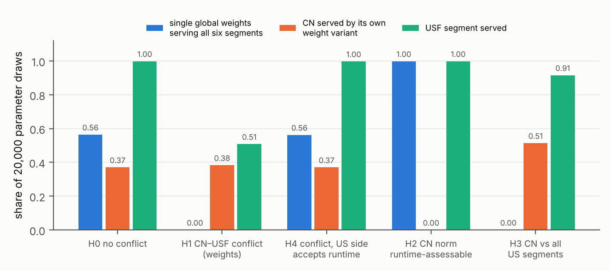
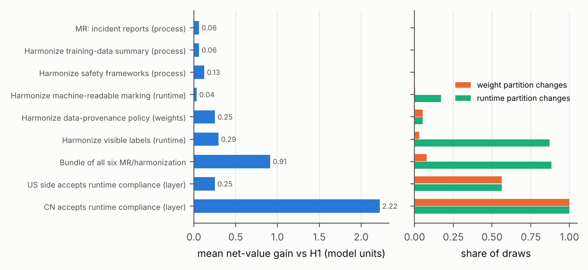
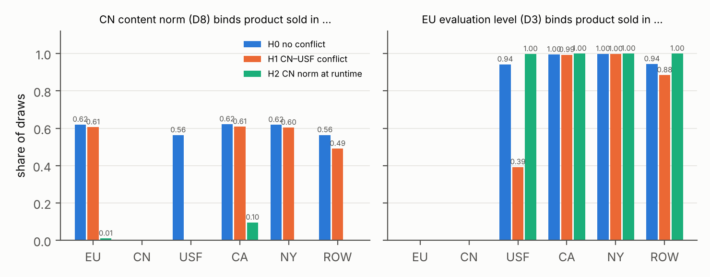
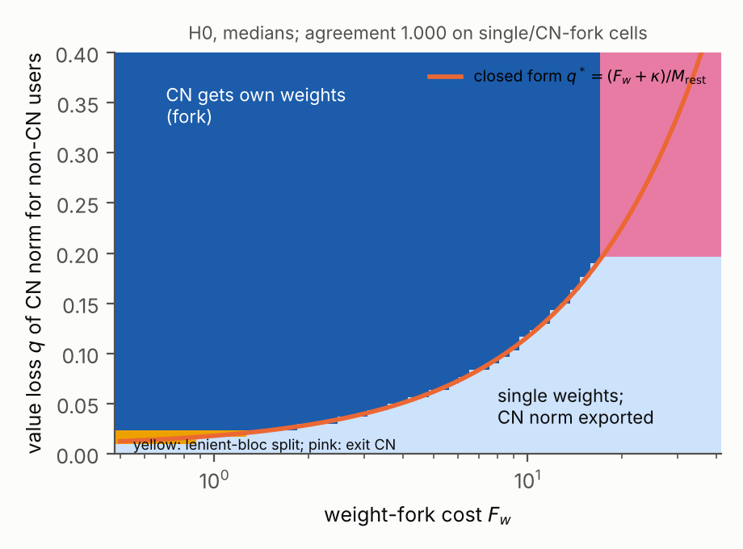

# Stackable, Divisible, or Conflicting? A Layered Compliance-Partition Model of Cross-Border AI Regulatory Coordination (EU, China, United States)

**Target venue:** ACM Conference on Fairness, Accountability, and Transparency (FAcCT) / AAAI/ACM Conference on AI, Ethics, and Society (AIES), full paper track

---

## Abstract

Debates on how the EU, Chinese and US regimes for AI might be coordinated usually treat "regulatory divergence" as one quantity. We argue that the right unit is the type of each obligation and the product layer at which compliance with it is assessed. We formalise a firm that supplies a frontier general-purpose model to several jurisdictions. It chooses which markets to serve, how to split them across weight-level model variants, and how to refine each of those into runtime variants (system prompts, filters, output pipelines). Obligations are of three types. *Ordered* obligations (levels) are satisfied by meeting the strictest level. *Format* obligations (specifications) can be stacked at additive cost. *Conflicting* obligations cannot be met by one artefact. We prove four results. (P1) For ordered obligations, the condition under which the strictest rule is exported (a "Brussels effect") has a closed form. Product-neutral obligations are always exported, while product-degrading ones are exported only when forking is costlier than the value lost. (P2) Conflicts set a chromatic lower bound on the number of variants and block rule export across conflict edges. (P3) Mutual recognition and harmonisation of process or format obligations cannot lower that bound. Only moving the *layer* at which a conflict is assessed can do so, and either party can do this alone. (P4) The general problem is NP-hard. We then apply the model to a hand-coded matrix of 11 obligation dimensions across six market segments (EU AI Act; China's Interim Measures for generative AI and its 2025 labelling rules; US EO 14319 for federal procurement; California SB 53, SB 942 and AB 2013; New York's RAISE Act). We solve it exactly over 20,000 draws from a deliberately wide synthetic cost prior. Process-layer mutual recognition and harmonisation never changed the product structure in any draw (0 of 20,000). Bundling all six coordination instruments cut mean compliance cost by 19.8%. A counterfactual in which China accepted runtime-level compliance for its content norm cut it by 28.7% and produced a single global weight set in 99.8% of draws. Under the baseline conflict hypothesis, China's content norm was built into the product sold in the EU in 61% of draws. Under no draw was it built into the product sold to the US federal segment. These figures describe structure under assumed priors; they are not estimates. We end with falsifiable predictions and a protocol for testing them.

## 中文摘要

关于欧盟、中国、美国人工智能法规如何协调的讨论，通常把"监管分歧"当作一个整体量来看待。本文认为，合适的分析单位是每项义务的*类型*，以及评估合规时所针对的*产品层级*。我们构建了一个形式模型：一家前沿通用模型提供者决定服务哪些市场，如何把这些市场划分到不同的*权重级*模型变体中，又如何把每个变体细分为*运行时*变体（系统提示、过滤器、输出管线）。义务分三类。"有序型"义务（如事件报告时限）只需满足最严格的一级。"格式型"义务（如标识规范）可以叠加，成本相加。"冲突型"义务无法由同一产品同时满足。我们证明了四个命题。(P1)对有序型义务，最严格规则的输出（即"布鲁塞尔效应"）有闭式条件：不影响产品价值的义务总会被输出；损害产品价值的义务，只有在分叉成本高于价值损失时才会被输出。(P2)冲突为变体数量设定了色数下界，并阻断规则沿冲突边的输出。(P3)对流程型和格式型义务做互认或协调，无法降低该下界。只有改变冲突被评估的*层级*才能降低它，而且任何一方都可以单方面做到。(P4)一般情形下该问题是NP难的。随后，我们对6个市场板块、11个义务维度的手工编码矩阵求精确解。编码依据包括欧盟《人工智能法》、中国《生成式人工智能服务管理暂行办法》与2025年《人工智能生成合成内容标识办法》、美国第14319号行政令（联邦采购）、加州SB 53/SB 942/AB 2013，以及纽约RAISE法案。参数取自刻意设得很宽的合成先验，共抽样20,000次。结果显示：流程层的互认与协调在全部20,000次抽样中都没有改变产品结构。六项协调工具合并使用，平均合规成本下降19.8%。在"中国接受运行时层合规"的反事实下，成本下降28.7%，并在99.8%的抽样中形成单一全球权重。在基线冲突假设下，中国的内容规范在61%的抽样中被带入在欧盟销售的产品，但在所有抽样中都没有被带入面向美国联邦采购板块的产品。这些数字描述的是给定先验下的结构，而不是估计值。文末给出可证伪的预测和检验方案。

---

## 1 Introduction

Since 2023 the three largest AI jurisdictions have legislated in different ways. The EU adopted a horizontal, risk-based regulation with specific duties for general-purpose AI (GPAI) models (Regulation (EU) 2024/1689). China built a set of service-level measures administered by the Cyberspace Administration of China (CAC). These include the 2023 Interim Measures for generative AI services and the 2025 Measures for Labeling AI-Generated Synthetic Content with the mandatory national standard GB 45438-2025. The US federal government has favoured procurement conditions and pre-emption of state laws (Executive Orders 14319 and 14365). Meanwhile, California (SB 53, SB 942, AB 2013) and New York (the RAISE Act) passed frontier-model transparency laws. The question "how should AI regulations be coordinated?" is usually answered either with broad comparative essays (Chun et al., 2024; Al-Maamari, 2025) or with control crosswalks (Kyrychenko et al., 2025). Neither says *which* coordination instruments would change what firms actually build and ship.

Two theoretical traditions point to answers that conflict. The "California effect" (Vogel, 1995) and the "Brussels effect" (Bradford, 2020) predict that when production is non-divisible, firms adopt the strictest standard worldwide, and coordination then happens through the market. Applied to AI, Siegmann and Anderljung (2022) expect both de facto and de jure Brussels effects for parts of the AI Act, Engler (2022) expects only a limited effect, and Crum (2025) reads the Act's external impact as experimentalist rather than market-driven. Game-theoretic work on regulators (Lancieri et al., 2025) predicts lasting fragmentation with occasional bursts of cooperation. In this literature *divisibility* is treated as a property of the product or the firm. We argue that for AI systems it is a property of the *obligation* and the *layer of the AI stack* at which the obligation is assessed. A content norm enforced by "model optimization training" (China, Interim Measures Art. 14) binds the weights. A label format binds the output pipeline. An incident-reporting deadline binds an internal process. The same firm can be fully divisible for one obligation and fully non-divisible for another.

**Sub-question.** We study the following question. *For a frontier GPAI provider serving the EU, China, US federal procurement, California, New York and the rest of the world, which features of the obligation landscape determine (a) how many distinct model variants the firm maintains, (b) whose rules are exported to whose markets, and (c) which coordination instruments (mutual recognition, harmonisation, layer re-assignment) change (a) and (b) rather than merely lowering paperwork costs?*

**Contributions.**

1. **A layered compliance-partition model** (Section 3). Obligations are typed as ordered, format, or conflicting, and assigned to a layer (weights, runtime, process). The firm's problem is a nested set-partition problem, which we solve exactly by subset dynamic programming.
2. **Four propositions** (Section 4). P1 gives a closed-form divisibility threshold for rule export; it is verified exactly against the dynamic programme on a 60×61 grid. P2 shows that conflicts impose a chromatic lower bound on variants and block rule export. P3 is a "coordination ceiling": instruments acting on process and format obligations cannot lower that bound, while layer re-assignment by *either* party can. P4 shows the problem is NP-hard in general.
3. **A coded obligation matrix** (Section 5, `code/obligations.py`). It covers 11 dimensions across 6 segments, each cell tied to an article or instrument, together with explicit conflict hypotheses and flagged unverified cells.
4. **A structural simulation** (Section 6). We solve the problem exactly over 20,000 draws from a wide synthetic prior, compare 12 regime and instrument scenarios, and run a robustness grid over 8 prior rescalings. We report which conclusions survive the prior and which do not.
5. **Falsifiable predictions and a test protocol** (Section 7) that can be checked with public artefacts: published frontier frameworks, output metadata, model-weight releases and procurement records.

We do not estimate compliance costs. All cost parameters are synthetic, and we say so wherever a number appears. The contribution is a typology with proved consequences, a coded dataset, and a map of which conclusions depend on parameters and which do not.

## 2 Related Work

**Regulatory spillover and the Brussels/California effect.** Vogel (1995) showed that trade integration can ratchet consumer and environmental standards upward towards the strictest large jurisdiction. Bradford (2020) set out the conditions for the EU's unilateral global influence: market size, regulatory capacity, stringency, inelastic targets and non-divisibility. For AI, Siegmann and Anderljung (2022) argue that de facto and de jure effects are both likely for parts of the AI Act. Engler (2022) concludes that the Act's global impact will be real but its Brussels effect limited, concentrated in AI embedded in regulated products. Crum (2025) argues that experimentalist governance describes the Act's external influence better. Our model makes "non-divisibility" endogenous and obligation-specific. P1 gives the exact export condition, and P2 identifies a case the Brussels-effect literature does not formalise: exclusive conflicts, where export is impossible whatever the market sizes.

**Regulatory competition and fragmentation.** Smuha (2021) examines whether competition over AI regulation and convergence among AI regimes are possible, real and desirable. Cihon, Maas and Kemp (2020) weigh centralised against fragmented architectures for international AI governance and expect fragmentation to persist. Lancieri, Edelson and Bechtold (2025) model AI regulation as a repeated game between governments and firms, with arbitrage and capture, and predict that neither full harmonisation nor unilateral imposition will occur. Their unit is the regulator's strategy. Ours is the firm's product architecture given regulators' choices, which makes our model complementary: it says which regulatory choices change product outcomes.

**Mutual recognition.** Nicolaidis and Shaffer (2005) show that managed mutual-recognition regimes can deliver "governance without global government". Our P3 marks the limit of this tool for AI. Mutual recognition substitutes one jurisdiction's conformity procedure for another's, so it acts on process and format obligations and cannot remove an exclusive conflict.

**Comparative mapping of AI regimes.** Chun, Schroeder de Witt and Elkins (2024) compare EU, Chinese and US approaches qualitatively. Al-Maamari (2025) compares risk-management frameworks in the EU, US, UK and China. Kyrychenko, Mudryi and Chaklosh (2025) review more than 40 regulatory documents to identify overlapping controls and jurisdiction-specific requirements. These works produce crosswalks. We add a *type* and a *layer* to each cell of such a crosswalk and derive consequences for product structure.

**Evidence on weight-level content norms.** Naseh et al. (2025) find that DeepSeek-R1 refuses politically sensitive prompts related to China even when deployed privately, which they call "local censorship". Rager et al. (2025) develop methods for discovering forbidden topics in language models and analyse DeepSeek-R1 derivatives, including a third-party "decensored" fine-tune. These studies support our coding of China's content norm as assessed at the *weights* layer, and they document a real weight-level fork made by a third party.

## 3 Model

### 3.1 Primitives

Let $J$ be a finite set of market segments, with value $V_j=m_j>0$ from serving $j$. Let $D$ be a set of obligation dimensions. Each dimension $d$ has:

- a **type**. *Ordered*: segment $j$ requires level $l^d_j\in\mathbb{Z}_{\ge0}$, and an artefact at level $L$ satisfies every $l\le L$. *Format*: $j$ requires a set of specification tokens $T^d_j$, which are satisfied only by implementing every token, and tokens stack.
- a **layer** $\lambda(d)\in\{\text{weights},\text{runtime},\text{process}\}$: the artefact on which compliance is assessed.
- **costs**. A fixed cost $a_d$ per unit of level or per token, a market-proportional value loss $h_d$ (the share of a segment's value lost per unit of *excess* level or extra token imposed on its users), and, for ordered process obligations, a per-filing administrative cost $b_d$.

A **conflict** is a triple $(\ell,i,j)$: no single artefact at layer $\ell$ can satisfy both $i$ and $j$. $E_\ell$ denotes the conflict edges binding at layer $\ell$.

### 3.2 The firm's problem

The firm chooses a served set $S\subseteq J$, a partition $\mathcal W$ of $S$ into weight-level variants, and for each $W\in\mathcal W$ a partition $\mathcal R_W$ of $W$ into runtime variants. Its net value is

$$\Pi=\sum_{j\in S}m_j-\Big[(|\mathcal W|-1)F_w+\big(\textstyle\sum_W|\mathcal R_W|-1\big)F_r+\sum_{W}c_{w}(W)+\sum_{W}\sum_{R\in\mathcal R_W}c_{r}(R)+c_p(S)\Big],$$

where $F_w\gg F_r$ are the costs of an additional weight variant and an additional runtime variant. For a block $B$ at layer $\ell$,

$$c_\ell(B)=\begin{cases}+\infty & \text{if }\exists (\ell,i,j)\in E_\ell:\ i,j\in B,\\[2pt] \sum_{d:\lambda(d)=\ell,\ \text{ordered}}\Big[a_dL^d_B+h_d\sum_{j\in B}m_j(L^d_B-l^d_j)\Big] + \sum_{d:\lambda(d)=\ell,\ \text{format}}\Big[a_d|U^d_B|+h_d\sum_{j\in B}m_j(|U^d_B|-|T^d_j|)\Big] & \text{otherwise,}\end{cases}$$

with $L^d_B=\max_{j\in B}l^d_j$ and $U^d_B=\bigcup_{j\in B}T^d_j$. Process obligations are met once by the firm: $c_p(S)=\sum_{\text{ordered}}[a_dL^d_S+b_d\,\#\{j\in S:l^d_j>0\}]+\sum_{\text{format}}a_d|U^d_S|$.

**Rule export.** Segment $i$ *exports* its rule on ordered dimension $d$ to segment $j$ if $j$'s product is held to $i$'s level and that level is strictly above $j$'s own, that is, $l^d_i=L^d_B>l^d_j$ for the block $B$ at layer $\lambda(d)$ that contains $j$. This is the operational definition of a de facto Brussels effect that we measure.

**Coordination instruments** are transformations of the primitives:
- *mutual recognition (MR)* of a process filing replaces the filing count $\#\{\cdot\}$ with $\min(\#\{\cdot\},1)$;
- *harmonisation* of a format dimension maps every non-empty $T^d_j$ to one common token;
- *layer re-assignment* changes $\lambda(d)$, or the layer $\ell$ of a conflict edge, from weights to runtime.

### 3.3 Exact solution

Write $R^*(B)=\min_{\mathcal R\text{ partition of }B}\sum_{R}(F_r+c_r(R))$ and $W^*(S)=\min_{\mathcal W}\sum_{W}(F_w+c_w(W)+R^*(W))$. Both are set-partition minimisations that subset dynamic programming solves in $O(3^{|J|})$: fix the lowest element of the mask and enumerate the sub-masks that contain it. The optimum is $\max_S\{\sum_{j\in S}m_j-W^*(S)+F_w+F_r-c_p(S)\}$. With $|J|=6$, a full solve takes milliseconds and the solution is exact, with no heuristic (`code/model.py`).

## 4 Theory

All proofs are elementary. We state them because the policy conclusions in Section 6 follow from them and not from the priors.

**Proposition 1 (divisibility threshold for rule export).** Fix a layer $\ell$ and two blocks $A,B$ with no conflict edge between them at $\ell$ or at any layer below $\ell$. Suppose exactly one ordered dimension $d^\star$ at layer $\ell$ has $h_{d^\star}>0$, with $L_A>L_B$ on $d^\star$. Let $\kappa_{AB}=\sum_{d\ne d^\star}[c^d_\ell(A)+c^d_\ell(B)-c^d_\ell(A\cup B)]$, plus the analogous change in lower-layer costs, be the costs that a split duplicates. Then merging $A$ and $B$ into one variant (exporting $A$'s rule on $d^\star$ to $B$) is weakly optimal if and only if

$$h_{d^\star}\,(L_A-L_B)\sum_{j\in B}m_j\ \le\ F_\ell+\kappa_{AB}+a_{d^\star}L_B .$$

*Proof.* Subtract the merged cost from the split cost. The split pays $F_\ell$ once more, pays $a_{d^\star}L_A+a_{d^\star}L_B$ in place of $a_{d^\star}L_A$, pays $\kappa_{AB}$ more on the other dimensions, and avoids the excess-level loss $h_{d^\star}\sum_{j\in B}m_j(L_A-l_j)$ in place of $h_{d^\star}\sum_{j\in B} m_j(L_B-l_j)$. The difference of the two losses is $h_{d^\star}(L_A-L_B)\sum_{j\in B}m_j$. ∎

*Corollary 1a (product-neutral obligations are always exported).* If $h_d=0$ for every dimension at layer $\ell$ and there are no conflicts, then $\max$ and $\cup$ are subadditive, so $\kappa_{AB}\ge0$. The single variant at the strictest level is therefore optimal at that layer. For obligations that do not degrade the product, such as documentation, evaluations and machine-readable marks, the Brussels effect needs no market-size argument at all.

*Corollary 1b (layer matters).* The threshold rises with $F_\ell$. Obligations assessed at the weights layer, where $F_w$ is large, are exported more readily than runtime obligations, but when they *are* forked they produce costly weight forks.

**Proposition 2 (conflict bound and quarantine).** For any feasible structure, $|\mathcal W|\ge\chi(G_{\text{w}}[S])$ and $\sum_W|\mathcal R_W|\ge\chi(G_{\text{w}}\cup G_{\text{r}}[S])$, where $G_\ell$ is the conflict graph of edges binding at layer $\ell$ and $\chi$ is the chromatic number. If $(\text{w},i,j)\in E_\text{w}$, then no weight-layer rule of $i$ is exported to $j$ and vice versa.

*Proof.* Every block has finite cost only if it is an independent set in the relevant conflict graph. A partition into independent sets is a proper colouring. Export requires $i$ and $j$ to share a block. ∎

So when two segments' demands are mutually exclusive, the firm must fork or exit. No market-size advantage lets either side's rules spread across the conflict edge. The other segments then become the contested ground: each joins whichever side's variant serves it more cheaply.

**Proposition 3 (coordination ceiling).** (i) Any instrument that changes only process-layer primitives leaves the optimal $(\mathcal W,\{\mathcal R_W\})$ unchanged *for a fixed served set*. It can change product structure only through entry or exit. (ii) Any instrument that changes only format or level primitives, without touching conflict edges, leaves the lower bounds of P2 unchanged. (iii) Re-assigning a weight-layer conflict edge to the runtime layer lowers the weight-variant bound from $\chi(G_\text{w}[S])$ to $\chi(G_\text{w}\setminus e\,[S])$. If the edge comes from a requirement that one side can accept at the runtime layer *on top of* the other side's weight-level artefact, either side can make this change alone.

*Proof.* (i) $c_p$ depends only on $S$ and enters $\Pi$ additively. (ii) The bounds depend only on $E_\ell$. (iii) This follows from P2 applied to the reduced edge set. For unilateralism: if side $j$ accepts a runtime artefact (system prompt, output policy) layered on weights that satisfy side $i$, then a single weight set together with separate runtime variants satisfies both. ∎

**Proposition 4 (complexity).** Deciding whether all of $J$ can be served with at most $k$ weight variants is NP-complete when $|J|$ is part of the input.

*Proof.* Membership in NP is immediate. For hardness, set all costs to zero except conflicts at the weights layer. The question is then whether $\chi(G_\text{w})\le k$, which is graph $k$-colourability, NP-complete (Karp, 1972; Garey & Johnson, 1979). ∎

P4 implies that at the scale of real regulation (many states and countries) neither firms nor regulators can simply "compute" the optimal global product. This is one reason coordination focal points, such as common standards and recognised equivalences, carry value beyond their direct cost savings. With $|J|=6$, exact solution is easy.

## 5 Data: a coded obligation matrix

**Scope.** We code obligations for a hypothetical provider of a frontier GPAI model (above $10^{26}$ training operations, annual revenue above USD 500M, so within SB 53's "large frontier developer" category) that offers a consumer chat product and an API. There are six segments: EU, CN (mainland China), USF (US federal procurement), CA (California), NY (New York), and ROW (rest of world, coded with no AI-specific obligations). The rest of the US is folded into ROW because, apart from the federal procurement conditions, we code no US-wide frontier-model statute. Table 1 lists the coding. Every non-empty cell cites an article or instrument that we checked against the primary text or a verified summary (Section 9). Two cells are flagged as unverified and coded absent: NY whistleblower provisions, and any CN public training-data summary.

**Table 1. Obligation matrix (author coding).** Levels are integers; tokens are specification sets. "w/r/p" denotes the layer (weights, runtime, process).

| Dim | Type / layer | EU | CN | USF | CA | NY | Source basis |
|---|---|---|---|---|---|---|---|
| D1 incident reporting | ordered / p | 2* | 0 | 0 | 1 (15 d) | 2 (72 h) | AI Act Art. 55(1)(c) "without undue delay"; SB 53; RAISE as amended |
| D2 safety framework | format / p | systemic-risk assessment | – | – | frontier AI framework | safety protocol | Art. 55(1)(b), Art. 56; SB 53; RAISE |
| D3 model evaluation | ordered / w | 2 | 2 | 0 | 1 | 1 | Art. 55(1)(a) adversarial testing; CN Art. 17 security assessment; CA/NY frameworks |
| D4 training-data summary | format / p | public summary (template) | – | – | AB 2013 dataset summary | – | Art. 53(1)(d); AB 2013 |
| D5 training-data provenance | format / w | TDM opt-out policy | lawful sources | – | – | – | Art. 53(1)(c); CN Art. 7(1) |
| D6 machine-readable marking | format / r | Art. 50(2) marking | GB 45438 implicit metadata | – | SB 942 latent disclosure | – | Art. 50(2); CN Labeling Measures; SB 942/AB 853 |
| D7 visible disclosure | format / r | Art. 50(1) notice | GB 45438 explicit label | – | SB 942 manifest option | – | as D6 |
| D8 political content norm | ordered / w | 0 | 1 | 0 (conflict) | 0 | 0 | CN Art. 4(1) Core Socialist Values, Art. 14 "model optimization training"; EO 14319 truth-seeking / ideological neutrality |
| D9 illegal-content reporting | format / p | – | report to authorities | – | – | – | CN Art. 14 |
| D10 pre-market filing | format / p | Art. 52(1) notification | security assessment + algorithm filing | contract terms | – | – | Art. 52; CN Art. 17; EO 14319 |
| D11 whistleblower | format / p | Directive 2019/1937 via Art. 87 | – | – | SB 53 | (unverified) | Art. 87; SB 53 |

\*The EU level for D1 is ambiguous ("without undue delay") and is drawn uniformly from {1,2,3} in each Monte Carlo draw.

**Conflict hypotheses.** The only conflict we consider plausible on current texts is between China's content norm and the federal procurement requirement of "truth-seeking" and "ideological neutrality" (EO 14319). EO 14319 applies only to federal procurement and states that the government should be hesitant to regulate model functionality in the private market. That is why USF is modelled as a separate segment. We consider five hypotheses:
- **H0**, no conflict;
- **H1 (baseline)**, CN–USF conflict binding at the weights layer, because China requires correction through "model optimization training" (Art. 14) and weight-level censorship has been documented (Naseh et al., 2025);
- **H2**, the same conflict, but China accepts runtime-level compliance (a counterfactual, not current law);
- **H3**, CN conflicts with all three US segments. This is a *speculative* scenario motivated by EO 14365's direction to develop federal standards on AI outputs and disclosure. EO 14365 does not itself create a private-market neutrality rule;
- **H4**, the same CN–USF conflict, but the US side accepts runtime-level compliance (system prompt or output policy). EO 14319 directs that implementation guidance "afford latitude for vendors"; we do not claim that current OMB guidance accepts runtime compliance.

**Timing caveats.** Effective dates differ and some are moving. The EU Digital Omnibus on AI, proposed on 19 November 2025, would defer high-risk obligations, which we do not code, and give legacy generative systems until 2 December 2026 for Art. 50(2). Our sources disagreed on whether it had been formally adopted. California SB 942 became operative on 2 August 2026 after AB 853. The NY RAISE chapter amendment was signed on 27 March 2026. Our matrix describes obligations as enacted, not necessarily already in force.

## 6 Simulation

### 6.1 Design

**Priors (synthetic; not estimates).** Units are arbitrary: 1 equals the value of serving a market of USD 1 trillion GDP. Reference market sizes are EU 19.4 and CN 18.7, from World Bank 2024 nominal GDP as reported by secondary aggregators. CA 4.0, NY 2.3, USF 0.5 and ROW 65 are rough author assumptions. Each is multiplied by a lognormal(0, 0.5) shock per draw. Other priors: $F_w\sim$ logU[0.5, 10]; $F_r\sim$ logU[0.02, 0.5]; for process dimensions, $a_d\sim$ logU[0.01, 0.2] and $b_d\sim$ logU[0.005, 0.1]; for weight dimensions, $a_d\sim$ logU[0.1, 1]; for runtime dimensions, $a_d\sim$ logU[0.01, 0.2]. Product-degradation parameters: $h_{D8}=q\sim$ logU[0.001, 0.4], the share of value lost by non-CN users of a CN-aligned variant, and $h_{D7}\sim$ U[0, 0.02], the UX cost of extra visible labels. All other $h_d=0$.

**Scenarios.** The five hypotheses, plus six instruments applied to H1: I1, MR of incident reports; I2, harmonised safety frameworks; I3, harmonised training-data summaries; I4, harmonised machine-readable marking; I5, harmonised visible labels; I6, a harmonised data-provenance policy. We also run their bundle. We use 20,000 draws, common random numbers across scenarios, and exact solution for every draw and scenario. Total wall time was 104 s on 4 CPU cores (`results/run_log.txt`). All numbers below come from `results/summary.json`, `results/scenario_table.csv`, `results/phase_check.json` and `results/robustness.csv`.

### 6.2 Exact checks of the propositions

- **P1 phase diagram** (Fig. 3, H0, other parameters at prior medians). On a 60×61 grid of $(F_w,q)$, the closed-form boundary $q^*=(F_w+\kappa)/M_{\text{rest}}$, with $\kappa=0.632$ (the duplicated D3 evaluation cost) and $M_{\text{rest}}=91.2$, matches the dynamic programme in **100%** of cells where the optimum is either "single weights" or "China split off". Two kinds of solution fall outside that two-way comparison. In 10.2% of cells, at large $F_w$ and large $q$, the firm *exits China*. In 0.6% of cells, at small $F_w$ and small $q$, it prefers a *lenient-bloc split*, giving USF+ROW their own weights evaluated at level 0. P1 as stated covers pairwise merges only; the full optimum can use other partitions.
- **P2 bound.** Across 20,000 draws × 12 scenarios we found 0 violations of $|\mathcal W|\ge\chi$. Under H1, the firm used exactly $\chi$ weight variants in 99.89% of draws.
- **P3 ceiling.** The process-layer instruments I1–I3 changed the weight or runtime partition in **0 of 20,000** draws each (Table 2).

### 6.3 Regime hypotheses

**Table 2. Outcomes by scenario** (means over 20,000 draws; net gain is relative to H1, in model units; "Δw" and "Δr" are the shares of draws in which the weight or runtime partition differs from H1).

| Scenario | mean #weight variants | P(single global weights) | P(CN own weights) | P(USF served) | mean net gain vs H1 | rel. cost saving | Δw | Δr |
|---|---|---|---|---|---|---|---|---|
| H1 baseline (CN–USF conflict, weights) | 1.502 | 0.000 | 0.383 | 0.508 | 0 | 0 | 0 | 0 |
| H0 no conflict | 1.429 | 0.564 | 0.370 | 0.998 | 0.255 | −0.3% | 0.564 | 0.564 |
| H4 conflict, US side accepts runtime | 1.429 | 0.562 | 0.370 | 0.997 | 0.252 | −0.4% | 0.562 | 0.562 |
| H2 CN norm runtime-assessable | 1.000 | 0.998 | 0.000 | 0.998 | 2.222 | 28.7% | 0.999 | 0.999 |
| H3 CN vs all US segments | 1.901 | 0.000 | 0.513 | 0.915 | −1.381 | −27.9% | 0.609 | 0.609 |
| I1 MR incident reports | 1.502 | 0.000 | 0.383 | 0.508 | 0.063 | 1.3% | 0.000 | 0.000 |
| I2 harmonise frameworks | 1.502 | 0.000 | 0.383 | 0.508 | 0.127 | 2.7% | 0.000 | 0.000 |
| I3 harmonise training summary | 1.502 | 0.000 | 0.383 | 0.508 | 0.063 | 1.3% | 0.000 | 0.000 |
| I4 harmonise machine-readable marking | 1.502 | 0.000 | 0.380 | 0.508 | 0.035 | 0.7% | 0.004 | 0.170 |
| I5 harmonise visible labels | 1.497 | 0.000 | 0.363 | 0.503 | 0.295 | 6.4% | 0.029 | 0.870 |
| I6 harmonise data provenance | 1.497 | 0.000 | 0.331 | 0.502 | 0.253 | 5.6% | 0.054 | 0.054 |
| Bundle I1–I6 | 1.492 | 0.000 | 0.311 | 0.497 | 0.915 | 19.8% | 0.080 | 0.883 |

(Relative cost saving is the mean of cost differences divided by H1 cost. It is negative for H0 and H4 because the firm then serves USF more often, which raises cost but raises net value more.)

*Figure 1. Product structure under five regime hypotheses (20,000 draws each).*

Four observations:

1. **A conflict involving a small segment forces a choice between fork and exit.** Under H1, P2 rules out a single global weight set. The firm exits the USF segment in 49.2% of draws and otherwise maintains a separate variant. Removing the conflict (H0) restores full service (99.8%) and a single global weight set in 56.4% of draws. The 50.8% service rate depends on the prior. It rises to 97.3% when the USF market is scaled ×20 and falls to 35.4% at ×0.2 (`robustness.csv`). The *qualitative* result, that H1 admits no single global model, holds in every row of the robustness grid.
2. **Unilateral layer choice by the US side reproduces the no-conflict outcome.** H4 is almost indistinguishable from H0: single global weights 56.2% versus 56.4%, net gain 0.252 versus 0.255. This is P3(iii) in action. Whether federal procurement accepts runtime-level ("vendor latitude") compliance determines whether a firm that also serves China needs a second weight set for the federal segment.
3. **Divisibility drives China's weight fork more than conflict does.** P(CN own weights) barely moves between H0 (0.370) and H1 (0.383). Its main driver is the value loss $q$: the Spearman correlation with $q$ is 0.78 under H0, against −0.16 for $F_w$ (Section 6.5). This is P1. Whether China's content norm is quarantined from the West depends mostly on how costly the norm is to non-Chinese users, not on legal conflict.
4. **Layer re-assignment by China is the largest single lever**, but its size depends on the prior. Under H2 the firm runs one global weight set in 99.8% of draws, with a mean cost saving of 28.7% (median net gain 1.25, 5th–95th percentile 0.04–6.58). In the robustness grid, H2's net gain is 2.2–4.3 times that of the full harmonisation bundle in six of eight rows. The two are roughly equal at high cost scale (×4: 3.93 vs 3.77), and the bundle is larger when $q$ is scaled ×0.1 (1.12 vs 1.02). The ranking of *structural* effects is robust: process instruments never changed product structure, and the bundle changed weight structure in only 4.7–13.9% of draws. The ranking of *cost* effects is not.

### 6.4 Coordination instruments

*Figure 2. Left: mean net-value gain relative to H1. Right: share of draws in which the instrument changes the weight-level (orange) or runtime-level (aqua) partition.*

The instruments fall into three groups, as P3 predicts.
- **Process MR and harmonisation (I1–I3)** cut cost (net gains 0.06–0.13) and changed the product partition in 0% of draws. In the robustness grid they changed structure only at cost scale ×4 (5.8% of draws), and only through the served set, as P3(i) allows.
- **Runtime-format harmonisation (I4, I5)** changes runtime structure. Harmonising visible labels merges runtime variants in 87.0% of draws. Harmonising machine-readable marking does so in only 17.0%, because marks without a UX cost are already stacked in one pipeline (Corollary 1a).
- **Weight-format harmonisation (I6, data provenance)** is the only harmonisation instrument that changes the *weight* partition to a material degree (5.4%). It does so by lowering the duplicated cost $\kappa$ in P1.

Together, the six instruments cut mean compliance cost by 19.8% (net gain 0.915; 5th–95th percentile 0.32–1.72) but changed the weight partition in only 8.0% of draws.

### 6.5 Rule export

*Figure 4. Share of draws in which a rule binds the product sold in each segment. Left: China's content norm (D8). Right: the EU evaluation level (D3).*

Under H1, China's content norm was built into the product sold in the EU in 60.6% of draws, and in CA in 61%, NY in 60% and ROW in 49%. These are the draws where $q$ is small enough that the firm merges China into the global weight set (P1). It was built into the USF product in **0%** of draws (P2 quarantine), against 56.4% under H0. The quarantine also cuts the *other* way: the share of draws in which the EU's evaluation level bound the USF product fell from 94.2% (H0) to 39.3% (H1), because USF is pushed into exit or into a separate, more lenient variant. Under H2, China's norm stays in China's runtime variant: export to the EU is 1%, to CA 10%. The 10% arises when merging China into California's runtime variant saves the runtime fork cost.

These results identify a specific risk. In the *absence* of conflicts, the de facto Brussels effect for product-degrading obligations can run *from* the strictest content regime *to* everyone else, whenever the obligation is assessed at the weights layer and its cost to foreign users is modest. The EU's process and evaluation rules are exported almost everywhere (D3: CA 99%, NY 100%, ROW 88–94%). The outcome thus combines strictest-standard export with exposure to non-Western norms.

### 6.6 Sensitivity

Spearman rank correlations between parameters and outcomes over the 20,000 draws:
- P(CN own weights | H0): $q$ +0.78, $F_w$ −0.16.
- Number of weight variants (H1): $q$ +0.69, $F_w$ −0.40.
- Number of runtime variants (H1): $F_r$ −0.55.
- Bundle cost saving: $q$ −0.59, $a_{D5}$ +0.35, $F_r$ +0.30.
- H2 cost saving: $q$ +0.83.

The ambiguity of the EU incident-reporting level barely matters: mean H1 cost is 5.34, 5.38 and 5.44 for EU levels 1, 2 and 3. The one parameter that should be measured empirically is therefore $q$, the value cost to non-Chinese users of a model aligned to Chinese content norms. It decides whether China's norm is exported to the world or forked away (P1), and how much a layer counterfactual is worth.

## 7 Predictions and test protocol

Each prediction follows from a proposition, holds across the robustness grid unless noted, and can be checked against public artefacts.

**Pred-1 (process obligations converge on the strictest level; Cor. 1a).** Frontier providers that fall under both NY RAISE (72 h) and CA SB 53 (15 days) will run one global incident-handling process at the stricter deadline. Their published frontier frameworks will not contain jurisdiction-specific incident clauses beyond addressee lists.
*Test:* Code every published SB 53 framework and RAISE safety protocol for jurisdiction-scoped commitments. *Falsifier:* more than 25% of covered developers keep different internal timelines by jurisdiction.

**Pred-2 (machine-readable marks are stacked; visible labels are forked; I4 vs I5).** Providers serving both CN and EU/CA users will embed multiple metadata schemas in the *same* output files, for example GB 45438 implicit fields alongside a provenance manifest, rather than vary metadata by region. They will vary *visible* labels by region.
*Test:* Generate matched outputs from Chinese providers' domestic and international apps, and from global providers in several regions. Parse file metadata and record visible labels. *Falsifier:* region-specific metadata with region-invariant visible labels.

**Pred-3 (open weights force export of weight-layer norms; P1 with $F_r\to\infty$ for weight artefacts).** When a model is released with open weights, runtime geofencing of a weight-layer norm is impossible, so the releasing jurisdiction's weight-level norms travel with the weights. Any de-export happens as a *third-party* weight fork. This is consistent with documented local censorship in DeepSeek-R1 (Naseh et al., 2025) and with third-party "decensored" derivatives analysed by Rager et al. (2025).
*Test:* For open-weight releases by Chinese developers, compare the refusal rates of official weights on a fixed sensitive-topic set with those of the official hosted API inside and outside China. *Prediction:* official weights refuse as the domestic service does, and derivative forks appear within months for widely used models.

**Pred-4 (procurement conflict produces fork or exit; P2).** Firms that serve the PRC consumer market with a CN-aligned weight set will either not hold federal LLM contracts subject to EO 14319 or will supply a distinct model variant to them. If implementation guidance accepts runtime-level compliance, the share of dual-market firms supplying the *same* weights to both will rise (H4).
*Test:* Match federal procurement records (model identifiers in contracts) against CAC generative-AI filing lists.

**Pred-5 (coordination ceiling; P3).** Equivalence or MR decisions on documentation and incident reporting, for example deference to equivalent federal reporting under SB 53 or a future EU–US arrangement on GPAI documentation, will reduce the number of distinct compliance *documents* per provider but not the number of distinct *model variants*.
*Test:* Before–after comparison of providers' model cards and regional availability pages around such a decision. *Falsifier:* a decline in variant counts that is attributable to the decision.

## 8 Discussion

**What "coordination" can and cannot do.** The main practical message is the split in P3. Most coordination energy, including crosswalks, MR proposals, and standards bodies aligning frameworks with the AI Act, targets process and format obligations. Our model says these produce real but bounded savings: 19.8% for the bundle, under our priors. They leave product architecture almost unchanged, and process-layer instruments leave it exactly unchanged when the served set is fixed. The variables that change what is built are (i) conflicts and (ii) the *layer* at which the conflicting obligation is assessed. Neither is touched by MR, because MR substitutes one conformity procedure for another and cannot make an artefact satisfy two exclusive norms (Nicolaidis & Shaffer, 2005).

**Layer as a policy variable.** Regulators rarely say whether compliance is assessed on the weights, on the deployed system, or on the organisation's processes. P3(iii) shows that this choice decides whether a conflict forces a weight-level fork. It also shows that either side of a conflict can defuse the fork alone by accepting runtime-level compliance. That is a cheaper form of coordination than substantive convergence, which is unlikely on content norms. EO 14319 already says implementation should "afford latitude for vendors". In our model, whether that latitude extends to runtime-level compliance decides whether dual-market firms need separate weights for the federal segment (H4 vs H1).

**A Brussels effect in reverse.** The Brussels-effect literature focuses on the EU exporting its rules. Our coded matrix shows that the same mechanism, non-divisibility at the weights layer, can export *China's* content norm to the EU and the US when its cost to foreign users is modest (Fig. 4). This is not a forecast that it will happen; that depends on $q$, which we do not know. It shows that the question "will EU rules go global?" is incomplete without asking "which weight-layer rules from elsewhere will travel with the same models?". It also gives a reason to *want* runtime-layer assessment of content norms. Runtime assessment quarantines each jurisdiction's content choices to its own users (H2 export to the EU: 1%).

**Relation to fragmentation theories.** Lancieri et al. (2025) predict fragmentation with bursts of cooperation. Our model adds that fragmentation is uneven across layers. Process obligations converge through the market (Cor. 1a). Runtime formats fragment cheaply. Weight-level fragmentation is concentrated on a small set of conflicting or product-degrading obligations. Coordination efforts should therefore be aimed at those few cells.

## 9 Limitations

- **Synthetic costs.** All cost and value parameters are priors, not estimates. Means, percentages and cost savings are conditional on the prior box. We report robustness to rescaling (Section 6.3; `results/robustness.csv`) and found that the *cost* ranking of the layer counterfactual against the harmonisation bundle reverses at small $q$. Only the structural statements (P1–P3 and their exact checks) are free of the priors.
- **Coding by a single author.** Table 1 was coded by one coder from primary texts and verified secondary summaries. There was no inter-coder reliability check. The levels, especially D3 (CN = EU = 2, CA = NY = 1), compress legal detail into integers. Translations of Chinese measures are unofficial, from China Law Translate. Two cells are coded absent for lack of verification.
- **Conflict coding is contestable.** Whether CN's content norm and EO 14319's neutrality requirement are truly exclusive, and at which layer each is assessed, is an interpretive judgement. That is why we report five hypotheses rather than one. H3 is speculative.
- **Moving law.** The EU Digital Omnibus, the implementation of EO 14365 and the NY chapter amendment changed or may change the matrix during 2025–2026. Our sources conflicted on whether the Omnibus had been adopted.
- **Single representative firm.** We ignore strategic interaction between firms, between regulators, and between regulators and firms (cf. Lancieri et al., 2025), and dynamic learning. We also ignore that some obligations, such as CN's filing, are entry *barriers* whose costs depend on political factors outside the model.
- **Simplified geography.** Geofencing California or New York within the US is harder than the model assumes. The model allows any partition of segments.
- **Six segments only.** The exact solver is not a claim of tractability at scale (P4).
- **No empirical test yet.** Section 7 gives a protocol; we have not run it.

## 10 Conclusion

Typing each AI obligation as ordered, format or conflicting, and locating it at a product layer, turns the vague question of how EU, Chinese and US AI rules "coordinate" into a precise one. Product-neutral process obligations converge on the strictest standard without any treaty. Product-degrading weight-layer obligations travel, in either direction, only when forking is costlier than the value they destroy. Conflicts can only be forked around or exited. Mutual recognition and harmonisation lower costs but cannot touch the conflict bound. The variable that moves product architecture is the layer at which a conflicting obligation is assessed, and either side can change it alone. On a coded matrix of current law and over a wide synthetic prior, these propositions hold exactly, and the outcomes that depend on the prior are identified. The most valuable empirical quantity for this policy question is the cost $q$ to foreign users of a model aligned to another jurisdiction's content norms. Measuring it is the next step.

## Reproducibility

All code is in `code/`. Run `python3 run_experiments.py 20000 && python3 plots.py && python3 robustness.py` (about 4 minutes on 4 CPU cores). Outputs are in `results/`. Every number in Sections 6–8 is read from those files. The figures are `results/fig1_regimes.png`, `fig2_instruments.png`, `fig3_phase.png` and `fig4_exports.png`.

*Figure 3. Proposition 1: the closed-form boundary (orange) against exact optima (H0, other parameters at prior medians). Dark: China split off. Light: single weights with China's norm exported. Pink: exit China. Yellow: lenient-bloc split.*

## References

*Legal and policy instruments*

- California Legislature. (2024). AB 2013, Generative Artificial Intelligence: Training Data Transparency (operative 1 January 2026).
- California Legislature. (2024/2025). SB 942, California AI Transparency Act, as amended by AB 853 (signed 13 October 2025; operative 2 August 2026).
- California Legislature. (2025). SB 53, Transparency in Frontier Artificial Intelligence Act (signed 29 September 2025).
- Cyberspace Administration of China et al. (2023). Interim Measures for the Management of Generative Artificial Intelligence Services (effective 15 August 2023). English translation: China Law Translate, https://www.chinalawtranslate.com/en/generative-ai-interim/.
- Cyberspace Administration of China et al. (2025). Measures for Labeling AI-Generated Synthetic Content (effective 1 September 2025), with mandatory national standard GB 45438-2025.
- European Commission. (2025, 19 November). Digital Omnibus on AI (proposal amending Regulation (EU) 2024/1689).
- European Parliament and Council. (2024). Regulation (EU) 2024/1689 laying down harmonised rules on artificial intelligence (Artificial Intelligence Act). Official Journal of the European Union. Articles 50, 52, 53, 55, 56, 87.
- Executive Office of the President. (2025). Executive Order 14319, Preventing Woke AI in the Federal Government. 90 Fed. Reg. 35389 (28 July 2025).
- Executive Office of the President. (2025). Executive Order 14365, Ensuring a National Policy Framework for Artificial Intelligence (signed 11 December 2025; Federal Register 16 December 2025).
- New York State Legislature. (2025/2026). Responsible AI Safety and Education (RAISE) Act, S6953B/A6453B (signed 19 December 2025), chapter amendment signed 27 March 2026.

*Scholarship*

- Al-Maamari, A. (2025). Between Innovation and Oversight: A Cross-Regional Study of AI Risk Management Frameworks in the EU, U.S., UK, and China. arXiv:2503.05773.
- Bradford, A. (2020). *The Brussels Effect: How the European Union Rules the World.* Oxford University Press.
- Chun, J., Schroeder de Witt, C., & Elkins, K. (2024). Comparative Global AI Regulation: Policy Perspectives from the EU, China, and the US. arXiv:2410.21279.
- Cihon, P., Maas, M. M., & Kemp, L. (2020). Fragmentation and the Future: Investigating Architectures for International AI Governance. *Global Policy*, 11(5), 545–556. https://doi.org/10.1111/1758-5899.12890
- Crum, B. (2025). Brussels effect or experimentalism? The EU AI Act and global standard-setting. *Internet Policy Review*, 14(3). https://doi.org/10.14763/2025.3.2032
- Engler, A. (2022). The EU AI Act will have global impact, but a limited Brussels Effect. Brookings Institution.
- Garey, M. R., & Johnson, D. S. (1979). *Computers and Intractability: A Guide to the Theory of NP-Completeness.* W. H. Freeman.
- Karp, R. M. (1972). Reducibility among combinatorial problems. In R. E. Miller & J. W. Thatcher (Eds.), *Complexity of Computer Computations* (pp. 85–103). Plenum Press.
- Kyrychenko, M., Mudryi, M., & Chaklosh, M. (2025). Global AI Governance Overview: Understanding Regulatory Requirements Across Global Jurisdictions. arXiv:2512.02046.
- Lancieri, F., Edelson, L., & Bechtold, S. (2025). AI regulation: Competition, arbitrage and regulatory capture. *Theoretical Inquiries in Law*. https://doi.org/10.1515/til-2025-0010
- Naseh, A., et al. (2025). R1dacted: Investigating Local Censorship in DeepSeek's R1 Language Model. arXiv:2505.12625.
- Nicolaidis, K., & Shaffer, G. (2005). Transnational Mutual Recognition Regimes: Governance without Global Government. *Law and Contemporary Problems*, 68(3–4), 263–318.
- Rager, C., Wendler, C., Gandikota, R., & Bau, D. (2025). Discovering Forbidden Topics in Language Models. arXiv:2505.17441.
- Siegmann, C., & Anderljung, M. (2022). The Brussels Effect and Artificial Intelligence: How EU regulation will impact the global AI market. arXiv:2208.12645.
- Smuha, N. A. (2021). From a 'race to AI' to a 'race to AI regulation': regulatory competition for artificial intelligence. *Law, Innovation and Technology*, 13(1), 1–28. https://doi.org/10.1080/17579961.2021.1898300
- Vogel, D. (1995). *Trading Up: Consumer and Environmental Regulation in a Global Economy.* Harvard University Press.
