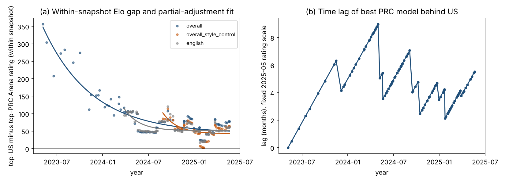
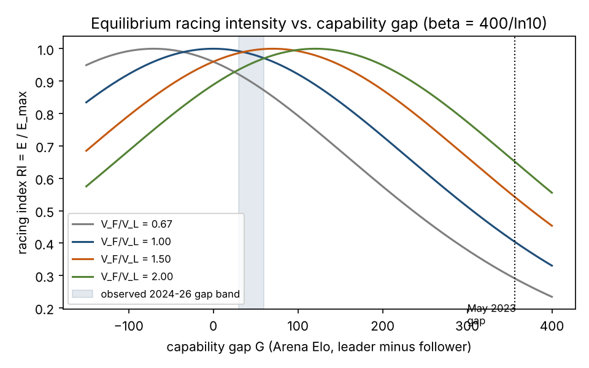
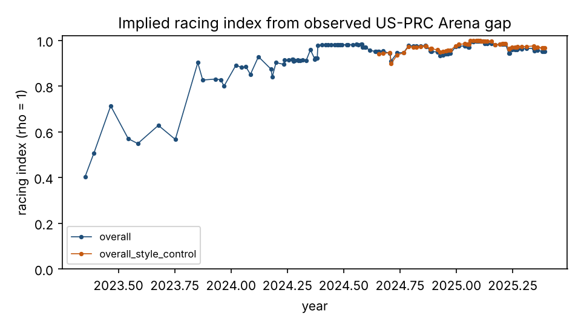
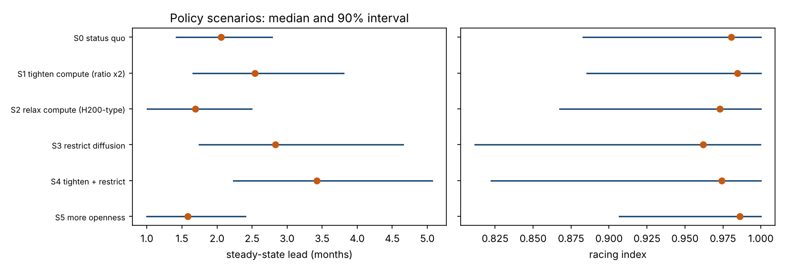
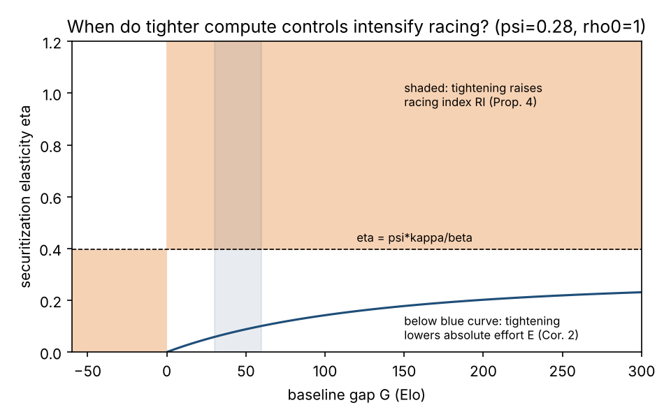

# Diffusion-Bounded Leads and Stake-Driven Racing: A Calibrated Model of US–China Frontier AI Competition

**Target venue:** AAAI/ACM Conference on AI, Ethics, and Society (AIES), full paper track

**Code and data:** `code/`, `results/`, `README.md` in this directory (all computed numbers are reproducible in under one minute of CPU time).

---

## Abstract

Will US–China competition in frontier AI turn into an arms race, and can US compute export controls keep a durable lead? We address one specific part of this question: how the capability gap between the two countries' best models is set, and how that gap, together with what each side has at stake, determines how hard both sides race. We make three contributions. (i) **Measurement.** Using 117 public LMArena leaderboard snapshots (May 2023 to May 2025), we build a within-snapshot series of the gap between the best US model and the best model from the People's Republic of China (PRC). The gap fell from 356 Elo to a plateau. After May 2024 it averages 61 Elo (SD 21), and its trend is not distinguishable from zero (−7 Elo/yr, 90% CI −33 to +15). A partial-adjustment fit gives a steady-state gap of 43 Elo (90% CI 22–57) and a convergence half-life of about 4.4 months. A value reported independently for March 2026 (39 Elo, Stanford AI Index 2026) falls inside this band. (ii) **Theory.** We build a two-channel catch-up model. Compute is rival and excludable, and it reaches capability with a pass-through ψ. Algorithmic knowledge diffuses at rate δ. We couple this model with a handicapped Tullock contest. In closed form, the normalized racing intensity is RI = sech²(½(G/β − ln ρ)), where G is the capability gap, β is the contest's noise scale and ρ is the follower's stake relative to the leader's. Racing peaks at a gap G† = β ln ρ, not at parity. Tighter compute controls raise racing whenever they raise the follower's stakes faster than they widen the gap (a "securitization reversal"). (iii) **Calibration.** We convert Elo to effective compute using published growth rates. Under this conversion, the observed US compute advantage (Pilz et al. report a US-to-PRC ratio of roughly 5×) implies a compute-only gap of 158 Elo (90% interval 80–260). The observed gap is 30–60 Elo, so at most about 28% of the compute advantage (median bound; 90% interval 15–60%) passes through to frontier capability. In Monte Carlo policy scenarios, halving the PRC's relative compute raises the US level-equivalent lead by a median of about 0.5 months. Total equilibrium racing effort rises in 94% of draws under our priors, and partial rank correlation shows that this sign depends almost entirely on the unmeasured securitization elasticity. We state four falsifiable predictions, each with a test protocol.

## 中文摘要

中美前沿AI竞争是否会演变为军备竞赛？美国的算力出口管制能否维持持久领先？本文只研究其中一个可检验的子问题：两国最佳模型之间的能力差距由什么决定，以及该差距与双方"赌注"如何共同决定竞赛强度。本文有三项贡献。(1) 测量：基于117个公开的LMArena排行榜快照（2023年5月至2025年5月），我们构建了美国最佳模型与中国最佳模型之间的同期Elo差距序列。差距从356 Elo降至一个平台：2024年5月以后均值为61 Elo（标准差21），趋势与零无显著差异（−7 Elo/年，90%置信区间−33至+15）。部分调整模型估计的稳态差距为43 Elo（90%区间22–57），收敛半衰期约4.4个月；斯坦福《AI指数2026》独立报告的2026年3月差距（39 Elo）落在该区间内。(2) 理论：我们提出"双通道追赶模型"。算力是竞争性、可排他的资源，以传导系数ψ转化为能力；算法知识以速率δ扩散。将其与带先发优势的Tullock竞赛结合，得到闭式解：标准化竞赛强度 RI = sech²(½(G/β − ln ρ))，其中G为能力差距，β为竞赛噪声尺度，ρ为追赶方相对于领先方的赌注之比。竞赛强度在差距 G† = β ln ρ 处最大，而非在能力持平时最大；当收紧管制使追赶方赌注上升的速度快于差距扩大的速度时，管制反而加剧竞赛（"安全化逆转"）。(3) 校准：按已发表的增长率把Elo换算为有效算力后，美国约5倍的算力优势（Pilz等人估计）对应仅由算力决定的差距约158 Elo（90%区间80–260），而实际差距只有30–60 Elo。这意味着美国算力优势最多约28%（上界中位数；90%区间15–60%）转化为前沿能力。蒙特卡洛政策情景显示：把中国相对算力减半，美国的"等效领先时间"中位数仅增加约0.5个月；在我们的先验下，94%的抽样中总竞赛投入上升，而偏秩相关分析表明这一符号几乎完全取决于尚未测量的"安全化弹性"。文末给出四项可证伪预测及其检验方案。

---

## 1 Introduction

Public argument about the US–China AI race usually treats two claims as one. The first is that the United States can and should keep a durable capability lead, mainly by denying the PRC advanced chips. The second is that an "AI arms race" is either happening or about to happen. Export controls on advanced computing items began with the US Bureau of Industry and Security (BIS) rule of 7 October 2022 [BIS 2022; Allen 2022]. They have since been tightened and partly relaxed: in December 2025 the US administration announced it would license Nvidia H200 sales to approved Chinese customers in exchange for a 25% payment [CNBC 2025]. Meanwhile, measured capability gaps have narrowed sharply. The Stanford AI Index 2025 reported that the Chatbot Arena gap between the top US and top Chinese model fell from 9.26% in January 2024 to 1.70% in February 2025 [Stanford HAI 2025]. The 2026 edition reported a 39-point gap in March 2026 and described the gap as "effectively closed" [Stanford HAI 2026]. Epoch AI estimates that Chinese models have trailed the US frontier on its Capabilities Index by about seven months on average since 2023 (range 4–14 months) [Emberson 2026].

These observations fit together awkwardly. The United States hosts about 75% of measured AI-supercomputer performance and China about 15% [Pilz et al. 2025]. Yet the capability gap is a few months. If the lead is that small, what do controls buy? Does a small gap make an arms race more likely or less likely? The formal literature on AI races [Armstrong et al. 2016; Han et al. 2020; Stafford et al. 2022; Emery-Xu et al. 2023] mostly treats the capability gap as a fixed parameter or as private information. In the actual policy debate, the gap is the thing policy is trying to move. On the other side, the empirical work tracking the gap [Stanford HAI 2025; Emberson 2026] has no model connecting the gap to policy levers or to racing incentives.

**Sub-question.** We ask a narrow question that we can make progress on: *Given public leaderboard data, what determines the steady-state US–PRC frontier capability gap, how much of the US compute advantage passes through to that gap, and under what conditions do compute controls raise or lower equilibrium racing intensity?*

**Contributions.**

1. **A reproducible gap series and its dynamics (empirical, computed).** From 117 LMArena snapshots we build the top-US minus top-PRC Elo gap, together with a fixed-scale time-lag series. We fit a partial-adjustment (Nelson–Phelps-type) model and test whether the gap has plateaued. The gap converges to a stationary band of about 40–60 Elo, with a half-life of months, not years (Section 5.1).
2. **A two-channel catch-up model with closed-form steady state (theory).** Compute enters capability as a level term scaled by a pass-through ψ. Algorithmic knowledge closes at a diffusion rate δ. Proposition 1 separates what controls can and cannot do: a one-off knowledge shock decays with half-life ln 2/δ; a sustained compute-ratio change shifts the gap permanently by ψκΔℓ; only a persistent divergence in compute *growth rates* produces a widening lead (Section 3).
3. **Closed-form racing intensity and a securitization reversal (theory).** In a handicapped Tullock contest whose head start comes from the capability gap, we derive RI = sech²(½(G/β − ln ρ)) (Proposition 2). Racing peaks at G† = β ln ρ (Proposition 3). We give exact sign conditions under which tighter controls raise the racing index (Proposition 4) and total racing effort (Corollary 2). Closed forms are checked numerically to 10⁻¹⁴ (Section 4).
4. **A data-implied bound on compute pass-through and calibrated policy scenarios (quantitative model).** Converting Elo to effective compute with published compute and algorithmic growth rates, we bound ψ ≤ 0.28 (median; 90% interval 0.15–0.60). We then evaluate six policy scenarios with 200,000-draw Monte Carlo and partial rank correlation sensitivity (Section 5).
5. **Four falsifiable predictions with test protocols** (Section 6).

We do not claim to forecast the whole US–China AI relationship. Our results apply to civilian frontier language models as measured by human-preference leaderboards. Military AI, chip supply chains as such, and catastrophic-risk dynamics are outside our measurement and enter only through the model's stakes parameter.

## 2 Related Work

**AI race models.** Armstrong, Bostrom and Shulman [2016] model teams that trade safety for speed. In their model, more teams, more enmity and, counter-intuitively, more information about capabilities raise disaster risk. Han et al. [2020] study evolutionary dynamics of an idealized AI race and show that the case for regulation depends on the time horizon of the race. Stafford, Trager and Dafoe [2022] analyze risky technology races between states with a safety–performance trade-off and find that the effect of a laggard catching up depends on enmity. Emery-Xu, Park and Trager [2023] show that information about capabilities can be hazardous or beneficial depending on how decisive the race is. Jensen, Emery-Xu and Trager [2023] study compute pricing as a lever on the "safety tax". Our contest component is deliberately simpler than these models: it has no explicit safety choice. Instead, we make the capability gap endogenous to compute and diffusion policy and calibrate it to data, which these papers do not do. We read "racing intensity" as the resources diverted into winning, which these models connect to safety corner-cutting.

**Arms-race skepticism and strategic frameworks.** Scharre [2021] argues that AI competition is not an arms race in the classical sense but that *perceptions* of a race can cause corner-cutting. Horowitz [2018] analyzes AI's effect on the balance of power through adoption capacity. Ding and Dafoe [2023] argue, using electricity as an analogy, that general-purpose technologies transform military power through slow, economy-wide diffusion. Hendrycks, Schmidt and Wang [2025] propose "Mutual Assured AI Malfunction" deterrence. Our securitization parameter η formalizes one mechanism in Scharre's argument: policy actions change perceived stakes, and stakes drive racing more than the gap does.

**Contest theory.** We use the Tullock [1980] lottery contest with asymmetric valuations and a multiplicative head start. Equilibria of asymmetric two-player contests are classical [Dixit 1987; Baik 1994; Konrad 2009]. As far as we know, the sech² representation of normalized total effort and its use to map an Elo-measured capability gap to racing intensity are new to this application. The mathematics is elementary.

**Technology diffusion and catch-up.** Our knowledge channel is the Nelson–Phelps [1966] catch-up equation, also used in models of cross-country technology diffusion [Barro and Sala-i-Martin 1997]. The new step is to place it next to a non-diffusing, excludable input (compute) whose pass-through we bound empirically.

**Measuring the frontier and compute.** Training compute for notable models has grown about 4–5× per year [Sevilla and Roldán 2024]. Compute needed for a fixed language-modelling performance level has halved roughly every 8 months [Ho et al. 2024]. Pilz et al. [2025] estimate national shares of AI-supercomputer performance. Chiang et al. [2024] describe Chatbot Arena's pairwise human-preference methodology. Singh et al. [2025] document ways Arena rankings can be distorted (private testing, unequal sampling). The AI Index [Stanford HAI 2025; Stanford HAI 2026] and Epoch AI [Emberson 2026] provide US–China gap estimates, which we use as external checks. Open-weight Chinese releases such as DeepSeek-R1 [DeepSeek-AI 2025] illustrate the knowledge-diffusion channel running in both directions.

**Gap addressed.** No existing work (i) estimates gap *dynamics* from a long public panel, (ii) separates excludable from diffusing inputs in a way the data can constrain, and (iii) links the resulting gap to equilibrium racing in closed form. This paper does all three, at the cost of strong simplifying assumptions, which we list in Section 8.

## 3 A Two-Channel Catch-Up Model

**Setup.** There are two actors, a leader L (US) and a follower F (PRC). Frontier capability K_i(t) is measured on an Elo-like interval scale. We assume capability is approximately linear in the log of *effective compute*: physical training compute multiplied by algorithmic efficiency. Let κ denote Elo per order of magnitude (OOM) of effective compute. Write

  K_i = κ·log₁₀ C_i + A_i,

where C_i is frontier-relevant physical compute and A_i is the algorithmic/know-how stock, expressed in Elo. Define the compute deficit ℓ = log₁₀(C_L/C_F) ≥ 0 and the knowledge gap X = A_L − A_F.

**Compute channel (rival, excludable).** Chips cannot be copied. A compute deficit ℓ therefore reduces the follower's own-trained capability by κℓ. The follower can partly avoid this by distilling from leader outputs, training more efficiently, or allocating a larger share of national compute to frontier runs. We collect these effects in a *pass-through* ψ ∈ [0, 1]. The compute contribution to the gap is ψκℓ.

**Knowledge channel (non-rival, diffusing).** Algorithms, training recipes, and open-weight artefacts diffuse through publications, open weights, talent movement and reverse engineering. Following Nelson and Phelps [1966]:

  dX/dt = Δa − δX,

where Δa ≥ 0 is the leader's advantage in its own algorithmic innovation rate and δ > 0 is the diffusion rate.

**Gap.** G(t) = ψκℓ(t) + X(t).

**Proposition 1 (diffusion-bounded lead).** Suppose ψ, κ, Δa and δ are constant.
(a) If ℓ is constant, G(t) → G* = ψκℓ + Δa/δ monotonically at exponential rate δ. The half-life is ln 2/δ.
(b) A one-off shock to the knowledge gap, X(0) → X(0) + s, raises G by s·e^{−δt}. Its cumulative effect is s/δ Elo-years.
(c) A permanent shift of the compute deficit, ℓ → ℓ + Δℓ, raises G* by ψκΔℓ, with no decay, for as long as the shift persists.
(d) If the compute deficit grows, dℓ/dt = c > 0 (the follower's frontier compute grows more slowly), then G(t) grows without bound at asymptotic rate ψκc.

*Proof.* The ODE for X is linear: X(t) = Δa/δ + (X(0) − Δa/δ)e^{−δt}. Parts (a) and (b) follow directly, and the integral of s·e^{−δt} is s/δ. For (c), ℓ enters G additively and does not appear in the X dynamics. For (d), G(t) = ψκ(ℓ₀ + ct) + X(t) and X(t) converges. ∎

*Interpretation.* Controls that restrict *knowledge* (for example, restrictions on publishing, open weights or distillation) act through δ and Δa. Controls that restrict *compute* act through ℓ, and their effect is scaled by ψ. Only a sustained difference in compute *growth* (part d) produces a lead that keeps widening. A one-time cut in the follower's compute stock or flow, if the follower then grows at the same rate as the leader, buys a fixed lead of ψκΔℓ, not a widening one. In "time-lead" units, a gap G corresponds to a level-equivalent lag τ = G/g, where g is the frontier's growth rate in Elo per year.

**Lemma (lead-gain decomposition).** Let G_obs be the observed steady gap. Then Δa/δ = G_obs − ψκℓ ≥ 0, which requires ψ ≤ ψ_max ≡ G_obs/(κℓ). Multiplying δ by m < 1 (diffusion restriction) raises G* by (G_obs − ψκℓ)(1/m − 1). Tightening compute by Δℓ raises it by ψκΔℓ. Holding G_obs fixed, the two lever effects move in opposite directions in ψ: the less compute passes through, the more of the gap is knowledge, and the more a diffusion restriction can buy. ∎

So the data on G_obs, κ and ℓ constrain which lever can be potent, even though ψ itself is not point-identified.

## 4 Racing Intensity in a Handicapped Contest

**Contest.** Both actors choose a racing effort x_i ≥ 0. This is resources devoted to winning a decisive contest (for example, being first to a strategically decisive capability), and it is diverted from other uses, including safety. The leader's win probability is

  p_L = h·x_L / (h·x_L + x_F),  with head start h = exp(G/β),

where β > 0 is the contest's noise scale. Payoffs are V_L·p_L − x_L and V_F·(1 − p_L) − x_F. Let ρ ≡ V_F/V_L denote relative stakes. With β = 400/ln 10 ≈ 173.7, the head start equals the Bradley–Terry odds implied by the Elo gap. In that case, a contest with equal efforts reproduces pairwise-preference win odds. We use this as a reference calibration and vary β by a factor of 4.

**Proposition 2 (equilibrium and racing index).** The unique interior Nash equilibrium is

  x_L* = V_L·hρ/(h+ρ)²,  x_F* = ρ·x_L*,  p_L* = h/(h+ρ),

and total effort is E = V_L·hρ(1+ρ)/(h+ρ)². Over h, E is maximized at h = ρ, where E_max = (V_L+V_F)/4. The normalized racing index is

  RI ≡ E/E_max = 4hρ/(h+ρ)² = sech²(½(G/β − ln ρ)).

*Proof.* The first-order conditions are V_L·h·x_F/S² = 1 and V_F·h·x_L/S² = 1, with S = h·x_L + x_F. Dividing them gives x_F = ρ·x_L. Substituting yields x_L*. Payoffs are strictly concave in own effort, so the equilibrium is unique. Maximizing h/(h+ρ)² gives h = ρ. Finally, 4ab/(a+b)² = sech²(½ ln(a/b)). ∎

*Numerical verification (computed).* For 24 (h, ρ) pairs with h ∈ [0.5, 10] and ρ ∈ [0.5, 3], we solved the best-response fixed point by bracketed root-finding. The maximum absolute deviation from the closed form was 8.6×10⁻¹⁵. A grid search over 200,001 unilateral deviations found no profitable deviation (maximum gain 4.4×10⁻¹⁶). Total effort peaks numerically at h = 0.5001, 1.000 and 1.9997 for ρ = 0.5, 1 and 2 (`results/contest_check.json`). Naive damped best-response iteration does not converge for strongly asymmetric cases (h = 10, ρ = 0.5); it cycles. This is why we used root-finding.

**Proposition 3 (racing-maximizing gap).** RI is maximized at G† = β ln ρ and is strictly decreasing in |G − G†|. With the Bradley–Terry reference β, G† = 70 Elo when ρ = 1.5 and 120 Elo when ρ = 2 (computed). *Proof:* sech² is maximized at 0 and is even and unimodal. ∎

*Interpretation.* Racing is most intense when the leader's capability head start exactly offsets the follower's higher stakes, not when capabilities are equal. If the PRC values the contest moderately more than the US does (ρ ≈ 1.5), the gap that maximizes racing is about the size of the gap we observe (Section 5).

**Proposition 4 (securitization reversal, racing index).** Suppose compute controls change the deficit ℓ and (i) shift the steady gap by ∂G/∂ℓ = ψκ and (ii) change relative stakes by ∂ln ρ/∂ℓ = η ≥ 0. We call η the *securitization elasticity*: how much the follower's stake rises per OOM of denial. Let z = G/β − ln ρ. Then dRI/dℓ > 0 if and only if sign(z)·(ψκ/β − η) < 0. In particular, when the leader is "ahead of its stakes" (z > 0), tightening raises racing intensity if and only if η > ψκ/β.

*Proof.* RI = sech²(z/2) is decreasing in |z|, and dz/dℓ = ψκ/β − η. ∎

For a discrete policy step, this rule is exact at the midpoint of z. In the Monte Carlo below it classified the RI response correctly in 100% of 200,000 draws (computed).

**Corollary 2 (absolute effort).** Normalize V_L = 1. Then

  d ln E/dℓ = (ψκ/β)·(ρ − h)/(h + ρ) + η·[(h − ρ)/(h + ρ) + ρ/(1 + ρ)].

At h = ρ (the racing-maximizing gap), d ln E/dℓ = ηρ/(1+ρ) > 0 for any η > 0. Near the racing-maximizing gap, total racing effort is therefore insensitive to the gap to first order and sensitive to stakes to first order. Evaluated at scenario midpoints, the marginal rule matched the sign of the discrete effort change in 99.999% of Monte Carlo draws (computed).

## 5 Data, Calibration and Results

Every number in this section is either **[computed]**, meaning it was produced by `code/arena_gap.py` or `code/race_model.py` and saved under `results/`, or **[cited]**, meaning it comes from the cited source.

### 5.1 The US–PRC gap on LMArena

**Data.** We use 117 LMArena (Chatbot Arena) leaderboard snapshots from 8 May 2023 to 22 May 2025. These come from a public, MIT-licensed JSON conversion (github.com/nakasyou/lmarena-history) of the official leaderboard files that LMArena publishes on Hugging Face. Our environment could not reach later official snapshots, so for 2025–2026 we rely on cited values. We classify models by developer headquarters using name prefixes. PRC developers: Zhipu/GLM, Alibaba/Qwen, DeepSeek, 01.AI/Yi, Tencent/Hunyuan, StepFun, Shanghai AI Lab/InternLM. US developers: OpenAI, Anthropic, Google, Meta, xAI, Nvidia, Microsoft, Amazon, IBM, and others. European, Canadian, Israeli and other developers, models with ambiguous affiliation, and anonymous code names are excluded from both groups. The two top-ranked models per snapshot in each group are unambiguous, so the classification of marginal models does not affect the gap series.

**Measures.** (a) *Within-snapshot gap*: the top-US rating minus the top-PRC rating in the same snapshot and category ("overall", "overall with style control" from August 2024, and "English" from March 2024). Ratings in one snapshot share a scale, so this gap is comparable over time even though absolute ratings are re-anchored between snapshots. (b) *Fixed-scale lag*: using the final snapshot's ratings for all models and each model's first appearance date, the number of months since a US model first matched the best PRC model then available.

**Results [computed].** The overall gap was 356 Elo in May 2023, when the best PRC entry was ChatGLM-6B. It fell to 50 Elo by May 2024 (GPT-4o vs. Yi-Large-preview), reached a minimum of about 22 Elo in February 2025 (Gemini-2.0-Flash-Thinking vs. DeepSeek-R1), and stood at 78 Elo in the final snapshot (Gemini-2.5-Pro vs. DeepSeek-V3-0324) (Figure 1a). From May 2024 to May 2025 (n = 86 snapshots), the overall gap averaged 61 Elo (SD 21, range 22–107). Its linear trend was −7 Elo/yr, with a 90% moving-block-bootstrap CI of −33 to +15, so we cannot reject a flat gap. The English-only gap averaged 57 Elo with a mildly negative trend (−23; CI −45 to −2). The style-controlled gap averaged 53 Elo (trend −47; CI −129 to +14).

We fit G(t) = G* + (G₀ − G*)e^{−δt}, which is Proposition 1(a) with constant ℓ, by nonlinear least squares, using a moving-block bootstrap (block length 6) on residuals:

| series | n | G* (Elo) | 90% CI | δ (1/yr) | 90% CI | half-life |
|---|---|---|---|---|---|---|
| overall, 2023-05 to 2025-05 | 117 | 43.3 | 21.9–57.3 | 1.88 | 1.41–2.41 | 4.4 months |
| overall, 2024-01 to 2025-05 | 105 | 55.6 | 24.5–65.5 | 3.63 | 1.23–6.70 | 2.3 months |
| English, 2024-03 to 2025-05 | 94 | 51.3 | 31.0–59.1 | 6.14 | 1.56–14.5 | 1.4 months |
| style control, 2024-08 to 2025-05 | 57 | 42.3 | not identified | 6.17 | not identified | — |

The steady-state gap is robust at about 40–55 Elo across specifications. The diffusion rate is poorly identified. Every specification puts the half-life below about 6 months, but the full-sample estimate depends heavily on the 2023 entry phase, when strong PRC models had not yet been submitted. The style-control series is too short to identify δ.

**External checks [cited].** The AI Index 2026 reports a style-controlled gap of 39 Arena points in March 2026 (Claude Opus 4.6 at 1,503 vs. Dola-Seed-2.0 Preview at 1,464), and 5 points in February 2025 (o1 vs. DeepSeek-R1) [Stanford HAI 2026]. The March 2026 value lies inside our fitted steady-state band, about ten months after our data end. This is weak out-of-sample support for a stationary gap. The February 2025 value matches our observed trough.

**Time lag [computed].** On the fixed May 2025 rating scale, the best PRC model trailed the first US model of equal rating by 4.8 months on average (maximum 9.0 months, last value 5.5 months; Figure 1b). This is the same order as Epoch AI's ECI-based estimate of a seven-month average lag (range 4–14) [Emberson 2026]. The frontier record-setting slope on the fixed scale is g = 262 Elo/yr (90% bootstrap CI 228–295). The fitted G* = 43 Elo therefore corresponds to a level-equivalent lag of G*/g ≈ 2.0 months. This is shorter than the record-based lag because the US frontier advances in discrete jumps: the record-based measure counts time since the last jump.

**Implied intrinsic growth gap [computed, model-dependent].** Proposition 1(a) implies Δg = δG*. At the full-sample point estimates this is 81 Elo/yr, or 31% of the frontier slope. In other words, without diffusion the follower's own frontier progress would run at roughly 69% of the leader's rate. This figure inherits the weak identification of δ and should be read as illustrative.

*Figure 1. (a) Within-snapshot top-US minus top-PRC Arena rating, by category, with partial-adjustment fits. (b) Fixed-scale time lag of the best PRC model.*

### 5.2 How much of the compute advantage reaches capability?

**Converting Elo to effective compute.** Effective compute at the frontier grows at log₁₀(c) + (12/H)·log₁₀ 2 OOM per year. Here c is the annual multiplier of training compute, 4.1× (90% CI 3.7–4.6) [Sevilla and Roldán 2024; cited], and H is the algorithmic halving time, 8 months (95% CI about 5–14) [Ho et al. 2024; cited]. Dividing the frontier slope g by this rate gives κ, the Elo per OOM of effective compute. We sample g from its bootstrap CI, c uniformly on [3.7, 4.6], and H log-uniformly on [5, 14] months. This gives κ = 248 Elo/OOM (90% interval 193–311) [computed]. One caveat: Ho et al. measure *pre-training* efficiency, while Arena ratings also reflect post-training. If post-training raises the effective rate of algorithmic progress, κ is overstated, and the bound below on ψ is conservative (too high).

**Compute deficit.** Pilz et al. [2025] find that the US hosts about 75% and China about 15% of AI-supercomputer performance in their dataset (March 2025) [cited]. That is a ratio of about 5 (ℓ ≈ 0.70). Hosting location is not the same as frontier-run compute, because cloud access, smuggling and allocation between training and inference all intervene. We therefore sample the ratio log-uniformly on [2, 10] (ℓ ∈ [0.30, 1.00]).

**Result [computed].** The compute-only gap κℓ is 158 Elo (90% interval 80–260); at the point values κ = 246 and ℓ = 0.70 it is 172 Elo. Sampling G_obs uniformly on [30, 60] Elo, the pass-through bound ψ_max = G_obs/(κℓ) has a median of 0.28 (90% interval 0.15–0.60), and ψ_max < 0.5 in 89% of draws. At the point values with G_obs = 45, ψ_max = 0.26. **Under this calibration, at most roughly a quarter to a third of the US's measured compute advantage shows up as a frontier-capability gap.** The rest is absorbed by distillation, efficiency, differences in how compute is allocated to frontier runs, or measurement differences between national compute shares and frontier-run compute. This bound is the quantitative form of the observation that a 5× compute ratio coexists with a lag of a few months.

### 5.3 Racing intensity implied by the observed gap

Applying Proposition 2 with the reference β and ρ = 1 to the observed gap series, RI rose from 0.40 in May 2023 (gap 356 Elo) to 0.95 in May 2025. It averaged 0.97 over the last 12 months of the overall series and 0.97 for the style-controlled series [computed] (Figures 2–3). At a 45-Elo gap the leader's equilibrium win probability is only 0.56. In this model, then, **the closing of the capability gap during 2023–2024 moved the contest from a regime of moderate racing incentives into one near the theoretical maximum.** Once there, further narrowing or widening of the gap by tens of Elo changes RI by only a few percent. If ρ = 1.5, the racing-maximizing gap G† = 70 Elo is within the observed 2024–2025 range.

*Figure 2. Racing index RI as a function of the capability gap for several stake ratios ρ (β = 400/ln 10). The shaded band is the observed 2024–2026 gap.*

*Figure 3. Racing index implied by the observed Arena gap series (ρ = 1).*

### 5.4 Policy scenarios

**Design.** We draw 200,000 parameter vectors: g, κ and ℓ as in Section 5.2; G_obs ~ U[30, 60]; ψ ~ U[0, ψ_max]; Δa/δ = G_obs − ψκℓ; ρ₀ log-uniform on [2/3, 3/2]; η ~ U[0, 1] per OOM; β = 173.7 × log-uniform[0.5, 2]. The priors on ρ₀, η and β are assumptions, not estimates. Scenarios: **S0** status quo. **S1** tighten compute (ratio ×2, Δℓ = +0.30). **S2** relax compute, an H200-type licensing change (Δℓ ~ −U[0.1, 0.3]). **S3** restrict diffusion (δ × U[0.4, 0.7]). **S4** S1 + S3. **S5** more openness (δ × U[1.5, 2]). Under compute-policy changes, stakes move with ln ρ = ln ρ₀ + ηΔℓ. We report steady states.

**Results [computed]** (medians with 90% intervals; lead τ = 12G*/g in level-equivalent months; ΔE is the change in total racing effort relative to S0):

| scenario | gap G* (Elo) | lead τ (months) | racing index | P(leader wins) | ΔE vs S0 | P(ΔE > 0) |
|---|---|---|---|---|---|---|
| S0 status quo | 45 (31–58) | 2.06 (1.42–2.78) | 0.981 (0.883–1.000) | 0.57 (0.46–0.67) | — | — |
| S1 tighten compute | 55 (37–81) | 2.54 (1.65–3.80) | 0.984 (0.885–1.000) | 0.55 (0.43–0.67) | +8.8% (−0.4, +18.7) | 0.94 |
| S2 relax compute | 37 (22–53) | 1.69 (1.00–2.49) | 0.973 (0.868–1.000) | 0.58 (0.48–0.68) | −4.9% (−12.7, +0.1) | 0.05 |
| S3 restrict diffusion | 62 (39–100) | 2.84 (1.75–4.65) | 0.962 (0.812–1.000) | 0.60 (0.48–0.72) | −1.2% (−9.9, +0.3) | 0.13 |
| S4 tighten + restrict | 75 (50–108) | 3.42 (2.24–5.07) | 0.974 (0.822–1.000) | 0.58 (0.45–0.71) | +7.0% (−5.5, +17.4) | 0.82 |
| S5 more openness | 35 (22–51) | 1.58 (0.99–2.41) | 0.986 (0.907–1.000) | 0.55 (0.45–0.65) | +0.4% (−0.4, +3.5) | 0.80 |

Four patterns stand out.

1. **Leads are small under every lever.** Doubling the compute ratio adds a median of about 0.5 level-equivalent months of lead. Restricting diffusion adds about 0.8 months. Doing both adds about 1.4 months. None of these levers moves the contest out of the near-maximal racing regime.
2. **Compute tightening raises total racing effort in most draws, but only because of η.** The leader's win probability barely changes, and under S1 it even falls slightly in the median, because higher follower stakes raise follower effort.
3. **Diffusion restriction widens the lead more than compute tightening and, under our priors, does not raise stakes.** This holds by construction, since we did not attach a securitization response to diffusion restrictions. That modelling choice is itself an assumption that needs testing.
4. **Relaxing compute (S2) lowers racing effort.** The mechanism is mirrored: lower stakes outweigh a narrower gap.

**Sensitivity [computed].** Partial rank correlations of ΔE under S1 are: η +0.98, ψ −0.38, G_obs +0.12, ρ₀ −0.08, κ −0.08, ℓ +0.07, log β −0.06. The sign and size of the racing response to tighter controls are therefore governed almost entirely by the unmeasured securitization elasticity. The share of draws with ΔE > 0 is 0.72 for η ∈ [0, 0.2), 0.97 for η ∈ [0.2, 0.4), and ≥ 0.995 for η ≥ 0.4. For η < 0.05 the share is 0.42 for ΔE and 0.18 for the normalized RI. The RI threshold ψκ/β has median 0.18 (90% interval 0.02–0.67), and z > 0 at baseline in 83% of draws. For the lead gain from diffusion restriction, the partial rank correlations are: ψ −0.89, the δ-multiplier −0.72, G_obs +0.71, ℓ −0.61 and κ −0.44, consistent with the Lemma in Section 3.

*Figure 4. Policy scenarios: median and 90% interval of the steady-state lead and the racing index.*

*Figure 5. Shaded: (G, η) region where tightening raises the racing index (Proposition 4), at ψ = 0.28, κ = 246, ρ₀ = 1. Below the blue curve, tightening lowers absolute effort (Corollary 2). The grey band is the observed gap. At the observed gap, absolute effort rises once η exceeds about 0.05–0.1.*

## 6 Falsifiable Predictions and Test Protocol

The model and calibration imply four predictions. Each has a pre-specified test, and each would be falsified by a stated outcome.

**H1 (stationary gap).** Absent a structural change in diffusion, the style-controlled top-US minus top-PRC Arena gap stays in a band of about 20–80 Elo, with no sustained trend (|slope| < 30 Elo/yr), through December 2027. *Protocol:* monthly official leaderboard exports; the same classification rules and code (`arena_gap.py`); moving-block-bootstrap trend test on a rolling 12-month window. *Falsified if* the gap exceeds 120 Elo for six consecutive months, or a PRC model leads for six consecutive months. Either would imply a change in ψκℓ or in Δa/δ of a size the model attributes to sustained growth divergence (Proposition 1d).

**H2 (bounded compute-policy effects).** Compute-policy changes move the steady gap by at most ψκΔℓ. With ψ ≤ 0.3 and an H200-type relaxation of Δℓ ≈ 0.1–0.3, the gap should narrow by no more than about 7–22 Elo, with a delay of roughly one training cycle (6–12 months). *Protocol:* interrupted time series on the H1 series, pre-registered windows of December 2025–June 2026 (pre-period) and June 2026–June 2027 (post-period), with a placebo date test. *Falsified if* the post-period mean gap drops by more than 40 Elo with no concurrent diffusion shock.

**H3 (fast catch-up).** For each US frontier record on the Arena, the time until a PRC model comes within 25 Elo has a median of 6 months or less. Measures that cut diffusion lengthen this time, for example enforced anti-distillation terms or a sharp drop in US open-weight releases. *Protocol:* event-based catch-up durations from the leaderboard history, with a Kaplan–Meier estimate stratified by period. *Falsified if* the median catch-up time exceeds 12 months without such measures.

**H4 (stakes, not gap, drive racing).** Indicators of racing effort respond more to stake-raising events than to changes in the measured gap. Candidate indicators are announced state and corporate AI capital expenditure, compute-procurement programs, and AI-specific budget lines in both countries. Candidate stake-raising events are new controls, entity listings and public securitizing statements. *Protocol:* event study with ±90-day windows around (a) control announcements and (b) the largest month-on-month gap changes, comparing abnormal announced investment. *Falsified if* responses to gap changes are as large as or larger than responses to control events. This test also provides the first empirical handle on η.

## 7 Discussion

**Will US–China AI competition become an arms race?** In this model, yes in the narrow sense that matters for incentives, and largely already. The racing index moves from moderate to near its maximum once the capability gap falls below about 100 Elo. The data show the gap fell below that level in early 2024 and has stayed in a 20–110 Elo band since. Two further points follow. First, small changes in the gap matter less than is often assumed: within the observed band, policy levers move RI by at most a few percent. Second, total racing effort scales with the combined stakes (V_L + V_F)/4, and Corollary 2 shows that near parity it responds to stakes to first order. Whether the competition intensifies further therefore depends mainly on perceived stakes, not on who is a few months ahead. This is a formal version of Scharre's [2021] concern that *perceptions* of a race drive risky behaviour.

**What do compute controls buy?** Under our calibration, a modest and roughly fixed lead. A durable, widening lead requires a sustained difference in frontier-compute *growth* (Proposition 1d), and even then it is scaled down by a pass-through that the data bound at around 0.3 or less. Two policy implications follow, each conditional on the model's assumptions. (i) If the goal is a larger lead, restricting diffusion is at least as potent as restricting compute, and more potent the lower ψ is. But diffusion restrictions have costs to openness that we do not model, and they may also securitize. (ii) If the goal is to limit racing, the securitization elasticity η is the quantity to estimate and to manage. Controls framed and implemented in ways that raise the PRC's perceived stakes can raise total racing effort even as they widen the gap. The December 2025 H200 decision is, in this framework, a relaxation (S2): it should narrow the gap slightly and, if it lowers perceived stakes, lower racing effort. Analyst commentary that the August 2025 reversal of the H20 ban produced no sales because Chinese authorities raised security concerns and limited domestic purchases [Juricic 2025] suggests that the follower's stake response may not be symmetric. Our model does not capture that asymmetry.

**Relation to safety.** We have not modelled a safety choice explicitly. If racing effort displaces safety investment, as in Armstrong et al. [2016] and Stafford et al. [2022], then our findings translate directly: near parity, the joint risk from racing is close to its maximum and is driven by stakes. Emery-Xu et al. [2023] show that information about capabilities is hazardous mainly in decisive races. Our β plays the role of decisiveness, and our results hold across a 4× range of β because RI saturates near parity.

**What is new here and what is not.** The contest equilibrium is textbook. The catch-up ODE is from 1966. The new elements are: combining the two in a way that public data can constrain; the bound on compute pass-through; the sech² representation that makes the gap-to-racing mapping transparent; the securitization-reversal conditions; and the predictions with protocols.

## 8 Limitations

1. **Arena as the capability measure.** Human-preference ratings reflect style, language mix and voter population, as well as capability. They can be distorted by private testing and sampling asymmetries [Singh et al. 2025]. Style control and an English-only subset give similar steady-state gaps (Section 5.1), but agentic, scientific or military-relevant capabilities may show different gaps. Some PRC frontier models may be missing or delayed on the Arena.
2. **Data window.** Our own panel ends in May 2025, because the official snapshots after that date were not reachable from our environment. Values for 2026 are cited, not recomputed, and they use the style-control category.
3. **Identification of δ.** The diffusion rate is identified mainly from the 2023–2024 decline, which mixes genuine catch-up with *entry* of serious PRC models onto the leaderboard. The confidence intervals are wide, and the "implied intrinsic growth gap" is illustrative only. G* is better identified than δ.
4. **Linearity of Elo in log effective compute.** κ assumes that Arena ratings are linear in log effective compute over 2023–2025 and that pre-training algorithmic progress rates [Ho et al. 2024] apply. Both are approximations. A different κ rescales ψ_max proportionally.
5. **Compute ratio.** National shares of AI-supercomputer performance [Pilz et al. 2025] are a proxy for frontier-training compute. Allocation to inference, foreign cloud use and smuggling are not observed. We address this only through a wide prior.
6. **Contest abstraction.** The contest is static, risk-neutral and two-player, with a single prize and linear costs. It omits sabotage and preventive action [Hendrycks et al. 2025], alliances, third countries, and dynamic investment. The stake ratio ρ, the securitization elasticity η and the noise scale β are set by assumed priors. The headline "P(ΔE > 0) = 0.94" for tightening is driven by the prior on η and should not be read as an estimate. The robust result is the *conditional* one in Proposition 4 and Corollary 2.
7. **Classification.** Assignment by headquarters ignores multinational teams and models trained abroad. The top-ranked models in each group are unambiguous, but the attribution of the underlying R&D is not.
8. **Scope.** We say nothing about military AI adoption, chip manufacturing capacity (including domestic PRC accelerators beyond their effect on ℓ), or catastrophic misuse.

## 9 Conclusion

Using a public leaderboard panel, a two-channel catch-up model and a handicapped contest, we find the following. The US–PRC frontier gap behaves like a diffusion-bounded steady state of roughly 40–60 Arena Elo, which corresponds to about two level-equivalent months. The US compute advantage passes through to this gap weakly (ψ ≲ 0.3). At this gap, equilibrium racing incentives are near their maximum, and policy changes the *amount* of racing mainly through stakes, not through the gap. Whether the competition becomes a more dangerous arms race therefore depends mostly on a quantity, the securitization elasticity, that nobody has yet measured. We give a protocol (H4) for measuring it, and three further predictions (H1–H3) that are checkable on public data in 2026–2027.

## References

Allen, G. C. (2022). *Choking off China's Access to the Future of AI.* Center for Strategic and International Studies, 11 October 2022. https://www.csis.org/analysis/choking-chinas-access-future-ai

Armstrong, S., Bostrom, N., & Shulman, C. (2016). Racing to the precipice: a model of artificial intelligence development. *AI & Society*, 31(2), 201–206. (FHI Technical Report 2013-1.)

Baik, K. H. (1994). Effort levels in contests with two asymmetric players. *Southern Economic Journal*, 367–378.

Barro, R. J., & Sala-i-Martin, X. (1997). Technological diffusion, convergence, and growth. *Journal of Economic Growth*, 2(1), 1–26.

Bureau of Industry and Security [BIS] (2022). Commerce Implements New Export Controls on Advanced Computing and Semiconductor Manufacturing Items to the People's Republic of China (PRC). Press release and interim final rule, 7 October 2022. U.S. Department of Commerce.

Chiang, W.-L., Zheng, L., et al. (2024). Chatbot Arena: An open platform for evaluating LLMs by human preference. *Proceedings of the 41st International Conference on Machine Learning (ICML)*. arXiv:2403.04132.

CNBC (2025). Trump: Nvidia can sell H200 AI chips to China if U.S. gets 25% cut. 8 December 2025. https://www.cnbc.com/2025/12/08/trump-nvidia-h200-sales-china.html

DeepSeek-AI (2025). DeepSeek-R1: Incentivizing reasoning capability in LLMs via reinforcement learning. arXiv:2501.12948. (Journal version: DeepSeek-R1 incentivizes reasoning in LLMs through reinforcement learning, *Nature*, 2025.)

Ding, J., & Dafoe, A. (2023). Engines of power: Electricity, AI, and general-purpose, military transformations. *European Journal of International Security*, 8(3), 377–394.

Dixit, A. (1987). Strategic behavior in contests. *American Economic Review*, 77(5), 891–898.

Emberson, L. (2026). Chinese AI models have lagged the US frontier by 7 months on average since 2023. Epoch AI Data Insight, 2 January 2026. https://epoch.ai/data-insights/us-vs-china-eci

Emery-Xu, N., Park, A., & Trager, R. F. (2023). Uncertainty, information, and risk in international technology races. *Journal of Conflict Resolution*.

Han, T. A., Pereira, L. M., Santos, F. C., & Lenaerts, T. (2020). To regulate or not: A social dynamics analysis of an idealised AI race. *Journal of Artificial Intelligence Research*, 69, 881–921.

Hendrycks, D., Schmidt, E., & Wang, A. (2025). Superintelligence strategy: Expert version. arXiv:2503.05628.

Ho, A., Besiroglu, T., et al. (2024). Algorithmic progress in language models. arXiv:2403.05812.

Horowitz, M. C. (2018). Artificial intelligence, international competition, and the balance of power. *Texas National Security Review*, May 2018. https://tnsr.org/2018/05/artificial-intelligence-international-competition-and-the-balance-of-power

Jensen, M., Emery-Xu, N., & Trager, R. (2023). Industrial policy for advanced AI: Compute pricing and the safety tax. arXiv:2302.11436.

Juricic, L. (2025). Trump allows Nvidia to ship H200 chips to China with 25% tariff. Investing.com (syndicated by Yahoo Finance), December 2025. https://finance.yahoo.com/news/trump-allows-nvidia-ship-h200-220949133.html

Konrad, K. A. (2009). *Strategy and Dynamics in Contests.* Oxford University Press.

Nelson, R. R., & Phelps, E. S. (1966). Investment in humans, technological diffusion, and economic growth. *American Economic Review*, 56(1/2), 69–75.

Pilz, K. F., Sanders, J., Rahman, R., & Heim, L. (2025). Trends in AI supercomputers. arXiv:2504.16026.

Scharre, P. (2021). Debunking the AI arms race theory. *Texas National Security Review*, 4(3), 121ff. https://tnsr.org/2021/06/debunking-the-ai-arms-race-theory

Sevilla, J., & Roldán, E. (2024). Training compute of frontier AI models grows by 4–5x per year. Epoch AI, 28 May 2024. https://epoch.ai/publications/training-compute-of-frontier-ai-models-grows-by-4-5x-per-year

Singh, S., Nan, Y., Wang, A., D'Souza, D., Kapoor, S., Üstün, A., Koyejo, S., Deng, Y., Longpre, S., Smith, N. A., Ermis, B., Fadaee, M., & Hooker, S. (2025). The leaderboard illusion. arXiv:2504.20879.

Stafford, E., Trager, R. F., & Dafoe, A. (2022). Safety not guaranteed: International strategic dynamics of risky technology races. Working paper, Centre for the Governance of AI. https://www.governance.ai/research-paper/safety-not-guaranteed-international-strategic-dynamics-of-risky-technology-races

Stanford HAI (2025). *The AI Index 2025 Annual Report.* AI Index Steering Committee, Institute for Human-Centered AI, Stanford University. https://hai.stanford.edu/ai-index/2025-ai-index-report

Stanford HAI (2026). *The 2026 AI Index Report* (Technical Performance chapter). Institute for Human-Centered AI, Stanford University. https://hai.stanford.edu/ai-index/2026-ai-index-report

Tullock, G. (1980). Efficient rent seeking. In J. M. Buchanan, R. D. Tollison, & G. Tullock (Eds.), *Toward a Theory of the Rent-Seeking Society* (pp. 97–112). Texas A&M University Press.

**Data source.** Nakamura, S. (2024–2025). lmarena-history: JSONized lmarena.ai score data (MIT License). https://github.com/nakasyou/lmarena-history (accessed 22 November 2026; derived from the official lmarena-ai/chatbot-arena-leaderboard Hugging Face space).
