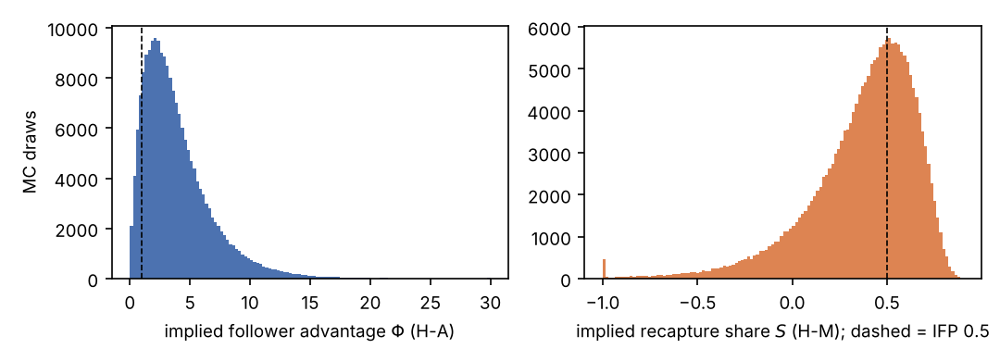
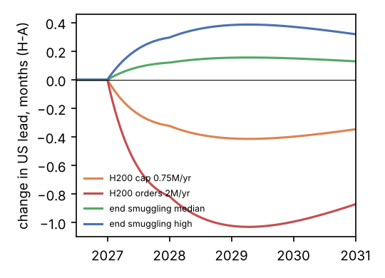
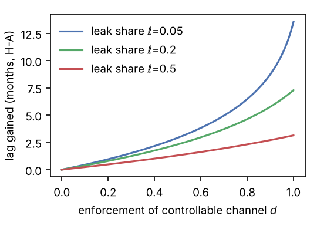
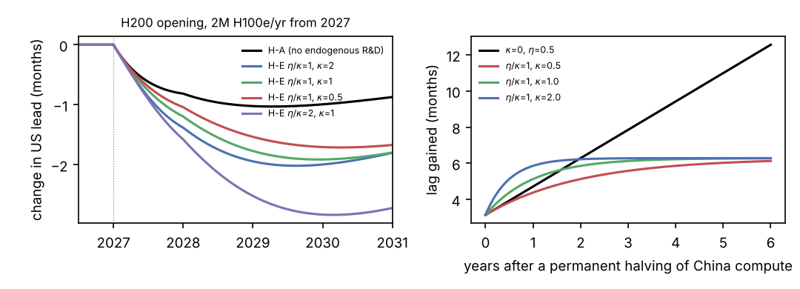
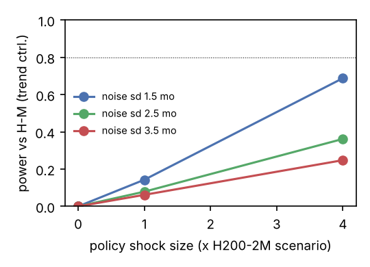

# Logarithmic Leverage: How Much Frontier-AI Lag Do Chip Export Controls Buy, and Why Lag Data Cannot Yet Tell Us

**Target venue:** AAAI/ACM Conference on AI, Ethics, and Society (AIES), main track (socio-technical / policy modelling)

---

## Abstract

Whether AI chip export controls "work" is usually argued from two observations that point in opposite directions: the United States holds several times more AI compute than China, yet Chinese models trail the US frontier by only about seven months. We give a model that connects the two and use it to say what each kind of evidence can and cannot show. Lemma 1 is a lag identity. If capability is any increasing function of log effective compute, the capability lag (in time) equals the log compute ratio, plus the follower's algorithmic-efficiency gap, minus an imitation advantage, all divided by the growth rate G of frontier effective compute. Using sourced rates (frontier training compute about 5x per year; algorithmic efficiency halving about every 8 months), G ≈ 2.65 per year. So a tenfold compute advantage is worth about 10.4 months of lag and halving China's compute is worth about 3.1 months. We call this *logarithmic leverage*. We derive five further results. (i) A leakage ceiling: when a share ℓ of counterfactual compute cannot be controlled, the lag that controls can buy is bounded by ln(1/ℓ)/G, and the value of enforcement is convex. (ii) A stock filter: with installed-base growth γ and depreciation δ, a change in chip flows reaches lag with a half-life of ln2/(γ+δ), about 9 months at current growth. (iii) Endogenous follower R&D with Nelson–Phelps catch-up raises the long-run lag elasticity by a factor (1+η/κ), and the lag grows without bound if diffusion stops (κ=0). (iv) Two margins: lag is logarithmic in compute, but deployment capacity is linear in it. (v) Non-identification: while the compute ratio trends smoothly, lag time series cannot distinguish the three structural hypotheses. We calibrate to public estimates. Controls since 2022 have raised the US:China compute ratio by a factor of about 2.4 (median Δln R = 0.86). Under exogenous diffusion this has bought about 3.8 months of lag (90% interval 2.3–5.5). It is 1.8 months (0.9–3.3) if distillation recaptures half the lead, and about 7.6 months in the long run under endogenous R&D. Opening H200 sales at the reported order volume (2M/yr) would raise China's AI compute stock by about 25% by end-2028 but cost only about 0.5–1.0 months of lag (up to about 2.7 under endogenous R&D). The observed 7-month lag implies a follower imitation advantage of Φ ≈ 3.2 (90% interval 0.7–9.5) under exogenous diffusion. A Monte Carlo power analysis shows that naive regressions of lag on compute ratio are badly over-confident (rejection rates of 19–41% at a nominal 5%). Trend-robust tests reach useful power only after policy shocks about four times larger than the H200 decision. We end with falsifiable predictions and a pre-registered test protocol.

## 中文摘要

关于芯片出口管制是否"有效"的争论，常常基于两个看似矛盾的事实：美国拥有数倍于中国的 AI 算力，而中国模型仅落后美国前沿约七个月。本文建立一个形式模型，将二者统一起来，并说明每类证据能证明什么、不能证明什么。我们首先证明一个"滞后恒等式"：只要能力是对数有效算力的任意单调递增函数，能力滞后（以时间计）等于〔对数算力比 + 追赶方算法效率差距 − 模仿优势〕除以前沿有效算力增长率 G。依据已发表的数据（前沿训练算力约每年增长 5 倍，算法效率约每 8 个月翻倍），G≈2.65/年，故十倍算力优势约值 10.4 个月滞后，使中国算力减半约值 3.1 个月——我们称之为"对数杠杆"。在此基础上我们推导出：(i) 泄漏上限：若反事实算力中有比例 ℓ 不受管控，则管制可带来的滞后上限为 ln(1/ℓ)/G，且执法价值呈凸性；(ii) 存量滤波：芯片流量变化传导至滞后的半衰期为 ln2/(γ+δ)，按当前增速约 9 个月；(iii) 若追赶方研发内生并存在 Nelson–Phelps 式技术扩散，长期滞后弹性放大 (1+η/κ) 倍，若扩散停止 (κ=0) 则滞后无界增长；(iv) 双重边际：滞后对算力是对数关系，而部署能力对算力是线性关系；(v) 不可识别性：在算力比平滑变化时，滞后时间序列无法区分上述结构假说。校准结果显示：2022 年以来的管制使美中算力比提高约 2.4 倍，在外生扩散假说下约换来 3.8 个月滞后（90% 区间 2.3–5.5），若蒸馏夺回一半领先则为 1.8 个月，在内生研发假说下长期约为 7.6 个月。按报道订单量（每年 200 万颗）开放 H200 出口，会使中国 AI 算力存量到 2028 年底增加约 25%，但只使滞后减少约 0.5–1.0 个月（内生研发下至多约 2.7 个月）。蒙特卡洛功效分析表明，将滞后对算力比做朴素回归会严重高估显著性（名义 5% 检验的实际拒绝率为 19–41%），而稳健检验需要约为 H200 决策四倍规模的政策冲击才具备实用功效。文末给出可证伪预测与预注册检验方案。

---

## 1 Introduction

Since October 2022 the United States has restricted exports of advanced AI accelerators and chipmaking tools to China. Allies have partly followed, and the rules have been revised several times, including the 2025–2026 moves to license H20- and then H200-class sales (Allen, 2022; TechRepublic, 2026; Fist, Adamson & Pilz, 2026). Whether these controls are *effective* is among the most consequential and least settled questions in AI governance. Two facts are cited on opposite sides. First, compute is very unevenly distributed. Customs-based estimates put the United States at about 72% and China at about 10% of AI-chip compute arriving since 2022 (Epoch AI, 2026a), and the US:China ratio for frontier *training* compute is estimated at about 16x (Fist et al., 2026). Second, the capability gap is short. On Epoch AI's Capabilities Index, Chinese models have trailed the US frontier by about seven months on average since 2023, within a range of 4–14 months (Epoch AI, 2026b). Releases such as DeepSeek-V3, reportedly trained with 2.788M H800 GPU-hours (DeepSeek-AI, 2024), are often taken as evidence that controls fail.

The two facts are not in tension once compute is converted into *time*. That conversion has a specific mathematical form, and its consequences for policy evaluation have not been worked out. This paper makes the conversion explicit and draws out what follows.

**The sub-question.** We do not try to answer "are export controls effective?" in general. We ask a narrower question that can be answered: *How many months of frontier-capability lag does a given change in China's AI compute buy, through which channels, with what delay, and could the available lag data distinguish the competing answers?*

**Contributions.**

1. **A lag identity (Lemma 1)** that holds for *any* monotone mapping from effective compute to capability. Lag equals (ln R + x − ln Φ)/G, where R is the compute ratio, x the follower's algorithmic-efficiency gap, Φ an imitation advantage, and G the frontier's effective-compute growth rate. Policy-relevant comparisons therefore do not depend on the shape of the capability curve.
2. **A taxonomy of three structural hypotheses** about how the efficiency gap responds to compute denial: additive/exogenous diffusion (H-A), multiplicative recapture as assumed by the most detailed current policy model (H-M; Fist et al., 2026), and endogenous follower R&D with Nelson–Phelps catch-up (H-E; Nelson & Phelps, 1966). Each implies a different *lag–compute elasticity* β, and we show that this one number decides the policy value of every intervention we study.
3. **Five propositions with proofs**: logarithmic leverage (P1), a leakage ceiling with convex enforcement value (P2), a stock filter with closed-form half-life (P3), endogenous-R&D amplification and divergence (P4), and non-identification of β from trending lag data (P6). A further observation (P5) separates the logarithmic capability margin from the linear deployment margin.
4. **A calibrated quantification** from public sources with full uncertainty propagation. It gives retrospective (2022–2026) and prospective (H200 licensing, anti-smuggling enforcement) values in months of lag, and inverts the observed lag to infer the size of the follower's imitation advantage.
5. **A power analysis and pre-registered protocol** showing which evidence could discriminate between the hypotheses, and that current evidence cannot.

All numbers in Sections 5–6 come either from our code, which was run in this study with outputs in `results/results.json` and labelled **[computed]**, or from cited sources, labelled **[sourced]**. The code runs in about 7 seconds on a CPU.

## 2 Related Work

**Compute governance.** Sastry et al. (2024) argue that compute is an unusually governable input to AI because it is detectable, excludable, quantifiable, and produced through a highly concentrated supply chain, which is the premise behind export controls. Heim et al. (2024) analyse cloud providers as intermediaries, which matters here because remote access is one of the leakage channels in our model. Pilz, Sanders, Rahman & Heim (2025) compile about 500 AI supercomputers and estimate that the United States holds about 75% and China about 15% of covered AI-supercomputer performance.

**Compute efficiency and diffusion.** Pilz, Heim & Brown (2025) separate an *access effect*, where falling compute requirements spread a given capability to more actors, from a *performance effect*, where efficiency gains also help the largest compute holders. They argue that large compute investors can keep a performance lead as capabilities diffuse. Our lag identity formalises this in time units. The follower's imitation advantage Φ is their access effect, and the frontier's G includes the performance effect. Ho et al. (2024) estimate that the compute needed to reach a fixed language-model performance halves about every 8 months (90% CI 2–22 months). Epoch AI (2024) estimates frontier training compute growth at 4–5x per year, and about 5x per year for frontier LLMs since 2020. Kaplan et al. (2020) establish the power-law relation between loss and compute that motivates a log-compute capability axis. Our results need only monotonicity.

**Quantitative policy models of the US–China gap.** The closest work is the Institute for Progress report by Fist, Adamson & Pilz (2026). It models the US lead as Lead = (1 − S)·K·log₁₀(CR_train), with K = 10.8 months per 10x of training compute and S = 0.5, the share of the lead recaptured by adversarial distillation. It sums four channels of Chinese compute (domestic production, legal imports, smuggling and remote access) and scores interventions. Our work complements it in four ways. (a) We derive K from first principles as 12·ln10/G and obtain 10.4 months, a close independent match. (b) We show that its multiplicative-recapture form (our H-M) is one of three structurally different hypotheses with different policy implications. (c) We add explicit stock-flow and endogenous-R&D dynamics. (d) We ask whether lag data can identify which hypothesis holds.

**Channels of leakage.** Grunewald & Fist (2025) estimate that 2024 AI-chip smuggling to China ranged from about 10,000 to several hundred thousand chips. Epoch AI (2026c) estimates 660,000 H100-equivalents (H100e) smuggled through end-2025 (90% range 290,000–1.6M). Estimates of Chinese domestic production differ sharply. A US Commerce official told Congress that Huawei's 2025 Ascend output would be at or below 200,000 units, while press reports cited figures as high as 800,000 (Bloomberg, 2025). Measured performance also differs from peak specifications. Testing attributed to DeepSeek reportedly found the Ascend 910C reaches about 60% of H100 inference performance (Tom's Hardware, 2025).

**Economic effects of controls.** Crosignani, Han, Macchiavelli & Silva (2024) show that the October 2022 controls caused US suppliers to pull back from Chinese customers broadly, including non-targeted ones, with valuation losses for affected US firms. Nvidia has said that China fell from up to about a quarter of its data-centre revenue to mid-single digits after the controls (Fortune, 2024). Policy analyses (Allen, 2022; Allen, 2025) describe the strategic aim as constraining China's *future* AI capacity rather than its immediate capabilities, a distinction our "two margins" observation (P5) makes precise.

**Catch-up growth.** Nelson & Phelps (1966) model technology diffusion as catch-up proportional to the gap between the frontier and the follower's level. We use the same structure for algorithmic efficiency, which yields stationary lags when diffusion is positive.

**Gap.** To our knowledge no prior work (i) proves that the lag value of controls is independent of the capability curve's shape, (ii) bounds that value under leakage, (iii) derives the stock-filter delay, (iv) separates the three structural hypotheses, or (v) assesses whether lag data can identify the effect at all.

## 3 Model

### 3.1 Setup

Time t is measured in years. Let C_U(t) and C_C(t) be the compute that the US and Chinese frontier developers can devote to their largest training runs, and R(t) = C_U/C_C. Let E_U(t) and E_C(t) be algorithmic-efficiency multipliers, so that *effective compute* is C·E. Write x(t) = ln E_U − ln E_C for the follower's efficiency gap. Let Φ ≥ 0 be an *imitation advantage*: the follower reaches a capability that has already been demonstrated with Φ-times less effective compute, through distillation, published recipes or knowing that a capability is attainable. Capability is A = f(ln C + ln E + 1{follower}·ln Φ) for some strictly increasing f.

**Assumption 1 (frontier growth).** Over the window of interest, the US frontier's log effective compute grows linearly: ln C_U(t) + ln E_U(t) = c₀ + G t with G = g + a. Here g is the growth rate of frontier training compute and a the rate of algorithmic progress.

**Definition (lag).** The lag L(t) solves A_U(t − L) = A_C(t). It is the time since the US frontier last had the capability China has now. This is the operational definition used by Epoch AI's ECI-based comparison (Epoch AI, 2026b).

### 3.2 Lemma 1 (lag identity)

*Under Assumption 1, for any strictly increasing f,*

  **G·L(t) = ln R(t) + x(t) − ln Φ.**

*Proof.* Because f is strictly increasing, equal capability means equal arguments: c₀ + G(t − L) = ln C_C(t) + ln E_C(t) + ln Φ. Substitute ln C_C = ln C_U − ln R and ln E_C = ln E_U − x, and use c₀ + Gt = ln C_U(t) + ln E_U(t). This gives −GL = −ln R − x + ln Φ. ∎

The identity converts a compute ratio into time by dividing by the *frontier's* growth rate. Its key property is that **the shape of f drops out**. Whether scaling yields diminishing or accelerating benchmark gains, a given compute ratio corresponds to the same lag, as long as the frontier's effective compute grows log-linearly. Faster algorithmic progress (larger a) *shortens* the lag that a given compute ratio produces, because the frontier covers any fixed log-distance more quickly.

### 3.3 Three structural hypotheses

The policy content lies in how x and Φ respond to R.

- **H-A (exogenous diffusion).** The follower's efficiency tracks the frontier with a fixed delay or wedge, so x and Φ do not depend on R. The lag–compute elasticity is β_A = dL/d ln R = 1/G.
- **H-M (multiplicative recapture; Fist et al., 2026).** Distillation and imitation recapture a fixed share S of whatever lead exists: L = (1 − S) ln R / G, so β_M = (1 − S)/G. In Lemma 1 terms, this corresponds to ln Φ − x = S·ln R, so imitation becomes *more* productive as the gap widens.
- **H-E (endogenous follower R&D with catch-up).** The follower's own algorithmic progress uses compute for experiments, so compute denial slows it. Diffusion pulls it back toward the frontier at rate κ (Nelson & Phelps, 1966):

  dx/dt = η·ln R(t) − κ·x(t),  η ≥ 0, κ ≥ 0.

  Here η is the reduction in the follower's algorithmic-progress rate per e-fold of relative compute disadvantage, and κ is the speed of knowledge diffusion.

### 3.4 Stock-flow layer

Compute available for training is a *stock* built from chip *flows*. For China, dK/dt = F(t) − δK, where F aggregates domestic production, legal imports, smuggling and remote access (all in H100e) and δ is depreciation or obsolescence. Following Fist et al. (2026), we assume that the training-compute ratio moves in proportion to the total-stock ratio when interventions change flows. Under this assumption Δln R_train = Δln R_stock = −Δln K_C, so the proportionality constant cancels from every policy comparison.

## 4 Theoretical Results

**Proposition 1 (logarithmic leverage).** A permanent reduction of China's compute by a fraction d raises the lag by

  ΔL = −m·ln(1 − d)/G, with m = 1 (H-A), m = 1 − S (H-M), and m = 1 + η/κ in the long run under H-E with κ > 0.

Halving China's compute is worth 12·m·ln2/G months.

*Proof.* Under H-A and H-M the claim follows directly from Lemma 1 and the definitions of β. Under H-E with constant R and κ > 0, x converges to x* = (η/κ) ln R. Substituting into Lemma 1 gives L* = [(1 + η/κ) ln R − ln Φ]/G. ∎

The logarithm creates diminishing *returns to denial measured in absolute chips*. The 10 millionth H100e denied is worth far less lag than the 10 thousandth, when measured against China's stock at the time.

**Proposition 2 (leakage ceiling and convex enforcement).** Suppose a share ℓ ∈ (0,1) of China's counterfactual compute C₀ comes through uncontrollable channels (domestic production, undetected smuggling, offshore cloud), and enforcement removes a fraction d of the controllable remainder: C = C₀[ℓ + (1 − ℓ)(1 − d)]. Then the lag gained is

  Gain(d) = −(m/G)·ln(1 − d(1 − ℓ)).

This is increasing and strictly convex in d, its supremum is (m/G)·ln(1/ℓ), and the marginal value of enforcement at d = 1 is 1/ℓ times the marginal value at d = 0.

*Proof.* Substitute into P1. Then dGain/dd = (m/G)(1 − ℓ)/(1 − d(1 − ℓ)) > 0, which is increasing in d. Evaluate at d = 0 and d = 1. ∎

The policy implication runs against a common intuition. Because enforcement value is convex, partial enforcement buys disproportionately little, and the last increments (closing the remaining smuggling routes or cloud loopholes) are worth the most. But the whole effort is capped by the uncontrollable share. If domestic production alone is a large share of what China would otherwise have had, the ceiling is low whatever the enforcement budget.

**Proposition 3 (stock filter).** Let China's flow grow as F₀e^{γt} in balanced growth, so that K₀(t) = F₀e^{γt}/(γ + δ). If the flow is multiplied by θ > 0 from t₀ onward, then for t ≥ t₀

  ln[K₁(t)/K₀(t)] = ln[θ + (1 − θ)e^{−(γ+δ)(t−t₀)}].

The effect on the lag converges to its permanent value at rate λ = γ + δ, so for small changes the half-life is ln2/λ.

*Proof.* K₁(t) = K₀(t₀)e^{−δ(t−t₀)} + θ∫_{t₀}^{t}F₀e^{γs}e^{−δ(t−s)}ds. Evaluating the integral and dividing by K₀(t) gives the expression. ∎

Two corollaries follow. (a) In a fast-growing compute economy the stock filter is *short*. Flow controls take effect, and loosening erodes their effect, within roughly a year. (b) A *constant absolute* change in flow (for example, a fixed number of H200s per year) has a *transient* relative effect when the status-quo stock grows. Its log-ratio impact peaks and then decays, as Figure 1 shows.

**Proposition 4 (endogenous R&D: amplification, delay and divergence).** Under H-E:

(a) If κ > 0 and ln R steps permanently by Δ at t₀, the lag responds immediately by Δ/G and then rises toward (1 + η/κ)Δ/G at rate κ: ΔL(t) = [Δ + (η/κ)Δ(1 − e^{−κ(t−t₀)})]/G.

(b) If κ = 0 (no diffusion of follower-relevant algorithmic knowledge), then for any constant ln R > 0 the lag grows without bound at rate η·ln R/G per year.

(c) The long-run marginal lag value of compute denial, ∂L*/∂ln R = (1 + η/κ)/G, increases as κ falls. Measures that slow knowledge diffusion and measures that deny compute are therefore *complements*.

*Proof.* (a) Solve the linear ODE for x with constant forcing and substitute into Lemma 1. (b) With κ = 0, x(t) = x(t₀) + η ln R·(t − t₀), and substitution gives the result. (c) Differentiate. ∎

Part (c) is the dynamic counterpart of the complementarity between compute controls and anti-distillation measures that Fist et al. (2026) note for H-M. Part (b) shows that the question "do controls give a permanent lead or a one-off delay?" reduces to whether κ > 0.

**Observation 5 (two margins).** Let the cost per token of serving a model of fixed capability be equal across countries. Then the ratio of deployable inference capacity at a given capability equals the ratio of compute stocks, so a policy that changes China's stock by a factor e^{−Δ} changes its deployment capacity by the same factor. On the frontier-lag margin the same policy changes L by only mΔ/G. Controls are logarithmically weak on *how far behind* the follower is and linearly strong on *how much AI it can run*, including inference-heavy uses such as agents, reasoning-time compute and military or surveillance applications.

**Proposition 6 (non-identification from trending ratios).** Suppose that over the sample ln R(t) = α + ρt exactly, and the observed lag is L_i = c + β ln R(t_i) + φ t_i + ε_i with unknown secular drift φ (from shifts in talent, data or benchmark composition unrelated to compute). Then β is not identified. Even when ln R deviates from linearity, the precision of β̂ depends only on the variance of the deviation of ln R from trend, which policy shocks generate and the stock filter (P3) attenuates and smooths.

*Proof.* With exact linearity, the regressors {1, ln R(t), t} are collinear and β and φ can be traded off one-for-one (scaled by ρ) without changing the fit. In general, by the Frisch–Waugh–Lovell theorem, Var(β̂) = σ²/Σᵢ(r̃ᵢ)², where r̃ is the residual of ln R after projecting on {1, t}. ∎

## 5 Calibration

Table 1 lists every input. Uncertainty is propagated by Monte Carlo with 200,000 draws (seeded). Rates use log-normal priors matched to the sourced 90% intervals.

**Table 1. Inputs.** (S) = sourced; (A) = assumption, varied in sensitivity analysis.

| Quantity | Value (90% range) | Source |
|---|---|---|
| Frontier training-compute growth | 5x/yr (4–6x) | (S) Epoch AI (2024) |
| Algorithmic-efficiency halving time | 8 months (2–22); narrow prior 5–14 used for policy values | (S) Ho et al. (2024); (A) narrow prior |
| Observed US–China lag | 7 months (4–14) | (S) Epoch AI (2026b); 6.5 months in Fist et al. (2026) |
| Training-compute ratio US:China, end-2026 | 16x (prior 7.5–30) | (S) Fist et al. (2026); (A) prior width |
| Share of AI-chip compute arriving since 2022 | US 72.2%, China 9.6% | (S) Epoch AI (2026a), as reported in secondary coverage |
| Total-stock ratio | 9x end-2026, 13x end-2027 | (S) Fist et al. (2026) |
| US stock | 41.5M H100e end-2026; 117M end-2027 | (S) Fist et al. (2026) |
| China's pre-control share of Nvidia data-centre revenue | up to ~20–25% → counterfactual share 15–25% | (S) Fortune (2024); (A) range |
| Distillation recapture S (H-M) | 0.5 (0.25–0.75) | (S) Fist et al. (2026); (A) range |
| H200 flow scenarios | 0.75M/yr (75k-per-customer cap × ~10 customers); 2M/yr (reported orders) | (S) Fist et al. (2026); TechRepublic (2026) |
| H200 compute per unit | 1.0 H100e (same dense compute as H100) | (S) NVIDIA H200 datasheet |
| Smuggling, cumulative through 2025 | 660k H100e (290k–1.6M), spread over 2.5 yr | (S) Epoch AI (2026c); (A) annualisation |
| Depreciation δ | 0.25/yr (0–0.4) | (A) |
| US stock growth after 2027 | 2x/yr | (A) |
| Status-quo ratio after 2027 | keeps rising at 2027 rate, or flat at 13x | (A) both reported |

The parameters of H-E (η, κ) have no empirical calibration. We report them as scenarios (η/κ ∈ {1, 2}; κ ∈ {0.5, 1, 2}/yr) and do not treat them as estimates.

## 6 Results

### 6.1 Logarithmic leverage in numbers (E1)

At the central values, G = ln 5 + ln2/(8/12) = 2.65 per year **[computed]**. A tenfold compute advantage is therefore worth K = 12·ln10/G = **10.4 months** of lag under H-A **[computed]**. This independently reproduces the 10.8 months per 10x that Fist et al. (2026) calibrate by a different route **[sourced]**. Under the wide algorithmic-progress prior, K has a 90% interval of 5.5–14.6 months. Under the narrow prior it is 8.2–12.7 months **[computed]**. Halving China's compute is worth (median, 90% interval, narrow prior) **[computed]**:

| Hypothesis | Months of lag per halving of China's compute |
|---|---|
| H-M (S ∈ [0.25, 0.75]) | 1.5 (0.8–2.4) |
| H-A | 3.1 (2.5–3.8) |
| H-E long run, η/κ = 1 | 6.3 (4.9–7.6) |

The fourfold spread across hypotheses is larger than the spread from parameter uncertainty within any one hypothesis. For policy purposes, **the structural question matters more than the parameter values.**

### 6.2 What the observed seven-month lag implies (E2)

With R_train = 16 and no imitation advantage, Lemma 1 predicts a lag of 12.6 months at the central values, or 12.4 (8.6–16.9) under parameter uncertainty **[computed]**. That is well above the observed ~7 months. Inverting the identity under H-A gives an implied imitation advantage of **Φ = 3.4** at the central values, or 3.2 (90% interval 0.66–9.5) **[computed]**. In 90% of draws Φ > 1 and in 54% Φ > 3 (Figure 2, left). In words, Chinese developers appear to reach a demonstrated capability with roughly a third of the effective compute that the US frontier needed, which fits the access effect of Pilz et al. (2025) and widely reported distillation. Under H-M the same data imply S = 0.44 at the central values, or 0.43 (−0.17 to 0.72) **[computed]**, consistent with the S = 0.5 assumed by Fist et al. (2026) (Figure 2, right). *The observed lag is fully consistent with both H-A and H-M*. It identifies the *level* of the imitation term but not how that term responds to R. This is the first instance of the identification problem formalised in P6.

*Figure 2. Implied follower imitation advantage Φ under H-A (left) and implied recapture share S under H-M (right), from inverting Lemma 1 at the observed lag. Dashed lines: Φ = 1 (no advantage) and S = 0.5 (Fist et al., 2026).*

### 6.3 Retrospective: what have the controls bought since 2022? (E3-i)

If China had kept a 15–25% share of new AI compute instead of the observed 9.6%, with the difference reallocated proportionally, the US:China ratio of compute arriving since 2022 would have been about 2.75x instead of the observed 7.5x. The controls thus raised ln R by a median 0.86 (90% interval 0.55–1.12), a factor of about 2.4 **[computed]**. Converted to lag **[computed]**:

| Hypothesis | Lag bought by controls since 2022 (months) |
|---|---|
| H-M | 1.8 (0.9–3.3) |
| H-A | 3.8 (2.3–5.5) |
| H-E long run, η/κ = 1 | 7.6 (4.7–10.9) |

Measured against the observed ~7-month lag, the controls account for roughly a quarter (H-M) to a half (H-A) of today's gap. Under H-E the long-run value could equal the entire current gap, but this has not yet fully appeared because of the catch-up dynamics in P4(a). The question "did controls fail because China is only seven months behind?" therefore rests on a counterfactual. Under H-A the counterfactual lag without controls would have been about 3 months. Under H-M it would have been about 5 months.

### 6.4 Prospective interventions (E3-ii, Figure 1)

We apply flow changes from the start of 2027 to the status-quo path anchored on Fist et al. (2026), with δ = 0.25 and the ratio continuing to rise. Medians and 90% intervals, in months of change to the US lead, are **[computed]**:

| Intervention (from 2027) | Δln R at end-2028 | H-A, end-2028 | H-M, end-2028 | Change in China's AI compute stock, end-2028 |
|---|---|---|---|---|
| H200 licensed at cap, 0.75M/yr | −0.091 | −0.41 (−0.50 to −0.32) | −0.20 (−0.32 to −0.11) | +9.5% |
| H200 at reported orders, 2M/yr | −0.226 | −1.02 (−1.24 to −0.80) | −0.50 (−0.79 to −0.27) | +25.3% |
| End smuggling (median 2023–25 rate) | +0.034 | +0.15 (0.12–0.19) | +0.08 (0.04–0.12) | −3.3% |
| End smuggling (high-end rate) | +0.085 | +0.38 (0.30–0.46) | +0.19 (0.10–0.29) | −8.1% |

*Figure 1. Change in US lead (H-A, central parameters) from interventions starting in 2027. Effects peak and then decay because a constant absolute flow becomes a shrinking fraction of a growing status-quo stock (P3, corollary b).*

Three results stand out. First, every single-channel intervention moves the frontier lag by about a month or less. This is logarithmic leverage at work, and it agrees in magnitude with the default projection of Fist et al. (2026), in which the lead rises from 6.5 to about 7.4 months as the total ratio goes from 9x to 13x. Second, the deployment margin moves far more. The 2M/yr H200 scenario adds about a quarter to China's AI compute stock by end-2028 while costing about one month of lag under H-A. An evaluation that looks only at frontier lag would miss most of what this decision changes (Observation 5). Third, the smuggling values are small because the 2023–25 smuggling rate is small relative to China's projected 2027–28 stock. They scale linearly with the smuggling rate in this range, so higher 2026 smuggling volumes, for example involving Blackwell-generation chips (Epoch AI, 2026c), would raise them proportionally. The sensitivity runs give the same picture: with δ ∈ {0, 0.4}, or with the status-quo ratio flat at 13x after 2027, Δln R for the 2M/yr H200 scenario at end-2028 ranges from −0.14 to −0.28 **[computed]**.

### 6.5 Leakage ceiling (E4, Figure 3)

Under H-A at central parameters, the most lag that controls can buy is 13.6 months if only 5% of counterfactual compute is uncontrollable, 7.3 months at 20%, and 3.1 months at 50% **[computed]**. Convexity is strong. At ℓ = 0.05, the last 10% of enforcement (d from 0.9 to 1) delivers 36% of the maximum gain. At ℓ = 0.5 it delivers 14% **[computed]**. Half-hearted enforcement (d = 0.5) buys 2.9, 2.3 and 1.3 months at the three leakage levels **[computed]**. Domestic production makes ℓ rise over time. As Chinese chip output grows (Fist et al. estimate about 985,000 H100e of Chinese-designed chips in 2026), the ceiling falls. This is a structural reason why the lag value of controls on *finished chips* is expected to erode, independent of smuggling. It also explains why controls on *chipmaking equipment and HBM*, which lower ℓ itself, matter for the ceiling.

*Figure 3. Lag gained versus enforcement of the controllable channel, for three uncontrollable shares ℓ (H-A, central parameters).*

### 6.6 Stock-filter timing (E5)

Taking China's status-quo stock growth implied by the end-2026 and end-2027 anchors, γ = 0.67 per year, the half-life with which flow changes reach the lag is 12.4 months with δ = 0, 9.1 months with δ = 0.25, and 7.8 months with δ = 0.4 **[computed]**. A numerical integration of the stock ODE matches the closed form in P3 to a maximum absolute error of 2.4×10⁻⁵ **[computed]**. Because the filter is short, the effects of a licensing decision show up within the 1–2 year horizon of policy debate, and so do the effects of reversing it.

### 6.7 Endogenous R&D (E6, Figure 4)

For the 2M/yr H200 scenario, the lag loss at end-2028 is 1.02 months under H-A. Under H-E it is 1.77 months (η/κ = 1, κ = 1) and 2.52 months (η/κ = 2, κ = 1). At end-2030 the losses are 0.87, 1.80 and 2.72 months **[computed]**. Under H-E the loss keeps growing after the H-A effect has peaked, because the follower's faster own R&D builds up over time. Figure 4 (right) shows the divergence in P4(b). After a permanent halving of China's compute, with κ = 0 and η = 0.5, the lag gain reaches about 11.0 months after five years and keeps rising. With any κ > 0 it levels off at (1 + η/κ) times the impact effect **[computed]**.

*Figure 4. Left: lag change from the H200 2M/yr scenario under H-A and four H-E parameterisations. Right: lag gained after a permanent halving of China's compute: stationary for κ > 0, divergent for κ = 0.*

### 6.8 Can lag data tell the hypotheses apart? (E7, Figure 5)

We simulate Chinese frontier releases arriving as a Poisson process (8 per year) from 2023. The lag follows L = c + β ln R(t) + φt + ε, with ln R rising log-linearly from 5x (2023) to 13x (2028), unknown drift φ ~ N(0, 0.5 months/yr), and noise σ ∈ {1.5, 2.5, 3.5} months. We test H-M (β_M = 2.26 months per e-fold) against H-A (β_A = 4.53) with a one-sided 5% test. There are 1,000 replications per cell **[computed]**.

- **Naive regression** (no trend control) is **invalid**. When H-M is true, it rejects H-M in 19–41% of replications instead of 5%. Its reported standard errors (median 0.43–1.9 months) understate the true sampling spread of β̂ (2.6–3.8 months), because drift loads onto the trending ln R.
- **Trend-controlled regression** has correct size (4–7%). Without a policy shock β is *not identified* (P6). With a shock the size of the 2M/yr H200 scenario, median standard errors are 4.2–10.6 months per e-fold, larger than the gap between β_A and β_M, and power is only 6–14%.
- Only a shock **four times** that size (Δln R ≈ −0.9 by end-2028) gives meaningful power: 63–69% at σ = 1.5 and 22–36% at σ ≥ 2.5, even with data through 2030.

*Figure 5. Power of the trend-controlled test to reject H-M when H-A is true (data 2023–2030), versus the size of the policy shock in multiples of the H200 2M/yr scenario.*

The implication for public debate is that charts showing a stable or shrinking US–China lag alongside a rising compute ratio are **not** evidence against controls, and charts showing a growing lag are not evidence for them. Within a few years of data, neither pattern can separate the structural hypotheses that determine the controls' value.

## 7 Discussion

**So, are chip export controls effective?** The model splits the question into parts with different answers.

1. *On the frontier-capability margin,* controls have bought a modest but real delay: about 2–5 months under exogenous diffusion, about 1–3 months if distillation recaptures half the lead, and possibly 5–11 months in the long run if Chinese algorithmic R&D depends on compute. Because the effect is logarithmic, no realistic tightening of chip flows turns a seven-month lag into a multi-year one under H-A or H-M. Only a large uncontrollable-share reduction (P2) or the endogenous-R&D channel with slow diffusion (P4) does.
2. *On the deployment margin,* controls are strong. They have roughly cut China's share of new AI compute from a counterfactual 15–25% to about 10%, and each further intervention moves China's stock by a proportion several times larger than its lag effect suggests. Analyses that judge controls by benchmark lag alone will systematically understate them on this margin.
3. *On durability,* the stock filter is short (about 8–12 months), so licensing decisions such as H200 sales take effect quickly. The leakage ceiling falls as China's domestic production grows, so controls on finished chips lose leverage over time unless upstream controls (tools, HBM) keep ℓ low.

**Policy design.** P2 implies that enforcement budgets have increasing returns up to the ceiling, which favours concentrated enforcement over broad, thin enforcement. P4(c) implies that compute controls and measures that slow follower-relevant knowledge diffusion (for example against adversarial distillation) are complements under H-E, as they are under H-M (Fist et al., 2026). The two hypotheses differ in *why*: under H-M distillation directly recaptures the lead, while under H-E slower diffusion lets compute-starved follower R&D fall further behind. Observation 5 implies that the deployment margin should be evaluated explicitly whenever a licensing decision is scored.

**Falsifiable predictions.** The model makes the following predictions, each testable with public data.

- **(F1) Level.** Under H-A with current growth rates, the lag in months should be close to 10.4·log₁₀(R_train) − 12·ln Φ/G. With the Φ ≈ 3 implied today, a sustained doubling of the training-compute ratio should add about 3 months (H-A) or about 1.5 months (H-M) to the lag, appearing with a half-life of about 9 months.
- **(F2) Growth-rate dependence.** Holding R fixed, a slowdown in frontier effective-compute growth G should *lengthen* the lag in proportion to 1/G. For example, if frontier training-compute growth falls from 5x to 3x per year with algorithmic progress unchanged, the lag for a given compute ratio should rise by about 24%. This is a distinctive prediction that "China is catching up because of talent" explanations do not make.
- **(F3) Dynamics.** If H-E holds, lag responses to compute shocks should *grow* after impact, rising toward (1 + η/κ) times the impact effect at rate κ. Under H-A and H-M they should be complete within the stock-filter half-life.
- **(F4) Deployment versus frontier.** After the H200 opening, Chinese inference-heavy indicators (served tokens, agentic product usage, API price cuts) should respond in proportion to the change in China's compute stock (about +10–25%). The frontier lag should move by at most a month or so (H-A/H-M).
- **(F5) Ceiling erosion.** As domestic Chinese accelerator output grows relative to imports, the measured sensitivity of the lag to import-channel shocks should fall roughly as ln(1/ℓ).

**Pre-registered test protocol.** (1) *Outcome:* the daily ECI-based lag series (Epoch AI, 2026b), with a second capability index as a robustness check. (2) *Treatment variable:* deviations of ln R_train from its pre-specified trend, built from licensing events, documented enforcement actions and chip-import data (Epoch AI, 2026a), passed through the P3 filter with δ fixed in advance at 0.25. (3) *Estimator:* trend-controlled regression with heteroskedasticity- and autocorrelation-robust errors. Event windows are pre-specified around (i) the H200 licensing decision (January 2026 rule; Fist et al., 2026) and (ii) any later decision. (4) *Decision rule:* report the posterior over {H-M, H-A, H-E} from the β estimate and its dynamic profile (F3). Declare the test *uninformative* if the standard error exceeds β_A − β_M, which E7 predicts unless shocks are large. (5) *Complementary designs* that avoid the low power of lag regressions: cross-lab variation in compute access within China (labs with different smuggled or cloud exposure), and the response of inference-margin indicators (F4), where the elasticity is close to 1 and power is far higher.

## 8 Limitations

We state these specifically, because several of them could change the numbers materially.

1. **Assumption 1 is strong.** Frontier effective compute is assumed to grow log-linearly at a constant G. Breaks in G (power constraints, a shift to inference-time scaling, a slowdown in pretraining returns) change K directly. F2 turns this into a test, but our point estimates are conditional on G ≈ 2.65/yr. Ho et al. (2024) measure algorithmic progress in pretraining perplexity, not in downstream or post-training capability.
2. **A one-dimensional capability.** Lemma 1 needs a scalar capability index. If China trails by different amounts in different domains (for example, close on some coding benchmarks and further behind on agentic tasks), the lag is a vector and Lemma 1 applies separately to each component, with domain-specific G.
3. **Proportionality between training and stock ratios.** Like Fist et al. (2026), we assume interventions change the training-compute ratio in proportion to the stock ratio. If Chinese developers concentrate scarce compute on frontier runs, the training ratio responds less than the stock ratio, which lowers all our lag values. If compute fragmentation across heterogeneous chips (Ascend, smuggled Nvidia, cloud) prevents large clusters, it responds more.
4. **Data quality.** Several inputs come from think-tank reports or secondary press coverage rather than peer-reviewed sources: the 16x training ratio (which Fist et al. attribute to a forthcoming work), the stock anchors, the 7-month lag, and the import shares. Estimates of key channels disagree widely, for example 200,000 versus 800,000 Huawei Ascend units in 2025 (Bloomberg, 2025). We could not read several primary pages directly (network restrictions) and relied on verified search excerpts. Our Monte Carlo covers parameter uncertainty, not errors in these anchors.
5. **The retrospective counterfactual is crude.** It assumes China would have kept a 15–25% share of new AI compute, based on Nvidia's pre-control revenue share. It ignores that controls may have *raised* Chinese domestic investment (as several firm-level studies suggest for R&D spending), and that without controls China's demand might have grown faster than the world's.
6. **H-E is not calibrated.** We have no estimate of η or κ. The H-E numbers are scenarios that show the mechanism, not forecasts. Estimating η would require data on how algorithmic-progress rates at compute-poor labs depend on research compute, which is a natural target for CPU- or GPU-scale experiments and for bibliometric analysis.
7. **Omitted channels.** We do not model talent, data, energy (where China may have an advantage at scale), US-side effects of lost revenue on R&D (Crosignani et al., 2024), strategic responses such as Chinese restrictions on H200 imports, or security effects beyond compute. We also do not model the welfare or diplomatic costs of controls.
8. **The power analysis is stylised.** It assumes independent release-level noise, a log-linear status-quo ratio and Gaussian drift. Real lag series are autocorrelated and sparse at the frontier, which would further *reduce* power. The qualitative conclusion is therefore conservative in the direction that matters.

## 9 Conclusion

Converting compute into time turns a confused debate into a precise one. The lag that export controls buy is the log compute ratio divided by the frontier's growth rate, scaled by a structural factor that ranges from about 0.5 (distillation recaptures half) to 1 (exogenous diffusion) to more than 1 (compute-dependent follower R&D). At current growth rates this means about 3 months per halving of China's compute under exogenous diffusion. Controls since 2022 have bought a few months of frontier lead, much more on the deployment margin, and a ceiling set by what cannot be controlled. Which structural hypothesis holds is the key unknown, and the lag data now cited on both sides of the debate cannot answer it. Answering it requires large policy shocks, cross-lab designs, or direct measurement of how follower R&D depends on compute. The simple claim that "China is only seven months behind, so controls failed" does not follow from the evidence. Neither does the claim that "the compute gap is tenfold, so controls succeeded."

## References

All references were checked to exist via web search on 2026-11-22. Web documents are cited by organisation where no personal byline could be confirmed.

- Allen, G. C. (2022). *Choking off China's Access to the Future of AI: New U.S. Export Controls on AI and Semiconductors Mark a Transformation of U.S. Technology Competition with China.* Center for Strategic and International Studies (CSIS). https://www.csis.org/analysis/choking-chinas-access-future-ai
- Allen, G. C. (2025). *DeepSeek, Huawei, Export Controls, and the Future of the U.S.-China AI Race.* CSIS. https://www.csis.org/analysis/deepseek-huawei-export-controls-and-future-us-china-ai-race
- Bloomberg (2025, June 12). US Says Export Controls to Keep Huawei AI Output Limited in 2025. https://www.bloomberg.com/news/articles/2025-06-12/us-says-huawei-s-2025-output-is-no-more-than-200-000-ai-chips (see also TrendForce, 2025-06-05, for the 800,000 figure reported by the Wall Street Journal).
- Crosignani, M., Han, L., Macchiavelli, M., & Silva, A. F. (2024). *Geopolitical Risk and Decoupling: Evidence from U.S. Export Controls.* Federal Reserve Bank of New York Staff Report; CEPR Discussion Paper 18986.
- DeepSeek-AI (2024). DeepSeek-V3 Technical Report. arXiv:2412.19437.
- Epoch AI (2024). Training compute of frontier AI models grows by 4–5x per year. https://epoch.ai/blog/training-compute-of-frontier-ai-models-grows-by-4-5x-per-year
- Epoch AI (2026a). AI Chip Imports explorer and documentation. https://epoch.ai/data/ai-chip-imports (share figures as reported in secondary coverage, e.g., Crypto Briefing, "US has acquired 72% of the world's AI compute since 2022, Epoch AI data shows").
- Epoch AI (2026b). US vs. China on the Epoch Capabilities Index (data insight). https://epoch.ai/data-insights/us-vs-china-eci
- Epoch AI (2026c, April 29). Diversion and resale: estimating compute smuggling to China. https://epoch.ai/blog/chip-smuggling
- Fist, T., Adamson, G., & Pilz, K. (2026). *How to Increase America's AI Lead Over China.* Institute for Progress. https://ifp.org/how-to-increase-americas-ai-lead-over-china/
- Fortune (2024, February 22). [Report on Nvidia Q4 FY2024 earnings: China falls to a mid-single-digit share of data-center revenue after US chip controls.] https://fortune.com/asia/2024/02/22/nvidia-earnings-shares-china-drops-mid-single-digit-data-center-revenue-biden-chip-controls/
- Grunewald, E., & Fist, T. (2025). *Countering AI Chip Smuggling Has Become a National Security Priority: An Updated Playbook for Preventing AI Chip Smuggling to the PRC.* Center for a New American Security (CNAS) / IAPS. https://www.cnas.org/publications/reports/countering-ai-chip-smuggling-has-become-a-national-security-priority
- Heim, L., Fist, T., Egan, J., Huang, S., Zekany, S., Trager, R., Osborne, M. A., & Zilberman, N. (2024). Governing Through the Cloud: The Intermediary Role of Compute Providers in AI Regulation. arXiv:2403.08501.
- Ho, A., Besiroglu, T., Erdil, E., Owen, D., Rahman, R., Guo, Z. C., Atkinson, D., Thompson, N., & Sevilla, J. (2024). Algorithmic progress in language models. *Advances in Neural Information Processing Systems 37 (NeurIPS 2024)*. arXiv:2403.05812.
- Kaplan, J., McCandlish, S., Henighan, T., Brown, T. B., Chess, B., Child, R., Gray, S., Radford, A., Wu, J., & Amodei, D. (2020). Scaling Laws for Neural Language Models. arXiv:2001.08361.
- Nelson, R. R., & Phelps, E. S. (1966). Investment in Humans, Technological Diffusion, and Economic Growth. *American Economic Review*, 56(1/2), 69–75.
- NVIDIA (2024). NVIDIA H200 Tensor Core GPU datasheet / product page. https://www.nvidia.com/en-us/data-center/h200/
- Pilz, K. F., Heim, L., & Brown, N. (2025). Increased Compute Efficiency and the Diffusion of AI Capabilities. *Proceedings of the AAAI Conference on Artificial Intelligence*, 39(26), 27582–27590. arXiv:2311.15377.
- Pilz, K. F., Sanders, J., Rahman, R., & Heim, L. (2025). Trends in AI Supercomputers. arXiv:2504.16026.
- Sastry, G., Heim, L., Belfield, H., Anderljung, M., Brundage, M., Hazell, J., O'Keefe, C., et al. (2024). Computing Power and the Governance of Artificial Intelligence. arXiv:2402.08797.
- TechRepublic (2026, May). US Approves Nvidia H200 Sales to China, But Shipments Remain Stalled. https://www.techrepublic.com/article/news-nvidia-h200-ai-chip-sales-china-stalled/
- Tom's Hardware (2025, February). DeepSeek research suggests Huawei's Ascend 910C delivers 60% of Nvidia H100 inference performance. https://www.tomshardware.com/tech-industry/artificial-intelligence/deepseek-research-suggests-huaweis-ascend-910c-delivers-60-percent-nvidia-h100-inference-performance

---

**Reproducibility.** `code/run_all.py` reproduces every [computed] number and figure (`code/README.md`). Inputs and their provenance are in `code/params.py`.
