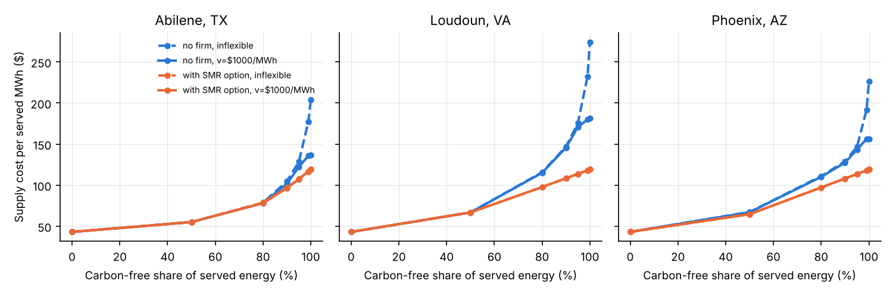
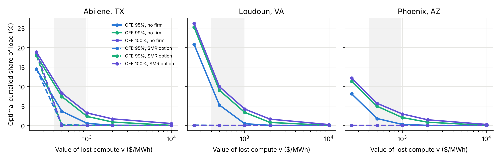
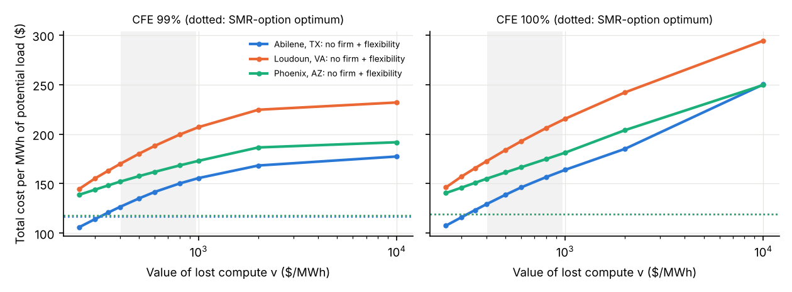
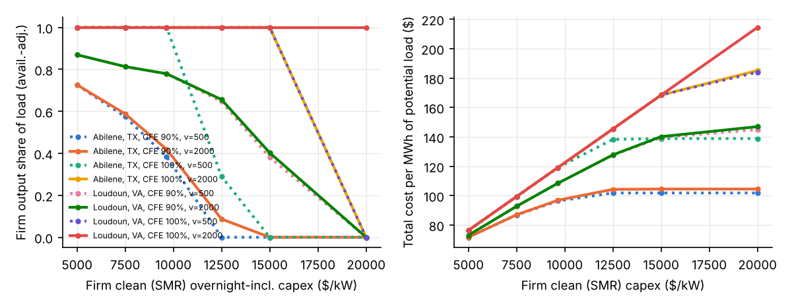
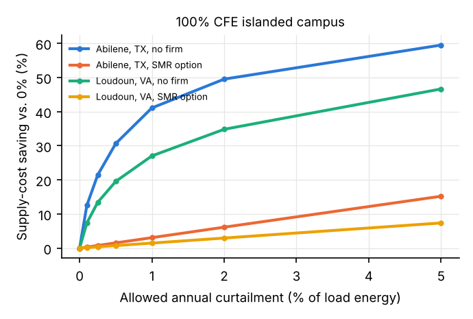
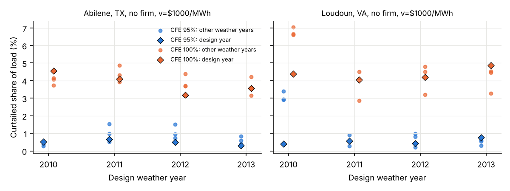
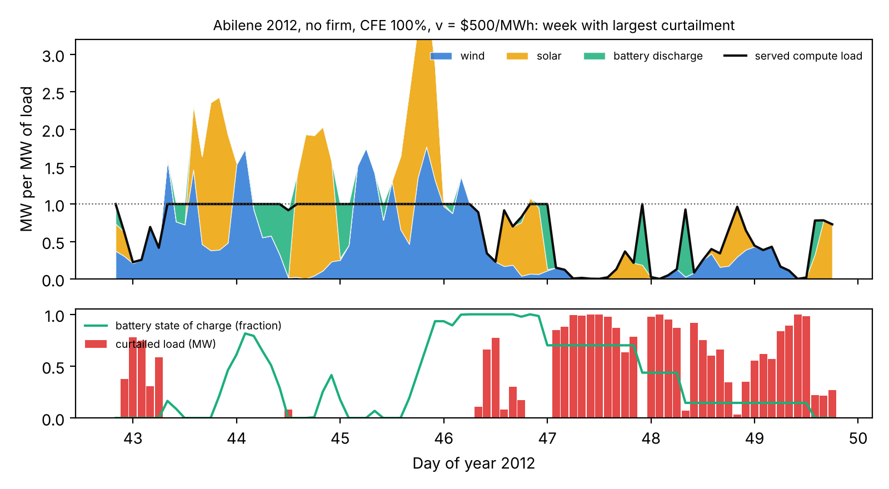

# Idle Accelerators Are Expensive: Pricing Compute Flexibility in Clean-Power Supply for Islanded AI Data Centers

**Target venue:** *Joule* (Analysis article)

**Code and data:** `code/` and `results/` in this directory. Every number in this paper is either produced by those scripts (marked [model], with the results file named where useful) or taken from a cited source. `README.md` gives the run commands.

---

## Abstract

Data-center electricity demand is growing faster than grids can connect new supply. AI developers have responded with nuclear contracts, renewables-plus-storage and on-site ("islanded") power. A common proposal for closing the gap is load flexibility, in which campuses curtail some consumption in scarce hours. Existing studies set the flexible quantity (a share, a window or a curtailment rate) exogenously. We argue that for AI campuses the right primitive is a price: the *value of lost compute* (VoLC), meaning the capital cost of accelerators left idle during curtailment. Public price and power estimates for a current rack-scale accelerator system put VoLC at \$403–968 per MWh of facility energy (central \$597/MWh), counting accelerator capital only [model]. We build an hourly linear capacity-expansion model of an islanded campus in which curtailment is chosen endogenously and priced at VoLC. The supply options are solar, wind, Li-ion storage, gas and a firm clean resource standing in for small modular reactors (SMRs). We prove three properties: an effective scarcity-price ceiling, which shows that share-based clean targets penalise curtailment; a concavity identity that converts a VoLC sweep into certified break-even brackets; and a cost bound on the number of curtailment hours. We then solve 431 instances with NREL resource data for 2010–2013 and NREL ATB 2024 costs at three US sites. We report five findings, all [model]. (i) With an SMR option at ATB costs and idealised constant availability, firm supply dominates at 95–100% carbon-free energy (CFE), and VoLC-priced flexibility changes total cost by less than 1%. (ii) Without firm supply, a 100%-CFE campus that cannot curtail has a supply cost of \$289–311/MWh (Abilene and Loudoun). With VoLC-priced curtailment of 3–10% of energy (360–1,430 h/yr), total cost falls to \$139–216/MWh at VoLC of \$500–1,000, which is still 17–81% above the SMR option. (iii) A renewables-plus-flexibility campus matches the SMR option only at Abilene and only if VoLC is below \$319–321/MWh, under the empirical range. Equivalently, it wins only if SMR capital costs exceed \$11.8–16.7k/kW at a VoLC of \$500 (\$14.5–20.1k/kW at \$1,000). (iv) When nuclear availability is lumpy (whole-module refuelling and forced outages), its 100%-CFE cost rises to \$134–175/MWh at VoLC = \$1,000. Flexibility then cuts total cost by 10–33% relative to a near-inflexible campus, so it acts as a complement to firm supply rather than a substitute. (v) Supply cost per *served* MWh, the metric commonly reported, can make flexible renewable designs look cheaper than nuclear when they are not. We give falsifiable predictions and a test protocol.

## 中文摘要

数据中心用电需求的增长速度超过了电网接入新电源的速度。AI 企业正转向核电合约、"可再生能源+储能"以及园区自建（离网）电源。常见建议是利用负荷灵活性，即园区在电力稀缺时段削减部分用电。现有研究把可调节的量（比例、时间窗或削减率）设为外生参数。本文认为，对 AI 园区而言，更合适的基本量是一个价格，即"算力损失价值"（VoLC）：削减期间闲置加速器的资本成本。根据现有机架级加速器系统的公开价格与功率估计，仅计入加速器资本时，VoLC 约为每 MWh 设施用电 403–968 美元（中心值 597 美元）［模型］。我们构建了离网 AI 园区的逐小时线性容量扩展模型，削减量由模型内生决定并按 VoLC 计价，可选电源包括光伏、风电、锂电池、燃气，以及代表小型模块化反应堆（SMR）的稳定清洁电源。我们证明了三个性质：一是有效稀缺电价上限，它表明基于比例的清洁目标会惩罚削减；二是一个凹性恒等式，可把 VoLC 扫描结果转化为有证明保证的盈亏平衡区间；三是削减小时数的成本上界。随后，我们使用 NREL 2010–2013 年资源数据和 ATB 2024 成本数据，在美国三个站点求解了 431 个模型实例，得到五项结论（均为［模型］结果）。(i) 若可按 ATB 成本建设 SMR，且假设其可用率恒定，则在 95–100% 无碳能源（CFE）目标下稳定电源占主导，按 VoLC 计价的灵活性对总成本的影响不到 1%。(ii) 若没有稳定电源，不能削减的 100% CFE 园区供电成本为 289–311 美元/MWh（阿比林与劳登）。在 VoLC 为 500–1000 美元时，允许按 VoLC 计价削减 3–10% 的用电（每年 360–1430 小时），总成本可降至 139–216 美元/MWh，但仍比 SMR 方案高 17–81%。(iii) 只有在阿比林、且 VoLC 低于 319–321 美元/MWh（低于经验区间）时，"可再生能源+灵活性"才能与 SMR 持平。换言之，只有当 SMR 造价高于 1.18–1.67 万美元/kW（VoLC=500）或 1.45–2.01 万美元/kW（VoLC=1000）时，它才更便宜。(iv) 若考虑核电按整台机组换料和强迫停运造成的可用率"块状"波动，在 VoLC=1000 美元时，100% CFE 成本升至 134–175 美元/MWh；此时相对于几乎不可削减的园区，灵活性可降低总成本 10–33%，是稳定电源的补充而非替代。(v) 常用的"每 MWh 已服务电量供电成本"指标，会让灵活的可再生能源方案看起来比核电便宜，而实际并非如此。文末给出可证伪的预测与检验方案。

---

## 1 Introduction

US data centers used about 176 TWh in 2023, roughly 4.4% of national electricity consumption. Lawrence Berkeley National Laboratory projects 325–580 TWh by 2028, or 6.7–12% of the national total [Shehabi et al. 2024]. The IEA estimates global data-center consumption at about 415 TWh in 2024, rising to about 945 TWh by 2030 in its Base Case [IEA 2025]. EPRI's 2026 update projects data centers at 9–17% of US electricity by 2030, about 60% above its earlier scenarios [EPRI 2024; EPRI 2026]. The binding constraint is often speed rather than annual energy. At the end of 2023, about 2.6 TW of generation and storage was waiting in US interconnection queues [Rand et al. 2024]. Firm clean supply is arriving on long lead times. Microsoft's 20-year agreement to restart the 835 MW Three Mile Island Unit 1, now the Crane Clean Energy Center, targets around 2028 [Constellation 2024]. Google's agreement with Kairos Power for up to 500 MW of SMRs targets a first unit by 2030 [Google 2024]. First-of-a-kind SMR costs remain uncertain: the target power price of the NuScale/UAMPS Carbon Free Power Project rose from \$58 to \$89/MWh before the project was cancelled in 2023 [Power Engineering 2023]. The question in this paper's title, whether nuclear and renewables can keep up, is therefore partly a question about what fills the gap and at what cost.

Two responses dominate the debate. The first is *on-site or islanded supply*: an off-grid campus that combines solar, storage and gas backup and so avoids the interconnection queue. An industry white paper argues that such microgrids could serve a large share of AI-training demand [Baranko et al. 2024]. The second is *load flexibility*. Norris et al. [2025] estimate that the 22 largest US balancing authorities could absorb 76 GW of new load if that load accepted curtailment averaging 0.25% of its maximum annual energy, rising to 98 GW at 0.5% and 126 GW at 1%. A field trial reduced an AI cluster's power by 25% for three hours using software alone [Colangelo et al. 2025]. Energy-system models show that spatial and temporal load shifting lowers the cost of 24/7 carbon-free procurement [Riepin, Brown & Zavala 2025] and of system operation [Knittel, Senga & Wang 2025].

**The gap.** These studies treat flexibility as a *quantity*, such as a share of load that can be shifted, a shifting window or an allowed curtailment rate, and they impose it exogenously. For AI campuses, flexibility also has a clear and very large *price*. A curtailed accelerator keeps depreciating while producing nothing, and hardware amortisation, not energy, dominates the cost of frontier training [Cottier et al. 2024]. If idling compute costs several times as much as the electricity it would have used, the economically chosen amount of flexibility may be very different from the amounts assumed in the literature. In that case, whether flexibility can substitute for firm clean power, or instead complement it, depends on this price. No existing model answers that question in this form.

**This paper.** We ask a narrow question: *for an islanded AI campus that must meet a carbon-free share, how much curtailment is cost-optimal when curtailment is priced at the capital cost of idle compute, and how does that price change the competition between renewables-plus-storage and firm clean (nuclear) supply?* We study islanded campuses for three reasons. They are the deployment mode most directly motivated by interconnection delays. Their trade-offs are not hidden inside the rest of a grid. And they bound what a single developer can do without the grid.

**Contributions.**

1. **Formulation (§3).** We define an hourly capacity-expansion linear program (LP) in which compute curtailment is a decision variable priced at the value of lost compute *v*, and the carbon-free target applies to *served* energy. We also give a sourced estimate of *v*: \$403–968 per MWh of facility energy, with a central value of \$597 [model]. Because it counts accelerator capital only, it is a lower bound.
2. **Theory (§4).** We prove three properties of the model. P1: scarcity prices are capped at an *effective* VoLC, v + (1−φ)μ, so a share-based clean target makes curtailment more expensive than its face value. P2: the optimal total cost is concave in *v*, and the flexibility dividend equals the integral of the curtailment curve. A corollary turns a coarse VoLC grid into *certified brackets* on break-even VoLC. P3: the number of curtailment hours per year is bounded by F/(a(v − c)). All three are checked numerically on every applicable solved instance.
3. **Empirics on real weather and cost data (§5).** We solve 431 LPs. They use NREL NSRDB and WIND Toolkit data for 2010–2013 at Abilene TX, Loudoun County VA and Phoenix AZ, with NREL ATB 2024 costs. We locate the VoLC and the SMR capital cost at which renewables plus flexibility displace firm clean supply. We also show that the quantity framing used in prior work implies marginal values of curtailment of \$23,000–36,000 per MWh for the first 0.1% of energy.
4. **Lumpy firm supply (§5.6).** Replacing the usual constant-availability treatment of nuclear with whole-module refuelling and forced outages reverses the role of flexibility. It becomes worth 10–33% of total cost and acts as a *complement* to nuclear rather than a substitute for it.
5. **Robustness, a metric caveat and falsifiable predictions (§5.7–§6).** We validate against full hourly resolution, test designs on out-of-sample weather years and vary the main cost inputs. We show that supply cost per *served* MWh misranks portfolios, and we state predictions with a test protocol.

We do not claim that flexibility of grid-connected campuses is unimportant. A small curtailment commitment that secures a grid connection years early can be worth much more than its energy-system value. Our results concern flexibility as a substitute for, or complement to, *supply capacity* inside a clean portfolio (§6).

## 2 Related Work

**Data-center demand.** Bottom-up US estimates [Shehabi et al. 2024], global estimates [IEA 2025] and utility-sector scenarios [EPRI 2024; EPRI 2026] agree on rapid growth with wide uncertainty bands. Our model is per MW of load and does not depend on which projection is correct.

**Firm low-carbon resources and storage.** Capacity-expansion studies find that firm low-carbon resources (nuclear, geothermal, gas with CCS) lower the cost of deep decarbonization by 10–62%, and that batteries and demand flexibility did not substitute for them in the scenarios studied [Sepulveda et al. 2018]. Ziegler et al. [2019] show that a wind–solar mix can supply cost-competitive baseload in Texas and Arizona only if storage energy capacity costs fall to about \$20/kWh. Our islanded-campus results are consistent with both findings. The new element is that we let demand flexibility compete on price.

**24/7 carbon-free procurement.** Xu et al. [2024] show that hourly matching drives much larger system-level emission reductions than annual matching, and that it raises participants' cost premiums. Riepin, Brown & Zavala [2025] show that spatio-temporal shifting across a network of data centers lowers the cost of 24/7 matching, by about €1.29/MWh per additional percentage point of flexible load. In both lines of work flexibility is exogenous, a fixed share or window that carries no opportunity cost.

**Data-center flexibility.** Google's carbon-intelligent computing system shifts temporally flexible workloads using day-ahead "virtual capacity curves" [Radovanović et al. 2021]. Norris et al. [2025] quantify grid headroom unlocked by curtailable load. Colangelo et al. [2025] demonstrate a 25% three-hour power reduction on a 256-GPU A100 cluster. Knittel, Senga & Wang [2025] find in GenX that flexible data centers lower system costs, but they can raise emissions when the grid has a low renewable share. None of these studies prices curtailment at the capital cost of idle accelerators, and none derives the optimal amount of curtailment from that price.

**Training cost structure.** Cottier et al. [2024] estimate that amortized hardware dominates the cost of frontier training runs (with R&D staff at 29–49% of total amortized cost for the four models studied in depth), and that energy is a small component. This cost structure is the economic basis for our VoLC.

**Off-grid AI campuses.** Baranko et al. [2024] (an industry white paper, not peer-reviewed) argue that off-grid solar microgrids with gas backup could serve AI training. Their analysis, as reported, uses fixed solar shares. We optimize the full portfolio and treat flexibility endogenously.

## 3 Model

### 3.1 Setting

A campus has flat potential electricity demand L (we normalize L = 1 MW; all results scale linearly). It is islanded: all supply is on site. The planner chooses capacities K = (S, W, P_b, E_b, G_ct, G_cc, N). These are solar PV (MW_ac, single-axis tracking), wind (MW), Li-ion power (MW) and energy (MWh), simple-cycle gas (CT), combined-cycle gas (CC), and a firm clean resource N with hourly availability a = 0.93 in the main runs. N stands in for SMRs, though it could equally be enhanced geothermal. In §5.6 we replace the constant availability with an hourly series a_t generated by whole-module refuelling and forced outages, so that the limit becomes n_t ≤ a_t N. For each hour t = 1..T the planner chooses gas dispatch g_t^ct and g_t^cc, storage charge c_t, discharge d_t and state of charge e_t, firm output n_t, and curtailed compute load u_t ∈ [0, L].

### 3.2 Linear program

$$
\min\; \sum_k F_k K_k \;+\; \sum_t \Big[ c^{ct} g_t^{ct} + c^{cc} g_t^{cc} + c^{N} n_t + v\,u_t \Big]
$$

subject to, for all t:

- balance: S·σ_t + W·ω_t + n_t + g_t^{ct} + g_t^{cc} + d_t − c_t ≥ L − u_t  (dual λ_t ≥ 0)
- storage: e_t = e_{t−1} + η_c c_t − d_t/η_d (cyclic), 0 ≤ e_t ≤ E_b, 0 ≤ c_t, d_t ≤ P_b
- limits: g_t^{ct} ≤ G_ct, g_t^{cc} ≤ G_cc, n_t ≤ a N, 0 ≤ u_t ≤ L

and the carbon-free-energy (CFE) constraint on **served** energy

$$
\sum_t (g_t^{ct} + g_t^{cc}) \;\le\; (1-\varphi) \sum_t (L - u_t) \qquad (\text{dual } \mu \ge 0).
$$

Here σ_t and ω_t are hourly solar and wind capacity factors, F_k are annualized fixed costs, c^· are variable costs, φ is the CFE target, and v is the VoLC. Surplus generation is spilled (the balance is an inequality). Storage charging from gas is allowed, and the CFE accounting charges the gas at generation. Round-trip efficiency is 85%.

### 3.3 Data and cost inputs

*Resource data.* Hourly global, direct and diffuse irradiance, air temperature and wind speed come from the NSRDB v3.0.6 (4 km, 30 min, aggregated to hourly) [Sengupta et al. 2018]. 100 m wind speed, temperature and pressure come from the WIND Toolkit CONUS v1.0.0 (2 km, hourly) [Draxl et al. 2015]. Both were read directly from NREL's public AWS buckets at the grid cells nearest Abilene, TX (32.45°N, 99.73°W), Loudoun County, VA (39.04°N, 77.49°W) and Phoenix, AZ (33.45°N, 112.07°W), for 2010–2013 (the overlapping years). Abilene is the site of a large AI campus under construction, and Loudoun is the largest US data-center market. PV output is modelled with pvlib [Anderson et al. 2023]: single-axis tracking with backtracking (GCR 0.35), isotropic transposition, SAPM cell temperature, PVWatts DC model with γ = −0.35%/K, 14% DC losses, DC/AC ratio 1.3 and 96% inverter efficiency. Wind output uses a generic normalized power curve (cut-in 3 m/s, rated 11 m/s, cut-out 25 m/s), a density-corrected hub-height speed and 15% wake, availability and electrical losses. Resulting mean capacity factors for 2012 are 28.1% / 33.1% (Abilene PV / wind), 23.1% / 20.6% (Loudoun) and 30.3% / 10.0% (Phoenix) [model; `results/capacity_factor_summary.json`]. The generic power curve is conservative compared with modern low-specific-power turbines (§7).

*Costs.* All capital and fixed O&M costs are NREL ATB 2024 (v3) Moderate-scenario, Market-case values for cost year 2030, read from the official parquet release [NREL 2024]. They are: tracking PV \$1,193/kW_ac and \$18.0/kW-yr; land-based wind (techno-resource class 4) \$1,408/kW and \$29.3/kW-yr; Li-ion storage \$433/kW plus \$255/kWh (split from the ATB 2-h and 4-h system costs of \$942/kW and \$1,451/kW); gas CT \$1,270/kW with heat rate 9.72 MMBtu/MWh; gas CC (1-on-1 H-frame) \$1,669/kW with heat rate 6.04 MMBtu/MWh; and "Nuclear – Small" \$9,650/kW and \$136/kW-yr. We annualize at a uniform 7% real WACC, with lifetimes of 30 years (PV, wind, gas), 15 years (storage) and 40 years (firm). We assume a gas price of \$3.5/MMBtu and a firm-resource variable cost of \$13.6/MWh, and we exclude tax credits. These choices are assumptions, and we vary them in §5.7. The CO₂ factor for gas is 53.06 kg/MMBtu [EPA 2024]. At 93% availability, the annualized firm cost corresponds to about \$119/MWh [model].

*Solver and resolution.* LPs are solved with HiGHS [Huangfu & Hall 2018] through SciPy. The main sweeps use 2-hour time steps (T = 4,380), with capacity factors averaged within each step. We report the error against full hourly resolution in §5.7.

### 3.4 The value of lost compute

We define VoLC as the capital cost per MWh of facility energy of accelerators idled by curtailment:

$$
v_{\text{cap}} = \frac{P_{\text{rack}}\cdot \mathrm{CRF}(r, \ell)}{p_{\text{rack}} \cdot \mathrm{PUE}\cdot 8760}.
$$

Analyst and press estimates put a GB200 NVL72 rack at about \$3.0M (HSBC, May 2024, as reported by Tom's Hardware); later press reports give \$2.8–3.4M [Tom's Hardware 2024]. Rack power is about 120 kW per NVIDIA's DGX GB200 documentation and up to 132 kW in vendor specifications [NVIDIA 2025; HPE 2025]. We sweep price {2.8, 3.0, 3.4} \$M, power {120, 132} kW, amortization life {4, 5, 6} years, cost of capital {8, 10, 12}% and PUE {1.1, 1.2, 1.3}, which gives 162 combinations. VoLC ranges from \$403 to \$968/MWh with a median of \$615/MWh. The central case (\$3.0M, 126 kW, 5 years, 10%, PUE 1.2) gives \$597/MWh [model; `results/volc_summary.json`]. This is a *lower bound* on the economic cost of curtailment. It omits building and cooling capital, networking, staff, and the margin forgone on inference revenue, and it ignores schedule costs of delaying a training run. Our sweep over v ∈ {250, 500, 1000, 2000, 10000} \$/MWh covers depreciated hardware at the low end (\$250) and an effectively inflexible campus at the high end (\$10,000).

## 4 Theory

Let (P_v) denote the LP of §3.2 with VoLC v, let Z(v) be its optimal value (including curtailment cost), and let U*(v) = Σ_t u_t* be the optimal annual curtailment for any optimal solution. Write Z(∞) for the optimum of the inflexible problem (u ≡ 0), which is feasible whenever any dispatchable capacity is allowed.

**Proposition 1 (effective scarcity-price ceiling).** At any optimal primal–dual pair, every hour with u_t* < L satisfies

$$
\lambda_t \le v_{\text{eff}} \equiv v + (1-\varphi)\,\mu ,
$$

with equality whenever u_t* > 0. Hence curtailment occurs only in hours whose shadow price reaches v_eff. When the CFE constraint binds (μ > 0), v_eff > v.

*Proof.* The variable u_t appears in the objective with coefficient v, in the balance row with coefficient +1 (it relaxes the requirement), and in the CFE row with coefficient (1−φ) (curtailment reduces served energy and therefore the allowed gas). Its bounds are 0 ≤ u_t ≤ L, with duals ν_t^lo, ν_t^up ≥ 0. Stationarity of the Lagrangian gives v + (1−φ)μ − λ_t − ν_t^lo + ν_t^up = 0. If u_t < L, complementary slackness gives ν_t^up = 0, so λ_t = v_eff − ν_t^lo ≤ v_eff. If, in addition, u_t > 0, then ν_t^lo = 0 and λ_t = v_eff. ∎

*Interpretation.* With a share-based clean target, each curtailed MWh also removes (1−φ) MWh of gas allowance. The planner therefore values curtailment at v plus the marginal cost of that lost allowance. At φ = 0.9 and μ ≈ \$200/MWh (a typical value in our Abilene runs), v_eff exceeds v by about \$20/MWh. At φ = 1 the target is an absolute ban on gas, and the correction vanishes. A target expressed in absolute emissions rather than as a share would remove this penalty on flexibility.

**Proposition 2 (concavity and the flexibility dividend).** Z(v) is non-decreasing, concave and piecewise linear in v. U*(v) is non-increasing. For v₁ < v₂,

$$
U^*(v_2)\,(v_2 - v_1) \;\le\; Z(v_2) - Z(v_1) \;\le\; U^*(v_1)\,(v_2 - v_1).
$$

There is a finite v̄ with U*(v) = 0 for all v ≥ v̄, and the flexibility dividend satisfies Z(∞) − Z(v) = ∫_v^{v̄} U*(s) ds ≤ (v̄ − v) U*(v).

*Proof.* For a fixed feasible x, the objective C(x) + v U(x) is affine in v. Z is the pointwise minimum of such functions and is therefore concave. It is non-decreasing because U(x) ≥ 0. Let x₁ and x₂ be optimal at v₁ and v₂. Optimality of x₂ at v₂ gives Z(v₂) ≤ C(x₁) + v₂U(x₁) = Z(v₁) + (v₂ − v₁)U(x₁), which is the upper bound. Optimality of x₁ at v₁ gives Z(v₁) ≤ C(x₂) + v₁U(x₂) = Z(v₂) − (v₂ − v₁)U(x₂), which is the lower bound. Combining the two yields (v₂ − v₁)(U(x₁) − U(x₂)) ≥ 0, so U* is non-increasing. Because the LP has finitely many bases, Z is piecewise linear with slope U*(v) almost everywhere. Since U* ≥ 0 is non-increasing and Z is bounded above by Z(∞), U* must equal 0 beyond some v̄. Integrating the slope gives the identity, and monotonicity gives the final bound. ∎

*Use.* Proposition 2 turns a sweep over v into an exact accounting of what flexibility is worth. If the optimal curtailment at the empirical VoLC is small, the remaining dividend is at most (v̄ − v)·U*(v). In particular, flexibility cannot be worth much in a system where the planner chooses to use little of it.

**Corollary 2.1 (certified break-even brackets).** Let Z_A be the cost of an alternative portfolio that does not depend on v (for example, a firm-only campus). Suppose Z(v_a) ≤ Z_A < Z(v_b) for two grid points v_a < v_b. Then the unique crossing v* where Z(v*) = Z_A satisfies

$$
v_a + \frac{Z_A - Z(v_a)}{U^*(v_a)} \;\le\; v^* \;\le\; v_a + \frac{(Z_A - Z(v_a))(v_b - v_a)}{Z(v_b) - Z(v_a)} .
$$

*Proof.* The left inequality follows from the supergradient bound Z(w) ≤ Z(v_a) + U*(v_a)(w − v_a), which holds by concavity. The right inequality follows from Z lying on or above its chord on [v_a, v_b]. Uniqueness holds because Z is non-decreasing and, while U* > 0, strictly increasing. ∎

From a handful of LP solves, the corollary gives a guaranteed interval for the VoLC at which a flexible portfolio stops beating a rigid one. A finer grid narrows the interval.

**Proposition 3 (duration bound).** Suppose resource k has annualized fixed cost F_k per MW, constant hourly availability a_k, variable cost c_k < v and unbounded capacity. Suppose also that either (i) k is carbon-free, or (ii) k is gas and φ = 0. Then for every Δ > 0, the number of hours with u_t* ≥ Δ satisfies

$$
D(\Delta) \;\le\; \frac{F_k}{a_k\,(v - c_k)} .
$$

*Proof.* Take ε ∈ (0, Δ] and perturb an optimal solution. Add ε/a_k MW of resource k, dispatch it at ε in each of the D(Δ) hours with u_t ≥ Δ, and lower u_t by ε in those hours. The hourly balance is unchanged and u_t stays non-negative. In case (i), the CFE row's left side changes by −(1−φ)εD ≤ 0. In case (ii), with φ = 0, it changes by εD − εD = 0. The perturbation is therefore feasible, and its cost change is ε[F_k/a_k + D(c_k − v)]. This must be ≥ 0 by optimality, which gives the bound. ∎

*Numbers.* With the ATB-derived firm cost (F = \$860k/MW-yr, a = 0.93, c = \$13.6/MWh), the bound is 937 h/yr at v = \$1,000 and 465 h/yr at v = \$2,000. With a gas CT (F = \$127k/MW-yr, c = \$40.9/MWh) and φ = 0, it is 133 h/yr at v = \$1,000. The bounds hold for any weather year and any site, which makes them useful screening rules. They need the comparison resource to have constant availability, and they do not hold for lumpy firm supply (§5.6). A gas-backed campus with VoLC near \$1,000/MWh should never plan to curtail in more than about 130 hours per year.

## 5 Results

All numbers in this section are [model] outputs of the code in `code/`. Raw outputs are in `results/E*.jsonl`, and derived quantities are in `results/summary.json`. Costs are in 2030 real dollars per MWh of *potential* compute load (that is, total cost including v × curtailed MWh, divided by 8,760 MWh per MW-year) unless stated otherwise. §5.5 explains why we use this denominator.

### 5.1 The propositions hold on every solved instance

On all 210 main-sweep instances, the largest hourly shadow price equals v + (1−φ)μ to solver tolerance and never exceeds it (P1: 210/210). For example, for Abilene without firm supply at φ = 0.95 and v = \$1,000, μ = \$575/MWh. The predicted ceiling is \$1,029, and the observed maximum price is \$1,029. P2's monotonicity and two-sided sandwich hold on all 168 adjacent pairs in the v-sweep. P3's firm-resource duration bound holds on all 105 instances with the firm option, and the gas-CT bound holds on all 30 instances with φ = 0 (`summary.json: prop_checks`). Because the propositions are theorems, these checks test the implementation, not the mathematics. They confirm that the code solves the model that §4 analyses.

### 5.2 Main sweep: with a firm option, priced flexibility hardly matters

Table 1 reports total cost by site, mix, CFE target and VoLC.

**Table 1.** Total cost (\$/MWh of potential load) [model; `results/table_E1_total.md`]. "With firm" = SMR option available at ATB 2024 cost (\$9,650/kW) and constant 93% availability.

| Site | Mix | v (\$/MWh) | CFE 80% | 90% | 95% | 99% | 100% |
|---|---|---|---|---|---|---|---|
| Abilene, TX | with firm | 500 | 78 | 96 | 107 | 117 | 119 |
| Abilene, TX | with firm | 10,000 | 79 | 97 | 108 | 117 | 119 |
| Abilene, TX | no firm | 500 | 78 | 102 | 120 | 135 | 139 |
| Abilene, TX | no firm | 1,000 | 79 | 104 | 127 | 156 | 164 |
| Abilene, TX | no firm | 10,000 | 79 | 105 | 129 | 177 | 250 |
| Loudoun, VA | with firm | 500–10,000 | 98 | 108 | 114 | 118 | 119 |
| Loudoun, VA | no firm | 500 | 115 | 145 | 165 | 180 | 184 |
| Loudoun, VA | no firm | 1,000 | 115 | 147 | 174 | 207 | 216 |
| Loudoun, VA | no firm | 10,000 | 116 | 147 | 176 | 232 | 294 |
| Phoenix, AZ | with firm | 500–10,000 | 97 | 108 | 114 | 118 | 119 |
| Phoenix, AZ | no firm | 500 | 110 | 127 | 143 | 158 | 161 |
| Phoenix, AZ | no firm | 1,000 | 111 | 129 | 146 | 173 | 181 |
| Phoenix, AZ | no firm | 10,000 | 111 | 129 | 147 | 192 | 250 |

A gas-only campus (CFE 0%) costs \$43/MWh at all sites and emits 0.32 tCO₂/MWh. When the SMR option is available, the optimal portfolio moves toward firm supply as the target rises. At 100% CFE every site builds 1.08 MW of firm capacity per MW of load (1/0.93) and nothing else, at \$119/MWh. At the 95% target, firm supply already carries most of the load in Loudoun and Phoenix (0.95–0.99 MW). In Abilene, which has strong wind, the planner mixes 0.67 MW of firm capacity with PV, wind and a small battery at v = \$500. Across all sites and targets with the firm option, moving from v = \$10,000 (near-inflexible) to v = \$500 lowers total cost by at most 0.75% (Abilene, 80%). Optimal curtailment is at most 0.24% of energy, over at most 286 hours. **At empirical VoLC, a campus with access to firm clean supply at ATB cost has almost no economic use for curtailment.**

At v = \$250, which corresponds to fully depreciated hardware, the picture changes sharply in Abilene. The planner abandons firm supply and builds 1.5 MW of PV, 2.1 MW of wind and 1.5 MWh of storage per MW of load, and it curtails 10–19% of energy over 2,268–3,202 hours. The resulting total cost at 100% CFE is \$108/MWh. In Loudoun and Phoenix, firm supply remains optimal at v = \$250 when it is available.

Without firm supply, costs rise steeply above 95% CFE, and flexibility becomes valuable (Figure 2). An inflexible renewables-plus-storage campus at 100% CFE costs \$250–294/MWh at v = \$10,000. Even that value does not make the campus fully inflexible: it still curtails 0.2–0.5% of energy over 28–64 hours (see §5.4). At v = \$1,000, curtailing 2.9–4.2% of energy (360–572 h) lowers total cost by 27–34%. At v = \$500, curtailing 5.7–9.9% (684–1,430 h) lowers it further. The optimal 100%-CFE renewable portfolio is large: 3.4–5.5 MW of PV, up to 2.6 MW of wind and 11–15 MWh of storage per MW of load at v = \$1,000, with 66–71% of potential generation spilled (`table_E1_caps.md`).

*Figure 1. Supply cost per served MWh against CFE target, with and without the SMR option, for v = \$1,000 and v = \$10,000 [model].*

*Figure 2. Optimal curtailed share of load against VoLC (log scale). The grey band is the empirical VoLC range of \$403–968/MWh [model].*

### 5.3 When do renewables plus flexibility beat firm clean supply?

**Break-even VoLC.** We add a finer VoLC grid (E7: v ∈ {300, 350, 400, 600, 800}) for the no-firm 99% and 100% cases and apply Corollary 2.1 against the firm-option optimum (Figure 7). In Abilene, the no-firm portfolio with flexibility matches the firm option at a VoLC certified to lie in [\$319, \$321]/MWh at 100% CFE and in [\$318, \$320]/MWh at 99% CFE (`summary.json: breakeven_vs_firm`). Both values are below the lowest value in our empirical range (\$403). In Loudoun and Phoenix, the no-firm portfolio is more expensive than the firm option even at v = \$250: \$139–146/MWh against \$118–119/MWh. Within the empirical VoLC range, the renewables-plus-flexibility campus costs 17–81% more than the firm option at 100% CFE (\$139–216/MWh against \$119/MWh).

*Figure 7. Total cost of the optimal no-firm portfolio against VoLC, with the firm-option optimum shown dotted. The grey band is the empirical VoLC range [model].*

**Break-even SMR cost.** The comparison depends strongly on the SMR capital cost, which is the most uncertain input. A firm-only 100%-CFE campus costs a known affine function of capex, so we can solve for the capex at which it ties with the optimal no-firm campus (`summary.json: breakeven_firm_capex_cfe100`):

| v (\$/MWh) | Abilene | Loudoun | Phoenix |
|---|---|---|---|
| 250 | \$8,400/kW | \$12,590/kW | \$11,970/kW |
| 500 | \$11,790/kW | \$16,700/kW | \$14,240/kW |
| 1,000 | \$14,520/kW | \$20,120/kW | \$16,400/kW |
| 10,000 | \$23,890/kW | \$28,680/kW | \$23,820/kW |

Flexibility priced at empirical VoLC therefore lowers the SMR capital cost at which nuclear stops being the cheapest route to 24/7 clean supply on an islanded campus. The threshold falls from roughly \$24–29k/kW for a near-inflexible campus to \$12–17k/kW at v = \$500. All thresholds still lie above the ATB "Nuclear – Small" 2030 Moderate value of \$9,650/kW. The capex sweep E2 (Figure 3) confirms the switch with the full portfolio optimisation and shows that mixed portfolios appear near the threshold. For Abilene at 100% CFE and v = \$500, an SMR capex of \$12,500/kW gives a mix of 0.31 MW firm with renewables and 5.7% curtailment, at \$138.3/MWh. At 90% CFE, firm supply leaves the Abilene portfolio between \$9,650 and \$12,500/kW at v = \$500 but survives up to \$12,500/kW at v = \$2,000. In Loudoun it survives at 90% CFE up to \$15,000/kW at either VoLC.

*Figure 3. Firm share and total cost against SMR capital cost (E2) [model].*

### 5.4 Price versus quantity: what the exogenous-flexibility framing implies

To connect our results with the quantity framing of prior work, we set v = 0 and cap annual curtailment at a fraction f of energy (E6, 100% CFE). This is the exogenous design used by Norris et al. [2025]. For a renewables-only campus, allowing f = 0.1% lowers supply cost from \$289 to \$253/MWh in Abilene and from \$311 to \$289/MWh in Loudoun. Allowing f = 1% brings it to \$170 and \$227/MWh, and f = 5% to \$117 and \$166/MWh. The implied *marginal* value of curtailment is \$36,170/MWh (Abilene) and \$22,926/MWh (Loudoun) for the first 0.1% of energy. It falls to \$2,400/MWh between 1% and 2%, and to \$960–1,226/MWh between 2% and 5% (Figure 4; `summary.json: E6`).

This explains two observations. First, the price framing and the quantity framing agree where they should. The endogenous solution at v = \$1,000 curtails 3.2% (Abilene) and 4.2% (Loudoun), close to where the exogenous marginal value curve crosses \$1,000. Second, the first few tenths of a percent of curtailment are worth far more than any plausible VoLC. That is why even the v = \$10,000 runs curtail 0.2–0.5% at 100% CFE: a renewable-only islanded campus has a handful of hours that are extremely expensive to serve. In contrast, when the firm option is available, the marginal value of free curtailment is a flat \$176–365/MWh, below empirical VoLC, so a priced-flexibility campus does not curtail.

*Figure 4. Supply-cost saving from an exogenous, free annual curtailment allowance at 100% CFE (E6) [model].*

### 5.5 A metric caveat: cost per served MWh misranks portfolios

Analyses of flexible loads often report supply cost per MWh actually delivered. In our model this metric is misleading. For Abilene at 100% CFE and v = \$500, the no-firm portfolio has a supply cost of \$106/MWh *served*, which looks cheaper than the firm option at \$119. Its total cost, including \$500 × 8.3% of load in idle compute, is \$139/MWh of potential load, 17% *more* than the firm option. The ranking reverses because the served-energy metric leaves out the forgone output. We therefore recommend that campus-level clean-power comparisons report cost per MWh of *potential* compute load, or equivalently per unit of compute delivered, with idle hardware costed in.

### 5.6 Lumpy nuclear: flexibility as complement, not substitute

The main runs give the firm resource a constant 93% availability, the usual simplification in capacity-expansion models. It assumes away the defining feature of a reactor serving an islanded campus: whole modules go offline. In E8 we generate hourly fleet availability for a fleet of M equal modules. Each module has one 30-day refuelling outage every two years (start dates staggered across modules) and forced outages from a two-state Markov chain with 2% steady-state unavailability and a 7-day mean duration (`experiments.py: module_availability`, seed 1). In the simulated year, mean availability is 0.917 for M = 1 (minimum 0) and 0.936 for M = 4 (minimum 0.5). We re-optimise the full portfolio for Abilene and Loudoun.

| Site | CFE | Fleet | v = 500 | v = 1,000 | v = 2,000 | v = 10,000 | constant-availability case |
|---|---|---|---|---|---|---|---|
| Abilene | 100% | 4 modules | 125.2 | 134.1 | 143.4 | 159.6 | 119.1 |
| Abilene | 100% | 1 module | 132.3 | 149.1 | 166.7 | 209.0 | 119.1 |
| Loudoun | 100% | 4 modules | 136.4 | 148.8 | 154.7 | 165.7 | 119.1 |
| Loudoun | 100% | 1 module | 152.0 | 174.8 | 202.1 | 258.9 | 119.1 |
| Abilene | 95% | 4 modules | 108.6 | 110.0 | 110.6 | 111.5 | 107.2–107.7 |
| Loudoun | 95% | 4 modules | 120.2 | 120.9 | 121.8 | 122.9 | 113.8 |

*Total cost, \$/MWh of potential load [model; `summary.json: E8`].*

Three results follow. First, lumpiness raises the cost of 100% CFE with nuclear by 13–47% at v = \$1,000 compared with the constant-availability idealisation. Second, flexibility becomes valuable. Moving from v = \$10,000 to v = \$1,000 lowers total cost by 16% (Abilene) and 10% (Loudoun) for a four-module fleet, and by 29% and 32% for a single module. The optimal campus curtails 1.4–3.5% of energy, concentrated in outage periods, and keeps 0.5–1.0 MW of firm capacity alongside renewables and storage. Third, even with lumpiness, the four-module nuclear campus at v = \$1,000 (\$134–149/MWh) stays cheaper than the renewables-only campus at the same VoLC (\$164–216/MWh). At the 95% target, the remaining gas allowance covers most outage hours, and lumpiness adds only 2–7%. The policy-relevant pattern is that **VoLC-priced flexibility substitutes poorly for firm clean supply but complements it well**, because outages of a lumpy resource are rare, long and predictable (refuelling) or short (forced). Those are the conditions under which paying VoLC for a few hundred hours beats building redundant capacity.

### 5.7 Robustness

**Time resolution (E4).** For six instances spanning the sites, mixes and targets, the 2-hour aggregation used in the sweeps understates the hourly-resolution cost by 0.0–1.55%. It changes the curtailed share by at most 0.22 percentage points (Abilene, no firm, 100%, v = \$500: 8.30% at 2 h against 8.51% at 1 h).

**Weather years (E3).** We design no-firm portfolios (v = \$1,000) on each of 2010–2013 and re-dispatch them on the other three years with capacities fixed and the CFE target still enforced. The campus keeps meeting its target by curtailing more. Out-of-sample curtailment averages 0.77% (range 0.27–1.54%) for Abilene at 95% CFE, 3.98% (3.15–4.87%) for Abilene at 100%, 1.21% (0.20–3.38%) for Loudoun at 95% and 4.71% (2.87–7.04%) for Loudoun at 100%. The corresponding in-sample values are 0.31–0.65%, 3.18–4.55%, 0.40–0.76% and 4.05–4.86%. Out-of-sample total costs average \$170/MWh (Abilene 100%) and \$217/MWh (Loudoun 100%), against \$164 and \$216 for the 2012 design evaluated in-sample. Flexibility therefore also works as weather insurance. For a renewables-only design at a fixed site and target, realised curtailment can vary widely between years, from 0.20% to 3.38% for Loudoun at 95% CFE (Figure 5).

*Figure 5. In-sample (diamonds) and out-of-sample (dots) curtailment for designs optimised on each weather year (E3) [model].*

**Cost inputs (E5).** For Abilene at 90% CFE and v = \$1,000 (base total \$96.8/MWh), we vary the cost of capital (5% / 10%), gas price (\$2 / \$6 per MMBtu), SMR capex (\$6,000 / \$15,000/kW) and PV, wind and battery costs (±30%). Total cost ranges from \$78 (SMR at \$6,000/kW) to \$121/MWh (10% cost of capital). Optimal curtailment stays at or below 0.20% of energy in all 13 cases. The firm share drops to zero only when SMR capex is \$15,000/kW, in which case curtailment rises to 0.20%. The qualitative conclusion of §5.2 is therefore not sensitive to these inputs within the ranges tested.

**Dispatch illustration.** Figure 6 shows the week with the most curtailment for Abilene, no firm, 100% CFE, v = \$500. Curtailment happens in multi-day low-wind, low-sun periods after the battery has emptied, which matches the mechanism behind Proposition 3.

*Figure 6. Dispatch in the week with the largest curtailment (Abilene 2012, no firm, CFE 100%, v = \$500/MWh) [model].*

## 6 Discussion

**Answering the motivating question, for this setting.** Can nuclear and renewables keep up with AI data-center demand? For a single islanded campus that wants 24/7 clean power, our model gives a conditional answer. Renewables plus storage can do it physically at all three sites. At 100% CFE with little or no flexibility they cost \$250–311/MWh, six to seven times the cost of a gas-fired campus. Pricing compute flexibility at its true opportunity cost lowers this to \$139–216/MWh, but it does not close the gap to firm clean supply at ATB 2030 costs (\$119/MWh with idealised availability, \$134–175/MWh with module outages at v = \$1,000). The conclusion turns on SMR capex. If first-of-a-kind costs land above roughly \$12–20k/kW (depending on site and VoLC), renewables plus priced flexibility win, and the 2023 cancellation of the NuScale/UAMPS project [Power Engineering 2023] shows that this range is not hypothetical. At partial targets (80–95%), the remaining gas allowance does much of the work, and flexibility adds little in any portfolio.

**Why priced flexibility differs from quantity flexibility.** Studies that give flexibility for free (a fixed share or window) find large benefits, and §5.4 reproduces them: 13–41% savings for 0.25–1% curtailment on a renewables-only campus. These benefits are real at the margin, but they are not free. Once each curtailed MWh costs \$400–1,000 of idle hardware, the planner uses flexibility only in the few hundred hours where its marginal value exceeds that price. For AI campuses the right policy question is therefore not "how much load can flex?" but "how much does each flexible hour cost, and who bears it?".

**Share-based targets penalise flexibility.** Proposition 1 shows that targets defined as a share of served energy raise the effective price of curtailment by (1−φ)μ, because each curtailed MWh also shrinks the allowance for fossil generation. In our runs this premium was about \$20/MWh at 90% CFE in Abilene with firm supply and \$29/MWh at 95% without. A target framed as absolute emissions or absolute clean MWh would remove this distortion.

**Falsifiable predictions.** The model implies the following, each testable with data that exist or are being collected:

- *P-a (curtailment duration).* Campuses with recent-generation accelerators (VoLC ≥ \$400/MWh) that sign flexible-interconnection or demand-response agreements will commit to fewer than about 300 hours per year of full curtailment when gas or firm backup is available (Proposition 3 gives 133 h/yr for a gas CT at v = \$1,000). Commitments of thousands of hours will appear only with depreciated or older hardware (v ≲ \$300/MWh).
- *P-b (hardware vintage).* Within one operator, flexible commitments will concentrate on older accelerator generations, because VoLC falls as hardware depreciates and is superseded.
- *P-c (complementarity).* Islanded or behind-the-meter campuses built around one or a few large firm units (nuclear or large turbines) will sign more curtailment flexibility per MW than campuses with modular, diversified backup, because flexibility pays most when firm supply is lumpy (§5.6).
- *P-d (metric).* Published comparisons that rank flexible renewable designs ahead of firm supply on cost per *served* MWh will tend to reverse when costs are restated per unit of potential compute (§5.5).

**Test protocol.** (1) Assemble interconnection agreements with curtailment provisions from public utility-commission filings (for example, large-load tariffs and flexible-interconnection dockets), recording committed hours, depth and notice. (2) Match each campus to its accelerator generation and commissioning date from operator disclosures, and estimate VoLC with the formula in §3.4. (3) Test P-a and P-b by regressing committed curtailment hours on log VoLC, with controls for backup type and region. The prediction is a negative elasticity, and committed hours at v ≥ \$400 should fall below the Proposition 3 bound for the stated backup. (4) Test P-c by comparing commitments across campuses classified by backup lumpiness (largest unit as a share of campus load). (5) Pre-register the thresholds above. P-a is falsified if more than a quarter of current-generation campuses with gas backup commit to more than 500 h/yr of full curtailment.

## 7 Limitations

- **Islanded scope.** We model a stand-alone campus. Grid-connected campuses can import power in scarce hours and earn value from flexibility (such as faster interconnection) that our model does not capture. Our conclusions about flexibility as a *supply substitute* do not transfer directly to grid flexibility arguments such as Norris et al. [2025].
- **VoLC is a lower-bound estimate built from press and analyst figures.** Rack prices come from analyst estimates reported in the press, not audited transaction prices. Our VoLC omits building, cooling and network capital, staff, and inference revenue. A higher true VoLC would strengthen our main conclusions. A lower one (depreciated hardware, or workloads that can be delayed at no cost) moves results toward the v = \$250 regime. We also treat VoLC as constant across hours and depths of curtailment. Real fleets have heterogeneous workloads, and partial curtailment of deferrable jobs may cost much less than v.
- **Firm resource representation.** The SMR is a generic "Nuclear – Small" ATB cost with fixed availability or our stylised outage model. We ignore minimum stable output, ramp limits, construction lead times and financing risk. The E8 outage model uses one simulated year and one random seed, and the planner sees forced outages with perfect foresight. That makes the lumpy-firm costs in §5.6 optimistic.
- **Perfect foresight and weather years.** The LP knows the whole year in advance. E3 shows that fixed designs stay feasible on other years by curtailing more, but we do not model operational forecast errors. Only four weather years (2010–2013, the overlap of NSRDB and WIND Toolkit) are used, and they may not contain the worst multi-day lulls.
- **Resource conversion.** Wind uses a generic power curve and a single grid cell per site, which probably understates the output of modern low-specific-power turbines. PV uses standard pvlib defaults. Phoenix wind is very poor at this cell (10% capacity factor), which drives the PV-only result there.
- **Costs.** All costs are ATB 2024 2030 Moderate projections at a single real cost of capital (7%), with no tax credits, land costs, transmission inside the campus or gas pipeline costs. E5 varies some of these, but not jointly.
- **Time aggregation.** Sweeps use 2-hour steps. E4 shows errors of 1.6% or less in cost, but battery cycling within steps is smoothed.
- **No empirical test yet.** The predictions in §6 are untested, and we have not assembled the agreement data the protocol requires.

## 8 Conclusion

We priced AI-campus flexibility at the capital cost of idle accelerators, \$400–970 per MWh of facility energy, and built an islanded capacity-expansion model in which curtailment is chosen against that price. Three proved properties make the model's behaviour transparent: an effective price ceiling, a concavity identity with certified break-even brackets, and a curtailment-duration bound. On NREL weather and cost data for three US sites, priced flexibility does not substitute for firm clean supply. It lowers the cost of a renewables-only 24/7 campus by about a third, but that campus still costs 17–81% more than an SMR option at ATB costs. Renewables plus flexibility win only if SMR capex exceeds roughly \$12–20k/kW, or if hardware is depreciated enough that VoLC falls below about \$320/MWh. Flexibility is most valuable as a complement to lumpy firm supply, where it lowers total cost by 10–33%. These results give developers and regulators a concrete way to price the "flexible AI load" proposals now under discussion, along with a set of predictions that public filings can test.

## References

All references were checked by web search in November 2026. Industry and press sources are marked as such.

- Anderson, K. S., Hansen, C. W., Holmgren, W. F., Jensen, A. R., Mikofski, M. A., & Driesse, A. (2023). pvlib python: 2023 project update. *Journal of Open Source Software*, 8(92), 5994. https://doi.org/10.21105/joss.05994
- Baranko, K., Campbell, D., Hausfather, Z., McWalter, J., & Ransohoff, N. (2024). *Fast, scalable, clean, and cheap enough: How off-grid solar microgrids can power the AI race.* White paper (Paces, Scale Microgrids, Stripe), December 2024. [Industry white paper; author list as given in the North American Clean Energy reprint.]
- Colangelo, P., et al. (2025). Turning AI data centers into grid-interactive assets: Results from a field demonstration in Phoenix, Arizona. arXiv:2507.00909.
- Constellation Energy (2024). Press release announcing a 20-year power purchase agreement with Microsoft and the restart of Three Mile Island Unit 1 as the Crane Clean Energy Center. Business Wire, 20 September 2024. https://www.businesswire.com/news/home/20240920487805/en
- Cottier, B., Rahman, R., Fattorini, L., Maslej, N., Besiroglu, T., & Owen, D. (2024). The rising costs of training frontier AI models. arXiv:2405.21015.
- Draxl, C., Clifton, A., Hodge, B.-M., & McCaa, J. (2015). The Wind Integration National Dataset (WIND) Toolkit. *Applied Energy*, 151, 355–366. https://doi.org/10.1016/j.apenergy.2015.03.121
- EPA (2024). *GHG Emission Factors Hub* (natural gas: 53.06 kg CO₂/MMBtu, HHV). U.S. Environmental Protection Agency. https://www.epa.gov/system/files/documents/2024-02/ghg-emission-factors-hub-2024.pdf
- EPRI (2024). *Powering Intelligence: Analyzing Artificial Intelligence and Data Center Energy Consumption.* Electric Power Research Institute white paper, May 2024.
- EPRI (2026). *Powering Intelligence 2026: Updated Scenarios of U.S. Data Center Electricity Use and Power Strategies.* Product 3002034696. https://esca.epri.com/products/3002034696/
- Google (2024). New nuclear clean energy agreement with Kairos Power. The Keyword (Google blog), 14 October 2024. https://blog.google/outreach-initiatives/sustainability/google-kairos-power-nuclear-energy-agreement/
- HPE (2025). NVIDIA GB200 NVL72 by HPE, product specifications (rack power 132 kW). https://buy.hpe.com/us/en/compute/rack-scale-system/nvidia-nvl-system/nvidia-gb200-nvl72-by-hpe/p/1014890104 [Vendor specification.]
- Huangfu, Q., & Hall, J. A. J. (2018). Parallelizing the dual revised simplex method. *Mathematical Programming Computation*, 10(1), 119–142. https://doi.org/10.1007/s12532-017-0130-5
- IEA (2025). *Energy and AI.* International Energy Agency, Paris, April 2025. https://www.iea.org/reports/energy-and-ai
- Knittel, C. R., Senga, J. R. L., & Wang, S. (2025). Flexible data centers and the grid: Lower costs, higher emissions? MIT CEEPR Working Paper 2025-14.
- NREL (2024). *2024 Annual Technology Baseline (ATB), electricity, v3.0.0* (ATBe.parquet). National Renewable Energy Laboratory, via Open Energy Data Initiative, s3://oedi-data-lake/ATB/electricity/parquet/2024/v3.0.0/. See also https://www.osti.gov/biblio/2377191
- Norris, T. H., Profeta, T., Patiño-Echeverri, D., & Cowie-Haskell, A. (2025). *Rethinking Load Growth: Assessing the Potential for Integration of Large Flexible Loads in US Power Systems.* NI R 25-01, Nicholas Institute for Energy, Environment & Sustainability, Duke University.
- NVIDIA (2025). NVIDIA DGX GB200 User Guide: Hardware (approximately 120 kW per rack). https://docs.nvidia.com/dgx/dgxgb200-user-guide/hardware.html [Vendor documentation.]
- Power Engineering (2023). Facing mounting costs, NuScale cancels small modular reactor project in Utah. *Power Engineering*, November 2023 (target power price rose from \$58/MWh to \$89/MWh before cancellation). https://www.power-eng.com/nuclear/smrs/facing-mounting-costs-nuscale-cancels-small-modular-reactor-project-in-utah/ [Trade press.]
- Radovanović, A., Koningstein, R., Schneider, I., Chen, B., Duarte, A., et al. (2021). Carbon-aware computing for datacenters. arXiv:2106.11750.
- Rand, J., et al. (2024). *Queued Up: 2024 Edition. Characteristics of Power Plants Seeking Transmission Interconnection as of the End of 2023.* Lawrence Berkeley National Laboratory.
- Riepin, I., Brown, T., & Zavala, V. M. (2025). Spatio-temporal load shifting for truly clean computing. *Advances in Applied Energy*, 17, 100202. https://doi.org/10.1016/j.adapen.2024.100202
- Sengupta, M., Xie, Y., Lopez, A., Habte, A., Maclaurin, G., & Shelby, J. (2018). The National Solar Radiation Data Base (NSRDB). *Renewable and Sustainable Energy Reviews*, 89, 51–60. https://doi.org/10.1016/j.rser.2018.03.003
- Sepulveda, N. A., Jenkins, J. D., de Sisternes, F. J., & Lester, R. K. (2018). The role of firm low-carbon electricity resources in deep decarbonization of power generation. *Joule*, 2(11), 2403–2420. https://doi.org/10.1016/j.joule.2018.08.006
- Shehabi, A., Smith, S. J., Hubbard, A., Newkirk, A., Lei, N., Siddik, M. A. B., Holecek, B., Koomey, J., Masanet, E., & Sartor, D. (2024). *2024 United States Data Center Energy Usage Report.* LBNL-2001637, Lawrence Berkeley National Laboratory.
- Tom's Hardware (2024). Nvidia's next-gen Blackwell AI GPUs to cost up to \$70,000; fully equipped servers range up to \$3,000,000 (reporting HSBC analyst estimates, May 2024). https://www.tomshardware.com/pc-components/gpus/nvidias-next-gen-blackwell-ai-gpus-to-cost-up-to-dollar70000-fully-equipped-servers-range-up-to-dollar3000000-report [Press report of analyst estimate.]
- Xu, Q., Ricks, W., Manocha, A., Patankar, N., & Jenkins, J. D. (2024). System-level impacts of voluntary carbon-free electricity procurement strategies. *Joule*, 8(2), 374–400. https://doi.org/10.1016/j.joule.2023.12.007
- Ziegler, M. S., Mueller, J. M., Pereira, G. D., Song, J., Ferrara, M., Chiang, Y.-M., & Trancik, J. E. (2019). Storage requirements and costs of shaping renewable energy toward grid decarbonization. *Joule*, 3(9), 2134–2153.
