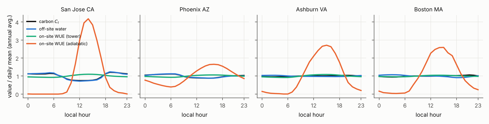
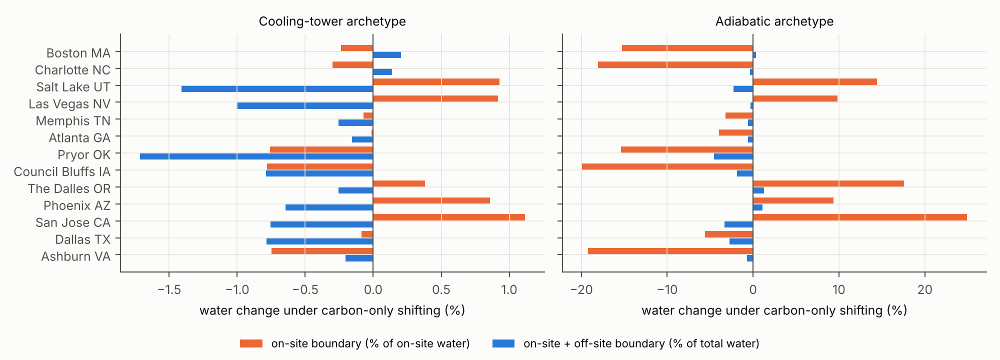
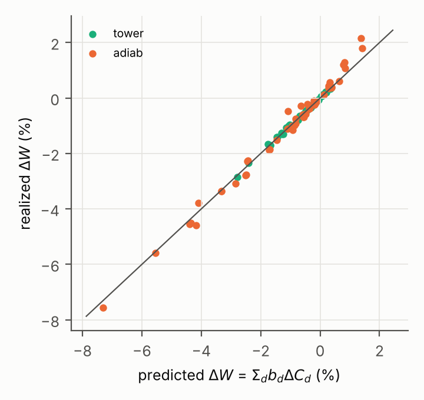
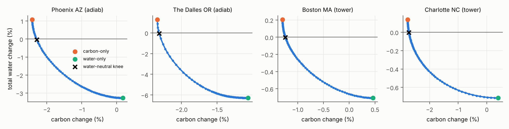
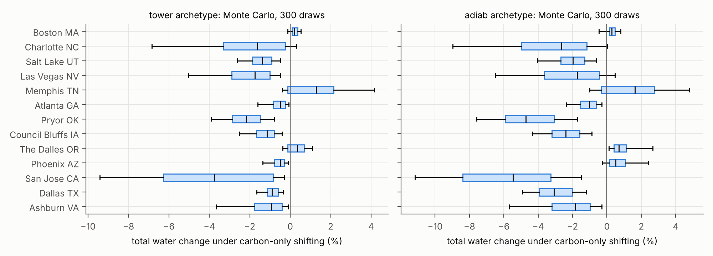

# Which Water Counts? Boundary-Dependent Carbon–Water Conflicts in Carbon-Aware Scheduling of AI Workloads

**Target venue:** ACM International Conference on Future and Sustainable Energy Systems (ACM e-Energy 2027). Environmental Research Letters would be the fallback journal.

---

## Abstract

AI operators are being asked to report and cut both carbon emissions and water use. The main operational lever, carbon-aware temporal load shifting, is often said to work against water. We test that claim against real data and find that its sign is not a property of the workload or the site alone. It also depends on the *accounting boundary*, meaning which water is counted. We make four contributions. (i) We prove a covariance identity: the error of the average-factor accounting used in sustainability reports is exactly ρ·CV_x·CV_s. (ii) We prove that the expected water side effect of any carbon-only reallocation equals b·ΔC, where b is the within-window regression slope of water intensity on carbon intensity. The sign of the conflict therefore reduces to the sign of one measurable covariance. That covariance splits into an on-site (cooling) term and an off-site (electricity-generation) term, which can have opposite signs. (iii) We show that the box-constrained scheduling problem is solved by a greedy rule and that its carbon–water Pareto frontier is convex. Convexity gives a closed-form bound on the carbon cost of making a schedule water-neutral. (iv) We assemble an hourly panel for 2023 covering 13 US data-center hubs. It combines physically reconciled EIA-930 generation by fuel with NOAA ISD weather and two transparent cooling archetypes (cooling tower and adiabatic), and we use it to simulate 24-hour deferrable AI batch load. All numbers below come from code run for this paper.

The covariance prediction matches simulated water changes with correlation 0.995 and the correct sign in all 104 configurations. Within the *on-site* boundary alone, carbon-only shifting raised cooling water at all five western hubs, by +9% to +25% of on-site water for adiabatic designs. In four of those five hubs, total water nonetheless fell once generation water was counted. A different mechanism appears in nuclear-heavy eastern hubs (Charlotte, Boston). There, night-time low-carbon hours are water-intensive at the power plant, so the signs reverse: on-site water falls and total water rises. Where a total-water penalty occurs, water-neutral scheduling keeps 95–99% of the carbon savings. In a 300-draw Monte Carlo over emission factors, water factors, hydropower attribution and cooling parameters, the median retained share is 96%. Finally, for a daytime-peaking inference profile, annual- or monthly-average WUE accounting understates on-site water at adiabatic sites by 8–20%. We state falsifiable predictions and a test protocol for operators that meter water hourly.

## 中文摘要

AI 运营方正被要求同时报告并削减碳排放与用水。主要的运营手段是碳感知的时间负载转移，人们常认为它会与节水目标冲突。我们用真实数据检验这一说法，发现冲突的正负号并不只取决于负载或站点，还取决于*核算边界*，即把哪部分用水计算在内。本文有四项贡献。(i) 证明一个协方差恒等式：可持续发展报告中常用的"平均因子"核算，其误差恰为 ρ·CV_x·CV_s。(ii) 证明任何仅以碳为目标的负载重分配，其期望用水副作用等于 b·ΔC，其中 b 为时间窗内水强度对碳强度的回归斜率。冲突的正负号因此归结为一个可测协方差的正负号。该协方差可分解为现场冷却项与场外发电项，两项可能符号相反。(iii) 证明带上下界的调度问题可用贪心规则求解，且其碳–水帕累托前沿为凸；由凸性可得"水中性"调度碳代价的闭式上界。(iv) 构建 2023 年美国 13 个数据中心枢纽的逐时面板数据：将经物理一致化处理的 EIA-930 分燃料发电数据、NOAA ISD 气象数据与两种透明的冷却原型（冷却塔、绝热蒸发）结合，用于模拟 24 小时可推迟的 AI 批处理负载。下文所有数字均来自本文运行的代码。

协方差预测与模拟所得用水变化的相关系数为 0.995，104 个配置的符号全部正确。仅看*现场*边界，碳优先调度使全部 5 个西部枢纽的冷却用水上升（绝热设计为现场用水的 +9% 至 +25%）。但在其中 4 个枢纽，计入发电用水后总用水反而下降。核电占比高的东部枢纽（夏洛特、波士顿）出现另一种机制：夜间低碳时段的发电端耗水更高，因此符号反转，现场用水下降而总用水上升。在出现总用水惩罚的情形中，水中性调度可保留 95–99% 的碳减排；在排放因子、水因子、水电归因与冷却参数的 300 次蒙特卡洛抽样中，保留比例中位数为 96%。最后，对于白天达峰的推理负载，按年或按月平均 WUE 核算会把绝热冷却站点的现场用水低估 8–20%。文末给出可证伪的预测，以及供具备逐时水计量的运营方使用的检验方案。

---

## 1 Introduction

AI is now a visible driver of electricity demand. The IEA's base case has global data-centre electricity use roughly doubling to about 945 TWh by 2030 [IEA 2025], and LBNL's 2024 report documents a renewed rise in US data-centre consumption driven by accelerated servers [Shehabi et al. 2024]. Water has followed carbon onto the agenda. Li et al. estimated the on-site and off-site water footprint of large models and argued that the time and place of training matter for water [Li et al. 2025]. Production measurements now report water per prompt alongside energy and carbon [Elsworth et al. 2025].

Carbon-aware temporal shifting is the most widely deployed operational lever for AI's environmental cost. Deferrable work (training checkpoints, batch inference, evaluation sweeps, data processing) is moved into hours when grid carbon intensity is low [Wiesner et al. 2021; Radovanović et al. 2023; Dodge et al. 2022; Sukprasert et al. 2024]. A growing literature warns that carbon and water objectives conflict. WaterWise reports that "carbon and water sustainability are at odds with each other — and, optimizing one alone hurts the other" [Jiang et al. 2025]. Other work co-optimizes the two across regions [Li, Yang, Wierman & Ren 2024; Attenni et al. 2026].

The physical intuition behind the conflict is that low-carbon hours on solar-heavy grids are midday hours, and midday is when evaporative cooling uses the most water. Most corporate disclosures, however, report water usage effectiveness (WUE), which counts *on-site* water only. Water consumed at power plants, which can be larger, is usually left out [Mytton 2021; Siddik et al. 2021]. That raises a question prior work has not isolated: **is the carbon–water conflict a property of the system, or of the accounting boundary?** If the conflict's sign flips when off-site water is counted, a policy that penalizes carbon-aware scheduling for raising WUE could raise total freshwater consumption. A policy that ignores on-site water could shift burden onto local watersheds.

We answer this with a narrow, testable formulation. We hold the workload fixed (a 24-hour-deferrable fraction of a flat AI batch load) and the site fixed (one of 13 US hubs). We then ask how carbon-only scheduling changes water within each boundary.

**Contributions.**

1. **Accounting identity (Prop. 1).** The relative error of average-factor footprint accounting, i.e. reported energy × annual mean intensity, is exactly ρ(x,s)·CV(x)·CV(s). It is unaffected by monthly averaging when the covariance is diurnal. Empirically, for a daytime-peaking inference profile with ±30% amplitude, annual and monthly WUE accounting understate on-site water at adiabatically cooled sites by 7.8–19.9%, and at cooling-tower sites by 0.6–1.2%.
2. **A one-number test for the conflict (Prop. 2, Cor. 2).** For any carbon-driven reallocation, E[ΔW] = b·ΔC, where b = Cov(C,W)/Var(C) is computed within the scheduling window. The water penalty exists iff b < 0. Splitting b into on-site and off-site parts gives the exact conditions under which the on-site and total boundaries disagree. Validated on 104 simulated configurations: correlation 0.995 between prediction and outcome, 100% sign agreement, median absolute error 0.04 percentage points.
3. **Structure of the joint problem (Prop. 3, Cor. 3).** The box-constrained scheduling LP is solved by a greedy rule on a scalarized score. Its bi-objective frontier is convex and piecewise linear. This yields a closed-form upper bound on the carbon cost of water neutrality, which is loose but valid in every case.
4. **A sourced, reproducible hourly panel and its findings.** It covers 13 hubs × 8,754 h in 2023. It identifies three mechanisms behind the conflict: a *solar–heat* channel (western grids, on-site), a *nuclear–night* channel (eastern grids, off-site) and a *hydro-attribution* channel (TVA, BPA). It also shows that water-neutral carbon-aware scheduling keeps a median 96% of carbon savings across 7,800 Monte Carlo site-draws.

We do not claim that temporal shifting is a large lever. In our setting it cuts operational carbon by 0.9–4.9% (flexible share 30%), in line with the limits documented by Sukprasert et al. [2024]. Our claim is narrower: whether that lever "hurts water" is a boundary-dependent and site-dependent quantity. It can be predicted from one covariance, and it is cheap to neutralize.

## 2 Related Work

**Measuring AI's carbon footprint.** Early accounting estimated training emissions from hardware power and grid averages [Strubell et al. 2019; Patterson et al. 2021]. Later work added life-cycle stages [Luccioni et al. 2023], measured software carbon intensity on cloud instances [Dodge et al. 2022] and measured production inference end to end [Elsworth et al. 2025]. These works mostly multiply energy by an average (often annual) grid intensity. Prop. 1 quantifies exactly when that is biased.

**Measuring water.** Mytton [2021] reviews data-centre water consumption and shows that WUE excludes electricity-generation water. Siddik et al. [2021] quantify US data-centre direct and indirect water and scarcity footprints. Li et al. [2025] estimate on-site plus off-site water for AI models and highlight its spatio-temporal variation. Shehabi et al. [2024] simulate PUE and site WUE across cooling types and US weather stations and find the highest WUE for water-cooled chillers without economizers. Power-plant water factors come from the NREL review of Macknick et al. [2011; 2012]. Hydropower is often excluded [Macknick et al. 2012; Spang et al. 2014] or attributed via reservoir evaporation [Torcellini et al. 2003; Mekonnen & Hoekstra 2012].

**Carbon-aware and water-aware scheduling.** Temporal shifting [Wiesner et al. 2021] and production load shaping [Radovanović et al. 2023] reduce carbon. Sukprasert et al. [2024] bound the achievable gains. WaterWise [Jiang et al. 2025] co-optimizes carbon and water across regions with a MILP and a wet-bulb-based WUE regression. Li, Yang, Wierman & Ren [2024] study geographic load balancing for environmental equity. Attenni et al. [2026] evaluate spatio-temporal shifting for carbon, water and land with provider-declared annual PUE/WUE. To our knowledge, none of these isolates (a) the *within-day* covariance that governs temporal shifting, (b) how the conflict's sign depends on boundary, or (c) a closed-form test and bound. They mostly report optimizer outcomes for chosen settings.

**Data.** We use the physically reconciled EIA-930 data and consumption-based emissions of de Chalendar et al. [2019] and de Chalendar & Benson [2021], and the NOAA Integrated Surface Database [Smith et al. 2011].

## 3 Model

### 3.1 Signals

Index hours by t. Grid signals for the balancing authority (BA) serving a site are the generation shares σ_{f,t} by fuel f. Production-based carbon intensity is c_t = Σ_f σ_{f,t} κ_f (gCO₂e/kWh) and generation water intensity is EWIF_t = Σ_f σ_{f,t} ω_f (L/kWh consumed). Facility signals are PUE_t and the on-site water usage effectiveness WUE_t (L per IT kWh). Per unit of IT energy, the **carbon** and **water** intensities are

  C_t = PUE_t · c_t,  W_t = W^on_t + W^off_t,  W^on_t = WUE_t,  W^off_t = PUE_t · EWIF_t.

We call W^on the *on-site boundary*, which is what WUE reports. W is the *total operational boundary*, which corresponds to the "scope-1 + scope-2 water" of Li et al. [2025].

### 3.2 Scheduling problem

A site runs a flat IT load of 1 unit per hour. A fraction φ is deferrable within a window of N hours (N = 24 local hours by default; 72 in the sensitivity analysis). Writing x_t = 1 − φ + y_t, the operator chooses y to

  min Σ_t s_t y_t  s.t. Σ_t y_t = Nφ,  0 ≤ y_t ≤ 2φ,     (LP)

so load stays in [1−φ, 1+φ]. The upper bound reflects provisioned capacity. The score is s_t = λ C̃_t + (1−λ) W̃_t, with tilde denoting normalization by the site's annual mean and λ ∈ [0,1]. λ = 1 is carbon-only scheduling and λ = 0 is water-only. The baseline is the flat schedule x ≡ 1.

### 3.3 Theory

**Proposition 1 (average-factor accounting error).** Let x_t ≥ 0 be any load and s_t any intensity over N hours, with population means x̄, s̄, standard deviations σ_x, σ_s and correlation ρ. Let F = Σ x_t s_t (hourly accounting) and F̂ = (Σ x_t)·s̄ (average-factor accounting). Then

  (F − F̂)/F̂ = ρ · (σ_x/x̄) · (σ_s/s̄).

*Proof.* Σ x_t s_t = N(x̄ s̄ + Cov(x,s)) and F̂ = N x̄ s̄. Divide and use Cov = ρσ_xσ_s. ∎

*Remark.* If the averaging is done per month, the identity holds within each month. A covariance that is mainly diurnal (e.g. a daytime load peak meeting a daytime WUE peak) therefore survives monthly averaging almost entirely. The error vanishes only at the resolution of the covariance itself.

**Proposition 2 (linear side effect of carbon-driven reallocation).** Fix a window and let Δx satisfy Σ_t Δx_t = 0. Define b = Cov(C,W)/Var(C) over the window and residuals e_t = (W_t − W̄) − b(C_t − C̄). Then exactly

  ΔW ≡ Σ_t Δx_t W_t = b·ΔC + Σ_t Δx_t e_t,  ΔC ≡ Σ_t Δx_t C_t.

If Δx is a function of (C_1,…,C_N) only, as the λ = 1 solution of (LP) is, and E[e_t | C_1,…,C_N] = 0 (linear conditional mean), then E[ΔW | C] = b·ΔC.

*Proof.* Substitute W_t = W̄ + b(C_t − C̄) + e_t. The constant terms vanish because Σ Δx_t = 0, and Σ Δx_t (C_t − C̄) = ΔC. For the conditional statement, Δx is C-measurable, so E[Σ Δx_t e_t | C] = Σ Δx_t E[e_t|C] = 0. ∎

**Corollary 2 (sign test and boundary disagreement).** Carbon-only scheduling achieves ΔC ≤ 0, and its expected water change is non-negative iff b ≤ 0, i.e. iff Cov(C,W) ≤ 0. Writing Cov(C,W) = Cov(C,W^on) + Cov(C,W^off), the on-site boundary and the total boundary give *opposite* verdicts iff either

  (a) Cov(C,W^on) < 0 < Cov(C,W^on) + Cov(C,W^off) (on-site penalty, total co-benefit), or
  (b) Cov(C,W^on) > 0 > Cov(C,W^on) + Cov(C,W^off) (on-site co-benefit, total penalty).

Case (a) arises when low-carbon hours are hot hours but fossil (water-intensive) generation is displaced at the same time. We call this the *solar–heat* channel. Case (b) arises when low-carbon hours are cool night hours but the low-carbon generation is itself water-intensive, as with nuclear and evaporatively cooled thermal plants. We call this the *nuclear–night* channel.

**Proposition 3 (greedy optimality; convex frontier).** Let N be even. (LP) is solved by setting y_t = 2φ on the N/2 hours of lowest score s_t and y_t = 0 elsewhere. As λ ranges over [0,1], the image {(ΣC_t x_t, ΣW_t x_t)} of the optimal solutions traces the Pareto frontier of the bi-objective problem min (ΣC x, ΣW x) over the same polytope. The frontier is convex and piecewise linear, with at most N(N−1)/2 breakpoints per window. The annual frontier is the Minkowski sum of window frontiers and is convex and piecewise linear too.

*Proof sketch.* (LP) is a continuous knapsack with equal capacities and unit weights. An exchange argument shows that any feasible y with y_i < 2φ, y_j > 0 and s_i < s_j is improved by moving mass from j to i, which leaves the lowest-N/2 assignment. The feasible set P is a polytope, and its image under the linear map (C·,W·) is a polytope Q. The Pareto set of a bi-objective linear program is the lower-left boundary of Q, which is convex. Every point on it minimizes some nonnegative weighting of the objectives, so it is reached by some λ (normalization rescales λ monotonically). Order changes between two hours occur at a single λ per pair, which gives the breakpoint bound. Windows are independent, so annual images add. ∎

**Corollary 3 (carbon cost of water neutrality).** Let (C_c, W_c) and (C_w, W_w) be the carbon-only and water-only endpoints, in percent change from baseline, and let P = W_c > 0 be the water penalty, with P ≤ W_c − W_w. Along a convex frontier the exchange rate (water recovered per unit of carbon given up) is non-increasing as one moves from the carbon end. The first segment's average rate is therefore at least the whole frontier's, and the carbon given up to reach ΔW = 0 is at most

  P · (C_w − C_c) / (W_c − W_w).

Equivalently, water-neutral scheduling keeps at least 1 − P(C_w − C_c)/((W_c − W_w)|C_c|) of the carbon-only savings.

### 3.4 Data (sourced)

*Grid.* We use the gridemissions bulk dataset [de Chalendar et al. 2019; de Chalendar & Benson 2021]: hourly EIA-930 generation by fuel (coal, natural gas, nuclear, oil, other, solar, unknown, hydro, wind) after physics-based reconciliation, plus consumption-based CO₂ intensity, for calendar year 2023 (UTC). We checked the UTC alignment against solar output, which peaks at local noon in CISO. Carbon factors κ_f are exactly those used by gridemissions (gCO₂e/kWh: coal 1000, gas 469, oil 840, other/unknown 439, solar 46, nuclear 16, wind 12, hydro 4), so our production-based c_t is consistent with their consumption-based series ci_cons, which we use as an alternative signal.

*Generation water.* ω_f are operational consumption medians from the NREL review [Macknick et al. 2011, Table 2]: recirculating (tower) coal 687, NGCC 198, nuclear 672 and gas/oil steam 826 gal/MWh, i.e. 2.60, 0.75, 2.54 and 3.13 L/kWh. Solar PV and wind are set to 0, following the same review's finding that they are the lowest. "Other/unknown" is an assumption (2.0 L/kWh; swept over 0–3.8). Hydropower is excluded in the central case, following Macknick et al. [2012] and Spang et al. [2014]. In the sensitivity analysis it takes 17 L/kWh (the NREL-derived value tabulated by Attenni et al. [2026]) or 68 L/kWh (end-use basis, Torcellini et al. [2003]). The Monte Carlo draws each thermal factor uniformly between the once-through median (coal 250, NGCC 100, nuclear 269, steam 240 gal/MWh) and the tower maximum (1100, 300, 845, 1170 gal/MWh), all from Macknick et al. [2011].

*Weather and sites.* Hourly air temperature and dew point come from NOAA ISD-Lite [Smith et al. 2011], with gaps of at most 6 h linearly interpolated. Each hub is paired with the nearest major station and its BA: Ashburn VA (PJM; Dulles), Dallas TX (ERCO; DFW), San Jose CA (CISO; SJC), Phoenix AZ (AZPS; PHX), The Dalles OR (BPAT; KDLS), Council Bluffs IA (MISO; Omaha), Pryor OK (SWPP; Tulsa), Atlanta GA (SOCO; ATL), Memphis TN (TVA; MEM), Las Vegas NV (NEVP; LAS), Salt Lake UT (PACE; SLC), Charlotte NC (DUK; CLT) and Boston MA (ISNE; BOS). Relative humidity uses the Magnus form with Alduchov & Eskridge [1996] coefficients, and wet-bulb temperature uses Stull [2011]. Each site has 8,754 aligned hours and 363–364 complete local days.

### 3.5 Cooling archetypes (assumption-driven, transparent)

We do not have metered hourly WUE for any facility. We therefore use two physically motivated parametric archetypes, report both, and sweep their parameters.

* **Tower** (water-cooled chiller plant with evaporative cooling tower). All facility energy (PUE_t per IT kWh) is rejected as heat. A fraction ε(T) = clip(0.55 + 0.012·T, 0.5, 0.95) is rejected latently (h_fg = 2.43 MJ/kg, i.e. 1.48 L per kWh of latent heat), and blowdown multiplies the total by COC/(COC−1) with COC = 4. The resulting annual-mean WUE is 1.55–1.88 L/kWh across sites (results/site_annual_means.csv).
* **Adiabatic** (air-side economizer with direct evaporative assist). Water is used only when the dry-bulb temperature T exceeds the supply set-point T_set = 24 °C. It cools supply air by min(T − T_set, 0.85(T − T_wb)), with air mass set by a 12 K server temperature rise and a 1.1 blowdown factor. Annual-mean WUE is 0.03–0.64 L/kWh, highest in Phoenix and Las Vegas.
* **PUE** rises with wet-bulb temperature: PUE_t = 1.10 + 0.008·max(0, T_wb − 10 °C), giving annual means of 1.12–1.15.

Shehabi et al. [2024] likewise find that chiller-plus-tower designs have the highest site WUE and that adiabatic designs use water mainly when wet mode is active. Our archetypes reproduce that qualitative ordering. They are not calibrated to any operator.

### 3.6 Experiments

E1 (§4.1) computes within-day correlations ρ(C,W^on), ρ(C,W^off) and ρ(C,W). E2 (§4.2) solves (LP) for each site, archetype and carbon signal at φ = 0.3, plus φ ∈ {0.1, 0.5} with the production-based signal. It reports ΔC, ΔW within both boundaries, the frontier over 101 values of λ, and the water-neutral point. E3 (§4.3) tests Prop. 2 on all 104 configurations. E4 (§4.4) is the accounting-bias experiment: a daytime-peaking inference profile x_t = 1 + 0.3 cos(2π(h−15)/24) in local hour h, with error computed against the annual- and monthly-average factor. E5 (§4.5) is a 300-draw Monte Carlo over all uncertain inputs (Table 3), including φ ~ U[0.1, 0.5] and window length ∈ {24, 72} h. Runtime is under 4 minutes on one CPU.

## 4 Results

All numbers in this section come from `results/` (files named in brackets) produced by the code in `code/`.

### 4.1 Diurnal structure: two opposing channels

Figure 1 (fig_diurnal.png) shows mean diurnal profiles. In San Jose (CISO) and Phoenix, carbon intensity C falls by about 25% around midday as solar displaces gas. Generation water W^off falls in lockstep because the displaced gas and coal are evaporatively cooled. On-site WUE peaks in the afternoon: adiabatic WUE in San Jose reaches about 4× its daily mean. In Ashburn and Boston, C and W^off are nearly flat within the day. Their mean within-day correlation is *negative* (ρ(C,W^off) = −0.30 and −0.48; Table 1), because the low-carbon night hours carry a higher nuclear share and nuclear is water-intensive per kWh. Averaged over days, ρ(C,W^off) ranges from −0.48 (Boston) to +1.00 (Salt Lake). ρ(C,W^on) under the tower archetype ranges from −0.65 (Phoenix) to +0.37 (Pryor) [shifting_summary.csv].

*Figure 1. Annual-mean diurnal profiles (normalized to the daily mean) of carbon intensity, off-site water, and on-site WUE under two archetypes.*

### 4.2 Carbon-only shifting: the verdict depends on the boundary

**Table 1.** Carbon-only scheduling (λ = 1), φ = 0.3, 24-h window, production-based carbon. ΔW total is in % of total operational water; ΔW on-site is in % of on-site water. "Retained" is the share of carbon savings kept at the water-neutral point on the λ grid. [shifting_summary.csv; tables.md]

| Site (BA) | Arch. | on-site share | ρ(C,W) | ΔC % | ΔW total % | ΔW on-site % | retained |
|---|---|---|---|---|---|---|---|
| Ashburn (PJM) | tower | 0.48 | 0.19 | −0.90 | −0.20 | −0.7 | 1.000 |
| Dallas (ERCO) | tower | 0.63 | 0.69 | −2.85 | −0.79 | −0.1 | 1.000 |
| San Jose (CISO) | tower | 0.69 | 0.65 | −4.73 | −0.75 | +1.1 | 1.000 |
| Phoenix (AZPS) | tower | 0.56 | 0.61 | −2.42 | −0.65 | +0.9 | 1.000 |
| The Dalles (BPAT) | tower | 0.78 | 0.29 | −2.34 | −0.26 | +0.4 | 1.000 |
| Council Bluffs (MISO) | tower | 0.50 | 0.66 | −1.59 | −0.79 | −0.8 | 1.000 |
| Pryor (SWPP) | tower | 0.58 | 0.85 | −3.83 | −1.72 | −0.8 | 1.000 |
| Atlanta (SOCO) | tower | 0.52 | 0.29 | −1.02 | −0.16 | −0.0 | 1.000 |
| Memphis (TVA) | tower | 0.47 | 0.25 | −1.10 | −0.25 | −0.1 | 1.000 |
| Las Vegas (NEVP) | tower | 0.64 | 0.84 | −4.87 | −1.00 | +0.9 | 1.000 |
| Salt Lake (PACE) | tower | 0.49 | 0.89 | −3.50 | −1.41 | +0.9 | 1.000 |
| Charlotte (DUK) | tower | 0.43 | −0.12 | −2.77 | **+0.14** | −0.3 | 0.985 |
| Boston (ISNE) | tower | 0.54 | −0.29 | −1.30 | **+0.21** | −0.2 | 0.958 |
| Ashburn (PJM) | adiab. | 0.05 | 0.05 | −0.90 | −0.70 | −19.2 | 1.000 |
| Dallas (ERCO) | adiab. | 0.22 | 0.69 | −2.85 | −2.76 | −5.6 | 1.000 |
| San Jose (CISO) | adiab. | 0.05 | 0.73 | −4.73 | −3.35 | **+24.9** | 1.000 |
| Phoenix (AZPS) | adiab. | 0.31 | 0.07 | −2.42 | **+1.08** | **+9.4** | 0.946 |
| The Dalles (BPAT) | adiab. | 0.19 | 0.52 | −2.34 | **+1.29** | **+17.6** | 0.989 |
| Council Bluffs (MISO) | adiab. | 0.06 | 0.79 | −1.59 | −1.85 | −19.9 | 1.000 |
| Pryor (SWPP) | adiab. | 0.12 | 0.91 | −3.83 | −4.54 | −15.4 | 1.000 |
| Atlanta (SOCO) | adiab. | 0.07 | 0.32 | −1.02 | −0.58 | −4.0 | 1.000 |
| Memphis (TVA) | adiab. | 0.07 | 0.34 | −1.10 | −0.60 | −3.2 | 1.000 |
| Las Vegas (NEVP) | adiab. | 0.29 | 0.43 | −4.87 | −0.29 | **+9.8** | 1.000 |
| Salt Lake (PACE) | adiab. | 0.08 | 0.75 | −3.50 | −2.27 | **+14.5** | 1.000 |
| Charlotte (DUK) | adiab. | 0.04 | 0.12 | −2.77 | −0.36 | −18.1 | 1.000 |
| Boston (ISNE) | adiab. | 0.02 | −0.35 | −1.30 | **+0.37** | −15.3 | 0.966 |

Three patterns stand out.

**(i) On-site penalties are western and systematic.** Under both archetypes, carbon-only shifting increases on-site water at exactly the five western hubs (San Jose, Phoenix, The Dalles, Las Vegas, Salt Lake) [headline.json: onsite_penalty_sites]. The increase is +0.4% to +1.1% of on-site water for towers, whose WUE varies little within a day, and +9.4% to +24.9% for adiabatic designs. An operator who discloses only WUE would see carbon-aware scheduling "hurt water" at these sites.

**(ii) Total water usually improves anyway.** At four of the five western hubs under the tower archetype, and at three of five (San Jose, Las Vegas, Salt Lake) under the adiabatic archetype, total water falls. Displacing evaporatively cooled fossil generation saves more water than the extra midday evaporation costs (solar–heat channel, Cor. 2(a)). The exceptions are Phoenix and The Dalles under the adiabatic archetype. Phoenix has very high afternoon adiabatic WUE and a large on-site share (0.31). The Dalles has little fossil generation to displace (70% hydro, which the central case gives zero water).

**(iii) The nuclear–night channel reverses the pattern in the East.** In Charlotte and Boston, carbon-only shifting *lowers* on-site water (cool nights) but *raises* total water (+0.14% and +0.21% for towers, +0.37% for adiabatic Boston). Low-carbon hours there have a higher share of nuclear, whose tower-cooled consumption factor (2.54 L/kWh) is higher than NGCC's (0.75 L/kWh). This is Cor. 2(b). Here, an operator who reports only WUE would see a co-benefit that disappears under the total boundary.

Across the 26 site × archetype cases, the on-site and total boundaries disagree in sign in 11 cases: 7 for towers and 4 for adiabatic designs [headline.json: boundary_sign_flip]. Carbon savings from shifting are modest, −0.90% to −4.87% at φ = 0.3, and water changes scale roughly linearly with φ [shifting_summary.csv, φ ∈ {0.1, 0.3, 0.5}].

*Figure 2. Water change under carbon-only shifting, measured within the on-site boundary (orange, % of on-site water) and the total boundary (blue, % of total water).*

### 4.3 The one-covariance test works

Prop. 2 predicts ΔW = Σ_d b_d ΔC_d using the daily regression slope b_d. Across all 104 configurations (13 sites × 2 archetypes × {production, consumption} carbon × φ variants), prediction and simulated outcome correlate at 0.995. The sign agrees in 100% of cases, and the median absolute error is 0.04 percentage points (Figure 3) [headline.json]. The cross-site correlation between the *mean* within-day ρ(C,W) and the realized water-per-carbon ratio is only 0.57. The slope b, not the correlation, is the right summary statistic, because it carries the relative variance of W.

*Figure 3. Predicted (Prop. 2) vs simulated water change.*

### 4.4 Water neutrality is cheap

Figure 4 (fig_frontiers.png) plots the convex frontiers for the five cases with a total-water penalty. They are steep near the carbon-only end, as Prop. 3 and Cor. 3 predict. Linearly interpolating the exact water-neutral point on the 101-point frontier, water-neutral scheduling keeps 95.8% (Boston, tower), 96.9% (Boston, adiab.), 98.5% (Charlotte, tower), 94.9% (Phoenix, adiab.) and 99.0% (The Dalles, adiab.) of the carbon-only savings [corollary3_bound.csv]. The Cor. 3 lower bounds for the same cases are 69.4%, 73.0%, 81.5%, 73.4% and 90.8%: valid in every case, but conservative. Measured on the λ grid, the initial exchange rate is 3.3–53 percentage points of water recovered per percentage point of carbon given up [tables.md].

*Figure 4. Carbon–water Pareto frontiers (φ = 0.3) at the four hubs with a total-water penalty under at least one archetype.*

### 4.5 Average-factor accounting under-reports on-site water of daytime loads

For the daytime-peaking inference profile (±30%, peak at 15:00 local), annual-average-factor accounting understates on-site water by 7.8% (Phoenix) to 19.9% (San Jose) under the adiabatic archetype. Under the tower archetype the understatement is 0.6–1.2%. Monthly-average accounting gives almost the same errors (e.g. San Jose adiabatic −19.9%), as the Prop. 1 remark predicts. The errors match Prop. 1's closed form to the printed precision in all 26 cases [accounting_bias.csv: bias_* vs theory_*]. For carbon the error is −1.8% to +2.7%, and for total water −3.1% to +1.3%. The large errors are therefore specific to on-site evaporative water: its high hourly variance (CV_s) multiplies a modest load CV.

### 4.6 Robustness (Monte Carlo)

**Table 3.** Inputs resampled in each of 300 draws: thermal water factors (each ~U[once-through median, tower max]); hydropower ∈ {0, 17, 68} L/kWh; other/unknown ~U[0, 3.8]; carbon signal ∈ {production, consumption}; PUE slope ~U[0.004, 0.012]/K; COC ~U[3,6]; latent-fraction slope ~U[0.008, 0.016]/K; T_set ~U[21, 27] °C; evaporative effectiveness ~U[0.7, 0.9]; server ΔT ~U[10, 15] K; φ ~U[0.1, 0.5]; window ∈ {24, 24, 72} h. The seed is fixed. Draws × sites × archetypes = 7,800 [mc_draws.csv].

Key outcomes [mc_summary.csv, headline.json]:

* The total-water penalty is the exception: P(ΔW > 0) = 0.23 pooled. Within the on-site boundary the penalty is common: P(ΔW^on > 0) = 0.43. The on-site boundary flags a penalty more often than the total boundary.
* Sites are stable in sign across draws. On-site penalties occur in 100% of draws at the five western hubs and never at Ashburn, Council Bluffs, Pryor, Boston or Charlotte (adiabatic). Total-water penalties are robust at The Dalles (adiabatic 0.96, tower 0.67), Boston (0.86, 0.89) and Phoenix-adiabatic (0.85). They are rare (≤ 0.01) at Ashburn, Atlanta, Council Bluffs, Dallas, Pryor, Salt Lake and San Jose.
* **Hydro attribution is a third channel.** Memphis (TVA, about 10% hydro) shows a total-water penalty in 0% of draws when hydropower is given zero water and in 100% of draws when it is given 17 or 68 L/kWh. Pooled P(ΔW > 0) rises from 0.16 (hydro 0) to 0.26 (hydro 17 or 68). Which water counts thus also includes whether reservoir evaporation is attributed to electricity, and that choice alone can flip the verdict.
* The carbon signal (production vs consumption-based) and the window (24 vs 72 h) matter little: P(ΔW > 0) is 0.22 vs 0.24 and 0.24 vs 0.21.
* In draws with a total-water penalty, water-neutral scheduling (λ grid of 41 points) keeps a median 96.4% of carbon savings (5th percentile 83.0%, minimum 72.7%).

*Figure 5. Distribution of total-water change under carbon-only shifting across 300 Monte Carlo draws (box: interquartile range; whiskers: 5–95%).*

## 5 Discussion

**Reconciling with prior claims.** Our results do not contradict reports that carbon and water objectives conflict [Jiang et al. 2025]. They locate the conflict more precisely. For *temporal* shifting, the conflict in the on-site boundary is real, large for evaporative designs, and western. Within the total boundary it is usually absent in the West and appears instead in nuclear-heavy grids and wherever hydro evaporation is attributed. A single statement that "carbon-aware scheduling hurts water" is therefore under-specified until the boundary and the hydro convention are named. Spatial shifting, which we do not study, involves cross-site differences in annual means and may behave differently [Attenni et al. 2026; Li, Yang, Wierman & Ren 2024].

**Implications for measurement and disclosure.**
(1) *Report both boundaries.* WUE alone can reverse the sign of a policy's water effect relative to total operational water (11 of 26 cases here). Disclosure frameworks that ask for WUE should also ask for generation-water intensity on the same hourly basis.
(2) *Report hourly-matched water.* Prop. 1 shows that annual or monthly average-factor accounting is biased by ρ·CV_x·CV_s. For evaporatively cooled sites running daytime-heavy inference, the understatement is 8–20% in our archetype, and monthly averaging does not fix it. This is the water analogue of the hourly-matching argument for carbon.
(3) *State the hydro convention.* It flips verdicts at hydro-rich BAs.

**Implications for reduction.** Operators do not need a full co-optimizer to avoid water harm. Cor. 2 gives a monitoring rule: estimate b = Cov(C,W)/Var(C) over the scheduling window from forecasts, and if b < 0, add a small water weight. Cor. 3 and the empirical frontiers show that this costs only a few percent of the carbon savings. The rule extends to scarcity-weighted water (multiply W^on and W^off by local and remote scarcity factors) without changing the theory, because Props. 2–3 hold for any per-hour linear footprint.

**Falsifiable predictions and test protocol.** For operators with hourly metered make-up water and IT energy:

* **H1 (solar–heat).** At evaporatively cooled sites in CISO, NEVP, AZPS, PACE and BPAT, carbon-aware temporal shifting raises metered on-site water per IT kWh relative to a matched control, by an amount ≈ b_on·ΔC with b_on estimated from the preceding 30 days.
* **H2 (nuclear–night).** At sites in DUK and ISNE, the same intervention lowers metered on-site water, while hourly-matched generation-water accounting (tower-based factors) shows an increase.
* **H3 (accounting).** For daytime-peaking inference at adiabatic sites, the ratio of hourly-metered on-site water to annual-WUE × energy exceeds 1 by ρ·CV_x·CV_WUE, ± measurement error.

*Protocol.* Use a randomized cluster-day design as in Radovanović et al. [2023], with treated days on carbon-aware load shaping and control days flat. Pre-register b_on and b_off estimated from the prior 30 days, then compare the treatment–control difference in metered water with b·ΔC. H1 is refuted if the 95% CI on the on-site water difference excludes positive values at a western evaporative site with |ΔC| ≥ 1%.

## 6 Limitations

* **Cooling models are archetypes, not measurements.** The magnitudes of on-site WUE and its hourly shape come from parametric models (§3.5), not metered data. The signs of ρ(C,W^on) are robust to the parameter sweeps, but magnitudes, and therefore the total-boundary verdict where on-site and off-site terms nearly cancel (e.g. Phoenix-tower vs Phoenix-adiabatic), depend on the design. Real facilities mix modes, use set-point resets and may run dry coolers.
* **Average, not marginal, factors.** We use average generation mixes. The marginal unit displaced by flexible load can differ, and marginal water factors are not publicly available hourly. Our results describe attributional accounting, which is how disclosures are prepared, not the consequential effect on the grid.
* **Price-taker assumption.** Shifted load does not change the grid mix. For multi-hundred-MW AI campuses this assumption weakens.
* **Water factors are national medians by technology, not plant-specific.** We apply recirculating-cooling medians fleet-wide in the central case. Once-through plants (common for older eastern nuclear and coal) consume less but withdraw far more. Withdrawal is not modeled. The nuclear–night result in Charlotte and Boston is not robust to lower nuclear factors: P(ΔW > 0) is 0.18 for Charlotte-tower in the Monte Carlo.
* **Production-based water.** Generation water uses each BA's own production mix. Imports are not traced for water, although they are for carbon in the consumption-based robustness signal.
* **EIA-930 categories.** "Other" mixes biomass, geothermal and storage. Batteries were not separated in our files. Its water factor is an assumption.
* **Scope.** One year (2023), 13 US hubs and one workload model (flat load with a 24/72-h deferrable fraction and symmetric capacity headroom). No scarcity weighting and no embodied (supply-chain) water or carbon. Weather comes from the nearest airport station, not the facility.
* **No real AI workload traces.** We did not run or meter any AI system. The workload is stylized.

## 7 Conclusion

Whether carbon-aware scheduling of AI workloads "costs water" is not a fixed fact. It is the sign of a within-window covariance between carbon intensity and water intensity, and that covariance depends on which water is counted. Using reconciled 2023 grid data, weather and transparent cooling models for 13 US hubs, we find that on-site-only accounting flags penalties in the solar-rich West that largely disappear once generation water is included. Total-boundary penalties appear instead in nuclear-heavy eastern grids and wherever hydro evaporation is attributed. In every penalty case a small water weight restores water neutrality while keeping most of the carbon savings. We recommend reporting both boundaries on an hourly-matched basis and stating the hydro convention. Schedulers can monitor the regression slope b = Cov(C,W)/Var(C) and add water weight only when b is negative.

## Reproducibility

`README.md` lists the run commands. All inputs are public (gridemissions S3 bulk file; NOAA ISD-Lite on AWS Open Data). All factors and assumptions are in `code/factors.py` and `code/cooling.py`. Every number in §4 is in `results/*.csv`, `results/tables.md` or `results/headline.json`.

## References

- Alduchov, O. A., & Eskridge, R. E. (1996). Improved Magnus form approximation of saturation vapor pressure. *Journal of Applied Meteorology*, 35(4), 601–609.
- Attenni, G., Moawad, Y., Bartolini, N., & Thamsen, L. (2026). Spatio-temporal shifting to reduce carbon, water, and land use footprints of cloud workloads. *Sustainable Computing: Informatics and Systems*, 52, 101498. doi:10.1016/j.suscom.2026.101498. (Preprint arXiv:2512.08725.)
- de Chalendar, J. A., & Benson, S. M. (2021). Physics-informed data reconciliation framework for real-time electricity and emissions tracking. *Applied Energy*, 304, 117761. doi:10.1016/j.apenergy.2021.117761.
- de Chalendar, J. A., Taggart, J., & Benson, S. M. (2019). Tracking emissions in the US electricity system. *Proceedings of the National Academy of Sciences*, 116(51), 25497–25502. doi:10.1073/pnas.1912950116.
- Dodge, J., Prewitt, T., Tachet des Combes, R., Odmark, E., Schwartz, R., Strubell, E., Luccioni, A. S., Smith, N. A., DeCario, N., & Buchanan, W. (2022). Measuring the carbon intensity of AI in cloud instances. In *Proc. ACM FAccT '22*.
- Elsworth, C., Huang, K., Patterson, D., Schneider, I., Sedivy, R., Goodman, S., Townsend, B., Ranganathan, P., Dean, J., Vahdat, A., Gomes, B., & Manyika, J. (2025). Measuring the environmental impact of delivering AI at Google scale. arXiv:2508.15734.
- International Energy Agency (2025). *Energy and AI*. IEA, Paris.
- Jiang, Y., Basu Roy, R., Kanakagiri, R., & Tiwari, D. (2025). WaterWise: Co-optimizing carbon- and water-footprint toward environmentally sustainable cloud computing. In *Proc. ACM PPoPP 2025*. arXiv:2501.17944.
- Li, P., Yang, J., Islam, M. A., & Ren, S. (2025). Making AI less "thirsty": Uncovering and addressing the secret water footprint of AI models. *Communications of the ACM*. arXiv:2304.03271.
- Li, P., Yang, J., Wierman, A., & Ren, S. (2024). Towards environmentally equitable AI via geographical load balancing. In *Proc. ACM e-Energy 2024*.
- Luccioni, A. S., Viguier, S., & Ligozat, A.-L. (2023). Estimating the carbon footprint of BLOOM, a 176B parameter language model. *Journal of Machine Learning Research*, 24(253), 1–15.
- Macknick, J., Newmark, R., Heath, G., & Hallett, K. C. (2011). *A Review of Operational Water Consumption and Withdrawal Factors for Electricity Generating Technologies*. NREL/TP-6A20-50900. National Renewable Energy Laboratory.
- Macknick, J., Newmark, R., Heath, G., & Hallett, K. C. (2012). Operational water consumption and withdrawal factors for electricity generating technologies: A review of existing literature. *Environmental Research Letters*, 7(4), 045802.
- Mekonnen, M. M., & Hoekstra, A. Y. (2012). *The Water Footprint of Electricity from Hydropower*. Value of Water Research Report Series No. 51, UNESCO-IHE.
- Mytton, D. (2021). Data centre water consumption. *npj Clean Water*, 4, 11.
- Patterson, D., Gonzalez, J., Le, Q., Liang, C., Munguia, L.-M., Rothchild, D., So, D., Texier, M., & Dean, J. (2021). Carbon emissions and large neural network training. arXiv:2104.10350.
- Radovanović, A., Koningstein, R., Schneider, I., Chen, B., Duarte, A., Roy, B., Xiao, D., Haridasan, M., Hung, P., Care, N., Talukdar, S., Mullen, E., Smith, K., Cottman, M., & Cirne, W. (2023). Carbon-aware computing for datacenters. *IEEE Transactions on Power Systems*, 38(2), 1270–1280.
- Shehabi, A., Smith, S. J., Hubbard, A., Newkirk, A., Lei, N., Siddik, M. A. B., Holecek, B., Koomey, J., Masanet, E., & Sartor, D. (2024). *2024 United States Data Center Energy Usage Report*. LBNL-2001637. Lawrence Berkeley National Laboratory.
- Siddik, M. A. B., Shehabi, A., & Marston, L. (2021). The environmental footprint of data centers in the United States. *Environmental Research Letters*, 16(6), 064017.
- Smith, A., Lott, N., & Vose, R. (2011). The Integrated Surface Database: Recent developments and partnerships. *Bulletin of the American Meteorological Society*, 92, 704–708.
- Spang, E. S., Moomaw, W. R., Gallagher, K. S., Kirshen, P. H., & Marks, D. H. (2014). The water consumption of energy production: An international comparison. *Environmental Research Letters*, 9, 105002.
- Strubell, E., Ganesh, A., & McCallum, A. (2019). Energy and policy considerations for deep learning in NLP. In *Proc. ACL 2019*.
- Stull, R. (2011). Wet-bulb temperature from relative humidity and air temperature. *Journal of Applied Meteorology and Climatology*, 50(11), 2267–2269.
- Sukprasert, T., Souza, A., Bashir, N., Irwin, D., & Shenoy, P. (2024). On the limitations of carbon-aware temporal and spatial workload shifting in the cloud. In *Proc. EuroSys '24*. doi:10.1145/3627703.3650079.
- Torcellini, P., Long, N., & Judkoff, R. (2003). *Consumptive Water Use for U.S. Power Production*. NREL/TP-550-33905. National Renewable Energy Laboratory.
- Wiesner, P., Behnke, I., Scheinert, D., Gontarska, K., & Thamsen, L. (2021). Let's wait awhile: How temporal workload shifting can reduce carbon emissions in the cloud. In *Proc. Middleware '21*. doi:10.1145/3464298.3493399.
