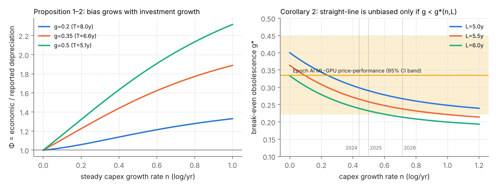
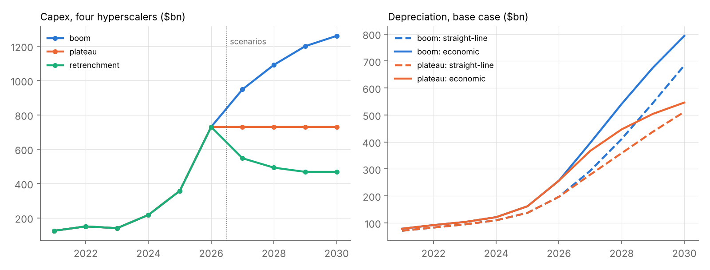
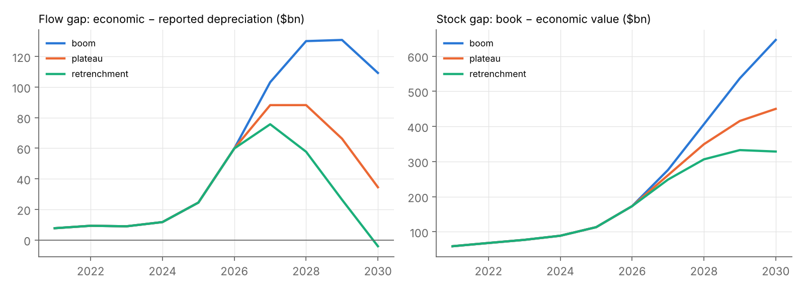
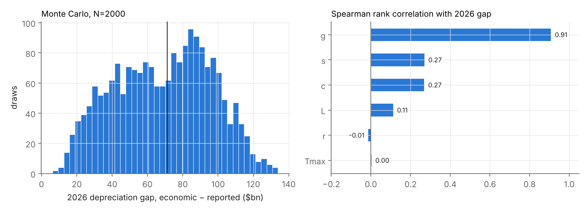
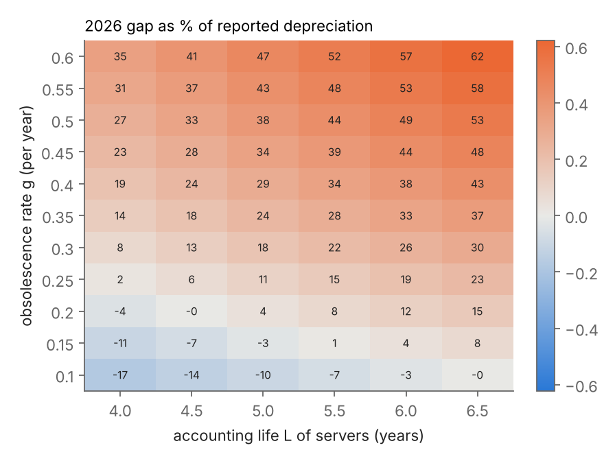

# Growth Hides Obsolescence: A Vintage-Capital Test of Whether Reported Earnings Overstate the Returns to AI Infrastructure

**Target venue:** *Economic Policy* (alternative: *Review of Accounting Studies*)

**Code and data:** `code/` (run `bash code/run_all.sh`, about 30 s on one CPU core); all outputs are in `results/`.

---

## Abstract

The question of whether AI investment is a bubble is usually framed as a revenue gap: does end-user revenue cover the capital being spent? This paper isolates a narrower, tractable piece of that question that the revenue-gap framing leaves out. Even with revenue held fixed, do the *reported* earnings of the firms doing the spending overstate the economic return on that spending? If so, how much of the overstatement comes from the pace of investment rather than from the choice of asset life? We build a vintage-capital model in which the market rental of a unit of AI compute falls at the rate *g* at which newer hardware lowers the cost of compute, operating costs are fixed, and free entry prices the asset. We prove four results. (i) Economic depreciation is front-loaded (Lemma 1). (ii) In a steady state with zero investment growth, straight-line depreciation matches economic depreciation in flow terms *whatever life is chosen* (Proposition 1). (iii) When investment grows at rate *n*, the ratio of economic to reported depreciation rises strictly with *n* (Proposition 2). In the closed-form case, straight-line accounting over *L* years understates depreciation exactly when *g* exceeds a break-even rate *g\**(*n*, *L*). This rate falls from 2/*L* at zero growth to about 0.23 per year at the 2026 hyperscaler growth rate. (iv) A gap between book value and economic value remains in the steady state even after the flow gap closes (Proposition 3). We calibrate *g* from Epoch AI's GPU price-performance trend (0.33/yr; 95% CI 0.22 to 0.45) and from H100 rental indices. We then apply the model to the property-and-equipment spending of Microsoft, Alphabet, Amazon and Meta ($357.5bn in fiscal 2025; about $730bn of 2026 guidance). In the base case, economic depreciation in 2026 exceeds straight-line depreciation by $60bn, or 30% of reported depreciation (Monte Carlo median $71bn, 90% interval $24 to 111bn). Book value exceeds economic value by $173bn. The flow gap is positive in every draw with *g* ≥ 0.2, and it turns negative only if obsolescence falls below 0.13/yr. Matching economic depreciation in 2026 with straight-line accounting would need a server life of about 3 years at *g* = 0.35. We think this reconciles two claims usually treated as rivals: that servers stay useful for about six years, and that depreciation is understated. The disagreement is about the *shape* of depreciation, not the life of the asset. We state five falsifiable predictions with test protocols. The model does not settle whether AI equity prices are a bubble. It identifies a growth-dependent, self-reversing component of reported profitability that a bubble test should remove.

## 中文摘要

关于"AI投资是否存在泡沫"的讨论多集中于"收入缺口"，即终端收入能否覆盖资本开支。本文研究其中一个被忽视而可处理的子问题：在收入给定的情况下，投资方报告的会计利润是否系统性高估AI基础设施的经济回报？这种高估有多少来自投资增速，而非折旧年限的选择？我们构建了一个资本年份（vintage capital）模型：算力的市场租金以新硬件降低算力成本的速率 *g* 下降，运营成本固定，资产价格由自由进入决定。我们证明了四个结论。(i) 经济折旧前高后低（引理1）。(ii) 投资零增长的稳态下，无论选择何种年限，直线折旧在流量上都等于经济折旧（命题1）。(iii) 投资以速率 *n* 增长时，经济折旧与报告折旧之比随 *n* 严格上升（命题2）；在闭式解情形下，当且仅当 *g* 超过临界值 *g\**(*n*, *L*) 时直线折旧低估折旧，该临界值从零增长时的 2/*L* 降至2026年超大规模云厂商增速下的约0.23/年。(iv) 流量偏差消失后，账面价值与经济价值之差在稳态中仍然存在（命题3）。我们用Epoch AI的GPU性价比趋势（*g*≈0.33/年，95%置信区间0.22–0.45）和H100租金指数校准 *g*，并将模型应用于微软、Alphabet、亚马逊和Meta的资本开支（2025财年3,575亿美元，2026年指引约7,300亿美元）。基准情形下，2026年经济折旧比直线折旧高600亿美元，占报告折旧的30%（蒙特卡洛中位数710亿美元，90%区间240–1,110亿美元）；账面价值比经济价值高1,730亿美元。在所有 *g*≥0.2 的抽样中流量缺口均为正，只有当 *g* 低于0.13/年时才转为负。若要在2026年让直线折旧与经济折旧相符，在 *g*=0.35 时服务器折旧年限需约3年。我们认为，"服务器可用六年"与"折旧被低估"并不矛盾，分歧在于折旧的形状而非年限。文章给出五个可证伪预测及检验方案。本模型不能判定AI股票价格是否为泡沫，但指出了报告盈利中一个依赖增速、会自行反转的成分，泡沫检验应先将其剔除。

---

## 1 Introduction

Between their 2023 and 2025 fiscal years, the cash spent on property and equipment by Microsoft, Alphabet, Amazon and Meta rose from $140.1bn to $357.5bn. The four companies' guidance for 2026 adds up to roughly $720–745bn [Capexwave 2026; MLQ.ai 2026]. Whether this is a bubble has been argued mostly through *revenue gaps*. Cahn's "$600B question" multiplies Nvidia's data-center run-rate by two for total cost of ownership and by two again for end-user margin, then compares the result with observed AI revenue [Cahn 2024]. Goldman Sachs asked whether there is "too much spend, too little benefit" [Goldman Sachs 2024]. Macroeconomic estimates of AI's productivity effect range from modest [Acemoglu 2024] to large.

A second argument has run alongside the first and has received much less formal treatment: the argument about **depreciation**. Since 2022 several hyperscalers have lengthened the accounting lives of servers. Microsoft moved from four to six years effective fiscal 2023, Alphabet moved to six years in 2023, and Meta moved to 5.5 years in January 2025, which it disclosed reduced 2025 depreciation by $2.92bn [Hudson Labs 2025a,b; CIO Dive 2022]. Amazon went the other way and shortened a subset of servers from six to five years in 2025, citing "the increased pace of technology development, particularly in the area of artificial intelligence" [Hudson Labs 2025c]. In November 2025 Michael Burry argued that the true economic life of AI servers is two to three years and that the hyperscalers' earnings are overstated as a result [CNBC 2025]. The usual reply is that older GPUs keep earning revenue for many years.

We argue that both sides frame this debate in terms of *life* when the quantity that matters is the *shape* of depreciation interacting with the *growth rate of investment*. This interaction was identified decades ago in the literature on accounting rates of return [Harcourt 1965; Fisher and McGowan 1983]. As far as we can find, it has not been applied to AI infrastructure, where both ingredients are extreme. Compute obsolescence is fast (FLOP/s per dollar of ML GPUs doubles about every two years [Hobbhahn and Besiroglu 2022]), and investment growth is unusually high (the log growth of the four firms' capex was 0.50 in 2025 and 0.71 on 2026 guidance; `results/extras.json`).

**Sub-question.** *Holding revenue and technology fixed, by how much does straight-line depreciation at the lives hyperscalers disclose overstate the economic profitability of their AI-infrastructure spending? How does the overstatement depend on investment growth, and when does it reverse?* This is one ingredient of a bubble test, not the test itself. If market valuations capitalize reported earnings, the component of those earnings that comes from depreciation timing should be removed before deciding whether prices are justified by fundamentals.

**Contributions.**

1. **A vintage-capital model of AI compute with closed-form economic depreciation** (Section 3). Free entry pins the rental level. The retirement age is endogenous. Economic depreciation has an explicit form, and we prove it is front-loaded under a stated sufficient condition (Lemma 1).
2. **Growth-neutrality and growth-amplification results** (Propositions 1–2, Corollaries 1–2). With zero growth, straight-line accounting is unbiased in flow terms *for any accounting life*. With growth, the bias rises strictly with the investment growth rate. We derive a closed-form break-even obsolescence rate *g\**(*n*, *L*) and show that it falls from 2/*L* toward zero as *n* rises.
3. **A persistent stock gap** (Proposition 3). Book value exceeds economic value by *L*/2 − E_δ[*a*] per unit of steady annual investment. This gap does not close when growth stops, and it measures write-down exposure.
4. **A calibrated fleet-level application with uncertainty quantification** (Sections 4–5). The model is applied to 10-K capex for 2021–2025 and company guidance for 2026, under three post-2026 scenarios, with a 2,000-draw Monte Carlo and break-even analyses. Every number is produced by code in `code/` or taken from a cited source, and each is labeled as one or the other.
5. **Five falsifiable predictions with test protocols** (Section 6). These cover rental-price decay, reported depreciation paths, useful-life revisions and impairments, and cross-sectional returns.

We do not claim to determine whether AI equities are mispriced. The contribution is a correction term, with explicit dependence on measurable parameters, that any such determination should include.

## 2 Related Work

**Revenue-gap arguments about AI capex.** Cahn [2024] made the best-known back-of-envelope case: required end-user revenue equals Nvidia data-center run-rate × 2 (GPUs are about half of data-center cost) × 2 (a 50% end-user gross margin), which gave $600bn against much smaller observed AI revenue. Goldman Sachs [2024] collected opposing views on whether roughly $1tn of planned capex would pay off. Acemoglu [2024] estimates from task-level evidence that the total-factor-productivity gains from AI over the next decade will be modest (well under 1%). These analyses take accounting at face value, or they bypass accounting by comparing capex to revenue directly. Our analysis is complementary. We hold the revenue question aside and ask how far reported profitability is a biased signal of economic return, which matters because valuations are anchored on reported earnings.

**Bubbles and technological revolutions.** Pástor and Veronesi [2009] show that bubble-like price paths of innovative firms can arise rationally during technological revolutions, because learning about a new technology's productivity changes the nature of its risk. Greenwood, Shleifer and You [2019] find that sharp industry price run-ups do not predict low average returns but do predict a much higher probability of a crash, and that issuance, volatility and turnover help forecast crashes. Historical studies of infrastructure manias are especially relevant. Odlyzko [2010] argues that public data during the British Railway Mania showed the lines could not earn the returns investors expected. Doms [2004] finds that U.S. IT investment in 1999–2000 exceeded what fundamentals-based models predicted, which he attributes to overly optimistic expectations in telecommunications and the dot-com sector. Our model adds an accounting channel. During an investment boom, reported profitability rises mechanically relative to economic profitability, and this can feed back into the expectations those studies highlight. At the firm level, Cooper, Gulen and Schill [2008] document that high asset growth predicts low subsequent returns. Our mechanism gives one specific reason why fast-growing, fast-obsolescing asset bases could have overstated reported returns.

**Accounting versus economic returns.** Harcourt [1965] showed that even in a golden-age steady state the accountant's rate of profit generally differs from the true rate, and that the difference depends on the depreciation method and the growth rate. Fisher and McGowan [1983] made the point forcefully: accounting rates of return, even when measured correctly and consistently, carry almost no information about economic rates of return, and the discrepancy depends on the time shape of an asset's cash flows and the firm's growth. Our Propositions 1–2 are a special case of this logic, re-derived for an asset whose cash-flow profile comes from a technology-obsolescence rate *g* that can be measured from hardware and rental-price data. Our contribution is the specialization, the closed-form break-even rate *g\**(*n*, *L*), the calibration, and the predictions. We do not claim the general insight.

**Economic depreciation measurement.** Hulten and Wykoff [1981] established the vintage-price method for estimating economic depreciation and found that geometric patterns approximate the depreciation of many assets well. Our rental-decay model produces a near-geometric pattern for compute (exactly geometric when operating costs are zero; Corollary 1).

**Compute price trends and rental markets.** Hobbhahn and Besiroglu [2022] (Epoch AI) estimate that FLOP/s per dollar for ML GPUs doubles every 2.07 years (95% CI 1.54–3.13). Rahman [2024] (Epoch AI) reports that hardware at fixed performance gets about 30% cheaper each year and lists an H100 release price of about $44,000 including server hardware. Rental-index providers document a fall in H100 rental prices from $7–10/hour in 2023 to $2–4/hour by late 2025 [Silicon Data 2025a,b]. They also document a partial reversal, a 38% rise in one-year contract prices from October 2025 to March 2026, attributed to inference demand [SemiAnalysis 2026]. We use these sources to bound *g*, and the reversal motivates our low-obsolescence ("demand regime") sensitivity case.

**Hyperscaler depreciation disclosures.** Analyses of the 10-K disclosures [Hudson Labs 2025a,b,c; Altss 2026] and a Harvard Business School teaching case on Meta's data-center depreciation [HBS 2026] describe the life changes. They do not model the interaction between those choices and investment growth.

## 3 Model

### 3.1 A unit of compute capital

Normalize the purchase cost of one unit of compute capital (servers and accelerators) to 1. At age *a* the unit earns a competitive gross rental

  ρ(*a*) = *P* e^{−*g a*},

where *g* > 0 is the rate at which the market rental of a fixed bundle of old compute falls. In a competitive rental market, an old chip's rent is bounded by the cost of producing the same compute with new chips, so *g* tracks the decline in the cost of compute (price-performance), adjusted for differences in energy efficiency. The unit incurs a constant operating cost *c* per year (power, maintenance, operations), expressed per dollar of capex, so its net cash flow is π(*a*) = *P* e^{−*g a*} − *c*. It is retired at

  *T* = min( ln(*P*/*c*)/*g*, *T*_max ),

either when rent no longer covers operating cost or at a physical limit *T*_max. With discount rate *r*, the economic value at age *a* is

  *V*(*a*) = ∫_*a*^*T* π(*s*) e^{−*r*(*s*−*a*)} d*s* = *P* e^{−*g a*} [1 − e^{−(*r*+*g*)(*T*−*a*)}]/(*r*+*g*) − *c* [1 − e^{−*r*(*T*−*a*)}]/*r*,

for *a* < *T*, and *V*(*a*) = 0 otherwise. **Free entry** requires *V*(0) = 1, which determines *P* given (*c*, *g*, *r*, *T*_max) (solved numerically in `code/vintage.py`). Economic depreciation is δ(*a*) = −*V*′(*a*). Since *V*(0) = 1 and *V*(*T*) = 0, ∫_0^*T* δ(*a*) d*a* = 1, so δ is a probability density over age.

**Accounting.** Straight-line accounting over life *L* gives book value *B*(*a*) = max(0, 1 − *a*/*L*) and depreciation *h*(*a*) = 1/*L* on [0, *L*], which is also a density.

**Lemma 1 (front-loading).** Write *x* = *T* − *a*. Then

  δ(*a*) = π(*T*) e^{−*r x*} + *g P* e^{−*g a*} [1 − e^{−(*r*+*g*)*x*}]/(*r*+*g*).

(a) If retirement is interior (π(*T*) = 0), δ is strictly decreasing on [0, *T*).
(b) If the physical limit binds (π(*T*) > 0), δ is non-increasing on [0, *T*) whenever *r*(*r*+*g*) ≤ *g*².

*Proof.* Write *V*(*a*) = ∫_0^{*x*} π(*a*+*u*) e^{−*r u*} d*u* and differentiate with Leibniz's rule: −*V*′(*a*) = π(*T*) e^{−*r x*} − ∫_0^{*x*} π′(*a*+*u*) e^{−*r u*} d*u*. Using π′ = −*g P* e^{−*g a*} gives the expression. The second term decreases in *a*, because e^{−*g a*} falls and *x* falls. That proves (a). For (b), the derivative of the first term is *r* π(*T*) e^{−*r x*} ≤ *r P* e^{−*g a*} e^{−(*r*+*g*)*x*} ≤ *r P* e^{−*g a*}. The derivative of the second term is −*g P* e^{−*g a*}[*g*/(*r*+*g*) + (*r*/(*r*+*g*)) e^{−(*r*+*g*)*x*}] ≤ −*g*² *P* e^{−*g a*}/(*r*+*g*). The sum is non-positive whenever *r* ≤ *g*²/(*r*+*g*). ∎

The sufficient condition in (b) holds at our base calibration (*r* = 0.09, *g* = 0.35: 0.040 ≤ 0.123). We also checked monotonicity numerically on a 675-point grid (*g* ∈ {0.15, …, 0.7}, *c* ∈ {0, …, 0.15}, *r* ∈ {0.06, 0.09, 0.12}, *T*_max ∈ {6, 8, 12}, *L* ∈ {5, 5.5, 6}) and found no violations, including at points where (b)'s sufficient condition fails (`results/theory_checks.json`).

### 3.2 Fleet aggregation in a steady state

Let investment grow at the constant rate *n* (in logs), so the vintage of age *a* has weight proportional to e^{−*n a*}. Define the **depreciation-bias ratio**

  Φ(*n*) = ∫_0^*T* δ(*a*) e^{−*n a*} d*a* / ∫_0^*L* (1/*L*) e^{−*n a*} d*a*

as fleet economic depreciation divided by fleet reported depreciation. Φ > 1 means reported earnings exceed economic earnings.

**Proposition 1 (growth neutrality).** Φ(0) = 1 for every (*g*, *c*, *r*, *T*_max, *L*). With zero investment growth, straight-line depreciation over *any* life equals economic depreciation in flow terms.

*Proof.* Both the numerator and the denominator integrate a density to 1. ∎

Proposition 1 implies that **the choice of asset life alone does not bias steady-state reported earnings**. In a no-growth world, a firm depreciating servers over six years and a firm depreciating them over three years report the same depreciation expense. Life matters only through its interaction with growth (Proposition 2) and through the stock of book value (Proposition 3).

**Proposition 2 (growth amplification).** Suppose δ is non-increasing (Lemma 1) and *T* ≤ *L*. Then Φ(*n*) is strictly increasing in *n* ≥ 0, so Φ(*n*) > 1 for all *n* > 0.

*Proof.* Let *f* = δ and *h* = 1/*L* on [0, *L*], with *f* = 0 on (*T*, *L*]. The likelihood ratio *f*/*h* = *L* δ(*a*) is non-increasing on [0, *L*], so *f* is smaller than *h* in the likelihood-ratio order. Exponential tilting by e^{−*n a*} preserves the ratio up to a constant, so the tilted densities *f_n* ∝ *f* e^{−*n a*} and *h_n* ∝ *h* e^{−*n a*} keep the same order. Hence E_{*f_n*}[*a*] < E_{*h_n*}[*a*] (strictly, since *f* ≠ *h*). Finally, d ln Φ/d*n* = E_{*h_n*}[*a*] − E_{*f_n*}[*a*] > 0. ∎

When *T* > *L* (economic life longer than accounting life), the likelihood-ratio order can fail in the tail and Φ need not be monotone. On our grid, 97 of the 404 cases with *T* > *L* were non-monotone, but none of the 271 cases with *T* ≤ *L* were (`results/theory_checks.json`). Even when *T* > *L*, Φ is typically well above 1 at realistic *n*, as Corollary 1 shows.

**Corollary 1 (closed form).** With *c* = 0 and *T*_max → ∞, *V*(*a*) = e^{−*g a*} and δ(*a*) = *g* e^{−*g a*} (geometric economic depreciation), and

  Φ(*n*) = [*g*/(*g*+*n*)] · [*n L*/(1 − e^{−*n L*})].

For small *n*, Φ ≈ 1 + *n*(*L*/2 − 1/*g*). (The numerical integration matches the closed form to machine precision; `results/theory_checks.json`.)

**Corollary 2 (break-even obsolescence).** In the setting of Corollary 1, Φ(*n*) > 1 if and only if *g* > *g\**(*n*, *L*) := *n k*/(1 − *k*), where *k* = (1 − e^{−*n L*})/(*n L*). The break-even rate *g\** tends to 2/*L* as *n* → 0 (the double-declining-balance rate) and falls as *n* rises (checked numerically on *n* ∈ [0, 1.2]; `results/extras.json`). For *L* = 5.75 years: *g\** = 0.348 at *n* = 0, 0.293 at *n* = 0.2, 0.244 at *n* = 0.5, 0.225 at *n* = 0.71 and 0.210 at *n* = 1.0.

Corollary 2 gives a simple diagnostic. **Straight-line depreciation over about six years understates economic depreciation whenever compute rentals fall faster than about 22–25% a year during a boom of the current speed**, a threshold that falls as the boom accelerates. Epoch AI's central estimate for ML-GPU price-performance, *g* = ln 2/2.07 = 0.335, is above this threshold, and so is most of its 95% interval (0.221–0.450).

### 3.3 The stock gap

**Proposition 3 (persistent stock gap).** In a zero-growth steady state with investment of 1 per year, aggregate book value minus aggregate economic value equals

  ∫_0^*L* *B*(*a*) d*a* − ∫_0^*T* *V*(*a*) d*a* = *L*/2 − E_δ[*a*],

where E_δ[*a*] = ∫ *a* δ(*a*) d*a* is the mean age at which economic value is used up. With *c* = 0 this equals *L*/2 − 1/*g*, which is positive exactly when *g* > 2/*L*.

*Proof.* Integrate by parts: ∫_0^*T* *V* d*a* = [*a V*]_0^*T* + ∫_0^*T* *a* δ d*a* = E_δ[*a*], because *V*(*T*) = 0. Likewise ∫_0^*L* *B* = *L*/2. ∎

The flow gap of Proposition 2 is **transient**: it is a growth effect and goes to zero when growth stops. The stock gap is **permanent**: it is a shape effect. In practice the stock gap shows up as either (a) a return on book capital persistently below the economic return, or (b) impairments, accelerated depreciation or life shortenings when the overstatement is recognized. Amazon's 2025 shortening and the $920m of accelerated depreciation it booked in Q4 2024 [Calcbench 2025] are examples of (b). At base parameters (*c* = 0.05, *r* = 0.09, *T*_max = 8, *L* = 5.75) the numerical check gives a stock gap per $1/yr of server investment of −0.28 at *g* = 0.15, 0.10 at *g* = 0.20, 1.02 at *g* = 0.35 and 1.50 at *g* = 0.50 (`results/prop3.json`).

### 3.4 Required rental revenue

The same model gives the **required rental-equivalent revenue** of the fleet, Σ_vintages *I_v* ρ(*t* − *v*). This is the gross revenue at the infrastructure-rental layer, whether from external customers or from internal use, at which the fleet exactly earns its cost of capital. It is a disciplined counterpart to Cahn's (2024) "2 × 2" heuristic: it accounts for vintage structure, retirement and the decline of old-vintage rents, and it does not include the end-user margin layer.

## 4 Calibration and data

### 4.1 Sources (S) and assumptions (A)

All inputs are in `code/data.py`, each labeled S or A.

* **(S) Capex, 2021–2025.** Cash purchases of property and equipment from each firm's 10-K, as compiled by Capexwave [2026]. In $bn, MSFT/GOOGL/AMZN/META: 2021 20.6/24.6/61.1/18.7; 2022 23.9/31.5/63.6/31.2; 2023 28.1/32.3/52.7/27.0; 2024 44.5/52.5/83.0/37.3; 2025 64.6/91.4/131.8/69.7. Combined: 125.0, 150.2, 140.1, 217.3, 357.5. Microsoft's fiscal year ends 30 June.
* **(S) 2026 guidance** (late October 2026 earnings, quoted by Capexwave [2026]): Amazon about $220bn cash capex; Alphabet $195–205bn; Meta $135–145bn, including finance-lease principal; Microsoft about $170bn for calendar 2026, including finance leases. We use midpoints, which sum to $730bn and fall inside the $720–745bn range reported by MLQ.ai [2026]. **Caveat:** the four firms measure capex on different bases.
* **(S) Accounting lives.** Microsoft 6 years (from FY2023), Alphabet 6 years (2023), Meta 5.5 years (2025), Amazon 5 years for a subset (2025) [Hudson Labs 2025a,b,c; Yahoo Finance/Zacks 2025]. **(A)** Base *L* = 5.75 years, range 5–6.
* **(S) Server share.** Alphabet stated that about 60% of its 2025 capex went to servers and about 40% to data centers and networking [MLQ.ai 2026]. **(A)** *s* = 0.6, range 0.5–0.7. The remaining (1 − *s*) is treated as long-lived structures with a 15-year life, where economic and accounting depreciation coincide (so structures contribute no gap by construction), and operating cost 0.02/yr.
* **(S) Obsolescence evidence** (computed in `results/calibration.json`):
  * Epoch ML-GPU price-performance doubling time of 2.07 years gives *g* = 0.335 (95% CI 0.221–0.450).
  * Epoch's "about 30% cheaper per year" gives *g* = 0.357.
  * The H100 rental fall from about $8/hr at the 2023 peak to $2.35/hr (March 2026, SemiAnalysis one-year index) gives *g* ≈ 0.45. The fall to $1.70 (October 2025) gives *g* ≈ 0.69.
  * Silicon Data's H100 index, $3.06 (September 2024) to $2.36 (June 2025), gives *g* ≈ 0.32.
  * The SemiAnalysis rise from $1.70 to $2.35 (October 2025 to March 2026) gives *g* ≈ −0.78. This is a demand shock, not a trend.
* **(A)** Base *g* = 0.35, range 0.20–0.60, plus a low-obsolescence case at *g* = 0.15.
* **(A) Operating cost** *c* = 0.05 per $ of server capex per year, range 0.02–0.10. Illustrative arithmetic, not a sourced figure: about 1.5 kW per accelerator including overhead × 8,760 h × $0.08/kWh ≈ $1,050/yr, plus about 2.5% of capex for maintenance, gives roughly $2,150 on a $44,000 unit, or c ≈ 0.05.
* **(A) Other parameters.** *r* = 0.09 (range 0.07–0.11); *T*_max = 8 years (range 6–9). Pre-2021 vintages are back-cast at 15%/yr growth; they matter only for early-year stocks. Post-2026 scenarios: **boom** (+30%, +15%, +10%, +5% in 2027–2030), **plateau** (flat at $730bn) and **retrenchment** (−25%, −10%, −5%, 0%).
* **Timing.** Each vintage is placed in service at mid-year. Annual flows are differences of *V* and *B* at year-ends.

### 4.2 Sanity checks on the calibration

**Implied rental prices.** At base parameters, free entry gives *P* = 0.581 per $ of capex per year and an economic life of *T* = 7.0 years. On a $44,000 H100 [Rahman 2024], the implied first-year rent is $2.92 per GPU-hour at 100% utilization, $3.65 at 80% and $4.86 at 60% (`results/calibration.json`). These sit inside the observed range of $2–4/hr at neoclouds and marketplaces and below hyperscaler on-demand list prices of about $9/hr [Silicon Data 2025a]. That is the expected position for a competitive, fully-loaded rental, so the free-entry calibration is not wildly off.

**Accounting arithmetic versus Meta's disclosure.** Meta reported that moving most servers and network assets to 5.5 years cut 2025 depreciation by $2.92bn, computed on assets in service at 31 December 2024 [Hudson Labs 2025b]. Our straight-line module reproduces this with 2021–2024 Meta capex if servers and network make up 86% of capex. At server shares of 0.5, 0.6 and 0.7 it gives $1.70bn, $2.04bn and $2.38bn (`results/calibration.json`). The shortfall at plausible shares is expected, because we ignore pre-2021 vintages and Meta's earlier four-year lives (which make the extension worth more). We count this as an order-of-magnitude check on the accounting module, not a validation of the economic module.

## 5 Results

### 5.1 Theory checks

All results below come from `results/theory_checks.json`, `results/extras.json` and `results/prop3.json`.

* Lemma 1 had no violations across 675 parameter combinations.
* Proposition 1 holds with a maximum absolute error of 6.8 × 10⁻¹³.
* Proposition 2 holds in all 271 combinations with *T* ≤ *L*.
* The closed form of Corollary 1 matches numerical integration to machine precision.
* *g\** is monotonically decreasing in *n*.
* The integration-by-parts identity of Proposition 3 holds numerically: ∫*V* equals E_δ[*a*] to 10⁻¹⁵.

Figure 2 (left) shows Φ(*n*) in the full model with operating costs and endogenous retirement. At *g* = 0.35, steady-state Φ is 1.6 at *n* = 0.6.

*Figure 2. Left: steady-state ratio of economic to straight-line depreciation (L = 5.75, c = 0.06, r = 0.09, T_max = 8) for three obsolescence rates. Right: break-even obsolescence g\*(n, L) from Corollary 2, against the Epoch AI ML-GPU price-performance estimate (line) and its 95% CI (band). Dotted verticals mark the four firms' log capex growth in 2024, 2025 and 2026 (guidance).*

### 5.2 Fleet-level gaps, base case

Table 1 reports the base case (`results/fleet_summary.json`). The model's reported (straight-line) depreciation covers data-center assets only and is not intended to match the firms' total D&A.

**Table 1. Base case (g = 0.35, c = 0.05, r = 0.09, L = 5.75, s = 0.6), $bn. Model output.**

| Year | Scenario | Capex | Reported dep. | Economic dep. | Flow gap | Gap / reported | Book − econ. value | Required rent |
|---|---|---|---|---|---|---|---|---|
| 2024 | (actual) | 217.3 | 109.4 | 121.1 | 11.7 | 11% | 88.7 | 197.4 |
| 2025 | (actual) | 357.5 | 137.2 | 161.6 | 24.4 | 18% | 113.1 | 258.7 |
| 2026 | (guidance) | 730.0 | 196.7 | 256.5 | 59.8 | 30% | 172.9 | 398.2 |
| 2028 | boom | 1,091.4 | 410.8 | 540.9 | 130.1 | 32% | 406.2 | 828.3 |
| 2028 | plateau | 730.0 | 358.4 | 446.6 | 88.2 | 25% | 349.3 | 693.8 |
| 2028 | retrenchment | 492.8 | 319.0 | 376.7 | 57.7 | 18% | 306.3 | 593.7 |
| 2030 | boom | 1,260.5 | 684.1 | 793.3 | 109.3 | 16% | 646.3 | 1,242.7 |
| 2030 | plateau | 730.0 | 511.7 | 546.1 | 34.5 | 7% | 450.1 | 877.4 |
| 2030 | retrenchment | 468.1 | 405.2 | 401.1 | −4.1 | −1% | 328.5 | 661.2 |

*Figure 1. Left: combined capex (actual 2021–2025, guidance 2026, scenarios thereafter). Right: straight-line (dashed) versus economic (solid) depreciation in the boom and plateau scenarios.*

*Figure 5. Flow gap (left) and stock gap (right) by scenario.*

Three patterns stand out.

1. **The flow gap tracks growth and reverses after it.** In the plateau scenario the gap peaks at $88bn in 2027–28 and falls to $34bn by 2030. In retrenchment it turns slightly negative by 2030. This is Propositions 1–2 at work in a fleet that is not in steady state.
2. **The stock gap keeps rising after growth stops.** In the plateau scenario it reaches $450bn by 2030. This is almost exactly Proposition 3's steady-state value: 730 × 0.6 × 1.02 = $448bn.
3. **Reported depreciation rises mechanically after capex flattens.** In the plateau scenario, straight-line depreciation rises 2.6× from 2026 to 2030 with capex unchanged. This result is insensitive to parameters (Monte Carlo 5–95% range 2.58–2.63×), because it is mostly accounting arithmetic applied to the sourced capex path.

For scale, the 2026 base-case flow gap of $60bn is about the same size as AWS's trailing-twelve-month operating income to Q3 2026 ($61.0bn [Midgard Finance 2026]). This comparison is illustrative only. Our gap is a pre-tax depreciation timing difference spread across four firms.

### 5.3 Uncertainty

Table 2 summarizes 2,000 Monte Carlo draws, with parameters uniform over the ranges in Section 4.1 (seed 20261122; `results/montecarlo_summary.json`).

**Table 2. Monte Carlo, N = 2,000. Model output.**

| Quantity | 5th pct | Median | 95th pct | P(> 0) |
|---|---|---|---|---|
| Economic life T (years) | 4.3 | 6.1 | 8.1 | — |
| 2026 flow gap ($bn) | 23.7 | 71.2 | 111.3 | 1.000 |
| 2026 gap / reported depreciation | 12% | 36% | 54% | 1.000 |
| 2026 stock gap ($bn) | 55.9 | 200.0 | 311.0 | 0.999 |
| 2026 required rent ($bn) | 359 | 413 | 468 | — |
| 2028 flow gap, plateau ($bn) | 29.8 | 98.2 | 147.3 | 0.999 |
| 2028 flow gap, boom ($bn) | 47.9 | 148.3 | 225.2 | 1.000 |
| 2030 flow gap, plateau ($bn) | −10.9 | 29.9 | 58.0 | 0.893 |

*Figure 3. Distribution of the 2026 flow gap, and Spearman rank correlations between parameters and the gap.*

The flow gap is driven almost entirely by the obsolescence rate *g* (Spearman ρ = 0.91). Server share *s* (0.27), operating cost *c* (0.27) and accounting life *L* (0.11) matter much less, and *r* and *T*_max are negligible. Required rent depends mostly on *c* (0.71), then *g* (0.47) and *s* (0.44). **The empirical question that decides the accounting part of the bubble debate is therefore the rate at which AI-compute rentals decay with age, not the asset life the firms choose.**

### 5.4 Break-even values

From `results/extras.json`:

* **Break-even obsolescence for the 2026 fleet.** With other parameters at base values, the 2026 flow gap is zero at *g* = 0.133. Reported depreciation is conservative only if AI-compute rentals decay by less than about 12.5% a year (1 − e^{−0.133}) on average over the asset's life. That is well below every trend estimate in Section 4.1, though not below short demand-shock episodes such as the 2025–26 H100 contract-price rise. In the plateau scenario the 2030 break-even rises to *g* = 0.229, which is the self-reversal at work.
* **Break-even accounting life for 2026.** The straight-line life that makes the 2026 flow gap zero is 3.8 years at *g* = 0.25, 2.9 years at *g* = 0.35 and 2.5 years at *g* = 0.45.

The second result reconciles the two sides of the life debate. At *g* = 0.35 the model's economic life is about 7 years, consistent with hyperscalers' claims that servers stay in productive use for six years or more. Yet matching economic depreciation in 2026 with a straight-line schedule would need a life of about 3 years, which is close to Burry's two-to-three-year figure [CNBC 2025]. **Both claims can be true together.** Six-year lives describe *how long* assets earn money. Three-year straight-line equivalence describes *how fast* their value falls during a boom. The gap between the two is the growth-amplified front-loading of Propositions 1–2.

### 5.5 Sensitivity heat-map

Figure 4 shows the 2026 gap as a share of reported depreciation over (*g*, *L*). The gap is negative only at low obsolescence: at *g* = 0.10 for every life considered, at *g* = 0.15 with *L* ≤ 5, and at *g* = 0.20 with *L* ≤ 4.5. At the disclosed lives (5–6 years) and *g* ≥ 0.25, the gap ranges from 11% to 57% of reported depreciation (19% to 33% at *g* = 0.35) (`results/heatmap_gap_ratio_2026.csv`).

*Figure 4. 2026 flow gap as a percentage of reported (straight-line) depreciation, other parameters at base values.*

In the low-obsolescence case (*g* = 0.15, *T* = 8 years), the 2026 gap is only $5bn and the stock gap is negative (−$7bn). This "demand regime" shows that the conclusions are conditional on *g* (`results/calibration.json`).

### 5.6 Required rental revenue

The fleet's required rental-equivalent revenue is $398bn in 2026 in the base case (Monte Carlo 90% interval $359–468bn). It rises to $694bn (plateau) or $828bn (boom) in 2028, and to $877bn (plateau) or $1.24tn (boom) in 2030 (Table 1).

For comparison, AWS, Azure and Google Cloud together reported $110bn of revenue in Q3 2026, $440bn annualized [CRN 2026; StockTitan 2026]. That figure includes non-AI services and Google Workspace. Meta's capex earns its return through advertising rather than rentals, and much of Amazon's capex serves retail logistics. The 2026 requirement is therefore not obviously out of reach of observed revenue. In contrast, the plateau path to roughly $0.9tn by 2030 needs the rental-equivalent value of the installed base to roughly double again over four years, *with no further capex growth*. Section 6 turns this into a test.

## 6 Falsifiable predictions and test protocols

Each prediction states what would refute the model or its calibration.

**P1 (rental decay).** For each accelerator generation, the log rental price measured against age, after removing a common demand factor, declines at a rate *g* in [0.22, 0.45] (Epoch interval) when averaged over a full generation.
*Protocol.* Use generation-level rental indices (SemiAnalysis, Silicon Data) for A100, H100, H200 and B200, monthly from launch. Regress log rent(gen, month) on age(gen, month) with month fixed effects; the month effects absorb demand shocks such as 2025–26. Pre-registered threshold: if the estimated slope over 2026–2028 is below 0.133 (the fleet break-even), the claim that reported depreciation is understated (Section 5.4) is refuted for the current boom.

**P2 (reported-depreciation path).** If combined capex for the four firms is flat at about $730bn from 2027 to 2030, their combined data-center depreciation will rise about 2.6× between 2026 and 2030, and operating margins on cloud/AI segments will compress unless revenue per unit of installed capital rises.
*Protocol.* Track depreciation on servers and network equipment from the 10-K property and equipment notes, and compare it with the plateau path in `results/fleet_plateau.csv`, rescaled to each firm's disclosed base.

**P3 (life revisions and impairments).** If *g* > *g\** holds, the stock gap ($173bn in 2026 in the base case; $56–311bn, 90% interval) will be recognized over time through shortened lives (as Amazon did in 2025), accelerated depreciation or impairments. These events will be concentrated in the years after capex growth slows.
*Protocol.* Code all useful-life changes and server-related impairments or accelerated-depreciation charges in hyperscaler and neocloud filings, 2025–2031, and test whether their timing follows declines in capex growth. Refutation: no net shortening of lives and no material charges by 2030 despite a capex plateau.

**P4 (cross-section).** Across AI-infrastructure firms (hyperscalers, Oracle, neoclouds), a firm's model-implied gap ratio, computed from its own capex path and disclosed server lives, predicts (a) later declines in its reported return on invested capital and (b) lower subsequent stock returns, controlling for asset growth [Cooper et al. 2008].
*Protocol.* Build a firm-quarter panel. Compute the gap ratio from `code/fleet.py` with firm-specific inputs. Run Fama–MacBeth regressions of 12-month-ahead returns and ΔROIC on the gap ratio, asset growth, size and book-to-market. Because the sample is small (about 10 firms), the estimates must be reported with wide confidence intervals, and the test is better framed as an event study around life-change announcements.

**P5 (revenue-requirement test).** Rental-equivalent revenue attributable to the four firms' data-center assets must reach roughly $0.7tn by 2028 under a plateau, or $0.8tn under a boom, for the fleet to earn its cost of capital.
*Protocol.* Sum cloud-segment revenue and a disclosed or estimated attribution of internal AI usage, such as revenue uplift in advertising and search where firms disclose it. Compare with the required path. A sustained shortfall would be direct evidence that the capex is not earning its cost of capital, which is closer to a bubble test in the strict sense.

## 7 Discussion

**What this says about the bubble question.** The model separates three things that the public debate tends to merge:

1. **Whether the capital earns its cost.** This is the revenue question (Section 5.6; P5). The model sets the hurdle but does not answer the question.
2. **Whether reported earnings are a biased signal of that return.** This is the accounting question. Under any obsolescence rate in the evidence-based range, the answer is yes, and the bias is large *during the boom specifically*.
3. **Whether the bias persists.** The flow bias reverses by itself when growth slows (Propositions 1–2). The stock bias does not (Proposition 3).

This structure has a specific implication for valuation. Suppose investors capitalize reported earnings at multiples that assume today's margins persist. Then part of the valuation rests on a component that is guaranteed to shrink when investment growth slows, even if demand for AI is strong. This is a mechanical reason why the end of a capex boom can produce disappointment in reported earnings *without* any collapse in AI demand. It is consistent with the crash-predictive role of issuance and investment run-ups in Greenwood et al. [2019] and with the asset-growth effect [Cooper et al. 2008]. Unlike the revenue-gap arguments, it does not require AI to be overhyped.

**Who is right in the depreciation debate.** Hyperscalers who say servers last six years and critics who say depreciation is understated are both right, about different quantities (Section 5.4). On our reading, the productive question is not "what is the right life?". It is "what is the rate *g* at which old compute's rent falls?". That rate can be measured from rental and secondary-market data (P1).

**Demand regimes.** The 2025–26 rise in H100 contract prices [SemiAnalysis 2026] is a reminder that *g* is not a technological constant. If inference demand keeps rising faster than new capacity, old chips can hold their rents. In that regime (*g* ≈ 0.15) the depreciation bias largely disappears. This is the strongest version of the bull case that fits our model, and the model makes it testable.

**Policy relevance.** For standard-setters and auditors, Proposition 1 implies that reviewing useful lives in isolation is the wrong check. The relevant disclosure is how an asset's value is expected to decline over its life, together with investment growth. A disclosure of the economic-depreciation-equivalent life (in our base case about 3 years for 2026) would let investors adjust earnings directly. For financial-stability monitoring, the stock gap is a measurable estimate of write-down exposure that can be set against the debt now financing the buildout.

## 8 Limitations

* **The rental-decay specification is stylized.** We assume a constant exponential decay *g*. In reality *g* varies over time (Section 4.1) and may differ across generations, with Blackwell versus Hopper energy efficiency an example. Demand shocks can make *g* negative for months. The Monte Carlo covers a range of *g* but not time-varying *g*.
* **Competitive free-entry pricing.** We price compute as if rental markets were competitive and assets earned exactly their cost of capital. Hyperscalers with market power, or with captive internal demand (Meta's advertising, Google Search), may earn rents that differ from the competitive path. For such firms our "economic depreciation" is a benchmark, not an estimate.
* **Capex is not all AI compute.** The filings report one property-and-equipment line, which includes warehouses (Amazon), offices and non-AI servers. Our server share *s* = 0.6 comes from a single Alphabet statement. Microsoft and Meta count finance leases in their 2026 guidance, but those leases are not in the 2021–2025 cash figures, so the 2026 series mixes bases.
* **Structures are treated as gap-free by construction.** If data-center shells or power equipment also become obsolete faster than straight-line (for example because rack power densities change), our gaps are understated. If they last longer, the gaps are not affected, because we set their economic and accounting depreciation equal.
* **No validation against total reported D&A.** We do not compare the model's reported depreciation with the firms' actual D&A, because firm D&A covers non-data-center assets and we lack a sourced breakdown for all four firms. The only accounting check, against Meta's $2.92bn disclosure, is order-of-magnitude and needs a high server share or omitted vintages to match.
* **Several sources are secondary.** The capex series comes from Capexwave's compilation of SEC filings, because direct access to SEC EDGAR was blocked in our environment. Cloud revenues come from trade press (CRN, StockTitan), and rental prices from commercial index providers' public summaries. We did not re-derive these from primary filings.
* **Theory scope.** Proposition 2 is proven for *T* ≤ *L*. Monotonicity of *g\** in *n* and Lemma 1 outside the stated sufficient condition are verified numerically on grids, not proven.
* **This is not a valuation model.** We do not estimate market-implied expectations or test whether prices are rational. The bubble verdict needs P5 together with an asset-pricing test, both of which we leave to future work.

## 9 Conclusion

The "is AI a bubble?" debate has largely ignored how the accounting of the AI buildout depends on the speed of the buildout. With a vintage-capital model calibrated to compute price-performance trends, we show the following:

* Straight-line depreciation is unbiased in a no-growth steady state, whatever life is chosen.
* Its downward bias rises with investment growth, and in closed form it is present exactly when obsolescence exceeds a break-even rate that falls as the boom accelerates.
* A gap between book and economic value persists after growth stops.

For the four largest US hyperscalers, the base case puts the 2026 understatement of depreciation at about $60bn (30% of reported data-center depreciation) and the book-value overstatement at about $170bn. The flow gap is positive whenever AI-compute rentals decay faster than about 13% a year in log terms. Most of this flow gap is set to reverse mechanically when capex growth slows. The single number that decides the sign and size of the gap, the rental decay rate of aging compute, is observable, and we give a pre-registered protocol to measure it.

## References

All references were checked for existence via web search on 22 November 2026. URLs are given for non-journal sources.

* Acemoglu, D. (2024). The Simple Macroeconomics of AI. Working paper, MIT, April 2024; published in *Economic Policy*. https://economics.mit.edu/sites/default/files/2024-04/The%20Simple%20Macroeconomics%20of%20AI.pdf
* Altss (2026). Amazon and Meta's server-life estimates moved earnings in opposite directions. https://altss.com/blog/amazon-meta-server-depreciation-useful-lives-earnings
* Cahn, D. (2024). AI's $600B Question. Sequoia Capital, June 2024. https://sequoiacap.com/article/ais-600b-question
* Calcbench (2025). On Amazon and Server Lifespans. https://www.calcbench.com/blog/post/blogger141924366623734345/On-Amazon-and-Server-Lifespans
* Capexwave (2026). How big is the AI capex wave? The four biggest spenders, in their own filings. https://capexwave.com/ai/how-big-is-the-ai-capex-wave (compiled from Microsoft, Alphabet, Amazon and Meta Forms 10-K and 10-Q, 2026).
* CIO Dive (2022). Microsoft extends server life, cuts cloud costs. https://www.ciodive.com/news/Microsoft-extends-cloud-server-life/628384
* CNBC (2025). The question everyone in AI is asking: How long before a GPU depreciates? 14 November 2025. https://www.cnbc.com/2025/11/14/ai-gpu-depreciation-coreweave-nvidia-michael-burry.html
* Cooper, M. J., Gulen, H., and Schill, M. J. (2008). Asset Growth and the Cross-Section of Stock Returns. *Journal of Finance*, 63(4), 1609–1651. doi:10.1111/j.1540-6261.2008.01370.x
* CRN (2026). AWS vs. Microsoft Azure vs. Google Cloud Q3 Earnings Face-Off. https://www.crn.com/news/cloud/2026/aws-vs-microsoft-azure-vs-google-cloud-q3-earnings-faceoff
* Doms, M. (2004). The Boom and Bust in Information Technology Investment. *FRBSF Economic Review*, 19–34.
* Fisher, F. M., and McGowan, J. J. (1983). On the Misuse of Accounting Rates of Return to Infer Monopoly Profits. *American Economic Review*, 73(1), 82–97.
* Goldman Sachs (2024). Gen AI: too much spend, too little benefit? *Top of Mind*, 27 June 2024. https://www.goldmansachs.com/insights/top-of-mind/gen-ai-too-much-spend-too-little-benefit
* Greenwood, R., Shleifer, A., and You, Y. (2019). Bubbles for Fama. *Journal of Financial Economics*, 131(1), 20–43.
* Harcourt, G. C. (1965). The Accountant in a Golden Age. *Oxford Economic Papers*, 17(1), 66–80.
* HBS (2026). Meta: Accounting for AI Data Center Depreciation. Harvard Business School case. https://www.hbs.edu/faculty/Pages/item.aspx?num=68932
* Hobbhahn, M., and Besiroglu, T. (2022). Trends in GPU price-performance. Epoch AI. https://epoch.ai/publications/trends-in-gpu-price-performance
* Hudson Labs (2025a). Microsoft Extended Server Useful Life From 4 to 6 Years. https://www.hudson-labs.com/research/msft-server-useful-life
* Hudson Labs (2025b). Meta's Server Useful Life Went 4 to 5 to 5.5 Years. https://www.hudson-labs.com/research/meta-financials-meta
* Hudson Labs (2025c). Amazon Extended Server Life Twice, Then Reversed It. https://www.hudson-labs.com/research/amazon-server-depreciation-amzn
* Hulten, C. R., and Wykoff, F. C. (1981). The Measurement of Economic Depreciation. In C. R. Hulten (ed.), *Depreciation, Inflation, and the Taxation of Income from Capital*. Washington, DC: The Urban Institute.
* Midgard Finance (2026). AWS vs Azure vs Google Cloud: Revenue and Market Share. https://www.midgardfinance.com/research/cloud
* MLQ.ai (2026). Big Tech's 2026 Capex Range Reaches $720 Billion to $745 Billion. https://mlq.ai/news/big-techs-2026-capex-range-reaches-720-billion-to-745-billion
* Odlyzko, A. (2010). Collective Hallucinations and Inefficient Markets: The British Railway Mania of the 1840s. SSRN 1537338. https://papers.ssrn.com/sol3/papers.cfm?abstract_id=1537338
* Pástor, Ľ., and Veronesi, P. (2009). Technological Revolutions and Stock Prices. *American Economic Review*, 99(4), 1451–1483.
* Rahman, R. (2024). Performance per dollar improves around 30% each year. Epoch AI Data Insight, 23 October 2024. https://epoch.ai/data-insights/price-performance-hardware
* SemiAnalysis (2026). The Great GPU Shortage – Rental Capacity – Launching our H100 1 Year Rental Price Index. https://newsletter.semianalysis.com/p/the-great-gpu-shortage-rental-capacity
* Silicon Data (2025a). H100 Rental Price Over Time (2023–2025): A Complete Market Analysis. https://www.silicondata.com/blog/h100-rental-price-over-time
* Silicon Data (2025b). A Correction in Compute: Tracing the Decline in H100 Rental Prices (C. Li). https://www.linkedin.com/pulse/correction-compute-tracing-decline-h100-rental-prices-carmen-li-iazle
* StockTitan (2026). AWS vs Azure vs Google Cloud: The Smallest Cloud, Google, Added the Most Revenue in Dollars. https://www.stocktitan.net/articles/aws-vs-azure-vs-google-cloud-q3-2026-google-cloud-added-most-sales
* Yahoo Finance / Zacks (2025). Understanding Michael Burry's Bet Against AI. https://finance.yahoo.com/news/understanding-michael-burrys-bet-against-120000277.html
