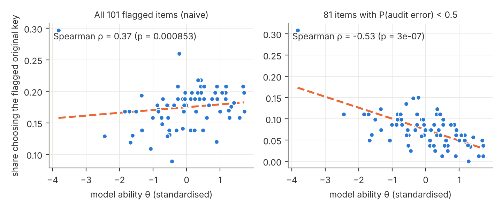
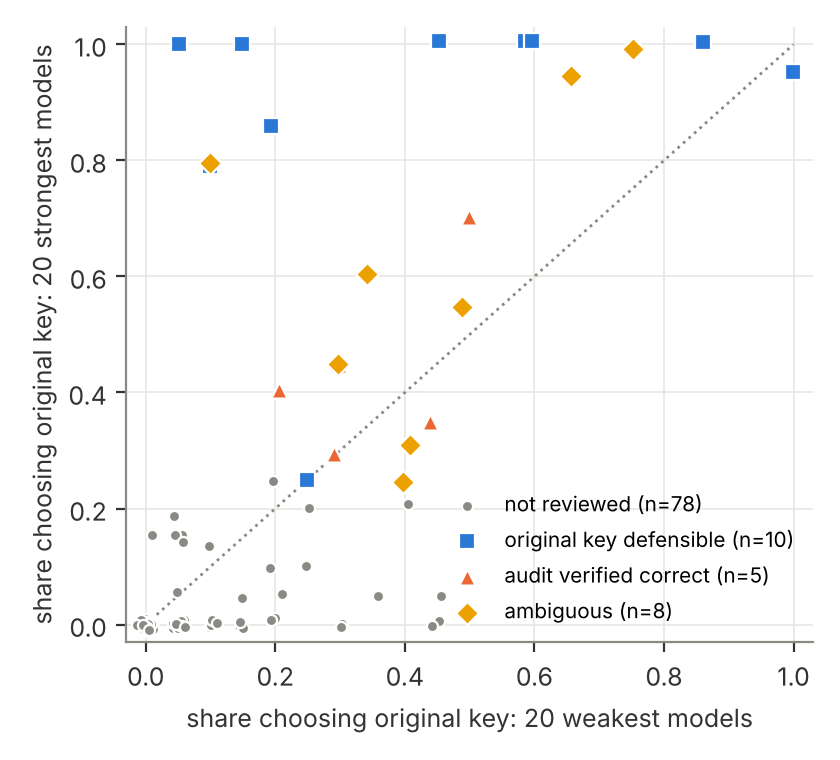
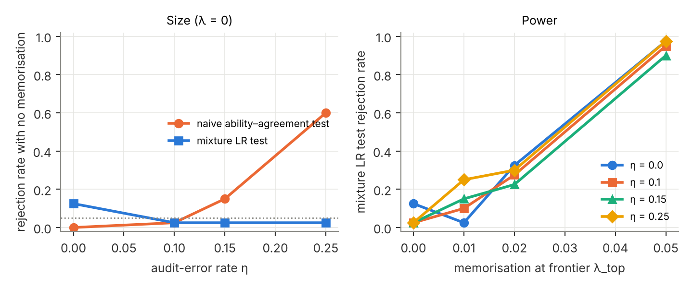
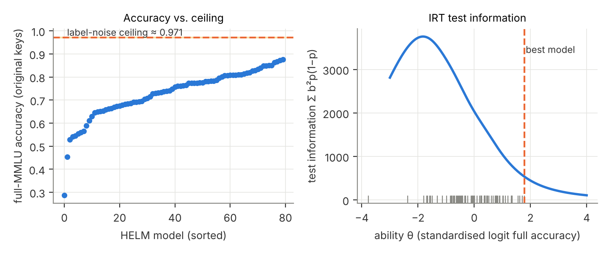

# Memorised Mistakes or Mistaken Audits? Wrong-Key Agreement as a Contamination Signal on MMLU, and Why It Needs a Mixture Model

**Target venue:** NeurIPS Datasets and Benchmarks Track (evaluation methodology)

---

## Abstract

A recurring argument in the "is the benchmark saturated or contaminated?" debate goes like this: if a model picks a benchmark's *wrong* answer key more often than its ability would predict, it probably memorised the key. This argument rests on an unstated assumption that the audit that marked the key as wrong is itself correct. We show that the assumption fails in practice and that it changes the conclusion. We join per-instance predictions of 80 language models from the public HELM MMLU runs with the expert re-annotations in MMLU-Redux, which flags 107 of 5,700 sampled questions as having a wrong ground truth. We use the 101 flagged items where the audit names a different option. On these items the naive analysis gives a positive association between model ability and choosing the flagged original key (Spearman ρ = 0.37, p = 8.5×10⁻⁴), which is the pattern usually read as memorisation. We formalise wrong-key agreement as a two-class item mixture: an audit-error class whose original key behaves like a correct answer, and an audit-correct class whose original key behaves like a distractor, with an optional memorisation curve λ(θ) shared across models of ability θ. We prove three things. (i) Without memorisation, the naive ability association is positive whenever the audit-error rate η exceeds a threshold η*(θ) that we can estimate. (ii) Memorisation confined to a few items cannot be told apart from audit error using response data alone. (iii) Any model's wrong-key rate on audit-correct items gives a distribution-free upper bound on its memorisation probability. On the real data the mixture estimates η̂ = 0.147, close to the median estimated threshold η* = 0.152. The likelihood ratio for memorisation is exactly 0, and a profile-likelihood bound puts homogeneous memorisation below 0.1% of items across all models. Among the 23 highest-agreement items, which we re-adjudicated ourselves, 10 have a defensible original key. The mixture posterior separates these from the 5 numerically verified wrong keys with AUC 0.86. After removing likely audit errors the ability association reverses (ρ = −0.53, p = 3×10⁻⁷), and no model is a significant outlier at FDR 10%. A simulation study calibrated to the data shows the naive test is invalid: under no memorisation it rejects at a rate of 60% when η = 0.25. The mixture LR test is close to nominal size, and its power reaches 0.90–0.98 when frontier memorisation is 5%. It has no power against item-concentrated memorisation, as result (ii) predicts. On saturation, the same data put a label-noise accuracy ceiling for MMLU near 0.971 (95% CI 0.967–0.975), compared with a best HELM score of 0.876. At the frontier, MMLU retains only 14% of its peak test information, but it can still resolve 1-point gaps between models with about 8.8k paired items. We release code that regenerates every number in the paper.

## 中文摘要

在"基准是否已饱和或被污染"的讨论中，有一种常见论证：如果模型比其能力所预期的更频繁地选择基准中的*错误*答案键，那么它很可能记忆了该答案键。这一论证暗含一个假设：将答案键标记为错误的审计本身是正确的。我们证明该假设在实际中并不成立，并且会改变结论。我们将公开 HELM MMLU 运行中 80 个语言模型的逐题预测，与 MMLU-Redux 的专家重标注（在 5,700 道抽样题中标出 107 道"标准答案错误"）相连接。在审计给出不同选项的 101 道题上，朴素分析显示模型能力与选择被标记原答案之间呈正相关（Spearman ρ = 0.37，p = 8.5×10⁻⁴），这通常会被解读为记忆污染。我们把错误答案一致性形式化为两类题目的混合模型："审计错误"类中原答案表现为正确答案；"审计正确"类中原答案表现为干扰项；此外还有一条跨模型共享、随能力 θ 变化的可选记忆曲线 λ(θ)。我们证明了三点：(i) 在无记忆时，只要审计错误率 η 超过一个可估计的阈值 η*(θ)，朴素关联就为正；(ii) 仅凭作答数据，集中在少数题目上的记忆与审计错误无法区分；(iii) 模型在审计正确题目上的错误键选择率，为其记忆概率给出不依赖分布假设的上界。在真实数据上，η̂ = 0.147，接近阈值中位数 η* = 0.152；记忆的似然比恰为 0；剖面似然显示，所有模型中同质记忆低于题目的 0.1%。在我们重新裁定的 23 道一致性最高的题目中，有 10 道的原答案可以成立。混合模型的后验能以 AUC 0.86 将它们与 5 道经数值验证的错误答案键区分开。剔除可能的审计错误后，能力关联反转（ρ = −0.53，p = 3×10⁻⁷），且在 FDR 10% 下没有模型是显著离群点。以数据校准的模拟表明：朴素检验无效，在无记忆、η = 0.25 时拒绝率达 60%；混合似然比检验的显著性水平接近名义值，当前沿记忆率为 5% 时检验功效达 0.90–0.98，而对集中式记忆则如 (ii) 所预言毫无功效。关于饱和：同一数据给出的 MMLU 标签噪声准确率上限约为 0.971（95% CI 0.967–0.975），HELM 最高分为 0.876。在前沿区域 MMLU 仅保留其峰值测验信息量的 14%，但用约 8,800 道配对题目仍可分辨模型间 1 个百分点的差距。

---

## 1 Introduction

Two worries dominate current discussion of static LLM benchmarks such as MMLU (Hendrycks et al., 2021). The first is saturation: top scores approach the ceiling, so the benchmark stops separating models (Ott et al., 2022). The second is contamination: test items leak into pretraining corpora, so scores overstate generalisation (Sainz et al., 2023; Xu et al., 2024). The two worries interact. A benchmark near its ceiling invites the suspicion that the last few points are memorised. A benchmark with label errors has a ceiling below 100%, so "saturation" has to be measured against that lower ceiling (Northcutt et al., 2021; Gema et al., 2025; Vendrow et al., 2025).

Label errors also support a contamination argument that is intuitive and cheap to run. If an item's official key is wrong, a model that answers from knowledge should rarely pick it. A model that memorised the answer file should pick it often. So excess agreement with known-wrong keys, especially among the strongest models, looks like a fingerprint of memorisation. The argument needs no access to logits, training data or model weights, which makes it attractive for auditing closed models. Versions of it appear in informal analyses and in the reasoning behind consensus-based label-error detectors, which flag items where strong models agree against the key.

The argument has a weak link: *who decided the key was wrong?* Re-annotation efforts are themselves noisy. Northcutt et al. (2021) report that only about half of algorithmically flagged candidates were confirmed by human reviewers. MMLU-Redux (Gema et al., 2025) relied on expert annotators, but its "wrong ground truth" label is still a human judgement. Some judgements depend on conventions (for example, whether rings must have a unity), and some are simply mistaken. If the audit is wrong, the "wrong" key is right, and stronger models will choose it *more* often because they are stronger. Audit error therefore produces the same signature as memorisation. This paper makes that confound precise, measures how large it is on MMLU, and gives a test that separates the two explanations where they can be separated. It also proves that in one important case they cannot be.

**Sub-question.** Given per-item responses from many models and an external audit that flags some keys as wrong, can we tell whether models reproduce flagged keys because they memorised them, or because the audit is wrong? If so, how much memorisation of MMLU keys is consistent with public HELM data?

**Contributions.**

1. **A formal model of wrong-key agreement** (Section 3). Items are a two-class mixture (audit error vs. audit correct), with an optional memorisation curve λ(θ). We prove that the naive ability–agreement test is confounded once the audit-error rate exceeds an estimable threshold η*(θ) (Proposition 1). We prove that item-concentrated memorisation is observationally equivalent to audit error (Proposition 2). We give a distribution-free per-model upper bound on memorisation (Proposition 3).
2. **An estimator and test** (Section 4). We fit the mixture by EM, constraining the audit-error class with curves estimated from 5,330 unflagged items, and test λ ≡ 0 with a boundary-corrected likelihood ratio. A calibrated simulation shows that the naive test reaches 60% false-positive rate while the mixture test stays near nominal size, and it maps the power region.
3. **An empirical audit of MMLU contamination via wrong keys** (Section 5). We use 80 HELM models × 101 MMLU-Redux wrong-key items. The naive positive association disappears and reverses once audit error is modelled. The estimated memorisation is at the boundary (zero). Profile-likelihood and Clopper–Pearson bounds quantify how much memorisation the data can still hide. An independent adjudication of the 23 highest-agreement items supports the mixture's classification.
4. **A label-noise-aware saturation analysis** (Section 6). We estimate an MMLU accuracy ceiling under the original keys, the share of frontier errors located on flagged items, pairwise discriminability, and item-response-theory (IRT) information at the frontier. MMLU is *informationally* saturated at the top but not *statistically* exhausted for 1-point comparisons.

All numbers come from code we ran on public data (Section 4.4). We did not query any model. The contribution is methodological and diagnostic. We do not claim that any specific model is or is not contaminated beyond what the stated bounds support.

## 2 Related Work

**Contamination detection.** Methods fall into three groups. *Data-access methods* look for test items in training corpora; Deng et al. (2024) combine retrieval with probing. *Likelihood-based black-box methods* use token probabilities. Examples are Min-K% Prob (Shi et al., 2024) and the exchangeability test of Oren et al. (2024), which shows that a model preferring the canonical ordering of a benchmark is provably contaminated. *Generation-based probes* ask models to reproduce masked parts of items: guided instruction (Golchin & Surdeanu, 2024) and Testset Slot Guessing, where GPT-4 recovered masked MMLU wrong options at a 57% exact-match rate (Deng et al., 2024). *Performance-based methods* compare scores on the original benchmark with fresh or rephrased counterparts. GSM1k found drops of up to 8% for some model families (Zhang et al., 2024), and ConStat defines contamination as non-generalising performance relative to reference models and benchmarks (Dekoninck et al., 2024). Balloccu et al. (2024) document indirect leakage through API use. Carlini et al. (2023) show that memorisation grows with model scale and data duplication, which motivates the ability-dependent λ(θ) used here. Surveys are Sainz et al. (2023) and Xu et al. (2024). Our method sits in the performance-based family but uses *errors in the benchmark* as the probe. It needs only the chosen option, not log-probabilities. To our knowledge, no prior work models the possibility that the error audit itself is wrong when using wrong keys as a contamination signal.

**Label errors in benchmarks.** Northcutt et al. (2021) estimate at least 3.3% label errors across ten ML test sets and show that errors can reorder models. For MMLU, Gema et al. (2025) re-annotated 5,700 questions (MMLU-Redux) and estimated that 6.49% contain errors, concentrated in a few subjects such as virology. MMLU-Pro (Wang et al., 2024) filters and extends MMLU. Vendrow et al. (2025) argue for "platinum" benchmarks with errors removed. Rodriguez et al. (2021) show that IRT-style leaderboards can surface annotation errors. A 2026 preprint proposes an IRT mislabel indicator evaluated on responses from 114 models (Auditing LLM Benchmarks with IRT, arXiv:2605.30504). These works treat model consensus *against* the key as evidence of a label error. We use the complementary signal, model agreement *with* a flagged key, as evidence about either memorisation or audit error. Our mixture model is a structured relative of Dawid & Skene (1979): the "annotator" whose reliability we estimate is the audit.

**Saturation and measurement.** Ott et al. (2022) map how benchmarks saturate across 3,765 benchmarks. IRT-based evaluation (Rodriguez et al., 2021; Polo et al., 2024) shows that items differ in information and that MMLU accuracy can be estimated from about 100 curated items. Miller (2024) argues for paired standard errors and power analysis in LLM evaluation. We combine these tools with label-error annotations to separate three things: headroom that is not attainable, headroom that is attainable, and the frontier's loss of information.

## 3 Model and Theory

### 3.1 Setup

Let m = 1..M index models with scalar ability θ_m. Let i = 1..I index items whose original key g_i an audit has flagged as wrong, proposing instead c_i ≠ g_i. Let Y_mi = 1 if model m chooses g_i. Each item has a latent class Z_i ∈ {A, B}:

* **Class A (audit correct):** g_i is a distractor. A model answering from knowledge chooses g_i with probability D_i(θ).
* **Class B (audit error):** g_i is in fact correct (or at least the best-supported option). A model answering from knowledge chooses it with probability T_i(θ).

P(Z_i = B) = η is the *audit-error rate*. Memorisation is a mechanism by which a model, with probability λ_m, outputs the stored key regardless of knowledge. On class-A items this gives

  P(Y_mi = 1 | Z_i = A) = λ_m + (1 − λ_m) D_i(θ_m).     (1)

On class-B items memorisation and knowledge agree, so P(Y_mi = 1 | Z_i = B) = T_i(θ_m) up to a change in T that the data cannot separate. The *homogeneous* memorisation hypothesis is λ_m = λ(θ_m) for a curve common to all items. The *concentrated* hypothesis lets λ depend on i.

We use two weak assumptions:

* **A1 (distractor monotonicity).** D_i is non-increasing in θ: stronger models are not more attracted to a given wrong option.
* **A2 (truth monotonicity).** T_i is non-decreasing in θ.

A2 is what an ability scale means. A1 can be checked on unflagged items. On 3,605 MMLU-Redux "OK" items whose modal distractor was chosen by at least 3 of the 80 models, the fitted logistic slope of choosing that distractor against θ is negative for 80.3% of items (median slope −0.65 per SD of θ) [results/theory_quantities.json]. A1 holds on average but not for every item, and the estimator below does not require it item by item.

### 3.2 The naive test and its confound

The naive analysis computes W_m = (1/I) Σ_i Y_mi and tests for a positive association between W_m and θ_m, or between agreement among top models and among bottom models. Let D̄(θ) and T̄(θ) be the averages over class-A and class-B items.

**Proposition 1 (confound threshold).** Under λ ≡ 0, E[W | θ] = (1 − η) D̄(θ) + η T̄(θ). At any θ where T̄′(θ) > 0 and D̄′(θ) ≤ 0,

  dE[W|θ]/dθ > 0  ⟺  η > η*(θ) := |D̄′(θ)| / ( |D̄′(θ)| + T̄′(θ) ).

*Proof.* Differentiate: (1 − η)D̄′ + ηT̄′ > 0 ⟺ η(T̄′ − D̄′) > −D̄′ ⟺ η(T̄′ + |D̄′|) > |D̄′|, using D̄′ = −|D̄′|. ∎

So a positive ability association is *not* evidence of memorisation unless the analyst can rule out η > η*. Conversely, with η < η* everywhere, a positive association does require λ′ > 0 somewhere. Under (1), dE[W|θ]/dθ = (1 − η)[λ′(1 − D̄) + (1 − λ)D̄′] + ηT̄′, so memorisation increasing in ability adds a positive term. η*(θ) depends only on the knowledge curves, so it can be estimated from the fitted mixture. On our data it is close to η̂ (Section 5.2), which is why the naive conclusion is fragile here.

### 3.3 Non-identifiability of concentrated memorisation

**Proposition 2.** Fix an item i with response curve P_i(θ) = P(Y_mi = 1 | θ_m = θ), and suppose a class-A explanation is available with some D_i satisfying A1. If P_i(θ) ≥ D_i(θ) for all θ, define λ_i(θ) := (P_i(θ) − D_i(θ)) / (1 − D_i(θ)) ∈ [0, 1]. Then the class-A-with-item-specific-memorisation model {D_i, λ_i} and the class-B model {T_i := P_i} produce identical distributions of (Y_1i, …, Y_Mi) given θ. In particular, if P_i is non-decreasing, the class-B explanation satisfies A2. So no test based only on responses to item i can distinguish "audit error" from "audit correct and memorised".

*Proof.* Substituting λ_i into (1) gives λ_i + (1 − λ_i)D_i = (P_i − D_i) + D_i = P_i for every θ, and responses are conditionally independent across models given θ in both models. ∎

The consequence is that wrong-key agreement can detect memorisation only through *pooling*. If memorisation is a property of the model that affects all of its memorised keys similarly (the homogeneous hypothesis), class-A items with low D_i reveal λ(θ) as a floor shared across items. Memorisation of a handful of items is absorbed into the audit-error class. Breaking that tie needs information outside the response matrix: an independent re-adjudication of the item, or a counterfactual such as a perturbed item (Zhang et al., 2024; Dekoninck et al., 2024). Our simulation confirms that the mixture assigns concentrated-memorisation items to class B with mean posterior 0.94 (Section 5.4).

### 3.4 A distribution-free per-model bound

**Proposition 3.** Let S be a set of items, chosen without reference to model m's responses, and let k_m be the number of items in S on which m chooses the original key, out of n_m answered. If every item in S is class A, or if S contains class-B items with T_i ≥ λ_m, then E[k_m]/n_m ≥ λ_m. The one-sided Clopper–Pearson upper limit for k_m/n_m is therefore a conservative upper confidence bound for λ_m, assuming responses are independent across items given λ_m.

*Proof.* From (1), P(Y = 1 | A) = λ + (1 − λ)D ≥ λ. For a class-B item the condition T_i ≥ λ_m gives P(Y = 1) ≥ λ_m directly. So each item's success probability is at least λ_m, and a binomial upper limit for the mean success probability bounds λ_m (stochastic dominance of the Poisson-binomial over Binomial(n, λ_m)). ∎

The bound does not need A1, the mixture model or any parametric curve. Its cost is conservativeness: plausible distractors and audit errors inflate k_m. Section 5.3 reports it under three item-selection rules.

## 4 Method

### 4.1 Data

* **Model responses.** We downloaded per-instance predictions for MMLU from the public HELM bucket (Liang et al., 2023). For each model and subject we took the latest HELM release (v1.0.0–v1.13.0) and kept the 80 models with all 57 subjects available. These runs use HELM's standard five-shot multiple-choice prompting. In total there are 14,015 test items after de-duplication by (subject, question, options) [code/03_build_matrix.py].
* **Audit.** MMLU-Redux (Gema et al., 2025) annotations for 5,700 questions (100 per subject), from the authors' GitHub repository at commit 4563cfa. Of these, 5,330 are labelled OK and 107 "wrong ground truth". On 101 of the latter, the annotation gives a parseable corrected option different from the original key (audit indices are 0-based; we checked the convention on arithmetic items such as "−47 = g + 24"). These 101 items are our wrong-key set.
* **Join.** HELM instances were matched to Redux rows by subject and normalised question text. Chosen options were mapped to Redux option order through the option text. Response validity is high: each model has a valid, matched choice on 74–101 of the 101 items, and 69 of the 80 models on all 101.

**Ability.** θ_m is the standardised logit of model m's accuracy on the 5,330 OK items, which are disjoint from the wrong-key items. Accuracy on OK items ranges from 0.295 to 0.893.

### 4.2 Estimator

We parameterise the two classes as

* class B: P = σ(a_i + s(b_i) θ),
* class A: P = λ(θ) + (1 − λ(θ)) σ(c_i − s(d_i) θ), with λ(θ) = σ(γ₀ + γ₁θ),

where σ is the logistic function and s is the softplus. Softplus enforces A2 for class B and A1 for the knowledge part of class A. To stop the audit-error class from absorbing items that merely look like hard distractors, we constrain class-B curves to look like curves of *correctly keyed* items. We fitted per-item logistic curves P(correct | θ) on the 5,330 OK items. Class-B intercepts are bounded below by the 5th percentile of those intercepts (a ≥ −1.72), and class-B slopes are bounded below by 0.2 [results/ok_item_params.json]. The mixture is fitted by EM with L-BFGS-B M-steps, first without memorisation (λ ≡ 0) and then with it, initialised from the first fit [code/mixture.py].

**Test.** H₀: λ ≡ 0 lies on the boundary of the parameter space (γ₀ → −∞), and γ₁ is unidentified under H₀. The likelihood ratio therefore does not have a χ²₁ reference distribution (Self & Liang, 1987). We use two calibrations: (a) a parametric bootstrap from the λ ≡ 0 fit (60 replicates), and (b) in the simulation, a conservative fixed critical value of 4.23, the 95% point of the ¼χ²₀ + ½χ²₁ + ¼χ²₂ mixture. Because the LR test answers a yes/no question, we also report a **profile likelihood** for constant memorisation λ ∈ {0, 0.001, …, 0.05}, applied either to all models or only to the 20 strongest, and take the largest λ whose deviance is ≤ 2.71 as a one-sided 95% upper bound.

**Cleaned naive analysis.** After fitting, we drop items with posterior P(B) > 0.5 and items our adjudication judged defensible or ambiguous (Section 4.3). We then re-run the ability association, a binomial GLM of per-model counts on θ with Pearson overdispersion, and per-model excess tests (binomial tail against the GLM fit, Benjamini–Hochberg FDR 10%).

### 4.3 Independent adjudication

To check the mixture against something outside the response matrix, we re-adjudicated the 23 wrong-key items on which the 25 strongest models most often chose the original key (top-25 agreement > 0.2). For each item we recorded one of three verdicts. GOLD_DEFENSIBLE means the original key is correct or the better-supported answer. AUDIT_CORRECT means the audit's key is right. AMBIGUOUS covers items that depend on convention or are underspecified. Rationales are in data/author_adjudication.csv. For the five computational chemistry items judged AUDIT_CORRECT, the decisive quantities were recomputed numerically from physical constants [code/07_verify_items.py; results/item_verification.json]. For example, the ¹⁴N nuclear magnetic moment g_N μ_N √(I(I+1)) = 2.884×10⁻²⁷ J T⁻¹, the high-temperature electron/proton polarisation ratio γ_e/γ_H = 658, and a 5-line (not 9-line) EPR spectrum for a nitronyl nitroxide diradical with J ≪ a. The adjudication was done by the author alone, without blinding to model responses, and on items selected *because* strong models agreed with the original key. Section 8 discusses what this does and does not license.

### 4.4 Simulation design

We use the observed θ of the 80 models and I = 101 items. Class-B items draw intercepts from N(2.67, 2²) truncated at the OK-item 5th percentile and slopes from |N(1.26, 0.6²)| + 0.2, matching the median and spread of OK-item curves. Class-A items draw c ~ N(−3, 1) and slopes |N(0.47, 0.3²)|. Homogeneous memorisation is λ(θ) = σ(γ₀ + 1.5θ), with γ₀ chosen so that λ at the best model equals λ_top ∈ {0, 0.01, 0.02, 0.05}. The audit-error rate is η ∈ {0, 0.10, 0.15, 0.25}. For concentrated memorisation (η = 0.1), 5 or 10 class-A items are memorised with λ_i(θ) = 0.9 σ(3(θ − 0.5)), so the strongest models reproduce those keys with probability up to about 0.6. The naive test is a one-sided Spearman test (α = 0.05) of W on θ. Each cell has 40 replicates [code/05_simulation.py]. All code runs on 4 CPU cores in about 15 minutes, excluding the ~600 MB HELM download.

## 5 Results: Contamination via Wrong Keys

All numbers in this section are produced by our code and stored in results/contamination_results.json, results/theory_quantities.json, results/extra_quantities.json and results/simulation_summary.json.

### 5.1 The naive analysis finds a "memorisation" signal

Averaged over 80 models, models choose the flagged original key on 17.5% of the 101 items (range 8.9–29.7%). The 20 strongest models do so slightly more often than the 20 weakest (18.2% vs 16.3%). The rank association with ability is positive and highly significant (Spearman ρ = 0.37, p = 8.5×10⁻⁴), though the linear slope is small (0.0044 per SD of θ, p = 0.22) (Figure 1, left). If the audit were perfect, assumption A1 would predict a *negative* association, because stronger models avoid distractors. Read naively, the positive association says that stronger models increasingly reproduce wrong keys, which is the memorisation story. By contrast, the share choosing the audit's corrected key rises steeply with ability (r = 0.80). That is already a hint that most audit decisions are sound and that the positive W signal comes from a minority of items.

*Figure 1. Share of flagged items on which each of the 80 HELM models chooses the original (flagged-wrong) MMLU key, against ability θ. Left: all 101 items. Right: after removing items with mixture posterior P(audit error) > 0.5 and items adjudicated defensible or ambiguous. Dashed lines: least-squares fits.*

### 5.2 The mixture attributes the signal to audit error

Without memorisation, the mixture estimates an audit-error rate of η̂ = 0.147 (14.8 expected audit errors among 101 items; 13 items with posterior > 0.5). Adding the memorisation curve does not improve the likelihood: the fitted λ(θ) sits at the boundary (between 4.5×10⁻⁶ and 1.2×10⁻⁵ across models). The LR statistic is 0, and the parametric-bootstrap p-value is 1.0 (60 replicates; bootstrap 95th percentile also 0).

The confound threshold of Proposition 1, evaluated on the fitted class curves, has median η* = 0.152 across the observed ability range (min 0.066, max 0.723). The estimated η̂ exceeds η*(θ) on 48% of the θ grid. In other words, MMLU-Redux's wrong-key set sits almost exactly at the point where audit error alone is enough to flip the sign of the naive association across about half the ability range. The fitted curves show why. The average class-A agreement falls from 0.35 for the weakest model to 0.08 for the strongest. The average class-B agreement rises from 0.07 to 0.83. A small share of class-B items therefore dominates the top of the ability range.

**Item-level view (Figure 2).** On the 78 items we did not review, the 20 strongest models choose the original key 2.6% of the time and the 20 weakest 8.9%, the pattern A1 predicts for distractors. The reviewed items are different. On the 10 items we judged GOLD_DEFENSIBLE the strongest models agree with the original key 88.5% of the time (weakest: 42.5%). On the 8 AMBIGUOUS items it is 61.3% (43.1%). On the 5 numerically verified AUDIT_CORRECT items it is 44.0% (35.0%).

**Agreement with adjudication.** The mixture posterior P(B), computed without any use of the adjudication, exceeds 0.5 on 8 of 10 GOLD_DEFENSIBLE items, 3 of 8 AMBIGUOUS items, 1 of 5 AUDIT_CORRECT items, and 1 of 78 unreviewed items. As a classifier of GOLD_DEFENSIBLE vs AUDIT_CORRECT it reaches AUC 0.86 (n = 10 vs 5). Examples of defensible original keys include: the one-time-pad item ("k = m ⊕ c"; the audit's choice, "No, I cannot compute the key", is wrong); the comet ion-tail item (the original key, the solar wind, is correct; the audit's choice, radiation pressure, applies to dust tails); and passive-personality jurisdiction (victim's nationality, as in the original key). In a further unreviewed case, the area of a square with opposite vertices (1,2) and (7,4) is 20, the original key, not the audit's 40. The audit errors we found are not exotic. They include basic facts that strong models get right.

*Figure 2. For each of the 101 wrong-key items, the share of the 20 weakest (x) and 20 strongest (y) models choosing the original key, coloured by our adjudication. Items above the diagonal behave like correct keys. Small jitter added.*

### 5.3 How much memorisation can the data still hide?

LR = 0 is not proof of absence, so we bound λ.

* **Profile likelihood (homogeneous memorisation, parametric).** With a constant λ applied to all 80 models, the deviance at λ = 0.001 is already 5.7 (> 2.71), so the one-sided 95% bound is below 0.1% of items, the smallest non-zero grid value. If memorisation is confined to the 20 strongest models, the deviance is 2.30 at λ = 0.001 and 4.61 at λ = 0.002, so the bound lies between 0.1% and 0.2%.
* **Clopper–Pearson (Proposition 3, distribution-free).** Using all 101 items, so that no selection depends on responses, the 95% upper bounds for the five strongest models are 0.23–0.29 (median over all models 0.25). These are very conservative because they include audit errors. Excluding only items we adjudicated defensible or ambiguous (83 items) tightens the bounds for the five strongest models to 0.056–0.138 (median over the top 20: 0.122). Excluding items with mixture posterior > 0.5 (88 items) gives 0.10–0.17 for the top ten. This last rule selects items using the pooled responses, so it is only approximately valid. Each model contributes 1/80 of the selection signal.
* **Cleaned naive analysis.** On the 81 items that survive both filters, agreement with the flagged key averages 7.5%. It is *lower* for the strongest 20 models than for the weakest 20 (4.5% vs 10.4%), and the association with ability reverses (Spearman ρ = −0.53, p = 3.4×10⁻⁷; binomial GLM slope −0.33 per SD, p = 6.5×10⁻¹⁵) (Figure 1, right). The Pearson dispersion of the GLM is 1.13, so models do not vary much beyond what ability explains. No model is a significant positive outlier at FDR 10%. The largest excess is Qwen2.5-7B-Instruct, at 12 observed vs 6.1 expected (unadjusted p = 0.018).

The three bounds answer different questions. The profile bound says that a *common* memorisation floor of even 0.1–0.2% of keys is inconsistent with the data, *given the parametric model*. The distribution-free bounds say that no model can have memorised more than roughly 6–29% of keys, depending on how strictly items are filtered. Proposition 2 explains why the gap between the two cannot be closed from responses alone: memorisation confined to a few specific items is indistinguishable from audit error.

**The five verified wrong keys.** On the 5 items whose original key we verified numerically to be wrong, the 20 strongest models choose the wrong original key 45.3% of the time, the 20 weakest 36.3%. The GLM slope on θ is positive but not significant (0.18, p = 0.09). With uniform guessing over the three wrong options a model would pick it 33% of the time. This is the most memorisation-like residue in the data. It is also exactly the case Proposition 2 describes. These are specialised NMR/EPR calculations in which the original key corresponds to a common convention or a common slip: using I rather than √(I(I+1)), or the J ≫ a multiplet in place of J ≪ a. A shared misconception predicts the same pattern as memorisation, and five items cannot separate them.

### 5.4 Simulation: validity and power

Table 1 summarises the simulation (40 replicates per cell).

*Table 1. Rejection rates. Naive = one-sided Spearman test of wrong-key agreement on ability. Mixture = LR test with critical value 4.23. λ_top = memorisation probability at the strongest model.*

| η (audit error) | λ_top | naive | mixture | mean naive ρ |
|---|---|---|---|---|
| 0.00 | 0 | 0.000 | 0.125 | −0.70 |
| 0.00 | 0.05 | 0.000 | 0.975 | −0.53 |
| 0.10 | 0 | 0.025 | 0.025 | −0.43 |
| 0.10 | 0.02 | 0.000 | 0.275 | −0.32 |
| 0.10 | 0.05 | 0.025 | 0.950 | −0.13 |
| 0.15 | 0 | 0.150 | 0.025 | −0.12 |
| 0.15 | 0.05 | 0.325 | 0.900 | +0.09 |
| 0.25 | 0 | **0.600** | 0.025 | +0.27 |
| 0.25 | 0.01 | 0.775 | 0.250 | +0.33 |
| 0.25 | 0.05 | 0.800 | 0.975 | +0.37 |

Full grid in results/simulation_summary.json; Figure 3.

Three findings stand out. First, the naive test is **invalid under audit error**. With no memorisation its false-positive rate rises from 0 at η = 0 to 0.15 at η = 0.15 and 0.60 at η = 0.25. The mean ρ under the null crosses zero between η = 0.10 and 0.15, consistent with the estimated η* ≈ 0.15. Second, the naive test is also **weak when the audit is good**. At η = 0 and λ_top = 0.05 it never rejects, because declining distractor attraction swamps a small memorisation floor. Third, the mixture test **holds size** at 0.025 for η ≥ 0.10. At η = 0 it reaches 0.125, which is imprecise with 40 replicates (binomial SE ≈ 0.05) and is a known small-sample issue when the class-B component is empty. Its **power** is 0.90–0.975 at λ_top = 0.05, 0.23–0.33 at 0.02 and 0.03–0.25 at 0.01.

**Concentrated memorisation.** With 5 or 10 memorised items, the mixture LR test never rejects (0/40 in both settings). Instead the memorised items receive mean posterior P(B) of 0.94, as Proposition 2 predicts. The naive test rejects in 22.5% and 90% of runs, but it cannot distinguish this case from audit error, because it rejects just as often when η = 0.25 and no item is memorised.

*Figure 3. Left: false-positive rate of the naive and mixture tests as a function of the audit-error rate, with no memorisation (dotted line: 0.05). Right: power of the mixture test against homogeneous memorisation.*

## 6 Results: Saturation Under Label Noise

Results in this section come from results/saturation_results.json [code/06_saturation.py].

**Ceiling.** We weight MMLU-Redux annotations by the size of each subject in the full test set. On that basis, 7.0% of MMLU items are flagged with some error and 1.43% as wrong ground truth. We define an attainable ceiling under the original keys as follows. OK items score 1. Wrong-ground-truth items score η̂ = 0.147, the probability that the original key is in fact right. Other flagged categories (unclear question, unclear options, multiple or no correct answers, expert-disputed) score the rate at which the five strongest models match the original key on them, which ranges from 0.66 to 0.86. This gives a central ceiling of **0.971** (subject-stratified bootstrap 95% CI 0.967–0.975). Bounding flagged items between 0 and their most favourable value gives **[0.930, 0.988]**. The best HELM model scores 0.876 on the full 14,015 items (Claude 3.5 Sonnet, 2024-10-22; median of 80 models 0.753). In HELM's harness, the frontier therefore remains about 9–10 points below the label-noise ceiling. MMLU is not saturated in the sense of "no attainable headroom". (Vendor-reported MMLU scores use different prompting and are not comparable to these.)

**Where frontier errors are.** For the ten strongest models, 17.7–23.0% of errors on the Redux sample fall on flagged items, which make up 6.5% of the sample. Flagged items are about 3× over-represented among frontier errors. Most frontier errors, however, are still on items the audit judged OK.

**Discriminability.** Among the 45 pairs of the ten strongest models, 78% differ significantly on full MMLU after Holm correction (exact McNemar). The median discordance is 11.3% of items and the median accuracy gap 1.6 points. For the top 20 the figure is 77%, and for all 80 models 91%. From the observed discordance, a paired test with 80% power at α = 0.05 needs about 2,200 items to detect a 2-point gap, 8,800 for 1 point and 35,000 for 0.5 points. MMLU's 14k items can still resolve 1-point differences at the frontier but not half-point ones. Removing flagged items changes the order of 8.9% of top-10 pairs on the Redux sample (median share of a pairwise difference attributable to flagged items: 7.4%). The Kendall τ between rankings with and without flagged items is 0.82 among the top ten and 0.99 across all 80.

**Information.** We fitted a two-parameter logistic item model on the full matrix, with θ fixed from overall accuracy. Test information peaks at θ = −1.8 (in units of the 80-model distribution) and falls at the best model's θ to 14.3% of the peak. The standard error of θ at the top is 0.043, against 0.016 at the peak. At the best model's ability, 64% of items have predicted correctness above 0.95. The ten strongest models give identical correctness on 70.4% of items. Also, 12.1% of items have a *negative* fitted discrimination, meaning stronger models are less likely to match the key. That is the signature that label errors and ambiguous items leave in a response matrix.

*Figure 4. Left: full-MMLU accuracy of the 80 HELM models against the label-noise ceiling (dashed; band: 95% CI). Right: IRT test information as a function of ability. Ticks: model abilities. Dashed line: best model.*

Taken together, MMLU is *informationally* saturated at the frontier: most items no longer carry information about the best models. But it is not *statistically* exhausted, and its remaining headroom is mostly attainable. The wrong-key analysis gives no evidence that this headroom is being closed by memorised keys.

## 7 Discussion

**What the confound means for contamination audits.** Contamination claims built on agreement with known-wrong labels are popular because they need only black-box outputs. Our results show that such claims are only as good as the audit that defines "wrong". On MMLU the audit-error rate among wrong-ground-truth flags is about 15%. On the higher-agreement subset we reviewed, 10 of 23 flags (43%) were defensible original keys and only 5 were clearly correct audits. That rate is enough to make a naive analysis point in the wrong direction. This matches the broader experience with label-error detection, where a large fraction of flagged candidates do not survive human review (Northcutt et al., 2021). It has a sharp consequence: *a contamination analysis that uses audited label errors must estimate the audit's error rate jointly with memorisation*. Proposition 1 gives the threshold beyond which ignoring it reverses the sign of the evidence.

**A reusable test.** The mixture test needs three ingredients: a response matrix from many models, an external audit, and a set of unflagged items to calibrate what correct keys look like. HELM, the Open LLM Leaderboard and similar platforms already release per-instance predictions, and re-annotation projects such as MMLU-Redux, MMLU-Pro filtering and platinum benchmarks keep appearing. The test also extends to any audited benchmark.

**Falsifiable predictions.** The model makes predictions others can check:

1. *Re-adjudication.* Independent expert panels reviewing the 13 items with posterior P(B) > 0.5 should side with the original key substantially more often than on the 88 items with P(B) < 0.5. Summing posteriors, the model expects about 12 defensible keys among the 13 and about 3 among the remaining 88.
2. *Perturbation.* If the 5 verified wrong keys reflect shared misconceptions rather than memorisation, then numerically perturbed versions of those items should elicit the *perturbed analogue* of the same wrong answer (for example the I-convention value) at a similar rate. Memorisation predicts reversion to the correct calculation, or a random error, once the numbers change.
3. *Other benchmarks.* For any audited benchmark, the sign of the naive ability association should track whether η̂ exceeds η̂*. Datasets with audits dominated by clear-cut errors (low η) should show negative naive associations unless memorisation is present.

**Pre-registered protocol for models we could not run.** The protocol is: (a) Collect choices of current frontier models on the 101 items, unperturbed and with numeric or textual perturbations. (b) Refit the mixture with the original 80 models plus new ones. (c) Report the profile bound on λ for the new models and their Clopper–Pearson bounds on the 81 cleaned items. (d) Declare evidence of memorisation only if the LR exceeds its bootstrap critical value *and* the excess concentrates on unperturbed versions. We did not run this protocol (no model access in our environment).

## 8 Limitations

* **Single, unblinded adjudicator, selected items.** The 23 adjudications were made by the author, who could see model responses. The items were chosen because strong models agreed with the original key, which favours finding defensible keys. The AUC of 0.86 rests on 15 items. It shows that the mixture agrees with one careful reader on the cases where the question matters most, not that it is accurate in general. Two of the "AMBIGUOUS" items were not adjudicated on substance.
* **Ability is one-dimensional.** θ is a scalar derived from OK-item accuracy. Subject-specific skill (for example, NMR spectroscopy) could produce item-specific patterns that the model attributes to class B. A multidimensional θ would weaken the pooling that identifies λ.
* **Homogeneity is an assumption, not a finding.** The profile bound below 0.1–0.2% holds only for memorisation common to all class-A items, with a logistic or constant shape. Proposition 2 shows that concentrated memorisation is invisible to this method. The distribution-free bounds that remain (about 6–29%) are loose.
* **HELM-specific evaluation.** All responses come from HELM's five-shot multiple-choice prompts, and models span HELM releases v1.0–v1.13. The model population ends roughly with early-2025 releases (for example DeepSeek-V3 and Claude 3.5 Sonnet). Newer models, chain-of-thought prompting and vendor harnesses may behave differently. The headroom numbers are specific to HELM.
* **Wrong-key items are few and clustered.** 101 items, 54 of them from virology (33) and college chemistry (21), give limited power. The simulation shows power below 0.35 for frontier memorisation of 2% or less.
* **Boundary inference.** The LR at the boundary uses a conservative fixed critical value in simulation and a 60-replicate bootstrap on real data. The simulation size estimate at η = 0 (0.125) is imprecise.
* **Ceiling definition.** The ceiling scores ambiguous categories at the five strongest models' attainment, which mixes a property of the benchmark with properties of current models. The [0.930, 0.988] interval brackets this choice.
* **Memorisation proxy.** We detect memorisation only through choosing the stored key. A model could memorise items but still answer from knowledge on wrong-key items, or memorise and correct them. Wrong-key agreement measures *harmful* memorisation of keys, not exposure.

## 9 Conclusion

Agreement with known-wrong benchmark keys is an appealing contamination signal, but it confounds memorisation with errors in the audit that declared the keys wrong. On MMLU, about one in seven "wrong ground truth" flags appears to be an audit error. That is enough to produce a positive ability association that a naive reading would call memorisation. A two-class mixture with a shared memorisation curve removes the confound. It finds no evidence of homogeneous key memorisation across 80 HELM models, bounds it below about 0.1–0.2% of keys under its assumptions, and identifies which flags are likely audit errors in agreement with an independent re-adjudication. Response data cannot rule out memorisation of a few specific items, and we have proved that no response-only method can. On saturation, MMLU under HELM's harness retains about 9–10 points of attainable headroom and can resolve 1-point gaps, even though most items no longer inform about the frontier. The broader lesson for the "saturated or contaminated?" question is that both diagnoses depend on the quality of the labels, and label quality has to be estimated, not assumed.

## Reproducibility

Code: `code/` (run order in README.md). Outputs: `results/*.json`, `results/fig*.png`. Data: HELM public bucket `crfm-helm-public` (MMLU runs), MMLU-Redux GitHub repository (commit 4563cfa79b659d76716e5b6019f46bba85fa02db), and our adjudications in `data/author_adjudication.csv`. Total CPU time is about 15 minutes on 4 cores after download.

## References

Balloccu, S., Schmidtová, P., Lango, M., & Dušek, O. (2024). Leak, Cheat, Repeat: Data Contamination and Evaluation Malpractices in Closed-Source LLMs. *Proceedings of EACL 2024 (Long Papers)*, 67–93. https://aclanthology.org/2024.eacl-long.5

Carlini, N., Ippolito, D., Jagielski, M., Lee, K., Tramèr, F., & Zhang, C. (2023). Quantifying Memorization Across Neural Language Models. *ICLR 2023*. arXiv:2202.07646.

Dawid, A. P., & Skene, A. M. (1979). Maximum Likelihood Estimation of Observer Error-Rates Using the EM Algorithm. *Journal of the Royal Statistical Society Series C (Applied Statistics)*, 28(1), 20–28. doi:10.2307/2346806

Dekoninck, J., Müller, M. N., & Vechev, M. (2024). ConStat: Performance-Based Contamination Detection in Large Language Models. *NeurIPS 2024*. arXiv:2405.16281.

Deng, C., Zhao, Y., Tang, X., Gerstein, M., & Cohan, A. (2024). Investigating Data Contamination in Modern Benchmarks for Large Language Models. *Proceedings of NAACL 2024 (Long Papers)*, 8706–8719. https://aclanthology.org/2024.naacl-long.482

Gema, A. P., Leang, J. O. J., Hong, G., Devoto, A., et al. (16 authors) (2025). Are We Done with MMLU? *Proceedings of NAACL 2025 (Long Papers)*, 5069–5096. https://aclanthology.org/2025.naacl-long.262

Golchin, S., & Surdeanu, M. (2024). Time Travel in LLMs: Tracing Data Contamination in Large Language Models. *ICLR 2024*. arXiv:2308.08493.

Hendrycks, D., Burns, C., Basart, S., Zou, A., Mazeika, M., Song, D., & Steinhardt, J. (2021). Measuring Massive Multitask Language Understanding. *ICLR 2021*. arXiv:2009.03300.

Liang, P., Bommasani, R., Lee, T., et al. (2023). Holistic Evaluation of Language Models. *Transactions on Machine Learning Research*. arXiv:2211.09110.

Maia Polo, F., Weber, L., Choshen, L., Sun, Y., Xu, G., & Yurochkin, M. (2024). tinyBenchmarks: Evaluating LLMs with Fewer Examples. *ICML 2024*, PMLR 235, 34303–34326.

Miller, E. (2024). Adding Error Bars to Evals: A Statistical Approach to Language Model Evaluations. arXiv:2411.00640.

Northcutt, C. G., Athalye, A., & Mueller, J. (2021). Pervasive Label Errors in Test Sets Destabilize Machine Learning Benchmarks. *NeurIPS 2021 Datasets and Benchmarks Track*. arXiv:2103.14749.

Oren, Y., Meister, N., Chatterji, N., Ladhak, F., & Hashimoto, T. B. (2024). Proving Test Set Contamination in Black-Box Language Models. *ICLR 2024*. arXiv:2310.17623.

Ott, S., Barbosa-Silva, A., Blagec, K., Brauner, J., & Samwald, M. (2022). Mapping Global Dynamics of Benchmark Creation and Saturation in Artificial Intelligence. *Nature Communications*, 13, 6793. doi:10.1038/s41467-022-34591-0

Rodriguez, P., Barrow, J., Hoyle, A. M., Lalor, J. P., Jia, R., & Boyd-Graber, J. (2021). Evaluation Examples are not Equally Informative: How should that change NLP Leaderboards? *Proceedings of ACL-IJCNLP 2021*, 4486–4503. doi:10.18653/v1/2021.acl-long.346

Sainz, O., Campos, J. A., García-Ferrero, I., Etxaniz, J., Lopez de Lacalle, O., & Agirre, E. (2023). NLP Evaluation in Trouble: On the Need to Measure LLM Data Contamination for each Benchmark. *Findings of EMNLP 2023*, 10776–10787. doi:10.18653/v1/2023.findings-emnlp.722

Self, S. G., & Liang, K.-Y. (1987). Asymptotic Properties of Maximum Likelihood Estimators and Likelihood Ratio Tests Under Nonstandard Conditions. *Journal of the American Statistical Association*, 82(398), 605–610.

Shi, W., Ajith, A., Xia, M., Huang, Y., Liu, D., Blevins, T., Chen, D., & Zettlemoyer, L. (2024). Detecting Pretraining Data from Large Language Models. *ICLR 2024*. arXiv:2310.16789.

Vendrow, J., Vendrow, E., Beery, S., & Madry, A. (2025). Do Large Language Model Benchmarks Test Reliability? arXiv:2502.03461.

Wang, Y., Ma, X., Zhang, G., et al. (2024). MMLU-Pro: A More Robust and Challenging Multi-Task Language Understanding Benchmark. *NeurIPS 2024 Datasets and Benchmarks Track*. arXiv:2406.01574.

Xu, C., Guan, S., Greene, D., & Kechadi, M.-T. (2024). Benchmark Data Contamination of Large Language Models: A Survey. arXiv:2406.04244.

Zhang, H., Da, J., Lee, D., et al. (2024). A Careful Examination of Large Language Model Performance on Grade School Arithmetic. *NeurIPS 2024 Datasets and Benchmarks Track*. arXiv:2405.00332.

Anonymous/as listed on arXiv (2026). Auditing LLM Benchmarks with Item Response Theory. arXiv:2605.30504. (Cited by title; author list not verified by us.)
