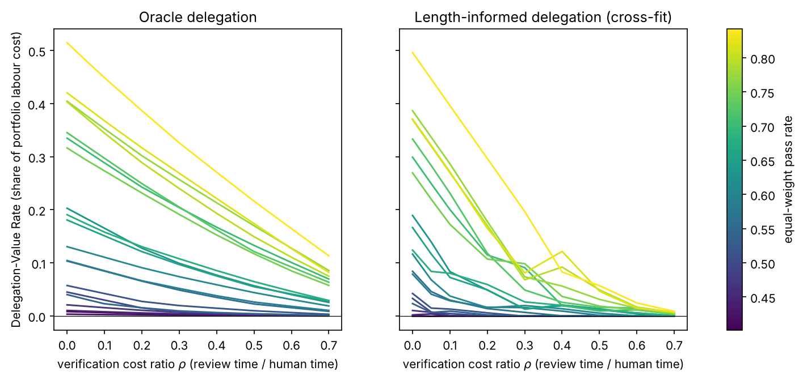
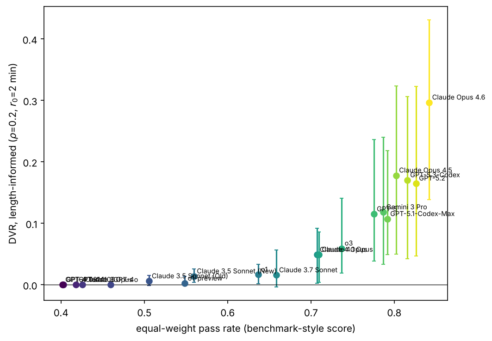
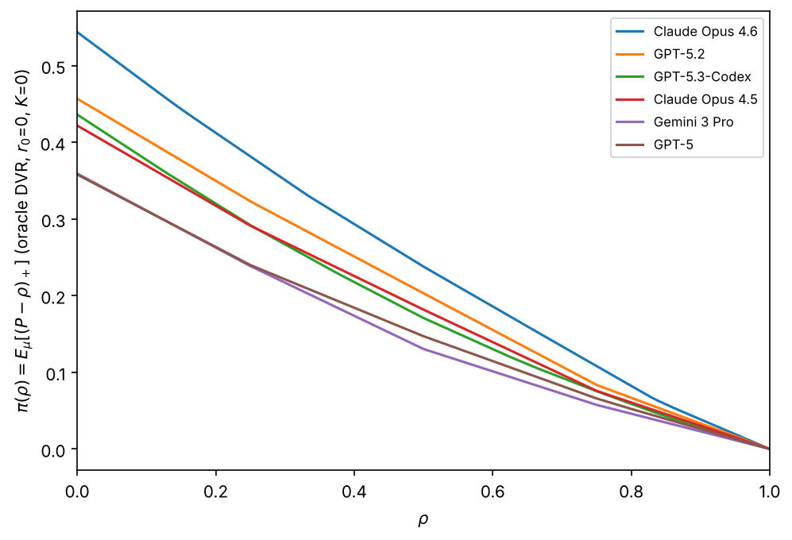
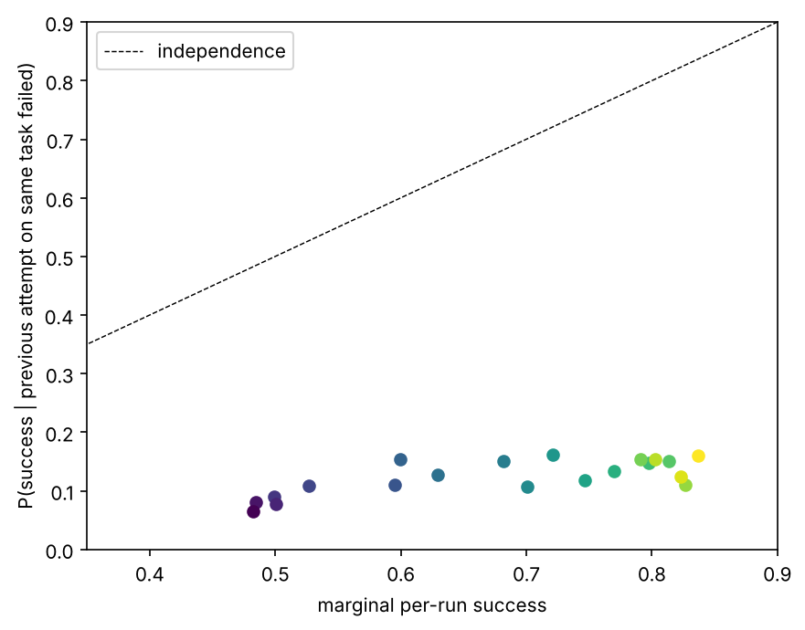
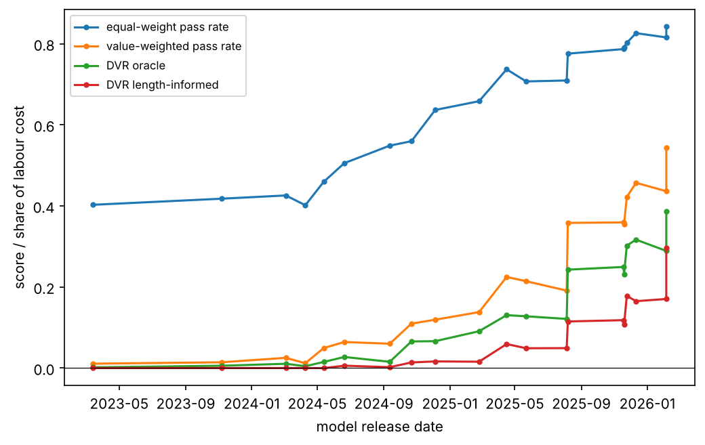

# Pass Rates Are Not Paychecks: Delegation Value, Verification Costs, and the Economic Reading of Agent Benchmarks

**Target venue:** NeurIPS 2027, Datasets & Benchmarks Track (evaluation methodology)

**Code and data:** `code/` and `results/` in this directory. The run command is in `README.md`. Every empirical number in this paper is computed by that code from METR's public per-run data. Numbers taken from other papers are cited and marked as such.

---

## Abstract

Benchmark pass rates are often read as statements about economic value: "the agent solves 84% of tasks", or "the agent completes tasks that take humans 17 hours". Delegating a task to an agent pays off only if the expected saving exceeds the cost of checking the output, the cost of running the agent, and the cost of failures that slip through. We formalise this as a **Delegation-Value Rate (DVR)**: the share of a task portfolio's human labour cost that a principal saves by delegating to an agent under a stated verification technology and a stated information regime. We prove four results. (i) A pass rate does not identify value. For value-weighted pass rate *q* and verification-cost ratio *ρ*, oracle DVR can be anywhere in the sharp interval [(*q*−*ρ*)₊, *q*(1−*ρ*)]. (ii) Two agents keep the same value ranking at every verification cost if and only if their value-weighted distributions of per-task success are ordered in the *increasing convex order*. When the means are ordered but this order fails, the ranking provably reverses at some verification cost. (iii) Imperfect verification moves the break-even success probability from *ρ* to (*a*+*ρ*+*κ*)/(1+*a*), where *a* prices undetected failures. (iv) Under task-level heterogeneity, retries only add value on tasks that already clear the threshold, and pooled pass@k overstates value by Jensen's inequality. We apply the framework to METR's public Time-Horizon 1.1 run data: 20 models, 228 tasks, 23,235 runs. The mapping from pass rate to value is strongly convex. Models with pass rates of 0.40–0.64 produce DVR between −0.0001 and 0.016. Models with pass rates of 0.71–0.84 produce DVR between 0.049 and 0.297 (*ρ*=0.2, 2-minute review overhead, length-informed delegation). For 13 of 20 models, delegating every task loses money. Rankings mostly survive the change of metric (Kendall τ = 0.87; family-clustered bootstrap 95% CI [0.70, 0.93]), but 7 of 190 model pairs cross in the increasing convex order. The top model changes in 24 of 108 sensitivity configurations. On the same task, the probability of success after a failed attempt is 0.06–0.16, against marginal success rates of 0.48–0.84. We release the metric, code, and a pre-registered field protocol with falsifiable predictions.

## 中文摘要

基准测试的通过率常被当作经济价值的代理指标，例如"智能体能解决84%的任务"。然而，只有当预期节省超过审核产出的成本、运行成本以及未被发现的失败所造成的损失时，把任务委托给AI才划算。本文提出**委托价值率（Delegation-Value Rate, DVR）**：在给定验证技术与信息结构下，委托方通过委托AI所能节省的任务组合人工成本份额。我们证明了四个结论：（1）通过率不能识别价值。给定价值加权通过率 *q* 与验证成本比 *ρ*，oracle DVR 可取区间 [(*q*−*ρ*)₊, *q*(1−*ρ*)] 中的任意值，且该区间是紧的；（2）两个模型在所有验证成本下排序一致，当且仅当它们按价值加权的逐任务成功率分布满足递增凸序（increasing convex order）；若均值有序而凸序不成立，排序必然在某个验证成本处反转；（3）不完美验证把盈亏平衡成功率从 *ρ* 提高到 (*a*+*ρ*+*κ*)/(1+*a*)；（4）在任务异质性下，重试只对已超过阈值的任务有价值，合并的 pass@k 会因 Jensen 不等式高估价值。我们在 METR 公开的 Time-Horizon 1.1 逐次运行数据上（20个模型、228个任务、23,235次运行）应用该框架，发现通过率到价值的映射高度凸：通过率为0.40–0.64的模型 DVR 仅为 −0.0001 至 0.016，而通过率为0.71–0.84的模型 DVR 为 0.049 至 0.297（*ρ*=0.2，2分钟固定审核开销，按任务时长决策的委托策略）。在20个模型中，有13个若"全部委托"会产生净亏损。排序大体一致（Kendall τ = 0.87，按任务族聚类自助法95%置信区间 [0.70, 0.93]），但190对模型中有7对的递增凸序交叉，在108种敏感性配置中有24种的最优模型发生改变。同一任务上一次失败之后再次成功的概率仅为0.06–0.16，而边际成功率为0.48–0.84。我们公开了指标、代码以及一个带可证伪预测的预注册实地验证方案。

---

## 1 Introduction

Benchmarks that claim economic relevance have multiplied. SWE-Lancer prices each software task at the dollar amount a freelancer was actually paid [Miserendino et al., 2025]. GDPval grades deliverables from 44 occupations against expert work [Patwardhan et al., 2025]. The Remote Labor Index reports an "automation rate" on real freelance projects [Mazeika et al., 2025]. METR's time-horizon metric expresses agent capability as the human working time of tasks the agent completes with 50% probability [Kwa et al., 2025]. These benchmarks are a large improvement over synthetic leaderboards because their tasks are anchored in real work and real prices. Their headline statistics, however, are still pass rates or pass-rate transformations: the fraction of tasks, dollars, or deliverables graded acceptable.

A pass rate is not what a firm buys. A firm that hands a task to an agent pays three costs that a pass rate does not include. Someone has to check the output, which is the verification cost. The agent has to run, which is the inference cost. Some failures pass the check and cause damage, which is the cost of undetected failure. If the agent fails, the human usually does the task anyway, so a failure costs the review time on top of the original labour. Field evidence shows that these costs are large enough to change the sign of the effect. In a randomised trial with experienced open-source developers, allowing early-2025 AI tools *increased* completion time by 19% [Becker et al., 2025], while those same tools scored well on coding benchmarks. Field experiments with knowledge workers likewise find gains inside a "jagged frontier" of tasks and losses outside it [Dell'Acqua et al., 2023].

This paper asks a narrow question. **Given the per-task outcome data a benchmark already produces, how should we convert it into an estimate of economic value that accounts for verification and delegation, and when does the conversion change our conclusions?** We do not try to measure macroeconomic impact [Acemoglu, 2025] or occupational exposure [Eloundou et al., 2024]. Our target is the evaluation step that sits between a benchmark and a deployment decision.

**Contributions.**

1. **A metric with explicit primitives.** We define the Delegation-Value Rate (DVR), the share of a portfolio's labour cost saved under a delegation policy. It has five interpretable primitives: verification-cost ratio *ρ*, fixed review overhead *r*₀, inference cost *K*, verifier sensitivity *s*, and damage multiplier *δ*. It also has an explicit *information regime*: what the principal knows when deciding to delegate (Section 3).
2. **Theory.** (a) Sharp bounds showing that a pass rate cannot identify value (Proposition 1). (b) An if-and-only-if characterisation of when value rankings agree across all verification costs: the increasing convex order of value-weighted per-task success distributions (Theorem 1). (c) A threshold formula for imperfect verification (Proposition 3). (d) A Blackwell-type monotonicity result that prices the information a principal has about *which* tasks will fail (Proposition 4). (e) A retry result showing that repeated attempts cannot rescue tasks below threshold, and that pooled pass@k overstates value (Proposition 5).
3. **Empirical re-reading of a public benchmark.** On METR Time-Horizon 1.1 per-run data (20 frontier models released 2023–2026, 228 tasks, 23,235 runs), we compute DVR under four information regimes, with family-clustered bootstrap intervals and a 108-cell sensitivity grid. We document a strongly convex pass-rate-to-value map, negative "delegate everything" value for 13 of 20 models, ranking reversals predicted by Theorem 1, a 9–13 percentage-point value-of-information gap for the frontier, and failure concentration that makes retries far less valuable than pass@k suggests.
4. **A reporting standard and a pre-registered field protocol** (Section 7). Benchmarks should report the value-weighted stop-loss curve π(ρ) together with per-task outcomes. We also give five falsifiable predictions for field deployments.

We state the scope plainly. DVR is an accounting framework built on top of benchmark outcomes. It inherits every external-validity limitation of the underlying tasks (Section 9). Its contribution is to make the assumptions behind "economic value" explicit, testable, and sweepable, not to measure GDP.

## 2 Related Work

**Economically anchored benchmarks.** SWE-Lancer attaches real Upwork payouts to 1,400+ software tasks and reports dollars "earned" by summing payouts of passed tasks [Miserendino et al., 2025]. GDPval measures win-or-tie rates of model deliverables against expert deliverables across 44 occupations. Its authors also discuss speed and cost under a "try the model, then fix" workflow [Patwardhan et al., 2025]. The Remote Labor Index scores end-to-end freelance projects and reports a maximum automation rate of 2.5% (as reported by Mazeika et al., 2025). TheAgentCompany simulates a software firm with 175 tasks [Xu et al., 2024]. Vending-Bench measures sustained business operation over long horizons [Backlund & Petersson, 2025]. UpBench uses real Upwork jobs with rubric grading and a human-feedback stage [Yi et al., 2025]. METR's time horizon converts success-versus-task-length curves into a human-time scale [Kwa et al., 2025]. These works choose *which tasks* to measure and *how to value each task*. DVR is complementary. It takes any such per-task outcome table and asks what a principal who must verify outputs would actually save. "Dollars earned" in SWE-Lancer is the special case *ρ* = *r*₀ = *K* = 0, *s* = 1 with blind delegation, where a failure costs nothing. Our theory shows when this special case preserves rankings and when it does not.

**Cost-aware and holistic agent evaluation.** Kapoor et al. (2024) argue that agent evaluations should report cost jointly with accuracy and use Pareto frontiers. DVR goes further by putting inference cost, human verification cost, and failure cost into one currency, which yields a scalar for a stated workflow rather than a frontier. Recent work on the economics of agents models net value as gross value minus deployment cost minus expected failure loss in cooperative-game terms [Zhu, 2026]. Our contribution differs in giving identification results (what a pass rate can and cannot reveal), an ordering characterisation, and an empirical application to public run-level data.

**Learning to defer and selective prediction.** Whether a task should go to the model or a human is the learning-to-defer problem [Madras et al., 2018; Mozannar & Sontag, 2020], and abstention under a risk budget is selective classification [Geifman & El-Yaniv, 2017]. Those literatures optimise a classifier and a rejector jointly. We take the agent as fixed and evaluate it, pricing how much deferral information is worth (Proposition 4). We find that cheap, observable deferral signals such as task length and past performance on similar tasks recover only part of the oracle value.

**Field evidence on productivity.** Randomised and quasi-experimental studies find heterogeneous effects. Customer-support agents gained 14–15% in productivity, concentrated among novices [Brynjolfsson et al., 2025]. Professional writing tasks were completed about 40% faster in a preregistered experiment (as reported by Noy & Zhang, 2023). Consultants gained inside the frontier and lost outside it [Dell'Acqua et al., 2023]. Experienced developers were slowed by 19% [Becker et al., 2025]. Usage data show which O*NET tasks people bring to an assistant [Handa et al., 2025]. Exposure studies estimate which tasks LLMs could speed up [Eloundou et al., 2024]. Macroeconomic estimates are modest [Acemoglu, 2025]. These studies measure realised value in specific settings. None provides a bridge from benchmark tables to such estimates. DVR supplies that bridge, together with a protocol for testing it (Section 7).

**Metric validity.** Goodhart-style failures of proxies under optimisation [Manheim & Garrabrant, 2018] motivate metrics whose relationship to the target is derived rather than assumed. Our Theorem 1 gives one such derivation: it states exactly which property of the per-task outcome distribution, beyond its mean, the economic target depends on.

## 3 Model

### 3.1 Primitives

A **portfolio** is a finite set of tasks *i* = 1,…,*n* with frequency weights *ω*ᵢ > 0. Task *i* has human replacement cost *H*ᵢ = *w*·*h*ᵢ, where *h*ᵢ is expert completion time and *w* the loaded wage. An agent *A* succeeds on task *i* with probability *p*ᵢ. A principal can do the task herself (cost *H*ᵢ) or **delegate** it. Delegation incurs:

- inference cost *K*ᵢ;
- verification cost *V*ᵢ = *w*(*ρ h*ᵢ + *r*₀): review takes a fraction *ρ* of doing time plus a fixed context-switch overhead *r*₀;
- on a failure the verifier detects (probability *s*, the sensitivity), the principal does the task herself at cost *H*ᵢ;
- on an undetected failure (probability 1−*s*), the output is used and causes damage *δH*ᵢ (*δ* = 1 means "as costly as the labour saved"; *δ* > 1 covers downstream harm).

False rejection of correct outputs is ignored for simplicity; it can be folded into *ρ*.

**Lemma 1 (net saving).** The expected saving from delegating task *i* once is

  *S*ᵢ = *H*ᵢ [ *p*ᵢ + (1−*p*ᵢ)(1−*s*)(1−*δ*) ] − *V*ᵢ − *K*ᵢ.

*Proof.* Baseline cost is *H*ᵢ. Delegated cost is *V*ᵢ + *K*ᵢ, plus *H*ᵢ with probability (1−*p*ᵢ)*s*, plus *δH*ᵢ with probability (1−*p*ᵢ)(1−*s*). Subtracting and collecting terms gives the expression. ∎

Writing *a* = (1−*s*)(*δ*−1) ≥ 0 for the excess cost of undetected failures and *κ*ᵢ = (*w r*₀ + *K*ᵢ)/*H*ᵢ for fixed costs relative to task size gives the normalised form

  *S*ᵢ/*H*ᵢ = (1+*a*)*p*ᵢ − *a* − *ρ* − *κ*ᵢ.   (1)

### 3.2 Information regimes and the Delegation-Value Rate

A **delegation policy** is a set *D* of delegated tasks, chosen using a signal *Z* the principal observes before delegating. The **Delegation-Value Rate** is

  DVR(*D*) = Σᵢ∈*D* *ω*ᵢ *S*ᵢ / Σᵢ *ω*ᵢ *H*ᵢ,

the fraction of the portfolio's labour bill that is saved. We study four regimes:

- **Blind:** delegate everything (*D* = all tasks). This is the implicit regime behind "dollars earned".
- **Length-informed:** the principal knows each task's human duration and has the agent's success-versus-log-duration curve, fitted on *other* task families (5-fold cross-fitting by family, averaged over 10 random fold assignments). She delegates iff her plug-in estimate of *S*ᵢ is positive. This is the information a time-horizon plot provides.
- **Family-experience:** the principal estimates *p*ᵢ as the agent's mean success on the other tasks in the same family. Singleton families fall back to the length estimate. This models a firm that has tried the agent on similar work before.
- **Oracle:** delegate iff *S*ᵢ > 0. This upper bound corresponds to a perfect predictor of which tasks will succeed in expectation.

Realised value always uses the true (empirical) *p*ᵢ. Policies differ only in which tasks they select.

### 3.3 Theory

Let *μ* be the **value-weighted distribution** of per-task success: *μ*({*p*}) ∝ Σᵢ:*p*ᵢ=*p* *ω*ᵢ*H*ᵢ. Write *P* ~ *μ*. The value-weighted pass rate is *q* = E_μ[*P*]. The equal-weight pass rate is the unweighted mean of *p*ᵢ and can differ from *q* arbitrarily when *H*ᵢ varies.

In the **canonical case** (*s* = 1, *r*₀ = 0, *K* = 0), equation (1) gives *S*ᵢ = *H*ᵢ(*p*ᵢ − *ρ*), so

  DVR_oracle(*ρ*) = E_μ[(*P* − *ρ*)₊] =: π(*ρ*),   (2)

which is the **stop-loss transform** of *μ* evaluated at *ρ*. Our code checks this identity numerically: the maximum absolute error across the 20 models is 6.7×10⁻¹⁶ (`results/results.json`, `identity_check_max_abs_err`).

**Proposition 1 (pass rates do not identify value; sharp bounds).** Fix *q* ∈ [0,1] and *ρ* ∈ [0,1]. Over all distributions *μ* on [0,1] with mean *q*,

  (*q* − *ρ*)₊ ≤ π(*ρ*) ≤ *q*(1 − *ρ*),

and both bounds are attained.

*Proof.* The map *x* ↦ (*x*−*ρ*)₊ is convex, so Jensen gives the lower bound, attained by the point mass at *q*. For *x* ∈ [0,1], convexity also implies (*x*−*ρ*)₊ ≤ *x*(1−*ρ*), the chord through (0,0) and (1,1−*ρ*). Taking expectations gives the upper bound, attained by the two-point distribution with mass *q* at 1 and 1−*q* at 0. ∎

At *q* = 0.5 and *ρ* = 0.5, value ranges from 0 to 0.25 of the labour bill. Two agents with identical pass rates can therefore differ arbitrarily within this interval. The difference depends on whether failures are spread evenly (bad) or concentrated on a recognisable subset of tasks (good, if the principal can recognise them).

**Theorem 1 (value rankings across verification costs).** In the canonical case, DVR_oracle^A(*ρ*) ≥ DVR_oracle^B(*ρ*) for **every** *ρ* ∈ [0,1] if and only if *P*_A ≥_icx *P*_B, i.e. *P*_A dominates *P*_B in the increasing convex order. Consequently, if *q*_A ≥ *q*_B but *P*_A ≱_icx *P*_B, there exists *ρ** ∈ (0,1) at which B is strictly more valuable than A.

*Proof.* For random variables with finite mean, *X* ≥_icx *Y* iff E[(*X*−*t*)₊] ≥ E[(*Y*−*t*)₊] for all real *t* [Shaked & Shanthikumar, 2007, Thm. 4.A.2]. For variables supported in [0,1], *t* ≥ 1 gives 0 = 0, and *t* ≤ 0 gives E[*X*] − *t* ≥ E[*Y*] − *t*, which is the *t* = 0 case. So the condition reduces to *t* ∈ [0,1], which by (2) is exactly DVR dominance for all *ρ* ∈ [0,1]. If *q*_A ≥ *q*_B (dominance at *ρ* = 0) and icx fails, some *t* ∈ (0,1) has π_A(*t*) < π_B(*t*). ∎

Theorem 1 turns "is the leaderboard economically meaningful?" into a checkable property of two per-task outcome vectors and the task values. It is a statement about orders, not magnitudes. The magnitudes come from Proposition 1.

**Proposition 2 (marginal value of capability).** π is convex and non-increasing on [0,1], with right derivative π′(*ρ*) = −μ(*P* > *ρ*). If every *p*ᵢ improves by a small Δ (truncated at 1), oracle DVR rises by Δ·μ(*P* > *ρ*) + o(Δ).

*Proof.* Standard for stop-loss transforms. Differentiate E[(*P*−*ρ*)₊] in *ρ* and in a location shift of *P*, respectively. ∎

At the margin, improvements on tasks below the break-even threshold are worth nothing. The pass-rate-to-value map is therefore convex for an agent whose mass is moving up through the threshold. Section 5.2 tests this.

**Proposition 3 (imperfect verification shifts the threshold).** With general (*s*, *δ*, *r*₀, *K*), task *i* is worth delegating iff

  *p*ᵢ > *p*ᵢ* = (*a* + *ρ* + *κ*ᵢ)/(1 + *a*),  *a* = (1−*s*)(*δ*−1).

If *κ*ᵢ ≡ *κ* is constant, DVR_oracle = (1+*a*)·π(*p**), so Theorem 1 applies with *ρ* replaced by *p** ∈ [0,1].

*Proof.* Immediate from (1). ∎

For example, *s* = 0.8, *δ* = 5, *ρ* = 0.2 and *κ* = 0 give *a* = 0.8 and *p** = 1.0/1.8 ≈ 0.56, compared with 0.2 under perfect verification. Weak verifiers do more than add cost. They raise the success bar a task must clear before delegation is worthwhile.

**Proposition 4 (value of information about failures).** Let the principal observe a signal *Z* and delegate iff E[*S*ᵢ | *Z*] > 0. Then (i) this policy maximises expected DVR among *Z*-measurable policies; (ii) (E Σ*S*)₊ ≤ DVR_Z ≤ DVR_oracle; (iii) if *Z*′ is a garbling of *Z* (*Z*′ ⊥ *S* | *Z*), then DVR_Z ≥ DVR_Z′.

*Proof.* (i) Pointwise optimality of thresholding the conditional mean. (ii) and (iii) follow from conditional Jensen applied to *x* ↦ *x*₊: E[(E[*S*|*Z*′])₊] = E[(E[E[*S*|*Z*]|*Z*′])₊] ≤ E[(E[*S*|*Z*])₊]. This is the decision-problem form of Blackwell's comparison of experiments [Blackwell, 1953]. ∎

The gap DVR_oracle − DVR_Z is the most a principal should pay for a better *predictor of agent failure*, such as a calibrated self-assessment or a cheap pre-check. Benchmarks that report only aggregate pass rates make this quantity invisible. Our empirical length and family policies use plug-in estimates rather than exact posterior means, so the ordering in (iii) is not guaranteed for them, but it is testable.

**Proposition 5 (retries).** Suppose that on task *i* attempts are i.i.d. with success probability *p*ᵢ, each costs *V*ᵢ + *K*ᵢ, and detection is perfect. The (*j*+1)-th attempt, made after *j* failures, has expected marginal value (1−*p*ᵢ)ʲ(*p*ᵢ*H*ᵢ − *V*ᵢ − *K*ᵢ). Hence (i) retries add value exactly on tasks that already clear the single-attempt threshold, and never turn a below-threshold task into a profitable one; (ii) for any heterogeneous *μ*, E_μ[1−(1−*P*)ᵏ] ≤ 1 − (1 − *q*)ᵏ, so a pooled "pass@k from pass@1" calculation overstates value-weighted success within *k* attempts.

*Proof.* (i) The (*j*+1)-th attempt happens with probability (1−*p*)ʲ and then gains *pH* at cost *V*+*K*. (ii) The map *p* ↦ 1−(1−*p*)ᵏ is concave, so Jensen applies. ∎

## 4 Data and Estimation

**Data (public).** We use METR's `eval-analysis-public` repository (commit `52cb829`, March 2026), file `reports/time-horizon-1-1/data/raw/runs.jsonl`. It contains per-run outcomes for 20 agent configurations from GPT-4 0314 to Claude Opus 4.6 and GPT-5.3-Codex on 228 tasks in 79 families, drawn from HCAST (157 tasks), RE-Bench (5) and SWAA (66) [Kwa et al., 2025]. Each task carries an expert completion time *h*ᵢ (from human baselines or METR estimates), ranging from about 1 second to 1,800 minutes (median 12.6 minutes), and a `human_cost` field that equals *h*ᵢ times a constant wage. From the data we recover *w* = $143.61/hour. We use 23,235 agent runs. Most model–task cells have 4–8 runs. We treat the 37 missing model–task cells (out of 4,560) as failures. We use METR's binarised score as success. Inference cost uses the recorded `generation_cost` where present (two older models) and otherwise `tokens_count` × price, with price $10 per million tokens at baseline and swept over {0, 10, 50}. The total portfolio labour cost is $77,742, and the ten longest tasks account for 31% of it. Release dates come from the repository's `release_dates.yaml`.

**Baseline parameters (assumptions, all swept).** *ρ* = 0.2, *r*₀ = 2 minutes, *s* = 1, *δ* = 1, price = $10/Mtok, portfolio weights *ω*ᵢ = 1 (each task once). The sensitivity grid crosses *r*₀ ∈ {0, 2, 10} min, (*s*, *δ*) ∈ {(1,1), (0.9,2), (0.8,3), (0.8,5)}, price ∈ {0, 10, 50}, and *ρ* ∈ {0.1, 0.2, 0.4}, for 108 configurations. We also reweight the portfolio with METR's diversity weights (inverse square root of family size).

**Pass-rate metrics compared.** Equal-weight pass rate (mean of *p*ᵢ), value-weighted pass rate *q*, and the 50% and 80% time horizons, which we obtain from our own logistic fit of *p*ᵢ on log₂ *h*ᵢ. Our fit is unweighted and computed on the full TH1.1 task set. It is not METR's official estimate and should not be compared with METR's published horizons.

**Uncertainty.** We use a family-clustered bootstrap: resample the 79 task families with replacement, re-fit the cross-fitted length policy in each replicate, and recompute all metrics (*B* = 500). Intervals are 2.5–97.5 percentiles. The bootstrap captures task-sampling uncertainty, which dominates here because value is concentrated in a few long tasks. It does not capture run-level noise within a task.

**Compute.** The full analysis runs in about 31 seconds of wall-clock time on a CPU (`results/analysis_stdout.txt`).

## 5 Results

All numbers in this section come from `results/main_table.csv`, `results/results.json`, `results/extra.json`, `results/retry.csv` and `results/sensitivity.csv`.

### 5.1 Pass rates overstate value, and blind delegation loses money for most models

**Table 1.** Pass-rate metrics and DVR at baseline parameters (*ρ* = 0.2, *r*₀ = 2 min, *s* = 1, $10/Mtok). DVR = share of the $77,742 portfolio labour cost saved. Length-informed DVR shows the family-bootstrap 95% CI. Selected models, sorted by length-informed DVR. Full table in `results/main_table.csv`.

| Model | Pass (equal) | Pass (value-wtd) | Blind DVR | Length-informed DVR [95% CI] | Family-exp. DVR | Oracle DVR |
|---|---|---|---|---|---|---|
| Claude Opus 4.6 | 0.842 | 0.544 | 0.292 | 0.297 [0.143, 0.384] | 0.338 | 0.387 |
| Claude Opus 4.5 | 0.802 | 0.422 | 0.183 | 0.178 [0.028, 0.306] | 0.225 | 0.302 |
| GPT-5.3-Codex | 0.816 | 0.436 | 0.166 | 0.170 [0.042, 0.272] | 0.213 | 0.289 |
| GPT-5.2 | 0.826 | 0.457 | 0.166 | 0.165 [0.047, 0.317] | 0.224 | 0.317 |
| Gemini 3 Pro | 0.787 | 0.359 | 0.129 | 0.118 [0.018, 0.260] | 0.147 | 0.249 |
| GPT-5 | 0.776 | 0.358 | 0.095 | 0.115 [0.023, 0.253] | 0.153 | 0.243 |
| GPT-5.1-Codex-Max | 0.792 | 0.355 | 0.063 | 0.107 [0.032, 0.235] | 0.157 | 0.232 |
| o3 | 0.737 | 0.225 | −0.087 | 0.059 [0.015, 0.123] | 0.070 | 0.131 |
| Claude 4 Opus | 0.707 | 0.214 | −0.016 | 0.049 [−0.005, 0.075] | 0.056 | 0.128 |
| Claude 3.7 Sonnet | 0.658 | 0.138 | −0.088 | 0.016 [−0.001, 0.031] | 0.026 | 0.091 |
| o1 | 0.637 | 0.119 | −0.129 | 0.016 [0.006, 0.032] | −0.007 | 0.066 |
| o1-preview | 0.549 | 0.060 | −0.217 | 0.002 [−0.001, 0.009] | −0.001 | 0.015 |
| GPT-4o | 0.459 | 0.049 | −0.172 | −0.000 [−0.000, 0.004] | 0.004 | 0.015 |
| GPT-4 0314 | 0.403 | 0.011 | −0.262 | 0.000 [0.000, 0.000] | −0.004 | 0.002 |

Three patterns stand out.

First, **value-weighted success is far below equal-weight success**. For the best model, 0.84 of tasks are passed but only 0.54 of labour value, because failures concentrate on long tasks. A headline like "solves 84% of tasks" overstates the share of work automated by about 30 points before any verification cost is counted.

Second, **blind delegation is value-destroying for 13 of 20 models**. Every model released before GPT-5 has negative blind DVR (e.g. o3: −0.087), because review and redo costs on the many failed long tasks outweigh savings on the successes. "Dollars earned" metrics implicitly assume blind delegation with zero cost per failure, and so systematically hide this.

Third, **verification cost alone removes a quarter to a half of the value**. Even with perfect foresight (oracle), Claude Opus 4.6 saves 0.387 of the labour bill at *ρ* = 0.2, compared with 0.515 at *ρ* = 0 (Figure 1, left). Under length-informed delegation the decline is steeper: 0.496 at *ρ* = 0, 0.297 at *ρ* = 0.2, and 0.083 at *ρ* = 0.4 (`results/results.json`, `sweep`).

**Figure 1.** DVR as a function of the verification-cost ratio *ρ* (*r*₀ = 2 min), for oracle (left) and length-informed cross-fit (right) delegation. Colour encodes the equal-weight pass rate.

### 5.2 The pass-rate-to-value map is strongly convex

Figure 2 plots length-informed DVR against equal-weight pass rate. Among the 9 models with pass rate below 0.65 (range 0.40–0.64), DVR ranges from −0.0001 to 0.016, and a linear fit gives 0.07 DVR per unit of pass rate. Among the 10 models with pass rate at least 0.70 (range 0.71–0.84), DVR ranges from 0.049 to 0.297, and the slope is 1.44, about 21 times steeper (`results/extra.json`, `band_low`/`band_high`). This is the shape Proposition 2 predicts. Pass-rate gains on tasks below the break-even success level are economically inert, and value only accrues once a large value-weighted mass of tasks crosses *p** = *ρ* + *κ*. One practical consequence is that equal-sized pass-rate improvements are not equal-sized economic improvements. Reporting pass-rate deltas as value deltas is unjustified without the full distribution.

**Figure 2.** Equal-weight pass rate versus length-informed DVR at baseline parameters. Error bars: family-clustered bootstrap 95% CI.

### 5.3 Rankings mostly survive, but reversals occur where Theorem 1 predicts

Rankings by pass rate and by DVR are highly but not perfectly concordant. At baseline, Kendall τ between equal-weight pass rate and length-informed DVR is 0.87 (bootstrap 95% CI [0.70, 0.93]). τ between the 50% horizon and DVR is also 0.87. Concordance is weakest at *ρ* = 0.3 (τ = 0.74; `rank_stats`). Across the 108-cell sensitivity grid, τ ranges from 0.30 to 0.96. Claude Opus 4.6 has the highest length-informed DVR in 84 of 108 configurations. GPT-5.2 is highest in 14, Claude Opus 4.5 in 7, GPT-5.3-Codex in 2 and Gemini 3 Pro in 1. In the baseline-cost row at *ρ* = 0.4, GPT-5.2 (0.122) beats Claude Opus 4.6 (0.083) under length-informed delegation, although Opus 4.6 leads on every pass-rate metric. In the bootstrap at baseline, Opus 4.6 is top in 496 of 500 replicates. The leader is therefore robust at moderate verification costs but not across all plausible workflows.

Theorem 1 states that reversals of oracle value ranking occur exactly when the icx order fails. Computing π(*ρ*) on a 101-point grid for all 190 model pairs (`pairs` in `results/results.json`), **7 of 190 pairs cross**. They include frontier pairs: Claude Opus 4.5 vs GPT-5.3-Codex (crossing at *ρ* ≈ 0.26), GPT-5 vs GPT-5.1-Codex-Max (*ρ* ≈ 0.22), GPT-5.1-Codex-Max vs Gemini 3 Pro (*ρ* ≈ 0.21), GPT-5 vs Gemini 3 Pro (*ρ* ≈ 0.12), and Claude 4 Opus vs Claude 4.1 Opus (*ρ* ≈ 0.56) (Figure 3). For these pairs no single summary number can rank the models for all workflows. The ranking is a function of the verification technology. Under the length-informed policy, which adds estimation error, equal-weight pass rate and DVR disagree on 11 of 184 non-tied pairs at *ρ* = 0.2 and 11 of 175 at *ρ* = 0.4 (`extra.json`).

**Figure 3.** Value-weighted stop-loss curves π(*ρ*) = E_μ[(*P*−*ρ*)₊] for the six models with the highest value-weighted pass rate (canonical case). By Theorem 1, crossing curves mean the value ranking depends on verification cost.

### 5.4 Imperfect verification is the dominant sensitivity

Weak verification hurts realistic policies far more than it hurts the oracle. At *r*₀ = 2 min, price = $10/Mtok and *ρ* = 0.2, the best length-informed DVR is 0.297 with perfect verification. It is 0.251 at (*s*, *δ*) = (0.9, 2), 0.138 at (0.8, 3) and 0.072 at (0.8, 5), while best oracle DVR only falls from 0.387 to 0.354 (`sensitivity.csv`). This matches Proposition 3. With *a* = 0.8 the break-even success level rises to about 0.56. The length-only predictor cannot tell which tasks clear it, so the principal either forgoes value or eats undetected failures. The number of models with positive length-informed DVR falls from 15 to 12. Across the grid, the best length-informed DVR ranges from 0.007 to 0.444. The fixed overhead *r*₀ matters mainly for the many short SWAA tasks, which carry almost no labour value. With perfect verification and *r*₀ = 2 min, raising the token price from $0 to $50/Mtok lowers the best DVR by 0.02–0.13, depending on *ρ*. Inference cost is not negligible, but it is second-order next to verification.

One non-monotonicity deserves mention. For some cells, length-informed DVR is *higher* at a higher token price (e.g. *r*₀ = 10, *s* = 0.8, *δ* = 5, *ρ* = 0.1: 0.056 at $0 versus 0.078 at $10). The plug-in policy is miscalibrated, and an extra per-task cost happens to make it more conservative. Proposition 4's ordering applies only to exact posterior means, and this case shows why the oracle–informed gap should be reported rather than assumed away.

### 5.5 What principals know about failures is worth a lot

Table 1 orders the four information regimes. For the seven newest models, family experience beats length information by 0.03–0.06 of the labour bill (Opus 4.6: 0.338 vs 0.297; GPT-5.2: 0.224 vs 0.165; GPT-5.1-Codex-Max: 0.157 vs 0.107). The oracle adds a further 0.05–0.10 (Opus 4.6: 0.387). Family experience weakly beats length information for 15 of 20 models. The exceptions are older models whose family-level estimates are noisy. For the frontier model, roughly 23% of attainable oracle value (0.090 of 0.387) is lost when the principal knows only task length. By Proposition 4, this gap is an upper bound on the value of any failure predictor (self-assessment, test suite, pre-screen) in this workflow. That makes predictor quality, i.e. calibration and discrimination of per-task success, an *economically priced* evaluation target. Few current agent benchmarks report it.

The blind-versus-informed comparison tells the same story from the other side. For o3, delegating everything costs 0.087 of the labour bill, while delegating by length saves 0.059 and by family experience 0.070. The same agent is a net loss or a net gain depending on whether the principal can route tasks.

### 5.6 Failures are concentrated: retries add little

Across models, the probability that a run succeeds *given that another run of the same model on the same task failed* is 0.06–0.16, against marginal per-run success of 0.48–0.84 (Figure 4; `retry.csv`). Failures are therefore not coin flips but properties of tasks. By Proposition 5(ii), pooled reasoning overstates multi-attempt success. For Claude Opus 4.6, a pooled calculation 1 − (1 − *q*)³ predicts value-weighted success within three attempts of 0.905, whereas the unbiased per-task estimator [Chen et al., 2021] gives 0.626. The economic effect of allowing up to three verified attempts (oracle task selection, baseline costs) is modest: Opus 4.6 rises from 0.387 to 0.427, and GPT-5.2 from 0.317 to 0.350. Consistent with Proposition 5(i), retries never rescue tasks below threshold, so pass@k-style headline numbers should not be read as value.

**Figure 4.** Marginal per-run success versus success conditional on a failed attempt on the same task. Every model lies far below the independence line.

### 5.7 Trends: value grows as fast as horizon, from a lower base

Fitting log₂(metric) against release date on this 20-model subset (`extra.json`), the 50% horizon from our own fit doubles every 3.9 months (R² = 0.93, *n* = 20). Length-informed DVR, among the 14 models with DVR > 0.005, doubles every 3.7 months (R² = 0.94). Oracle DVR doubles every 4.3 months (R² = 0.94, *n* = 20). Equal-weight pass rate rises linearly by 0.19 per year (R² = 0.93). These doubling times are specific to this model subset and to our unweighted fits. They are not METR's published estimates, which use different weighting and a longer model history [Kwa et al., 2025]. Our substantive point is narrower. On this task suite, verification-adjusted value has grown at a similar exponential rate to the time horizon, but from a level where most pre-2025 models produce essentially zero value. Extrapolations of horizon trends to economic impact should therefore be made in value units with an explicit *ρ*.

**Figure 5.** Pass rates and DVR by model release date (baseline parameters).

### 5.8 Robustness to portfolio weighting

Reweighting tasks with METR's diversity weights changes length-informed DVR only modestly for the frontier (Opus 4.6: 0.292 vs 0.297; GPT-5.2: 0.142 vs 0.165; `main_table.csv`, last column). This is expected, because value weighting by *H*ᵢ already dominates the frequency weights. The bigger issue is that the TH1.1 portfolio is not an economic portfolio (Section 9). DVR makes that choice explicit through *ω* instead of hiding it.

## 6 Recommended Reporting Standard

Given Theorem 1 and Propositions 1–5, the following additions to benchmark reports are cheap and decision-relevant:

1. **Per-task outcome table** with task values *H*ᵢ, multiple runs per task, and run-level costs. Without it, none of the quantities above can be computed.
2. **The value-weighted stop-loss curve** π(*ρ*) for *ρ* ∈ [0,1], or equivalently the value-weighted distribution of per-task success, instead of or alongside its mean. Pairwise crossings of these curves flag workflow-dependent rankings (Theorem 1).
3. **DVR under at least two information regimes** (blind and one realistic, cross-fitted regime), with the gap to oracle reported as the value of failure prediction (Proposition 4).
4. **Conditional success after failure** on the same task, instead of pooled pass@k (Proposition 5).
5. **Stated verification assumptions** (*ρ*, *r*₀, *s*, *δ*) and a sensitivity sweep. Where possible, use *measured* review times (Section 7).

## 7 Pre-registered Field Protocol and Falsifiable Predictions

DVR is only as good as its primitives. We propose the following protocol to test it against realised value. We have not run it; doing so requires human participants.

**Design.** Within an organisation, sample *N* ≥ 200 real tasks from a task log with recorded historical durations. For each, (a) obtain an expert duration estimate *h*ᵢ, (b) run the agent ≥ 4 times in a sandbox and record success by the organisation's acceptance criteria, giving *p̂*ᵢ, and (c) randomise tasks to *human-only* or *delegate-then-verify* arms in which a worker reviews the agent output, fixes or redoes it, and logs time. A random 10% of accepted agent outputs get a blinded second review to estimate *s*, and downstream defects are tracked for 30 days to estimate *δ*. Measured review time per task gives *ρ* and *r*₀.

**Pre-registered predictions** (each falsified by the stated outcome):

- **P1 (value tracks DVR, not pass rate).** The realised time saving per task in the delegate arm, regressed on DVR-predicted saving *S*ᵢ (computed from *p̂*ᵢ and measured *ρ*, *r*₀), has a slope in [0.5, 1.5]. Pass rate adds no significant predictive power once *S*ᵢ is controlled for. *Falsified if* the slope CI excludes [0.5, 1.5] or pass rate remains significant at *α* = 0.05.
- **P2 (net loss below threshold).** Tasks with *p̂*ᵢ < *p̂** show a net slowdown in the delegate arm. *Falsified if* their mean realised saving is significantly positive.
- **P3 (convexity).** Across agents or agent versions, realised organisation-level saving is a convex function of pass rate. *Falsified if* a linear fit is not rejected in favour of a convex (quadratic or hinge) one when ≥ 4 agents span pass rates of 0.4–0.85.
- **P4 (failure concentration).** P(success on retry | failure) is below half the marginal success rate. *Falsified if* it is ≥ 0.5 × marginal.
- **P5 (workflow-dependent rankings).** For any two agents whose estimated stop-loss curves cross at *ρ̂* inside the 95% CI of measured *ρ* across teams, teams with *ρ* above and below the crossing prefer different agents in realised savings. *Falsified if* the preferred agent is the same on both sides with a significant margin.

These predictions are informed by, and in P2's case consistent with, the slowdown reported by Becker et al. (2025). That study did not measure *p̂*ᵢ, so it cannot test P2 directly.

## 8 Discussion

**What changes in practice.** The leaderboard is largely preserved: τ ≈ 0.87 at baseline. What changes is the *magnitude and interpretation* of progress. A model "solving 84% of tasks" saves about 30% of the labour bill on this suite with competent routing and perfect checking, and much less with imperfect checking. Most models through early 2025 had zero or negative delegation value on this suite despite pass rates of 50–70%. This reconciles strong benchmark numbers with weak or negative field results: under Proposition 1 both can be true at once.

**Where evaluation effort should go.** Proposition 4 and Section 5.5 suggest that, in a delegation workflow, predicting *which* tasks will fail can be worth as much as several months of capability progress. For Opus 4.6, the oracle–length gap (0.090) is comparable to the DVR difference between Claude Opus 4.5 and Opus 4.6 (0.119) under the length policy. Proposition 3 says the same about verifier quality. These are evaluable properties of agent systems that current headline metrics ignore.

**Relation to "dollars earned".** Payout-weighted success, as in SWE-Lancer, is π(0) under blind delegation with zero cost per failure. By Theorem 1 it ranks agents consistently with value at every verification cost only under icx dominance. By Proposition 1 its magnitude is an upper bound that can exceed realised value by an arbitrary factor at moderate *ρ*. We recommend that such benchmarks also report π(*ρ*) and the share of value from tasks where *p*ᵢ exceeds plausible thresholds.

**Augmentation versus automation.** DVR models full delegation with review. Much real use is augmentation, i.e. iterating with the model [Handa et al., 2025]. Augmentation can be represented as a different cost structure (partial-credit outputs reduce redo cost; interactive use raises *r*₀). The framework extends naturally, but we did not estimate those parameters.

## 9 Limitations

- **External validity of tasks.** METR TH1.1 tasks are mostly software, ML-engineering and cybersecurity tasks selected for measurability. Their human times come partly from estimates rather than baselines, with 6,243 of 24,008 rows flagged as estimates. Their value weights (time × a single wage of $143.61/h) are not market prices. Our DVR numbers describe *this portfolio*, not the economy. METR itself discusses the gap between benchmark and real tasks [Kwa et al., 2025].
- **Assumed verification primitives.** *ρ*, *r*₀, *s* and *δ* are not measured here. We sweep them, but the sweep ranges are judgements. In particular, a constant *ρ* across tasks is a simplification, since verifying some outputs is much cheaper than producing them and verifying others is nearly as hard. The protocol in Section 7 is designed to measure these primitives.
- **Binary success and "redo from scratch".** We use METR's binarised scores and assume a failed output has zero salvage value. Partial credit would raise value for all models and could change rankings.
- **Finite runs.** Per-task *p*ᵢ is estimated from about 4–8 runs, so oracle DVR is biased upward: thresholding noisy estimates selects lucky tasks. The family-clustered bootstrap captures task sampling, not this within-task noise. The length and family policies use only out-of-task information and do not suffer from this selection bias.
- **Missing and heterogeneous cost data.** Token counts are not comparable across scaffolds, and we price them with a single assumed rate. Two older models use recorded generation cost instead. Inference cost proved second-order, but this conclusion is conditional on the assumed prices.
- **Policies are illustrative.** Our "length-informed" and "family-experience" principals are simple plug-in rules, not optimal Bayesian decision makers. Better routing could close more of the oracle gap.
- **Trend estimates** use 20 models over three years with our own unweighted fits. They are not comparable to METR's official horizon estimates and should not be extrapolated.
- **No human-subject validation.** We have not shown that DVR predicts realised savings. That is the purpose of the pre-registered protocol, and until it is run DVR should be read as a structured accounting of assumptions, not a measured economic quantity.

## 10 Conclusion

A benchmark pass rate is the mean of a distribution. Economic value under verification is a convex functional of that distribution, so the mean alone cannot determine it. We made this precise with sharp bounds, an if-and-only-if ranking condition, and threshold and retry results. On public run-level data from 20 models, we showed that the convexity matters: value is near zero for pass rates up to about 0.65, then rises steeply. Blind delegation loses money for most models. A minority of model pairs, including frontier pairs, swap places depending on verification cost. Knowing which tasks will fail is worth a large share of attainable value. Benchmarks that already collect per-task, multi-run outcomes can report these quantities at negligible extra cost. Field studies can then test whether the predicted values materialise.

## References

- Acemoglu, D. (2025). The simple macroeconomics of AI. *Economic Policy*, 40(121), 13–58. (NBER Working Paper 32487, 2024.)
- Backlund, A., & Petersson, L. (2025). Vending-Bench: A benchmark for long-term coherence of autonomous agents. arXiv:2502.15840.
- Becker, J., Rush, N., Barnes, E., & Rein, D. (2025). Measuring the impact of early-2025 AI on experienced open-source developer productivity. arXiv:2507.09089.
- Blackwell, D. (1953). Equivalent comparisons of experiments. *Annals of Mathematical Statistics*, 24(2), 265–272. doi:10.1214/aoms/1177729032.
- Brynjolfsson, E., Li, D., & Raymond, L. (2025). Generative AI at work. *Quarterly Journal of Economics*, 140(2), 889–942. doi:10.1093/qje/qjae044.
- Chen, M., et al. (2021). Evaluating large language models trained on code. arXiv:2107.03374.
- Dell'Acqua, F., McFowland III, E., Mollick, E., Lifshitz-Assaf, H., Kellogg, K., Rajendran, S., Krayer, L., Candelon, F., & Lakhani, K. R. (2023). Navigating the jagged technological frontier: Field experimental evidence of the effects of AI on knowledge worker productivity and quality. Harvard Business School Technology & Operations Mgt. Unit Working Paper No. 24-013. SSRN 4573321. (Later published in *Organization Science*, doi:10.1287/orsc.2025.21838.)
- Eloundou, T., Manning, S., Mishkin, P., & Rock, D. (2024). GPTs are GPTs: Labor market impact potential of LLMs. *Science*. Preprint: GPTs are GPTs: An early look at the labor market impact potential of large language models, arXiv:2303.10130 (2023).
- Geifman, Y., & El-Yaniv, R. (2017). Selective classification for deep neural networks. In *Advances in Neural Information Processing Systems 30* (NeurIPS 2017). arXiv:1705.08500.
- Handa, K., et al. (2025). Which economic tasks are performed with AI? Evidence from millions of Claude conversations. arXiv:2503.04761.
- Kapoor, S., Stroebl, B., Siegel, Z. S., Nadgir, N., & Narayanan, A. (2024). AI agents that matter. arXiv:2407.01502. (*Transactions on Machine Learning Research*, 2025.)
- Kwa, T., West, B., Becker, J., Deng, A., Garcia, K., Hasin, M., Jawhar, S., Kinniment, M., Rush, N., Von Arx, S., et al. (2025). Measuring AI ability to complete long tasks (later version titled "Measuring AI ability to complete long software tasks"). arXiv:2503.14499. Data and code: METR, `eval-analysis-public`, https://github.com/METR/eval-analysis-public (commit 52cb829, accessed Nov. 2026).
- Madras, D., Pitassi, T., & Zemel, R. (2018). Predict responsibly: Improving fairness and accuracy by learning to defer. In *Advances in Neural Information Processing Systems 31* (NeurIPS 2018). arXiv:1711.06664.
- Manheim, D., & Garrabrant, S. (2018). Categorizing variants of Goodhart's law. arXiv:1803.04585.
- Mazeika, M., et al. (2025). Remote Labor Index: Measuring AI automation of remote work. arXiv:2510.26787.
- Miserendino, S., Wang, M., Patwardhan, T., & Heidecke, J. (2025). SWE-Lancer: Can frontier LLMs earn $1 million from real-world freelance software engineering? In *Proceedings of the 42nd International Conference on Machine Learning* (ICML 2025), PMLR 267. arXiv:2502.12115.
- Mozannar, H., & Sontag, D. (2020). Consistent estimators for learning to defer to an expert. In *Proceedings of the 37th International Conference on Machine Learning*, PMLR 119, 7076–7087.
- Noy, S., & Zhang, W. (2023). Experimental evidence on the productivity effects of generative artificial intelligence. *Science*, 381, 187–192.
- Patwardhan, T., et al. (2025). GDPval: Evaluating AI model performance on real-world economically valuable tasks. arXiv:2510.04374. (ICLR 2026.)
- Shaked, M., & Shanthikumar, J. G. (2007). *Stochastic Orders*. Springer Series in Statistics. Springer, New York.
- Xu, F. F., Song, Y., Li, B., et al. (2024). TheAgentCompany: Benchmarking LLM agents on consequential real world tasks. arXiv:2412.14161. (NeurIPS 2025 Datasets and Benchmarks.)
- Yi, D., Liu, T., Terzolo, M., Hasson, L., Sinha, A., Mendes, P., & Rabinovich, A. (2025). UpBench: A dynamically evolving real-world labor-market agentic benchmark framework built for human-centric AI. arXiv:2511.12306.
- Zhu, Q. (2026). Agentomics: Economic foundations for the valuation, attribution, and pricing of AI agents in human–AI workflows. arXiv:2606.14769.

---

*Provenance note.* Empirical numbers come from code in `code/` run on METR's public data (`results/`). Statements about other works' findings (e.g. the 19% slowdown, the 2.5% automation rate, the 14–15% productivity gain, the 40% time reduction) are reported as stated in the cited sources. Entries with "et al." were checked for existence by title, identifier and first author.
