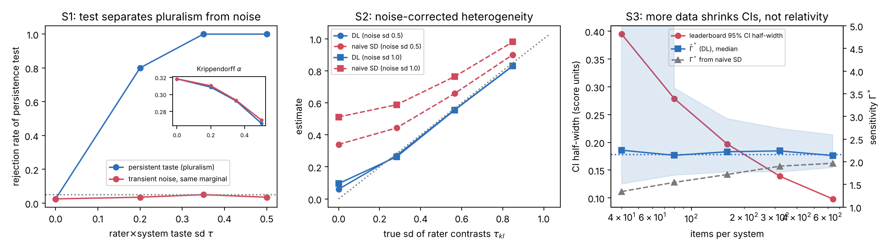
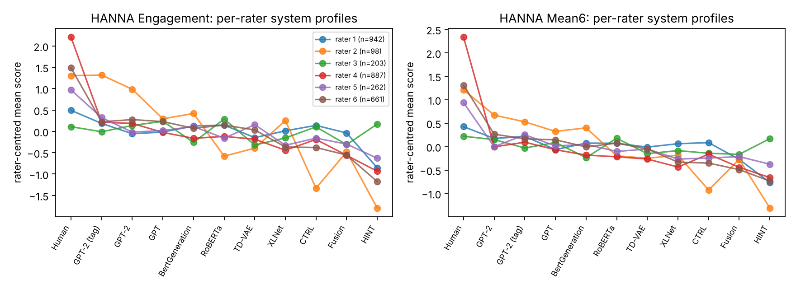
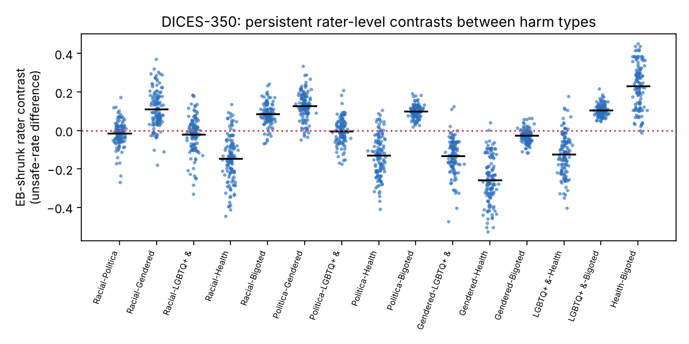

# Is It Taste or Noise? Separating Persistent Evaluator Pluralism from Rating Noise, and Certifying How Population-Relative a Subjective Leaderboard Is

**Target venue:** International Conference on Machine Learning (ICML 2027), main track (evaluation methodology)

---

## Abstract

Human evaluation of open-ended outputs such as stories, chatbot replies, and safety judgments usually reports a leaderboard, a confidence interval, and an inter-annotator agreement coefficient. Low agreement is then read as noise to be averaged away. We argue that this practice mixes up two different things. One is *transient noise*: a rater would give a different score on another occasion. The other is *persistent pluralism*: a rater has a stable taste that tilts how they judge whole systems. The two have opposite consequences. Averaging removes noise. Pluralism makes the leaderboard a property of the systems *and of the rater population*. We make three contributions. (i) **Agreement blindness.** Every per-item agreement statistic (Krippendorff's α, Fleiss' κ, item entropy) has the same distribution whether disagreement is persistent taste or transient noise, as long as rater identities are not linked across items. Persistence is identified only through rater-linked cross-item contrasts. We give a moment identity and a DerSimonian–Laird estimator of the noise-corrected rater-by-system heterogeneity τ², with an exact within-item permutation test. (ii) **Population-relativity certificates.** For any leaderboard functional that is linear in the rater mixture (mean score, Borda/win rate), we derive in closed form the minimal total-variation shift of the rater population that reverses a pairwise ordering. Under a Gaussian random-effects model we also derive the minimal density-ratio reweighting Γ\* that reverses it, which depends only on the consensus ratio κ = m/τ: κ = φ(Φ⁻¹(1/(1+Γ\*)))(Γ\* − 1/Γ\*). Unlike a confidence interval, Γ\* does not shrink as more annotations are collected. (iii) **Evidence.** In simulation, the permutation test holds its nominal size (2.5–5.0% rejection at α = 0.05). Its power is 0.80 at a modest taste SD, while Krippendorff's α is identical under the two mechanisms. The naive spread of per-rater means overstates heterogeneity by up to 0.51 score units, and it biases Γ\* downward. On HANNA (story generation, 11 systems, 3,168 ratings), Krippendorff's α is only −0.05 to 0.28 across six criteria, yet rater persistence is overwhelming: the observed statistic is 28–75 times its permutation-null mean, p ≤ 0.001 for every criterion. Of the 29–44 system pairs per criterion that are statistically separated, 3–14 have at least one (noise-shrunk) rater on the opposite side. Under each criterion, the most fragile of these can be reversed by changing 16–43% of the rater population. On DICES-350 (123 raters × 350 conversations), persistent rater-by-harm-type heterogeneity is large (p = 0.001). Yet the 30 demographic cells explain at most about 0.1 of τ² beyond chance, so demographic quotas alone do not capture evaluator pluralism. We end with a reporting protocol: report τ̂, κ̂ and Γ̂\* next to each leaderboard gap.

## 中文摘要

对开放式输出（故事、对话回复、安全判断等）的人类评估，通常只报告排行榜、置信区间和标注者一致性系数，并把低一致性当作需要平均掉的"噪声"。本文指出，这种做法把两种性质相反的现象混在了一起。一种是**瞬时噪声**：同一评审换个时间可能给出不同分数。另一种是**持久的多元偏好**：评审有稳定的品味，会系统性地偏向某些系统。平均可以消除噪声。多元偏好却意味着排行榜同时取决于被评系统和评审人群。本文有三项贡献。(1) **一致性盲区定理**：只要评审身份没有跨条目关联，任何逐条目的一致性统计量（Krippendorff α、Fleiss κ、条目熵）在"持久品味"和"瞬时噪声"两种机制下分布完全相同。持久性只能通过同一评审的跨条目对比来识别。我们给出矩恒等式、基于 DerSimonian–Laird 的去噪异质性 τ² 估计量，以及精确的条目内置换检验。(2) **人群相对性证书**：对任何在评审混合比例上线性的排行榜泛函（平均分、Borda/胜率），给出翻转两两排序所需的最小总变差人群偏移的闭式解。在高斯随机效应模型下，最小密度比重加权 Γ\* 只取决于共识比 κ=m/τ，满足 κ=φ(Φ⁻¹(1/(1+Γ\*)))(Γ\*−1/Γ\*)。与置信区间不同，Γ\* 不会随标注量增加而缩小。(3) **实证**：模拟中置换检验保持名义水平（拒绝率 2.5–5.0%），在中等品味差异下功效为 0.80，而两种机制下的 Krippendorff α 完全相同。朴素的评审均值离散度最多会高估异质性 0.51 个分值单位，并使 Γ\* 偏低。在 HANNA（11 个故事生成系统，3168 条评分）上，六项标准的 α 只有 −0.05 至 0.28，但评审持久性极强：观测统计量是置换零分布均值的 28–75 倍，所有标准 p≤0.001。每项标准下 29–44 个统计显著的系统对中，有 3–14 对存在持相反方向偏好的评审；各标准下最脆弱的一对只需改变 16–43% 的评审人群即可翻转。在 DICES-350（123 名评审 × 350 段对话）上，评审×伤害类型的持久异质性显著（p=0.001），但 30 个人口学单元超出随机水平的解释力至多约为 τ² 的 0.1，说明只按人口学配额并不能覆盖评审的多元性。最后我们提出报告规范：在每个排行榜差距旁同时报告 τ̂、κ̂ 和 Γ̂\*。

---

## 1 Introduction

Many of the most important AI capabilities are judged by people, and there is no answer key: whether a story is engaging, whether a reply is helpful, whether a conversation is unsafe. The standard evaluation stack for these open-ended, subjective tasks has three outputs:

1. a **leaderboard**, usually a mean rating or a Bradley–Terry/Elo fit to pairwise votes;
2. a **confidence interval**, from a bootstrap over items or votes;
3. a **reliability coefficient**, such as Krippendorff's α or Fleiss' κ.

When the reliability coefficient is low, as it nearly always is for subjective tasks, two responses are common. Practitioners collect more ratings so that disagreement "averages out". Critics say the data are unreliable. A growing literature on human label variation argues that disagreement often carries signal (Aroyo & Welty, 2015; Plank, 2022; Uma et al., 2021; Davani et al., 2022; Zhang et al., 2025). Pluralistic alignment asks *whose* preferences a model should reflect (Sorensen et al., 2024; Kirk et al., 2024). Recent social-choice work asks how leaderboards should aggregate heterogeneous preferences (Haghtalab et al., 2026; Khalaf et al., 2026). These literatures still lack a simple measurement layer that answers two operational questions for a given human evaluation:

* **Q1.** Is the observed disagreement *transient noise*, which more ratings remove, or *persistent pluralism*, which more ratings do not remove?
* **Q2.** If it is pluralism, how much would the rater population have to change before a reported conclusion ("system A beats system B") reverses?

The central observation of this paper is that the evaluation stack answers neither question as it is reported today. **Reliability coefficients are blind to the distinction.** Under random rater assignment, the multiset of labels on an item has the same distribution whether raters have stable tastes or flip coins with the same marginal (Theorem 1). **Confidence intervals answer a different question.** They quantify sampling uncertainty for a *fixed* rater population and shrink to zero as data grow, whatever the population's internal disagreement. Our population-relativity measure Γ\* stays constant (Proposition 3, Fig. 1c).

Kahneman, Sibony & Sunstein (2021) draw a related distinction between *level noise*, stable *pattern noise*, and *occasion noise*. In evaluation terms, stable pattern noise at the level of whole systems is pluralism. It is not error unless one has decided whose taste is correct.

**Contributions.**

1. **Identification (Section 3).** We formalize persistent rater-by-system taste and prove that per-item agreement statistics are invariant to it (Theorem 1). We show that the noise-corrected heterogeneity of rater-level system contrasts, τ²_kl, is identified by a cross-item moment that requires rater linkage (Proposition 1). We cast estimation as a random-effects meta-analysis with raters as "studies", using the DerSimonian–Laird estimator, and give an exact permutation test that shuffles rater identities within items. This test preserves every agreement statistic and destroys only persistence.
2. **Certificates (Section 4).** For leaderboard functionals that are linear in the rater mixture, we give (a) the exact minimal total-variation population shift that reverses a pairwise ordering, via a greedy fractional-knapsack solution (Theorem 2), and (b) under a Gaussian random-effects model, a closed-form sensitivity parameter Γ\*: the smallest bounded density-ratio reweighting of raters that reverses the ordering (Proposition 3). Γ\* depends only on the consensus ratio κ = m/τ, is invariant to sample size, and is biased downward if heterogeneity is not corrected for noise.
3. **Validation and evidence (Sections 5–6).** In simulations, the test has nominal size and high power, and Krippendorff's α is unchanged between the two mechanisms. The estimator is nearly unbiased where the naive one is badly biased, and Γ̂\* converges while CIs shrink. On two public multi-rater datasets, HANNA (story generation; Chhun et al., 2022) and DICES-350 (conversational safety; Aroyo et al., 2023), we find low reliability together with strong persistent pluralism. We find statistically significant system gaps that are nonetheless population-relative. We also find that demographic categories, often used as the unit of pluralism, explain only a small, mostly chance-level share of persistent heterogeneity.
4. **Protocol (Section 7).** We give a concrete reporting recommendation and a design rule: link rater IDs and give each rater at least two to three items per system.

We do not propose a new aggregation rule, and we do not claim that one population is the right one. Our claim is narrower: whichever population an evaluation uses, its dependence on that choice can be measured, and it should be reported.

## 2 Related Work

**Human label variation and perspectivism.** Aroyo & Welty (2015) argued against the "one truth" assumption in annotation. Plank (2022) argues that human label variation should be treated as signal throughout data, modeling and evaluation. Uma et al. (2021) survey learning from disagreement. Davani et al. (2022) model annotators individually instead of using majority vote. Prabhakaran et al. (2021) advocate releasing annotator-level labels. Zhang et al. (2025) build a taxonomy of why preference annotators diverge and show that reward models and LLM judges collapse divergent cases to one winner. These works motivate keeping disaggregated labels. Our contribution is a test of whether disagreement is persistent at the rater level and a measure of what it implies for system rankings.

**Disagreement-aware evaluation.** Gordon et al. (2021) introduce the *disagreement deconvolution*. It uses each annotator's consistency on repeated or similar items to separate a "primary label" from annotation noise, and then re-scores classifiers against that distribution. Gordon et al. (2022) propose *jury learning*, which makes explicit which groups decide a label. Wong et al. (2021) propose cross-replication reliability (xRR), which benchmarks reliability against a replication with a different rater pool. Our work is complementary. We work at the level of *system rankings* rather than item labels. We identify persistence from rater-linked *cross-item* contrasts without repeated measurements of the same item. We turn the result into a population-robustness certificate for leaderboard conclusions.

**Variance components and generalizability theory.** Decomposing scores into object, rater, and interaction facets is classical generalizability theory (Cronbach et al., 1972; Brennan, 2001). Our estimator is a G-theory rater × system interaction component estimated with a meta-analytic method-of-moments (DerSimonian & Laird, 1986). That makes it robust to the highly unbalanced designs of crowdsourcing. What we add is the link from that variance component to (a) the blindness of agreement coefficients and (b) a sensitivity parameter for leaderboard conclusions.

**Leaderboards under heterogeneous preferences.** Chatbot Arena (Chiang et al., 2024) and MT-Bench (Zheng et al., 2023) rank models from crowd or expert pairwise votes with Bradley–Terry models (Bradley & Terry, 1952). Siththaranjan et al. (2024) show that preference learning with hidden context implicitly aggregates by Borda count, which is linear in the mixture of hidden contexts. That is exactly the class of functionals our Theorem 2 covers. Haghtalab et al. (2026) study stability of leaderboard aggregation in a social-choice framework. Khalaf et al. (2026) show that maximal lotteries can favor models that underperform on subpopulations, and they propose robust lotteries that optimize worst-case performance under preference shifts. These works design *aggregation rules*. We design *diagnostics* for the rule actually in use. Our Γ\* plays for evaluation the role that Rosenbaum-style sensitivity parameters play for observational studies (Rosenbaum, 2002). Our density-ratio constraint is the marginal sensitivity model of Tan (2006), and the worst case is a quantile solution in the spirit of Dorn & Guo (2023).

**Datasets with linked raters.** DICES (Aroyo et al., 2023) provides 123 demographically balanced raters on every item of DICES-350. PRISM (Kirk et al., 2024) links ratings to participant profiles. HANNA (Chhun et al., 2022; 2024) provides MTurk worker IDs for 1,056 stories from 10 generation systems plus human-written stories.

## 3 Persistent Taste versus Transient Noise

### 3.1 Model

There are K systems. Item i (one output) belongs to system k(i). Rater r gives score Y_ir. We use the additive random-effects model

  Y_ir = θ_k(i) + η_i + b_r + g_ir + ε_ir,                    (1)

where θ_k is system quality, η_i is item quality within its system, b_r is rater leniency (level noise), ε_ir is transient noise with variance σ²_ε, and g_ir is the rater-by-output interaction. We compare two mechanisms for g that have the *same marginal distribution* for every (i, r):

* **Persistent (P):** g_ir = γ_r,k(i). Rater r has a stable taste γ_r,k for system k, shared across all of k's items, with γ_r ~ (0, Σ_γ) across raters.
* **Transient (T):** g_ir is drawn afresh for every (i, r) from the same marginal as γ_r,k(i).

Under P, the rater-level contrast between systems k and l, Δ_r,kl = (θ_k − θ_l) + γ_r,k − γ_r,l, has between-rater variance τ²_kl = Var(γ_r,k − γ_r,l) > 0. Under T, all raters share the same expected contrast. Pluralism, in the sense that matters for rankings, is τ²_kl > 0.

### 3.2 Agreement blindness

**Theorem 1 (Agreement blindness).** Suppose the raters of each item are drawn exchangeably from the rater population, independently of item content. Then:
(a) For every item i, the distribution of the multiset of its labels {Y_ir} is identical under P and T. Hence every statistic that is an average of per-item functions of label multisets has the same expectation under P and T. This covers the observed disagreement D_o of Krippendorff's α, per-item percent agreement, and per-item entropy. The expected disagreement D_e, built from pairs of labels pooled across items, can differ only through pairs that come from the same rater on different items. Those pairs are a vanishing fraction (O(1/R) for R raters of similar volume) of all pairs.
(b) If, in addition, each rater labels at most one item, or rater identities are not recorded, the joint distribution of all observed data is identical under P and T. Then no statistic can distinguish them, and τ²_kl is not identified.

*Proof.* (a) Condition on item i and its system k. Under P, the labels are Y_ir = c_i + b_r + γ_r,k + ε_ir for exchangeably drawn raters. Each label's marginal is the law of b + γ_·,k + ε shifted by c_i = θ_k + η_i. The dependence among the labels of one item comes only from the shared c_i, because distinct raters have independent (b_r, γ_r,k). Under T, the labels are c_i + b_r + g_ir + ε_ir, where g_ir has the law of γ_·,k and is independent across raters. The two vectors therefore have the same joint law given c_i, and integrating over c_i gives (a). (b) Without rater linkage across items, each rater's γ_r enters exactly one item. The data are then a collection of independent item-level vectors whose laws coincide by (a). ∎

Theorem 1 formalizes a point that is often made informally: low α does not mean low signal, and high α does not mean consensus. Fig. 1a (inset) confirms it numerically. Krippendorff's α is the same under the two mechanisms (difference ≤ 0.004 at every τ), while the persistence test separates them.

### 3.3 Identification with rater linkage

**Proposition 1 (Moment identity).** Under (1), let i, i′ be distinct items of system k and j, j′ distinct items of system l, all rated by the same rater r, with items drawn independently within systems. Then

  E[(Y_ir − Y_jr)(Y_i′r − Y_j′r)] − (θ_k − θ_l)² = τ²_kl  under P,  and  = 0 under T.

*Proof.* Expand: Y_ir − Y_jr = (θ_k − θ_l) + (η_i − η_j) + (γ_r,k − γ_r,l) + (ε_ir − ε_jr) under P. Item effects and transient noise are independent across the distinct items i, i′, j, j′, so they drop out of the cross-product. Leniency b_r cancels within each difference. The cross-product keeps E[(γ_r,k − γ_r,l)²] = τ²_kl plus the squared mean. Under T, the interaction terms for different items are independent and also drop out. ∎

So persistence is identified as soon as raters are linked across at least two items of each of two systems. The moment does not require any item to be rated twice by the same person, which is the main practical difference from test–retest designs.

### 3.4 Estimator: raters as studies in a meta-analysis

For each pair (k, l) and each rater r with n_rk, n_rl ≥ c items in the two systems, let D_r = Ȳ_r,k − Ȳ_r,l. Rater leniency cancels in D_r. Its sampling variance given rater r is v_r = s²_k/n_rk + s²_l/n_rl, where s²_k is the pooled within-(rater, system) variance. That variance contains item-quality variance and transient noise, but not persistent taste. So D_r = μ_kl + u_r + e_r with Var(u_r) = τ²_kl and Var(e_r) ≈ v_r. This is the random-effects meta-analysis model with raters as studies. We estimate τ²_kl with the DerSimonian–Laird (DL) moment estimator, τ̂² = max{0, (Q − (R − 1))/(Σw − Σw²/Σw)}, where w_r = 1/v_r and Q = Σ w_r (D_r − D̄_w)². The random-effects mean μ̂_kl weights raters by 1/(v_r + τ̂²). The empirical-Bayes rater contrasts D̃_r = μ̂ + τ̂²/(τ̂² + v_r)·(D_r − μ̂) remove most of the noise from per-rater contrasts. We use them for the discrete certificates in Section 4.

**Permutation test.** As an omnibus statistic we use T = Σ_(k,l) (Q_kl − df_kl). Under H₀, raters are exchangeable within items, so there is no persistent rater effect of any kind. Shuffling rater IDs among the labels of each item then leaves the distribution of the data unchanged. By Theorem 1 the shuffle also preserves every per-item agreement statistic exactly, so the test isolates persistence. The p-value is (1 + #{T_perm ≥ T_obs})/(B + 1). The test is exact under H₀ for any design, including unbalanced crowdsourcing and ordinal scores. It does not rely on DL's normality or independence approximations.

*Fully crossed designs.* When every rater sees every item (as in DICES), item effects are shared by all raters. In that case we first centre scores on item means, which contain the rater's own score with weight only 1/123. Otherwise the shared item variance inflates v_r and makes τ̂² conservative. With few raters per item (as in HANNA), we do not centre, because centring would absorb a third of each rater's own taste.

## 4 How Population-Relative Is a Conclusion?

Let the rater population be a mixture over types t (individual raters or groups) with weights w_t. Let δ_t be the type-level contrast between systems k and l under a leaderboard functional that is *linear in the mixture*. Mean score, mean pairwise win rate, and Borda score all qualify. The last is what preference learning implicitly computes under hidden context (Siththaranjan et al., 2024). The reported margin is m(w) = Σ_t w_t δ_t, and we take m(w) > 0 without loss of generality.

**Theorem 2 (Total-variation reversal radius).** Let ρ = inf{TV(w, w′) : m(w′) ≤ 0} over mixtures w′ on the same types. Then:
(a) ρ = ∞ if and only if δ_t ≥ 0 for all t. That is, the conclusion is population-robust exactly when every type agrees with it in direction, regardless of how large the disagreement in *magnitude* is.
(b) Otherwise, let t\* = argmin δ_t and order the remaining types by decreasing δ_t. ρ is obtained greedily: move mass from the highest-δ types to t\*, each unit of mass reducing the margin by δ_t − δ_t\*, until the margin reaches 0.
(c) m(w)/(max_t δ_t − min_t δ_t) ≤ ρ.

*Proof.* A shift to w′ with TV distance ε can be written as moving mass ε from some types to others. Moving mass to type s from type t changes m by (δ_s − δ_t) per unit. To reduce m as fast as possible per unit of mass, all mass should go to t\*. (a) follows because m(w′) ≥ min_t δ_t for every mixture w′: if min_t δ_t ≥ 0, the margin cannot become negative (it can reach 0 only in the degenerate case min_t δ_t = 0, which we count as non-reversal); if min_t δ_t < 0, putting all mass on t\* reverses it. For (b), choosing how much to take from each type t ≠ t\* is a fractional knapsack: unit "weight" per mass, value δ_t − δ_t\*, capacity w_t, demand m(w). Greedy by value is optimal. (c) Each unit of mass changes m by at most max δ − min δ. ∎

The TV radius has a direct reading: *the minimal share of the evaluator population that would have to be replaced to reverse the conclusion.* It is sensitive to extreme individual raters, and it can be ∞ even when heterogeneity is large but one-signed. We therefore also report a smooth, distributional version.

**Proposition 3 (Gaussian sensitivity Γ\*).** Suppose rater-level contrasts are Δ ~ N(m, τ²) in the population with m > 0. Allow any reweighted population whose density ratio to the original lies in [1/Γ, Γ] (the marginal sensitivity model; Tan, 2006). The worst-case (smallest) mean contrast is

  m_Γ = m − τ · φ(z_q) · (Γ − 1/Γ),  where q = 1/(1 + Γ), z_q = Φ⁻¹(q).

Hence the ordering reverses if and only if Γ ≥ Γ\*, where Γ\* is the unique solution of

  κ = φ(Φ⁻¹(1/(1 + Γ\*))) · (Γ\* − 1/Γ\*),   κ = m/τ.         (2)

*Proof.* Minimize E[λ(Δ)Δ] over λ ∈ [1/Γ, Γ] with E[λ] = 1. This linear program is solved by a threshold rule (a Neyman–Pearson argument): λ = Γ below a quantile c and 1/Γ above it. Normalization gives Γq + (1 − q)/Γ = 1, so q = 1/(1 + Γ). With c = m + τ z_q, we have E[Δ 1{Δ < c}] = mq − τφ(z_q) and E[Δ 1{Δ > c}] = m(1 − q) + τφ(z_q). Substituting gives m_Γ = m − τφ(z_q)(Γ − 1/Γ). The right side of (2) is 0 at Γ = 1 and increases without bound (as √(2 ln Γ)), so Γ\* exists and is unique. ∎

We checked (2) numerically against the discrete linear-program solution on 200,000 Gaussian draws. For κ = 0.1, 0.5, 1, 2 the closed form gives Γ\* = 1.134, 1.885, 3.721, 20.9, and the LP gives 1.130, 1.889, 3.726, 21.4. Representative values are Γ\*(0.25) = 1.37, Γ\*(0.6) = 2.15 and Γ\*(1.5) = 8.1. For example, Γ\* = 2 means that a population in which some raters are at most twice as represented, and others at most half as represented, already reverses the conclusion.

**Corollary 1 (CIs and population-relativity dissociate).** For a fixed population, the standard error of the leaderboard gap is O(N^(−1/2)) in the number of annotations, while Γ\* depends only on κ = m/τ. Any κ > 0, however small, therefore becomes "significant at any level" with enough data, while its Γ\* stays near 1.

**Corollary 2 (Noise inflates fragility).** If τ is replaced by the raw spread of per-rater contrasts, which estimates √(τ² + v̄), then κ_naive = m/√(τ² + v̄) < κ, and Γ\*_naive < Γ\*. Noise correction (Section 3.4) is needed to avoid *overstating* population-relativity.

## 5 Simulation Study

**Setup.** All code is in `code/sim.py` and all outputs in `results/`. Scores follow (1) with K = 6 systems (θ evenly spaced over [0, 1]), R = 30 raters, 100 items per system, and 3 raters per item drawn at random, which mimics HANNA. We set SD(η) = 0.6, SD(b) = 0.5, SD(ε) = 0.8. Scores are rounded and clipped to a 1–5 Likert scale. Each rater then has about 10 items per system. The persistence test uses B = 199 permutations and all 15 pairs.

**S1: Agreement blindness and test calibration** (Fig. 1a; `s1_summary.csv`). Krippendorff's α is the same under P and T: 0.309 vs 0.310 at τ = 0.2, 0.292 vs 0.293 at τ = 0.35, and 0.266 vs 0.270 at τ = 0.5 (SD over replications about 0.03). It is 0.318 at τ = 0. The persistence test rejected in 2.5% of 400 null replications with leniency only (τ = 0), and in 3.5%, 5.0% and 3.5% of 200 replications under transient interactions of SD 0.2, 0.35 and 0.5. Under persistent taste, power was 0.80 at τ = 0.2 and 1.00 at τ = 0.35 and 0.5. α falls by the same amount under both mechanisms as interaction variance grows. It cannot tell a population of noisy raters from a population of consistent raters who disagree.

**S2: Noise-corrected estimation** (Fig. 1b; `s2_summary.csv`). We used two systems, 40 raters, 150 items per system, continuous scores, and transient-noise SD of 0.5 or 1.0, with 300 replications per cell. The DL estimate of the pairwise taste SD τ_kl tracked the truth: 0.271 / 0.263 for a true value of 0.283, 0.557 / 0.555 for 0.566, and 0.830 / 0.829 for 0.849 (noise 0.5 / 1.0). Its main bias is a small positive offset at τ = 0 (0.06–0.10), caused by truncation at zero. The naive SD of raw per-rater contrasts was 0.34 / 0.51 at a true value of 0, and 0.44 / 0.59 at 0.283. It overstated heterogeneity by up to 0.51 score units, and the overstatement grew with noise.

**S3: CIs shrink, population-relativity does not** (Fig. 1c; `s3_summary.csv`). We set a true margin m = 0.3 and per-system taste SD 0.35, so τ_kl = 0.495, κ = 0.61 and Γ\* = 2.17. As items per system grew from 40 to 640 (150 replications each), the 95% CI half-width of the leaderboard gap fell from 0.395 to 0.098. The gap therefore moved from non-significant to clearly significant. The median Γ̂\* (DL) stayed at 2.14–2.26 throughout, and its interquartile range narrowed to [1.87, 2.60] at 640 items. Γ\* computed from the naive SD was biased downward (median 1.34 at 40 items), and it approached the truth (1.97 at 640) only as per-rater noise vanished. This matches Corollaries 1 and 2.

*Figure 1. (a) Rejection rate of the within-item permutation test under persistent taste (blue) and transient noise with identical marginals (red); the inset shows that Krippendorff's α is the same for both. (b) DL (noise-corrected) vs naive estimates of the SD of rater contrasts. (c) As annotations grow, the leaderboard CI shrinks (red) while Γ̂\* (blue, median and IQR) stays at the true value 2.17 (dotted); naive Γ\* is biased low.*

## 6 Real Data

All real-data numbers come from `code/analysis_hanna.py`, `code/robustness_hanna.py` and `code/analysis_dices.py` run on the public data, with outputs in `results/`.

### 6.1 HANNA: story generation

**Data.** HANNA (Chhun et al., 2022) contains 1,056 stories written for 96 WritingPrompts prompts by 10 generation systems and by humans (11 sources). Each story was rated by 3 MTurk workers on six 1–5 criteria: Relevance, Coherence, Empathy, Surprise, Engagement and Complexity. That gives 3,168 rating rows (we also analyse the mean of the six, "Mean6"). Worker IDs are linked. 22 workers took part, but 6 workers contributed 98–942 annotations each and cover every system with at least 3 stories. We use c = 3 as the minimum per (rater, system) cell.

**Table 1.** HANNA: agreement, persistence, and population-relativity (`results/hanna_summary.csv`). T_obs is the observed omnibus persistence statistic, and "null mean / 95%" refers to its permutation distribution (999 permutations). "Sig." counts system pairs (of 55) whose story-bootstrap 95% CI excludes 0. "Sig. & reversible" counts significant pairs with at least one empirical-Bayes rater on the opposite side, so that the TV radius is finite. "Min TV" is the smallest TV radius among significant pairs. "Kendall" is the rank correlation between the volume-weighted leaderboard (the standard mean over all ratings) and the equal-rater leaderboard. "min τ_K" is the lowest Kendall correlation between two raters' own system rankings.

| Criterion | Kripp. α | T_obs | null mean / 95% | p | Sig. | Sig. & reversible | Min TV (sig.) | Median Γ\* | Kendall vol./equal | min τ_K raters |
|---|---|---|---|---|---|---|---|---|---|---|
| Relevance | 0.138 | 839 | 20 / 124 | 0.001 | 29 | 3 | 0.28 | very large | 0.75 | 0.16 |
| Coherence | −0.055 | 2920 | 39 / 145 | 0.001 | 39 | 11 | 0.25 | 6.3 | 0.82 | −0.02 |
| Empathy | 0.116 | 1329 | 39 / 150 | 0.001 | 41 | 10 | 0.20 | 5.4 | 0.89 | −0.40 |
| Surprise | 0.051 | 1905 | 44 / 157 | 0.001 | 35 | 14 | 0.16 | 4.0 | 0.78 | −0.27 |
| Engagement | 0.180 | 1628 | 57 / 172 | 0.001 | 39 | 8 | 0.43 | 6.8 | 0.93 | −0.11 |
| Complexity | 0.278 | 1922 | 30 / 161 | 0.001 | 43 | 8 | 0.30 | 9.3 | 0.98 | 0.04 |
| Mean6 | 0.149 | 3119 | 57 / 170 | 0.001 | 44 | 9 | 0.26 | 8.8 | 0.89 | 0.02 |

(p = 0.001 is the smallest attainable value with 999 permutations. For Relevance, only 28 of 55 pairs have τ̂ > 0, and the median Γ\* is effectively infinite.)

**Finding 1: Low reliability, strong persistence.** By conventional thresholds every criterion is "unreliable": α ranges from −0.05 to 0.28. Yet the persistence statistic is 28–75 times its permutation-null mean for every criterion (p ≤ 0.001). The disagreement is therefore largely *stable rater-by-system taste*, not noise that more ratings would remove. The result is robust (`results/hanna_robustness.csv`). For Mean6, it holds with minimum cell sizes c = 2, 3, 5 and 10 (T_obs = 3221, 3119, 3118 and 2965; null 95th percentiles of 164–190). It also holds after dropping each heavy rater in turn (T_obs between 956 and 3102, every null 95th percentile ≤ 290, all p = 0.002 with 499 permutations).

**Finding 2: Significant but population-relative gaps.** On Mean6, 44 of 55 pairs are significant by the usual story bootstrap. For 9 of those 44, at least one rater's (noise-shrunk) contrast has the opposite sign, so a population change can reverse the conclusion. Take CTRL vs Fusion. The volume-weighted gap is +0.26 (95% CI [0.14, 0.39]), but the random-effects rater mean is only +0.11, with τ̂ = 0.19 (κ = 0.58). That gives Γ\* = 2.1 under the Gaussian model and 2.7 empirically, and a TV radius of 0.26: replacing about a quarter of the rater population reverses a "significant" result. Across criteria, the least robust significant pairs have TV radii of 0.16–0.43 and Gaussian Γ\* of 1.7–2.4 (Surprise: CTRL > HINT, Γ\* = 1.8, TV = 0.16; Empathy: CTRL > Fusion, Γ\* = 1.7, TV = 0.20). Even the volume weighting itself matters. The standard leaderboard weights raters by how many HITs they took, and the single heaviest worker contributes 942 of 3,168 ratings. Re-weighting the six eligible raters equally changes the Mean6 ranking (Kendall 0.89), swapping three adjacent pairs: GPT-2/GPT-2 (tag), BertGeneration/RoBERTa and CTRL/XLNet (`results/hanna_rankings.csv`).

**Finding 3: Large heterogeneity can still be consensus.** The pairs involving human-written stories have the *largest* heterogeneity (τ̂ ≈ 0.93–1.10 on Mean6). Raters differ a lot in how much better they find human stories: the rater-centred mean score of human stories ranges from about +0.2 to +2.3 across raters (Fig. 2). Yet every rater agrees on the direction, so the TV radius is ∞ (Theorem 2a) and Γ\* is 3.7–11.1. Heterogeneity in magnitude and fragility in direction are different things. The certificate measures the latter.

*Figure 2. Per-rater, rater-centred system means for the six heavy HANNA raters (Engagement and Mean6), with systems ordered by mean.*

### 6.2 DICES-350: conversational safety

**Data.** In DICES-350 (Aroyo et al., 2023), each of 123 raters, balanced across 5 race/ethnicity groups, 2 genders and 3 age cohorts (30 demographic cells), rated all 350 adversarial conversations: 43,050 ratings in a fully crossed design. We score the overall safety question as unsafe = 1, unsure = 0.5, safe = 0. Here the "systems" are the conditions a safety report would compare. We use (a) the four expert degree-of-harm strata and (b) the six most frequent harm types (Racial, Political, Gendered & Sexist, LGBTQ+ & Homophobic, Health, Bigoted). The question is, for example, "is content of type A judged unsafe more often than type B?"

**Finding 4: Low reliability again, strong persistence again.** Krippendorff's α is 0.161 (nominal, 3 categories) and 0.192 (interval). In a simple two-way decomposition of the raw scores (total variance 0.214), item means account for 0.043, rater means (leniency) for 0.039, and the residual for 0.133 (`results/dices_variance_decomp.csv`). The persistence test, on item-centred scores, gives T_obs = 212 for the degree-of-harm design (null mean 5, 95th percentile 101) and T_obs = 2149 for the harm-type design (null mean 13, 95th percentile 210), both with p = 0.001 (`results/dices_summary.csv`). Raters differ persistently in *which kinds* of harm they find unsafe, beyond their overall strictness.

**Finding 5: Several harm-type orderings are population-relative.** Of 15 harm-type pairs, several have population means near zero and large τ̂ (`results/dices_pairs.csv`). Racial vs Political has μ̂ = −0.016, τ̂ = 0.083 and Γ\* = 1.27, with 47 of 123 raters on the minority side after shrinkage. Political vs LGBTQ+ has μ̂ = −0.005, τ̂ = 0.098 and Γ\* = 1.06, with 52 raters opposed. Other orderings are robust. Gendered & Sexist vs Health has μ̂ = −0.257, τ̂ = 0.149, κ = 1.73 and Γ\* = 12.1, with 2 raters opposed. A safety report that ranks harm categories by unsafe rate is therefore partly reporting a property of its rater pool.

**Finding 6: Demographic cells explain little of the persistent heterogeneity.** For each pair, we computed the share of τ̂² attributable to between-cell variance of the 30 demographic cells, and compared it with a null in which cell labels are shuffled among raters (999 permutations). Observed shares (0.05–0.23) were close to their chance levels (0.05–0.17). The excess over chance was at most about 0.105, for Health vs Bigoted (0.231 vs 0.126). Demographic membership was significantly predictive (p < 0.05) for only 5 of the 19 pairs with τ̂ > 0: Racial–Bigoted, Political–Health, Political–Bigoted, Gendered–Health and Health–Bigoted. When types are defined demographically, the TV radius is often ∞ even where individual raters disagree in sign. For Racial vs Political, the radius is 0.04 over raters but 0.13 over demographic cells. Demographic quotas are a reasonable way to *sample* raters, but on these data they are a weak *proxy* for the persistent tastes that drive population-relativity.

*Figure 3. DICES-350: empirical-Bayes rater-level contrasts (difference in unsafe rate) for the 15 harm-type pairs; black bars are random-effects means.*

## 7 Discussion

**What should a subjective evaluation report?** Based on the results above, we propose a minimal addition to the standard stack:

1. **Keep rater IDs linked, and design for linkage.** Each rater should see at least two, and preferably three or more, items from every system being compared. This is the identification condition of Proposition 1. Many arena-style protocols collect a handful of votes per anonymous user, which makes persistence unidentifiable by Theorem 1(b).
2. **Report the persistence test alongside α.** Low α with a significant persistence test means the disagreement is pluralism. More ratings from the same population will narrow CIs but will not remove the disagreement.
3. **For every headline comparison, report (μ̂, τ̂, κ̂, Γ̂\*) and the TV radius**, next to the CI. A gap with a tight CI and Γ\* < 2 should be described as "preferred by this population of evaluators", not as "better".
4. **State the population weighting.** Volume weighting, which lets heavy annotators dominate, is itself a population choice. On HANNA, changing it alone changes the ranking.

**Relation to aggregation-rule design.** Social-choice approaches (Haghtalab et al., 2026; Khalaf et al., 2026) choose rules that are stable or robust under preference heterogeneity. Our certificates are diagnostics that apply to any linear rule actually in use, and they tell a designer *whether* such machinery is needed for a given comparison. On HANNA, most significant pairs have Γ\* > 4. A minority are fragile, and that minority is exactly where robust aggregation or stratified reporting matters.

**Relation to LLM-as-a-judge.** Automatic judges are increasingly validated by agreement with human majority labels (Zheng et al., 2023). Theorem 1 implies that agreement with the majority can be high while the judge represents only one taste within a pluralistic population. Our framework extends directly. Treat each judge, or each prompt persona, as an additional "rater". Then τ̂ and Γ\* indicate whether the judge sits inside the human taste distribution and how much the leaderboard would move if it were included. We have not run that experiment (Section 8).

**Falsifiable predictions.** The framework makes predictions that can be checked on other datasets with linked raters, such as PRISM or MultiPref.
(P1) For subjective criteria, the persistence statistic will be significant even when α < 0.3. For criteria with a stronger objective component, persistence will be weaker relative to α.
(P2) As annotation budgets grow under a fixed population, the fraction of significant pairs will rise, but the fraction of significant pairs with Γ\* < 2 will not fall.
(P3) Splitting raters into two random halves will reproduce rankings for high-Γ\* pairs much more reliably than for low-Γ\* pairs, even when both kinds are significant in each half.

## 8 Limitations

* **Assumptions of the estimator.** DL assumes that per-rater contrasts are independent given the rater's taste, with known sampling variance. In HANNA, raters who share items share item-quality deviations, which induces positive correlation between their contrasts and makes τ̂² conservative. The permutation test does not rely on these assumptions. With only six eligible HANNA raters, τ̂ per pair is noisy. We therefore emphasise the omnibus test and the direction of the effect over individual pair values.
* **Persistence is not necessarily taste.** The test rejects "raters exchangeable within items". Persistent rater-by-system effects could also come from batch effects in HIT assignment (for example, a worker seeing an unrepresentative set of prompts), from learning or drift over a long session, or from scale-use differences that interact with a system's typical quality range. We do not separate these from genuine taste. The HANNA analysis compares systems within the stories a worker actually rated, and the result survives dropping any heavy worker. It is nevertheless not a causal identification of preference.
* **Gaussian Γ\*.** Proposition 3 assumes Gaussian rater contrasts. With heavy-tailed or multimodal tastes, the discrete LP version (which we also report) is more appropriate. Both treat the observed rater pool as the reference population. Reweighting cannot represent tastes that are absent from the pool.
* **Linear functionals only.** Theorem 2 and Proposition 3 cover mean scores, win rates and Borda-type scores. Bradley–Terry maximum-likelihood fits are not exactly linear in the mixture. Our certificates apply to them only approximately, through their close relation to win rates.
* **Datasets.** We analysed two public datasets. HANNA's systems predate modern LLMs, and DICES's "systems" are content categories rather than models. We could not download Chatbot Arena, MT-Bench human judgments or PRISM in this environment. We ran no experiments with large models or LLM judges.
* **Ordinal scores.** We treat 1–5 ratings as interval scores. The permutation test remains valid, but τ̂ and Γ\* are on the raw score scale.

## 9 Conclusion

Disagreement in subjective evaluation comes in two kinds that standard reporting cannot tell apart. Transient noise shrinks as annotations accumulate. Persistent pluralism does not, and it makes every leaderboard conditional on its rater population. Per-item agreement statistics are provably blind to the difference, and confidence intervals answer a different question. With rater-linked designs, a simple meta-analytic estimator and an exact permutation test separate the two. Closed-form certificates (a TV reversal radius and a sensitivity parameter Γ\* that depends only on the consensus ratio m/τ) quantify how far the population must move before a conclusion reverses. On story-generation and safety data, reliability is low and pluralism is strong. Some significant gaps are reversible by changing a quarter or less of the evaluators, and demographic categories capture little of the relevant taste. Our recommendation is to report τ̂, κ̂ and Γ̂\* next to every subjective leaderboard gap.

---

## Reproducibility

Code: `code/` (`core.py` estimators; `sim.py`; `analysis_hanna.py`; `robustness_hanna.py`; `analysis_dices.py`). Outputs: `results/`. Instructions: `README.md`. Total CPU time is about 5 minutes. Data are public: HANNA from github.com/dig-team/hanna-benchmark-asg and DICES-350 from github.com/google-research-datasets/dices-dataset. Every number in Sections 3.4–6 was produced by these scripts in this environment. Numbers about other work are taken from the cited papers.

## References

Aroyo, L., & Welty, C. (2015). Truth Is a Lie: Crowd Truth and the Seven Myths of Human Annotation. *AI Magazine*, 36(1), 15–24. doi:10.1609/aimag.v36i1.2564

Aroyo, L., Taylor, A. S., Díaz, M., Homan, C. M., Parrish, A., Serapio-García, G., Prabhakaran, V., & Wang, D. (2023). DICES Dataset: Diversity in Conversational AI Evaluation for Safety. *Advances in Neural Information Processing Systems 36 (NeurIPS 2023), Datasets and Benchmarks Track*. arXiv:2306.11247

Bradley, R. A., & Terry, M. E. (1952). Rank Analysis of Incomplete Block Designs: I. The Method of Paired Comparisons. *Biometrika*, 39(3/4), 324–345.

Brennan, R. L. (2001). *Generalizability Theory*. Statistics for Social and Behavioral Sciences. New York: Springer. doi:10.1007/978-1-4757-3456-0

Chhun, C., et al. (2022). Of Human Criteria and Automatic Metrics: A Benchmark of the Evaluation of Story Generation. *Proceedings of the 29th International Conference on Computational Linguistics (COLING 2022)*. arXiv:2208.11646

Chhun, C., Suchanek, F. M., & Clavel, C. (2024). Do Language Models Enjoy Their Own Stories? Prompting Large Language Models for Automatic Story Evaluation. *Transactions of the Association for Computational Linguistics*, 12. doi:10.1162/tacl_a_00689

Chiang, W.-L., Zheng, L., Sheng, Y., Angelopoulos, A. N., Li, T., Li, D., Zhang, H., Zhu, B., Jordan, M., Gonzalez, J. E., & Stoica, I. (2024). Chatbot Arena: An Open Platform for Evaluating LLMs by Human Preference. *Proceedings of the 41st International Conference on Machine Learning (ICML)*, PMLR 235, 8359–8388.

Cronbach, L. J., Gleser, G. C., Nanda, H., & Rajaratnam, N. (1972). *The Dependability of Behavioral Measurements: Theory of Generalizability for Scores and Profiles*. New York: Wiley.

Davani, A. M., Díaz, M., & Prabhakaran, V. (2022). Dealing with Disagreements: Looking Beyond the Majority Vote in Subjective Annotations. *Transactions of the Association for Computational Linguistics*, 10, 92–110. doi:10.1162/tacl_a_00449

DerSimonian, R., & Laird, N. (1986). Meta-analysis in clinical trials. *Controlled Clinical Trials*, 7(3), 177–188. doi:10.1016/0197-2456(86)90046-2

Dorn, J., & Guo, K. (2023). Sharp Sensitivity Analysis for Inverse Propensity Weighting via Quantile Balancing. *Journal of the American Statistical Association*, 118(544), 2645–2657. doi:10.1080/01621459.2022.2069572

Fleiss, J. L. (1971). Measuring nominal scale agreement among many raters. *Psychological Bulletin*, 76(5), 378–382.

Gordon, M. L., Zhou, K., Patel, K., Hashimoto, T., & Bernstein, M. S. (2021). The Disagreement Deconvolution: Bringing Machine Learning Performance Metrics In Line With Reality. *Proceedings of the 2021 CHI Conference on Human Factors in Computing Systems*. ACM.

Gordon, M. L., Lam, M. S., Park, J. S., Patel, K., Hancock, J. T., Hashimoto, T., & Bernstein, M. S. (2022). Jury Learning: Integrating Dissenting Voices into Machine Learning Models. *Proceedings of the 2022 CHI Conference on Human Factors in Computing Systems*. ACM. doi:10.1145/3491102.3502004

Haghtalab, N., Procaccia, A. D., Shao, H., Wang, S. L., & Yang, K. (2026). Pluralistic Leaderboards. *Proceedings of the 43rd International Conference on Machine Learning (ICML)*, PMLR 306. arXiv:2606.02547

Kahneman, D., Sibony, O., & Sunstein, C. R. (2021). *Noise: A Flaw in Human Judgment*. New York: Little, Brown Spark.

Khalaf, H., Wang, S. L., Halpern, D., Shapira, I., Calmon, F. du P., & Procaccia, A. D. (2026). Robust AI Evaluation through Maximal Lotteries. *Proceedings of the 43rd International Conference on Machine Learning (ICML)*, PMLR 306, 56796–56827. arXiv:2602.21297

Kirk, H. R., Whitefield, A., Röttger, P., et al. (incl. Vidgen, B., & Hale, S. A.) (2024). The PRISM Alignment Dataset: What Participatory, Representative and Individualised Human Feedback Reveals About the Subjective and Multicultural Alignment of Large Language Models. *Advances in Neural Information Processing Systems 37 (NeurIPS 2024), Datasets and Benchmarks Track*. arXiv:2404.16019

Krippendorff, K. (2018). *Content Analysis: An Introduction to Its Methodology* (4th ed.). Thousand Oaks, CA: SAGE.

Plank, B. (2022). The "Problem" of Human Label Variation: On Ground Truth in Data, Modeling and Evaluation. *Proceedings of the 2022 Conference on Empirical Methods in Natural Language Processing (EMNLP)*, 10671–10682. doi:10.18653/v1/2022.emnlp-main.731

Prabhakaran, V., et al. (2021). On Releasing Annotator-Level Labels and Information in Datasets. *Proceedings of the Joint 15th Linguistic Annotation Workshop (LAW) and 3rd Designing Meaning Representations (DMR) Workshop*. arXiv:2110.05699

Rosenbaum, P. R. (2002). *Observational Studies* (2nd ed.). New York: Springer.

Siththaranjan, A., Laidlaw, C., & Hadfield-Menell, D. (2024). Distributional Preference Learning: Understanding and Accounting for Hidden Context in RLHF. *International Conference on Learning Representations (ICLR 2024)*. arXiv:2312.08358

Sorensen, T., Moore, J., Fisher, J., Gordon, M., Mireshghallah, N., Rytting, C. M., Ye, A., Jiang, L., Lu, X., Dziri, N., Althoff, T., & Choi, Y. (2024). Position: A Roadmap to Pluralistic Alignment. *Proceedings of the 41st International Conference on Machine Learning (ICML)*, PMLR 235, 46280–46302.

Tan, Z. (2006). A Distributional Approach for Causal Inference Using Propensity Scores. *Journal of the American Statistical Association*, 101(476), 1619–1637. doi:10.1198/016214506000000023

Uma, A. N., Fornaciari, T., Hovy, D., Paun, S., Plank, B., & Poesio, M. (2021). Learning from Disagreement: A Survey. *Journal of Artificial Intelligence Research*, 72, 1385–1470. doi:10.1613/jair.1.12752

Wong, K., Paritosh, P., & Aroyo, L. (2021). Cross-replication Reliability – An Empirical Approach to Interpreting Inter-rater Reliability. *Proceedings of ACL-IJCNLP 2021 (Long Papers)*, 7053–7065. doi:10.18653/v1/2021.acl-long.548

Zhang, M. J. Q., et al. (2025). Diverging Preferences: When do Annotators Disagree and do Models Know? *Proceedings of the 42nd International Conference on Machine Learning (ICML)*, PMLR 267. arXiv:2410.14632

Zheng, L., et al. (2023). Judging LLM-as-a-Judge with MT-Bench and Chatbot Arena. *Advances in Neural Information Processing Systems 36 (NeurIPS 2023), Datasets and Benchmarks Track*.
