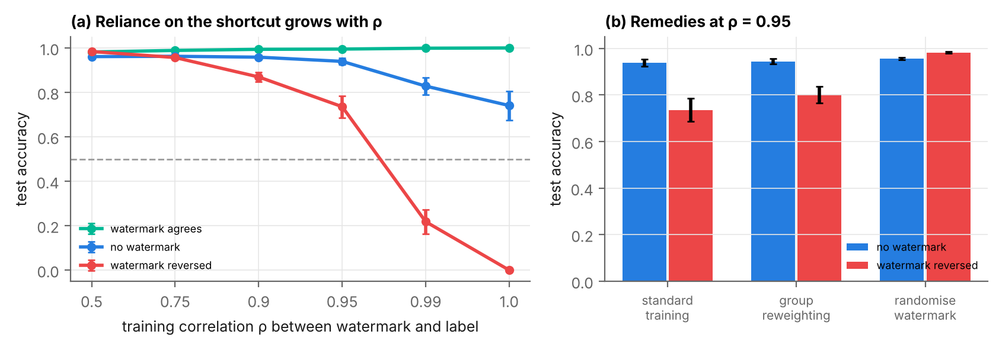

## 1. Introduction

Modern AI systems are trained on an objective of striking narrowness: predict the next token, reconstruct a masked patch, minimise a loss on labelled examples. Yet the resulting systems behave, across a wide range of probes, as though they model the structure of the world that generated their data: spatial layouts, temporal order, physical regularities, other agents' beliefs. This raises one of the central scientific questions of the field. **How does a learning machine, given only samples from a world whose complexity vastly exceeds its own size, come to represent that world well enough to act on it?**

There is no shortage of answers. Information theory says prediction *is* compression, and compression of data requires modelling its source [@shannon1948; @solomonoff1964; @deletang2024]. Statistical learning theory points to the low intrinsic dimension of natural data [@pope2021; @sharma2022]. Scaling research describes smooth power-law improvement with size [@kaplan2020; @hoffmann2022] and explains it by the heavy-tailed structure of the world [@hutter2021; @michaud2023]. Mechanistic interpretability finds that networks store more concepts than they have dimensions by superposition [@elhage2022], and that they sometimes replace memorised look-up tables with compact algorithms [@power2022; @nanda2023grok]. Work on in-context learning finds transformers performing something close to Bayesian inference over latent tasks at inference time [@xie2022; @garg2022]. Critics, meanwhile, argue that learning from form alone cannot yield meaning [@bender2020], and document characteristic failures — shortcut learning [@geirhos2020], incoherent implicit world models [@vafa2024], sensitivity to the statistics of the training task [@mccoy2024].

These accounts are usually developed and tested in isolation, by different communities, on different systems. As a result it is unclear whether they compete, complement one another, or describe different levels of the same phenomenon. This paper attempts a comparative and integrative treatment. We do three things:

1. **Map the explanatory frameworks** along eight dimensions — epistemic, information-theoretic, representational, geometric, statistical, mechanistic, inferential, and the limits — and state for each a *testable* core claim (Section 2).
2. **Build one controlled computational model per framework**, in which the "world" is fully known, so that the claim can be checked against an exact theoretical reference rather than against intuition (Sections 3–4). The seven models are: a partially observable navigation world with an exact Bayes filter (E1); data manifolds of controlled intrinsic dimension (E2); a Zipf-distributed world of facts (E3); sparse features compressed through a bottleneck (E4); modular arithmetic (E5); in-context linear regression with controlled task diversity (E6); and a classification world with a planted spurious cue (E7).
3. **Synthesise** the results into an account of what "understanding" amounts to for these systems, where each framework's explanatory reach ends, and what would falsify the synthesis (Sections 5–6).

The contribution is not a new phenomenon — several of our experiments are deliberately minimal reproductions of known effects — but a *common evidential standard* applied across frameworks: every claim is tested against an analytically known optimum or a theoretically predicted exponent, with multiple seeds, untrained or randomised controls, and an explicit statement of what result would have counted against it. Everything runs on a CPU in a few hours from a single repository.

## 2. Explanatory frameworks: a multi-dimensional map

We organise the literature into eight dimensions. For each we give the core claim, the mechanism it posits, and the prediction we test. Table 1 summarises.

**D1 — Epistemic: what would count as understanding?** The debate over whether language models "understand" [@mitchell2023] turns partly on definitions. The *form-only* critique [@bender2020; @harnad1990; @searle1980] holds that a system trained on symbols alone cannot acquire meaning, because meaning is a relation between form and something outside it. A *functionalist* reading holds that a system understands a domain to the extent that it carries internal states that track the domain's latent variables and that those states are used — causally — to produce appropriate behaviour, including under novel conditions. We adopt the functionalist criteria as *operational* tests without claiming they settle the philosophical question: (i) predictive adequacy relative to the optimum, (ii) recoverable latent structure, (iii) causal use of that structure, (iv) generalisation beyond the training distribution. Each experiment reports on whichever of these it can measure.

**D2 — Information-theoretic: prediction as compression.** By the source-coding theorem, minimising expected log-loss is minimising code length, and the minimum is achieved only by the true conditional distribution [@shannon1948]. Solomonoff induction and the MDL principle [@solomonoff1964; @rissanen1978; @hutter2005] turn this into a theory of induction: the shortest description of data is the one that captures its generating process. The prediction: a sequence model trained on next-token loss should approach the entropy rate of the source, and closing the gap to the optimum should *require* representing the source's hidden state, since that is the minimal sufficient statistic of the past for the future [@crutchfield1989; @shai2024]. Neuroscience offers a parallel account in predictive coding [@rao1999; @friston2010; @clark2013].

**D3 — Representational: emergent world models.** Models trained only on move sequences in Othello represent the board state, recoverably and causally [@li2023othello; @nanda2023linear]; LLMs carry linear representations of geographic and temporal coordinates [@gurnee2024]; transformers trained on hidden Markov processes linearly embed the Bayesian belief simplex [@shai2024]. The linear representation hypothesis [@park2024; @mikolov2013] and the convergence of representations across models [@huh2024] generalise the point. Sceptics note that probes can find structure that the model does not use [@hewitt2019; @belinkov2022], and that implicit world models can pass standard diagnostics while being incoherent [@vafa2024]. The prediction: latent state should be *linearly decodable well above an untrained control*, and *interventions on the decoded representation should change predictions as the world model implies*.

**D4 — Geometric: the manifold hypothesis.** High-dimensional observations of the world are generated by comparatively few factors, so they concentrate near low-dimensional manifolds [@pope2021; @ansuini2019; @facco2017]. Nonparametric learning in d dimensions requires sample sizes exponential in d, so the curse of dimensionality is governed by intrinsic, not ambient, dimension, and power-law learning-curve exponents should scale as 1/d [@sharma2022; @bahri2024]. Symmetry and locality priors further reduce the effective dimension [@bronstein2021; @lin2017]. The prediction: learning-curve exponents depend on d and are insensitive to ambient dimension D.

**D5 — Statistical: scaling laws and a heavy-tailed world.** Loss falls as a power law in parameters, data and compute [@kaplan2020; @hoffmann2022]. One explanation is that the world consists of many discrete regularities ("quanta") whose usefulness is Zipf-distributed [@zipf1949]; a capacity-limited learner acquires them in order of frequency, so the exponent is inherited from the world's frequency distribution [@michaud2023; @hutter2021]. The prediction: for frequency exponent α, error scales as N^−(α−1)^ in capacity and D^−(α−1)/α^ in data.

**D6 — Mechanistic: superposition and compact algorithms.** Two mechanisms let a bounded network represent an unbounded-seeming world. *Superposition*: when features are sparse, a network can store many more of them than it has dimensions, as nearly orthogonal directions, at the cost of interference [@elhage2022; @bricken2023; @templeton2024]. *Algorithmic compression*: networks can move from memorising examples to implementing a rule — in modular addition, a Fourier-basis "clock" algorithm — and do so abruptly ("grokking") under a pressure toward simplicity such as weight decay [@power2022; @nanda2023grok; @liu2022grok; @gromov2023]. Both connect to the broader evidence that deep networks are biased toward simple functions [@vallep2019; @goldblum2024], which is what makes generalisation possible despite their capacity to memorise [@zhang2017; @wolpert1996]. Predictions: superposition grows with feature sparsity and is absent in linear models; generalisation on algorithmic tasks coincides with the emergence of a structured, low-norm representation.

**D7 — Inferential: in-context Bayesian inference.** Pre-trained transformers adapt to new tasks from examples in their context, without weight updates [@garg2022; @olsson2022]. On this view, pre-training over a distribution of "worlds" amortises Bayesian inference: the network learns a prior and an inference procedure, and the context supplies the evidence [@xie2022]; mechanistic accounts implement this with gradient-descent-like updates in the forward pass [@vonoswald2023; @akyurek2023]. Raventós et al. [-@raventos2023] showed that the prior the network learns depends on the *diversity* of pre-training worlds: below a threshold it is Bayes-optimal for the finite pool it saw, and above it, it generalises to new worlds. The prediction: with high diversity the model tracks the Bayes-optimal ridge estimator on unseen worlds; with low diversity it tracks the pool-restricted Bayes estimator and fails on unseen worlds.

**D8 — Limits: shortcuts, simplicity bias and distribution shift.** The same biases that enable generalisation produce characteristic failures. A network will use whatever predictive cue is simplest to extract, including spurious ones [@geirhos2020; @shah2020], and robust behaviour requires that the data — or the training objective — break the spurious correlation [@sagawa2020; @scholkopf2021]. Compositional and systematic generalisation remain fragile [@lake2018; @dziri2023; @lake2017]. The prediction: reliance on a spurious cue grows with its training correlation, can dominate even when the true cue is perfectly predictive, and is removed by interventions that decorrelate the cue.

| Dimension | Core claim | Mechanism | Key references | Our test |
|---|---|---|---|---|
| D1 Epistemic | Understanding = latent tracking + causal use + robust generalisation | Functional criteria | Mitchell & Krakauer 2023; Bender & Koller 2020 | Criteria scored in E1 |
| D2 Information-theoretic | Optimal prediction requires modelling the source | Code length = log-loss; hidden state is the sufficient statistic | Shannon 1948; Solomonoff 1964; Delétang et al. 2024 | E1: gap to exact Bayes filter vs n-grams |
| D3 Representational | Sequence models build internal world models | Linear, causally used latent representations | Li et al. 2023; Gurnee & Tegmark 2024; Shai et al. 2024 | E1: probes, interventions, emergence |
| D4 Geometric | Data lie on low-dimensional manifolds | Error ∝ n^−c/d^ in intrinsic d | Pope et al. 2021; Sharma & Kaplan 2022 | E2: exponent vs d, TwoNN |
| D5 Statistical | Scaling laws reflect heavy-tailed world structure | Frequency-ordered acquisition of quanta | Hutter 2021; Michaud et al. 2023 | E3: exponents vs Zipf α |
| D6 Mechanistic | Superposition and compact algorithms | Sparse features in near-orthogonal directions; rule replaces table | Elhage et al. 2022; Nanda et al. 2023 | E4; E5 |
| D7 Inferential | Pre-training amortises Bayesian inference | In-context posterior inference over tasks | Xie et al. 2022; Raventós et al. 2023 | E6: vs ridge and pool-Bayes |
| D8 Limits | Simplicity bias yields shortcuts | Simplest predictive cue wins | Geirhos et al. 2020; Shah et al. 2020 | E7: planted spurious cue |

Table: **Table 1.** Eight dimensions of explanation, their core claims, and the experiment that tests each.

## 3. Methods: seven model worlds

Every experiment uses a world whose generating process we control, so that each framework's claim can be scored against an exact or theoretically derived reference. All models are trained from scratch in JAX on a 4-core CPU. Exact configurations are in the code (`wu/e*.py`); the main choices are given here. Unless noted, results are means over three seeds with ±1 s.d.

**E1 — Partially observable navigation (D1, D2, D3).** An agent occupies one of the free cells of a 6×6 grid with six obstacle cells, facing one of four headings: S = 120 hidden states. Each free cell carries one of three colours, so local views are heavily aliased. A trajectory is a token sequence `BOS o₀ a₁ o₁ … a₂₀ o₂₀`, where each action aₜ ∈ {Forward, Left, Right} is uniform-random and each observation oₜ is the colour of the cell directly ahead of the agent, or *wall*. The model is never told that a grid, position or heading exist. Because the world is a hidden Markov model with deterministic dynamics, the **Bayes-optimal predictor is computable exactly** by forward filtering over the 120 states; its log-loss is the entropy rate of the observation process, the floor that no predictor can beat. As *surface-statistics* baselines we fit back-off n-gram models (n = 1…12) on 200,000 trajectories — ten times more sequences than the transformer sees in training — and report the best. The learner is a 4-layer, 64-dimensional, 4-head pre-LayerNorm transformer trained for 5,000 steps (batch 64) on next-token loss over the whole sequence.

We evaluate four things. *Compression*: log-loss on observation tokens against the Bayes floor and the n-gram baseline. *Representation*: multinomial logistic-regression probes, trained on 70% of 3,000 held-out trajectories and tested on the rest, decode the true state (120-way), cell (30-way) and heading (4-way) from the residual stream at each layer, at the action positions from which the next observation is predicted. Because the state is sometimes genuinely ambiguous, the relevant ceiling is the accuracy of the Bayes-filter MAP state, not 100%. An identically shaped untrained network serves as the control for probe expressivity [@hewitt2019]. *Causality*: for test positions where the Bayes belief has collapsed (max > 0.99) onto a state A, we add μ~B~ − μ~A~ to the residual stream at layer ℓ, where μ~s~ is the mean training residual for state s, choosing a target state B whose view differs from A's. We then rerun the remaining layers and ask whether the model now predicts B's view. Controls are a random direction of equal norm and no patch. *Robustness*: the action policy is shifted at test time (P(Forward) = 0.7 rather than 1/3), which changes trajectory statistics but not the world. We also record the representational similarity (Spearman ρ) between the distances of cell-mean representations and grid Manhattan distances, TwoNN intrinsic dimension [@facco2017] per layer, and probe accuracy over training.

**E2 — Data manifolds of controlled dimension (D4).** Latents z ∈ [0,1]^d^ (d ∈ {2,3,4,6,8}) are mapped to observations x ∈ ℝ⁶⁴ by a fixed random two-layer tanh network. The target y = Σⱼ aⱼ cos(2π ωⱼ·z + φⱼ) has 32 random Fourier components, with ωⱼ ~ N(0, (1.5²/d) I), so that the function's variation along any direction is matched across d. A two-hidden-layer MLP (width 256) is trained on n ∈ {2⁷,…,2¹⁴} samples with early stopping on a validation set, and normalised test MSE (MSE / Var y) is recorded. We fit the learning-curve exponent and test whether it scales as c/d. As a control, d = 4 latents are embedded into D ∈ {16, 64, 256} ambient dimensions. TwoNN is applied to the synthetic data and to the 8×8 handwritten digits [@pope2021].

**E3 — A Zipfian world of facts (D5).** The world contains K = 2,048 facts: random input vectors xₖ ∈ ℝ³² with random labels yₖ ∈ {1…32}, encountered with probability pₖ ∝ k^−α^, α ∈ {1.5, 2.0, 2.5}. Labels are random, so no fact can be inferred from another; the only route to low error is storage. *Capacity scaling*: one-hidden-layer MLPs with 4–256 hidden units (N = 292 to 16,672 parameters) minimise the expected (p-weighted) loss — the infinite-data limit — for 6,000 full-batch Adam steps. *Data scaling*: a width-256 MLP is trained to convergence on the empirical distribution of D ∈ {2⁸,…,2¹⁶} draws. The metric is the p-weighted error rate. Theory (Section 2, D5) predicts slopes −(α−1) and −(α−1)/α respectively. We also compute the exact finite-K "unseen mass" curve Σₖ pₖ(1−pₖ)^D^ (1 − 1/32).

**E4 — Superposition (D6).** Following Elhage et al. [-@elhage2022], n = 20 features xᵢ ~ U[0,1], each zero with probability S, are encoded as h = Wx ∈ ℝ⁵ and decoded as x̂ = ReLU(Wᵀh + b), with importance-weighted MSE (Iᵢ = 0.85^i^). We sweep S from 0 to 0.997 and compare a linear decoder. A feature counts as represented if ‖Wᵢ‖ > 0.5. A second sweep with n = 100, m = 10 and uniform importance measures features stored per dimension.

**E5 — Modular arithmetic (D6).** The task is a + b mod 97, with 30% of the 9,409 pairs used for training. The model is a learned 128-d embedding followed by a 256-unit ReLU layer, trained full-batch with AdamW (lr 10⁻³, β₂ = 0.98) for 20,000 steps. We sweep weight decay ∈ {0, 0.1, 0.3, 1, 3} and training fraction ∈ {0.2, 0.25, 0.3, 0.4, 0.5, 0.7}. *Fourier concentration* is the share of (mean-removed) embedding power in the top 6 of 48 discrete Fourier frequencies; uniform spreading would give 0.125.

**E6 — In-context inference over worlds (D7).** Each sequence (x₁,y₁,…,x₁₆,y₁₆) is drawn from its own linear world, y = w·x + ε, with x, w ∈ ℝ⁵, w ~ N(0, I) and ε ~ N(0, 0.25²). A 4-layer, 64-d transformer predicts each yᵢ from the preceding pairs. Pre-training task diversity is either a fixed pool of M ∈ {8, 64, 512, 4096} worlds or unlimited (fresh w per sequence). References are ridge regression with λ = σ² (the Bayes posterior mean under the Gaussian prior), least squares, and dMMSE (the Bayes posterior mean under a uniform prior over the M pool worlds) [@raventos2023]. We evaluate on unseen worlds and measure the mean squared distance between the model's predictions and each estimator's.

**E7 — A world with a planted shortcut (D8).** On 8×8 digits, the task is digit ≥ 5. A 2×2 "watermark" is placed top-left for one class and top-right for the other, agreeing with the label for a fraction ρ of training images. An MLP (64-128-2) is trained on 60% of the data (5 seeds) and tested on held-out images with the watermark agreeing, absent, or reversed. At ρ = 0.95 we compare standard training with two remedies: group-balanced reweighting [@sagawa2020] and randomising the watermark, an intervention that cuts its causal link to the label.

**Evidential standard.** For each experiment we specify in advance the outcome that would count *against* the framework's prediction (Table 2), report all conditions run, and give the untrained, random-direction or linear-model control. Code, configurations, raw results (JSON) and figure scripts are released together, and the full pipeline runs in a few CPU-hours.

## 4. Results

### 4.1 E1 — Prediction forces a causally used model of the hidden world

![**E1: partially observable navigation.** (a) Log-loss per observation for a uniform predictor, the best n-gram (n = 12, trained on 10× more sequences), the transformer and the exact Bayes filter; diamonds show the same under a shifted action policy. (b) Loss along the trajectory, with the entropy of the Bayes posterior over hidden states. (c) Linear-probe accuracy for the hidden state (120-way), cell (30-way) and heading (4-way) at each layer; dotted: untrained network; dashed: accuracy of the Bayes MAP state, the ceiling for any decoder. (d) Probability that the model predicts the *target* state's view after adding μ~B~ − μ~A~ at a layer, against a random direction of equal norm and no edit. (e) First two principal components of cell-mean representations at the best layer; edges connect grid neighbours. (f) Probe accuracy against excess loss over training (checkpoints at 250–5,000 steps). Three seeds; bars ±1 s.d.](figures/fig_e1_world_model.png)

**Compression.** The transformer reaches 0.189 ± 0.003 nats per observation, against the Bayes floor of 0.170 and 0.304 for the best surface-statistics model, a 12-gram fitted to ten times more trajectories (Fig. E1a). It closes **85 ± 3%** of the gap between surface statistics and the optimum. Shorter n-grams are far worse (5-gram 0.75, 8-gram 0.53), because predicting the next view requires integrating evidence over the whole trajectory. The model's per-step loss tracks the Bayes loss as the posterior over hidden states collapses (Fig. E1b). The model is not cutting corners on a subset of positions: it performs the filtering.

**Representation.** No hidden state is decodable from the token embeddings (layer 0: 1.5%, chance 0.8%), nor much beyond chance from an untrained network at any layer (≤ 5%). After training, a linear probe recovers the exact hidden state — cell *and* heading, 120-way — at **52.8 ± 1.2%** from layer 3. Restricted to positions where the Bayes posterior has collapsed, so that the state is determined by the history, it reaches 67.8 ± 1.4%. The ceiling across all positions is the Bayes-MAP accuracy of 75.7%, because a quarter of positions are genuinely ambiguous; on identified positions the ceiling is 100%. A linear readout therefore recovers most, but not all, of the state information the model's predictions imply. Decodability peaks in the middle layers and falls slightly at the last layer (Fig. E1c), the profile expected if late layers re-map state onto the next-observation distribution.

**Causality.** Probes show that information is present, not that it is used [@hewitt2019; @belinkov2022]. Shifting the residual stream at one position from the mean representation of state A to that of state B makes the model predict B's view — which differs from A's by construction — in **89.0 ± 2.7%** of cases at layer 3 (55% at layer 2, 18% at layer 1). A random edit of the same norm does so in 3.0%, and with no edit the rate is 0.4% (Fig. E1d). The representation the probe finds is the one the model computes with, and it is organised by world state: an edit defined purely from state-conditional means transfers the model's beliefs between states.

**Robustness and emergence.** Shifting the agent's action policy at test time (P(Forward) from 1/3 to 0.7) changes trajectory statistics but not the world. Excess loss over Bayes moves only from 0.020 to 0.023 nats. Across training checkpoints, state decodability and excess loss are almost perfectly rank-correlated (Spearman ρ = −0.97; Fig. E1f). The world model is not a by-product that appears after the loss has converged. Its emergence *is* the reduction in loss.

**What kind of world model?** Three observations qualify the picture. First, the representation is *conjunctive* rather than factorised. The joint state (120-way) is decodable at 53%, but heading alone (4-way) only at 34% against 25% chance, and cell (30-way) at 45%. A designer would write position and heading as separate variables; the network represents their combination, which is what determines the next view. Second, the geometry of cell representations only weakly mirrors the grid: the rank correlation between representational and Manhattan distances is ρ = 0.20 ± 0.02 (Fig. E1e). Third, the representation is low-dimensional. The TwoNN intrinsic dimension of the residual stream at state-identified positions is 3.5–5.9 across layers in a 64-dimensional space. The network has found a compact code for the state, organised by *what each state predicts* rather than by *where the state is*. The model is predictively and causally adequate, and structurally only partly faithful, which is exactly the gap that motivates structural tests of implicit world models [@vafa2024].

### 4.2 E2 — Complexity lives in the intrinsic, not the ambient, dimension

![**E2: data manifolds.** (a) Learning curves of an MLP on 64-dimensional observations generated from d latent factors (3 seeds, ±1 s.d.). (b) The learning-curve exponent β, from a power-law-plus-floor fit per seed, against 1/d; dashed: least-squares fit c/d through the origin; dotted: the 4/d prediction of Sharma & Kaplan. Grey crosses show the naive log–log slope, which is biased toward zero at low d because those curves hit an optimisation floor of about 10⁻⁴. (c) TwoNN intrinsic-dimension estimates against the true d, and for d = 4 embedded in D = 16, 64 and 256.](figures/fig_e2_manifold.png)

**Intrinsic dimension is recoverable from samples alone.** TwoNN returns 2.04 ± 0.03, 2.89 ± 0.03, 3.94 ± 0.05, 5.61 ± 0.04 and 7.33 ± 0.10 for d = 2, 3, 4, 6, 8 (Fig. E2c). Embedding the same d = 4 manifold in 16, 64 or 256 ambient dimensions leaves the estimate unchanged (3.93, 3.88, 3.87). The mild underestimate at d = 8 is the known negative bias of nearest-neighbour estimators at higher d with a few thousand points [@facco2017]. The 64-pixel handwritten digits have a TwoNN dimension of 8.9, and 21 principal components are needed for 90% of their variance — consistent with prior reports that natural images are far lower-dimensional than their pixel count [@pope2021].

**Sample efficiency is governed by d, as theory predicts.** Errors at a fixed sample size rise steeply with d (Fig. E2a). At n = 16,384, normalised test MSE is 8×10⁻⁵ for d = 2 and 0.18 for d = 8. The samples needed to reach normalised error 0.1 grow from about 160 (d = 3) to 550 (d = 4) to 5,900 (d = 6), and d = 8 does not reach it within the budget. Fitting e(n) = a·n^−β^ + f per seed gives exponents β that fall as 1/d: a one-parameter fit β = c/d explains 96% of the variance across d, with **c = 4.9** (Fig. E2b). Sharma & Kaplan's [-@sharma2022] argument for piecewise-linear networks predicts β ≈ 4/d for squared loss. Our estimate is of the same form and magnitude, slightly steeper, as expected for a smooth (band-limited) target. The ambient-dimension control gives near-identical naive slopes for D = 16, 64 and 256 (−0.97, −1.08, −1.09).

Two caveats. The naive whole-curve log–log slope does *not* reproduce the 1/d law (R² = 0.18), because the low-d curves saturate at an optimisation floor and the d = 8 curve has not yet reached its asymptotic regime. The c/d result therefore depends on modelling the floor explicitly. And at d = 8 the fitted β·d is about 3, below the others (about 5), consistent with a pre-asymptotic curve still bending downward. We report both fits.

**Interpretation.** A complex-looking world is learnable to the extent that its variation is generated by few factors. The curse of dimensionality is real, but it is indexed by intrinsic dimension, and learning curves carry its signature in their exponent. This is a precondition for D5: power-law scaling with an exponent set by the data.

### 4.3 E3 — Scaling exponents are inherited from the world's frequency distribution

**Data scaling matches theory quantitatively.** With enough capacity to memorise everything it sees, a model's error is the probability mass of facts it has not yet seen. The fitted exponents are −0.52 for α = 2 (asymptotic theory −0.50) and −0.60 for α = 2.5 (theory −0.60), with R² ≥ 0.99 (Fig. E3b). For α = 1.5 the fit (−0.48) is steeper than the asymptotic −0.33, but it matches the exact finite-K curve (−0.50): with K = 2,048 facts, the heavy tail is truncated within our data range. Across all three α the measured error lies on the exact unseen-mass curve. The exponent of the data-scaling law is therefore a property of the world, not of the network.

**Capacity scaling is ordered by frequency but not purely capacity-limited.** Models learn facts in rank order (Fig. E3c). Each larger model extends a solid block of learned facts to rarer ranks, and its error is within 1.2–1.6× of the ideal "learn the top-n facts" error for the larger models (2–12× for the smallest). Capacity-scaling exponents are −0.94, −0.84 and −1.08 for α = 1.5, 2.0 and 2.5, against the quantization-model predictions of −0.5, −1.0 and −1.5. They do not track α as the theory predicts. The reason is visible in the number of facts learned, which grows as N^0.78^, N^0.49^ and N^0.35^ rather than linearly in N. For α = 2.5, the largest network learns only 330 facts, although the same architecture learns 2,018 when α = 1.5. Rare facts receive gradient in proportion to their frequency, so within a fixed optimisation budget the effective number of stored quanta is set by optimisation as much as by capacity (for α = 1.5 the curve also steepens as n approaches K).

**Interpretation.** The quantization picture — a world made of many discrete regularities, acquired in order of usefulness — survives as a *mechanism*: we observe frequency-ordered acquisition directly. Its simplest *quantitative* form (stored quanta ∝ parameters) does not hold in our compute-limited regime. This is a real distinction, not a technicality: in practice the variable that sets an exponent can be compute rather than parameters [@kaplan2020; @hoffmann2022], and an exponent measured in one regime should not be read as a property of the world without knowing which resource bound it.

### 4.4 E4 — Superposition lets a small network hold a large, sparse world

With dense features, the ReLU model behaves exactly like a linear one: it represents the 5 most important features orthogonally and drops the other 15 (Fig. E4a,b). As features become sparse, the number represented rises past the number of dimensions: 10 at S = 0.75, 15 at S = 0.97, and 18.7 ± 1.2 of 20 at S = 0.997. They are packed as non-orthogonal directions (Fig. E4c), with mean interference Σⱼ≠ᵢ(Ŵᵢ·Wⱼ)² rising from 0 to 3.5, and dimensions per feature falling from 1.0 to 0.21. The linear model never represents more than 5 features at any sparsity. At S = 0.997 the ReLU model's loss is 5× lower (5×10⁻⁴ against 2.7×10⁻³). In the larger setting (n = 100, m = 10), features stored per dimension climb from below 1 (dense) through 4.3 (S = 0.9) to 9.8–10 (S ≥ 0.98), where effectively every feature is stored (Fig. E4d). The low dense-regime value reflects equal importances, which let the model spread small weights below our representation threshold.

**Interpretation.** Real-world concepts are sparse: any scene or sentence involves a tiny fraction of the concepts a system knows. E4 reproduces the result of Elhage et al. [-@elhage2022] that this sparsity lets a bounded network represent many more concepts than it has dimensions, at the price of interference. Interference is negligible when features rarely co-occur, and it is filtered by the nonlinearity. The capacity puzzle — how a network with d dimensions can know millions of things — has a concrete answer, and it predicts that the units of knowledge are directions rather than neurons [@bricken2023; @templeton2024].

### 4.5 E5 — From table to rule: generalisation coincides with structure

![**E5: grokking modular addition (p = 97).** (a) Training and test accuracy and the Fourier concentration of the embedding (share of power in the top 6 of 48 frequencies; dotted line: the uniform value 0.125) for one seed with 30% of the table and weight decay 1.0. (b) Parameter norm for three seeds; dotted verticals mark 99% test accuracy. (c) Final embedding power spectrum. (d) Final Fourier concentration against final test accuracy for all 21 runs (main condition, weight-decay sweep, training-fraction sweep). (e) Steps to 99% test accuracy against training fraction; triangles mark runs that never generalised within 20,000 steps.](figures/fig_e5_grokking.png)

**Memorisation first, generalisation much later.** With 30% of the table and weight decay 1.0, all three seeds fit the training set by step 300 while test accuracy stays at chance. They reach 99% test accuracy only at steps 14,400–17,400 — a delay of about 50× (Fig. E5a). The transition is abrupt: test accuracy passes from 50% to 99% in 2,900–4,200 steps, after 11,000–13,000 steps near zero.

**Generalisation coincides with the emergence of a structured, compressed representation.** At the point of memorisation the embedding's power is spread almost uniformly across frequencies: Fourier concentration is 0.15 against a uniform 0.125. It stays there through the plateau, then rises with the test accuracy, to 0.32–0.37 when test accuracy crosses 50% and 0.49–0.68 at the end. By then the top 10 of 48 frequencies carry 72–91% of the power (Fig. E5c). This is the representation Nanda et al. [-@nanda2023grok] identified: numbers embedded as points on a few circles, so that addition becomes rotation. Across all 21 runs, final Fourier concentration predicts generalisation almost perfectly (Spearman ρ = 0.95; Fig. E5d). Every run that generalised has concentration ≥ 0.37; every run that did not has ≤ 0.28. No run found the rule without the structure, or the structure without the rule.

**The simplicity pressure is necessary.** Without weight decay, or with too little (0.1, 0.3), the network memorises the training set and never generalises within 20,000 steps (test accuracy ≤ 1%). With weight decay 1.0 or 3.0, all five runs generalise (≥ 97.6%). Parameter norm tells the same story (Fig. E5b): it grows during memorisation to a peak of about 96 at step 1,400, then declines steadily through the plateau to about 64 at generalisation, *below* its value at the moment of memorisation (70). The table is the more expensive description, and weight decay makes the network pay for it until a cheaper one — the rule — is found [@liu2022grok].

**Less data, longer delay.** The training fraction sets the delay (Fig. E5e). With 70% of the table, generalisation follows memorisation after about 950 steps; with 50%, 2,200–3,100; with 40%, 5,300–6,100; with 30%, 14,400–17,400. With 20–25% no run generalises within the budget. Fewer examples constrain the rule less relative to the table, so the gradient toward it is weaker.

**Interpretation.** "Understanding" modular addition — getting every unseen pair right — is identical here to having found a compressed, structured representation. A network can reach zero training error either way. Which solution it ends up with is decided by a pressure toward simplicity, and how long it takes by how strongly the data constrain the rule. This is the MDL principle of Section 2 acting on representations, observed directly.

### 4.6 E6 — In-context learning: amortised inference, and when it generalises

![**E6: in-context inference over linear worlds.** (a) Error on the next y against the number of in-context examples for a transformer pre-trained on unlimited worlds, compared with the Bayes-optimal ridge estimator and least squares (which diverges at k = d = 5, the interpolation threshold). (b) Error on *unseen* worlds for models pre-trained on M worlds. (c) Mean squared distance between the model's predictions and those of ridge (the general rule) and of dMMSE (Bayes over the memorised pool), against M.](figures/fig_e6_incontext.png)

A transformer pre-trained across many linear worlds infers the current world from its context, with no weight updates. On unseen worlds its error falls from 4.0 with one example to 0.41 with eight and 0.21 with fifteen (Fig. E6a). It follows the shape of the Bayes-optimal ridge curve but stays about 2× above it at large k (ridge: 0.19 and 0.097). It never shows the divergence that unregularised least squares shows at the interpolation threshold k = d. The model has learned a *regularised* estimator, as the Bayesian account predicts. It is not exactly optimal at this model size and training budget.

**Task diversity decides what is learned.** With M = 8 pre-training worlds, the model is excellent on those worlds (MSE 0.094 at k = 15; the pool-Bayes estimator dMMSE reaches 0.063) but useless on new ones (3.95, against 0.097 for ridge). Its predictions are 3× closer to dMMSE's than to ridge's (distance 1.30 against 3.71; Fig. E6c). A second seed, with a different pool of 8 worlds, reproduces this: 0.099 on its own worlds, 3.34 on new ones, distance 1.56 to dMMSE against 3.19 to ridge. It has memorised a prior over eight worlds and does inference within it. From M = 64 upward, behaviour changes qualitatively. Error on new worlds drops to 0.17–0.22, predictions lie 5–15× closer to ridge than to dMMSE, and — tellingly — the M = 64 model is only slightly better on its own training worlds (0.167) than on new ones (0.207), whereas dMMSE would reach 0.063 there. It has largely stopped exploiting the memorised pool. The transition lies between 8 and 64 worlds in our setting. It is lower than Raventós et al.'s [-@raventos2023] threshold, consistent with the smaller task dimension (d = 5) and model used here, and it reproduces their central finding: beyond a diversity threshold, the pre-trained model departs from the Bayes estimator for its *training* prior and approaches the one for the *general* prior. Above the threshold, extra diversity (512, 4096, ∞) brings no systematic further gain within our training budget (the M = ∞ run is slightly worse than M = 4096), so we do not interpret differences among them. Each run takes about 12 CPU-minutes, so E6 uses two seeds (different task pools and initialisations) for M ∈ {8, 64, 4096} and one for M ∈ {512, ∞}. The second seeds reproduce every qualitative contrast (new-world error 3.34 / 0.26 / 0.17 for M = 8 / 64 / 4096), but the exact threshold between 8 and 64 is not resolved.

**Interpretation.** Pre-training across a family of worlds amortises Bayesian inference: the network learns a prior and an update rule, and the context supplies the evidence [@xie2022]. Whether the learned prior is *the world's* or merely *the training set's* depends on whether the training set was diverse enough to make memorisation the costlier description — the same simplicity trade-off as in E5, at the level of whole tasks.

### 4.7 E7 — The limits: the network learns the simplest predictive cue, not the intended one

When the watermark is uninformative (ρ = 0.5), the network ignores it: accuracy is 98% whether the watermark agrees with the label or is reversed. As ρ rises, accuracy on reversed-watermark images falls monotonically: 96% (ρ = 0.75), 87% (0.9), 74% (0.95), 22% (0.99) and **0%** (ρ = 1). Accuracy on unmarked images falls too, from 96% to 74% (Fig. E7a). The striking case is ρ = 1, where *both* cues predict the label perfectly. The network trains to 100% accuracy and relies on the watermark almost exclusively, although the digit shape it was meant to learn would have generalised. On watermark-only images (a blank digit with the patch) it scores 100% for every ρ ≥ 0.9. This is simplicity bias [@shah2020]: a single corner patch is linearly separable with a large margin, and the network's inductive bias favours it.

Of the remedies (Fig. E7b), group-balanced reweighting raises reversed-watermark accuracy only from 74% to 80% at ρ = 0.95. With 5% minority examples, the model can still fit the majority shortcut and memorise the exceptions. *Randomising the watermark* — an intervention that severs its causal relation to the label — restores reversed-watermark accuracy to 98% and unmarked accuracy to 96%, matching a model never shown a watermark (98%).

**Interpretation.** E7 is the counterweight to E1–E6. Every mechanism that lets a network compress a world — preferring simple, low-norm, high-margin explanations — will also seize on any simple regularity that happens to predict the target, whether or not it reflects the world's causal structure. Prediction rewards correlation, not cause. The only reliable fix in our experiment is to change the data so that the shortcut stops working: an intervention, not more data from the same distribution [@scholkopf2021; @geirhos2020].

## 5. Synthesis: what the frameworks explain together

Table 2 gives each framework's prediction, the result that would have counted against it, and the verdict.

| Framework (dimension) | Prediction tested | Would have counted against | Result | Verdict |
|---|---|---|---|---|
| Prediction = compression (D2) | Next-token training approaches the Bayes floor and beats surface statistics | Loss stuck near n-gram level | 85% of the n-gram→Bayes gap closed; within 0.020 nats of the floor | Supported |
| Emergent world model (D3) | Hidden state linearly decodable well above an untrained control; decodability grows with skill | Probe at control level, or decoupled from loss | State probe 53% vs ≤ 5% untrained; ρ(excess loss, probe) = −0.97 | Supported, with a caveat on geometry |
| Causal use (D1, D3) | Editing the state representation changes predictions as the world model implies | Patch effect no larger than a random edit | 89% vs 3% (random) at layer 3 | Supported |
| Robustness (D1) | Same world, new behaviour policy → no degradation | Excess loss rises sharply under policy shift | Excess loss 0.020 → 0.023 | Supported |
| Manifold hypothesis (D4) | Exponent ∝ 1/d, independent of D | Exponent tracks D, or unrelated to d | β = c/d with c ≈ 4.9, R² = 0.96; D-invariant | Supported (after modelling the floor) |
| Heavy-tailed world (D5) | Data exponent −(α−1)/α | Exponent independent of α | −0.52 / −0.60 vs −0.50 / −0.60 | Supported |
| Quantization model (D5) | Capacity exponent −(α−1) | Exponent independent of α | Frequency-ordered learning holds; exponent does not track α (optimisation-limited) | Partially supported |
| Superposition (D6) | Features stored > dimensions iff sparse and nonlinear | Linear and ReLU behave alike | 18.7 of 20 features in 5 dims at S = 0.997; linear model stays at 5 | Supported |
| Algorithmic compression (D6) | Generalisation coincides with structured, low-norm representation; needs simplicity pressure | Generalisation without structure, or without weight decay | Test accuracy 0 → 100% ~15k steps after memorisation; Fourier concentration 0.15 → 0.49–0.68; ρ(structure, generalisation) = 0.95 over 21 runs; no generalisation with wd ≤ 0.3 | Supported |
| In-context Bayes (D7) | Diverse pre-training → near-ridge; narrow → pool-Bayes, fails on new worlds | Same behaviour at all M | M = 8: pool-Bayes behaviour, fails on new worlds (MSE 3.9); M ≥ 64: ridge-like (0.17–0.22, ridge 0.10) | Supported (qualitatively; 1–2 seeds; model ~2× Bayes error) |
| Shortcuts (D8) | Reliance on spurious cue grows with ρ; removed only by decorrelating interventions | No reliance, or reweighting suffices | Reversed-cue accuracy 98% → 0%; randomisation restores 98%, reweighting 80% | Supported |

Table: **Table 2.** Pre-specified predictions, falsifiers, and outcomes.

Read together, the experiments suggest that "how does AI understand a complex world" decomposes into four questions with different answers. They are not rival theories; they operate at different levels of description.

**(i) Why is the world learnable at all? — Because it is far simpler than it looks.** E2 shows that the difficulty of learning is indexed by intrinsic dimension, not observation size, and that intrinsic dimension can be read off the data. E3 shows that the world's regularities are not equally important: their heavy-tailed frequency distribution determines how error falls with data. E4 shows that the sparsity of concepts lets a bounded network hold far more of them than it has dimensions. Together these replace the impossible-sounding question — how does a finite network capture an unbounded world? — with a tractable one: how does it capture a world with low intrinsic dimension, heavy-tailed regularities and sparse concepts? The answer to (i) is a fact about the *world*, which is why the same systems would fail on a world without these properties [@wolpert1996; @goldblum2024].

**(ii) Why does training on prediction produce a model of the world? — Because the hidden state is the compression of the past.** In E1 the cheapest way to predict the next observation is to infer the hidden state, since the state is a sufficient statistic of the past for the future. A predictor that closes most of the gap to the Bayes floor must, in some form, carry that state. The transformer does: decodability rises in lockstep with predictive skill (ρ = −0.97 across checkpoints), and editing the state representation steers predictions. This is the information-theoretic argument (D2) and the representational finding (D3) seen as one phenomenon: a world model is what good compression looks like from the inside [@shai2024; @deletang2024].

**(iii) What form does the learned structure take? — Distributed directions, compact algorithms and amortised inference.** E4 (superposition), E5 (Fourier algorithm) and E6 (in-context inference) show three distinct representational strategies, each predicted by mechanistic theory. Knowledge lives in directions, not units. Rules can replace tables when a simplicity pressure makes the rule cheaper than the table. And a network pre-trained across many worlds learns an inference procedure rather than a fact, provided the worlds are diverse enough to make memorisation the more expensive option. In all three, which representation is learned is set by a trade-off between fitting the data and the description length of the solution. That trade-off is the MDL principle again, now acting on representations rather than predictions.

**(iv) Where does the understanding stop? — Where the data stop constraining the cause.** E7 shows the same simplicity bias producing a shortcut whenever a spurious cue is simpler than the true one. E1 shows a subtler limit. The model's state representation supports correct predictions and causal edits, but its geometry only weakly mirrors the grid (RSA ρ ≈ 0.20), and heading is barely linearly decodable on its own (≈ 34% against 0.25 chance), although the joint state is decodable at 53%. The model has learned *what the world will show it next* from each state, which is all its objective rewards, not a factorised map of position × orientation that a human designer would write down. This is the gap Vafa et al. [-@vafa2024] warn about: a predictively adequate world model need not be the *structurally* correct one, and the difference shows up only under tasks that demand the structure.

### 5.1 An integrative account

We summarise the account as four propositions, each of which our experiments bear on and each of which could be falsified.

1. **Learnability is a property of the world.** Natural data have low intrinsic dimension, heavy-tailed regularities and sparse concepts. These set the exponents with which learning curves fall (E2, E3) and the capacity needed to store concepts (E4).
2. **Understanding is compression under a simplicity bias.** Training on prediction drives a learner toward the minimal sufficient statistic of the past for the future — for a partially observable world, its hidden state (E1). A pressure toward simple solutions (weight decay, the implicit bias of gradient descent, task diversity) decides whether the learner stores a rule or a table (E5, E6).
3. **The learned world model is causally used but defined by its objective.** Internal states are decodable and steer behaviour (E1), but their structure is whatever best serves prediction on the training distribution. It is not guaranteed to be the world's own causal factorisation (E1 geometry, E7).
4. **Robustness requires interventions, not just more of the same data.** Generalisation holds under shifts that leave the world's mechanism intact (E1 policy shift) and fails under shifts that break a correlation the learner relied on (E7). The fix is data or objectives that vary the spurious factor, as causal representation learning argues [@scholkopf2021].

On this account the debate over whether such systems "really" understand [@mitchell2023; @bender2020] is partly a debate about which of proposition 3's two halves to emphasise. Our systems meet the functional criteria (predictive adequacy, decodable latents, causal use, robustness to benign shift) in their own worlds. They also show exactly the objective-relative, correlation-driven character the critics describe. Both descriptions are accurate. The productive question is not whether the model understands, but **which interventions on the world its internal model correctly anticipates** [@pearl2009; @geiger2021], and that is an empirical question each of our experiments answers in a specific case.

## 6. Discussion

**Relation to prior work.** Each experiment reproduces, in a minimal setting, a phenomenon previously reported in isolation: belief-state representations [@shai2024] and causal world models [@li2023othello; @nanda2023linear]; 1/d scaling [@sharma2022]; Zipfian data scaling [@hutter2021]; superposition [@elhage2022]; grokking with Fourier structure [@nanda2023grok]; the task-diversity transition [@raventos2023]; shortcut learning [@geirhos2020; @shah2020]. Our contribution is to put them under a single evidential standard — exact or theoretical references, untrained and randomised controls, pre-stated falsifiers — and to show how they compose into one account. Two results go beyond confirmation. First, the capacity-scaling test (E3) separates the quantization model's mechanism, which holds, from its quantitative prediction, which does not hold in a compute-limited regime. Second, the world-model test (E1) separates predictive and causal adequacy, which hold, from structural fidelity, which is weak.

**Threats to validity.** *Scale*: our models have 10⁴–10⁵ parameters and our worlds are small. The mechanisms we study are argued, and partly shown, to persist at scale [@templeton2024; @gurnee2024], but magnitudes will differ and new phenomena may appear. *Probe validity*: a linear probe can under-report information the model holds nonlinearly and can over-report information the model does not use [@belinkov2022]. We address the second with untrained controls and interventions; the first means our probe accuracies are lower bounds. *Estimator choices*: E2's 1/d law depends on modelling the optimisation floor (we report both fits), and TwoNN is biased low at higher d. *Optimisation budget*: E3's capacity exponents, and possibly E6's distance from ridge at intermediate M, reflect fixed training budgets. We flag where a conclusion is budget-sensitive rather than present budget-limited exponents as properties of the world. *Synthetic worlds*: we chose worlds where the ground truth is known, at the cost of realism. E7 uses real digit images but a planted cue. Natural shortcuts are subtler.

**What would change our conclusions.** The synthesis would be undermined if: (a) in larger models trained on natural data, latent variables recoverable by probes did *not* respond to interventions, which would suggest representations are epiphenomenal; (b) learning-curve exponents across natural datasets were unrelated to their measured intrinsic dimension; (c) predictive gains continued after decodability of task-relevant latents saturated, which would suggest prediction can be achieved without state-like representations; or (d) shortcut reliance did not decrease when spurious correlations were removed from training data. Each is testable with existing models and datasets.

**Implications.** For *science of AI*, the results argue for evaluating world models by intervention rather than by probe or benchmark alone, and for reporting scaling exponents together with the resource that bounds them. For *practice*, the most actionable lever on robust understanding is the training distribution: its diversity (E6), the decorrelation of nuisance factors (E7), and the coverage of the regimes in which the model will act. Capacity and compute matter less. For the *philosophical debate*, the operational criteria in Section 2 can be met by systems trained on form alone, in worlds where form carries enough information about state. Whether that amounts to understanding in the full human sense, with grounding, intention and conceptual flexibility [@lake2017; @harnad1990], is not settled by these experiments, and we do not claim it is.

## 7. Conclusion

We asked how a learning machine, trained only to predict, comes to model a world more complex than itself. Across seven controlled model worlds and eight explanatory dimensions, the answer is a layered one. The world is far simpler than it looks: low-dimensional, heavy-tailed and sparse, and that simplicity is what makes it learnable, with exponents we can predict. Prediction, pursued to near-optimality, forces the learner to compress the past into the world's hidden state, which it represents in decodable and causally used form. Pressures toward simplicity decide whether that compression takes the form of rules or tables, and of inference procedures or memories. The same pressures yield shortcuts whenever the data allow them, and a world model shaped by what it was asked to predict, not by how the world is built. Understanding, in this account, is not an all-or-nothing property but a measurable relation between a learner's internal model and the interventions on the world it correctly anticipates. Measuring that relation, at scale and in natural worlds, is the research programme these results point to.

## Appendix A. Reproducibility

All code is in `world-understanding/wu/`. Each experiment is a module that writes a JSON result file to `results/`: `python -m wu.e1_world_model [seed]`, `python -m wu.e2_manifold`, …, `python -m wu.e7_shortcuts`. Every module also accepts `--quick` for a smoke test. `python -m wu.plots` regenerates all figures, `python -m wu.summary` prints every number quoted in Sections 4–5, and `python paper/build.py` rebuilds this document. Tests (`pytest tests`) check the exact Bayes filter, the n-gram baseline, TwoNN, the power-law fit, and the ridge and dMMSE reference estimators.

**Compute.** All experiments ran on a 4-core x86 CPU with JAX 0.12. Approximate wall-clock: E1 ≈ 17 min per seed; E2 ≈ 21 min; E3 ≈ 24 min; E4 ≈ 9 min; E5 ≈ 150 min; E6 ≈ 12 min per condition; E7 ≈ 3 min.

**Key hyperparameters.** E1: transformer 4 layers, d = 64, 4 heads, MLP 256, AdamW (lr 10⁻³, wd 0.01, warm-up then cosine decay), batch 64, 5,000 steps, sequences of 20 action–observation pairs (length 42). Probes: multinomial logistic regression, 400 full-batch Adam steps, L2 10⁻⁴, standardised inputs, 20,000 training positions. E2: MLP 64-256-256-1, Adam 10⁻³, batch 256, 4,000 steps, early stopping on 1,000 validation points every 100 steps. E3: MLP 32-w-32, Adam 3×10⁻³ with cosine decay, full batch over 2,048 keys; 6,000 steps (capacity) or 3,000 (data). E4: Adam 10⁻³, batch 1,024, 8,000 steps. E5: AdamW (lr 10⁻³, β = (0.9, 0.98)), full batch, 20,000 steps. E6: transformer 4 layers, d = 64, read-in from ℝ⁶, Adam 10⁻³, batch 64, 5,000 steps. E7: MLP 64-128-2, AdamW (10⁻³, wd 10⁻⁴), full batch, 3,000 steps.

**Deviations and decisions made after seeing data.** We record these for transparency. (1) E1's probes were changed from ridge-to-one-hot to logistic regression after a pilot showed that the ridge readout under-reported decodability of a 120-way variable from 64 dimensions; all reported numbers use logistic probes. (2) E2's target frequencies were rescaled by 1/√d after a pilot, so that function wiggliness along any direction is matched across d. (3) E2's exponent estimator (power law plus floor) was adopted after seeing that the naive slope was dominated by an optimisation floor; both are reported. (4) E1 was shrunk from d = 128, 30-step trajectories to d = 64, 20 steps for compute reasons before any full run. No experiment or seed was dropped.

## Appendix B. Layer-wise E1 statistics

| Layer | State (120) | State, identified | Cell (30) | Heading (4) | Untrained state | Intrinsic dim. | Edit success | Random edit |
|---|---|---|---|---|---|---|---|---|
| Embedding | 1.5% | 1.6% | 4.3% | 25.1% | 1.6% | — | — | — |
| L1 | 21.1% | 25.2% | 25.5% | 30.3% | 5.1% | 3.5 | 17.9% | 2.6% |
| L2 | 47.1% | 59.9% | 43.1% | 33.2% | 4.9% | 4.6 | 55.0% | 3.7% |
| L3 | 52.8% | 67.8% | 45.4% | 34.1% | 4.8% | 5.1 | 89.0% | 3.0% |
| L4 | 49.1% | 63.0% | 40.9% | 34.0% | 5.0% | 5.9 | — | — |

Table: **Table B1.** E1 probe accuracy, intrinsic dimension of the residual stream (TwoNN, identified positions; ambient 64) and intervention success by layer; means of 3 seeds. Chance: state 0.8%, cell 3.3%, heading 25%. Bayes-MAP ceiling (all positions) 75.7%.

## References

::: {#refs}
:::
