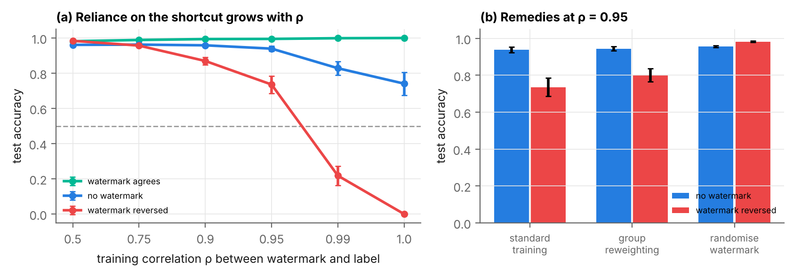

### 4.7 E7 — The limits: the network learns the simplest predictive cue, not the intended one

When the watermark is uninformative (ρ = 0.5), the network ignores it: accuracy is 98% whether the watermark agrees with the label or is reversed. As ρ rises, accuracy on reversed-watermark images falls monotonically: 96% (ρ = 0.75), 87% (0.9), 74% (0.95), 22% (0.99) and **0%** (ρ = 1). Accuracy on unmarked images falls too, from 96% to 74% (Fig. E7a). The striking case is ρ = 1, where *both* cues predict the label perfectly. The network trains to 100% accuracy and relies on the watermark almost exclusively, although the digit shape it was meant to learn would have generalised. On watermark-only images (a blank digit with the patch) it scores 100% for every ρ ≥ 0.9. This is simplicity bias [@shah2020]: a single corner patch is linearly separable with a large margin, and the network's inductive bias favours it.

Of the remedies (Fig. E7b), group-balanced reweighting raises reversed-watermark accuracy only from 74% to 80% at ρ = 0.95. With 5% minority examples, the model can still fit the majority shortcut and memorise the exceptions. *Randomising the watermark* — an intervention that severs its causal relation to the label — restores reversed-watermark accuracy to 98% and unmarked accuracy to 96%, matching a model never shown a watermark (98%).

**Interpretation.** E7 is the counterweight to E1–E6. Every mechanism that lets a network compress a world — preferring simple, low-norm, high-margin explanations — will also seize on any simple regularity that happens to predict the target, whether or not it reflects the world's causal structure. Prediction rewards correlation, not cause. The only reliable fix in our experiment is to change the data so that the shortcut stops working: an intervention, not more data from the same distribution [@scholkopf2021; @geirhos2020].
